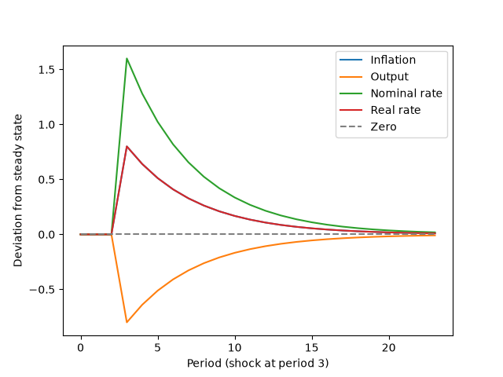
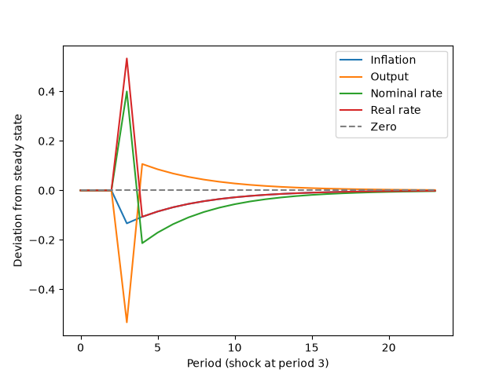
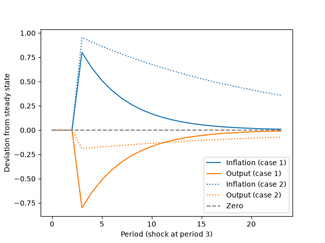
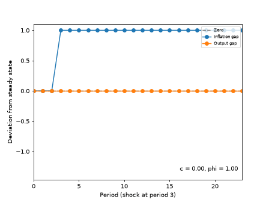

# 第 15 章: IS-MP-PC モデル

## 15.1 この章の地図

第 13・14 章の AD-AS モデルは、IS-LM から導いた総需要曲線を使いました。現実の中央銀行は、マネーストックではなく、**名目利子率**を操作して、インフレ率をコントロールします。この章では、その行動をテイラー・ルールで表した **IS-MP-PC モデル**を、数値で動かします。2 本の均衡式を、**行列**で解き、**固有値**で安定性を調べ、3 種類のショック（需要・金融政策・供給）への反応と、中央銀行の**政策スタンス**による違いを確かめます。

| 項目 | 内容 |
| :--- | :--- |
| 経済学の題材 | フィッシャー方程式、IS 曲線、MP 曲線（テイラー・ルール）、フィリップス曲線、適応的期待、安定性、テイラー原則、金融政策のスタンス |
| 使う Python の機能 | `dataclass`、`numpy` の行列（`@`、`np.linalg.solve`、`np.linalg.eigvals`）、`DataFrame` の組み立て |
| 新しく導入するライブラリ | なし |
| 完成形 | `IsMpPcParameters`、`ismppc_matrices`、`eigenvalues`、`is_stable`、`policy_rate`、`step`、`impulse_response`、`simulate_without_shocks` |
| ファイル | 実装: `lib/chapter15/ismppc.py`、`lib/chapter15/plot.py`／テスト: `test/chapter15/test_ismppc.py`、`test/chapter15/test_plot.py`（自分で書くときは、`practice/chapter15/` に、同じ名前で作ります） |
| データ | なし（パラメーターを決めて、モデルを動かす） |

### 経済学の式とコードの対応

| 経済学 | 式 | コード |
| :--- | :--- | :--- |
| フィッシャー方程式・適応的期待 | r(t) = i(t) − E π(t+1)、E π(t+1) = π(t) | （`policy_rate` と `step` の中） |
| IS 曲線 | y(t) = y\* − a·(r(t) − r\*) + u(t) | （`step` の中） |
| MP 曲線 | i(t) = r\* + π(t) + c·(π(t) − π\*) + d·(y(t) − y\*) + v(t) | `policy_rate(params, y, pi, v)` |
| PC 曲線 | π(t) = π(t−1) + b·(y(t) − y\*) + e(t) | （`step` の中） |
| 行列の形 | A·X(t) = B·X(t−1) + C(t)、X = (y, π) | `ismppc_matrices(params)` |
| 安定性 | A⁻¹B の固有値の絶対値 < 1 | `eigenvalues`、`is_stable` |
| インフレ率の係数 | φ = (1 + a·d) ÷ (1 + a·b·c + a·d) | `IsMpPcParameters.phi` |

> **記号について**: y は産出量（自然産出量 y\* = 100 からの乖離が、そのまま %）、π はインフレ率（目標 π\* = 2）、i は名目利子率、r は実質利子率（自然利子率 r\* = 2）です。u・v・e は、IS・MP・PC 曲線へのショックです。a・b は IS 曲線・フィリップス曲線の傾き、c・d は MP 曲線の、インフレ率・産出量への反応の大きさです。a・b・c・d は、第 13 章（AS・AD 曲線の a・c）などとは別物です。一覧は、[記号について](how-to-read.md#symbols) を参照してください。

## 15.2 予想する

デフォルトのパラメーター（a = 1、b = 0.25、c = 1.5、d = 0.5）で、経済が定常状態（y = 100、π = 2、r = 2）にあります。ある 1 期間だけ、フィリップス曲線に、プラスのショック（e = 1。たとえば、原油価格の上昇）が起きます。

- ショックの期に、インフレ率と産出量は、いくつになりますか（インフレ率は上がり、産出量は下がる、という方向を考えます）
- 次の期のインフレ率の乖離（π − 2）は、ショックの期の何倍になりますか
- 中央銀行が、産出量を重視する（c = 0.5、d = 1.5）と、インフレ率の動きは、どう変わりますか

## 15.3 モデルの考え方

### 5 本の式

| 式 | 意味 |
| :--- | :--- |
| フィッシャー方程式 r(t) = i(t) − E π(t+1) | 実質利子率 = 名目利子率 − 期待インフレ率 |
| 適応的期待 E π(t+1) = π(t) | 来期のインフレ率は、今期と同じと予想する（後ろ向き） |
| IS 曲線 y(t) = y\* − a·(r(t) − r\*) + u(t) | 実質利子率が自然利子率より高いと、産出量が減る |
| MP 曲線 i(t) = r\* + π(t) + c·(π(t) − π\*) + d·(y(t) − y\*) + v(t) | 中央銀行は、インフレ率と産出量の乖離に応じて名目利子率を決める |
| PC 曲線 π(t) = π(t−1) + b·(y(t) − y\*) + e(t) | 産出量が自然水準を上回ると、インフレ率が上がる |

### 2 本の均衡式（ISMP と PC）

フィッシャー方程式と適応的期待から r(t) = i(t) − π(t)。これを IS 曲線に入れ、MP 曲線の i(t) を代入します。

> y − y\* = −a·[c·(π − π\*) + d·(y − y\*) + v] + u
>
> **(1 + a·d)·(y − y\*) = −a·c·(π − π\*) − a·v + u**　（動的総需要 ISMP）

PC 曲線は、動的総供給です。**未知の変数は y(t) と π(t) の 2 つ**で、前期の π(t−1) と、ショック u・v・e が、与えられたものです。

### 行列で書く

γ = 1 + a·d とおいて、2 本を並べると、

> γ·y + a·c·π = γ·y\* + a·c·π\* + u − a·v
>
> −b·y + π = π(t−1) − b·y\* + e

```text
A·X(t) = B·X(t−1) + C(t)
  X = (y, π)ᵀ、A = [[γ, a·c], [−b, 1]]、B = [[0, 0], [0, 1]]
```

X(t) = A⁻¹B·X(t−1) + A⁻¹C(t) と解けます。**ショックがなければ、X(t) は、A⁻¹B で、前期から決まります**。

### 安定性とテイラー原則

A⁻¹B の固有値は、**0 と φ = (1 + a·d) ÷ (1 + a·b·c + a·d)** です（手計算で確かめます）。固有値の絶対値が 1 より小さければ、ショックがなければ、定常状態に戻ります（安定）。

- **c > 0 なら φ < 1** で、安定です。**c = 0 なら φ = 1** で、インフレ率は、収束も発散もせず、ショックで動いた値のまま持続します（単純なケース）
- MP 曲線を π で微分すると ∂i/∂π = 1 + c。**インフレ率が 1 上がったとき、名目利子率を、1 より大きく上げる**（c > 0）。これが**テイラー原則**です。名目利子率の上げ方が足りないと、実質利子率が下がり、需要がさらに増えて、インフレが加速します

> **元の記事との違い**: インフレ率の差分方程式を π(t+1) = φ0·π\* + φ1·π(t) + η とし、φ0 = a·b·c ÷ (1 + a·d) と書いています。この φ0 は、定常状態が π\* にならず、書き写しの誤りの可能性があります。この章は、導き直した π(t) − π\* = φ·(π(t−1) − π\*)（φ0 に当たる係数は、(1 − φ)·π\*）を使い、テストで確かめます。

## 15.4 プログラミング

### パラメーターと、安定性

```python
DEFAULT = IsMpPcParameters()


@pytest.mark.parametrize(
    ("a", "b", "c", "d"),
    [(0, 0.25, 1.5, 0.5), (1, 0, 1.5, 0.5), (1, 0.25, -0.1, 0.5), (1, 0.25, 1.5, -0.1)],
)
def test_パラメーターの符号が合わなければ受け付けない(
    a: float, b: float, c: float, d: float
) -> None:
    with pytest.raises(ValueError, match="パラメーター"):
        IsMpPcParameters(a=a, b=b, c=c, d=d)


def test_cとdが0でもパラメーターとして受け付ける() -> None:
    assert IsMpPcParameters(c=0, d=0).c == 0
    assert IsMpPcParameters(c=1.5, d=0).d == 0
```

```python
@dataclass(frozen=True)
class IsMpPcParameters:
    """IS 曲線の a、フィリップス曲線の b、MP 曲線の c・d と、定常状態の値。"""

    a: float = 1.0
    b: float = 0.25
    c: float = 1.5
    d: float = 0.5
    y_star: float = 100.0
    pi_star: float = 2.0
    r_star: float = 2.0

    def __post_init__(self) -> None:
        if self.a <= 0 or self.b <= 0 or self.c < 0 or self.d < 0:
            raise ValueError(
                "パラメーターは、a・b が正、c・d が 0 以上でなければならない"
            )

    @property
    def gamma(self) -> float:
        """γ = 1 + a·d。"""
        return 1 + self.a * self.d

    @property
    def phi(self) -> float:
        """インフレ率の差分方程式の係数 φ = (1 + a·d) ÷ (1 + a·b·c + a·d)。"""
        return self.gamma / (1 + self.a * self.b * self.c + self.a * self.d)
```

行列と固有値を、手計算の値と照合します（γ = 1.5、φ = 1.5 ÷ 1.875 = 0.8）。

```python
def test_行列は手計算の値と一致する() -> None:
    a_matrix, b_matrix = ismppc_matrices(DEFAULT)
    assert a_matrix == pytest.approx(np.array([[1.5, 1.5], [-0.25, 1.0]]))
    assert b_matrix == pytest.approx(np.array([[0.0, 0.0], [0.0, 1.0]]))


def test_固有値は0とφ() -> None:
    assert eigenvalues(DEFAULT) == pytest.approx([0.0, 0.8])
    assert DEFAULT.phi == pytest.approx(1.5 / 1.875)


def test_インフレ率に反応する中央銀行のもとでは安定() -> None:
    assert is_stable(DEFAULT)
    assert is_stable(CASE_2)


def test_インフレ率に反応しなければ安定ではない() -> None:
    assert not is_stable(SIMPLE)
    assert eigenvalues(SIMPLE) == pytest.approx([0.0, 1.0])
    assert SIMPLE.phi == pytest.approx(1.0)
```

```python
def ismppc_matrices(
    params: IsMpPcParameters,
) -> tuple[NDArray[np.float64], NDArray[np.float64]]:
    """A·X(t) = B·X(t-1) + C(t) の、行列 A と B（X = (y, π)）。"""
    a_matrix = np.array([[params.gamma, params.a * params.c], [-params.b, 1.0]])
    b_matrix = np.array([[0.0, 0.0], [0.0, 1.0]])
    return a_matrix, b_matrix


def eigenvalues(params: IsMpPcParameters) -> NDArray[np.float64]:
    """A⁻¹·B の固有値（小さい順）。1 つは 0、もう 1 つは φ。"""
    a_matrix, b_matrix = ismppc_matrices(params)
    return np.sort(np.linalg.eigvals(np.linalg.solve(a_matrix, b_matrix)).real)


def is_stable(params: IsMpPcParameters) -> bool:
    """固有値の絶対値が、すべて 1 より小さければ、安定（定常状態に戻る）。"""
    return bool(np.all(np.abs(eigenvalues(params)) < 1))
```

### MP 曲線と、1 期分の均衡

```python
def test_cがあればテイラー原則で名目利子率はインフレ率より大きく動く() -> None:
    low = policy_rate(DEFAULT, y=100, pi=2.0)
    high = policy_rate(DEFAULT, y=100, pi=3.0)
    assert high - low == pytest.approx(1 + DEFAULT.c)


def test_名目利子率は自然利子率とインフレ率と政策ルールの和() -> None:
    assert policy_rate(DEFAULT, y=100, pi=2.0) == pytest.approx(4.0)
    assert policy_rate(DEFAULT, y=99, pi=3.0, v=0.5) == pytest.approx(
        2 + 3 + 1.5 * 1.0 + 0.5 * (-1) + 0.5
    )
```

```python
def policy_rate(params: IsMpPcParameters, y: float, pi: float, v: float = 0.0) -> float:
    """MP 曲線: 名目利子率 i = r* + π + c·(π - π*) + d·(y - y*) + v。"""
    return (
        params.r_star
        + pi
        + params.c * (pi - params.pi_star)
        + params.d * (y - params.y_star)
        + v
    )
```

1 期分の均衡は、ショックがなければ定常状態にとどまり、ショックを 1 つずつ与えたときの値は、**手計算**と一致します。

```python
def test_ショックがなければ定常状態にとどまる() -> None:
    assert step(DEFAULT, 100.0, 2.0, 0, 0, 0) == pytest.approx((100.0, 2.0))


def test_単純なケースでは初期のインフレ率が持続する() -> None:
    y, pi = step(SIMPLE, 100.0, 3.0, 0, 0, 0)
    assert y == pytest.approx(100.0)
    assert pi == pytest.approx(3.0)


def test_フィリップス曲線のショックは手計算の値() -> None:
    y, pi = step(DEFAULT, 100.0, 2.0, 0, 0, 1.0)
    assert pi == pytest.approx(2.8)
    assert y == pytest.approx(99.2)


def test_IS曲線のショックは手計算の値() -> None:
    y, pi = step(DEFAULT, 100.0, 2.0, 1.0, 0, 0)
    assert y - 100 == pytest.approx(1 / 1.875)
    assert pi - 2 == pytest.approx(0.25 / 1.875)


def test_MP曲線のショックは手計算の値() -> None:
    y, pi = step(DEFAULT, 100.0, 2.0, 0, 1.0, 0)
    assert y - 100 == pytest.approx(-1 / 1.875)
    assert pi - 2 == pytest.approx(-0.25 / 1.875)


@pytest.mark.parametrize(
    ("pi_prev", "u", "v", "e"),
    [(2.0, 1.0, 0.0, 0.0), (3.1, -0.4, 0.7, 0.2), (1.2, 0.3, -0.5, -0.8)],
)
def test_均衡はIS曲線とフィリップス曲線を同時に満たす(
    pi_prev: float, u: float, v: float, e: float
) -> None:
    params = DEFAULT
    y, pi = step(params, 100.0, pi_prev, u, v, e)
    r = policy_rate(params, y, pi, v) - pi
    assert y == pytest.approx(params.y_star - params.a * (r - params.r_star) + u)
    assert pi == pytest.approx(pi_prev + params.b * (y - params.y_star) + e)


def test_インフレ率の差分方程式の係数はφ() -> None:
    _, pi1 = step(DEFAULT, 100.0, 3.0, 0, 0, 0)
    assert pi1 - 2 == pytest.approx(DEFAULT.phi * (3.0 - 2))
```

```python
def step(
    params: IsMpPcParameters,
    y_prev: float,
    pi_prev: float,
    u: float,
    v: float,
    e: float,
) -> tuple[float, float]:
    """前期の (y, π) と今期のショック (u, v, e) から、今期の (y, π) を求める。"""
    a_matrix, b_matrix = ismppc_matrices(params)
    constants = np.array(
        [
            params.gamma * params.y_star
            + params.a * params.c * params.pi_star
            + u
            - params.a * v,
            -params.b * params.y_star + e,
        ]
    )
    y, pi = np.linalg.solve(
        a_matrix, b_matrix @ np.array([y_prev, pi_prev]) + constants
    )
    return float(y), float(pi)
```

手計算（デフォルト）は、次のとおりです。

- PC ショック e = 1: ISMP から y − 100 = −(π − 2)。PC は π − 2 = 0.25·(y − 100) + 1。代入して (π − 2)·1.25 = 1 から、π = **2.8**、y = **99.2**
- IS ショック u = 1: 1.5·(y − 100) = −0.375·(y − 100) + 1 から、y − 100 = 1 ÷ 1.875 = **0.533**、π − 2 = **0.133**
- MP ショック v = 1: 同様に、y − 100 = **−0.533**、π − 2 = **−0.133**

最後の 2 つのテストは、**導いた均衡が、元の IS 曲線とフィリップス曲線を同時に満たす**ことを、確かめます（第 13 章と同じ、恒等式による確認です）。インフレ率の差分方程式の係数が φ であることも、1 期分の計算で確かめます。

### インパルス反応

```python
def test_インパルス反応の列と長さ() -> None:
    df = impulse_response(DEFAULT, shock_pc=1.0)
    assert list(df.columns) == ["pi", "y", "i", "r"]
    assert len(df) == 3 + 1 + 20


def test_ショック前の3期間は定常状態() -> None:
    df = impulse_response(DEFAULT, shock_pc=1.0)
    assert df.iloc[:3]["pi"].tolist() == [2.0, 2.0, 2.0]
    assert df.iloc[:3]["y"].tolist() == [100.0, 100.0, 100.0]
    assert df.iloc[:3]["i"].tolist() == [4.0, 4.0, 4.0]
    assert df.iloc[:3]["r"].tolist() == [2.0, 2.0, 2.0]


def test_インフレ率の乖離は毎期φ倍になって0に戻る() -> None:
    df = impulse_response(DEFAULT, shock_pc=1.0, periods_after=40)
    gap = df["pi"] - 2
    assert gap.iloc[3] == pytest.approx(0.8)
    assert gap.iloc[4] == pytest.approx(0.64)
    assert gap.iloc[5] == pytest.approx(0.512)
    assert abs(gap.iloc[-1]) < 1e-3


def test_ショックの翌期から産出量の乖離もφ倍で縮む() -> None:
    df = impulse_response(DEFAULT, shock_pc=1.0)
    assert df["y"].iloc[3] - 100 == pytest.approx(-0.8)
    assert df["y"].iloc[4] - 100 == pytest.approx(-0.64)


def test_単純なケースではインフレ率の変化が持続する() -> None:
    df = impulse_response(SIMPLE, shock_pc=1.0)
    assert df["pi"].iloc[3:].tolist() == pytest.approx([3.0] * 21)
    assert df["y"].tolist() == pytest.approx([100.0] * 24)


def test_ショックは比例する() -> None:
    one = impulse_response(DEFAULT, shock_is=1.0) - STEADY
    two = impulse_response(DEFAULT, shock_is=2.0) - STEADY
    assert two.to_numpy() == pytest.approx(2 * one.to_numpy())


def test_ショックは足し合わせられる() -> None:
    is_only = impulse_response(DEFAULT, shock_is=1.0) - STEADY
    pc_only = impulse_response(DEFAULT, shock_pc=1.0) - STEADY
    both = impulse_response(DEFAULT, shock_is=1.0, shock_pc=1.0) - STEADY
    assert both.to_numpy() == pytest.approx((is_only + pc_only).to_numpy())


def test_金融引き締めのショックは産出量とインフレ率を下げる() -> None:
    df = impulse_response(DEFAULT, shock_mp=1.0)
    assert df["y"].iloc[3] < 100
    assert df["pi"].iloc[3] < 2
```

```python
def _row(params: IsMpPcParameters, y: float, pi: float, v: float) -> dict[str, float]:
    i = policy_rate(params, y, pi, v)
    return {"pi": pi, "y": y, "i": i, "r": i - pi}


def impulse_response(
    params: IsMpPcParameters,
    shock_is: float = 0.0,
    shock_mp: float = 0.0,
    shock_pc: float = 0.0,
    periods_after: int = 20,
    periods_before: int = 3,
) -> pd.DataFrame:
    """1 期間だけのショック（IS: u、MP: v、PC: e）への反応。

    最初の periods_before 期間（既定は 3）は定常状態、次の期にショック、その後はなし。
    列は pi（インフレ率）、y（産出量）、i（名目利子率）、r（実質利子率）。
    """
    steady = _row(params, params.y_star, params.pi_star, 0.0)
    rows = [dict(steady) for _ in range(periods_before)]
    y, pi = params.y_star, params.pi_star
    shocks = [(shock_is, shock_mp, shock_pc)] + [(0.0, 0.0, 0.0)] * periods_after
    for u, v, e in shocks:
        y, pi = step(params, y, pi, u, v, e)
        rows.append(_row(params, y, pi, v))
    return pd.DataFrame(rows)
```

デフォルトのパラメーターでの、ショックの期（t = 3）以降の反応です（定常状態からの乖離）。

| ショック | | ショックの期 | 次の期 | その次 |
| :--- | :--- | ---: | ---: | ---: |
| PC（e = 1） | インフレ率 | +0.800 | +0.640 | +0.512 |
| | 産出量 | −0.800 | −0.640 | −0.512 |
| | 名目利子率 | +1.600 | +1.280 | +1.024 |
| IS（u = 1） | インフレ率 | +0.133 | +0.107 | +0.085 |
| | 産出量 | +0.533 | −0.107 | −0.085 |
| | 名目利子率 | +0.600 | +0.213 | +0.171 |
| MP（v = 1） | インフレ率 | −0.133 | −0.107 | −0.085 |
| | 産出量 | −0.533 | +0.107 | +0.085 |
| | 名目利子率 | +0.400 | −0.213 | −0.171 |





```python
def plot_responses(df: pd.DataFrame) -> Figure:
    """インパルス反応を、定常状態（π* = 2、y* = 100、i = 4、r = 2）からの乖離で描く。"""
    n = len(df)
    fig, ax = plt.subplots()
    labels = {
        "pi": "Inflation",
        "y": "Output",
        "i": "Nominal rate",
        "r": "Real rate",
    }
    for column, label in labels.items():
        ax.plot(range(n), (df[column] - STEADY[column]).to_numpy(), label=label)
    _zero_line(ax, n)
    ax.set_xlabel("Period (shock at period 3)")
    ax.set_ylabel("Deviation from steady state")
    ax.legend()
    plt.close(fig)
    return fig
```

図の読み方:

- **PC ショック**: ショックの期に、インフレ率が +0.8、産出量が −0.8。インフレ率の乖離は、以後、毎期 0.8 倍で戻ります。名目利子率の上昇（+1.6）は、インフレ率の上昇（+0.8）の 2 倍です（1 + c = 2.5 倍の 2.0 に、産出量の下落による −0.4 が加わった結果）。**実質利子率も上がる**ので、産出量が落ち込みます（スタグフレーション的な動き）
- **IS ショック**（需要の増加）: 産出量は、ショックの期に +0.53 上がりますが、次の期には、インフレ率の高止まりのせいで、**マイナス**（−0.11）になります
- **MP ショック**（予告なしの引き締め）: 名目利子率は、ショックの期に **+0.40**（v の +1 が、産出量とインフレ率の下落に反応した低下を上回る）。実質利子率は +0.53 上がり、産出量が −0.53 下がります
- **単純なケース**（c = d = 0。テストで確認）では、**インフレ率は、ショックで動いたまま、元に戻りません**（PC ショックで、π = 3.0 が持続）。中央銀行がインフレ率に反応しない（c = 0）ためです

> **元の記事との違い**: 元の記事の MP ショックの説明は、「中央銀行は名目利子率を下げる」と書いています。元のノートブックのコードは、MP ショック v を、名目利子率の計算に含めていません（産出量の式には含めています）。この章は、MP 曲線の式どおりに、名目利子率に v を含めるので、ショックの期の名目利子率は、**上がります**（+0.40）。

### ショックのない移行過程

初期値 (y₀, π₀) が定常状態から離れているとき、ショックがなくても、定常状態に向かって動きます。

```python
def test_ショックのない移行過程は定常状態に向かう() -> None:
    df = simulate_without_shocks(DEFAULT, pi0=3.0, y0=99.0, n=60)
    assert len(df) == 61
    assert df["pi"].iloc[0] == 3.0
    assert df["pi"].iloc[-1] == pytest.approx(2.0, abs=1e-3)
    assert df["y"].iloc[-1] == pytest.approx(100.0, abs=1e-3)
    assert df["r"].iloc[-1] == pytest.approx(2.0, abs=1e-3)


def test_移行過程の最初の期は初期値とMP曲線から決まる() -> None:
    df = simulate_without_shocks(DEFAULT, pi0=3.0, y0=99.0, n=2)
    assert df["y"].iloc[0] == 99.0
    assert df["i"].iloc[0] == pytest.approx(2 + 3 + 1.5 * 1 + 0.5 * (-1))
    assert df["r"].iloc[0] == pytest.approx(df["i"].iloc[0] - 3.0)


def test_初期の産出量は移行に影響しない() -> None:
    low = simulate_without_shocks(DEFAULT, pi0=3.0, y0=90.0, n=5)
    high = simulate_without_shocks(DEFAULT, pi0=3.0, y0=110.0, n=5)
    assert low["pi"].iloc[1:].tolist() == pytest.approx(high["pi"].iloc[1:].tolist())
    assert low["y"].iloc[1:].tolist() == pytest.approx(high["y"].iloc[1:].tolist())
```

```python
def simulate_without_shocks(
    params: IsMpPcParameters, pi0: float, y0: float, n: int
) -> pd.DataFrame:
    """初期値 (y0, π0) から、ショックなしで、n 期間の移行過程を計算する。"""
    y, pi = y0, pi0
    rows = [_row(params, y, pi, 0.0)]
    for _ in range(n):
        y, pi = step(params, y, pi, 0.0, 0.0, 0.0)
        rows.append(_row(params, y, pi, 0.0))
    return pd.DataFrame(rows)
```

初期値 π₀ = 3.0、y₀ = 99 では、インフレ率が 3.0 → 2.8 → 2.64 → … → 2.01（20 期後）と下がり、名目利子率も下がって、実質利子率が下がるので、産出量が 99 → 99.2 → … → 99.99 と戻ります。**初期の産出量は、移行に影響しません**（B の 1 列目が 0 のため。テストで確かめました）。

### 金融政策のスタンス

中央銀行が、インフレ率を重視する（case 1: c = 1.5、d = 0.5）か、産出量を重視する（case 2: c = 0.5、d = 1.5）かで、同じ PC ショックへの反応が、どう違うかを比べます。

```python
def test_産出量を重視する政策では物価の乖離は大きく長く続く() -> None:
    case1 = impulse_response(DEFAULT, shock_pc=1.0)
    case2 = impulse_response(CASE_2, shock_pc=1.0)
    assert case2["pi"].iloc[3] - 2 == pytest.approx(1 / 1.05)
    assert case2["y"].iloc[3] - 100 == pytest.approx(-0.2 / 1.05)
    assert abs(case2["y"].iloc[3] - 100) < abs(case1["y"].iloc[3] - 100)
    assert case2["pi"].iloc[3] > case1["pi"].iloc[3]
    assert CASE_2.phi > DEFAULT.phi
    assert case2["pi"].iloc[10] > case1["pi"].iloc[10]
```

| | case 1（インフレ重視） | case 2（産出量重視） |
| :--- | ---: | ---: |
| φ | 0.800 | 0.952 |
| ショックの期の産出量の乖離 | −0.800 | −0.190 |
| ショックの期のインフレ率の乖離 | +0.800 | +0.952 |
| インフレ率の乖離の半減期（四半期） | 3.1 | 14.2 |



```python
def plot_stance_comparison(case1: pd.DataFrame, case2: pd.DataFrame) -> Figure:
    """2 つの政策スタンスの、インフレ率と産出量の反応（定常状態からの乖離）を比べる。"""
    n = len(case1)
    fig, ax = plt.subplots()
    for number, df, style in ((1, case1, "-"), (2, case2, ":")):
        ax.plot(
            range(n),
            (df["pi"] - STEADY["pi"]).to_numpy(),
            style,
            color="tab:blue",
            label=f"Inflation (case {number})",
        )
        ax.plot(
            range(n),
            (df["y"] - STEADY["y"]).to_numpy(),
            style,
            color="tab:orange",
            label=f"Output (case {number})",
        )
    _zero_line(ax, n)
    ax.set_xlabel("Period (shock at period 3)")
    ax.set_ylabel("Deviation from steady state")
    ax.legend()
    plt.close(fig)
    return fig
```

**産出量とインフレ率の間には、トレードオフがあります**。産出量を重視する政策は、名目利子率を低く抑え、実質利子率の上昇を小さくするので、産出量の落ち込みは小さくなります。その代わり、インフレ率の上昇を許し、目標に戻るまでの時間が長くなります。

### 予想の答え合わせ

予想した答えを、プログラムで確かめます。

```python
from lib.chapter15.ismppc import IsMpPcParameters, impulse_response

default = IsMpPcParameters()
output_focus = IsMpPcParameters(c=0.5, d=1.5)

for name, params in [("default", default), ("output focus", output_focus)]:
    df = impulse_response(params, shock_pc=1.0)
    shock = df.iloc[3]
    after = df.iloc[4]
    print(name)
    print("  shock period: pi =", round(shock["pi"], 4), ", y =", round(shock["y"], 4))
    print("  next period pi gap:", round(after["pi"] - 2, 4))
    print("  ratio of pi gaps:", round((after["pi"] - 2) / (shock["pi"] - 2), 4))
    print("  phi:", round(params.phi, 4))
```

```text
default
  shock period: pi = 2.8 , y = 99.2
  next period pi gap: 0.64
  ratio of pi gaps: 0.8
  phi: 0.8
output focus
  shock period: pi = 2.9524 , y = 99.8095
  next period pi gap: 0.907
  ratio of pi gaps: 0.9524
  phi: 0.9524
```

- 1 つ目の問い: ショックの期に、インフレ率は **2.8**（+0.8）、産出量は **99.2**（−0.8）になります。インフレ率は上がり、産出量は下がります。
- 2 つ目の問い: 次の期のインフレ率の乖離は、ショックの期の **0.8 倍**（0.64 ÷ 0.8）です。これは、φ = 0.8 と一致します。乖離は、毎期、φ 倍になります。
- 3 つ目の問い: 産出量を重視すると（c = 0.5、d = 1.5）、産出量の落ち込みは **−0.19**（99.8095）と**小さく**なります。その代わり、インフレ率の上昇は **+0.95**（2.9524）と**大きく**、次の期の乖離も 0.907（基本は 0.64）と、**長く続きます**。φ が 0.9524 と、1 に近くなるためです。

### ノートブックで試す

数字を書き換えて、結果と図が変わるのを、手軽に確かめられます。`apps/macro-programming/python/notebooks/ch15_is_mp_pc.ipynb` を開き、「Parameters」のセルの数字（IS・フィリップス・MP 曲線の傾き a・b・c・d、ショックの大きさ）を書き換えて、上から順に実行します。起動は、アプリのディレクトリで `uv run --with jupyterlab jupyter lab notebooks/` です。

### 動かして見る

MP 曲線の、インフレへの反応 c を、0 から 3 へ上げ、物価ショックへの反応を見ます。中央銀行がインフレに強く反応するほど（φ が小さいほど）、**インフレ率は速く元に戻り**ますが、産出量の落ち込みは深くなります。



このアニメーションは、`lib/animations/` の関数で作っています（`uv run python -m tools.render_animations` で、GIF を書き出します）。**写経は、不要**です。動きを見て、式と図の対応を、確かめてください。

### 実行結果

```bash
cd apps/macro-programming/python
uv run pytest test/chapter15
```

```text
39 passed
```

> **実際の統計では試していません。** このモデルの政策金利・インフレ率の実際のデータの、取得元と形を、確認できていないためです。この章は、パラメーターを決めて、モデルを動かす章です。

## 15.5 規則で言うと

1. **2 本の均衡式を行列にして、1 期ずつ解く。** X(t) = A⁻¹B·X(t−1) + A⁻¹C(t)
2. **安定性は、固有値で調べる。** 絶対値が 1 より小さければ安定。c = 0 だと、固有値が 1 で、持続する
3. **手計算の値と、元の曲線に戻した恒等式で、確かめる。** 導いた式が正しいかは、元の IS 曲線・フィリップス曲線を満たすかで、確かめる
4. **インパルス反応は、モデルの構造を見る道具。** 反応は、ショックの大きさに比例し、足し合わせられる（線形）

混同しやすい点を、表にまとめます。

| 混同しやすい点 | 違い |
| :--- | :--- |
| MP 曲線の c と 動的総需要の傾き | c は、中央銀行の反応の大きさ。動的総需要（ISMP）の傾き（π を縦軸にしたとき）は −(1 + a·d) ÷ (a·c)（case 1 は −1、case 2 は −5） |
| 名目利子率 と 実質利子率 | 実質 = 名目 − インフレ率。テイラー原則は、名目をインフレ率より大きく動かして、実質を動かすこと |
| 安定 と 定常状態に戻る | 安定は、ショックがなければ、定常状態に戻ること。ショックが続けば、動き続ける |
| 初期の産出量 と 初期のインフレ率 | 移行に影響するのは、初期のインフレ率だけ（産出量は、均衡で決まる） |

### このモデルが成り立たない場面

- **期待が、後ろ向きです。** 「2 期後に利下げする」と、中央銀行が予告しても、このモデルでは、今期の変数は動きません（係数が固定されている）。将来を見据えた行動（フォワード・ルッキング）が、入っていません
- **ルーカス批判に、対応できません。** 係数を推定して、政策変更の効果を予測しても、政策が変われば、家計と企業の行動も変わり、係数が変わります。モデルが、最適化行動に基づいていないためです（次の章以降の RBC モデルは、最適化から出発します）
- **名目利子率は、ゼロ以下にできない場合があります**（ゼロ金利制約）。このモデルは、考えていません
- **パラメーターは、決めた値です。** a・b・c・d は、データから推定した値ではありません

## 15.6 練習問題

| 種類 | 問題 |
| :--- | :--- |
| 想起 | 本文を閉じて、「ショックがなければ、定常状態（100, 2）にとどまる」というテストを書いてください |
| 生成 | 解説を見る前に、インフレ率の乖離の半減期を返す `inflation_half_life(params)` を、テストから書いてください（第 8 章の `shock_half_life`）。c = 0 のときは、どうなりますか。case 1 と case 2 では、何四半期ですか |
| 多様 | c を 0.1、1.5、3.0 に変えたとき（d = 0.5）の φ を、先に予想してから、確かめてください。d を 0、0.5、2.0 に変えたとき（c = 1.5）は、どうでしょう |
| 交互 | 第 4 章の `linear_path` で、インフレ率の差分方程式 π(t+1) = φ·π(t) + (1 − φ)·π\* を計算して、`simulate_without_shocks` の結果と、比べてください |

??? note "解答（先に自分で取り組んでから、開いてください）"

    **想起**:

    ```python
    def test_ショックがなければ定常状態にとどまる() -> None:
        assert step(IsMpPcParameters(), 100.0, 2.0, 0, 0, 0) == pytest.approx((100.0, 2.0))
    ```

    **生成**: インフレ率の乖離は、毎期 φ 倍なので、半減期は ln 0.5 ÷ ln φ です（第 8 章）。

    ```python
    def inflation_half_life(params):
        return shock_half_life(params.phi)
    ```

    ```python
    def test_インフレ率の乖離の半減期() -> None:
        assert inflation_half_life(IsMpPcParameters()) == pytest.approx(3.106, abs=0.001)
        assert inflation_half_life(IsMpPcParameters(c=0.5, d=1.5)) == pytest.approx(14.21, abs=0.01)


    def test_cが0なら半減期は求まらない() -> None:
        with pytest.raises(ValueError):
            inflation_half_life(IsMpPcParameters(c=0, d=0))
    ```

    c = 0 では φ = 1 で、乖離が**半分にならない**ので、半減期は求まりません（`shock_half_life` が、エラーにします）。case 1 は 3.1 四半期、case 2 は 14.2 四半期です。

    **多様**: c が大きいほど、φ は小さく（早く戻る）なります。d が大きいほど、φ は大きく（遅く戻る）なります。

    ```python
    def test_cとdを変えたときのφ() -> None:
        for c, phi in [(0.1, 0.9836), (1.5, 0.8), (3.0, 0.6667)]:
            assert IsMpPcParameters(c=c, d=0.5).phi == pytest.approx(phi, abs=0.0001)
        for d, phi in [(0.0, 0.7273), (0.5, 0.8), (2.0, 0.8889)]:
            assert IsMpPcParameters(c=1.5, d=d).phi == pytest.approx(phi, abs=0.0001)
    ```

    c = 0.1（ほとんど反応しない）では φ = 0.984 で、ほぼ持続します。c = 3.0 では 0.667 で、早く戻ります。d が大きい（産出量を重視する）と、名目利子率を低く抑えるので、インフレ率が戻るのが遅くなります。

    **交互**: π(t) − π\* = φ·(π(t−1) − π\*) は、第 4 章の x(t+1) = a·x(t) + b の形（a = φ、b = (1 − φ)·π\*）です。

    ```python
    def test_インフレ率の動きは第4章の差分方程式で書ける() -> None:
        params = IsMpPcParameters()
        phi = params.phi
        path = linear_path(phi, (1 - phi) * params.pi_star, 3.0, 20)
        df = simulate_without_shocks(params, pi0=3.0, y0=99.0, n=20)
        assert df["pi"].tolist() == pytest.approx(path)
    ```

    行列で解いた結果と、第 4 章の差分方程式の結果が、**全期間で一致**します。IS-MP-PC モデルのインフレ率は、第 4 章の 1 次の差分方程式で、係数が φ です。

## 15.7 振り返り

- 予想した PC ショックの反応（π = 2.8、y = 99.2）は、当たりましたか。ショックの期に、名目利子率の上昇（+1.6）が、インフレ率の上昇（+0.8）の 2 倍になったのは、なぜですか（テイラー係数 1 + c = 2.5 と、産出量の下落の項 d·(y − y\*) を、考えてください）
- c = 0 のときと、c > 0 のときで、インフレ率の動きは、どう違いましたか。テイラー原則は、何を保証しますか
- 産出量を重視する政策は、何を犠牲にしますか

## 15.8 まとめ

- IS 曲線・MP 曲線・フィリップス曲線を、行列 A·X(t) = B·X(t−1) + C(t) にまとめ、固有値（0 と φ）で安定性を調べた
- 3 種類のショックへの反応を、手計算の値と、元の曲線への恒等式で確かめた
- c > 0（テイラー原則）で、インフレ率が定常状態に戻ること、c = 0 では持続することを確かめた
- 金融政策のスタンスで、産出量とインフレ率の間に、トレードオフがあることを確かめた
- 次の章では、TFP が確率的に動く**ソロー・モデル**で、景気循環の要因を、データと、シミュレーションで調べます
