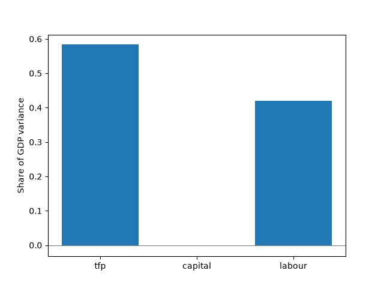
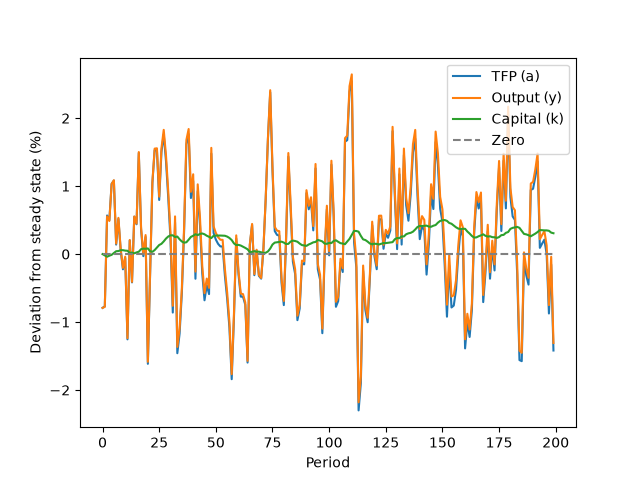

# 第 16 章: 確率的ソロー・モデル

## 16.1 この章の地図

景気循環は、何が起こすのでしょうか。**全要素生産性（TFP）の変動**だ、と考えるのが、実物的景気循環（RBC）理論です。この章では、その準備として、3 つのことをします。(1) GDP の変動を、**TFP・資本・労働の寄与に分解**する。(2) TFP を **AR(1)**（第 8 章）として、回帰で求める。(3) 第 5 章のソロー・モデルに、確率的な TFP を入れて、**シミュレーション**する。最後に、このモデルが**再現できない特徴**（消費が平滑であること）を、確かめます。

| 項目 | 内容 |
| :--- | :--- |
| 経済学の題材 | TFP（ソロー残差）、景気循環の要素分解、共分散の項、TFP の AR(1)、確率的ソロー・モデル、消費の平滑化 |
| 使う Python の機能 | `dataclass(frozen=True)`、`Series` の `cov`・`var`、`DataFrame` の組み立て、乱数の生成器を引数にする設計（第 8 章） |
| 新しく導入するライブラリ | なし |
| 完成形 | `SolowParameters`、`total_factor_productivity`、`business_cycle_components`、`decompose_business_cycle`、`fit_ar1_without_constant`、`steady_state_capital`、`simulate_with_shocks`、`stochastic_solow`、`log_deviations` |
| ファイル | 実装: `lib/chapter16/solow_stochastic.py`、`lib/chapter16/plot.py`／テスト: `test/chapter16/test_solow_stochastic.py`、`test/chapter16/test_plot.py`（自分で書くときは、`practice/chapter16/` に、同じ名前で作ります） |
| データ | `data/solow_quarterly.csv`（**架空の**四半期データ。1980Q1〜2019Q4、確率的ソロー・モデルから作った。実在の統計ではありません） |

### 経済学の式とコードの対応

| 経済学 | 式 | コード |
| :--- | :--- | :--- |
| 生産関数 | Y = A·B·K^α·H^(1−α) | （`simulate_with_shocks` の中） |
| TFP | A = Y ÷ (K^α·H^(1−α)) | `total_factor_productivity(gdp, capital, hours, alpha)` |
| 乖離の恒等式 | y = a + α·k + (1−α)·h | `business_cycle_components(df, alpha)` |
| 要素の寄与 | Cov(y, a) ÷ Var(y) など | `decompose_business_cycle(cycles, alpha)` |
| TFP の AR(1) | a(t) = ρ·a(t−1) + ε(t) | `fit_ar1_without_constant(x)` |
| 資本の蓄積 | K(t+1) = s·Y(t) + (1−δ)·K(t) | `stochastic_solow(params, n, rng)` |
| 定常状態の資本 | K\* = (s·H^(1−α) ÷ δ)^(1÷(1−α)) | `steady_state_capital(params)` |

> **記号について**: α は資本分配率、s は貯蓄率、δ は減耗率（第 5 章と同じ）。H は総労働時間、A は TFP の変動、B は TFP のトレンドです。y・k・h・a は、GDP・資本・総労働時間・TFP の、トレンドからの乖離（%）です。ρ と σ は、TFP の AR(1) の係数と、ショックの標準偏差で、第 8 章の ρ・σ と同じ役割です。第 13・14 章の y・p（産出量と物価の乖離）とは別の使い方です。一覧は、[記号について](how-to-read.md#symbols) を参照してください。

## 16.2 予想する

- GDP = 4、資本 = 4、総労働時間 = 1、α = 0.5 のとき、TFP はいくつですか
- GDP の変動の何割が、TFP の変動で説明されるでしょうか（TFP が主役だ、という RBC 理論の立場から、予想します）
- 貯蓄率が一定（s = 0.2）のソロー・モデルで、消費と投資の変動は、GDP の変動に比べて、大きいですか、小さいですか

答えは、TFP = 4 ÷ (4^0.5 × 1^0.5) = **2** です。この章の架空のデータでは、TFP の寄与は約 **58%**、労働の寄与が約 **42%**、資本の寄与は、ほぼ **0** です。消費も投資も、貯蓄率が一定なら、GDP と**まったく同じ割合**で動きます（相対的な変動 = 1.0）。

## 16.3 モデルの考え方

### TFP と、乖離の恒等式

生産関数 Y = A·K^α·H^(1−α) の対数をとると、log Y = log A + α·log K + (1−α)·log H。**TFP は、Y を、観測できる要素（K と H）で割った残り**で、「ソロー残差」とも呼ばれます。各変数の、HP フィルター（第 9 章）によるトレンドからの乖離は、同じ関係を満たします（HP フィルターは線形なので）。

> **y = a + α·k + (1−α)·h**

### 景気循環の要素分解

Var(y) = Cov(y, y) に、y = a + α·k + (1−α)·h を代入すると、

> Var(y) = Cov(y, a) + α·Cov(y, k) + (1−α)·Cov(y, h)

右辺の 3 項が、**TFP・資本・労働の寄与**です。両辺を Var(y) で割ると、合計が 1 の割合になります。

> TFP の寄与 = Cov(y, a) ÷ Var(y)、資本の寄与 = α·Cov(y, k) ÷ Var(y)、労働の寄与 = (1−α)·Cov(y, h) ÷ Var(y)

元の記事は、同じ分解を、分散と共分散の式で書いています（(σa² + α·σak + (1−α)·σah) ÷ σy² など）。この式は、上と同じものです。**分散だけを足して割ると、共分散の項が落ちて、合計が 1 になりません**（練習問題）。

### TFP の AR(1)

TFP の乖離 a(t) を、a(t−1) に、**定数項なしで**回帰します（乖離は、平均が 0 だから）。傾きが ρ、残差の標準偏差が σ です。

### 確率的ソロー・モデル

> 生産関数 Y(t) = A(t)·B(t)·K(t)^α·H^(1−α)、資本の蓄積 K(t+1) = s·Y(t) + (1−δ)·K(t)、消費 C = (1−s)·Y、投資 I = s·Y
>
> TFP: log A(t) = ρ·log A(t−1) + ε(t)

H は一定、B(t)（トレンド）の成長率 g は、既定で 0 とします。TFP のショック ε の系列を与えれば、K・Y・C・I が決まります。

## 16.4 Red → Green → Refactor

### TFP と、パラメーター

```python
def test_TFPは産出量を要素投入で割った値() -> None:
    gdp = pd.Series([4.0, 100.0])
    capital = pd.Series([4.0, 100.0])
    hours = pd.Series([1.0, 100.0])
    tfp = total_factor_productivity(gdp, capital, hours, alpha=0.5)
    assert tfp.tolist() == pytest.approx([2.0, 1.0])


def test_パラメーターの範囲が合わなければ受け付けない() -> None:
    with pytest.raises(ValueError, match="パラメーター"):
        SolowParameters(alpha=1.0)
    with pytest.raises(ValueError, match="パラメーター"):
        SolowParameters(saving=0.0)
    with pytest.raises(ValueError, match="パラメーター"):
        SolowParameters(depreciation=1.5)
    with pytest.raises(ValueError, match="パラメーター"):
        SolowParameters(rho=1.0)
    with pytest.raises(ValueError, match="パラメーター"):
        SolowParameters(sigma=-0.1)
    with pytest.raises(ValueError, match="パラメーター"):
        SolowParameters(saving=1.0)
    with pytest.raises(ValueError, match="パラメーター"):
        SolowParameters(depreciation=1.0)
    with pytest.raises(ValueError, match="パラメーター"):
        SolowParameters(hours=0.0)
```

```python
@dataclass(frozen=True)
class SolowParameters:
    """資本分配率 α、貯蓄率 s、減耗率 δ、TFP の ρ と σ、総労働時間 H、成長率 g。"""

    alpha: float = 0.36
    saving: float = 0.2
    depreciation: float = 0.025
    rho: float = 0.55
    sigma: float = 0.0078
    hours: float = 1.0
    growth: float = 0.0

    def __post_init__(self) -> None:
        if not (
            0 < self.alpha < 1
            and 0 < self.saving < 1
            and 0 < self.depreciation < 1
            and abs(self.rho) < 1
            and self.sigma >= 0
            and self.hours > 0
        ):
            raise ValueError(
                "パラメーターは、α・s・δ が 0 と 1 の間、"
                "|ρ| < 1、σ ≥ 0、H > 0 でなければならない"
            )


def total_factor_productivity(
    gdp: pd.Series, capital: pd.Series, hours: pd.Series, alpha: float
) -> pd.Series:
    """TFP = Y ÷ (K^α·H^(1-α))。"""
    return gdp / (capital**alpha * hours ** (1 - alpha))
```

### 定常状態

ショックがなければ、資本は、貯蓄 = 減耗となる水準 K\* にとどまります。

```python
PARAMS = SolowParameters(
    alpha=0.36, saving=0.2, depreciation=0.025, rho=0.55, sigma=0.0078, hours=1.0
)


def test_定常状態の資本は貯蓄と減耗が等しくなる水準() -> None:
    k = steady_state_capital(PARAMS)
    output = k**PARAMS.alpha * PARAMS.hours ** (1 - PARAMS.alpha)
    assert PARAMS.saving * output == pytest.approx(PARAMS.depreciation * k)


def test_ショックがなければ定常状態にとどまる() -> None:
    quiet = SolowParameters(sigma=0.0)
    df = stochastic_solow(quiet, 30, np.random.default_rng(0))
    assert df["K"].tolist() == pytest.approx([steady_state_capital(quiet)] * 30)
    assert df["A"].tolist() == pytest.approx([1.0] * 30)
    assert df["Y"].nunique() == 1
```

```python
def steady_state_capital(params: SolowParameters) -> float:
    """TFP の乱れがないときの定常状態の資本 K* = (s·H^(1-α) ÷ δ)^(1÷(1-α))。"""
    return float(
        (params.saving * params.hours ** (1 - params.alpha) / params.depreciation)
        ** (1 / (1 - params.alpha))
    )
```

### モデルの計算

ショックの系列を与える関数を先に作ります（乱数を使わないので、手で確かめられます）。

```python
def test_TFPはAR1で最初の期はショックそのもの() -> None:
    shocks = np.array([0.01, 0.0, 0.0])
    df = simulate_with_shocks(PARAMS, shocks)
    assert np.log(df["A"]).tolist() == pytest.approx(
        [0.01, 0.55 * 0.01, 0.55**2 * 0.01]
    )


def test_消費と投資は産出量を貯蓄率で分ける() -> None:
    df = stochastic_solow(PARAMS, 50, np.random.default_rng(1))
    assert df["C"].to_numpy() == pytest.approx(
        ((1 - PARAMS.saving) * df["Y"]).to_numpy()
    )
    assert df["I"].to_numpy() == pytest.approx((PARAMS.saving * df["Y"]).to_numpy())
    assert (df["C"] + df["I"]).to_numpy() == pytest.approx(df["Y"].to_numpy())


def test_資本は前期の投資と減耗後の資本の和() -> None:
    df = stochastic_solow(PARAMS, 50, np.random.default_rng(1))
    expected = df["I"] + (1 - PARAMS.depreciation) * df["K"]
    assert df["K"].iloc[1:].to_numpy() == pytest.approx(expected.iloc[:-1].to_numpy())


def test_生産関数は産出量を決める() -> None:
    df = stochastic_solow(PARAMS, 20, np.random.default_rng(2))
    expected = df["A"] * df["K"] ** PARAMS.alpha * PARAMS.hours ** (1 - PARAMS.alpha)
    assert df["Y"].to_numpy() == pytest.approx(expected.to_numpy())


def test_プラスのTFPショックは同じ期の産出を増やし資本は翌期から増える() -> None:
    shocks = np.array([0.01, 0.0, 0.0, 0.0])
    df = simulate_with_shocks(PARAMS, shocks)
    k_star = steady_state_capital(PARAMS)
    assert df["K"].iloc[0] == pytest.approx(k_star)
    assert df["Y"].iloc[0] > df["Y"].iloc[1] > 0
    assert df["K"].iloc[1] > k_star
    assert df["K"].iloc[2] > df["K"].iloc[1]


def test_初期の資本が定常状態より大きければ収束速度は1マイナス1マイナスα倍のδ() -> None:
    quiet = SolowParameters(sigma=0.0)
    k_star = steady_state_capital(quiet)
    df = simulate_with_shocks(quiet, np.zeros(40), initial_capital=k_star * 1.001)
    gap = np.log(df["K"] / k_star)
    speed = (1 - quiet.alpha) * quiet.depreciation
    assert gap.iloc[1] / gap.iloc[0] == pytest.approx(1 - speed, abs=1e-4)
    assert gap.iloc[-1] < gap.iloc[0]
```

```python
def simulate_with_shocks(
    params: SolowParameters,
    shocks: NDArray[np.float64],
    initial_capital: float | None = None,
) -> pd.DataFrame:
    """TFP のショック ε(t) の系列を与えて、A・K・Y・C・I の水準を計算する。

    初期の資本は、既定で、定常状態の値。最初の期の log A は、ショックそのもの。
    """
    capital = (
        steady_state_capital(params) if initial_capital is None else initial_capital
    )
    log_a = 0.0
    rows = []
    for t, shock in enumerate(shocks):
        log_a = params.rho * log_a + float(shock)
        trend = (1 + params.growth) ** t
        output = (
            float(np.exp(log_a))
            * trend
            * capital**params.alpha
            * params.hours ** (1 - params.alpha)
        )
        rows.append(
            {
                "A": float(np.exp(log_a)),
                "K": capital,
                "Y": output,
                "C": (1 - params.saving) * output,
                "I": params.saving * output,
            }
        )
        capital = params.saving * output + (1 - params.depreciation) * capital
    return pd.DataFrame(rows)
```

最後のテストは、**第 5 章の収束の速さ** λ = (1 − α)·δ と、一致します（定常状態の近くで、資本の乖離は、毎期 1 − λ 倍になる）。

次に、乱数の生成器を引数にして、毎期ショックが起きるシミュレーションにします（第 8 章と同じ設計）。

```python
def test_乱数の種が同じなら同じ結果() -> None:
    first = stochastic_solow(PARAMS, 30, np.random.default_rng(3))
    second = stochastic_solow(PARAMS, 30, np.random.default_rng(3))
    pd.testing.assert_frame_equal(first, second)


def test_シミュレーションの長さは1以上() -> None:
    with pytest.raises(ValueError, match="1 以上"):
        stochastic_solow(PARAMS, 0, np.random.default_rng(0))
```

```python
def stochastic_solow(
    params: SolowParameters, n: int, rng: np.random.Generator
) -> pd.DataFrame:
    """毎期、TFP にショックが起きる、n 期間のシミュレーション（乱数の生成器を渡す）。"""
    return simulate_with_shocks(params, white_noise(n, params.sigma, rng))
```

### 定常状態からの乖離

```python
def test_定常状態からの対数乖離は百分率() -> None:
    shocks = np.array([0.01, 0.0])
    df = simulate_with_shocks(PARAMS, shocks)
    dev = log_deviations(df, PARAMS)
    assert list(dev.columns) == ["a", "y", "k", "c", "i"]
    assert dev["a"].iloc[0] == pytest.approx(1.0)
    assert dev["y"].iloc[0] == pytest.approx(1.0)
    assert dev["k"].iloc[0] == pytest.approx(0.0, abs=1e-9)


def test_消費と投資の変動は産出量と同じになる() -> None:
    """貯蓄率が一定なので、モデルは、消費の平滑化を再現できない。"""
    df = stochastic_solow(PARAMS, 200, np.random.default_rng(5))
    dev = log_deviations(df, PARAMS)
    assert dev["c"].to_numpy() == pytest.approx(dev["y"].to_numpy())
    assert dev["i"].to_numpy() == pytest.approx(dev["y"].to_numpy())
```

```python
def log_deviations(df: pd.DataFrame, params: SolowParameters) -> pd.DataFrame:
    """定常状態からの、対数の乖離（%）。列は a・y・k・c・i（トレンドがない場合）。"""
    k_star = steady_state_capital(params)
    y_star = k_star**params.alpha * params.hours ** (1 - params.alpha)
    return pd.DataFrame(
        {
            "a": 100 * np.log(df["A"]),
            "y": 100 * np.log(df["Y"] / y_star),
            "k": 100 * np.log(df["K"] / k_star),
            "c": 100 * np.log(df["C"] / ((1 - params.saving) * y_star)),
            "i": 100 * np.log(df["I"] / (params.saving * y_star)),
        }
    )
```

2 つ目のテストが、このモデルの**限界**を示します。貯蓄率が一定なので、**消費も投資も、産出量と、まったく同じ割合で動く**のです（乖離が、全期間で一致）。現実のデータでは、消費は GDP より滑らかで、投資は GDP より大きく動きます（第 9 章）。

### TFP の AR(1)

```python
def test_AR1の係数は定数なしの回帰で求める() -> None:
    rho, sigma = fit_ar1_without_constant(pd.Series([1.0, 0.5, 0.25, 0.125]))
    assert rho == pytest.approx(0.5)
    assert sigma == pytest.approx(0.0, abs=1e-12)


def test_長いAR1系列から係数と標準偏差を復元する() -> None:
    x = pd.Series(ar1_series(0.6, 0.8, 20000, np.random.default_rng(4)))
    rho, sigma = fit_ar1_without_constant(x)
    assert rho == pytest.approx(0.6, abs=0.02)
    assert sigma == pytest.approx(0.8, abs=0.02)
```

```python
def fit_ar1_without_constant(x: pd.Series) -> tuple[float, float]:
    """x(t) を x(t-1) に、定数項なしで回帰する。係数 ρ と、残差の標準偏差 σ を返す。"""
    lag = x.shift().dropna()
    now = x.iloc[1:]
    rho = float((now * lag).sum() / (lag**2).sum())
    return rho, float((now - rho * lag).std())
```

### 要素分解

手計算の例は、a = (1, −1, 1, −1)、k = (1, 1, −1, −1)、h = (1, −1, −1, 1)、α = 0.5 です。y = a + 0.5·k + 0.5·h = (2, −1, 0, −1) で、寄与は 4/6、1/6、1/6 です。

```python
def test_要素分解の寄与は手計算の例と一致する() -> None:
    cycles = pd.DataFrame(
        {
            "a": [1.0, -1.0, 1.0, -1.0],
            "k": [1.0, 1.0, -1.0, -1.0],
            "h": [1.0, -1.0, -1.0, 1.0],
        }
    )
    cycles["y"] = cycles["a"] + 0.5 * cycles["k"] + 0.5 * cycles["h"]
    shares = decompose_business_cycle(cycles, alpha=0.5)
    assert shares["tfp"] == pytest.approx(4 / 6)
    assert shares["capital"] == pytest.approx(1 / 6)
    assert shares["labour"] == pytest.approx(1 / 6)
    assert shares.sum() == pytest.approx(1.0)


def test_生産関数が成り立てば寄与の和は1() -> None:
    rng = np.random.default_rng(9)
    cycles = pd.DataFrame({name: rng.normal(size=100) for name in ("a", "k", "h")})
    cycles["y"] = cycles["a"] + 0.36 * cycles["k"] + 0.64 * cycles["h"]
    shares = decompose_business_cycle(cycles, alpha=0.36)
    assert shares.sum() == pytest.approx(1.0)
    assert list(shares.index) == ["tfp", "capital", "labour"]
```

```python
def decompose_business_cycle(cycles: pd.DataFrame, alpha: float) -> pd.Series:
    """GDP の変動の、TFP・資本・労働の寄与（合計 1）。"""
    var_y = cycles["y"].var()
    return pd.Series(
        {
            "tfp": cycles["y"].cov(cycles["a"]) / var_y,
            "capital": alpha * cycles["y"].cov(cycles["k"]) / var_y,
            "labour": (1 - alpha) * cycles["y"].cov(cycles["h"]) / var_y,
        }
    )
```

### 架空のデータで試す

`data/solow_quarterly.csv` は、**確率的ソロー・モデルから作った、架空のデータ**です（GDP・資本・総労働時間の水準、160 四半期）。TFP は、ρ = 0.6、σ = 0.8% の AR(1)。総労働時間は、TFP に反応する AR(1)（ρ = 0.8）。資本は、貯蓄率 0.22、減耗率 0.025 で蓄積し、α = 0.36 です。

```python
def test_同梱のデータは1980年から2019年までの160四半期() -> None:
    df = load_solow_quarterly()
    assert len(df) == 160
    assert str(df.index[0]) == "1980Q1"
    assert list(df.columns) == ["gdp", "capital", "total_hours"]


def test_乖離の系列は4列で生産関数の恒等式を満たす() -> None:
    cycles = business_cycle_components(load_solow_quarterly(), alpha=0.36)
    assert list(cycles.columns) == ["y", "k", "h", "a"]
    identity = cycles["a"] + 0.36 * cycles["k"] + 0.64 * cycles["h"]
    assert identity.to_numpy() == pytest.approx(cycles["y"].to_numpy())
```

```python
def load_solow_quarterly(path: Path = DEFAULT_DATA_PATH) -> pd.DataFrame:
    """GDP・資本ストック・総労働時間（水準）の四半期データを読み込む。"""
    return load_quarterly(path)


def business_cycle_components(df: pd.DataFrame, alpha: float) -> pd.DataFrame:
    """GDP・資本・総労働時間・TFP の、トレンドからの乖離（%）。列は y・k・h・a。"""
    gdp = pd.Series(df["gdp"])
    capital = pd.Series(df["capital"])
    hours = pd.Series(df["total_hours"])
    tfp = total_factor_productivity(gdp, capital, hours, alpha)
    return pd.DataFrame(
        {
            "y": log_cycle(gdp),
            "k": log_cycle(capital),
            "h": log_cycle(hours),
            "a": log_cycle(tfp),
        }
    )
```

```python
def test_同梱のデータの要素分解() -> None:
    cycles = business_cycle_components(load_solow_quarterly(), alpha=0.36)
    shares = decompose_business_cycle(cycles, alpha=0.36)
    assert shares["tfp"] == pytest.approx(0.583, abs=0.001)
    assert shares["capital"] == pytest.approx(-0.003, abs=0.001)
    assert shares["labour"] == pytest.approx(0.420, abs=0.001)
    assert shares.sum() == pytest.approx(1.0)


def test_同梱のデータのTFPの変動はGDPの変動と強く相関する() -> None:
    cycles = business_cycle_components(load_solow_quarterly(), alpha=0.36)
    assert cycles["y"].std() == pytest.approx(1.279, abs=0.001)
    assert cycles["a"].std() == pytest.approx(0.823, abs=0.001)
    assert cycles["y"].corr(cycles["a"]) == pytest.approx(0.907, abs=0.001)
    assert cycles["a"].corr(cycles["h"]) == pytest.approx(0.561, abs=0.001)


def test_同梱のデータのAR1の推定() -> None:
    """真の値（TFP は ρ = 0.6、σ = 0.8、労働時間は ρ = 0.8）とは、少し違う。"""
    cycles = business_cycle_components(load_solow_quarterly(), alpha=0.36)
    rho_a, sigma_a = fit_ar1_without_constant(cycles["a"])
    rho_h, _ = fit_ar1_without_constant(cycles["h"])
    assert rho_a == pytest.approx(0.514, abs=0.001)
    assert sigma_a == pytest.approx(0.708, abs=0.001)
    assert rho_h == pytest.approx(0.829, abs=0.001)
```

| | 値 |
| :--- | ---: |
| GDP の乖離の標準偏差（%） | 1.279 |
| TFP の乖離の標準偏差（%） | 0.823 |
| GDP と TFP の相関 | 0.907 |
| TFP と総労働時間の相関 | 0.561 |
| **TFP の寄与** | **58.3%** |
| 資本の寄与 | −0.3% |
| **労働の寄与** | **42.0%** |
| TFP の AR(1) の係数 ρ（真の値 0.6） | 0.514 |
| TFP の AR(1) の標準偏差 σ（真の値 0.8%） | 0.708 |
| 総労働時間の AR(1) の係数（真の値 0.8） | 0.829 |



```python
def plot_decomposition(shares: pd.Series) -> Figure:
    """GDP の変動に対する、TFP・資本・労働の寄与を、棒で描く。"""
    fig, ax = plt.subplots()
    ax.bar(list(shares.index), shares.to_numpy())
    ax.axhline(0, color="gray", linewidth=0.8)
    ax.set_ylabel("Share of GDP variance")
    plt.close(fig)
    return fig
```

読み取れることと、注意点:

- **TFP が主役です**（58%）。労働時間は、TFP に反応して動くので（相関 0.56）、労働の寄与が 42% あります。資本は、ゆっくり動くので、景気循環の変動の寄与は、ほぼ 0 です
- 真の値（ρ = 0.6、σ = 0.8）と、推定値（0.514、0.708）は、少し違います。**HP フィルターが、ゆっくりした動きの一部を、トレンドとして取り除く**ためです（第 13 章と同じ注意）
- **分解の割合は、α に依存します**（練習問題）

### 確率的ソロー・モデルのシミュレーション

ρ = 0.6、σ = 0.8%、s = 0.2、δ = 0.025、α = 0.36 で、200 期間のシミュレーション（種 123）をします。

```python
def test_シミュレーションの特徴は産出量とTFPが同じ動きで資本は緩やか() -> None:
    params = SolowParameters(
        alpha=0.36, saving=0.2, depreciation=0.025, rho=0.6, sigma=0.008, hours=1.0
    )
    simulated = stochastic_solow(params, 200, np.random.default_rng(123))
    dev = log_deviations(simulated, params)
    assert dev["y"].std() == pytest.approx(0.885, abs=0.001)
    assert dev["k"].std() == pytest.approx(0.122, abs=0.001)
    assert dev["y"].autocorr() == pytest.approx(0.576, abs=0.001)
    assert dev["k"].autocorr() == pytest.approx(0.983, abs=0.001)
    assert dev["y"].corr(dev["k"]) == pytest.approx(0.002, abs=0.001)
    assert dev["y"].corr(dev["a"]) == pytest.approx(0.999, abs=0.001)
```

| | TFP (a) | 産出量 (y) | 資本 (k) |
| :--- | ---: | ---: | ---: |
| 標準偏差（%） | 0.886 | 0.885 | 0.122 |
| 自己相関（ラグ 1） | 0.574 | 0.576 | 0.983 |
| 産出量との相関 | 0.999 | 1.000 | 0.002 |



```python
def plot_solow_simulation(dev: pd.DataFrame) -> Figure:
    """TFP・産出量・資本の、定常状態からの乖離（%）を、0 の線と一緒に描く。"""
    n = len(dev)
    fig, ax = plt.subplots()
    ax.plot(range(n), dev["a"].to_numpy(), label="TFP (a)")
    ax.plot(range(n), dev["y"].to_numpy(), label="Output (y)")
    ax.plot(range(n), dev["k"].to_numpy(), label="Capital (k)")
    ax.plot([0, n - 1], [0, 0], "--", color="gray", label="Zero")
    ax.set_xlabel("Period")
    ax.set_ylabel("Deviation from steady state (%)")
    ax.legend()
    plt.close(fig)
    return fig
```

- 産出量は、TFP と**ほぼ同じ**動きです（相関 0.999）。資本は、同じ期には動かず（ショックの翌期から）、変動は小さく（産出量の 14%）、**持続性は非常に高い**（自己相関 0.98）です。「カモシカ（産出量）と象（資本）」です
- 資本の変動が小さいので、**このモデルでは、GDP の変動は、ほぼ、TFP の変動そのもの**です（相関 0.999）。労働は一定と仮定しているため、TFP の効果を、増幅する仕組みがありません
- 消費・投資・産出量の変動は、**同じ**です。貯蓄率が一定のため

### 実行結果

```bash
cd apps/macro-programming/python
uv run pytest test/chapter16
```

```text
30 passed
```

> **実際の統計では試していません。** TFP の計算に必要な、資本ストックと総労働時間の四半期データの、取得元と形を、確認できていないためです。この章のデータは、架空です。

## 16.5 規則で言うと

1. **対数の恒等式を、分解の土台にする。** y = a + α·k + (1−α)·h が成り立てば、寄与の合計は 1。恒等式が成り立つことを、テストで確かめる
2. **分散だけでなく、共分散も入れる。** 要素が相関していれば、共分散の項が、寄与に入る
3. **答えを知っているデータで、手続きを確かめる。** 真の ρ・σ と、推定値の違いを、見る
4. **モデルが再現できない特徴を、確かめる。** 消費の平滑化は、貯蓄率が一定のモデルでは、再現できない

混同しやすい点を、表にまとめます。

| 混同しやすい点 | 違い |
| :--- | :--- |
| TFP の水準 と 乖離 | TFP の水準は Y ÷ (K^α·H^(1−α))。乖離は、そのトレンドからの割合（%） |
| 寄与 と 相関 | 寄与は、Cov(y, 要素) ÷ Var(y)（合計 1）。相関は、−1 から 1。寄与は、要素の変動の大きさも反映 |
| H が一定 と H が変動 | この章のモデルは、H 一定。データの分解は、H の変動を含む。モデルで、労働の寄与が 0 になる |
| TFP のショック ε と 乖離 a | ε は、毎期のホワイト・ノイズ。a は、その蓄積（AR(1)） |

### このモデルが成り立たない場面

- **貯蓄率が一定です。** 家計は、将来を見据えて貯蓄を決めるはずです。次の章以降で、最適化から、貯蓄を内生的に決めます
- **労働が一定です。** 労働時間は、景気循環で、大きく動きます（TFP との相関 0.56）
- **TFP の変動の中身が、分かりません。** 資本の稼働率や、測定誤差が、TFP の変動に含まれます
- **パラメーターは、データと手続きの産物です。** ρ = 0.514 は、HP フィルターを使った推定値です

## 16.6 練習問題

| 種類 | 問題 |
| :--- | :--- |
| 想起 | 本文を閉じて、TFP の手計算のテスト（GDP = 4、資本 = 4、総労働時間 = 1、α = 0.5 で TFP = 2）を書いてください |
| 生成 | 解説を見る前に、共分散を入れず、分散だけで寄与を求める `naive_shares(cycles, alpha)`（Var(a) ÷ Var(y)、α²·Var(k) ÷ Var(y)、(1−α)²·Var(h) ÷ Var(y)）を、テストから書いてください。手計算の例と、同梱のデータで、合計はいくつになりますか。なぜですか |
| 多様 | α を 0.25、0.36、0.5 に変えたとき、同梱のデータの TFP の寄与は、どう変わるでしょうか（先に予想してから確かめてください） |
| 交互 | 第 9 章の `log_cycle` と `relative_volatility` で、シミュレーションの消費・投資の、産出量に対する相対的な変動を求めてください。第 9 章の架空のデータ（消費 0.76、投資 3.69）と、比べてください |

??? note "解答（先に自分で取り組んでから、開いてください）"

    **想起**:

    ```python
    def test_TFPは産出量を要素投入で割った値() -> None:
        tfp = total_factor_productivity(
            pd.Series([4.0]), pd.Series([4.0]), pd.Series([1.0]), alpha=0.5
        )
        assert tfp.tolist() == pytest.approx([2.0])
    ```

    **生成**:

    ```python
    def naive_shares(cycles, alpha):
        var_y = cycles["y"].var()
        return pd.Series(
            {
                "tfp": cycles["a"].var() / var_y,
                "capital": alpha**2 * cycles["k"].var() / var_y,
                "labour": (1 - alpha) ** 2 * cycles["h"].var() / var_y,
            }
        )
    ```

    ```python
    def test_相関がなければ分散だけの分解でも合計は1() -> None:
        cycles = pd.DataFrame(
            {
                "a": [1.0, -1.0, 1.0, -1.0],
                "k": [1.0, 1.0, -1.0, -1.0],
                "h": [1.0, -1.0, -1.0, 1.0],
            }
        )
        cycles["y"] = cycles["a"] + 0.5 * cycles["k"] + 0.5 * cycles["h"]
        assert naive_shares(cycles, 0.5).sum() == pytest.approx(1.0)


    def test_同梱のデータでは共分散を無視すると合計は1にならない() -> None:
        cycles = business_cycle_components(load_solow_quarterly(), alpha=0.36)
        assert naive_shares(cycles, 0.36).sum() == pytest.approx(0.655, abs=0.001)
        assert cycles["a"].cov(cycles["h"]) == pytest.approx(0.452, abs=0.001)
    ```

    手計算の例は、a・k・h が互いに無相関なので、共分散の項が 0 で、合計が 1 です。同梱のデータでは、**合計が 0.655** で、残りの約 35% は、**共分散の項**です。TFP と総労働時間が正の相関（共分散 0.452）なので、TFP の寄与に、労働を通じた効果（(1−α)·Cov(a, h)）が、含まれます。

    **多様**: α が大きいほど、資本の割合が増えて、労働の割合が減ります。TFP の寄与は、α が大きいと、大きくなります。

    ```python
    def test_αを変えたときのTFPの寄与() -> None:
        df = load_solow_quarterly()
        for alpha, expected in [(0.25, 0.510), (0.36, 0.583), (0.5, 0.676)]:
            cycles = business_cycle_components(df, alpha=alpha)
            shares = decompose_business_cycle(cycles, alpha=alpha)
            assert shares["tfp"] == pytest.approx(expected, abs=0.001)
            assert shares.sum() == pytest.approx(1.0)
    ```

    α が 0.25 から 0.5 に上がると、TFP の寄与は 51% から 68% に上がります（労働の寄与は 49% から 33% に下がる）。**分解の結果は、資本分配率という、仮定に依存します**。

    **交互**: 消費も投資も、産出量の定数倍なので、HP フィルターの循環も、産出量と一致します。

    ```python
    def test_モデルの消費と投資の相対的な変動は1() -> None:
        params = SolowParameters(rho=0.6, sigma=0.008)
        df = stochastic_solow(params, 200, np.random.default_rng(123))
        y = log_cycle(df["Y"])
        assert relative_volatility(log_cycle(df["C"]), y) == pytest.approx(1.0)
        assert relative_volatility(log_cycle(df["I"]), y) == pytest.approx(1.0)
    ```

    モデルでは、消費も投資も、相対的な変動が **1.0** です。第 9 章のデータでは、消費 0.76（GDP より滑らか）、投資 3.69（GDP の 3.7 倍）でした。**確率的ソロー・モデルは、消費の平滑化と、投資の大きな変動を、再現できません**。

## 16.7 振り返り

- TFP が、景気循環の主役だという予想は、当たりましたか。労働の寄与が 42% あったのは、なぜですか
- 共分散の項を落とすと、合計が 1 になりませんでした。分解の式を、どう確かめれば、安全ですか
- 消費の変動が、産出量と同じになるのは、モデルのどの仮定のためですか。その仮定を、どう変えますか

## 16.8 まとめ

- GDP の変動を、TFP・資本・労働の寄与に分解し、合計が 1 になること（共分散の項を含む）を確かめた
- TFP の AR(1) を、定数項なしの回帰で求め、HP フィルターの影響で、真の値と少し違うことを確かめた
- TFP が確率的に動くソロー・モデルを、乱数の生成器を引数にして作り、収束の速さが第 5 章の λ と一致することを確かめた
- モデルは、産出量と TFP がほぼ同じ動きになり、**消費の平滑化を再現できない**ことを確かめた
- 次の章では、**対数線形近似**を自作して、動学モデルを線形にし、最適化から導かれる RBC モデル（第 18 章）に備えます
