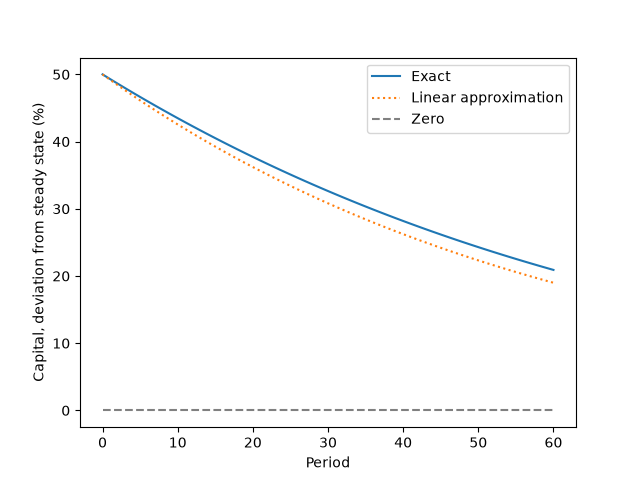

# 第 17 章: 対数線形近似

## 17.1 この章の地図

最適化から導かれるモデル（次の章の RBC モデル）の均衡条件は、非線形で、将来の変数の期待を含みます。そのままでは、扱いにくいので、**定常状態の近くで、線形に近似**します。変数を、定常状態からの**乖離率**で書くので、**対数線形近似**と呼びます。元の記事は、この作業を、`linearsolve` に任せますが、この章では、**自分で実装**します。数値微分で近似し、**先を見る変数**があるモデルの解法（行列の固有値を使う）まで作ります。

| 項目 | 内容 |
| :--- | :--- |
| 経済学の題材 | 対数線形近似、定常状態、状態変数とジャンプ変数、ブランチャード・カーンの条件、安定経路、近似の誤差 |
| 使う Python の機能 | 関数を引数にする設計（`Callable`）、`numpy` の行列（`solve`・`eig`）、数値微分、`dataclass`（第 16 章のパラメーター） |
| 新しく導入するライブラリ | なし（`linearsolve` は使わない。17.3 節の理由） |
| 完成形 | `numerical_jacobian`、`find_steady_state`、`log_linearize`、`linear_transition`、`solve_saddle_path`、`solow_equations`、`capital_paths` |
| ファイル | 実装: `lib/chapter17/loglinear.py`、`lib/chapter17/plot.py`／テスト: `test/chapter17/test_loglinear.py`、`test/chapter17/test_plot.py`（自分で書くときは、`practice/chapter17/` に、同じ名前で作ります） |
| データ | なし |

### 経済学の式とコードの対応

| 経済学 | 式 | コード |
| :--- | :--- | :--- |
| 均衡条件 | f(x', x) = 0（x': 来期、x: 今期） | `Equations`（`solow_equations(params)`） |
| 定常状態 | f(x\*, x\*) = 0 | `find_steady_state(equations, guess)` |
| 乖離率 | x̂ = ln(x ÷ x\*) | （ヤコビ行列を、対数の変数で求める） |
| 対数線形近似 | A·x̂' + B·x̂ = 0 | `log_linearize(equations, steady_state)` |
| 遷移行列 | x̂' = M·x̂、M = −A⁻¹B | `linear_transition(A, B)` |
| 先を見る変数がある解 | ジャンプ変数 = P·状態変数 | `solve_saddle_path(A, B, n_state)` |
| 近似の誤差 | 厳密な解と、線形近似の解の差 | `capital_paths(params, 初期の乖離, 期間)` |

> **記号について**: x̂ は、定常状態 x\* からの乖離率（対数の差。x̂ = ln(x ÷ x\*)）です。A・B は、均衡条件を対数の変数で微分した行列（第 15 章の A・B とは別。ここでは、f の微分）、M は遷移行列です。α・s・δ・ρ は第 16 章と同じです。一覧は、[記号について](how-to-read.md#symbols) を参照してください。

## 17.2 予想する

人口成長も技術進歩もない、ソロー・モデルです。α = 0.5、s = 0.2、δ = 0.05 とします。

- 資本の定常状態からの乖離率は、毎期、何倍になりますか（第 5 章の収束の速さ λ = (1 − α)·δ を使います）
- 資本が、定常状態より 1% 高い状態と、50% 高い状態で、線形近似の精度は、どちらが良いでしょうか
- 近似の誤差は、乖離の大きさに、どう依存しますか

答えは、毎期 1 − λ = 1 − 0.5 × 0.05 = **0.975 倍**です。誤差は、1% の乖離のほうが**ずっと小さく**、乖離の**大きさにほぼ比例して**（誤差の割合が）増えます。

## 17.3 考え方

### 乖離率と対数線形近似

定常状態 X と、今期の値 X(t) について、**x̂(t) = ln(X(t) ÷ X)** と書くと、x̂ が小さいとき、X(t) ≈ X·(1 + x̂(t)) です。べき乗は、Z(t)^a ≈ Z^a·(1 + a·ẑ(t)) となります。

### 例: ソロー・モデルの資本蓄積

K(t+1) = s·K(t)^α + (1 − δ)·K(t)（L = 1）。定常状態は s·K\*^α = δ·K\*（K\* = (s ÷ δ)^(1÷(1−α))）です。各項を近似して、K\* で割ると、

> 1 + k̂(t+1) = (s ÷ K\*^(1−α))·(1 + α·k̂(t)) + (1 − δ)·(1 + k̂(t))
>
> s ÷ K\*^(1−α) = δ なので、**k̂(t+1) = [1 − (1 − α)·δ]·k̂(t)**

第 5 章の、収束の速さ λ = (1 − α)·δ と、一致します。TFP が確率的（A(t+1) = A(t)^ρ）なら、

> â(t+1) = ρ·â(t)、**k̂(t+1) = δ·â(t) + [1 − (1 − α)·δ]·k̂(t)**

### 数値微分で、同じことを自動でやる

均衡条件 f(x', x) = 0 を、**対数の変数**で書き直して、定常状態で**数値微分**します。

> A = ∂f/∂ln x'、B = ∂f/∂ln x　→　A·x̂' + B·x̂ = 0　→　x̂' = M·x̂、M = −A⁻¹B

手計算の導出を、**関数にして、同じ結果が出るか**を、テストで確かめます。

### 先を見る変数がある場合（ブランチャード・カーンの条件）

消費のように、**今期に、将来を見据えて決まる変数**（ジャンプ変数）があると、M を、そのまま、前から回せません。変数を、**状態変数**（前の期に決まる: 資本・TFP）→ **ジャンプ変数**（消費）の順に並べたとき、

- M の、**絶対値が 1 より大きい固有値（不安定な根）の数 = ジャンプ変数の数**のとき、**爆発しない経路が、ただ 1 つ**決まります
- 不安定な根が、**少なければ**、解が**一意に決まらず**、**多ければ**、**解が存在しません**

不安定な根に対応する**左固有ベクトル** w は、w'·x̂(t) が、毎期、μ 倍（μ > 1。μ は、不安定な固有値）で増えることを意味します。爆発させないには、**w'·x̂(t) = 0** でなければなりません。これが、ジャンプ変数を、状態変数で表す式（政策関数）になります。

> **例**: x(t) = λ·E x(t+1) + a(t)、a(t+1) = ρ·a(t)（λ < 1）。手で解くと、x = a ÷ (1 − λρ)。この解法で、同じ式が出ることを、テストで確かめます。

### `linearsolve` を使わない理由

元の記事は、`linearsolve` を使います。導入前に、隔離した環境で確かめました。pandas 3 では、対数線形近似の内部（`Series.ravel`）が動かず、pandas 2 では動きます（ソロー・モデルで 0.975）。そこで、**自作**し、`linearsolve`（pandas 2 の隔離環境）の結果 **0.975 を、照合値**にします。

## 17.4 プログラミング

### 数値微分

```python
PARAMS = SolowParameters(
    alpha=0.36, saving=0.2, depreciation=0.025, rho=0.55, sigma=0.0078, hours=1.0
)


def test_数値微分は手計算の導関数と一致する() -> None:
    def f(x: NDArray[np.float64]) -> NDArray[np.float64]:
        return np.array([x[0] ** 2, x[0] * x[1]])

    jacobian = numerical_jacobian(f, np.array([2.0, 3.0]))
    assert jacobian == pytest.approx(np.array([[4.0, 0.0], [3.0, 2.0]]), abs=1e-6)
```

```python
def numerical_jacobian(
    f: Callable[[Vector], Vector], x: Vector, step: float = 1e-6
) -> NDArray[np.float64]:
    """ヤコビ行列を、中心差分で求める（(f(x + h) - f(x - h)) ÷ 2h）。"""
    columns = []
    for i in range(len(x)):
        shift = np.zeros(len(x))
        shift[i] = step * max(1.0, abs(x[i]))
        columns.append((f(x + shift) - f(x - shift)) / (2 * shift[i]))
    return np.column_stack(columns)
```

関数 f(x) = (x₀², x₀·x₁) の、(2, 3) でのヤコビ行列は、[[4, 0], [3, 2]] です。中心差分 (f(x + h) − f(x − h)) ÷ 2h で求めます。

### 定常状態

```python
def test_定常状態は今期と来期が等しい点() -> None:
    def f(x_next: NDArray[np.float64], x: NDArray[np.float64]) -> NDArray[np.float64]:
        return x_next - (0.5 * x + 1.0)

    assert find_steady_state(f, np.array([10.0])) == pytest.approx([2.0])


def test_ソローモデルの定常状態は解析解と一致する() -> None:
    ss = find_steady_state(solow_equations(PARAMS), np.array([1.2, 20.0]))
    assert ss[0] == pytest.approx(1.0)
    assert ss[1] == pytest.approx(steady_state_capital(PARAMS))


def test_定常状態が見つからなければ受け付けない() -> None:
    def f(x_next: NDArray[np.float64], x: NDArray[np.float64]) -> NDArray[np.float64]:
        return np.array([1.0 + 0.0 * x_next[0] * x[0]])

    with pytest.raises(ValueError, match="収束"):
        find_steady_state(f, np.array([1.0]))


def test_繰り返しの回数が足りなければ受け付けない() -> None:
    def f(x_next: NDArray[np.float64], x: NDArray[np.float64]) -> NDArray[np.float64]:
        return np.array([x_next[0] ** 2 + 1.0 - x[0] * 0.0])

    with pytest.raises(ValueError, match="収束"):
        find_steady_state(f, np.array([1.0]), max_iter=5)
```

```python
def find_steady_state(
    equations: Equations,
    guess: Vector,
    tol: float = 1e-10,
    max_iter: int = 100,
) -> Vector:
    """f(x, x) = 0 の解を、ニュートン法で探す。

    tol は、残差の絶対値の許容（変数の大きさに依存する）。途中で、値が負になって、
    べき乗などが計算できなくなる（有限でない）ときは、初期値を見直すように、エラーにする。
    """
    x = np.array(guess, dtype=float)
    for _ in range(max_iter):
        residual = equations(x, x)
        if not np.all(np.isfinite(residual)):
            raise ValueError("定常状態が収束しない（値が有限でない。初期値を見直す）")
        if np.max(np.abs(residual)) < tol:
            return x
        jacobian = numerical_jacobian(lambda v: equations(v, v), x)
        try:
            x = x - np.linalg.solve(jacobian, residual)
        except np.linalg.LinAlgError as error:
            raise ValueError("定常状態が収束しない（ヤコビ行列が特異）") from error
    raise ValueError("定常状態が収束しない（繰り返しの回数が足りない）")
```

f(x, x) = 0 を、ニュートン法で解きます。ヤコビ行列が特異（解が決まらない）、または、繰り返しの回数が足りないときは、エラーにします。

### ソロー・モデルの対数線形近似

```python
def solow_equations(params: SolowParameters) -> Equations:
    """確率的ソロー・モデルの均衡条件（変数は (A, K)）。

    A' = A^ρ、K' = s·A·K^α·H^(1-α) + (1-δ)·K。
    """

    def equations(x_next: Vector, x: Vector) -> Vector:
        tfp = x_next[0] - x[0] ** params.rho
        capital = x_next[1] - (
            params.saving
            * x[0]
            * x[1] ** params.alpha
            * params.hours ** (1 - params.alpha)
            + (1 - params.depreciation) * x[1]
        )
        return np.array([tfp, capital])

    return equations
```

```python
def test_対数線形近似の行列は手計算の値() -> None:
    k_star = steady_state_capital(PARAMS)
    ss = np.array([1.0, k_star])
    a_matrix, b_matrix = log_linearize(solow_equations(PARAMS), ss)
    delta, alpha, rho = PARAMS.depreciation, PARAMS.alpha, PARAMS.rho
    assert a_matrix == pytest.approx(np.array([[1.0, 0.0], [0.0, k_star]]), abs=1e-6)
    assert b_matrix == pytest.approx(
        np.array([[-rho, 0.0], [-delta * k_star, -k_star * (1 - (1 - alpha) * delta)]]),
        abs=1e-6,
    )


def test_線形の遷移行列は第5章の収束の速さと一致する() -> None:
    k_star = steady_state_capital(PARAMS)
    transition = linear_transition(
        *log_linearize(solow_equations(PARAMS), np.array([1.0, k_star]))
    )
    speed = convergence_speed(PARAMS.alpha, PARAMS.depreciation)
    assert transition[1, 1] == pytest.approx(1 - speed, abs=1e-6)
    assert transition[1, 0] == pytest.approx(PARAMS.depreciation, abs=1e-6)
    assert transition[0, 0] == pytest.approx(PARAMS.rho, abs=1e-6)
    assert transition[0, 1] == pytest.approx(0.0, abs=1e-6)


def test_隔離環境のlinearsolveの結果と一致する() -> None:
    """linearsolve（pandas 2 の隔離環境）が、α = 0.5、s = 0.2、δ = 0.05 で出した 0.975。"""
    params = SolowParameters(alpha=0.5, saving=0.2, depreciation=0.05)
    k_star = steady_state_capital(params)
    transition = linear_transition(
        *log_linearize(solow_equations(params), np.array([1.0, k_star]))
    )
    assert transition[1, 1] == pytest.approx(0.975, abs=1e-6)
```

```python
def log_linearize(
    equations: Equations, steady_state: Vector
) -> tuple[NDArray[np.float64], NDArray[np.float64]]:
    """定常状態の近くで、A·x̂' + B·x̂ = 0 の A と B を求める。"""
    n = len(steady_state)

    def in_logs(u: Vector) -> Vector:
        return equations(steady_state * np.exp(u[:n]), steady_state * np.exp(u[n:]))

    jacobian = numerical_jacobian(in_logs, np.zeros(2 * n))
    return jacobian[:, :n], jacobian[:, n:]


def linear_transition(
    a_matrix: NDArray[np.float64], b_matrix: NDArray[np.float64]
) -> NDArray[np.float64]:
    """x̂' = M·x̂ の M = -A⁻¹B（A が特異なら解けない。静学的な式は先に消す）。"""
    return -np.linalg.solve(a_matrix, b_matrix)
```

手計算の導出（17.3 節）と、**数値微分の結果が一致**します。M = [[ρ, 0], [δ, 1 − (1 − α)·δ]]。第 5 章の遷移係数 1 − λ（収束の速さは λ = 0.016。係数は 0.984）と、`linearsolve` の 0.975（α = 0.5、s = 0.2、δ = 0.05）も、再現します。

### 先を見る変数があるモデルの解

```python
def test_先を見る変数が1つのモデルの解は手計算の値() -> None:
    """x(t) = λ·E x(t+1) + a(t)、a(t+1) = ρ·a(t)。解は x = a ÷ (1 - λ·ρ)。"""
    lam, rho = 0.9, 0.5
    a_matrix = np.array([[1.0, 0.0], [0.0, lam]])
    b_matrix = np.array([[-rho, 0.0], [1.0, -1.0]])
    policy, transition = solve_saddle_path(a_matrix, b_matrix, n_state=1)
    assert policy == pytest.approx(np.array([[1 / (1 - lam * rho)]]))
    assert transition == pytest.approx(np.array([[rho]]))


def test_先を見る変数がなければ遷移行列がそのまま解() -> None:
    k_star = steady_state_capital(PARAMS)
    a_matrix, b_matrix = log_linearize(solow_equations(PARAMS), np.array([1.0, k_star]))
    policy, transition = solve_saddle_path(a_matrix, b_matrix, n_state=2)
    assert policy.shape == (0, 2)
    assert transition == pytest.approx(linear_transition(a_matrix, b_matrix), abs=1e-9)


def test_不安定な固有値がなければ解は決まらない() -> None:
    """λ > 1 だと 1/λ < 1 で、先を見る変数の解が、一意に決まらない。"""
    a_matrix = np.array([[1.0, 0.0], [0.0, 1.5]])
    b_matrix = np.array([[-0.5, 0.0], [1.0, -1.0]])
    with pytest.raises(ValueError, match="一意"):
        solve_saddle_path(a_matrix, b_matrix, n_state=1)


def test_不安定な固有値が多すぎれば解は存在しない() -> None:
    a_matrix = np.eye(2)
    b_matrix = -np.diag([1.5, 2.0])
    with pytest.raises(ValueError, match="存在"):
        solve_saddle_path(a_matrix, b_matrix, n_state=1)


def test_複素数の固有値は扱わない() -> None:
    angle = 0.3
    rotation = 1.5 * np.array(
        [[np.cos(angle), -np.sin(angle)], [np.sin(angle), np.cos(angle)]]
    )
    with pytest.raises(ValueError, match="複素数"):
        solve_saddle_path(np.eye(2), -rotation, n_state=0)


def test_複素数の固有値でも不安定でなければ遷移行列がそのまま解() -> None:
    angle = 0.3
    rotation = 0.5 * np.array(
        [[np.cos(angle), -np.sin(angle)], [np.sin(angle), np.cos(angle)]]
    )
    policy, transition = solve_saddle_path(np.eye(2), -rotation, n_state=2)
    assert policy.shape == (0, 2)
    assert transition == pytest.approx(rotation)


def test_絶対値がちょうど1の固有値は不安定とは数えない() -> None:
    policy, transition = solve_saddle_path(np.eye(1), -np.eye(1), n_state=1)
    assert policy.shape == (0, 1)
    assert transition == pytest.approx(np.eye(1))
```

```python
def solve_saddle_path(
    a_matrix: NDArray[np.float64],
    b_matrix: NDArray[np.float64],
    n_state: int,
) -> tuple[NDArray[np.float64], NDArray[np.float64]]:
    """状態変数が n_state 個、残りがジャンプ変数のモデルを解く。

    解は、ジャンプ変数 = P·状態変数、状態変数の遷移 x̂_s' = T·x̂_s。(P, T) を返す。
    M の、|固有値| > 1 の左固有ベクトルが、ジャンプ変数の数だけあるとき、
    それらに直交する経路（W·x̂ = 0）が、爆発しない唯一の解。
    """
    n = a_matrix.shape[0]
    if not 0 <= n_state <= n:
        raise ValueError("状態変数の数は、0 以上、変数の数以下でなければならない")
    n_jump = n - n_state
    m = linear_transition(a_matrix, b_matrix)
    values, vectors = np.linalg.eig(m.T)
    unstable = np.abs(values) > 1 + 1e-9
    if unstable.sum() > n_jump:
        raise ValueError("解が存在しない（不安定な固有値が、ジャンプ変数より多い）")
    if unstable.sum() < n_jump:
        raise ValueError(
            "解が一意に決まらない（不安定な固有値が、ジャンプ変数より少ない）"
        )
    left = np.real_if_close(vectors[:, unstable].T, tol=1000)
    if np.iscomplexobj(left):
        raise ValueError("不安定な固有値が複素数の場合は扱わない")
    w = np.asarray(left, dtype=np.float64)
    policy = np.zeros((0, n_state))
    if n_jump > 0:
        policy = -np.linalg.solve(w[:, n_state:], w[:, :n_state])
    transition = m[:n_state, :n_state] + m[:n_state, n_state:] @ policy
    return policy, np.asarray(transition.real, dtype=np.float64)
```

1 つ目のテストは、x = λ·E x(t+1) + a の解（x = a ÷ (1 − λρ)）を復元できることを確かめます。次の 4 つは、**条件が成り立たないときに、エラーにする**テストです（解が一意でない、存在しない、複素数の固有値）。最後の 2 つは、境界（絶対値がちょうど 1 の固有値は、不安定と数えない）と、安定な複素数の固有値が、エラーにならないことを確かめます。

### 近似の誤差

```python
def test_厳密な経路の最初の期は初期の乖離そのもの() -> None:
    df = capital_paths(PARAMS, initial_deviation=0.01, periods=10)
    assert list(df.columns) == ["exact", "linear"]
    assert len(df) == 11
    assert df["exact"].iloc[0] == pytest.approx(1.0)
    assert df["linear"].iloc[0] == pytest.approx(1.0)


def test_近似の経路は遷移係数の累乗() -> None:
    df = capital_paths(PARAMS, initial_deviation=0.01, periods=10)
    coefficient = 1 - (1 - PARAMS.alpha) * PARAMS.depreciation
    assert df["linear"].iloc[10] == pytest.approx(coefficient**10, abs=1e-6)


def test_定常状態に近ければ近似の誤差は小さい() -> None:
    df = capital_paths(PARAMS, initial_deviation=0.01, periods=40)
    assert (df["exact"] - df["linear"]).abs().max() < 1e-3


def test_定常状態から遠いほど近似の誤差は大きい() -> None:
    errors = []
    for size in (0.01, 0.1, 0.5):
        df = capital_paths(PARAMS, initial_deviation=size, periods=20)
        errors.append(float((df["exact"] - df["linear"]).abs().max()) / (100 * size))
    assert errors[0] < errors[1] < errors[2]


def test_厳密な経路は単調に減って定常状態に近づく() -> None:
    df = capital_paths(PARAMS, initial_deviation=0.5, periods=400)
    assert df["exact"].is_monotonic_decreasing
    assert df["exact"].iloc[-1] > 0
    assert df["exact"].iloc[-1] < 0.01 * df["exact"].iloc[0]
```

```python
def capital_paths(
    params: SolowParameters, initial_deviation: float, periods: int
) -> pd.DataFrame:
    """ショックのないソロー・モデルで、資本の乖離（%）の、厳密な経路と、線形近似の経路。

    初期の乖離 ln(K0 ÷ K*) = initial_deviation（0.01 なら 1%）。
    """
    k_star = steady_state_capital(params)
    transition = linear_transition(
        *log_linearize(solow_equations(params), np.array([1.0, k_star]))
    )
    capital = k_star * np.exp(initial_deviation)
    exact = [100 * np.log(capital / k_star)]
    linear = [100 * initial_deviation]
    for _ in range(periods):
        capital = (
            params.saving * capital**params.alpha * params.hours ** (1 - params.alpha)
            + (1 - params.depreciation) * capital
        )
        exact.append(100 * np.log(capital / k_star))
        linear.append(linear[-1] * transition[1, 1])
    return pd.DataFrame({"exact": exact, "linear": linear})
```

| 初期の乖離 | 20 期間の、最大の誤差（%） | 初期の乖離に対する割合 |
| ---: | ---: | ---: |
| 1% | 0.0006 | 0.00063 |
| 10% | 0.0627 | 0.00627 |
| 50% | 1.507 | 0.03014 |

誤差の**割合**は、乖離の大きさに**ほぼ比例**して（1% → 10% で約 10 倍）増えます。近似の誤差が、乖離の**2 乗**のオーダーだからです。



```python
def plot_exact_vs_linear(df: pd.DataFrame) -> Figure:
    """資本の乖離（%）の、厳密な経路（実線）と線形近似の経路（点線）を、描く。"""
    n = len(df)
    fig, ax = plt.subplots()
    ax.plot(range(n), df["exact"].to_numpy(), label="Exact")
    ax.plot(range(n), df["linear"].to_numpy(), ":", label="Linear approximation")
    ax.plot([0, n - 1], [0, 0], "--", color="gray", label="Zero")
    ax.set_xlabel("Period")
    ax.set_ylabel("Capital, deviation from steady state (%)")
    ax.legend()
    plt.close(fig)
    return fig
```

### 実行結果

```bash
cd apps/macro-programming/python
uv run pytest test/chapter17
```

```text
26 passed
```

## 17.5 規則で言うと

1. **対数線形近似は、均衡条件の微分で求める。** 手計算の導出と、数値微分の結果を、テストで突き合わせる
2. **別の手段の結果と、照合する。** 第 5 章の収束の速さ、`linearsolve` の 0.975 と一致すること
3. **解の存在と一意性を、固有値で検査する。** 不安定な根の数と、ジャンプ変数の数が、一致しなければ、エラーにする
4. **線形近似は、定常状態の近くでだけ正しい。** 誤差の割合は、乖離の大きさにほぼ比例する

混同しやすい点を、表にまとめます。

| 混同しやすい点 | 違い |
| :--- | :--- |
| 乖離率 と 乖離（水準の差） | 乖離率は、対数の差（%）。水準の差ではない |
| 状態変数 と ジャンプ変数 | 状態変数は、前の期に決まる（資本）。ジャンプ変数は、今期に、将来を見据えて決まる（消費） |
| 安定な根 と 不安定な根 | 絶対値が 1 より小さい根が安定、大きい根が不安定。ジャンプ変数の数だけ、不安定な根が必要 |
| 厳密な解 と 線形近似の解 | 線形近似は、定常状態の近くで正しい。遠いほど、誤差の割合が、大きい |

### このモデルが成り立たない場面

- **定常状態から遠いショックでは、近似が悪くなります。** 大きなショック（リーマン・ショックなど）の分析には、2 次の近似などが必要です
- **確実性等価です。** 線形の解は、ショックの分散を、変数の平均に反映しません（リスクの効果が出ない）
- **複素数の不安定な根は、扱いません。** 循環的に爆発する根が必要なモデルは、この実装の範囲外です
- **非線形のモデルを、そのまま解く方法**（グローバル解法）もあります。この章は、線形近似に限ります

## 17.6 練習問題

| 種類 | 問題 |
| :--- | :--- |
| 想起 | 本文を閉じて、数値微分の手計算のテスト（f(x) = (x₀², x₀·x₁)、(2, 3) で [[4, 0], [3, 2]]）を書いてください |
| 生成 | 解説を見る前に、近似の誤差を、初期の乖離で割った値を返す `relative_error(params, size, periods)` を、テストから書いてください。乖離を 1%、2%、10% にすると、誤差の割合は、どう変わりますか |
| 多様 | (α, δ) = (0.25, 0.025)、(0.5, 0.05)、(0.36, 0.1) の遷移係数 M[1, 1] を、先に 1 − (1 − α)·δ で予想してから、`log_linearize` で確かめてください |
| 交互 | 第 5 章の `log_linear_path` と `convergence_speed` で、同じ初期値（10% 高い資本）の線形近似の経路を求めて、`capital_paths` の `linear` と比べてください |

??? note "解答（先に自分で取り組んでから、開いてください）"

    **想起**:

    ```python
    def test_数値微分は手計算の導関数と一致する() -> None:
        def f(x):
            return np.array([x[0] ** 2, x[0] * x[1]])

        jacobian = numerical_jacobian(f, np.array([2.0, 3.0]))
        assert jacobian == pytest.approx(np.array([[4.0, 0.0], [3.0, 2.0]]), abs=1e-6)
    ```

    **生成**:

    ```python
    def relative_error(params, size, periods=20):
        df = capital_paths(params, size, periods)
        return float((df["exact"] - df["linear"]).abs().max() / (100 * size))
    ```

    ```python
    def test_相対誤差は乖離にほぼ比例する() -> None:
        params = SolowParameters(alpha=0.36, saving=0.2, depreciation=0.025, hours=1.0)
        errors = {size: relative_error(params, size) for size in (0.01, 0.02, 0.1)}
        assert errors[0.01] == pytest.approx(0.000633, abs=1e-6)
        assert errors[0.02] / errors[0.01] == pytest.approx(2.0, abs=0.01)
        assert errors[0.1] / errors[0.01] == pytest.approx(9.9, abs=0.1)
    ```

    誤差の割合は、乖離が 2 倍で 2 倍、10 倍で約 10 倍になります。**誤差の割合は、乖離に比例**（誤差そのものは、乖離の 2 乗に比例）します。

    **多様**: M[1, 1] = 1 − (1 − α)·δ です。

    ```python
    def test_αとδを変えた遷移係数() -> None:
        for alpha, delta, expected in [(0.25, 0.025, 0.98125), (0.5, 0.05, 0.975), (0.36, 0.1, 0.936)]:
            params = SolowParameters(alpha=alpha, saving=0.2, depreciation=delta)
            k_star = steady_state_capital(params)
            transition = linear_transition(
                *log_linearize(solow_equations(params), np.array([1.0, k_star]))
            )
            assert transition[1, 1] == pytest.approx(expected, abs=1e-6)
            assert transition[1, 1] == pytest.approx(1 - (1 - alpha) * delta, abs=1e-6)
    ```

    数値微分の結果が、手計算の式と、6 桁一致します。**減耗率 δ が大きいほど、資本は早く戻ります**（0.936）。

    **交互**: 第 5 章の関数は、資本の**水準**の経路（対数線形近似の、指数）を返します。対数の乖離（%）にして、比べます。

    ```python
    def test_第5章の対数線形近似の経路と一致する() -> None:
        params = SolowParameters(alpha=0.36, saving=0.2, depreciation=0.025, hours=1.0)
        k_star = steady_state_capital(params)
        speed = convergence_speed(params.alpha, params.depreciation)
        ch5 = log_linear_path(k_star * np.exp(0.1), k_star, speed, 20)
        ours = capital_paths(params, 0.1, 20)["linear"]
        assert (100 * np.log(np.array(ch5) / k_star)).tolist() == pytest.approx(
            ours.tolist(), abs=1e-6
        )
    ```

    第 5 章の閉じた形の解と、この章の数値微分による解が、全期間で一致します。**同じ近似を、2 通りの方法で求めて、一致を確かめた**例です。

## 17.7 振り返り

- 数値微分の結果が、手計算の式と一致したことは、何を保証しますか。何を保証しませんか
- ジャンプ変数があるモデルで、不安定な根の数が合わないとき、経済学的には、何が起きていますか
- 50% の乖離で、誤差が、初期の乖離の 3%（最大 1.5 ポイント）出ました。この近似を、どの範囲のショックの分析に、使いますか

## 17.8 まとめ

- 対数線形近似を、数値微分で自作し、手計算の導出・第 5 章の収束の速さ・`linearsolve` の結果と一致することを確かめた
- 状態変数とジャンプ変数があるモデルの解法（ブランチャード・カーンの条件）を実装し、手計算の例で確かめた
- 近似の誤差の割合は、乖離の大きさに、ほぼ比例することを確かめた
- 次の章では、この道具で、消費者の最適化から導かれる RBC モデルを解きます
