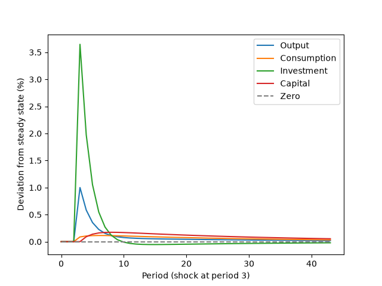
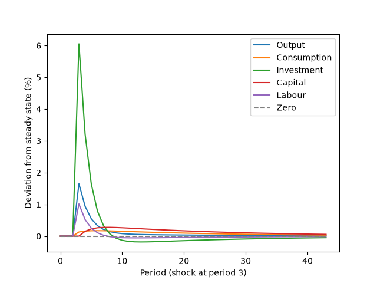

# 第 18 章: 実物的景気循環（RBC）モデル

## 18.1 この章の地図

第 15 章の IS-MP-PC モデルは、後ろ向きの期待で、家計と企業の最適化に基づいていませんでした（ルーカス批判）。この章の **RBC モデル**は、**代表的な消費者の最適化**（オイラー条件）から出発して、**完全競争の市場**で、TFP の変動だけから、景気循環を説明します。第 17 章の対数線形近似と解法で解いて、TFP ショックへの反応と、データとの比較をします。

| 項目 | 内容 |
| :--- | :--- |
| 経済学の題材 | 消費者の最適化、オイラー条件、割引因子、実質利子率と賃金、内生的な労働供給、労働供給の異時点間の代替、消費の平滑化、RBC 理論の意義と限界 |
| 使う Python の機能 | `dataclass`、第 17 章の関数（`log_linearize`・`solve_saddle_path`）、二分法、乱数の生成器を引数にする設計（第 8 章） |
| 新しく導入するライブラリ | なし |
| 完成形 | `RbcParameters`、`steady_state`、`calibrate_leisure_weight`、`equilibrium_equations`、`solve_rbc`、`impulse_response`、`simulate_with_shocks`、`stochastic_simulation`、`euler_residual` |
| ファイル | 実装: `lib/chapter18/rbc.py`、`lib/chapter18/plot.py`／テスト: `test/chapter18/test_rbc.py`、`test/chapter18/test_plot.py`（自分で書くときは、`practice/chapter18/` に、同じ名前で作ります） |
| データ | なし（パラメーターは、元の記事の値）、実際の統計（18.5 節。内閣府の GDP・消費・投資） |

### 経済学の式とコードの対応

| 経済学 | 式 | コード |
| :--- | :--- | :--- |
| 実質利子率（定常状態） | R = 1 ÷ β − 1 | `steady_state(params)["r"]` |
| 資本・産出比率 | K ÷ Y = α ÷ (R + δ) | `steady_state` |
| オイラー条件 | C(t)^(−θ) = β·E[(1 + R(t+1))·C(t+1)^(−θ)] | `equilibrium_equations` の 3 本目 |
| 資本の蓄積 | K' = Y − C + (1 − δ)·K | `equilibrium_equations` の 2 本目 |
| TFP | A' = A^ρ·e^v | `equilibrium_equations` の 1 本目 |
| 労働供給（内生的） | (1 − L)·W = m·C^θ | `_solve_labour`（二分法） |
| 解（政策関数） | ĉ = P·(â, k̂) | `solve_rbc(params, endogenous_labour)` |
| 解の検証 | 非線形のオイラー方程式の誤差 | `euler_residual(solution, a_dev, k_dev)` |

> **記号について**: β は割引因子、θ は危険回避度（相対的危険回避度）、m は余暇の重み、L は労働時間（総時間を 1 に基準化）です。R は実質利子率、W は実質賃金です。α・δ・ρ・σ は、第 16 章と同じです。a・k・c・y・i・r・w・l は、定常状態からの、対数の乖離（%）です。一覧は、[記号について](how-to-read.md#symbols) を参照してください。

## 18.2 予想する

β = 0.99、δ = 0.025、α = 1/3（四半期）です。TFP が 1% 上がる、1 回だけのショックが起きます。

- 定常状態の実質利子率 R は、いくつですか。資本・産出比率 K ÷ Y は、いくつですか
- ショックの期に、産出量・消費・投資は、それぞれ何 % 動きますか。**どれが最も大きく**、**どれが最も小さく**動くでしょうか
- 労働供給を内生的にすると、産出量の反応は、大きくなりますか、小さくなりますか

答えは、R = 1 ÷ 0.99 − 1 = **0.0101**（四半期 1%）、K ÷ Y = (1/3) ÷ (0.0101 + 0.025) = **9.5** です。α = 0.36 の基本モデルでは、産出量 +1.00%、消費 +0.09%、投資 +3.65% です。**消費は、ほとんど動かず**（消費の平滑化）、**投資が、大きく動きます**。労働を内生的にすると、産出量は **+1.65%** に増幅されます。

## 18.3 モデルの考え方

### 消費者の最適化と、オイラー条件

代表的な消費者は、生涯の効用 U = u(C₀) + β·u(C₁) + β²·u(C₂) + … を最大にします（β: 割引因子、u(C) = (C^(1−θ) − 1) ÷ (1 − θ)）。ある期の消費を 1 単位減らして貯蓄する（効用で測った費用 C(t)^(−θ)）と、次の期に (1 + R(t+1)) 単位の財が得られ、その効用の増分は β·(1 + R(t+1))·C(t+1)^(−θ) です。最適なら、両者が等しくなります（**オイラー条件**）。

> C(t)^(−θ) = β·E[(1 + R(t+1))·C(t+1)^(−θ)]

### 企業と、価格

完全競争の企業は、要素の限界生産性が価格と等しくなるように、資本と労働を使います。

> 実質利子率 R = α·Y/K − δ、実質賃金 W = (1 − α)·Y/L

### 均衡条件

| 式 | 決める変数 |
| :--- | :--- |
| オイラー条件 | C |
| K' = Y − C + (1 − δ)·K | K（Y = C + I、K' = I + (1 − δ)K） |
| Y = A·K^α·L^(1−α) | Y |
| A' = A^ρ·e^v | A |
| R・W の式 | R・W |

状態変数は (A, K)、ジャンプ変数は C です。他の変数（Y・I・R・W・L）は、(A, K, C) から決まります。この章は、**3 本の動学式（TFP・資本・オイラー）**に、第 17 章の対数線形近似と解法を使います。

### 定常状態

TFP のショックがなく（A = 1）、すべての変数が一定のとき、オイラー条件から **β·(1 + R) = 1、R = 1 ÷ β − 1**。R = α·Y/K − δ から、**K ÷ Y = α ÷ (R + δ)**。K ÷ L = (α ÷ (R + δ))^(1÷(1−α))。C = Y − δ·K。

### 内生的な労働供給

効用に余暇を加えます（u = ln C + m·ln(1 − L) など。一般には、C^(1−θ) の項と m·ln(1 − L)）。消費と余暇の限界効用が、賃金で結ばれるので、

> C^(−θ) = m ÷ ((1 − L)·W)　→　**(1 − L)·W = m·C^θ**

定常状態の労働時間は、閉じた形で求まります（L = (1 − α)·y ÷ ((1 − α)·y + m·(y − δ·z))、z = K ÷ L、y = z^α）。m = 1.73 のとき、**L ≈ 0.332（約 1/3）**です。逆に、目標の労働時間から、m を決めることもできます。

## 18.4 Red → Green → Refactor

### パラメーター

```python
BASIC = RbcParameters()


THIRD = RbcParameters(alpha=1 / 3)


@pytest.mark.parametrize(
    "kwargs",
    [
        {"alpha": 0.0},
        {"beta": 1.0},
        {"delta": 0.0},
        {"rho": 1.0},
        {"sigma": -0.1},
        {"theta": 0.0},
        {"hours": 0.0},
        {"leisure_weight": 0.0},
    ],
)
def test_パラメーターの範囲が合わなければ受け付けない(kwargs: dict[str, float]) -> None:
    with pytest.raises(ValueError, match="パラメーター"):
        RbcParameters(**kwargs)


def test_減耗率が1ならパラメーターとして受け付けない() -> None:
    with pytest.raises(ValueError, match="パラメーター"):
        RbcParameters(delta=1.0)


def test_ショックの標準偏差が0でも受け付ける() -> None:
    assert RbcParameters(sigma=0.0).sigma == 0.0
```

```python
@dataclass(frozen=True)
class RbcParameters:
    """α（資本分配率）、β（割引因子）、δ（減耗率）、ρ・σ（TFP）、θ、L、m（余暇の重み）。"""

    alpha: float = 0.36
    beta: float = 0.99
    delta: float = 0.025
    rho: float = 0.551
    sigma: float = 0.0078
    theta: float = 1.0
    hours: float = 0.33
    leisure_weight: float = 1.73

    def __post_init__(self) -> None:
        if not (
            0 < self.alpha < 1
            and 0 < self.beta < 1
            and 0 < self.delta < 1
            and abs(self.rho) < 1
            and self.sigma >= 0
            and self.theta > 0
            and self.hours > 0
            and self.leisure_weight > 0
        ):
            raise ValueError(
                "パラメーターは、α・β・δ が 0 と 1 の間、|ρ| < 1、σ ≥ 0、"
                "θ・L・m > 0 でなければならない"
            )
```

### 定常状態

```python
def test_実質利子率はβの逆数マイナス1() -> None:
    ss = steady_state(THIRD)
    assert ss["r"] == pytest.approx(1 / 0.99 - 1)
    assert ss["r"] == pytest.approx(0.0101, abs=0.0001)


def test_資本産出比率はαを実質利子率と減耗率の和で割った値() -> None:
    ss = steady_state(THIRD)
    assert ss["k"] / ss["y"] == pytest.approx((1 / 3) / (ss["r"] + 0.025))
    assert ss["k"] / ss["y"] == pytest.approx(9.5, abs=0.01)


def test_定常状態の資本は投資と減耗が等しく消費は産出から投資を引いた値() -> None:
    ss = steady_state(BASIC)
    assert ss["i"] == pytest.approx(BASIC.delta * ss["k"])
    assert ss["c"] == pytest.approx(ss["y"] - ss["i"])
    assert ss["w"] == pytest.approx((1 - BASIC.alpha) * ss["y"] / BASIC.hours)
    assert ss["y"] == pytest.approx(
        ss["k"] ** BASIC.alpha * BASIC.hours ** (1 - BASIC.alpha)
    )


def test_内生的労働供給の定常状態では労働供給の条件が成り立つ() -> None:
    ss = steady_state(BASIC, endogenous_labour=True)
    assert (1 - ss["l"]) * ss["w"] == pytest.approx(BASIC.leisure_weight * ss["c"])


def test_余暇の重みから労働時間は約3分の1() -> None:
    assert steady_state(BASIC, True)["l"] == pytest.approx(0.332, abs=0.001)


def test_余暇の重みを決めると定常状態の労働時間が目標になる() -> None:
    m = calibrate_leisure_weight(BASIC, target_hours=1 / 3)
    params = RbcParameters(leisure_weight=m)
    assert steady_state(params, True)["l"] == pytest.approx(1 / 3)


def test_βが1に近いほど資本産出比率が大きい() -> None:
    patient = RbcParameters(beta=0.995)
    assert steady_state(patient)["k"] / steady_state(patient)["y"] > (
        steady_state(BASIC)["k"] / steady_state(BASIC)["y"]
    )
```

```python
def _capital_labour_ratio(params: RbcParameters) -> float:
    """K ÷ L = (α ÷ (R + δ))^(1÷(1-α))、R = 1 ÷ β - 1。"""
    r = 1 / params.beta - 1
    return float((params.alpha / (r + params.delta)) ** (1 / (1 - params.alpha)))


def _steady_hours(params: RbcParameters) -> float:
    """内生的労働供給の定常状態の労働時間 L = (1-α)·y ÷ ((1-α)·y + m·(y - δ·z))。

    z = K ÷ L、y = z^α（1 人当たりの産出量）。
    """
    z = _capital_labour_ratio(params)
    y = z**params.alpha
    wage = (1 - params.alpha) * y
    return float(wage / (wage + params.leisure_weight * (y - params.delta * z)))


def calibrate_leisure_weight(params: RbcParameters, target_hours: float) -> float:
    """定常状態の労働時間が target_hours になる、余暇の重み m。"""
    z = _capital_labour_ratio(params)
    y = z**params.alpha
    return float(
        (1 - target_hours)
        * (1 - params.alpha)
        * y
        / (target_hours * (y - params.delta * z))
    )


def steady_state(
    params: RbcParameters, endogenous_labour: bool = False
) -> dict[str, float]:
    """定常状態（A = 1）の、A・K・C・Y・I・R・W・L。"""
    hours = _steady_hours(params) if endogenous_labour else params.hours
    k = _capital_labour_ratio(params) * hours
    y = k**params.alpha * hours ** (1 - params.alpha)
    return {
        "a": 1.0,
        "k": k,
        "c": y - params.delta * k,
        "y": y,
        "i": params.delta * k,
        "r": 1 / params.beta - 1,
        "w": (1 - params.alpha) * y / hours,
        "l": hours,
    }
```

α = 1/3 のとき、R = 0.0101、K ÷ Y = 9.5 です。基本モデル（α = 0.36、L = 0.33）では、K = 12.54、Y = 1.222、C = 0.909、I = 0.313、W = 2.371。内生的労働供給（m = 1.73）では、L = 0.3322、K = 12.62、Y = 1.231 です。

### 均衡条件と、その検証

```python
def _solve_labour(params: RbcParameters, a: float, k: float, c: float) -> float:
    """労働供給の条件 (1 - L)·W = m·C^θ を満たす L を、二分法で求める。"""
    low, high = 1e-12, 1 - 1e-12
    for _ in range(100):
        mid = (low + high) / 2
        wage = (1 - params.alpha) * a * k**params.alpha * mid**-params.alpha
        if (1 - mid) * wage > params.leisure_weight * c**params.theta:
            low = mid
        else:
            high = mid
    return (low + high) / 2


def _statics(
    params: RbcParameters, endogenous_labour: bool, a: float, k: float, c: float
) -> dict[str, float]:
    """(A, K, C) から決まる、Y・I・R・W・L。"""
    hours = _solve_labour(params, a, k, c) if endogenous_labour else params.hours
    y = a * k**params.alpha * hours ** (1 - params.alpha)
    return {
        "y": y,
        "i": y - c,
        "r": params.alpha * y / k - params.delta,
        "w": (1 - params.alpha) * y / hours,
        "l": hours,
    }


def equilibrium_equations(
    params: RbcParameters, endogenous_labour: bool = False
) -> Equations:
    """均衡条件 f(x', x) = 0（x = (A, K, C)）: TFP、資本の蓄積、オイラー方程式。"""

    def equations(x_next: Vector, x: Vector) -> Vector:
        now = _statics(params, endogenous_labour, *x)
        nxt = _statics(params, endogenous_labour, *x_next)
        tfp = x_next[0] - x[0] ** params.rho
        capital = x_next[1] - (now["y"] - x[2] + (1 - params.delta) * x[1])
        euler = (
            params.beta * (1 + nxt["r"]) / x_next[2] ** params.theta
            - 1 / x[2] ** params.theta
        )
        return np.array([tfp, capital, euler])

    return equations
```

```python
@pytest.mark.parametrize("endogenous_labour", [False, True])
def test_定常状態はすべての均衡条件を満たす(endogenous_labour: bool) -> None:
    ss = steady_state(BASIC, endogenous_labour)
    state = np.array([ss["a"], ss["k"], ss["c"]])
    residual = equilibrium_equations(BASIC, endogenous_labour)(state, state)
    assert residual == pytest.approx(np.zeros(3), abs=1e-10)


def test_危険回避度θを変えても定常状態は変わらない() -> None:
    for theta in (0.5, 1.0, 2.0):
        params = RbcParameters(theta=theta)
        assert steady_state(params)["k"] == pytest.approx(steady_state(BASIC)["k"])
        assert euler_residual(solve_rbc(params), 0.0, 0.0) == pytest.approx(
            0.0, abs=1e-9
        )
```

定常状態が、3 本の均衡条件を**すべて満たす**こと（残差が 0）を、基本モデルと内生的労働供給の両方で確かめます。危険回避度 θ を変えても、定常状態は変わりません（オイラー条件の θ が、定常状態で消えるため）。

### 解く

```python
@dataclass(frozen=True)
class RbcSolution:
    """対数線形近似した RBC モデルの解。

    policy: ジャンプ変数（消費）= policy @ (a, k)。transition: (a, k) の遷移行列。
    statics: (a, k, c) から、y・i・r・w（・l）の乖離を求める行列。
    """

    params: RbcParameters
    endogenous_labour: bool
    steady: dict[str, float]
    policy: NDArray[np.float64]
    transition: NDArray[np.float64]
    statics: NDArray[np.float64]
    static_names: tuple[str, ...]


def solve_rbc(params: RbcParameters, endogenous_labour: bool = False) -> RbcSolution:
    """RBC モデルを、定常状態の近くで、対数線形近似して解く。"""
    ss = steady_state(params, endogenous_labour)
    x_star = np.array([ss["a"], ss["k"], ss["c"]])
    a_matrix, b_matrix = log_linearize(
        equilibrium_equations(params, endogenous_labour), x_star
    )
    policy, transition = solve_saddle_path(a_matrix, b_matrix, n_state=2)
    names = ("y", "i", "r", "w", "l") if endogenous_labour else ("y", "i", "r", "w")

    def static_logs(u: Vector) -> Vector:
        values = _statics(params, endogenous_labour, *(x_star * np.exp(u)))
        return np.array([np.log(values[name]) for name in names])

    statics = numerical_jacobian(static_logs, np.zeros(3))
    return RbcSolution(
        params=params,
        endogenous_labour=endogenous_labour,
        steady=ss,
        policy=policy,
        transition=transition,
        statics=statics,
        static_names=names,
    )
```

```python
def test_基本モデルの政策関数と遷移行列の固有値() -> None:
    solution = solve_rbc(BASIC)
    assert solution.policy[0] == pytest.approx([0.0874, 0.6182], abs=0.0001)
    eigenvalues = sorted(float(v) for v in np.linalg.eigvals(solution.transition).real)
    assert eigenvalues == pytest.approx([0.551, 0.9653], abs=0.0001)


def test_内生的労働供給の政策関数と遷移行列の固有値() -> None:
    solution = solve_rbc(BASIC, True)
    assert solution.policy[0] == pytest.approx([0.1307, 0.569], abs=0.0001)
    eigenvalues = sorted(float(v) for v in np.linalg.eigvals(solution.transition).real)
    assert eigenvalues == pytest.approx([0.551, 0.9536], abs=0.0001)
```

| | 基本モデル | 内生的労働供給 |
| :--- | ---: | ---: |
| 消費の政策関数 ĉ = P_a·â + P_k·k̂ の P_a | 0.0874 | 0.1307 |
| 同 P_k | 0.6182 | 0.5690 |
| 遷移行列の固有値（TFP） | 0.551 | 0.551 |
| 同（資本） | 0.9653 | 0.9536 |

遷移行列の固有値は、TFP の持続性 ρ = 0.551 と、**資本の持続性**（0.965）です。ブランチャード・カーンの条件（不安定な根が 1 つ）は、第 17 章の `solve_saddle_path` が検査します。

### インパルス反応

```python
def _responses(solution: RbcSolution, states: NDArray[np.float64]) -> pd.DataFrame:
    """状態変数 (a, k)（対数の乖離）の系列から、すべての変数の乖離（%）を求める。"""
    consumption = states @ solution.policy.T
    core = np.column_stack([states, consumption])
    others = core @ solution.statics.T
    data: dict[str, Any] = {
        "a": states[:, 0],
        "k": states[:, 1],
        "c": consumption[:, 0],
    }
    for i, name in enumerate(solution.static_names):
        data[name] = others[:, i]
    return pd.DataFrame(data) * 100


def simulate_with_shocks(
    solution: RbcSolution, shocks: NDArray[np.float64]
) -> pd.DataFrame:
    """TFP のショック v(t) の系列から、すべての変数の乖離（%）を計算する。"""
    state = np.zeros(2)
    states = []
    for shock in shocks:
        state = solution.transition @ state + np.array([float(shock), 0.0])
        states.append(state)
    return _responses(solution, np.array(states))


def impulse_response(
    solution: RbcSolution,
    shock: float = 0.01,
    periods_after: int = 40,
    periods_before: int = 3,
) -> pd.DataFrame:
    """1 期間だけの TFP ショック（既定は 1%）への反応（定常状態からの乖離、%）。"""
    shocks = np.zeros(periods_before + 1 + periods_after)
    shocks[periods_before] = shock
    return simulate_with_shocks(solution, shocks)
```

```python
def test_基本モデルのインパクト効果は元の記事のlinearsolveの結果と一致する() -> None:
    df = impulse_response(solve_rbc(BASIC), shock=0.01)
    impact = df.iloc[3] / 1.0
    assert impact["a"] == pytest.approx(1.0)
    assert impact["k"] == pytest.approx(0.0)
    assert impact["y"] == pytest.approx(1.0)
    assert impact["w"] == pytest.approx(1.0)
    assert impact["r"] == pytest.approx(3.475, abs=0.001)
    assert impact["c"] == pytest.approx(0.0874, abs=0.0001)
    assert impact["i"] == pytest.approx(3.6466, abs=0.001)


def test_列と長さ() -> None:
    basic = impulse_response(solve_rbc(BASIC), shock=0.01)
    assert list(basic.columns) == ["a", "k", "c", "y", "i", "r", "w"]
    assert len(basic) == 3 + 1 + 40
    extended = impulse_response(solve_rbc(BASIC, True), shock=0.01, periods_after=10)
    assert list(extended.columns) == ["a", "k", "c", "y", "i", "r", "w", "l"]
    assert len(extended) == 3 + 1 + 10


def test_ショック前の3期間は定常状態() -> None:
    df = impulse_response(solve_rbc(BASIC), shock=0.01)
    assert df.iloc[:3].to_numpy() == pytest.approx(0.0)


def test_TFPはAR1で戻り資本は翌期から増える() -> None:
    df = impulse_response(solve_rbc(BASIC), shock=0.01)
    assert df["a"].iloc[4] == pytest.approx(BASIC.rho * df["a"].iloc[3])
    assert df["k"].iloc[4] > 0
    assert df["k"].iloc[5] > df["k"].iloc[4]


def test_消費は産出量より滑らかで投資は産出量より大きく動く() -> None:
    df = impulse_response(solve_rbc(BASIC), shock=0.01)
    assert df["c"].abs().max() < df["y"].abs().max()
    assert df["i"].abs().max() > df["y"].abs().max()


def test_モデルの均衡経路はすべての変数が定常状態に戻る() -> None:
    df = impulse_response(solve_rbc(BASIC), shock=0.01, periods_after=400)
    assert df.iloc[-1].abs().max() < 1e-2


def test_ショックは比例し足し合わせられる() -> None:
    solution = solve_rbc(BASIC)
    one = impulse_response(solution, shock=0.01)
    three = impulse_response(solution, shock=0.03)
    assert three.to_numpy() == pytest.approx(3 * one.to_numpy())


def test_シミュレーションは単位ショックの反応の重ね合わせ() -> None:
    solution = solve_rbc(BASIC)
    shocks = white_noise(60, 0.0078, np.random.default_rng(1))
    df = simulate_with_shocks(solution, shocks)
    unit = (
        impulse_response(solution, shock=1.0, periods_after=60)["y"].iloc[3:].to_numpy()
    )
    expected = np.convolve(shocks, unit)[:60]
    assert df["y"].to_numpy() == pytest.approx(expected)
```

**最初のテストが、外部の照合値です。** 元の記事の `linearsolve` が出した、インパクト効果（r = 3.475、c = 0.0874、i = 3.6466）と、**自作の実装が一致します**。最後のテストは、線形のモデルでは、シミュレーションが、**単位ショックの反応の重ね合わせ**（畳み込み）になることを確かめます。

TFP が 1% 上がった、基本モデルの反応です（定常状態からの乖離、%）。

| 期 | TFP | 資本 | 消費 | 産出量 | 投資 | 実質利子率 |
| :--- | ---: | ---: | ---: | ---: | ---: | ---: |
| ショックの期 | 1.000 | 0.000 | 0.087 | 1.000 | 3.647 | 3.475 |
| 1 期後 | 0.551 | 0.091 | 0.105 | 0.584 | 1.974 | 1.712 |
| 2 期後 | 0.304 | 0.138 | 0.112 | 0.353 | 1.053 | 0.748 |
| 3 期後 | 0.167 | 0.161 | 0.114 | 0.225 | 0.547 | 0.223 |



```python
def plot_rbc_responses(df: pd.DataFrame) -> Figure:
    """産出量・消費・投資・資本（と、あれば労働）の反応を、0 の線と一緒に描く。"""
    n = len(df)
    fig, ax = plt.subplots()
    for column, label in LABELS.items():
        if column in df.columns:
            ax.plot(range(n), df[column].to_numpy(), label=label)
    ax.plot([0, n - 1], [0, 0], "--", color="gray", label="Zero")
    ax.set_xlabel("Period (shock at period 3)")
    ax.set_ylabel("Deviation from steady state (%)")
    ax.legend()
    plt.close(fig)
    return fig
```

図の読み方:

- **投資が、最も大きく動きます**（+3.65%）。TFP の上昇で、資本の限界生産性が上がり（実質利子率 +3.5%）、貯蓄・投資が増えます。産出量の増加の多くは、**投資に回ります**
- **消費は、ほとんど動きません**（+0.09%）。TFP の上昇は一時的で、**恒常所得**（賃金と利子所得の、現在価値の合計）は、ほとんど変わらないため、消費者は、消費を、平滑にします
- **資本は、ゆっくり増え**（ピークは、ショックの約 10 期後）、ゆっくり戻ります（半減期は約 20 四半期）。TFP（半減期は約 1.2 四半期）より、はるかに持続的です

### 内生的な労働供給

```python
def test_内生的労働供給では労働が増え産出量の反応が大きくなる() -> None:
    basic = impulse_response(solve_rbc(BASIC), shock=0.01)
    extended = impulse_response(solve_rbc(BASIC, True), shock=0.01)
    assert extended["l"].iloc[3] > 0
    assert extended["y"].iloc[3] > basic["y"].iloc[3]
    assert extended["w"].iloc[3] < basic["w"].iloc[3]
    assert extended["i"].iloc[3] > basic["i"].iloc[3]


def test_内生的労働供給のインパクト効果() -> None:
    impact = impulse_response(solve_rbc(BASIC, True), shock=0.01).iloc[3]
    assert impact["y"] == pytest.approx(1.649, abs=0.001)
    assert impact["c"] == pytest.approx(0.131, abs=0.001)
    assert impact["i"] == pytest.approx(6.051, abs=0.001)
    assert impact["r"] == pytest.approx(5.730, abs=0.001)
    assert impact["w"] == pytest.approx(0.635, abs=0.001)
    assert impact["l"] == pytest.approx(1.014, abs=0.001)


def test_労働供給は数期後に定常状態を下回る() -> None:
    df = impulse_response(solve_rbc(BASIC, True), shock=0.01)
    assert df["l"].iloc[3] > 0
    assert df["l"].iloc[9] < 0
    assert df["l"].iloc[15] < 0
```

| ショックの期 | 基本モデル | 内生的労働供給 |
| :--- | ---: | ---: |
| 産出量 | 1.000 | **1.649** |
| 消費 | 0.087 | 0.131 |
| 投資 | 3.647 | **6.051** |
| 実質利子率 | 3.475 | 5.730 |
| 実質賃金 | 1.000 | 0.635 |
| 労働 | （一定） | **1.014** |



**労働供給の異時点間の代替**が働きます。TFP の上昇で、賃金と実質利子率が一時的に高くなるので、消費者は、**高い間に、余暇を減らして、長く働く**（労働 +1.0%）。これが、産出量と投資の反応を増幅します（1.00% → 1.65%、3.65% → 6.05%）。実質賃金の上昇は、労働が増えるぶん抑えられます（1.00% → 0.64%）。労働は、6 期ほど後に、定常状態を**下回り**（−0.05%）ます。賃金が定常状態に戻る一方で、消費が高止まりするためです。

### 解の検証: オイラー方程式の誤差

線形の解は、近似です。**非線形のオイラー方程式に入れて、誤差を見る**ことで、解が正しいかを確かめます。解が正しければ、誤差は、定常状態で 0 で、乖離の**2 乗**に比例して小さくなります（1 次の項が、消えるため）。

```python
def euler_residual(solution: RbcSolution, a_dev: float, k_dev: float) -> float:
    """対数線形の解（政策関数）を、非線形のオイラー方程式に入れたときの、誤差。

    状態 (ln A, ln K - ln K*) = (a_dev, k_dev)。消費は政策関数、来期の状態は
    非線形の式（ショックなし）で求め、β·(1 + R')·(C ÷ C')^θ - 1 を返す。
    定常状態では 0。解が正しければ、乖離の 2 乗に比例して、小さい。
    """
    params, ss = solution.params, solution.steady
    consumption = ss["c"] * np.exp(solution.policy[0] @ np.array([a_dev, k_dev]))
    a, k = np.exp(a_dev), ss["k"] * np.exp(k_dev)
    now = _statics(params, solution.endogenous_labour, a, k, consumption)
    a_next = a**params.rho
    k_next = now["y"] - consumption + (1 - params.delta) * k
    states_next = np.array([np.log(a_next), np.log(k_next / ss["k"])])
    consumption_next = ss["c"] * np.exp(solution.policy[0] @ states_next)
    nxt = _statics(params, solution.endogenous_labour, a_next, k_next, consumption_next)
    return float(
        params.beta * (1 + nxt["r"]) * (consumption / consumption_next) ** params.theta
        - 1
    )
```

```python
@pytest.mark.parametrize("endogenous_labour", [False, True])
def test_オイラー方程式の誤差は定常状態で0(endogenous_labour: bool) -> None:
    solution = solve_rbc(BASIC, endogenous_labour)
    assert euler_residual(solution, 0.0, 0.0) == pytest.approx(0.0, abs=1e-9)


@pytest.mark.parametrize("endogenous_labour", [False, True])
def test_オイラー方程式の誤差は乖離の2乗に比例して小さい(
    endogenous_labour: bool,
) -> None:
    solution = solve_rbc(BASIC, endogenous_labour)
    small = abs(euler_residual(solution, 0.005, 0.005))
    large = abs(euler_residual(solution, 0.01, 0.01))
    assert 0 < small < large < 1e-3
    assert 3 < large / small < 5
```

| 状態の乖離（a と k が同時） | 基本モデルの誤差 | 内生的労働供給の誤差 |
| ---: | ---: | ---: |
| 0.5% | −0.00000002 | −0.00000018 |
| 1% | −0.00000008 | −0.00000071 |
| 2% | −0.00000031 | −0.00000284 |

乖離が 2 倍になると、誤差は**約 4 倍**（2 乗）になります。**政策関数が間違っていれば、誤差は 1 次（2 倍）**になるので、この検証は、実装の誤りを検出できます。

### 確率的シミュレーション

```python
def stochastic_simulation(
    solution: RbcSolution, n: int, rng: np.random.Generator
) -> pd.DataFrame:
    """毎期、TFP にショックが起きる、n 期間のシミュレーション（乱数の生成器を渡す）。"""
    return simulate_with_shocks(solution, white_noise(n, solution.params.sigma, rng))
```

```python
def test_基本モデルのシミュレーションの特徴() -> None:
    sim = stochastic_simulation(solve_rbc(BASIC), 100000, np.random.default_rng(0))
    assert sim["c"].std() / sim["y"].std() == pytest.approx(0.393, abs=0.001)
    assert sim["i"].std() / sim["y"].std() == pytest.approx(3.395, abs=0.001)
    assert sim["c"].autocorr() == pytest.approx(0.984, abs=0.001)
    assert sim["i"].autocorr() == pytest.approx(0.537, abs=0.001)
    assert sim["y"].corr(sim["c"]) == pytest.approx(0.561, abs=0.001)
    assert sim["y"].corr(sim["i"]) == pytest.approx(0.961, abs=0.001)


def test_内生的労働供給のシミュレーションの特徴() -> None:
    sim = stochastic_simulation(
        solve_rbc(BASIC, True), 100000, np.random.default_rng(0)
    )
    assert sim["y"].std() == pytest.approx(1.583, abs=0.001)
    assert sim["c"].std() / sim["y"].std() == pytest.approx(0.328, abs=0.001)
    assert sim["i"].std() / sim["y"].std() == pytest.approx(3.509, abs=0.001)
    assert sim["l"].std() / sim["y"].std() == pytest.approx(0.586, abs=0.001)
    assert sim["y"].corr(sim["l"]) == pytest.approx(0.947, abs=0.001)


def test_シミュレーションの種が同じなら同じ結果() -> None:
    solution = solve_rbc(BASIC)
    first = stochastic_simulation(solution, 50, np.random.default_rng(3))
    second = stochastic_simulation(solution, 50, np.random.default_rng(3))
    assert first.to_numpy() == pytest.approx(second.to_numpy())


def test_危険回避度が大きいほど消費の最初の反応は小さい() -> None:
    impacts = [
        float(
            impulse_response(solve_rbc(RbcParameters(theta=theta)), shock=0.01)[
                "c"
            ].iloc[3]
        )
        for theta in (0.5, 1.0, 2.0, 5.0)
    ]
    assert impacts == pytest.approx([0.0927, 0.0874, 0.0758, 0.0599], abs=0.0001)
    assert impacts == sorted(impacts, reverse=True)
```

10 万期間のシミュレーション（σ = 0.78%、種 0）の、産出量との相対的な変動と、相関は、次のとおりです。

| | 基本モデル | 内生的労働供給 |
| :--- | ---: | ---: |
| 産出量の標準偏差（%） | 0.994 | 1.583 |
| 消費の相対的な変動（産出量 = 1） | 0.393 | 0.328 |
| 投資の相対的な変動 | 3.395 | 3.509 |
| 労働の相対的な変動 | （一定） | 0.586 |
| 消費と産出量の相関 | 0.561 | 0.512 |
| 投資と産出量の相関 | 0.961 | 0.972 |

### 実行結果

```bash
cd apps/macro-programming/python
uv run pytest test/chapter18
```

```text
46 passed
```

## 18.5 実際の統計で試す（内閣府の GDP・消費・投資と、モデル）

第 12 章の 12.5 節で読み込んだ、**実際の統計**（内閣府、実質 GDP・民間最終消費支出・民間企業設備、1994Q1〜2026Q1、129 四半期）を、HP フィルター（λ = 1600）で、トレンドと循環に分け、モデルの、**HP フィルターを同じようにかけた**シミュレーション（2000 期間、種 0）と比べます。

```python
from pathlib import Path

import numpy as np

from lib.chapter09.cycles import cycle, log_cycle
from lib.chapter12.cabinet import load_cabinet_quarterly
from lib.chapter18.rbc import RbcParameters, solve_rbc, stochastic_simulation

path = Path("data/gaku-jk2611.csv")
y = log_cycle(load_cabinet_quarterly(path, column=1))
c = log_cycle(load_cabinet_quarterly(path, column=2))
i = log_cycle(load_cabinet_quarterly(path, column=6))

sim = stochastic_simulation(solve_rbc(RbcParameters()), 2000, np.random.default_rng(0))
model_y, model_c, model_i = cycle(sim["y"]), cycle(sim["c"]), cycle(sim["i"])
```

```python
def test_HPフィルターをかけたシミュレーションの特徴() -> None:
    for labour, y_std, c_rel, i_rel, c_ac in (
        (False, 0.815, 0.140, 3.693, 0.828),
        (True, 1.349, 0.129, 3.715, 0.834),
    ):
        sim = stochastic_simulation(
            solve_rbc(BASIC, labour), 2000, np.random.default_rng(0)
        )
        y, c, i = cycle(sim["y"]), cycle(sim["c"]), cycle(sim["i"])
        assert y.std() == pytest.approx(y_std, abs=0.001)
        assert c.std() / y.std() == pytest.approx(c_rel, abs=0.001)
        assert i.std() / y.std() == pytest.approx(i_rel, abs=0.001)
        assert c.autocorr() == pytest.approx(c_ac, abs=0.001)
        assert y.corr(i) == pytest.approx(0.996, abs=0.001)
```

| 特徴（HP フィルター後） | 実際の統計 | 基本モデル | 内生的労働供給 |
| :--- | ---: | ---: | ---: |
| 産出量の標準偏差（%） | **1.577** | 0.815 | 1.349 |
| 消費の相対的な変動 | **0.832** | 0.140 | 0.129 |
| 投資の相対的な変動 | **2.174** | 3.693 | 3.715 |
| 産出量の自己相関 | **0.709** | 0.429 | 0.426 |
| 消費の自己相関 | **0.555** | 0.828 | 0.834 |
| 投資の自己相関 | **0.835** | 0.420 | 0.417 |
| 消費と産出量の相関 | **0.783** | 0.550 | 0.529 |
| 投資と産出量の相関 | **0.770** | 0.996 | 0.996 |

読み取れることと、注意点:

- **定性的な特徴は、再現できています。** 投資は、産出量より大きく動き（2.2 倍と 3.7 倍）、消費は、産出量より小さく動きます（0.83 倍と 0.13 倍）。**内生的な労働供給**は、産出量の変動を、データに近づけます（0.82 → 1.35。データは 1.58）
- **定量的には、大きく外れます。** 消費は、**平滑すぎます**（0.83 に対して 0.14）。投資は、**変動しすぎ**、産出量との相関も、高すぎます（0.996 と 0.770）。産出量の**持続性**は、足りません（0.43 と 0.71。モデルの持続性は、ρ = 0.551 に依存します）。消費の自己相関は、**高すぎます**（0.83 と 0.56）
- 元の記事も、同じ傾向を報告しています（投資の変動は近く、消費の変動は小さすぎる、自己相関は合わない）。**RBC モデルは、景気循環の主な特徴の一部を、TFP だけで説明できますが、全体を説明できる、とは言えません**
- ここでの比較は、**1 つのパラメーターの組と、1 つの種**による、2000 期間のシミュレーションです。種や期間を変えると、数値は動きます。**パラメーターは、元の記事の値**（日本の TFP から推定したもの）で、この比較のために、決め直してはいません

## 18.6 規則で言うと

1. **均衡条件を、オイラー条件から導き、定常状態が、すべてを満たすかを確かめる。** 残差が 0 になること
2. **外部の結果と、照合する。** 元の記事の `linearsolve` の結果と、自作の実装が一致すること
3. **解を、非線形の条件に戻して、誤差を見る。** 誤差が、乖離の 2 乗で小さくなること
4. **モデルの限界を、データと比べて、数値で言う。** 消費が平滑すぎる、投資が変動しすぎる、持続性が足りない

混同しやすい点を、表にまとめます。

| 混同しやすい点 | 違い |
| :--- | :--- |
| 消費の平滑化 と 貯蓄率が一定 | RBC は、最適化の結果として、貯蓄率が変わる（消費が平滑）。第 16 章は、貯蓄率が一定（消費も産出量と同じ動き） |
| 状態変数 と ジャンプ変数 | 資本は状態変数、消費はジャンプ変数（将来を見据えて、今期に決まる） |
| 基本モデル と 内生的労働供給 | 後者は、労働供給の異時点間の代替で、TFP の効果を増幅する |
| 政策関数 と インパルス反応 | 政策関数は、状態から消費を決める式。インパルス反応は、その解を使った、1 回のショックへの反応 |

### このモデルが成り立たない場面

- **完全競争・価格が柔軟です。** 市場の失敗がなく、景気循環は、TFP のショックへの最適な反応です。**貨幣は中立**で、金融政策は、景気循環に影響しません（第 11・12 章とは、対照的）。短期の価格の硬直性は、ニューケインジアン・モデルが扱います（この記事の範囲外）
- **代表的な個人です。** 失業や、家計の違い（異質性）は、扱いません
- **TFP が、景気循環のすべての原因とは限りません。** TFP の変動には、資本の稼働率や、測定誤差が含まれます（第 16 章）
- **線形近似です。** 大きなショックでは、精度が落ちます（第 17 章）

## 18.7 第 4 部の到達チェック

第 4 部（第 15〜18 章）の終わりです。何も見ずに、できるかどうかを、自分で確かめます。

### できること

| できること | 検証の方法 | 戻る章 |
| :--- | :--- | :--- |
| IS-MP-PC モデルを行列で解き、固有値で安定性を調べる | 手計算（PC ショックで π = 2.8、y = 99.2）。固有値 0 と φ = 0.8 | 第 15 章 |
| 景気循環を TFP・資本・労働の寄与に分解する | 寄与の合計が 1。手計算の例（4/6、1/6、1/6） | 第 16 章 |
| 確率的ソロー・モデルをシミュレーションする | 資本の収束の速さが 1 − (1 − α)·δ。消費・投資が産出量と同じ動き | 第 16 章 |
| 対数線形近似を数値微分で求める | 手計算（k̂' = δâ + [1 − (1 − α)δ]k̂）、`linearsolve` の 0.975 と一致 | 第 17 章 |
| 先を見る変数があるモデルを解く | x = λE x' + a の解（a ÷ (1 − λρ)）。不安定な根の数の検査 | 第 17 章 |
| RBC モデルの定常状態と、インパルス反応を求める | R = 1 ÷ β − 1、K ÷ Y = 9.5、インパクト効果（r = 3.475） | 第 18 章 |
| 解の正しさを、非線形の条件で検証する | オイラー方程式の誤差が、乖離の 2 乗に比例する | 第 18 章 |
| モデルの特徴を、データと並べて評価する | 消費が平滑すぎる、投資が変動しすぎる、という言い方を、数値でする | 第 18 章（18.5 節） |

### 時間を決めて書く課題

何も見ずに、時間を計って、関数とテストを書きます。

| 課題 | 目安の時間 |
| :--- | :--- |
| 数値微分のヤコビ行列と、手計算（f(x) = (x₀², x₀·x₁)）のテスト | 15 分 |
| RBC モデルの定常状態（R = 1 ÷ β − 1、K ÷ Y = α ÷ (R + δ)）の関数と、手計算のテスト | 15 分 |
| x = λ·E x(t+1) + a のモデルの解（ブランチャード・カーン）と、手計算のテスト | 25 分 |

### 誤りの原因の分類

できなかったときは、原因を分類して、戻る章に戻ります。

| 原因 | 例（第 4 部） | 対策 |
| :--- | :--- | :--- |
| 知らない | オイラー条件の導出。ブランチャード・カーンの条件 | 第 17・18 章に戻る |
| 見抜けない | 共分散を落とした分解が、合計 1 にならないこと。線形近似が、遠い乖離で悪くなること | 第 16・17 章の「規則で言うと」を読む |
| 混同した | 状態変数とジャンプ変数。乖離率と水準の差。基本モデルと内生的労働供給 | 各章の「混同しやすい点」の表を読む |
| 手順の誤り | 導いた式を、元の条件に戻して確かめない。照合値を使わない。非線形の条件で、解を検証しない | 手計算・照合値・恒等式・誤差の 4 つで、確かめる |

## 18.8 練習問題

| 種類 | 問題 |
| :--- | :--- |
| 想起 | 本文を閉じて、実質利子率の手計算のテスト（β = 0.99 で R = 1 ÷ 0.99 − 1）を書いてください |
| 生成 | 解説を見る前に、資本・産出比率 α ÷ (1 ÷ β − 1 + δ) を返す `capital_output_ratio(params)` を、テストから書いてください。α = 1/3 で 9.5 になりますか。`steady_state` の K ÷ Y と一致しますか |
| 多様 | TFP の持続性 ρ を 0.3、0.551、0.9 に変えたとき、ショックの期の消費と投資の反応は、どう変わるでしょうか（先に予想してから、確かめてください） |
| 交互 | 第 8 章の `shock_half_life` で、TFP（ρ = 0.551）と、資本（遷移行列の大きいほうの固有値）の、ショックの半減期を求めて、比べてください |

??? note "解答（先に自分で取り組んでから、開いてください）"

    **想起**:

    ```python
    def test_実質利子率はβの逆数マイナス1() -> None:
        params = RbcParameters(alpha=1 / 3)
        assert steady_state(params)["r"] == pytest.approx(1 / 0.99 - 1)
    ```

    **生成**:

    ```python
    def capital_output_ratio(params):
        return params.alpha / (1 / params.beta - 1 + params.delta)
    ```

    ```python
    def test_資本産出比率() -> None:
        params = RbcParameters(alpha=1 / 3)
        assert capital_output_ratio(params) == pytest.approx(9.5, abs=0.01)
        ss = steady_state(params)
        assert capital_output_ratio(params) == pytest.approx(ss["k"] / ss["y"])
    ```

    9.50 で、`steady_state` の K ÷ Y と一致します。**四半期のモデル**なので、資本は、四半期の産出量の約 9.5 倍（年の産出量の約 2.4 倍）です。

    **多様**: ρ が大きいほど、TFP の上昇が**長く続く**ので、恒常所得が大きく増え、**消費の反応は、大きく**なります。一方、投資は、TFP が早く戻るほど（ρ が小さいほど）、「いま投資して、高い収益を得る」誘因が強く、**大きく**なります。

    ```python
    def test_TFPの持続性を変えたときの反応() -> None:
        expected = {0.3: (0.0697, 3.698), 0.551: (0.0874, 3.647), 0.9: (0.2129, 3.283)}
        for rho, (consumption, investment) in expected.items():
            solution = solve_rbc(RbcParameters(rho=rho))
            impact = impulse_response(solution, shock=0.01).iloc[3]
            assert impact["c"] == pytest.approx(consumption, abs=0.0001)
            assert impact["i"] == pytest.approx(investment, abs=0.001)
    ```

    ρ = 0.3 では、消費 +0.07%、投資 +3.70%。ρ = 0.9 では、消費 +0.21%、投資 +3.28% です。**ショックが長く続くと、消費が動き、投資の反応は、少し小さく**なります。

    **交互**: TFP の半減期は 1.2 四半期、資本の半減期は約 20 四半期です。

    ```python
    def test_TFPと資本の半減期() -> None:
        solution = solve_rbc(RbcParameters())
        capital_root = max(float(v) for v in np.linalg.eigvals(solution.transition).real)
        assert shock_half_life(0.551) == pytest.approx(1.16, abs=0.01)
        assert shock_half_life(capital_root) == pytest.approx(19.63, abs=0.05)
    ```

    **資本の持続性が、景気循環の「ゆっくりした動き」を作ります**。TFP のショックは、すぐに消えても、その間に増えた資本が、長く残り、産出量や投資の動きを持続的にします。

## 18.9 振り返り

- 消費が、ほとんど動かなかったのは、なぜですか。恒常所得という言葉で、説明してください
- 労働供給を内生的にすると、産出量が増幅されました。それは、現実の景気循環の、どの特徴と整合的ですか。整合的でない特徴は、何ですか
- 解の正しさを、4 つの方法（手計算・照合値・恒等式・誤差）で確かめました。それぞれ、何を保証しますか

## 18.10 まとめ

- 消費者の最適化（オイラー条件）から、RBC モデルの定常状態と均衡条件を導き、第 17 章の対数線形近似と解法で解いた
- 基本モデルのインパクト効果が、元の記事の `linearsolve` の結果と一致し、オイラー方程式の誤差が、乖離の 2 乗に比例することを確かめた
- 労働供給を内生的にすると、TFP の効果が増幅されること（労働供給の異時点間の代替）を確かめた
- 日本の四半期データ（実際の統計）と比べて、投資の変動と、産出量の変動の定性的な特徴は再現できるが、消費の平滑化が強すぎ、持続性が足りないことを確かめた
- 第 4 部の到達チェックで、IS-MP-PC・確率的ソロー・対数線形近似・RBC を、自分でできるかを確かめた

### この記事のまとめ

この記事（全 18 章）で、マクロ経済学の中級レベルの内容を、**Python で動かし、テストで確かめる**方法を、4 つの部で学びました。

| 部 | 内容 | 道具 |
| :--- | :--- | :--- |
| 第 1 部（第 1〜7 章） | 長期分析: 成長、ソロー・モデル、収斂、購買力平価 | 回帰、差分方程式 |
| 第 2 部（第 8〜12 章） | 短期のデータ分析: 確率過程、景気循環、オークン、フィリップス曲線、貨幣 | AR(1)、HP フィルター |
| 第 3 部（第 13・14 章） | AD-AS モデルのカリブレーション、インパルス反応、分散分解 | 回帰、シミュレーション |
| 第 4 部（第 15〜18 章） | IS-MP-PC、確率的ソロー、対数線形近似、RBC | 行列、数値微分、固有値 |

**どの章でも、同じ作法**を使いました。テストを先に書き、手計算の値・恒等式・外部の結果で、実装を確かめる。答えを知っているデータで、手続きの限界を見る。モデルが説明できない特徴を、データと並べて、数値で言う。この作法は、モデルが変わっても、そのまま使えます。次の一歩は、**ニューケインジアン・モデル**（価格の硬直性と最適化を、両方入れる）です。この記事の道具（対数線形近似と、先を見る変数の解法）が、そのまま使えます。
