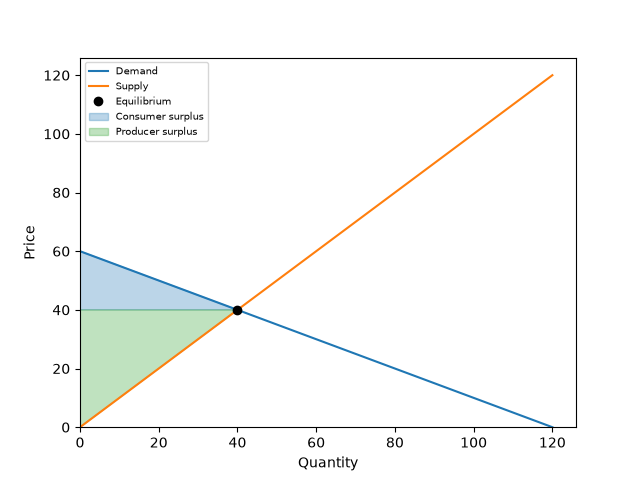
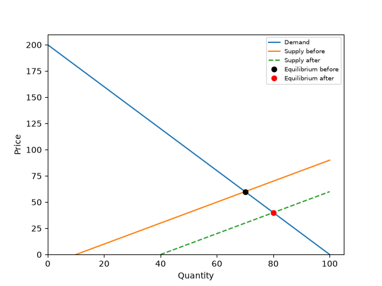

# 第 1 章: 1 次関数と市場メカニズム

## 1.1 この章の地図

経済学の教科書には、数式がたくさん出てきます。式を目で追っても、「わかったつもり」になりやすいのが、数学の難しいところです。この連載では、**式を Python の関数にして、手計算できる値をテストの期待値にし、数値とグラフで確かめます**。式が合っているかどうかを、自分のコードで判定できるようになります。

この連載の見取り図は、次のとおりです。

| 部 | 題材 | 数学 |
| :--- | :--- | :--- |
| 第 1 部（第 1〜4 章） | 市場・独占・お金の時間価値 | 1 次関数、2 次関数、指数・対数、数列 |
| 第 2 部（第 5〜8 章） | 利潤・効用の最大化 | 微分、ベクトル、偏微分 |
| 第 3 部（第 9〜12 章） | 回帰・リスク・オークション・成長 | 行列、確率、積分、漸化式 |

最初の章は、いちばん基本の道具、**1 次関数**です。需要も供給も、まず直線で表します。2 本の直線の交点が**市場均衡**で、2 本の直線と価格で囲まれた三角形の面積が**余剰**です。



| 項目 | 内容 |
| :--- | :--- |
| 経済学の題材 | 需要・供給、市場均衡、消費者余剰・生産者余剰、需要の集計、豊作貧乏、単位あたり費用が一定のケース |
| 数学 | 関数と変数、比例関数、1 次関数（直線）の式、連立方程式、三角形の面積 |
| 使う Python の機能 | 関数、タプル、`dataclass`、テスト（`pytest`） |
| 新しく導入するライブラリ | Matplotlib（図。[第 1 シリーズ](../economics-programming/index.md) の第 7 章で学習済み）。図のテストでは、NumPy（`np.asarray` など）も、説明なしに少し使います（第 7 章で、きちんと説明します。ここでは、写すだけでかまいません） |
| 完成形 | `line_through`、`demand_quantity`、`supply_quantity`、`Equilibrium`、`equilibrium`、`consumer_surplus`、`producer_surplus`、`total_surplus`、`market_demand`、`constant_cost_equilibrium` |
| ファイル | 実装: `lib/chapter01/market.py`、`lib/chapter01/plot.py`（図）／テスト: `test/chapter01/test_market.py`、`test/chapter01/test_plot.py`（自分で書くときは、`practice/chapter01/` に、同じ名前で作ります） |
| データ | なし（手計算できる小さな例だけ） |

### 数学の式とコードの対応

| 経済学・数学 | 式 | コード |
| :--- | :--- | :--- |
| 直線（傾きと切片） | y = 傾き × x + 切片 | `line_through(first, second)` |
| 需要（価格が上がると、需要量が減る） | q = a − b·p（b > 0） | `demand_quantity(price, a, b)` |
| 供給（価格が上がると、供給量が増える） | q = c + d·p（d > 0） | `supply_quantity(price, c, d)` |
| 市場均衡（需要量 ＝ 供給量） | p* = (a − c) ÷ (b + d)、q* = a − b·p* | `equilibrium(a, b, c, d)` |
| 消費者余剰 | 需要曲線の下で、価格の上の三角形の面積 | `consumer_surplus(price, a, b)` |
| 生産者余剰 | 価格の下で、供給曲線の上の面積 | `producer_surplus(price, c, d)` |
| 需要の集計 | 個人の需要量を、価格ごとに足す | `market_demand(price, individuals)` |
| 費用が一定のケース | 供給は水平。価格 ＝ 単位あたり費用 | `constant_cost_equilibrium(a, b, unit_cost)` |

> **記号について**: a・b は需要、c・d は供給の係数です。この章では、**価格 p を、グラフの縦軸**に、**数量 q を、横軸**に描きます。式は q = a − b·p（数量を価格で表す）と書き、グラフは p を縦軸にします。向きが逆に見えますが、同じ直線です（第 2 章では、独占の分析のために、価格を数量の式（逆需要 P = a − b·Q）で書きます。切り替えは、第 2 章で、注記します）。

### 前提とする第 1 シリーズの章

この連載は、Python の基礎を繰り返しません。次ができれば、読み進められます。

| できること | 第 1 シリーズの章 |
| :--- | :--- |
| 関数と pytest のテストを書く（Red → Green → Refactor） | 第 1〜6 章 |
| リスト・タプル・内包表記を使う | 第 2〜4 章 |
| Matplotlib で、折れ線グラフを描く | 第 7 章 |

高校数学の 1 次関数（傾きと切片）と、連立方程式を、一度は学んだ方を想定しています。忘れていても、1.4 節で思い出せます。

需要・供給・余剰の**経済学としての意味**（調整過程・課税の効果など）は、[ミクロ経済学のためのプログラミング（初級）の第 8 章](../micro-basics-programming/08-market-equilibrium-and-adjustment.md) と [第 9 章](../micro-basics-programming/09-surplus-and-tax.md) で扱います。この章は、**そこで使う数学**（直線・連立方程式・三角形の面積）を、関数とテストで確かめます。**記号の違いに注意**: ミクロ（初級）の連載は、需要を Q = a + s_d·P（傾き s_d は負）と、**符号つきの傾き**で書きます。この連載は、q = a − b·p（b は正）です。式の形は、b = −s_d と読み替えれば、同じです。独立して読めるように、この連載は、自分のコードで書き、ほかの連載のコードを import しません。

## 1.2 準備

サンプルコードは、リポジトリの `apps/math-for-economics-programming/python/` にあります。uv のインストールは、[第 1 シリーズの第 1 章](../economics-programming/01-preparation-and-first-test.md) を参照してください。

```bash
cd apps/math-for-economics-programming/python
uv sync
uv run pytest test/chapter01
```

```text
46 passed
```

自分でコードを書くときは、`practice/chapter01/` を作って、完成形と同じ名前（`market.py`・`test_market.py`、図の節も書くなら、`plot.py`・`test_plot.py`）のファイルに書きます（図の節を後回しにするなら、`plot.py` と `test_plot.py` は要らず、テストは 30 件になります）。テストは、`uv run pytest practice/chapter01` で動かします。テストの import は、`from lib.chapter01.market import ...` を、**`from practice.chapter01.market import ...` に書き換えて**ください（書き換えないと、完成形を読み込んで、最初から通ってしまい、Red になりません）。`plot.py` が `market.py` を import する行と、下の check スクリプトの import も、同じく `from practice.chapter01...` に書き換えます。**完成形（`lib/` と `test/`）は、答え合わせ用です。** 自分で書き終えてから、開いてください。

「予想の答え合わせ」のスクリプトは、`practice/chapter01/check.py` に保存し、アプリのディレクトリ（`apps/math-for-economics-programming/python`）で `uv run python -m practice.chapter01.check` と実行します（`python practice/...` と、ファイルのパスで実行すると、`lib`（import を書き換えたあとは `practice`）が見つからず、`ModuleNotFoundError` になります。**`-m` で、モジュールとして実行**してください。自分のコードを確かめるときは、スクリプトの import を `from practice.chapter01...` に書き換えます。Windows のシェルで、日本語が文字化けするときは、`PYTHONUTF8=1` を付けます）。

## 1.3 予想する

次の 4 つの問いに、**紙で、手計算で**答えてください。答えは、この節には書いてありません。「プログラミング」の節の「予想の答え合わせ」で、プログラムを動かして確かめます。

- ある財の需要が q = 120 − 2p、供給が q = p のとき、**均衡の価格と数量**は、いくつですか。そのときの**消費者余剰**と**生産者余剰**（どちらも三角形の面積）は、いくつですか
- 2 点 (10, 5) と (20, 15) を通る直線の、**傾きと切片**は、いくつですか
- 2 人の消費者がいます。A の需要は q = 60 − p、B の需要は q = 40 − p です。価格が 30 のとき、価格が 50 のとき、**市場全体の需要量**は、それぞれ、いくつですか。市場の需要曲線は、価格が 40 のところで、傾きが変わります。なぜですか
- 需要が q = 100 − 0.5p、供給が q = 10 + p の市場で、均衡の価格・数量と、売り手の**収入**（価格 × 数量）を求めてください。豊作で、供給が q = 40 + p に増えたとき、価格・数量・収入は、どうなりますか。**収入は、増えますか、減りますか**

## 1.4 1 次関数と市場の考え方

### 関数と変数

**関数**は、1 つの値（入力）を決めると、もう 1 つの値（出力）が決まる、対応です。経済学では、需要が、その典型です。**価格**（入力）を決めると、**需要量**（出力）が決まります。

入力を表す文字を**独立変数**、出力を表す文字を**従属変数**と言います。需要の式 q = a − b·p では、p が独立変数、q が従属変数です。a と b は、**パラメータ**（係数）です。値を決めると、直線が決まります。

### 直線の式

**1 次関数**は、y = 傾き × x + 切片 の形の関数で、グラフは**直線**です。

- **傾き**: x が 1 増えたときの、y の増え方。需要の q = a − b·p では、傾きは **−b**（価格が 1 上がると、需要量が b 減る）
- **切片**: x = 0 のときの y の値。需要では、**価格が 0 のときの需要量**（飽和需要）が a

**比例関数**（y = 傾き × x。切片が 0）は、特別な 1 次関数で、グラフは**原点を通る**直線です。比例関数には、「x が 2 倍になると、y も 2 倍になる」という性質があります。この章の供給 q = p は、比例関数の例です。

直線の式は、**2 点**を通る、という条件で決まります。2 点 (x₁, y₁)、(x₂, y₂) を通る直線は、次のようになります。

- 傾き = (y₂ − y₁) ÷ (x₂ − x₁)
- 切片 = y₁ − 傾き × x₁

x₁ = x₂ のときは、傾きが 0 で割れません。**縦の直線は、x の関数ではない**ので、式が決まりません（エラーにします）。

### 連立方程式と市場均衡

需要 q = a − b·p と、供給 q = c + d·p が、**同じ価格で、同じ量**になる点が、**市場均衡**です。需要量 ＝ 供給量 を、p について解きます。

> a − b·p = c + d·p　→　p* = (a − c) ÷ (b + d)　→　q* = a − b·p*

2 つの式を同時に満たす点を求めるので、**連立方程式**です。需要の傾き b と供給の傾き d が、どちらも正（需要は減る、供給は増える）なら、b + d > 0 で、必ず、1 つの交点が決まります。コードも、b > 0 と d > 0 を、別々に検査します。均衡の価格と数量は、**どちらも正**でなければなりません（負の価格では、取引になりません）。

### グラフと余剰分析

均衡では、売り手と買い手の双方に、得（**余剰**）があります。

- **消費者余剰**: 買い手が、「このくらいまでは払ってもよい」と思う額（需要曲線の高さ）と、実際に払う価格の差の合計。需要曲線の下で、価格の上の**三角形**の面積
- **生産者余剰**: 売り手が、「このくらいで売ってもよい」と思う額（供給曲線の高さ）と、実際に受け取る価格の差の合計。価格の下で、供給曲線の上の面積
- **総余剰** ＝ 消費者余剰 ＋ 生産者余剰

三角形の面積は、「底辺 × 高さ ÷ 2」です。需要曲線が縦軸（価格軸）と交わる点は、p = a ÷ b（数量が 0 になる価格）です。消費者余剰は、底辺（価格軸の方向）が (a ÷ b − 均衡価格)、高さが 均衡数量 なので、(a ÷ b − p*) × q* ÷ 2 です。

### もう少し練習: 集計・豊作貧乏・費用一定

**需要の集計**: 市場の需要曲線は、個人の需要曲線を、**横に（数量方向に）足す**ことで求めます。同じ価格での、個人の需要量の合計です。ある個人は、価格が高すぎると需要量が 0 になる（負にはならない）ので、市場の需要曲線は、**折れ点**を持ちます。

**豊作貧乏**: 豊作で、供給が増えると、価格が下がります。需要が**非弾力的**（価格が下がっても、需要量があまり増えない）ときは、価格の下がり方が大きく、売り手の収入（価格 × 数量）は、**減ります**。逆に、需要が弾力的なときは、収入が増えます。

**単位あたり費用が一定のケース**: 売り手が、何個作っても、1 個あたりの費用が同じ（水平の供給曲線）ときは、価格は、その費用に等しくなります。数量は、需要曲線が決めます。

## 1.5 プログラミング

### Red: 直線の式のテスト

最初のテストを書きます。2 点 (10, 5) と (20, 15) を通る直線は、手計算できます（傾き 1、切片 −5）。

```python
import pytest

from lib.chapter01.market import (
    Equilibrium,
    consumer_surplus,
    constant_cost_equilibrium,
    demand_quantity,
    equilibrium,
    line_through,
    market_demand,
    producer_surplus,
    supply_quantity,
    total_surplus,
)
```

```python
def test_2点を通る直線の傾きと切片() -> None:
    assert line_through((10, 5), (20, 15)) == (1, -5)


def test_同じxの2点では直線が決まらない() -> None:
    with pytest.raises(ValueError):
        line_through((10, 5), (10, 15))
```

`line_through` がまだないので、テストは失敗します（**Red**）。import できない、というエラーで、テストの収集の時点で止まりますが、これが Red です。

テストの import の一覧は、完成形の**全関数**です。自分で書くときは、関数を 1 つ書くたびに、その名前を、import に足していってかまいません（まだ書いていない関数を import すると、`ImportError` になり、Green になりません）。

### Green: 直線を実装する

`market.py` の先頭に、次の import を書きます。

```python
from collections.abc import Sequence
from dataclasses import dataclass
```

```python
def line_through(
    first: tuple[float, float], second: tuple[float, float]
) -> tuple[float, float]:
    """2 点を通る直線 y = 傾き × x + 切片 の（傾き, 切片）を返す。"""
    (x1, y1), (x2, y2) = first, second
    if x1 == x2:
        raise ValueError("x が同じ 2 点では、直線の式が決まりません")
    slope = (y2 - y1) / (x2 - x1)
    return slope, y1 - slope * x1
```

```python
from lib.chapter01.market import line_through

print(line_through((10, 5), (20, 15)))
```

```text
(1.0, -5.0)
```

### 需要・供給と均衡

需要量と供給量は、価格が高すぎる（低すぎる）ときに、**負にならない**ことを、テストにします。均衡のテストでは、**均衡では、需要量と供給量が等しい**という性質を、確かめます。手計算の答え（価格 40・数量 40）だけでなく、**性質**を確かめると、式の誤りを見つけやすくなります。

```python
A, B, C, D = 120, 2, 0, 1


def test_需要量は価格が上がると減る() -> None:
    assert demand_quantity(10, A, B) == 100
    assert demand_quantity(30, A, B) == 60
    assert demand_quantity(30, A, B) < demand_quantity(10, A, B)


def test_需要量は負にならない() -> None:
    assert demand_quantity(60, A, B) == 0
    assert demand_quantity(100, A, B) == 0


def test_供給量は価格が上がると増え負にならない() -> None:
    assert supply_quantity(10, 10, 1) == 20
    assert supply_quantity(5, -10, 1) == 0
    assert supply_quantity(30, -10, 1) == 20


def test_均衡では需要量と供給量が等しい() -> None:
    result = equilibrium(A, B, C, D)
    assert result == Equilibrium(price=40, quantity=40)
    assert demand_quantity(result.price, A, B) == supply_quantity(result.price, C, D)


def test_均衡の収入は価格かける数量() -> None:
    assert equilibrium(A, B, C, D).revenue == 1600


def test_切片のある供給でも均衡を求める() -> None:
    result = equilibrium(100, 2, 10, 1)
    assert result.price == pytest.approx(30)
    assert result.quantity == pytest.approx(40)


def test_均衡価格が正にならなければエラー() -> None:
    with pytest.raises(ValueError):
        equilibrium(10, 1, 20, 1)


def test_傾きが正でなければエラー() -> None:
    with pytest.raises(ValueError):
        equilibrium(120, 0, 0, 1)
    with pytest.raises(ValueError):
        equilibrium(120, 2, 0, 0)
```

```python
def demand_quantity(price: float, a: float, b: float) -> float:
    """需要量 q = a − b·p。価格が高すぎて負になるときは 0。"""
    return max(a - b * price, 0)


def supply_quantity(price: float, c: float, d: float) -> float:
    """供給量 q = c + d·p。負になるときは 0。"""
    return max(c + d * price, 0)


@dataclass(frozen=True)
class Equilibrium:
    """市場均衡（価格と数量）。"""

    price: float
    quantity: float

    @property
    def revenue(self) -> float:
        """売り手の収入 = 価格 × 数量。"""
        return self.price * self.quantity


def _require_positive_slope(slope: float, name: str) -> None:
    if slope <= 0:
        raise ValueError(f"{name}は、正でなければなりません")


def _validate_slopes(b: float, d: float) -> None:
    _require_positive_slope(b, "需要の傾き b")
    _require_positive_slope(d, "供給の傾き d")


def equilibrium(a: float, b: float, c: float, d: float) -> Equilibrium:
    """均衡: 需要 q = a − b·p と供給 q = c + d·p の交点（p について解く）。"""
    _validate_slopes(b, d)
    price = (a - c) / (b + d)
    quantity = a - b * price
    if price <= 0 or quantity <= 0:
        raise ValueError("価格も数量も正になる均衡がありません")
    return Equilibrium(price=price, quantity=quantity)
```

`Equilibrium` の中の `@property` は、**括弧なしで、計算した値を読む**ための書き方です。`result.revenue` と書くと、`result.price * result.quantity` が計算されます（`result.revenue()` とは、書きません）。`@dataclass(frozen=True)` は、「価格」と「数量」を持つだけの、書き換えられない入れ物を、短く書くための書き方です（第 1 シリーズの第 2〜4 章の、辞書やタプルの代わりです）。

傾きの検証は、`equilibrium` だけでなく、余剰の関数や、費用一定の均衡でも、同じ関数（`_require_positive_slope`）で行います。**同じ入力の誤りは、どの関数でも、同じように弾く**ためです（0 や負の傾きを、黙って受け入れたり、ゼロ除算にしたりしません）。

均衡が、正の価格・数量にならない設定（需要の上限が低すぎる、など）は、`ValueError` にします。**エラーにする条件を、先にテストにする**と、「どんな入力で、このモデルが意味を持たなくなるか」を、自分で確かめることになります。

### 余剰

三角形の面積は、数学の「底辺 × 高さ ÷ 2」です。生産者余剰は、**供給が、価格 0 のときから正の量**（切片 c が正）の場合も、数えられるように、「供給量を、価格の下限から価格まで足す」形にします（供給曲線が、数量軸の正の値から始まるとき、その分の面積も、余剰に入ります）。

```python
def test_消費者余剰と生産者余剰と総余剰() -> None:
    assert consumer_surplus(40, A, B) == 400
    assert producer_surplus(40, C, D) == 800
    assert total_surplus(A, B, C, D) == 1200


def test_供給が価格0でも正の量ならその分も生産者余剰に入る() -> None:
    assert producer_surplus(30, 10, 1) == pytest.approx(750)
    assert consumer_surplus(30, 100, 2) == pytest.approx(400)


def test_価格が需要の上限以上なら消費者余剰は0() -> None:
    assert consumer_surplus(60, A, B) == 0
    assert consumer_surplus(80, A, B) == 0


def test_価格が供給の下限以下なら生産者余剰は0() -> None:
    assert producer_surplus(5, -10, 1) == 0
    assert producer_surplus(10, -10, 1) == 0
```

```python
def consumer_surplus(price: float, a: float, b: float) -> float:
    """消費者余剰: 需要曲線の下で、価格の上の三角形の面積。"""
    _require_positive_slope(b, "需要の傾き b")
    top = a / b
    if price >= top:
        return 0
    return (top - price) * demand_quantity(price, a, b) / 2


def producer_surplus(price: float, c: float, d: float) -> float:
    """生産者余剰: 価格の下で、供給曲線の上の面積（供給量を足す）。"""
    _require_positive_slope(d, "供給の傾き d")
    low = max(-c / d, 0)
    if price <= low:
        return 0
    return c * (price - low) + d * (price**2 - low**2) / 2


def total_surplus(a: float, b: float, c: float, d: float) -> float:
    """均衡での総余剰 = 消費者余剰 + 生産者余剰。"""
    price = equilibrium(a, b, c, d).price
    return consumer_surplus(price, a, b) + producer_surplus(price, c, d)
```

価格が、需要の上限以上のときの消費者余剰（0）、価格が供給の下限以下のときの生産者余剰（0）は、**境界**のテストです。境界で、面積が負になったり、計算が壊れたりしないことを、確かめます。

### 需要の集計

```python
def test_個人の需要を横に足して市場の需要にする() -> None:
    people = [(60, 1), (40, 1)]
    assert market_demand(20, people) == 60
    assert market_demand(30, people) == 40
    assert market_demand(50, people) == 10


def test_市場の需要は価格が個人の上限を超えると折れる() -> None:
    people = [(60, 1), (40, 1)]
    assert market_demand(40, people) == 20
    assert market_demand(60, people) == 0
    # 折れ点（p = 40）の前後で、傾きが 2 から 1 に変わる
    left = market_demand(30, people) - market_demand(31, people)
    right = market_demand(41, people) - market_demand(42, people)
    assert (left, right) == (2, 1)
```

```python
def market_demand(price: float, individuals: Sequence[tuple[float, float]]) -> float:
    """個人の需要 q = a − b·p を、横に（数量を）足した市場の需要。"""
    return sum(demand_quantity(price, a, b) for a, b in individuals)
```

折れ点（価格 40）の前後で、傾きが 2 から 1 に変わることを、テストにしています。価格が 40 を超えると、B（q = 40 − p）の需要量が 0 になり、A だけが残るからです。

### 豊作貧乏と、費用一定のケース

```python
def test_需要が非弾力的なら豊作で収入が減る() -> None:
    before = equilibrium(100, 0.5, 10, 1)
    after = equilibrium(100, 0.5, 40, 1)
    assert (before.price, before.quantity) == (60, 70)
    assert (after.price, after.quantity) == (40, 80)
    assert before.revenue == 4200
    assert after.revenue == 3200


def test_需要が弾力的なら供給が増えて収入も増える() -> None:
    before = equilibrium(A, B, C, D)
    after = equilibrium(A, B, 20, D)
    assert after.price < before.price
    assert after.quantity > before.quantity
    assert after.revenue > before.revenue


def test_単位あたり費用が一定なら価格は費用に等しい() -> None:
    result = constant_cost_equilibrium(A, B, 20)
    assert result == Equilibrium(price=20, quantity=80)


def test_単位あたり費用が需要の上限以上なら均衡がない() -> None:
    with pytest.raises(ValueError):
        constant_cost_equilibrium(A, B, 60)
    with pytest.raises(ValueError):
        constant_cost_equilibrium(A, B, -1)
```

```python
def constant_cost_equilibrium(a: float, b: float, unit_cost: float) -> Equilibrium:
    """単位あたり費用が一定のとき、供給は水平で、価格は費用に等しい。"""
    _require_positive_slope(b, "需要の傾き b")
    quantity = demand_quantity(unit_cost, a, b)
    if unit_cost <= 0 or quantity <= 0:
        raise ValueError("費用が正で、需要の上限より低いときだけ、均衡があります")
    return Equilibrium(price=unit_cost, quantity=quantity)
```

豊作貧乏は、新しい関数を書かずに、`equilibrium` を 2 回呼んで、収入（`revenue`）を比べるだけで、確かめられます。**需要が非弾力的か、弾力的かで、結論が逆になる**ことが、2 つのテストの対比でわかります（弾力性は、第 6 章で、きちんと定義します）。

### 予想の答え合わせ

予想した答えを、プログラムで確かめます。

```python
from lib.chapter01.market import (
    consumer_surplus,
    equilibrium,
    line_through,
    market_demand,
    producer_surplus,
)

eq = equilibrium(120, 2, 0, 1)
print(eq.price, eq.quantity)
print(consumer_surplus(eq.price, 120, 2), producer_surplus(eq.price, 0, 1))
print(line_through((10, 5), (20, 15)))
people = [(60, 1), (40, 1)]
print(market_demand(30, people), market_demand(50, people))
before = equilibrium(100, 0.5, 10, 1)
after = equilibrium(100, 0.5, 40, 1)
print(before.price, before.quantity, before.revenue)
print(after.price, after.quantity, after.revenue)
```

```text
40.0 40.0
400.0 800.0
(1.0, -5.0)
40 10
60.0 70.0 4200.0
40.0 80.0 3200.0
```

- **1 つ目の問い**: 均衡は、価格 40・数量 40 です。消費者余剰は、底辺 (60 − 40)・高さ 40 の三角形で 400、生産者余剰は、底辺 40・高さ 40 の三角形で 800 です。総余剰は 1200 です
- **2 つ目の問い**: 傾きは (15 − 5) ÷ (20 − 10) = 1、切片は 5 − 1 × 10 = −5 です
- **3 つ目の問い**: 価格 30 では、A が 30、B が 10 で、合計 40。価格 50 では、A が 10、B は 0 で、合計 10 です。B の需要は、価格 40 で 0 になる（それ以上は、負にならず 0）ので、そこから先は A だけになり、市場の需要曲線の傾きが、2 から 1 に変わります
- **4 つ目の問い**: 供給が増える前は、価格 60・数量 70・収入 4200。増えたあとは、価格 40・数量 80・収入 3200 です。数量は 10 増えますが、価格が 3 分の 2 に下がり、**収入は、1000 減ります**（豊作貧乏）。需要が、価格の変化に対して、あまり増えない（非弾力的）からです

### 境界のテスト

ここまでのテストに加えて、完成形には、**境界**を確かめるテストがあります。価格が 0 や数量が 0 の均衡、1 未満の小さな値、供給の傾きが 0・1 でないとき、費用が 0 のとき、余剰の関数に、傾きが 0 以下の値を渡したときです。「d = 1 の例ばかり」「0 や 1 の近くを試していない」と、式の誤りを、テストが見逃します。完成形の「テストの件数」を合わせるため、ここに載せます。

??? note "境界のテスト"

    ```python
    def test_供給の傾きが0なら均衡を求めない() -> None:
        with pytest.raises(ValueError):
            equilibrium(120, 2, 10, 0)


    def test_均衡の価格が0なら成り立たない() -> None:
        with pytest.raises(ValueError):
            equilibrium(10, 1, 10, 1)


    def test_均衡の数量が0なら成り立たない() -> None:
        with pytest.raises(ValueError):
            equilibrium(10, 1, -10, 1)


    def test_価格も数量も1未満の均衡を求める() -> None:
        result = equilibrium(1, 2, 0.25, 1)
        assert result.price == pytest.approx(0.25)
        assert result.quantity == pytest.approx(0.5)


    def test_傾きが等しくない需要と供給の均衡() -> None:
        result = equilibrium(100, 2, 10, 3)
        assert (result.price, result.quantity) == (18, 64)


    def test_傾きが1でない供給の生産者余剰() -> None:
        assert producer_surplus(30, 10, 2) == pytest.approx(1200)
        assert producer_surplus(30, -10, 2) == pytest.approx(625)


    def test_費用が0なら均衡がない() -> None:
        with pytest.raises(ValueError):
            constant_cost_equilibrium(120, 2, 0)


    def test_費用も数量も1未満の均衡を求める() -> None:
        result = constant_cost_equilibrium(1, 1, 0.5)
        assert result == Equilibrium(price=0.5, quantity=0.5)


    def test_余剰の関数も傾きが正でなければエラー() -> None:
        with pytest.raises(ValueError):
            consumer_surplus(40, 120, 0)
        with pytest.raises(ValueError):
            consumer_surplus(40, 120, -2)
        with pytest.raises(ValueError):
            producer_surplus(40, 0, 0)
        with pytest.raises(ValueError):
            producer_surplus(40, 0, -1)


    def test_費用一定の均衡も需要の傾きが正でなければエラー() -> None:
        with pytest.raises(ValueError):
            constant_cost_equilibrium(120, 0, 20)
        with pytest.raises(ValueError):
            constant_cost_equilibrium(120, -2, 20)
    ```

### 図

図には、次の import が要ります。

```python
import matplotlib.pyplot as plt
from matplotlib.axes import Axes
from matplotlib.figure import Figure

from lib.chapter01.market import equilibrium
```

均衡と余剰の図を描く関数と、座標のテストです。需要曲線の両端、供給曲線の始まり、均衡の点、塗った領域の**面積が、余剰の値と等しい**ことを、確かめます（図が、式と食い違っていないことの確認です）。

??? note "描画のテストと実装（後回しにしても、学習は成り立ちます）"

    テストの import:

    ```python
    import matplotlib.pyplot as plt
    import numpy as np
    import pytest
    from matplotlib.axes import Axes
    from matplotlib.patches import Polygon

    from lib.chapter01.market import consumer_surplus, equilibrium, producer_surplus
    from lib.chapter01.plot import plot_harvest_paradox, plot_market
    ```

    ```python
    def _line(ax: Axes, label: str) -> tuple[list[float], list[float]]:
        line = next(x for x in ax.lines if x.get_label() == label)
        xs = np.asarray(line.get_xdata(), dtype=float).tolist()
        ys = np.asarray(line.get_ydata(), dtype=float).tolist()
        return xs, ys


    def test_需要曲線は右下がりで価格軸の切片は上限の価格() -> None:
        ax = plot_market(120, 2, 0, 1).axes[0]
        xs, ys = _line(ax, "Demand")
        assert (xs[0], ys[0]) == (0, 60)
        assert (xs[-1], ys[-1]) == (120, 0)
        assert all(y1 > y2 for y1, y2 in zip(ys, ys[1:], strict=False))


    def test_供給曲線は右上がりで原点を通る() -> None:
        ax = plot_market(120, 2, 0, 1).axes[0]
        xs, ys = _line(ax, "Supply")
        assert (xs[0], ys[0]) == (0, 0)
        assert all(y1 < y2 for y1, y2 in zip(ys, ys[1:], strict=False))


    def test_均衡の点は需要曲線と供給曲線の交点() -> None:
        ax = plot_market(120, 2, 0, 1).axes[0]
        xs, ys = _line(ax, "Equilibrium")
        assert (xs, ys) == ([40], [40])


    def test_切片のある供給は価格軸の正の値から始まる() -> None:
        ax = plot_market(100, 2, -10, 1).axes[0]
        xs, ys = _line(ax, "Supply")
        assert (xs[0], ys[0]) == (0, 10)


    def _area(ax: Axes, label: str) -> float:
        """塗った多角形の面積（靴ひも公式）。"""
        patch = next(x for x in ax.patches if x.get_label() == label)
        assert isinstance(patch, Polygon)
        points = patch.get_xy()[:-1]
        n = len(points)
        total = sum(
            points[i][0] * points[(i + 1) % n][1] - points[(i + 1) % n][0] * points[i][1]
            for i in range(n)
        )
        return float(abs(total)) / 2


    def test_余剰の領域が2つ塗られている() -> None:
        ax = plot_market(120, 2, 0, 1).axes[0]
        assert {p.get_label() for p in ax.patches} == {
            "Consumer surplus",
            "Producer surplus",
        }


    @pytest.mark.parametrize("params", [(120, 2, 0, 1), (100, 2, 10, 1), (100, 2, -10, 1)])
    def test_塗った面積は余剰の値に等しい(
        params: tuple[float, float, float, float],
    ) -> None:
        a, b, c, d = params
        price = equilibrium(a, b, c, d).price
        ax = plot_market(*params).axes[0]
        assert _area(ax, "Consumer surplus") == pytest.approx(consumer_surplus(price, a, b))
        assert _area(ax, "Producer surplus") == pytest.approx(producer_surplus(price, c, d))


    def test_軸と凡例がある() -> None:
        ax = plot_market(120, 2, 0, 1).axes[0]
        assert ax.get_xlabel() == "Quantity"
        assert ax.get_ylabel() == "Price"
        assert ax.get_legend() is not None
        plt.close("all")


    def test_供給曲線の終点は数量の上限での価格() -> None:
        ax = plot_market(100, 2, -10, 2).axes[0]
        xs, ys = _line(ax, "Supply")
        assert (xs[0], ys[0]) == (0, 5)
        assert (xs[-1], ys[-1]) == (100, 55)


    def test_軸は数量も価格も0から始まる() -> None:
        ax = plot_market(120, 2, 0, 1).axes[0]
        assert ax.get_xlim()[0] == 0
        assert ax.get_ylim()[0] == 0


    def test_消費者余剰の領域は価格軸の上限から始まり透けて見える() -> None:
        ax = plot_market(120, 2, 0, 1).axes[0]
        patch = next(x for x in ax.patches if x.get_label() == "Consumer surplus")
        assert isinstance(patch, Polygon)
        assert tuple(patch.get_xy()[0]) == (0, 60)
        alpha = patch.get_alpha()
        assert alpha is not None and 0 < alpha < 1
    ```

    ```python
    def _demand_line(a: float, b: float) -> tuple[list[float], list[float]]:
        """需要曲線の両端: 数量 0（価格 a/b）から、価格 0（数量 a）まで。"""
        return [0, a], [a / b, 0]


    def _supply_line(c: float, d: float, q_max: float) -> tuple[list[float], list[float]]:
        """供給曲線: 価格 0 以上の部分を、数量 q_max まで。"""
        q_start = max(c, 0)
        return [q_start, q_max], [max(-c / d, 0), (q_max - c) / d]


    def _style(ax: Axes) -> None:
        ax.set_xlabel("Quantity")
        ax.set_ylabel("Price")
        ax.set_xlim(left=0)
        ax.set_ylim(bottom=0)
        ax.legend(fontsize="x-small")


    def plot_market(a: float, b: float, c: float, d: float) -> Figure:
        """需要・供給・均衡の点と、消費者余剰・生産者余剰を描く。"""
        eq = equilibrium(a, b, c, d)
        fig, ax = plt.subplots()
        q_max = a
        ax.plot(*_demand_line(a, b), label="Demand")
        ax.plot(*_supply_line(c, d, q_max), label="Supply")
        ax.plot([eq.quantity], [eq.price], "ko", label="Equilibrium")
        supply_q, supply_p = _supply_line(c, d, q_max)
        ax.fill(
            [0, eq.quantity, 0],
            [a / b, eq.price, eq.price],
            alpha=0.3,
            color="tab:blue",
            label="Consumer surplus",
        )
        ax.fill(
            [supply_q[0], eq.quantity, 0, 0],
            [supply_p[0], eq.price, eq.price, supply_p[0]],
            alpha=0.3,
            color="tab:green",
            label="Producer surplus",
        )
        _style(ax)
        plt.close(fig)
        return fig
    ```

供給が増える前後を、並べて描きます。



??? note "描画のテストと実装（後回しにしても、学習は成り立ちます）"

    ```python
    def test_豊作貧乏の図は供給が右に動いた後の曲線を点線で描く() -> None:
        ax = plot_harvest_paradox(100, 0.5, 10, 1, 40).axes[0]
        xs, ys = _line(ax, "Supply after")
        assert (xs[0], ys[0]) == (40, 0)
        assert _line(ax, "Supply before")[0][0] == 10
        line = next(x for x in ax.lines if x.get_label() == "Supply after")
        assert line.get_linestyle() == "--"


    def test_豊作貧乏の図の均衡の点は前と後の2つ() -> None:
        ax = plot_harvest_paradox(100, 0.5, 10, 1, 40).axes[0]
        assert _line(ax, "Equilibrium before") == ([70], [60])
        assert _line(ax, "Equilibrium after") == ([80], [40])


    def test_需要の切片より供給が大きくなる設定でも描ける() -> None:
        fig = plot_harvest_paradox(120, 2, 0, 1, 20)
        assert fig.axes[0].get_legend() is not None


    @pytest.mark.parametrize("args", [(10, 1, 20, 1)])
    def test_均衡のない設定の図はエラー(args: tuple[float, float, float, float]) -> None:
        with pytest.raises(ValueError):
            plot_market(*args)
    ```

    ```python
    def plot_harvest_paradox(
        a: float, b: float, c: float, d: float, c_after: float
    ) -> Figure:
        """供給が増える（切片が c から c_after に増える）前後の均衡を、並べて描く。"""
        before = equilibrium(a, b, c, d)
        after = equilibrium(a, b, c_after, d)
        fig, ax = plt.subplots()
        q_max = a
        ax.plot(*_demand_line(a, b), label="Demand")
        ax.plot(*_supply_line(c, d, q_max), label="Supply before")
        ax.plot(*_supply_line(c_after, d, q_max), "--", label="Supply after")
        ax.plot([before.quantity], [before.price], "ko", label="Equilibrium before")
        ax.plot([after.quantity], [after.price], "ro", label="Equilibrium after")
        _style(ax)
        plt.close(fig)
        return fig
    ```

### ノートブックで試す

数字を書き換えて、結果と図が変わるのを、手軽に確かめられます。`apps/math-for-economics-programming/python/notebooks/ch01_linear_functions_and_markets.ipynb` を開き、「Parameters」のセルの数字（需要・供給の切片と傾き、豊作のあとの供給の切片）を書き換えて、上から順に実行します。起動は、アプリのディレクトリで `uv run --with jupyterlab jupyter lab notebooks/` です。

### 実行結果

```bash
uv run pytest test/chapter01
```

```text
46 passed
```

## 1.6 規則で言うと

1. **均衡は、連立方程式の解である。** 需要量 ＝ 供給量 を、価格について解く。価格か数量が 0 以下なら、そのモデルでは、取引が成り立たない
2. **余剰は、面積である。** 消費者余剰は、需要曲線の下・価格の上、生産者余剰は、価格の下・供給曲線の上。直線なら、三角形（または台形）の面積で、式で求まる
3. **市場の需要は、個人の需要を、横に足す。** 数量を足す（価格を足すのではない）。個人の需要が 0 になる価格で、折れ点ができる

混同しやすい点を、表にまとめます。

| 混同しやすい点 | 違い |
| :--- | :--- |
| 傾きと、グラフの見た目の傾き | 式 q = a − b·p の傾きは −b（q の p に対する変化）。価格を縦軸にしたグラフでは、見た目の傾きは −1 ÷ b。軸を入れ替えると、傾きは逆数になる |
| 消費者余剰と、需要の総額 | 余剰は、「払ってもよい額」と「実際に払う額」の**差**。価格 × 数量（収入）とは、別の量 |
| 需要の集計の、横に足すと縦に足す | 市場の需要は、同じ価格での、数量の和（横）。価格を足すのは、公共財の需要の集計（ミクロ（初級）の第 15 章） |
| 豊作と収入 | 供給が増えると、価格は必ず下がる。収入が増えるか減るかは、**需要の弾力性**で決まる（第 6 章） |

### このモデルが成り立たない場面

- **需要・供給が、直線であるとは、限りません。** 実際の曲線は、曲がっています。直線は、均衡の近くでの、**近似**です（第 5 章で、微分して、局所的に直線で近似する考えを学びます）
- **需要曲線・供給曲線は、観察できません。** 観察できるのは、取引された価格と数量（均衡の点）だけです。この章の曲線は、**式を仮定して**描いています
- **均衡に、すぐ到達するとは、限りません。** この章は、均衡の位置だけを求めています。価格の調整の過程は、ミクロ（初級）の第 8 章で扱います
- **余剰は、お金で測った得です。** 所得の違いは、考えていません。払える額の大きい人の余剰が、大きく数えられます

## 1.7 練習問題

| 種類 | 問題 |
| :--- | :--- |
| 想起 | 本文を閉じて、`equilibrium` の最初のテスト（需要 q = 120 − 2p、供給 q = p で、均衡の価格 40・数量 40）を書いてください |
| 生成 | 解説を見る前に、供給が c から c_after に増えたとき、売り手の収入が、どれだけ変わるかを返す `revenue_change(a, b, c, d, c_after)` を、テストから書いてください。需要 q = 100 − 0.5p、供給 q = 10 + p が、q = 40 + p になるとき、−1000 になります |
| 多様 | 需要を q = 120 − 3p に変えます（供給は q = p のまま）。均衡の価格・数量、消費者余剰、生産者余剰は、いくつですか。先に手計算で予想してから、確かめてください |
| 交互 | [第 1 シリーズ](../economics-programming/index.md)の第 3 章のリスト内包表記で、価格 10・20・…・60 での、市場の需要量（A: q = 60 − p、B: q = 40 − p）を、一度に求めてください。価格が上がるにつれて、需要量は、減り続けますか |

??? note "解答（先に自分で取り組んでから、開いてください）"

    解答の先頭に、次の import を書きます（`practice/chapter01/exercises.py` などに書くときは、`lib` を `practice` に書き換えます）。

    ```python
    import pytest

    from lib.chapter01.market import (
        consumer_surplus,
        equilibrium,
        market_demand,
        producer_surplus,
    )
    ```

    **想起**:

    ```python
    def test_最初の均衡のテスト() -> None:
        result = equilibrium(120, 2, 0, 1)
        assert result.price == 40
        assert result.quantity == 40
    ```

    **生成**: 供給が増える前後の均衡を、それぞれ求めて、収入の差を返します。置き場所は、どこでもかまいません（例: `practice/chapter01/exercises.py`）。

    ```python
    def revenue_change(a: float, b: float, c: float, d: float, c_after: float) -> float:
        return equilibrium(a, b, c_after, d).revenue - equilibrium(a, b, c, d).revenue
    ```

    ```python
    def test_供給が増えたときの収入の変化() -> None:
        assert revenue_change(100, 0.5, 10, 1, 40) == pytest.approx(-1000)
        assert revenue_change(120, 2, 0, 1, 20) > 0
    ```

    **多様**: 均衡の価格は (120 − 0) ÷ (3 + 1) = 30、数量は 120 − 3 × 30 = 30 です。需要曲線が価格軸と交わる点は、120 ÷ 3 = 40 なので、消費者余剰は (40 − 30) × 30 ÷ 2 = 150、生産者余剰は 30 × 30 ÷ 2 = 450 です。

    ```python
    def test_需要の傾きを変えたときの均衡と余剰() -> None:
        result = equilibrium(120, 3, 0, 1)
        assert (result.price, result.quantity) == (30, 30)
        assert consumer_surplus(30, 120, 3) == pytest.approx(150)
        assert producer_surplus(30, 0, 1) == pytest.approx(450)
    ```

    **交互**:

    ```python
    def test_市場の需要は価格が上がると減り続ける() -> None:
        people = [(60, 1), (40, 1)]
        values = [market_demand(p, people) for p in range(10, 70, 10)]
        assert values == [80, 60, 40, 20, 10, 0]
        assert all(a > b for a, b in zip(values, values[1:], strict=False))
    ```

## 1.8 振り返り

- うまくいったこと:
- 詰まったこと:
- 次に試すこと:

## 1.9 まとめ

- 需要 q = a − b·p と供給 q = c + d·p は、直線で、交点が市場均衡（p* = (a − c) ÷ (b + d)）。均衡が、負の価格・数量になるときは、モデルが意味を持たない
- 余剰は、均衡価格を挟んだ三角形の面積。消費者余剰は、需要曲線の下・価格の上、生産者余剰は、価格の下・供給曲線の上
- 市場の需要は、個人の需要を、数量方向に足す。個人の需要が 0 になる価格で、折れ点ができる
- 豊作貧乏は、需要が非弾力的なときに起きる（収入 ＝ 価格 × 数量が減る）。弾力的なら、収入は増える
- 式は、手計算の答えだけでなく、**性質**（均衡で需給が等しい、面積が余剰に等しい）でも、テストできる

次の章では、**2 次関数**を学びます。独占企業の利潤は、数量の 2 次関数で、頂点が、利潤を最大にする数量です。そこでも、第 1 章と同じ形の（直線の）需要が、また登場します（価格を数量の式で書く、逆需要の形で）。
