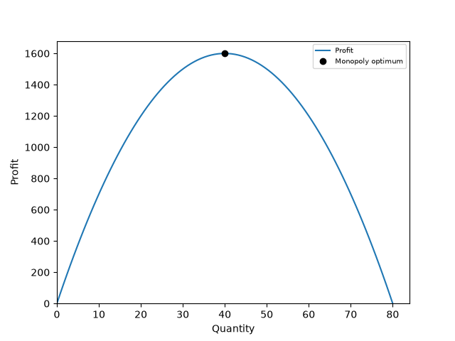
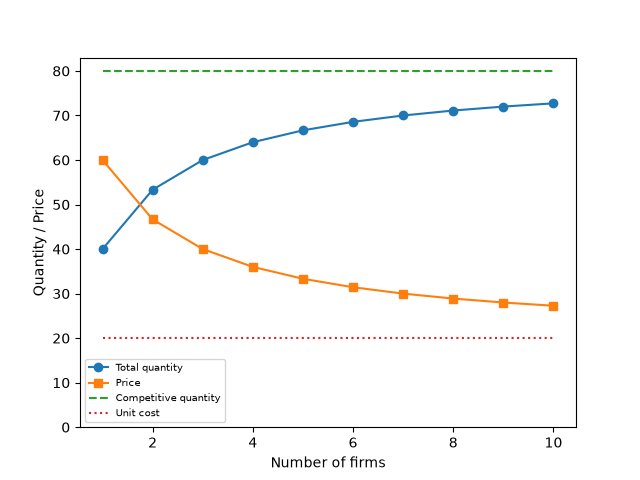
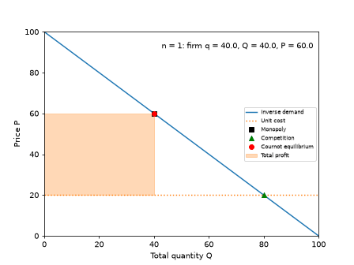

# 第 2 章: 2 次関数と独占・寡占市場

## 2.1 この章の地図

第 1 章では、需要と供給を**直線**（1 次関数）で表しました。この章の道具は、**2 次関数**です。グラフは**放物線**で、山（または谷）の頂上が 1 つあります。

経済学で 2 次関数が出てくる代表が、**独占企業の利潤**です。数量を増やすと、売上は増えますが、価格は下がります。その結果、利潤は数量の 2 次関数になり、**放物線の頂点が、利潤を最大にする数量**です。



| 項目 | 内容 |
| :--- | :--- |
| 経済学の題材 | 独占の利潤最大化、完全競争との比較と死荷重、クールノー競争（寡占）、n 企業の対称均衡 |
| 数学 | 2 次関数、平方完成、頂点（最大値・最小値）、判別式、解の公式、連立方程式 |
| 使う Python の機能 | 関数、タプル、`dataclass`、`lambda`、`max` の `key`、テスト（`pytest`） |
| 新しく導入するライブラリ | なし（標準ライブラリの `math` と、第 1 章の Matplotlib・NumPy） |
| 完成形 | `complete_the_square`、`parabola_vertex`、`quadratic_discriminant`、`quadratic_roots`、`argmax_on_grid`、`MarketOutcome`、`inverse_demand_price`、`monopoly_profit`、`monopoly_outcome`、`competitive_outcome`、`monopoly_deadweight_loss`、`cournot_best_response`、`cournot_duopoly`、`cournot_outcome` |
| ファイル | 実装: `lib/chapter02/quadratic.py`、`lib/chapter02/monopoly.py`、`lib/chapter02/plot.py`（図）／テスト: `test/chapter02/test_quadratic.py`、`test/chapter02/test_monopoly.py`、`test/chapter02/test_plot.py` |
| データ | なし（手計算できる小さな例だけ） |

### 数学の式とコードの対応

| 経済学・数学 | 式 | コード |
| :--- | :--- | :--- |
| 平方完成 | a·x² + b·x + c = a·(x − h)² + k | `complete_the_square(a, b, c)` |
| 頂点 | h = −b ÷ (2a)、k = c − b² ÷ (4a) | `parabola_vertex(a, b, c)` |
| 判別式 | D = b² − 4ac | `quadratic_discriminant(a, b, c)` |
| 解の公式 | x = (−b ± √D) ÷ (2a) | `quadratic_roots(a, b, c)` |
| 逆需要（数量から価格） | P = a − b·Q | `inverse_demand_price(quantity, a, b)` |
| 独占の利潤 | π(Q) = (a − b·Q − c)·Q | `monopoly_profit(quantity, a, b, cost)` |
| 独占の最適 | Q* = (a − c) ÷ (2b)、P* = (a + c) ÷ 2 | `monopoly_outcome(a, b, cost)` |
| 完全競争 | P = c、Q = (a − c) ÷ b | `competitive_outcome(a, b, cost)` |
| 死荷重 | ½·(P独占 − c)·(Q競争 − Q独占) | `monopoly_deadweight_loss(a, b, cost)` |
| クールノーの最適反応 | q = (a − c − b·q相手) ÷ (2b) | `cournot_best_response(rival_quantity, a, b, cost)` |
| n 社の対称均衡 | 1 社 q = (a − c) ÷ ((n + 1)·b) | `cournot_outcome(firms, a, b, cost)` |

> **記号について**: 第 1 章の需要は q = a − b·p で、**価格から数量**を求める式でした。この章では、向きを逆にした **逆需要** P = a − b·Q（**数量から価格**）を使います。独占企業は「何個作るか」を決め、価格は需要が決めるからです。同じ文字 a・b でも、意味が違います。第 1 章の需要 q = 100 − p は、逆需要 P = 100 − Q と同じ直線ですが、逆需要 P = 100 − 2Q は、第 1 章の形では q = 50 − 0.5p です。また、2 次関数の係数（a・b・c）と、市場の係数（a・b・費用 c）が、同じ文字なので、コードでは費用を `cost` と書いて区別します。図の軸と凡例は、Matplotlib で日本語のフォントを避けるため、英語にしています。

### 前提とする章

[第 1 章](01-linear-functions-and-markets.md) の、直線の式・連立方程式・三角形の面積を使います。高校数学の 2 次関数（平方完成・解の公式）を、一度は学んだ方を想定しています。忘れていても、2.4 節で思い出せます。

独占・寡占の**経済学としての意味**（独占の弊害、ゲーム理論としてのクールノー競争）は、[ミクロ経済学のためのプログラミング（初級）の第 11 章](../micro-basics-programming/11-monopoly-and-monopolistic-competition.md) と [第 12 章](../micro-basics-programming/12-oligopoly-and-game-theory.md) で扱います。この章は、**そこで使う数学**（放物線の頂点・連立方程式）を、関数とテストで確かめます。

## 2.2 準備

```bash
cd apps/math-for-economics-programming/python
uv run pytest test/chapter02
```

```text
46 passed
```

自分でコードを書くときは、第 1 章と同じく、`practice/chapter02/` に、完成形と同じ名前のファイル（`quadratic.py`・`monopoly.py`・`plot.py`・`test_quadratic.py`・`test_monopoly.py`・`test_plot.py`）を作り、テストの import を `from practice.chapter02...` に書き換えます（図の節を後回しにするなら、`plot.py` と `test_plot.py` は要らず、テストは 40 件になります）。`plot.py` と、下の check スクリプトの import も、`from practice.chapter02...` に書き換えます（書き換えないと、完成形を動かすことになります）。テストの import の一覧は、完成形の**全関数**です。まだ書いていない関数を import すると、`ImportError` になり、Green になりません。関数を 1 つ書くたびに、その名前を、import に足していってください（最初のテストの 1 つ、`quadratic_roots` を使うものも、その関数を書くまで、後回しにします）。「予想の答え合わせ」のスクリプトは、`practice/chapter02/check.py` に保存し、`uv run python -m practice.chapter02.check` で実行します。

## 2.3 予想する

次の 4 つの問いに、**紙で、手計算で**答えてください。答えは、この節には書いてありません。「プログラミング」の節の「予想の答え合わせ」で確かめます。

- 2x² − 8x + 6 = 0 の**判別式**と**解**は、いくつですか。x² + 2x + 5 = 0 は、どうですか
- 逆需要が P = 100 − Q、1 単位あたりの費用が 20 の独占企業があります。利潤 π(Q) = (100 − Q − 20)·Q を**平方完成**してください。利潤を最大にする**数量・価格・利潤**は、いくつですか。完全競争（価格 ＝ 費用）なら、数量と価格は、いくつですか。**死荷重**は、いくつですか
- 逆需要が P = 100 − 2Q に変わると（費用は 20 のまま）、独占の数量・価格・利潤・死荷重は、どう変わりますか。**価格は変わりますか**
- 同じ市場（P = 100 − Q、費用 20）に、2 社がいて、互いに相手の数量を所与として、数量を決めます（クールノー競争）。**1 社の数量・価格・1 社の利潤**は、いくつですか。10 社になると、価格は、いくつになりますか。企業がもっと増えると、価格は、どこに近づきますか

## 2.4 2 次関数と独占・寡占の考え方

### 2 次関数と平方完成

**2 次関数**は、y = a·x² + b·x + c（a ≠ 0）の形の関数で、グラフは**放物線**です。a > 0 なら下に凸（谷）、a < 0 なら上に凸（山）です。a = 0 なら 1 次関数（直線）なので、2 次関数として扱いません（エラーにします）。

放物線の頂上（頂点）を見つける方法が、**平方完成**です。

> a·x² + b·x + c = a·(x + b ÷ (2a))² + c − b² ÷ (4a) = a·(x − h)² + k

(x − h)² は、0 以上です。a < 0 なら、a·(x − h)² は 0 以下なので、y は x = h のとき、**最大値 k** をとります。a > 0 なら、**最小値 k** です。頂点の座標は、h = −b ÷ (2a)、k = c − b² ÷ (4a) です。

### 判別式と解の公式

2 次方程式 a·x² + b·x + c = 0 の解は、**解の公式**で求めます。

> x = (−b ± √D) ÷ (2a)、D = b² − 4ac（**判別式**）

√D は、D が負だと実数になりません。そこで、D の符号で、**実数解の個数**がわかります。D > 0 なら 2 つ、D = 0 なら 1 つ（重解。頂点が x 軸に接する）、D < 0 なら、実数解はありません（放物線が x 軸と交わらない）。

2 つの解の積は c ÷ a です（**解と係数の関係**）。コンピュータで解の公式をそのまま計算すると、b が大きいとき、−b と √D がほぼ同じ大きさになり、引き算で有効桁が消えます（**桁落ち**）。そこで、符号の同じものどうしを足して 1 つ目の解を求め、2 つ目は積 c ÷ a から求めます。

### 独占の利潤は 2 次関数

独占企業が Q 作ると、価格は逆需要 P = a − b·Q で決まります。1 単位あたりの費用 c が一定なら、利潤は、

> π(Q) = (P − c)·Q = (a − b·Q − c)·Q = −b·Q² + (a − c)·Q

で、Q の 2 次関数です。2 乗の係数 −b が負なので、上に凸の放物線で、**頂点で利潤が最大**です。頂点の公式で、Q* = (a − c) ÷ (2b)、価格は P* = a − b·Q* = (a + c) ÷ 2 です。**価格は b に依存しません**（b は数量だけを変えます）。

### 完全競争との比較と死荷重

**完全競争**では、価格は費用まで下がります（P = c）。そのときの数量は、a − b·Q = c から Q = (a − c) ÷ b で、独占のちょうど **2 倍**です。独占では、数量が減り、価格が上がります。その結果、失われる総余剰が**死荷重**です。独占の数量から完全競争の数量までの、需要曲線と費用の線に挟まれた三角形の面積で、½·(P独占 − c)·(Q競争 − Q独占) です。

### クールノー競争と連立方程式

2 社がいて、それぞれが**相手の数量を所与として**、自社の利潤を最大にする数量を選ぶとします（**クールノー競争**）。相手が q₂ 作るとき、自社の利潤 (a − b·(q₁ + q₂) − c)·q₁ は、q₁ の 2 次関数で、頂点は、

> q₁ = (a − c − b·q₂) ÷ (2b)（**最適反応**）

です。2 社とも最適反応をとっている点（**ナッシュ均衡**）は、2 社の最適反応の**連立方程式**の解です。費用が c₁・c₂ のとき、解くと q₁ = (a − 2c₁ + c₂) ÷ (3b)、q₂ = (a − 2c₂ + c₁) ÷ (3b) になります。

n 社が同じ費用なら、対称な均衡で、1 社 q = (a − c) ÷ ((n + 1)·b)、市場全体の数量は n 倍です。価格 − 費用 = (a − c) ÷ (n + 1) なので、**n = 1 で独占に一致し、n が大きくなると、価格は費用（完全競争）に近づきます**。

## 2.5 プログラミング

### Red: 平方完成のテスト

`test_quadratic.py` の先頭の import です。

```python
import pytest

from lib.chapter02.quadratic import (
    argmax_on_grid,
    complete_the_square,
    parabola_vertex,
    quadratic_discriminant,
    quadratic_roots,
)
```

2x² − 8x + 6 は、手計算で 2(x − 2)² − 2 と平方完成できます。平方完成した式が、**元の式と同じ値になる**ことも、いくつかの x（0 < x < 1 を含む）で確かめます。

```python
def test_平方完成すると頂点の形になる() -> None:
    # 2x² − 8x + 6 = 2(x − 2)² − 2
    assert complete_the_square(2, -8, 6) == (2, 2, -2)


def test_平方完成した式は元の式と同じ値になる() -> None:
    a, h, k = complete_the_square(2, -8, 6)
    for x in [-1, 0, 0.5, 3, 10]:
        assert a * (x - h) ** 2 + k == pytest.approx(2 * x**2 - 8 * x + 6)


def test_上に凸の放物線の頂点は最大値() -> None:
    # −x² + 80x = −(x − 40)² + 1600
    assert parabola_vertex(-1, 80, 0) == (40, 1600)


def test_2乗の係数が0なら2次関数ではない() -> None:
    with pytest.raises(ValueError):
        complete_the_square(0, 2, 1)
    with pytest.raises(ValueError):
        parabola_vertex(0, 2, 1)
    with pytest.raises(ValueError):
        quadratic_roots(0, 2, 1)
```

`quadratic.py` がないので、収集の時点で失敗します（**Red**）。

### Green: 平方完成と頂点

`quadratic.py` の先頭の import です。

```python
import math
from collections.abc import Callable
```

```python
def _require_quadratic(a: float) -> None:
    if a == 0:
        raise ValueError("x² の係数 a が 0 では、2 次関数ではありません")


def complete_the_square(a: float, b: float, c: float) -> tuple[float, float, float]:
    """平方完成: a·x² + b·x + c = a·(x − h)² + k の（a, h, k）を返す。"""
    _require_quadratic(a)
    h = -b / (2 * a)
    k = c - b**2 / (4 * a)
    return a, h, k


def parabola_vertex(a: float, b: float, c: float) -> tuple[float, float]:
    """放物線の頂点（h, k）。a < 0 なら最大値、a > 0 なら最小値。"""
    _, h, k = complete_the_square(a, b, c)
    return h, k
```

### 判別式と解の公式

判別式の 3 つの場合（正・0・負）を、テストにします。D = 0 では、2 乗の係数が 1 でない例（2x² − 8x + 8）も入れます（2a の掛け算と割り算の取り違えを見つけるためです）。解を代入すると 0 になる、という**性質**も確かめます（3x² − 5x − 7 = 0 の解は、無理数で、手計算しにくいからです）。

```python
def test_判別式は_b2乗引く_4ac() -> None:
    assert quadratic_discriminant(2, -8, 6) == 16
    assert quadratic_discriminant(1, -4, 4) == 0
    assert quadratic_discriminant(1, 2, 5) == -16


def test_実数解の個数は判別式の符号で決まる() -> None:
    assert quadratic_roots(2, -8, 6) == (1, 3)  # D > 0: 2 つ
    assert quadratic_roots(1, -4, 4) == (2,)  # D = 0: 1 つ
    assert quadratic_roots(2, -8, 8) == (2,)  # D = 0、2 乗の係数が 1 でない
    assert quadratic_roots(1, 2, 5) == ()  # D < 0: なし


def test_bが大きくても小さいほうの解が桁落ちしない() -> None:
    # x² + 10⁸x + 1 = 0 の解は、およそ −10⁸ と −10⁻⁸（2 つの解の積は c ÷ a = 1）
    lower, upper = quadratic_roots(1, 1e8, 1)
    assert lower == pytest.approx(-1e8, rel=1e-12)
    assert upper == pytest.approx(-1e-8, rel=1e-12)
    assert quadratic_roots(1, -1e8, 1)[0] == pytest.approx(1e-8, rel=1e-12)


def test_解を代入すると0になる() -> None:
    for x in quadratic_roots(3, -5, -7):
        assert 3 * x**2 - 5 * x - 7 == pytest.approx(0)
```

```python
def quadratic_discriminant(a: float, b: float, c: float) -> float:
    """判別式 D = b² − 4ac。正なら実数解 2 つ、0 なら 1 つ、負ならなし。"""
    return b**2 - 4 * a * c


def quadratic_roots(a: float, b: float, c: float) -> tuple[float, ...]:
    """解の公式で、a·x² + b·x + c = 0 の実数解を、小さい順に返す。

    −b と √D を、同じ符号どうしで足して 1 つ目の解を求め、もう 1 つは
    解の積 c ÷ a から求める（近い数の引き算で、桁が落ちるのを避ける）。
    """
    _require_quadratic(a)
    d = quadratic_discriminant(a, b, c)
    if d < 0:
        return ()
    if d == 0:
        return (-b / (2 * a),)
    q = -(b + math.copysign(math.sqrt(d), b)) / 2
    return tuple(sorted([q / a, c / q]))
```

x² + 10⁸x + 1 = 0 の小さいほうの解（約 −10⁻⁸）は、公式をそのまま計算すると、約 −0.745 × 10⁻⁸ になり、25% もずれます。2 つ目の解を c ÷ q で求めると、正しい値になります。2 つの解の大小は、a と b の符号で入れ替わるので、`sorted` で、小さい順にそろえます。

### 格子探索: 頂点を数値で確かめる

頂点の式が正しいかを、**式を使わずに**確かめる方法があります。範囲を細かい格子に区切り、すべての点で関数の値を計算して、最大の点を探す**格子探索**です。答えは格子の間隔の分だけずれますが、式の誤りを見つけるには十分です。

```python
def test_格子の上で最大値をとる点を探す() -> None:
    best = argmax_on_grid(lambda x: -((x - 40) ** 2) + 1600, 0, 100, 201)
    assert best == 40


def test_格子探索の答えは頂点の近くにある() -> None:
    def f(x: float) -> float:
        return -2 * x**2 + 7 * x + 1

    h, _ = parabola_vertex(-2, 7, 1)
    best = argmax_on_grid(f, 0, 10, 1001)
    assert best == pytest.approx(h, abs=0.01)


def test_格子の点が2つ未満ならエラー() -> None:
    with pytest.raises(ValueError):
        argmax_on_grid(lambda x: x, 0, 1, 1)
```

```python
def argmax_on_grid(
    func: Callable[[float], float], low: float, high: float, points: int
) -> float:
    """low から high までを、等間隔の points 個の点に区切り、func が最大の点を返す。"""
    if points < 2:
        raise ValueError("格子の点は、2 つ以上必要です")
    step = (high - low) / (points - 1)
    grid = [low + i * step for i in range(points)]
    return max(grid, key=func)
```

`max(grid, key=func)` は、`func` の値が最大になる、`grid` の要素を返します。

### 独占の利潤

`test_monopoly.py` の先頭です。`A, B, COST` は、この章で使い回す例（逆需要 P = 100 − Q、費用 20）です。

```python
import pytest

from lib.chapter02.monopoly import (
    MarketOutcome,
    competitive_outcome,
    cournot_best_response,
    cournot_duopoly,
    cournot_outcome,
    inverse_demand_price,
    monopoly_deadweight_loss,
    monopoly_outcome,
    monopoly_profit,
)
from lib.chapter02.quadratic import argmax_on_grid, parabola_vertex
```

```python
A, B, COST = 100, 1, 20


def test_利潤は逆需要の価格から費用を引いて数量を掛けたもの() -> None:
    assert inverse_demand_price(30, A, B) == 70
    assert inverse_demand_price(30, 100, 2) == 40
    assert monopoly_profit(10, A, B, COST) == 700
    assert monopoly_profit(10, 100, 2, COST) == 600


def test_利潤は数量の2次関数() -> None:
    # π(Q) = (a − b·Q − c)·Q = −b·Q² + (a − c)·Q
    for q in [0, 0.5, 15, 40, 90]:
        expected = -2 * q**2 + 80 * q
        assert monopoly_profit(q, 100, 2, COST) == pytest.approx(expected)


def test_独占の利潤最大は放物線の頂点() -> None:
    assert monopoly_outcome(A, B, COST) == MarketOutcome(
        quantity=40, price=60, profit=1600
    )
    assert parabola_vertex(-B, A - COST, 0) == (40, 1600)
    # 需要の傾きが 1 でないとき（P = 100 − 2Q）
    assert monopoly_outcome(100, 2, COST) == MarketOutcome(
        quantity=20, price=60, profit=800
    )


@pytest.mark.parametrize(
    "params", [(100, 1, 20), (100, 2, 20), (50, 0.5, 10), (12, 3, 0)]
)
def test_頂点の式と格子探索の答えが一致する(
    params: tuple[float, float, float],
) -> None:
    a, b, cost = params
    points = 2001
    step = (a / b) / (points - 1)
    best = argmax_on_grid(lambda q: monopoly_profit(q, a, b, cost), 0, a / b, points)
    assert best == pytest.approx(monopoly_outcome(a, b, cost).quantity, abs=step)
```

**b = 1 の例だけでは、b を掛けるか割るかの取り違えを、見逃します**。最初から b = 2（P = 100 − 2Q）と b = 0.5 の例を入れています。格子探索のテストは、4 つの市場で、**頂点の式と、数値の答えが、格子の間隔以内で一致する**ことを確かめます。

`monopoly.py` の先頭の import です。

```python
from dataclasses import dataclass
```

```python
@dataclass(frozen=True)
class MarketOutcome:
    """市場全体の数量・価格・利潤（企業が複数なら、全企業の合計）。"""

    quantity: float
    price: float
    profit: float


def _validate_market(a: float, b: float, cost: float) -> None:
    if b <= 0:
        raise ValueError("需要の傾き b は、正でなければなりません")
    if cost < 0 or a <= cost:
        raise ValueError("費用 c は 0 以上で、価格の上限 a より低くなければなりません")


def inverse_demand_price(quantity: float, a: float, b: float) -> float:
    """逆需要: 市場全体の数量 Q のときの価格 P = a − b·Q。"""
    return a - b * quantity


def monopoly_profit(quantity: float, a: float, b: float, cost: float) -> float:
    """市場全体で Q 作ったときの利潤 π(Q) = (a − b·Q − c)·Q。Q の 2 次関数。"""
    return (inverse_demand_price(quantity, a, b) - cost) * quantity


def monopoly_outcome(a: float, b: float, cost: float) -> MarketOutcome:
    """独占: 利潤の放物線の頂点 Q* = (a − c) ÷ (2b) で、利潤が最大になる。"""
    _validate_market(a, b, cost)
    quantity = (a - cost) / (2 * b)
    return MarketOutcome(
        quantity=quantity,
        price=inverse_demand_price(quantity, a, b),
        profit=monopoly_profit(quantity, a, b, cost),
    )
```

### 完全競争と死荷重

```python
def test_完全競争では価格が費用に等しく数量は独占の2倍() -> None:
    assert competitive_outcome(A, B, COST) == MarketOutcome(
        quantity=80, price=20, profit=0
    )
    assert competitive_outcome(100, 2, COST) == MarketOutcome(
        quantity=40, price=20, profit=0
    )
    assert monopoly_outcome(A, B, COST).price > competitive_outcome(A, B, COST).price


def test_死荷重は失われた三角形の面積() -> None:
    assert monopoly_deadweight_loss(A, B, COST) == 800
    assert monopoly_deadweight_loss(100, 2, COST) == 400


@pytest.mark.parametrize("params", [(100, 1, 20), (100, 2, 20), (30, 0.5, 6)])
def test_死荷重は総余剰の減少分に等しい(params: tuple[float, float, float]) -> None:
    a, b, cost = params
    monopoly = monopoly_outcome(a, b, cost)
    competition = competitive_outcome(a, b, cost)
    # 消費者余剰は、需要曲線の下・価格の上の三角形（価格軸の切片は a）
    surplus_monopoly = (a - monopoly.price) * monopoly.quantity / 2 + monopoly.profit
    surplus_competition = (a - competition.price) * competition.quantity / 2
    loss = surplus_competition - surplus_monopoly
    assert monopoly_deadweight_loss(a, b, cost) == pytest.approx(loss)


@pytest.mark.parametrize(
    "params", [(100, 0, 20), (100, -1, 20), (20, 1, 20), (100, 1, -1)]
)
def test_市場が成り立たない設定はエラー(params: tuple[float, float, float]) -> None:
    with pytest.raises(ValueError):
        monopoly_outcome(*params)
    with pytest.raises(ValueError):
        competitive_outcome(*params)
```

```python
def competitive_outcome(a: float, b: float, cost: float) -> MarketOutcome:
    """完全競争: 価格が費用に等しくなるまで作る。Q = (a − c) ÷ b、利潤は 0。"""
    _validate_market(a, b, cost)
    return MarketOutcome(quantity=(a - cost) / b, price=cost, profit=0)


def monopoly_deadweight_loss(a: float, b: float, cost: float) -> float:
    """死荷重: 独占で失われる総余剰 = ½·(P独占 − c)·(Q競争 − Q独占)。"""
    monopoly = monopoly_outcome(a, b, cost)
    competition = competitive_outcome(a, b, cost)
    return (monopoly.price - cost) * (competition.quantity - monopoly.quantity) / 2
```

死荷重のテストは、三角形の式の値だけでなく、**総余剰（消費者余剰 ＋ 利潤）の、完全競争と独占の差**に等しいことを、3 つの市場で確かめます。費用が価格の上限 a 以上の市場や、需要の傾きが 0 以下の市場は、`ValueError` にします。

### クールノー競争

```python
def test_最適反応は相手の数量が増えると減り0で止まる() -> None:
    assert cournot_best_response(0, A, B, COST) == 40  # 相手が 0 なら独占
    assert cournot_best_response(20, A, B, COST) == 30
    assert cournot_best_response(20, 100, 2, COST) == 10
    assert cournot_best_response(100, A, B, COST) == 0


def test_2社のクールノー均衡() -> None:
    q1, q2 = cournot_duopoly(A, B, COST, COST)
    assert q1 == pytest.approx(80 / 3)
    assert q2 == pytest.approx(80 / 3)


def test_費用の違う2社のクールノー均衡は互いに最適反応() -> None:
    q1, q2 = cournot_duopoly(A, B, 10, 40)
    assert (q1, q2) == pytest.approx((40, 10))
    assert cournot_best_response(q2, A, B, 10) == pytest.approx(q1)
    assert cournot_best_response(q1, A, B, 40) == pytest.approx(q2)
```

```python
def cournot_best_response(
    rival_quantity: float, a: float, b: float, cost: float
) -> float:
    """最適反応: 相手の数量を所与として、自社の利潤を最大にする数量（負なら 0）。"""
    return max((a - cost - b * rival_quantity) / (2 * b), 0)


def cournot_duopoly(
    a: float, b: float, cost1: float, cost2: float
) -> tuple[float, float]:
    """2 社のクールノー均衡: 2 つの最適反応を、連立方程式として解く。"""
    _validate_market(a, b, cost1)
    _validate_market(a, b, cost2)
    q1 = (a - 2 * cost1 + cost2) / (3 * b)
    q2 = (a - 2 * cost2 + cost1) / (3 * b)
    if q1 <= 0 or q2 <= 0:
        raise ValueError("2 社とも正の数量を作る均衡がありません")
    return q1, q2
```

費用の違う 2 社のテストは、連立方程式の解（40 と 10）が、**互いに最適反応になっている**こと（ナッシュ均衡の定義）を、確かめます。解の式を写し間違えても、この性質のテストが落ちます。

### n 社のクールノー均衡

```python
def test_1社のクールノーは独占に一致する() -> None:
    assert cournot_outcome(1, A, B, COST) == monopoly_outcome(A, B, COST)


def test_n社の対称なクールノー均衡() -> None:
    result = cournot_outcome(2, A, B, COST)
    assert result.quantity / 2 == pytest.approx(80 / 3)
    assert result.price == pytest.approx(140 / 3)
    assert result.profit / 2 == pytest.approx(6400 / 9)


def test_2社の対称均衡は連立方程式の解と一致する() -> None:
    assert cournot_outcome(2, 100, 2, COST).quantity == pytest.approx(
        sum(cournot_duopoly(100, 2, COST, COST))
    )


def test_企業が増えると価格は費用に近づく() -> None:
    prices = [cournot_outcome(n, A, B, COST).price for n in range(1, 11)]
    assert all(p1 > p2 for p1, p2 in zip(prices, prices[1:], strict=False))
    # 価格 − 費用 = (a − c) ÷ (n + 1)
    assert cournot_outcome(99, A, B, COST).price == pytest.approx(20.8)
```

```python
def cournot_outcome(firms: int, a: float, b: float, cost: float) -> MarketOutcome:
    """n 社の対称なクールノー均衡: 1 社 q = (a − c) ÷ ((n + 1)·b)。"""
    if firms < 1:
        raise ValueError("企業の数は、1 以上でなければなりません")
    _validate_market(a, b, cost)
    quantity = firms * (a - cost) / ((firms + 1) * b)
    return MarketOutcome(
        quantity=quantity,
        price=inverse_demand_price(quantity, a, b),
        profit=monopoly_profit(quantity, a, b, cost),
    )
```

n = 1 で独占に一致すること、n = 2 で 2 社の連立方程式の解に一致することは、**別々に書いた式どうしの照合**です。`MarketOutcome` は、市場全体の数量と利潤を持つので、1 社の値は、企業の数で割ります。

### 予想の答え合わせ

```python
from lib.chapter02.monopoly import (
    competitive_outcome,
    cournot_outcome,
    monopoly_deadweight_loss,
    monopoly_outcome,
)
from lib.chapter02.quadratic import (
    complete_the_square,
    quadratic_discriminant,
    quadratic_roots,
)

print(quadratic_discriminant(2, -8, 6), quadratic_roots(2, -8, 6))
print(quadratic_discriminant(1, 2, 5), quadratic_roots(1, 2, 5))
print(complete_the_square(-1, 80, 0))
print(monopoly_outcome(100, 1, 20))
print(competitive_outcome(100, 1, 20), monopoly_deadweight_loss(100, 1, 20))
print(monopoly_outcome(100, 2, 20), monopoly_deadweight_loss(100, 2, 20))
duopoly = cournot_outcome(2, 100, 1, 20)
print(round(duopoly.quantity / 2, 2), round(duopoly.price, 2))
print(round(duopoly.profit / 2, 1))
print(round(cournot_outcome(10, 100, 1, 20).price, 2))
```

```text
16 (1.0, 3.0)
-16 ()
(-1, 40.0, 1600.0)
MarketOutcome(quantity=40.0, price=60.0, profit=1600.0)
MarketOutcome(quantity=80.0, price=20, profit=0) 800.0
MarketOutcome(quantity=20.0, price=60.0, profit=800.0) 400.0
26.67 46.67
711.1
27.27
```

- **1 つ目の問い**: 2x² − 8x + 6 = 0 は、判別式 64 − 48 = 16 で、解は 1 と 3 です。x² + 2x + 5 = 0 は、判別式 4 − 20 = −16 で、実数解はありません
- **2 つ目の問い**: π(Q) = −Q² + 80Q = −(Q − 40)² + 1600 なので、数量 40・価格 100 − 40 = 60・利潤 1600 です。完全競争では、価格 20・数量 80 です。死荷重は、½ × (60 − 20) × (80 − 40) = 800 です
- **3 つ目の問い**: π(Q) = −2Q² + 80Q = −2(Q − 20)² + 800 なので、数量は 20 に半減し、利潤も 800 に半減します。**価格は 60 のまま変わりません**（P* = (a + c) ÷ 2 に b が入らない）。死荷重は、½ × 40 × (40 − 20) = 400 です
- **4 つ目の問い**: 1 社の数量は 80 ÷ 3 ≈ 26.67、市場全体 160 ÷ 3 ≈ 53.33 で、価格は 100 − 53.33 ≈ 46.67、1 社の利潤は (46.67 − 20) × 26.67 = 6400 ÷ 9 ≈ 711.1 です。2 社の利潤の合計（約 1422）は、独占の 1600 より小さくなります。10 社では、価格 − 費用 = 80 ÷ 11 で、価格 ≈ 27.27。費用 20 に近づいていきます

### 境界のテスト

完成形には、ほかに**境界**を確かめるテストがあります。格子の点が 2 つだけのとき、格子の下限が 0 でないとき、2 社の一方の数量がちょうど 0 になるとき、数量が 1 未満でも正のときです。テストの件数を合わせるため、ここに載せます（読むだけで、かまいません）。

??? note "境界のテスト"

    ```python
    def test_格子の点が2つだけでも下限が0でなくても探せる() -> None:
        assert argmax_on_grid(lambda x: -x, 0, 1, 2) == 0
        assert argmax_on_grid(lambda x: x, 0, 1, 2) == 1
        assert argmax_on_grid(lambda x: -((x - 40) ** 2), 15, 55, 41) == 40
    ```

    ```python
    @pytest.mark.parametrize("costs", [(10, 60), (10, 55), (55, 10)])
    def test_一方の数量が0以下になる2社はエラー(costs: tuple[float, float]) -> None:
        with pytest.raises(ValueError):
            cournot_duopoly(A, B, *costs)


    def test_数量が1未満でも正なら2社の均衡がある() -> None:
        assert cournot_duopoly(10, 1, 1, 5) == pytest.approx((13 / 3, 1 / 3))
        assert cournot_duopoly(10, 1, 5, 1) == pytest.approx((1 / 3, 13 / 3))


    def test_企業の数が1未満ならエラー() -> None:
        with pytest.raises(ValueError):
            cournot_outcome(0, A, B, COST)
    ```

### 図

図の実装の import です。

```python
import matplotlib.pyplot as plt
import numpy as np
from matplotlib.figure import Figure

from lib.chapter02.monopoly import (
    competitive_outcome,
    cournot_outcome,
    monopoly_outcome,
    monopoly_profit,
)
```

2.1 節の利潤の放物線を描く関数と、そのテストです。曲線の両端（数量 0 と、完全競争の数量）で利潤が 0、各点が利潤の式の値、頂点の点が曲線の最大値であることを確かめます。

??? note "描画のテストと実装（後回しにしても、学習は成り立ちます）"

    テストの import:

    ```python
    import numpy as np
    import pytest
    from matplotlib.axes import Axes

    from lib.chapter02.monopoly import cournot_outcome, monopoly_profit
    from lib.chapter02.plot import plot_cournot_convergence, plot_monopoly_profit
    ```

    ```python
    def _line(ax: Axes, label: str) -> tuple[list[float], list[float]]:
        line = next(x for x in ax.lines if x.get_label() == label)
        xs = np.asarray(line.get_xdata(), dtype=float).tolist()
        ys = np.asarray(line.get_ydata(), dtype=float).tolist()
        return xs, ys


    def test_利潤の放物線は数量0と競争の数量で利潤0() -> None:
        ax = plot_monopoly_profit(100, 2, 20).axes[0]
        xs, ys = _line(ax, "Profit")
        assert (xs[0], ys[0]) == (0, 0)
        assert xs[-1] == 40
        assert ys[-1] == pytest.approx(0)


    def test_利潤の放物線の各点は利潤の式の値() -> None:
        ax = plot_monopoly_profit(100, 2, 20).axes[0]
        xs, ys = _line(ax, "Profit")
        assert ys == pytest.approx([monopoly_profit(q, 100, 2, 20) for q in xs])


    def test_頂点の点は放物線の最大値() -> None:
        ax = plot_monopoly_profit(100, 1, 20).axes[0]
        assert _line(ax, "Monopoly optimum") == ([40], [1600])
        assert max(_line(ax, "Profit")[1]) == pytest.approx(1600)


    def test_利潤の図の軸と凡例() -> None:
        ax = plot_monopoly_profit(100, 1, 20).axes[0]
        assert (ax.get_xlabel(), ax.get_ylabel()) == ("Quantity", "Profit")
        assert ax.get_legend() is not None
        assert ax.get_xlim()[0] == 0
        assert ax.get_ylim()[0] == 0
    ```

    ```python
    def plot_monopoly_profit(a: float, b: float, cost: float) -> Figure:
        """利潤 π(Q) を、Q = 0 から完全競争の数量（利潤が 0 に戻る点）まで描く。"""
        best = monopoly_outcome(a, b, cost)
        q_end = competitive_outcome(a, b, cost).quantity
        quantities = np.linspace(0, q_end, 101).tolist()
        profits = [monopoly_profit(q, a, b, cost) for q in quantities]
        fig, ax = plt.subplots()
        ax.plot(quantities, profits, label="Profit")
        ax.plot([best.quantity], [best.profit], "ko", label="Monopoly optimum")
        ax.set_xlabel("Quantity")
        ax.set_ylabel("Profit")
        ax.set_xlim(left=0)
        ax.set_ylim(bottom=0)
        ax.legend(fontsize="x-small")
        plt.close(fig)
        return fig
    ```

企業の数を 1 から 10 まで増やすと、市場全体の数量は完全競争の 80 に、価格は費用 20 に、近づいていきます。



??? note "描画のテストと実装（後回しにしても、学習は成り立ちます）"

    ```python
    def test_企業の数ごとの総数量と価格() -> None:
        ax = plot_cournot_convergence(100, 1, 20, 10).axes[0]
        xs, quantities = _line(ax, "Total quantity")
        assert xs == list(range(1, 11))
        expected = [cournot_outcome(n, 100, 1, 20) for n in range(1, 11)]
        assert quantities == pytest.approx([r.quantity for r in expected])
        assert _line(ax, "Price")[1] == pytest.approx([r.price for r in expected])
        assert ax.get_xlabel() == "Number of firms"
        assert ax.get_legend() is not None
        assert ax.get_ylim()[0] == 0


    def test_完全競争の数量と費用を水平の点線で引く() -> None:
        ax = plot_cournot_convergence(100, 2, 20, 5).axes[0]
        assert _line(ax, "Competitive quantity") == ([1, 5], [40, 40])
        assert _line(ax, "Unit cost") == ([1, 5], [20, 20])
        for label in ["Competitive quantity", "Unit cost"]:
            line = next(x for x in ax.lines if x.get_label() == label)
            assert line.get_linestyle() in ("--", ":")
    ```

    ```python
    def plot_cournot_convergence(a: float, b: float, cost: float, max_firms: int) -> Figure:
        """企業の数 n = 1…max_firms の、クールノー均衡の総数量と価格を描く。"""
        firms = list(range(1, max_firms + 1))
        outcomes = [cournot_outcome(n, a, b, cost) for n in firms]
        competition = competitive_outcome(a, b, cost)
        ends = [firms[0], firms[-1]]
        fig, ax = plt.subplots()
        ax.plot(firms, [r.quantity for r in outcomes], "o-", label="Total quantity")
        ax.plot(firms, [r.price for r in outcomes], "s-", label="Price")
        ax.plot(ends, [competition.quantity] * 2, "--", label="Competitive quantity")
        ax.plot(ends, [cost] * 2, ":", label="Unit cost")
        ax.set_xlabel("Number of firms")
        ax.set_ylabel("Quantity / Price")
        ax.set_ylim(bottom=0)
        ax.legend(fontsize="x-small")
        plt.close(fig)
        return fig
    ```

### ノートブックで試す

数字を書き換えて、結果と図が変わるのを、手軽に確かめられます。`apps/math-for-economics-programming/python/notebooks/ch02_quadratics_monopoly_and_oligopoly.ipynb` を開き、「Parameters」のセルの数字（逆需要の切片と傾き、費用、企業の数）を書き換えて、上から順に実行します。起動は、アプリのディレクトリで `uv run --with jupyterlab jupyter lab notebooks/` です。

### 動かして見る

企業の数を 1 から 10 へ増やします。クールノー均衡の点（赤）が、需要曲線の上を、独占の点（黒）から完全競争の点（緑）へ向かって動き、市場全体の利潤（橙の長方形。高さが価格 − 費用）が、薄くなっていきます。



このアニメーションは、`lib/animations/` の関数で作っています（`uv run python -m tools.render_animations` で、GIF を書き出します）。**写経は、不要**です。動きを見て、式と図の対応を、確かめてください。

### 実行結果

```bash
uv run pytest test/chapter02
```

```text
46 passed
```

## 2.6 規則で言うと

1. **2 次関数の最大・最小は、頂点である。** 平方完成すると a·(x − h)² + k の形になり、a < 0 なら x = h で最大値 k、a > 0 なら最小値 k
2. **実数解の個数は、判別式の符号で決まる。** D > 0 で 2 つ、D = 0 で 1 つ、D < 0 でなし
3. **独占の利潤は、数量の 2 次関数で、頂点が最適。** 逆需要 P = a − b·Q・費用 c なら、Q* = (a − c) ÷ (2b)、P* = (a + c) ÷ 2。完全競争の半分しか作らない
4. **クールノー均衡は、最適反応の連立方程式の解。** n 社なら、価格 − 費用 = (a − c) ÷ (n + 1)。n = 1 で独占、n → ∞ で完全競争

混同しやすい点を、表にまとめます。

| 混同しやすい点 | 違い |
| :--- | :--- |
| 需要と逆需要 | 需要 q = a − b·p は価格→数量（第 1 章）。逆需要 P = a − b·Q は数量→価格。同じ直線でも、a・b の値は違う |
| 頂点と解 | 頂点は、放物線の山（谷）の頂上。解は、放物線が x 軸と交わる点。利潤の放物線では、解（利潤 0）は数量 0 と完全競争の数量で、頂点はその真ん中 |
| 1 社の利潤と、市場全体の利潤 | `cournot_outcome` は市場全体の値を返す。1 社の値は、企業の数で割る |
| 格子探索と頂点の式 | 格子探索は、格子の間隔の分だけ誤差がある。式の誤りを見つける**照合**の道具で、答えそのものは式で求める |

### このモデルが成り立たない場面

- **費用が一定とは、限りません。** 作るほど 1 単位あたりの費用が上がると、利潤は 2 次関数でなくなります（第 5 章で、微分を使って、2 次関数に限らない費用での利潤最大化を学びます。独占の限界収入 ＝ 限界費用は、第 5 章の練習問題で確かめます）
- **独占企業が、需要曲線を正確に知っているとは、限りません。** 実際の企業は、価格を試しながら探ります。この章は、需要の式を仮定しています
- **価格で競争すると、結論が変わります。** 同じ財を作る 2 社が、数量でなく**価格**を選ぶ（ベルトラン競争）なら、2 社でも価格は費用まで下がります。クールノーの結論は「数量で競争する」という仮定に依存します
- **企業の数は、決まっているとは限りません。** 利潤があれば新しい企業が参入し、n は変わります。この章は n を所与としています

## 2.7 練習問題

| 種類 | 問題 |
| :--- | :--- |
| 想起 | 本文を閉じて、`monopoly_outcome` の最初のテスト（逆需要 P = 100 − Q・費用 20 で、数量 40・価格 60・利潤 1600）を書いてください |
| 生成 | 解説を見る前に、n 社のクールノー均衡での**価格 − 費用**（マークアップ）を返す `cournot_markup(firms, a, b, cost)` を、テストから書いてください。P = 100 − Q・費用 20 なら、1 社で 40、3 社で 20 です |
| 多様 | 逆需要 P = 60 − 0.5Q・費用 10 の独占で、数量・価格・利潤・死荷重は、いくつですか。先に平方完成で予想してから、確かめてください |
| 交互 | [第 1 章](01-linear-functions-and-markets.md) の `demand_quantity`（自分で写した `practice.chapter01.market` から import します）を使い、独占価格 60 のときの需要量が、独占の数量に一致することを、逆需要 P = 100 − Q と P = 100 − 2Q の両方で確かめてください（第 1 章の形の需要に、書き直す必要があります） |

??? note "解答（先に自分で取り組んでから、開いてください）"

    **想起**:

    ```python
    def test_最初の独占のテスト() -> None:
        assert monopoly_outcome(100, 1, 20) == MarketOutcome(
            quantity=40, price=60, profit=1600
        )
    ```

    **生成**: 価格 − 費用 = (a − c) ÷ (n + 1) です。`cournot_outcome` の価格と照合するテストも書きます。

    ```python
    def cournot_markup(firms: int, a: float, b: float, cost: float) -> float:
        return (a - cost) / (firms + 1)
    ```

    ```python
    def test_クールノーのマークアップ() -> None:
        assert cournot_markup(1, 100, 1, 20) == 40
        assert cournot_markup(3, 100, 1, 20) == 20
        for n in range(1, 6):
            price = cournot_outcome(n, 100, 2, 20).price
            assert cournot_markup(n, 100, 2, 20) == pytest.approx(price - 20)
    ```

    **多様**: π(Q) = (60 − 0.5Q − 10)·Q = −0.5Q² + 50Q = −0.5(Q − 50)² + 1250 なので、数量 50・価格 60 − 25 = 35・利潤 1250 です。完全競争の数量は 50 ÷ 0.5 = 100 なので、死荷重は ½ × (35 − 10) × (100 − 50) = 625 です。

    ```python
    def test_傾きが0点5の独占() -> None:
        assert monopoly_outcome(60, 0.5, 10) == MarketOutcome(
            quantity=50, price=35, profit=1250
        )
        assert monopoly_deadweight_loss(60, 0.5, 10) == 625
    ```

    **交互**: 逆需要 P = a − b·Q を Q について解くと、Q = a ÷ b − P ÷ b です。第 1 章の形（q = a' − b'·p）では、a' = a ÷ b、b' = 1 ÷ b です。

    ```python
    def test_独占価格での需要量は独占の数量() -> None:
        for a, b in [(100, 1), (100, 2)]:
            result = monopoly_outcome(a, b, 20)
            assert demand_quantity(result.price, a / b, 1 / b) == pytest.approx(
                result.quantity
            )
    ```

## 2.8 振り返り

- うまくいったこと:
- 詰まったこと:
- 次に試すこと:

## 2.9 まとめ

- 2 次関数 a·x² + b·x + c は、平方完成で a·(x − h)² + k の形になり、頂点 (h, k) が最大値（a < 0）または最小値（a > 0）
- 判別式 D = b² − 4ac の符号で、実数解の個数（2・1・0）が決まる
- 独占の利潤 π(Q) = (a − b·Q − c)·Q は上に凸の放物線で、頂点 Q* = (a − c) ÷ (2b) が利潤最大。完全競争の半分しか作らず、死荷重が生じる
- クールノー均衡は、最適反応の連立方程式の解。n 社なら、価格 − 費用 = (a − c) ÷ (n + 1) で、企業が増えるほど完全競争に近づく
- 頂点の式は、**格子探索**（数値）や、**別に書いた式どうしの一致**（n = 1 と独占、n = 2 と連立方程式）で、テストできる

次の章では、**指数・対数**を学びます。銀行に預けたお金は、毎年同じ割合で増える（複利）ので、時間の 1 次関数でも 2 次関数でもなく、**指数関数**になります。
