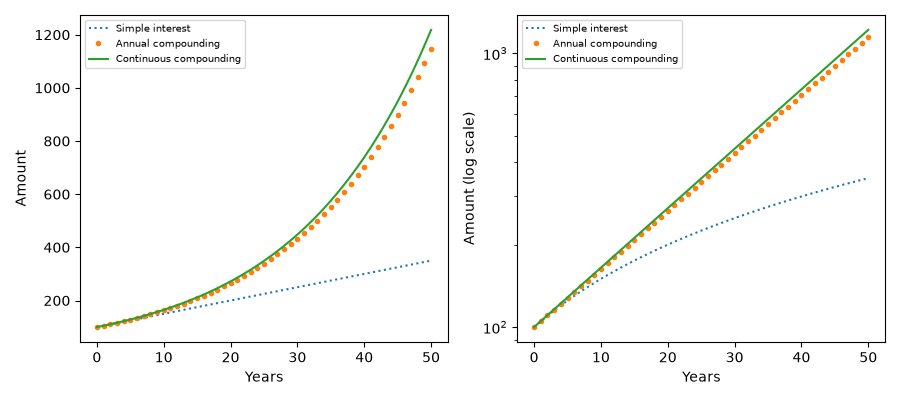

# 第 3 章: 指数・対数と金利

## 3.1 この章の地図

前の章までは、1 次関数・2 次関数で、**ある時点の市場**を見てきました。この章からは、**時間**が入ります。今日の 100 円と、10 年後の 100 円は、同じ価値ではありません。お金を預ければ、利子がつくからです。

利子に、さらに利子がつく（**複利**）と、お金は、**累乗**（同じ数を何回も掛ける）で増えます。逆に、「何年で 2 倍になるか」を求めるには、累乗の逆の計算、**対数**が要ります。この章は、指数と対数を、金利の計算で確かめます。



| 項目 | 内容 |
| :--- | :--- |
| 経済学の題材 | 複利、割引現在価値、年に何回もの複利と実効年利、倍になる年数と 72 の法則、連続複利、収益率と対数収益率 |
| 数学 | 累乗、指数法則（0 乗・負の指数・分数の指数）、対数、対数法則、底の変換、常用対数、自然対数と e |
| 使う Python の機能 | `**`（累乗）、`math.log`・`math.log10`・`math.exp`、標準ライブラリ `fractions` の `Fraction`（分数） |
| 新しく導入するライブラリ | なし（`fractions`・`math` は標準ライブラリ） |
| 完成形 | `compound_amount`、`exact_compound_amount`、`discount_to_present`、`effective_annual_rate`、`log_base`、`years_to_multiply`、`rule_of_72_years`、`power_in_scientific_notation`、`continuous_compound_amount`、`log_return`、`annual_growth_rate` |
| ファイル | 実装: `lib/chapter03/interest.py`、`lib/chapter03/plot.py`（図）／テスト: `test/chapter03/test_interest.py`、`test/chapter03/test_plot.py`（自分で書くときは、`practice/chapter03/` に、同じ名前で作ります） |
| データ | なし（手計算できる小さな例だけ） |

### 数学の式とコードの対応

| 経済学・数学 | 式 | コード |
| :--- | :--- | :--- |
| 複利の元利合計 | A = P·(1 + r)ⁿ | `compound_amount(principal, rate, years)` |
| 同じ計算を分数で厳密に | 同上（r を分数で） | `exact_compound_amount(principal, rate, years)` |
| 割引現在価値 | PV = F ÷ (1 + r)ⁿ | `discount_to_present(future, rate, years)` |
| 年 m 回の複利の実効年利 | (1 + r/m)ᵐ − 1 | `effective_annual_rate(annual_rate, times_per_year)` |
| 対数（底の変換） | log_b x = ln x ÷ ln b | `log_base(x, base)` |
| k 倍になる年数 | n = log₍₁₊ᵣ₎ k | `years_to_multiply(rate, multiple)` |
| 72 の法則 | n ≈ 72 ÷（年利の % の数字） | `rule_of_72_years(rate)` |
| 常用対数による指数表記 | aᵏ = 仮数 × 10^指数 | `power_in_scientific_notation(base, exponent)` |
| 連続複利 | A = P·e^(r·t) | `continuous_compound_amount(principal, rate, years)` |
| 対数収益率 | ln(終わり ÷ 始め) | `log_return(start, end)` |
| 年率（幾何平均の成長率） | (終わり ÷ 始め)^(1/n) − 1 | `annual_growth_rate(start, end, years)` |

> **記号について**: P は元本（はじめの額）、r は 1 年あたりの利子率（5% なら 0.05）、n は年数です。コードでは、利子率を、**% の数字ではなく、小数**で渡します（`0.05`）。ln は自然対数（底が e ≈ 2.718）、log₁₀ は常用対数（底が 10）です。

### 前提とする章

[第 1 章](01-linear-functions-and-markets.md) と同じく、関数と pytest のテストが書けること（[第 1 シリーズ](../economics-programming/index.md) の第 1〜6 章）を前提にします。経済学の章は前提にしません。

高校数学の指数・対数を、一度は学んだが、忘れている方を想定しています。3.4 節で、累乗から順に思い出します。

## 3.2 準備

```bash
cd apps/math-for-economics-programming/python
uv run pytest test/chapter03
```

```text
65 passed
```

自分でコードを書くときは、`practice/chapter03/` に、完成形と同じ名前（`interest.py`・`test_interest.py`）のファイルを作ります。テストの import は、`from practice.chapter03.interest import ...` に書き換えます（書き換えないと、完成形を読み込んで、最初から通ってしまいます）。予想の答え合わせのスクリプトは、`practice/chapter03/check.py` に保存し、`uv run python -m practice.chapter03.check` で実行します（第 1 章の 1.2 節と同じです）。スクリプトの import も、`from practice.chapter03.interest import ...` に書き換えます（書き換えないと、完成形を動かすことになります）。

## 3.3 予想する

次の 5 つの問いに、**紙で、電卓を使って**答えてください。答えは、この節には書いてありません。「プログラミング」の節の「予想の答え合わせ」で、確かめます。

- 100 を、年利 5% の**複利**（利子を毎年、元本に加える）で、10 年預けると、いくらになりますか。**単利**（利子が元本にだけつく。毎年 5 ずつ増える）なら 150 です。複利では、150 より、どのくらい多くなりますか
- 年利 5% の複利で、元本が **2 倍**になるのは、何年後ですか。「72 の法則」（72 ÷ 5）で見積もった年数と比べて、実際の年数は、長いですか、短いですか
- 年利 5% のとき、**3 年後に受け取る 1000** は、今のいくらと同じ価値ですか。900 より多いですか、少ないですか
- 100 が、2 年で 121 になりました。毎年同じ率で増えたとすると、**年率**は、何 % ですか。また、Python で `100 * 1.1 ** 2` を計算すると、`121` と表示されるでしょうか
- 2 の 100 乗は、**何桁**の数ですか。log₁₀ 2 ≈ 0.3010 を使って、見積もってください

## 3.4 指数・対数と金利の考え方

### 複利（その 1）: 利子にも利子がつく

100 を年利 5% で預けると、1 年後は 100 × 1.05 = 105 です。複利では、2 年目は、この 105 に、また 5% の利子がつきます。105 × 1.05 = 100 × 1.05 × 1.05 です。n 年後には、**1.05 を n 回掛けた**数が、元本に掛かります。

> A = P·(1 + r)ⁿ

同じ数を n 回掛けることを、**累乗**（べき乗）と言い、1.05ⁿ と書きます。1.05 を**底**、n を**指数**と言います。単利は、毎年同じ額（P·r）ずつ増える 1 次関数（第 1 章）です。複利は、毎年同じ**率**で増える、**指数関数**です。

### 累乗と指数法則

累乗には、次の規則（**指数法則**）があります。a > 0 とします。

| 規則 | 式 | 金利での意味 |
| :--- | :--- | :--- |
| 指数の足し算 | aˣ · aʸ = aˣ⁺ʸ | x 年運用してから y 年運用するのは、x + y 年の運用と同じ |
| 累乗の累乗 | (aˣ)ʸ = aˣʸ | 1 期で aˣ 倍になる率で、y 期運用すると、aˣʸ 倍 |
| 0 乗 | a⁰ = 1 | 0 年なら、元本のまま |
| 負の指数 | a⁻ⁿ = 1 ÷ aⁿ | n 年後から今へ、**さかのぼる**（割り引く） |
| 分数の指数 | a^(1/n) = aの n 乗根 | 1 年の 1/n の期間の倍率 |

指数は、整数でなくてもかまいません。1.21^(1/2) = 1.1 は、「2 年で 1.21 倍なら、1 年あたり 1.1 倍」という意味です。

### 割引現在価値

3 年後に受け取る 1000 は、今いくらの価値でしょうか。今 PV を預けると、3 年後に PV·(1 + r)³ になります。これが 1000 に等しい PV が、**割引現在価値**です。割引現在価値は、**将来のお金を、今のお金に換算した額**です。

> PV = F ÷ (1 + r)ⁿ = F·(1 + r)⁻ⁿ

複利の式を、逆向きに使っているだけです。負の指数（さかのぼる）の、いちばん身近な例です。

### 複利（その 2）: 年に何回も

「年利 5%、毎月複利」は、1 か月に 5% ÷ 12 の利子を、年 12 回つけます。1 年後の倍率は (1 + 0.05/12)¹² で、1.05 より少し大きくなります。1 年で、実際に何 % 増えるかを、**実効年利**と言います。

> 実効年利 ＝ (1 + r/m)ᵐ − 1（m は、年あたりの複利の回数）

m を増やすと、実効年利は増えますが、際限なく増えるわけではありません。ある値に近づきます（発展で扱う、連続複利です）。

### 対数: 「何乗すれば」を答える

「年利 5% で、何年たてば 2 倍になるか」は、1.05ⁿ = 2 となる n を求める問題です。指数 n が、未知数です。この n を、「1.05 を底とする 2 の**対数**」と言い、log₁.₀₅ 2 と書きます。

> bⁿ = x　⇔　n = log_b x　（b > 0、b ≠ 1、x > 0）

対数は、**「b を何乗すれば x になるか」**の答えです。b⁰ = 1 なので、log_b 1 = 0 です。底 b が正なので、bⁿ は、いつも正です。**0 や負の数の対数は、ありません**（コードでは、`ValueError` にします）。

電卓や Python には、底が e（自然対数）と 10（常用対数）の対数しか、ないことが多いです。ほかの底の対数は、**底の変換**で求めます。

> log_b x = ln x ÷ ln b

### 対数法則

指数法則を、対数で言い直したのが、**対数法則**です。

| 規則 | 式 |
| :--- | :--- |
| 積の対数は、対数の和 | log(xy) = log x + log y |
| 商の対数は、対数の差 | log(x/y) = log x − log y |
| 累乗の対数は、指数を前に出す | log(xᵏ) = k·log x |

3 つ目を使うと、1.05ⁿ = 2 の両辺の対数をとって、n·ln 1.05 = ln 2、つまり n = ln 2 ÷ ln 1.05 です。

**72 の法則**は、倍になる年数を、暗算で見積もる近似です。ln 2 ≈ 0.693 で、利子率 r が小さいとき ln(1 + r) ≈ r なので、n ≈ 0.693 ÷ r です。69.3 より、約数の多い 72 を使い、「72 ÷ 年利の % の数字」とします。近似なので、**誤差**があります。

### 常用対数による近似

常用対数（底が 10）は、**桁数**と結びついています。10³ = 1000 なので log₁₀ 1000 = 3 です。1000 以上 10000 未満の数の常用対数は、3 以上 4 未満です。

2¹⁰⁰ の桁数は、log₁₀ 2¹⁰⁰ = 100 × log₁₀ 2 ≈ 30.10 から、わかります。整数部分が 30 なので、2¹⁰⁰ ≈ 10^0.10 × 10³⁰ で、**31 桁**です。小数部分の 10^0.10 ≈ 1.26 が、先頭の数字（**仮数**）です。このように、累乗を、**仮数 × 10 の累乗**（指数表記）に直すのが、常用対数による近似計算です。

??? note "発展: 自然対数と連続時間での利子率"

    年あたりの複利の回数 m を、限りなく増やすと、(1 + r/m)ᵐ は、**e^r** に近づきます。e ≈ 2.71828 は、(1 + 1/m)ᵐ の、m を大きくしたときの極限です。毎瞬、利子がつく（**連続複利**）とき、t 年後の元利合計は、次のようになります。

    > A = P·e^(r·t)

    e を底とする対数が、**自然対数** ln です。e^(r·t) = k を解くと、t = ln k ÷ r です。連続時間では、倍になる年数が ln 2 ÷ r ≈ 0.693 ÷ r と、きれいな形になります（72 の法則の 69.3 は、ここから来ています）。

    連続複利の実効年利は、e^r − 1 です（年利 5% なら、約 5.127%）。経済学で、成長率や利子率を、ln を使って表すことが多いのは、連続時間の式が、簡単になるからです（微分は、第 6 章で扱います）。

### もう少し練習: 投資の収益率と対数

100 が、1 年目に 110、2 年目に 121 になったとします。毎年の収益率は 10% ずつですが、2 年の収益率は 21% です。10% + 10% = 20% にはなりません。**普通の収益率は、期間をつないでも、足し算になりません。**

**対数収益率** ln(終わり ÷ 始め) は、足し算になります。ln(121/100) = ln(110/100) + ln(121/110) です（積の対数は、対数の和）。ln 1.21 = 2·ln 1.1 です。

2 年で 1.21 倍になったときの、**年率**（毎年同じ率で増えたとみなした率）は、分数の指数を使って、1.21^(1/2) − 1 = 0.1 です。21% ÷ 2 = 10.5% ではありません。

## 3.5 プログラミング

### Red: 複利のテスト

最初のテストを書きます。100 を年利 10% で預けると、1 年後 110、2 年後 121（手計算できる値）です。年利 5%・10 年の値は、電卓で 1.05¹⁰ を計算して、確かめた値です。

```python
import math
from fractions import Fraction

import pytest

from lib.chapter03.interest import (
    annual_growth_rate,
    compound_amount,
    continuous_compound_amount,
    discount_to_present,
    effective_annual_rate,
    exact_compound_amount,
    log_base,
    log_return,
    power_in_scientific_notation,
    rule_of_72_years,
    years_to_multiply,
)
```

```python
def test_複利は利子にも利子がつく() -> None:
    assert compound_amount(100, 0.1, 1) == pytest.approx(110)
    assert compound_amount(100, 0.1, 2) == pytest.approx(121)
    assert compound_amount(200, 0.1, 3) == pytest.approx(266.2)
    assert compound_amount(100, 0.05, 10) == pytest.approx(162.889462677744)
```

`compound_amount` がないので、収集の時点で失敗します（**Red**）。import の一覧は完成形の全関数です。自分で書くときは、関数を 1 つ書くたびに、名前を足してください。

### Green: 複利を実装する

`interest.py` の先頭に、次の import を書きます。

```python
import math
from fractions import Fraction
```

```python
def _require_growth_factor(rate: float | Fraction) -> None:
    """1 + r が正でなければ、累乗（複利・割引）の意味がない。"""
    if rate <= -1:
        raise ValueError("利子率は −1 より大きくなければなりません（1 + r > 0）")


def compound_amount(principal: float, rate: float, years: float) -> float:
    """複利の元利合計 A = P·(1 + r)^n（浮動小数点で計算する）。"""
    _require_growth_factor(rate)
    factor: float = (1 + rate) ** years
    return principal * factor
```

`**` が、Python の累乗です。最初の Green は、`return principal * (1 + rate) ** years` の 1 行で足ります。`_require_growth_factor`（1 + r が正でないときのエラー）は、割引現在価値のテストで、エラーの条件を先にテストにしてから、足しました。`factor: float = ...` と型を書いているのは、`float ** float` の結果の型を、mypy が決められない（複素数になる場合がある）ためです。

### 分数で厳密に計算する

テストの `pytest.approx` は、「ほぼ等しい」を確かめます。`== 121` と書くと、通りません。

```python
from fractions import Fraction

print(0.1 + 0.2, Fraction(1, 10) + Fraction(2, 10))
```

```text
0.30000000000000004 3/10
```

コンピュータの小数（**浮動小数点数**）は、0.1 を 2 進数で、ちょうどには表せません。標準ライブラリの `Fraction`（分数）を使うと、**有理数のまま、厳密に**計算できます。整数の指数の累乗は、掛け算の繰り返しなので、分数のままで計算できます。

```python
def test_分数で計算すると複利はちょうどの値になる() -> None:
    assert exact_compound_amount(100, Fraction(1, 10), 2) == 121
    assert compound_amount(100, 0.1, 2) != 121
    exact = exact_compound_amount(100, Fraction(5, 100), 10)
    assert exact == Fraction("162.889462677744140625")
```

```python
def exact_compound_amount(
    principal: Fraction | int, rate: Fraction, years: int
) -> Fraction:
    """複利の元利合計を、分数で厳密に計算する（年数は整数）。"""
    _require_growth_factor(rate)
    return principal * (1 + rate) ** years
```

1.05 = 21/20 なので、100 × (21/20)¹⁰ の分母は、2 と 5 だけの積です。だから、10 年後の額は、**有限小数** 162.889462677744140625 で、割り切れます。浮動小数点の 162.8894626777442 は、その近似です。年数は、整数に限ります（分数の指数、たとえば 1.21^(1/2) は、一般に無理数になり、分数では表せません）。

### 指数法則と割引現在価値

指数法則を、複利の言葉でテストにします。値の組は、ランダムではなく、**整数・1 未満の正の数（0.5）・負の数・0** を含む組にします。どれか 1 種類だけだと、法則の取り違え（たとえば、足し算と掛け算）を見逃します。

```python
EXPONENT_PAIRS = [(3, 7), (0.5, 2), (2, -1), (0, 4)]


@pytest.mark.parametrize(("x", "y"), EXPONENT_PAIRS)
def test_x年運用してからy年運用するとx足すy年の運用と同じ(x: float, y: float) -> None:
    # 指数法則 a^x · a^y = a^(x+y)
    after_x = compound_amount(100, 0.05, x)
    assert compound_amount(after_x, 0.05, y) == pytest.approx(
        compound_amount(100, 0.05, x + y)
    )


@pytest.mark.parametrize(("x", "y"), EXPONENT_PAIRS)
def test_累乗の累乗は指数の掛け算(x: float, y: float) -> None:
    # 指数法則 (a^x)^y = a^(x·y)。1 + r = a^x となる利子率で y 年運用する
    rate = compound_amount(1, 0.05, x) - 1
    assert compound_amount(1, rate, y) == pytest.approx(compound_amount(1, 0.05, x * y))
```

この 2 つは、`compound_amount` ができた時点で、**最初から通ります**。新しいコードを要求するテストではなく、**実装が、数学の規則を守っていることを確かめる**テスト（性質のテスト）です。

割引現在価値のテストです。手計算の値だけでなく、「割り引いた額を、複利で運用すると、将来の額に戻る」という**性質**を、確かめます。利子率が −1 以下（1 + r が 0 以下）のときは、累乗の意味がないので、エラーにします。

```python
def test_割引現在価値は複利の逆向き() -> None:
    assert discount_to_present(1000, 0.05, 3) == pytest.approx(863.837598531476)
    for future, rate, years in [(1000, 0.05, 3), (500, 0.2, 4), (80, 0.03, 0.5)]:
        present = discount_to_present(future, rate, years)
        assert compound_amount(present, rate, years) == pytest.approx(future)


@pytest.mark.parametrize("rate", [-1, -1.5])
def test_利子率がマイナス1以下では複利も割引もできない(rate: float) -> None:
    with pytest.raises(ValueError):
        compound_amount(100, rate, 2)
    with pytest.raises(ValueError):
        discount_to_present(100, rate, 2)
    with pytest.raises(ValueError):
        exact_compound_amount(100, Fraction(rate), 2)
```

```python
def discount_to_present(future: float, rate: float, years: float) -> float:
    """割引現在価値 PV = F ÷ (1 + r)^n。n 年後の F を、今の額に換算する。"""
    _require_growth_factor(rate)
    factor: float = (1 + rate) ** years
    return future / factor
```

r = −1 のとき、複利の式は 0 を返し、割引の式は 0 で割って `ZeroDivisionError` になります。どちらも黙って計算が進まないように、`ValueError` にそろえます。

### 年に何回も複利にする

```python
def test_年m回の複利の実効年利() -> None:
    assert effective_annual_rate(0.05, 1) == pytest.approx(0.05)
    assert effective_annual_rate(0.1, 2) == pytest.approx(0.1025)
    assert effective_annual_rate(0.12, 4) == pytest.approx(0.12550881)
    assert effective_annual_rate(0.05, 12) == pytest.approx(0.0511618978817)


def test_複利の回数が増えると実効年利は増える() -> None:
    rates = [effective_annual_rate(0.05, m) for m in (1, 2, 4, 12, 365)]
    assert all(a < b for a, b in zip(rates, rates[1:], strict=False))


@pytest.mark.parametrize("times", [0, -1])
def test_複利の回数が1未満ならエラー(times: int) -> None:
    with pytest.raises(ValueError):
        effective_annual_rate(0.05, times)
```

```python
def effective_annual_rate(annual_rate: float, times_per_year: int) -> float:
    """年 m 回の複利の実効年利 (1 + r/m)^m − 1。1 年で、実際に何 % 増えるか。"""
    if times_per_year < 1:
        raise ValueError("複利の回数は、年 1 回以上でなければなりません")
    return compound_amount(1, annual_rate / times_per_year, times_per_year) - 1
```

1 回あたりの利子率 r/m で、m 回複利にした倍率から、1 を引きます。`compound_amount` を、元本 1 で呼んで、再利用しています。

### 対数: 底の変換

```python
def test_底を変えた対数() -> None:
    assert log_base(8, 2) == pytest.approx(3)
    assert log_base(0.25, 2) == pytest.approx(-2)
    assert log_base(9, 1 / 3) == pytest.approx(-2)
    for x, base in [(8, 2), (0.3, 10), (50, 1.05)]:
        assert log_base(x, base) == pytest.approx(math.log(x) / math.log(base))
        assert log_base(x, base) == pytest.approx(log_base(x, 7) / log_base(base, 7))


@pytest.mark.parametrize(("x", "base"), [(0, 10), (-1, 10), (5, 1), (5, 0), (5, -2)])
def test_0や負の数の対数と1や正でない底の対数はない(x: float, base: float) -> None:
    with pytest.raises(ValueError):
        log_base(x, base)
```

```python
def log_base(x: float, base: float) -> float:
    """底を base とする対数 log_base(x)。底の変換で、自然対数の比にする。"""
    if x <= 0:
        raise ValueError("0 や負の数の対数は、ありません")
    if base <= 0 or base == 1:
        raise ValueError("対数の底は、1 でない正の数でなければなりません")
    return math.log(x) / math.log(base)
```

底が 1 のときは、1 を何乗しても 1 なので、対数が決まりません（ln 1 = 0 で割ることになります）。底が 1 未満の正の数（1/3 など）は、許します。そのときの対数は、x > 1 で負になります。

### 倍になる年数と 72 の法則

```python
def test_倍になる年数だけ運用するとちょうど倍になる() -> None:
    assert years_to_multiply(0.05, 2) == pytest.approx(14.2066990829)
    for rate, multiple in [(0.05, 2), (0.08, 3), (0.3, 10), (0.01, 1.5)]:
        years = years_to_multiply(rate, multiple)
        assert compound_amount(100, rate, years) == pytest.approx(100 * multiple)


def test_72の法則の誤差は年利8パーセントの近くで小さく離れると大きい() -> None:
    assert rule_of_72_years(0.05) == pytest.approx(14.4)

    def error(rate: float) -> float:
        return abs(rule_of_72_years(rate) - years_to_multiply(rate, 2))

    assert error(0.08) < 0.01
    assert error(0.01) > 2
    assert error(0.3) > 0.2


@pytest.mark.parametrize("rate", [0, -0.05])
def test_利子率が正でなければ倍にならない(rate: float) -> None:
    with pytest.raises(ValueError):
        years_to_multiply(rate, 2)
    with pytest.raises(ValueError):
        rule_of_72_years(rate)
```

```python
def _require_positive_rate(rate: float) -> None:
    if rate <= 0:
        raise ValueError("利子率が正でなければ、元本は増えません")


def years_to_multiply(rate: float, multiple: float) -> float:
    """元本が multiple 倍になる年数 n。(1 + r)^n = 倍率 を、対数で解く。"""
    _require_positive_rate(rate)
    return log_base(multiple, 1 + rate)


def rule_of_72_years(rate: float) -> float:
    """72 の法則: 倍になる年数 ≈ 72 ÷ 年利（% の数字）。"""
    _require_positive_rate(rate)
    return 72 / (rate * 100)
```

倍になる年数は、(1 + r)ⁿ = k を、`log_base(k, 1 + r)` で解くだけです。最初のテストの後半は、「求めた年数だけ運用すると、ちょうど k 倍になる」という、**逆の計算での確かめ**です。72 の法則との差を、実行して並べます。

```python
from lib.chapter03.interest import rule_of_72_years, years_to_multiply

for rate in (0.01, 0.05, 0.08, 0.2, 0.3):
    print(rate, round(years_to_multiply(rate, 2), 2), rule_of_72_years(rate))
```

```text
0.01 69.66 72.0
0.05 14.21 14.4
0.08 9.01 9.0
0.2 3.8 3.6
0.3 2.64 2.4
```

年利 8% の近くで、ほぼ一致し、それより低いと長めに、高いと短めに見積もります。72 は、ln 2 ≈ 0.693 の近似（69.3）を、よく使う利子率の範囲（数 %〜10%）に合うように、大きめにした数だからです。

### 対数法則

対数法則も、**0 < x < 1 の値と、1 と、同じ値の組**を含めて、テストにします。

```python
LOG_PAIRS = [(2, 5), (0.5, 8), (0.1, 0.3), (1.05, 1.05), (1, 3)]


@pytest.mark.parametrize(("x", "y"), LOG_PAIRS)
def test_積の対数は対数の和で商の対数は対数の差(x: float, y: float) -> None:
    assert log_base(x * y, 10) == pytest.approx(log_base(x, 10) + log_base(y, 10))
    assert log_base(x / y, 10) == pytest.approx(log_base(x, 10) - log_base(y, 10))


@pytest.mark.parametrize(("x", "k"), [(2, 10), (0.5, 3), (1.05, 0.5), (3, -2)])
def test_累乗の対数は指数を前に出す(x: float, k: float) -> None:
    assert log_base(x**k, 10) == pytest.approx(k * log_base(x, 10))
```

### 常用対数で、累乗を指数表記にする

```python
def test_常用対数で累乗を指数表記にする() -> None:
    assert power_in_scientific_notation(2, 10) == (pytest.approx(1.024), 3)
    assert power_in_scientific_notation(2, 100) == (pytest.approx(1.2676506), 30)
    assert power_in_scientific_notation(1.05, 100) == (pytest.approx(1.31501258), 2)


@pytest.mark.parametrize(("base", "power"), [(2, 64), (3, 40), (7, 15), (12, 9)])
def test_指数表記の桁数は整数の累乗の桁数と一致する(base: int, power: int) -> None:
    mantissa, exponent = power_in_scientific_notation(base, power)
    assert 1 <= mantissa < 10
    assert exponent + 1 == len(str(base**power))
    assert mantissa * 10**exponent == pytest.approx(base**power)
```

2 つ目のテストは、Python の整数（桁数の上限がない）で、ちょうど計算した `base**power` の桁数と、常用対数で見積もった桁数が、一致することを確かめます。

最初は、`log_base(base, 10)`（底の変換）で、常用対数を求めていました。ところが、実行してみると、`log_base(1000, 10)` は、3 ではなく `2.9999999999999996` になります。これでは、1000 の指数を 2、仮数を 9.99… と誤ります。この誤りを、先にテストにしてから、直しました。

```python
def test_底の変換の誤差で10の累乗の桁を取り違えない() -> None:
    assert log_base(1000, 10) != 3
    assert power_in_scientific_notation(1000, 1) == (1, 3)
    assert power_in_scientific_notation(100, 3) == (1, 6)
```

```python
def power_in_scientific_notation(base: float, exponent: float) -> tuple[float, int]:
    """base^exponent を、常用対数で 仮数 × 10^指数（1 ≤ 仮数 < 10）に直す。"""
    if base <= 0:
        raise ValueError("0 や負の数の累乗は、常用対数で表せません")
    # 常用対数は math.log10 で直接求める（底の変換 ln x ÷ ln 10 は、誤差が出る）
    digits = exponent * math.log10(base)
    order = math.floor(digits)
    return 10 ** (digits - order), order
```

`math.log10` は、10 の累乗の常用対数を、ちょうど返します。**同じ数学の式でも、計算の順序で、浮動小数点の誤差が変わります。** 境界の値（ちょうど 10 の累乗）を、テストに入れておく理由です。

??? note "発展: 連続複利のテストと実装"

    ```python
    def test_連続複利と連続複利の実効年利() -> None:
        assert continuous_compound_amount(100, 0.05, 10) == pytest.approx(164.872127070)
        assert continuous_compound_amount(1, 0.05, 1) - 1 == pytest.approx(0.0512710964)


    def test_複利の回数を増やすと連続複利に近づく() -> None:
        limit = continuous_compound_amount(1, 0.05, 1) - 1
        gaps = [limit - effective_annual_rate(0.05, m) for m in (1, 12, 365, 10_000)]
        assert all(a > b > 0 for a, b in zip(gaps, gaps[1:], strict=False))
        assert gaps[-1] < 1e-6
    ```

    ```python
    def continuous_compound_amount(principal: float, rate: float, years: float) -> float:
        """連続複利の元利合計 A = P·e^(r·t)。"""
        return principal * math.exp(rate * years)
    ```

    2 つ目のテストは、年あたりの複利の回数 m を 1・12・365・10000 と増やすと、連続複利の実効年利との差が、**減り続けて、0 に近づく**（m = 10000 で 100 万分の 1 未満）ことを、確かめます。e が「(1 + 1/m)ᵐ の極限」であることの、数値での確かめです。

### 収益率と対数

```python
def test_年率で毎年増やすと最後の額になる() -> None:
    assert annual_growth_rate(100, 121, 2) == pytest.approx(0.1)
    for start, end, years in [(100, 121, 2), (80, 50, 3), (10, 30, 0.5)]:
        rate = annual_growth_rate(start, end, years)
        assert compound_amount(start, rate, years) == pytest.approx(end)


def test_対数収益率() -> None:
    assert log_return(100, 121) == pytest.approx(math.log(1.21))
    assert log_return(100, 121) == pytest.approx(2 * math.log(1.1))
    assert log_return(121, 100) == pytest.approx(-log_return(100, 121))


def test_対数収益率は期間をつなぐと足し算になる() -> None:
    path = [100, 110, 121, 90, 135]
    steps = [log_return(a, b) for a, b in zip(path, path[1:], strict=False)]
    assert sum(steps) == pytest.approx(log_return(path[0], path[-1]))


@pytest.mark.parametrize(("start", "end"), [(0, 100), (100, 0), (-100, 50)])
def test_0や負の額からは収益率を求めない(start: float, end: float) -> None:
    with pytest.raises(ValueError):
        log_return(start, end)
    with pytest.raises(ValueError):
        annual_growth_rate(start, end, 2)


@pytest.mark.parametrize("years", [0, -1])
def test_年数が正でなければ年率を求めない(years: float) -> None:
    with pytest.raises(ValueError):
        annual_growth_rate(100, 121, years)
```

```python
def log_return(start: float, end: float) -> float:
    """対数収益率 ln(終わりの額 ÷ 始めの額)。期間をつなぐと、足し算になる。"""
    if start <= 0 or end <= 0:
        raise ValueError("収益率は、始めと終わりの額が正のときだけ求めます")
    return math.log(end / start)


def annual_growth_rate(start: float, end: float, years: float) -> float:
    """毎年同じ率で増えたとみなした年率 (終わり ÷ 始め)^(1/n) − 1。"""
    if years <= 0:
        raise ValueError("年数は正でなければなりません")
    return math.exp(log_return(start, end) / years) - 1
```

年率は、(終わり ÷ 始め)^(1/n) − 1 ですが、実装では、対数収益率を年数で割り、`math.exp` で戻しています（e^(ln x ÷ n) = x^(1/n)）。「対数にすると、割り算で、年あたりに均せる」ことを、そのまま書いた形です。

`test_対数収益率` で、ln 1.21 と 2·ln 1.1 を、`==` でなく `pytest.approx` で比べています。浮動小数点では、`math.log(1.21)` は `0.1906203596086497`、`2 * math.log(1.1)` は `0.19062035960864987` で、最後の桁が違うからです。

### 予想の答え合わせ

```python
from fractions import Fraction

from lib.chapter03.interest import (
    annual_growth_rate,
    compound_amount,
    discount_to_present,
    exact_compound_amount,
    power_in_scientific_notation,
    rule_of_72_years,
    years_to_multiply,
)

print(compound_amount(100, 0.05, 10))
print(years_to_multiply(0.05, 2), rule_of_72_years(0.05))
print(discount_to_present(1000, 0.05, 3))
print(annual_growth_rate(100, 121, 2))
print(compound_amount(100, 0.1, 2), exact_compound_amount(100, Fraction(1, 10), 2))
mantissa, order = power_in_scientific_notation(2, 100)
print(round(mantissa, 6), order)
```

```text
162.8894626777442
14.206699082890463 14.4
863.837598531476
0.10000000000000009
121.00000000000001 121
1.267651 30
```

- **1 つ目の問い**: 約 162.89 です。単利の 150 より、約 12.89 多くなります。この差が、「利子についた利子」です。年数が長いほど、差は開きます（図の左）
- **2 つ目の問い**: 約 14.21 年です。実際の年数は、72 の法則の 14.4 年より、少し短いです（72 の法則は、少し長めに見積もります）
- **3 つ目の問い**: 約 863.84 です。900 より少なくなります。3 年分の利子（約 136）を、先に差し引いた額です。1000 × 0.95 × 0.95 × 0.95 のように「5% ずつ引く」（857.375）とも、少し違います（割るのと、引くのは、違う計算です）
- **4 つ目の問い**: 年率 10% です（21% ÷ 2 = 10.5% ではありません）。浮動小数点では、`0.10000000000000009` と表示されます。`100 * 1.1 ** 2` は、`121` ではなく `121.00000000000001` と表示されます。分数（`Fraction`）で計算すると、ちょうど 121 です
- **5 つ目の問い**: 100 × 0.3010 = 30.10 なので、31 桁です。0.3010 で見積もると、仮数は 10^0.10 ≈ 1.26 です。プログラムの 1.267651 との差は、log₁₀ 2 = 0.30103… を 0.3010 に切り捨てた分（100 倍されて 0.003）から来ます

### 境界のテスト

ここまでのテストに加えて、完成形には、**境界**を確かめるテストがあります。0 年、利子率 0、負の利子率、半年（1 未満の年数）、1 未満の額、倍率 1 と 1 未満、10 の累乗、0 乗です。変異確認（演算子や定数を、わざと書き換えて、テストが落ちるかを見る）で、「0 < 額 ≤ 1 のテストがない」ことが、見つかったため、足したものもあります。完成形の「テストの件数」を合わせるため、ここに載せます（読むだけで、かまいません）。

??? note "境界のテスト"

    ```python
    @pytest.mark.parametrize("base", [0, -2])
    def test_0や負の数の累乗は常用対数で表せない(base: float) -> None:
        with pytest.raises(ValueError):
            power_in_scientific_notation(base, 3)


    def test_0年か利子率0なら元の額のまま() -> None:
        assert compound_amount(100, 0.05, 0) == 100
        assert discount_to_present(100, 0.05, 0) == 100
        assert exact_compound_amount(100, Fraction(1, 20), 0) == 100
        assert compound_amount(100, 0, 30) == 100
        assert discount_to_present(100, 0, 30) == 100
        assert continuous_compound_amount(100, 0, 30) == 100


    def test_利子率が負なら減っていき半年なら平方根の倍率() -> None:
        assert compound_amount(100, -0.5, 2) == pytest.approx(25)
        assert exact_compound_amount(Fraction(1, 2), Fraction(-1, 4), 2) == Fraction(9, 32)
        assert discount_to_present(25, -0.5, 2) == pytest.approx(100)
        assert continuous_compound_amount(100, -0.05, 10) == pytest.approx(60.6530659713)
        assert compound_amount(100, 0.21, 0.5) == pytest.approx(110)


    def test_倍率1なら0年で1未満なら負の年数で0なら求まらない() -> None:
        assert log_base(1, 10) == 0
        assert log_base(1, 0.5) == 0
        assert years_to_multiply(0.05, 1) == 0
        assert years_to_multiply(0.05, 0.5) == pytest.approx(-14.2066990829)
        with pytest.raises(ValueError):
            years_to_multiply(0.05, 0)


    def test_1未満の数や10の累乗も指数表記にする() -> None:
        assert power_in_scientific_notation(0.5, 3) == (pytest.approx(1.25), -1)
        assert power_in_scientific_notation(10, 3) == (1, 3)
        assert power_in_scientific_notation(1, 5) == (1, 0)
        assert power_in_scientific_notation(7, 0) == (1, 0)


    def test_1未満の額や変わらない額や減った額の収益率() -> None:
        assert log_return(0.5, 1) == pytest.approx(math.log(2))
        assert log_return(2, 1) == pytest.approx(-math.log(2))
        assert log_return(1, 0.25) == pytest.approx(-2 * math.log(2))
        assert annual_growth_rate(0.25, 1, 2) == pytest.approx(1)
        assert log_return(100, 100) == 0
        assert annual_growth_rate(100, 100, 5) == 0
        assert annual_growth_rate(100, 81, 2) == pytest.approx(-0.1)
    ```

### 図

図には、次の import が要ります。

```python
import matplotlib.pyplot as plt
import numpy as np
from matplotlib.axes import Axes
from matplotlib.figure import Figure

from lib.chapter03.interest import compound_amount, continuous_compound_amount
```

単利・年 1 回の複利・連続複利を、左に線形目盛、右に対数目盛で描きます（3.1 節の図）。対数目盛では、**一定の率で増えるもの（複利）が、直線になります**。log(P·(1 + r)ⁿ) = log P + n·log(1 + r) が、n の 1 次関数だからです。単利は、増える額が一定なので、率は年々下がり、対数目盛では、曲がって鈍っていきます。

??? note "描画のテストと実装（後回しにしても、学習は成り立ちます）"

    テストの import:

    ```python
    import math

    import matplotlib.pyplot as plt
    import numpy as np
    import pytest
    from matplotlib.axes import Axes

    from lib.chapter03.interest import compound_amount, continuous_compound_amount
    from lib.chapter03.plot import plot_compound_growth
    ```

    ```python
    def _series(ax: Axes, label: str) -> tuple[list[float], list[float]]:
        line = next(x for x in ax.lines if x.get_label() == label)
        xs = np.asarray(line.get_xdata(), dtype=float).tolist()
        ys = np.asarray(line.get_ydata(), dtype=float).tolist()
        return xs, ys


    def _log_steps(ys: list[float]) -> list[float]:
        """隣り合う値の、常用対数の差（対数目盛での、1 年あたりの上がり幅）。"""
        return [math.log10(b) - math.log10(a) for a, b in zip(ys, ys[1:], strict=False)]


    def test_図は線形目盛と対数目盛の2つで軸と凡例がある() -> None:
        linear, logarithmic = plot_compound_growth(100, 0.05, 50).axes
        assert linear.get_yscale() == "linear"
        assert logarithmic.get_yscale() == "log"
        for ax in (linear, logarithmic):
            assert ax.get_xlabel() == "Years"
            assert ax.get_ylabel().startswith("Amount")
            assert ax.get_legend() is not None
        plt.close("all")


    def test_年1回の複利は毎年の点で元利合計に等しい() -> None:
        for ax in plot_compound_growth(100, 0.05, 50).axes:
            xs, ys = _series(ax, "Annual compounding")
            assert xs == list(range(51))
            assert ys == pytest.approx([compound_amount(100, 0.05, t) for t in xs])


    def test_連続複利の曲線は0年から最後の年まで() -> None:
        ax = plot_compound_growth(100, 0.05, 50).axes[0]
        xs, ys = _series(ax, "Continuous compounding")
        assert (xs[0], xs[-1]) == (0, 50)
        assert ys[0] == pytest.approx(100)
        assert ys[-1] == pytest.approx(continuous_compound_amount(100, 0.05, 50))


    def test_単利は毎年同じ額ずつ増え対数目盛では増え方が鈍る() -> None:
        linear, logarithmic = plot_compound_growth(100, 0.05, 50).axes
        xs, ys = _series(linear, "Simple interest")
        assert xs == list(range(51))
        assert (ys[0], ys[-1]) == (100, 350)
        assert [b - a for a, b in zip(ys, ys[1:], strict=False)] == pytest.approx([5] * 50)
        steps = _log_steps(_series(logarithmic, "Simple interest")[1])
        assert all(a > b for a, b in zip(steps, steps[1:], strict=False))


    def test_対数目盛では複利の点が一直線に並ぶ() -> None:
        ax = plot_compound_growth(100, 0.05, 50).axes[1]
        steps = _log_steps(_series(ax, "Annual compounding")[1])
        assert steps == pytest.approx([math.log10(1.05)] * 50)


    def test_1年だけの図は描けて0年の図は描かない() -> None:
        ax = plot_compound_growth(100, 0.05, 1).axes[0]
        assert _series(ax, "Annual compounding") == ([0, 1], pytest.approx([100, 105]))
        with pytest.raises(ValueError):
            plot_compound_growth(100, 0.05, 0)
    ```

    ```python
    def _draw_growth(ax: Axes, principal: float, rate: float, years: int) -> None:
        """単利の直線・年 1 回の複利の点・連続複利の曲線を、1 つの軸に描く。"""
        annual = list(range(years + 1))
        simple_amounts = [principal * (1 + rate * t) for t in annual]
        ax.plot(annual, simple_amounts, ":", label="Simple interest")
        annual_amounts = [compound_amount(principal, rate, t) for t in annual]
        ax.plot(annual, annual_amounts, "o", markersize=3, label="Annual compounding")
        smooth = np.linspace(0, years, 200)
        smooth_amounts = [continuous_compound_amount(principal, rate, t) for t in smooth]
        ax.plot(smooth, smooth_amounts, label="Continuous compounding")
        ax.set_xlabel("Years")
        ax.legend(fontsize="x-small")


    def plot_compound_growth(principal: float, rate: float, years: int) -> Figure:
        """同じ増え方を、線形目盛（左）と対数目盛（右）で、並べて描く。"""
        if years < 1:
            raise ValueError("年数は 1 以上の整数でなければなりません")
        fig, (linear, logarithmic) = plt.subplots(1, 2, figsize=(9, 4))
        _draw_growth(linear, principal, rate, years)
        linear.set_ylabel("Amount")
        _draw_growth(logarithmic, principal, rate, years)
        logarithmic.set_yscale("log")
        logarithmic.set_ylabel("Amount (log scale)")
        fig.tight_layout()
        plt.close(fig)
        return fig
    ```

    最初の版は、単利を両端の 2 点だけで描いていました。線形目盛では直線で正しいのですが、対数目盛でも直線に見えてしまい、「単利は、対数目盛では鈍る」ことが、図に出ませんでした。図を目で見て気づき、毎年の点で描くテストを、先に足してから直しました。

### 実行結果

```bash
uv run pytest test/chapter03
```

```text
65 passed
```

## 3.6 規則で言うと

1. **一定の率で増えるものは、累乗（指数関数）で表す。** 複利は A = P·(1 + r)ⁿ。割引現在価値は、その逆向き F·(1 + r)⁻ⁿ
2. **「何年で」「何乗で」は、対数で解く。** (1 + r)ⁿ = k なら n = ln k ÷ ln(1 + r)。0 や負の数の対数はない
3. **対数は、掛け算を足し算に、累乗を掛け算に変える。** だから、対数収益率は、期間をつなぐと足し算になり、対数目盛では、複利が直線になる

混同しやすい点を、表にまとめます。

| 混同しやすい点 | 違い |
| :--- | :--- |
| 単利と複利 | 単利は、毎年同じ**額**（1 次関数）。複利は、毎年同じ**率**（指数関数） |
| 割り引くと、引く | 割引現在価値は、(1 + r)ⁿ で**割る**。r ずつ**引く**（(1 − r)ⁿ を掛ける）のとは、別の計算 |
| 名目の年利と実効年利 | 「年利 5%、毎月複利」の、1 年の実際の増え方は、約 5.116%。年 1 回なら、同じ |
| 年率と、期間の収益率を年数で割った値 | 2 年で 21% なら、年率は 10%（分数の指数）。21% ÷ 2 = 10.5% ではない |
| 普通の収益率と対数収益率 | 100 → 50 → 100 は、普通の収益率で −50% と +100%（足すと +50%）。対数収益率では、−ln 2 と +ln 2（足すと 0） |
| 浮動小数点と分数 | `100 * 1.1 ** 2` は `121.00000000000001`。比べるときは `pytest.approx`、ちょうどの値が要るときは `Fraction` |

### このモデルが成り立たない場面

- **利子率は、一定とは限りません。** 変動金利や、期間によって違う利回り（1 年物と 10 年物で利子率が違う）では、(1 + r)ⁿ の r を、年ごとに変える必要があります（掛け算の (1 + r₁)(1 + r₂)…になります）
- **実際の口座は、端数を丸めます。** 利子を、毎回 1 円未満切り捨てにすると、式の値と、少しずつずれます。お金の計算に、浮動小数点をそのまま使わない理由の 1 つです
- **物価が上がると、額面の増え方は、買える量の増え方ではありません。** 名目の利子率から、インフレ率を差し引いた**実質**の利子率で考える必要があります（練習問題の「生成」）
- **72 の法則は、近似です。** 年利 1% では約 2.3 年、30% では約 0.24 年、ずれます
- **額が 0 になると、対数収益率は定義できません。** 倒産で価値が 0 になった株の対数収益率は、−∞ です。コードでは、`ValueError` にしています

## 3.7 練習問題

| 種類 | 問題 |
| :--- | :--- |
| 想起 | 本文を閉じて、`compound_amount` の最初のテスト（元本 100・年利 5%・10 年で 162.889…）と、`discount_to_present` のテスト（3 年後の 1000 は、年利 5% で約 863.84）を書いてください |
| 生成 | 名目の利子率 i とインフレ率 π から、**実質の利子率** (1 + i) ÷ (1 + π) − 1 を返す `real_interest_rate(nominal, inflation)` を、テストから書いてください。i = 5%・π = 2% で、約 2.94% です（5% − 2% = 3% は、近似です）。対数では、ln(1 + 実質) = ln(1 + i) − ln(1 + π) になることも、テストにしてください |
| 多様 | 年利 3% で、倍になる年数、72 の法則の年数、10 年後の 1000 の割引現在価値は、いくつですか。先に電卓で予想してから、確かめてください |
| 交互 | [第 1 シリーズ](../economics-programming/index.md) の第 3 章のリスト内包表記と `Fraction` で、元本 100・年利 10% の、0〜5 年後の元利合計を、ちょうどの値で求めてください。毎年の増加額は、一定ですか |

??? note "解答（先に自分で取り組んでから、開いてください）"

    **想起**:

    ```python
    def test_複利と割引現在価値の最初のテスト() -> None:
        assert compound_amount(100, 0.05, 10) == pytest.approx(162.889462677744)
        assert discount_to_present(1000, 0.05, 3) == pytest.approx(863.837598531476)
    ```

    **生成**: 置き場所は、どこでもかまいません（例: `practice/chapter03/exercises.py`）。

    ```python
    def real_interest_rate(nominal: float, inflation: float) -> float:
        return (1 + nominal) / (1 + inflation) - 1
    ```

    ```python
    def test_実質の利子率() -> None:
        assert real_interest_rate(0.05, 0.02) == pytest.approx(0.0294117647)
        assert real_interest_rate(0.02, 0.02) == 0
        assert real_interest_rate(0.05, 0.02) < 0.05 - 0.02


    def test_実質の利子率は対数では差になる() -> None:
        real = real_interest_rate(0.05, 0.02)
        assert math.log(1 + real) == pytest.approx(math.log(1.05) - math.log(1.02))
    ```

    **多様**: 倍になる年数は ln 2 ÷ ln 1.03 ≈ 23.45 年、72 の法則は 72 ÷ 3 = 24 年です。割引現在価値は 1000 ÷ 1.03¹⁰ ≈ 744.09 です。

    ```python
    def test_年利3パーセントの場合() -> None:
        assert years_to_multiply(0.03, 2) == pytest.approx(23.4497722504)
        assert rule_of_72_years(0.03) == pytest.approx(24)
        assert discount_to_present(1000, 0.03, 10) == pytest.approx(744.093914896725)
    ```

    **交互**: 増加額は 10、11、12.1、13.31、14.641 と、毎年増えます（一定なのは、率の 10% です）。

    ```python
    def test_毎年の元利合計を分数でちょうど求める() -> None:
        values = [exact_compound_amount(100, Fraction(1, 10), t) for t in range(6)]
        assert values == [100, 110, 121, Fraction("133.1"), Fraction("146.41"),
                          Fraction("161.051")]
        increases = [b - a for a, b in zip(values, values[1:], strict=False)]
        assert increases == [10, 11, Fraction("12.1"), Fraction("13.31"),
                             Fraction("14.641")]
    ```

## 3.8 振り返り

- うまくいったこと:
- 詰まったこと:
- 次に試すこと:

## 3.9 まとめ

- 複利は、毎年同じ率で増える累乗 A = P·(1 + r)ⁿ。割引現在価値は、その逆向き F ÷ (1 + r)ⁿ で、将来のお金を、今のお金に換算した額
- 指数法則（aˣ·aʸ = aˣ⁺ʸ など）は、「運用の期間を分けても、同じ」という意味を持つ。負の指数は割引、分数の指数は、1 年あたりの倍率
- 対数は「何乗すれば」の答えで、倍になる年数は ln 2 ÷ ln(1 + r)。72 の法則は、その近似で、利子率が 8% から離れると、ずれる
- 常用対数で、累乗を「仮数 × 10 の累乗」に直せる。2¹⁰⁰ は 31 桁
- 対数収益率は、期間をつなぐと足し算になる。年率は、分数の指数（または、対数を年数で割る）で求める
- 浮動小数点の値は、`pytest.approx` で比べる。ちょうどの値が要るときは `Fraction`。同じ式でも、計算の順序（底の変換と `math.log10`）で、誤差が変わる

次の章では、**数列**を学びます。毎年 10 ずつ積み立てた貯金の将来の額や、毎年 5 ずつ受け取る債券の割引現在価値は、この章の (1 + r)ⁿ を、**たくさん足し合わせた**ものです。等比数列の和の公式で、それを 1 行で計算します。
