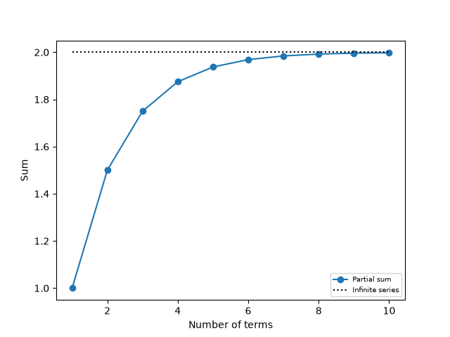
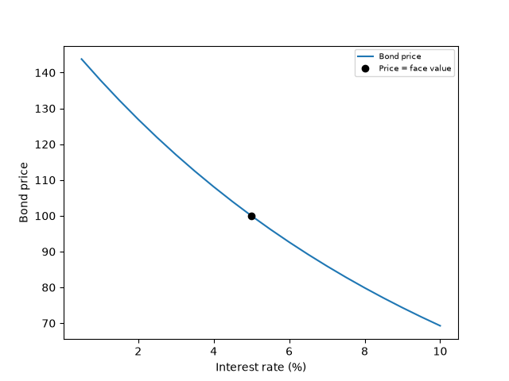
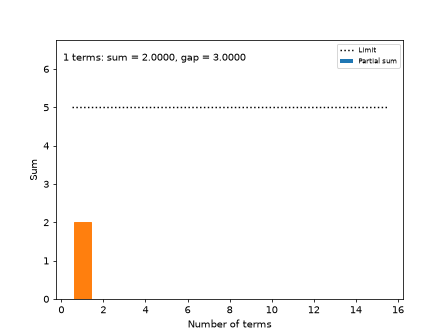

# 第 4 章: 数列と貯蓄

## 4.1 この章の地図

毎年 5 ずつ、永久に利子を払ってくれる債券があるとします。受け取る合計は、無限大です。それでも、この債券には、**有限の値段**が付きます。将来のお金を、今のお金に**割り引いて**足すと、項がどんどん小さくなり、和が、ある値に**近づく**からです。

この章の道具は、**等比数列**と、その和（**級数**）です。前の章の「割引現在価値」を、何年分も足すと、等比数列の和になります。年金・債券・株価の値段は、どれも、この和で決まります。この章は、第 1 部（第 1〜4 章）の最後で、**到達チェック**も行います。



| 項目 | 内容 |
| :--- | :--- |
| 経済学の題材 | 積立貯蓄、年金の現在価値、永久債（コンソル債）、利付債の価格と利子率、配当割引モデル（株価） |
| 数学 | 等比数列、部分和の公式、数列の極限、無限級数、漸化式（差分方程式）と不動点 |
| 使う Python の機能 | 関数、リスト、`while`、例外（`ValueError`）、テスト（`pytest`） |
| 新しく導入するライブラリ | なし |
| 完成形 | `geometric_term`、`geometric_partial_sum`、`geometric_series_limit`、`partial_sums`、`terms_until_within`、`annuity_present_value`、`perpetuity_present_value`、`savings_future_value`、`coupon_bond_price`、`iterate_map`、`affine_fixed_point`、`gordon_stock_price` |
| ファイル | 実装: `lib/chapter04/sequence.py`、`lib/chapter04/plot.py`（図）／テスト: `test/chapter04/test_sequence.py`、`test/chapter04/test_plot.py`（自分で書くときは、`practice/chapter04/` に、同じ名前で作ります） |
| データ | なし（手計算できる小さな例だけ） |

### 数学の式とコードの対応

| 経済学・数学 | 式 | コード |
| :--- | :--- | :--- |
| 等比数列の第 n 項 | a·r^(n−1) | `geometric_term(first, ratio, n)` |
| 部分和（第 n 項までの和） | S_n = a(1 − r^n) ÷ (1 − r)（r = 1 なら a·n） | `geometric_partial_sum(first, ratio, n)` |
| 無限級数 | a ÷ (1 − r)（\|r\| < 1 のときだけ） | `geometric_series_limit(first, ratio)` |
| 年金の現在価値 | C(1 − (1 + r)^(−n)) ÷ r | `annuity_present_value(payment, rate, periods)` |
| 永久債の現在価値 | C ÷ r | `perpetuity_present_value(payment, rate)` |
| 積立の将来価値 | C((1 + r)^n − 1) ÷ r | `savings_future_value(payment, rate, periods)` |
| 利付債の価格 | クーポンの年金の現在価値 + 額面 ÷ (1 + r)^n | `coupon_bond_price(face, coupon, rate, years)` |
| 漸化式と不動点 | x(t + 1) = a·x(t) + b、x* = b ÷ (1 − a) | `iterate_map(a, b, start, steps)`、`affine_fixed_point(a, b)` |
| 配当割引モデル | D ÷ (r − g)（r > g のときだけ） | `gordon_stock_price(dividend, rate, growth)` |

> **記号について**: a は初項、r は公比です。お金の話では、r を**利子率**にも使うので、この章のコードでは、公比を `ratio`、利子率を `rate` と、名前で分けます。利子率 5% は、0.05 と書きます。支払いは、すべて**期末**（1 年後、2 年後、…）に受け取るものとします。

### 前提とする章

| できること | 場所 |
| :--- | :--- |
| 関数とテストを書く、リスト内包表記を使う | [第 1 シリーズ](../economics-programming/index.md)の第 1〜6 章 |
| 1 次関数・連立方程式で、均衡と余剰を求める | この連載の[第 1 章](01-linear-functions-and-markets.md) |
| 複利と、割引現在価値（将来のお金を、今のお金に換算する）を計算する | この連載の[第 3 章](03-exponents-logarithms-and-interest.md) |

漸化式の経済学での使い方（所得の調整・資本の蓄積）は、[マクロ経済学のためのプログラミング（中級＋）の第 4 章](../macro-programming/04-difference-equations.md)で扱います。この章は、そこで使う数学（等比数列・級数・不動点）を、関数とテストで確かめます。

## 4.2 準備

```bash
cd apps/math-for-economics-programming/python
uv sync
uv run pytest test/chapter04
```

```text
62 passed
```

自分でコードを書くときは、`practice/chapter04/` に、完成形と同じ名前のファイル（`sequence.py`・`plot.py`・`test_sequence.py`・`test_plot.py`）を作ります（図の節を後回しにするなら、`plot.py` と `test_plot.py` は要らず、テストは 55 件になります）。テストと `plot.py` の import は、`from practice.chapter04...` に書き換えてください（書き換えないと、完成形を読み込んで、最初から通ってしまいます）。「予想の答え合わせ」のスクリプトは、`practice/chapter04/check.py` に保存し、`uv run python -m practice.chapter04.check` で実行します。

## 4.3 予想する

次の 5 つの問いに、**紙で、手計算で**答えてください。答えは、この節には書いてありません。「プログラミング」の節の「予想の答え合わせ」で、プログラムを動かして確かめます。

- 1 + 0.5 + 0.25 + … と、公比 0.5 で 10 項を足すと、和は、いくつですか。永久に足し続けると、和は、どの値に近づきますか。その値との差が、**0.01 より小さくなる**のは、何項目まで足したときですか
- 毎年 5 を、永久に受け取れる債券（永久債）があります。利子率が 5% のとき、この債券の今の価値は、いくつですか。同じ 5 を、**10 年だけ**受け取る年金の価値は、永久債の価値の、およそ何割ですか（5 割より多いですか、少ないですか）
- 額面 100、毎年のクーポン（利子の支払い）5、満期 3 年の債券があります。利子率が 4% のとき、価格は、額面の 100 より高いですか、低いですか。利子率が 6% のときは、どうですか
- x(t + 1) = 0.5·x(t) + 10 で、x(0) = 0 から始めると、x(1)・x(2)・x(3) は、いくつですか。x は、どの値に近づきますか
- （発展）来年の配当が 2 で、毎年 2% ずつ増える株式の価格は、利子率 7% のとき、いくつですか。発展の節を飛ばす方は、この問いも、飛ばしてかまいません

## 4.4 数列と割引現在価値の考え方

### 等比数列

**数列**は、数を、順番に並べたものです。1 番目を**初項**、n 番目を**第 n 項**と言います。**等比数列**は、前の項に、毎回、同じ数（**公比**）を掛けて作る数列です。

> 第 n 項 = a·r^(n−1)　（a: 初項、r: 公比）

初項 3・公比 2 なら、3、6、12、24、…です。経済学では、複利が、典型的な等比数列です。元本 100 を年利 5% で預けると、残高は、100、105、110.25、…と、毎年 1.05 倍になります（[第 3 章](03-exponents-logarithms-and-interest.md)）。

### 部分和の公式

初項から第 n 項までの和 S_n を、**部分和**と言います。等比数列の部分和は、次の公式で、一度に求まります。

> S_n = a + ar + ar² + … + ar^(n−1) = a(1 − r^n) ÷ (1 − r)　（r ≠ 1）

導き方は、S_n から、r·S_n を引くことです。r·S_n = ar + ar² + … + ar^n なので、引くと、間の項がすべて消えて、S_n − r·S_n = a − ar^n が残ります。両辺を (1 − r) で割れば、公式です。**r = 1 のときは、0 で割ることになる**ので、別に扱います（すべての項が a なので、S_n = a·n）。

### 数列の極限

初項 2・公比 1/3 の部分和は、2、2.67、2.89、2.96、…と、増えていきますが、3 を超えません。項数 n を大きくすると、S_n は、3 に、いくらでも近づきます。これを、「S_n の**極限**は 3」と言い、**S_n は 3 に収束する**と言います。

「いくらでも近づく」とは、「どんなに小さな許容誤差を決めても、ある項数から先は、差が、その許容誤差より小さくなる」ということです。この章では、その項数を、実際に数える関数を書きます。

### 級数（無限級数）

数列の項を、**永久に**足したものを、**級数**（無限級数）と言います。等比数列の級数は、|r| < 1 のとき、部分和の公式で n を大きくすると、r^n が 0 に近づくので、次の値に収束します。

> a + ar + ar² + … = a ÷ (1 − r)　（|r| < 1 のときだけ）

|r| ≥ 1 のときは、r^n が 0 に近づかないので、和は、収束しません（大きくなり続けるか、振動します）。コードでは、`ValueError` にします。

### 割引現在価値の和

1 年後の C は、利子率 r で割り引くと、今の C ÷ (1 + r) です。2 年後の C は、C ÷ (1 + r)² です。毎年 C を受け取る約束の、今の価値は、これらの和で、**初項 C ÷ (1 + r)、公比 1 ÷ (1 + r) の等比数列の和**です。

| 約束 | 現在価値（将来価値） | 数学 |
| :--- | :--- | :--- |
| **年金**: 毎年 C を n 年 | C(1 − (1 + r)^(−n)) ÷ r | 部分和 |
| **永久債**（コンソル債）: 毎年 C を永久に | C ÷ r | 無限級数（r > 0 なら、公比 1 ÷ (1 + r) < 1） |
| **積立**: 毎年 C を預け、n 年後に引き出す | C((1 + r)^n − 1) ÷ r（将来価値） | 公比 (1 + r) の部分和 |

経済学の意味を 1 行で言うと、永久債の価格 C ÷ r は、「**利子率 r で運用して、毎年 C の利子を生む元本**」です（100 を 5% で預ければ、毎年 5 の利子が、永久に得られます）。

### もう少し練習: 利付債

**利付債**は、満期まで毎年クーポン（利子）を払い、満期に額面を返す債券です。価格は、「クーポンの年金の現在価値 + 満期の額面の現在価値」です。この式から、2 つの性質が出ます。

- **利子率が上がると、債券の価格は下がる**（すべての項の分母が大きくなる）
- クーポン ÷ 額面（クーポンの利回り）が、利子率と**等しい**とき、価格は、ちょうど額面

??? note "発展: 漸化式（差分方程式）と株価の決まり方"

    **漸化式**は、「次の値を、今の値から決める」規則です。x(t + 1) = a·x(t) + b は、最も簡単な形（1 次の漸化式）です。x(0) を決めると、x(1)、x(2)、…が、順に決まります。

    x = a·x + b を満たす点 x* = b ÷ (1 − a) を、**不動点**と言います（そこから始めると、動かない）。x(t) と x* の差は、毎期 a 倍になります（x(t + 1) − x* = a·(x(t) − x*)）。つまり、**差は、公比 a の等比数列**です。|a| < 1 なら、差は 0 に近づき、x は不動点に**収束**します。|a| > 1 なら、離れていきます。a が負なら、不動点の上下を、行き来します。

    **配当割引モデル**（ゴードン・モデル）: 株価を、将来の配当の割引現在価値の和と考えます。来年の配当が D で、毎年 g の率で増えるなら、和は、初項 D ÷ (1 + r)、公比 (1 + g) ÷ (1 + r) の無限級数です。r > g のとき、公比が 1 より小さく、和は D ÷ (r − g) に収束します。r ≤ g なら、和は、収束しません（株価が決まらない）。

## 4.5 プログラミング

### Red: 等比数列のテスト

テストの import は、次のとおりです（完成形の全関数）。自分で書くときは、関数を 1 つ書くたびに、名前を足していってください。

```python
import pytest

from lib.chapter04.sequence import (
    affine_fixed_point,
    annuity_present_value,
    coupon_bond_price,
    geometric_partial_sum,
    geometric_series_limit,
    geometric_term,
    gordon_stock_price,
    iterate_map,
    partial_sums,
    perpetuity_present_value,
    savings_future_value,
    terms_until_within,
)
```

最初のテストは、手計算できる値（3、6、12、24 と、1.998046875 = 2 − 1/512）と、**性質**（公式の値が、項を順に足した値と一致する）です。公比が 1 のときも、テストにします。

```python
def test_等比数列の第n項は初項に公比をnマイナス1回掛ける() -> None:
    assert [geometric_term(3, 2, n) for n in (1, 2, 3, 4)] == [3, 6, 12, 24]


def test_初項1公比2分の1の10項の和() -> None:
    assert geometric_partial_sum(1, 0.5, 10) == 1.998046875


def test_部分和の公式は項を順に足した値と一致する() -> None:
    for first, ratio, n in [(1, 0.5, 10), (3, 2, 5), (5, 1 / 1.04, 3), (2, -0.5, 7)]:
        added = sum(geometric_term(first, ratio, k) for k in range(1, n + 1))
        assert geometric_partial_sum(first, ratio, n) == pytest.approx(added)


def test_公比1の部分和は初項のn倍() -> None:
    assert geometric_partial_sum(4, 1, 6) == 24
```

`lib.chapter04.sequence` がないので、テストの収集の時点で失敗します（**Red**）。

性質のテストでは、公比 2（大きくなる）、1 ÷ 1.04（割引）、−0.5（負）と、**種類の違う公比**を試します。公比 0.5 だけでは、`ratio**n` と `ratio*n` を取り違えても、たまたま通る値があるからです。

### Green: 等比数列を実装する

```python
def geometric_term(first: float, ratio: float, n: int) -> float:
    """等比数列の第 n 項 = 初項 × 公比^(n − 1)。n は 1 から数える。"""
    if n < 1:
        raise ValueError("第 n 項の n は 1 以上でなければなりません")
    return first * ratio ** (n - 1)


def geometric_partial_sum(first: float, ratio: float, n: int) -> float:
    """等比数列の、初項から第 n 項までの和 S_n = a(1 − r^n) ÷ (1 − r)。"""
    if n < 0:
        raise ValueError("項数は 0 以上でなければなりません")
    if ratio == 1:
        return first * n
    return first * (1 - ratio**n) / (1 - ratio)
```

第 n 項の n は 1 から数えるので、`geometric_term` は n < 1 を、和の項数は 0 項まで意味があるので、`geometric_partial_sum` は n < 0 を、`ValueError` にします（境界のテストで確かめます）。

### 数列の極限と無限級数

部分和が、無限級数に「近づく」ことを、2 通りでテストにします。1 つは、**差が、毎回小さくなり、最後は 1e-8 より小さい**こと。もう 1 つは、許容誤差を決めて、**差がそれより小さくなる項数**を数えることです。初項 1・公比 0.5 の差は 2 × 0.5^n なので、0.01 より小さくなるのは、n = 8（0.0078125。n = 7 では 0.015625）と、手計算できます。

```python
def test_初項1公比2分の1の無限級数は2() -> None:
    assert geometric_series_limit(1, 0.5) == 2


@pytest.mark.parametrize("ratio", [1, -1, 1.5, -2])
def test_公比の絶対値が1以上なら無限級数は収束しない(ratio: float) -> None:
    with pytest.raises(ValueError):
        geometric_series_limit(1, ratio)


def test_部分和は無限級数に近づいていく() -> None:
    limit = geometric_series_limit(1, 0.5)
    sums = partial_sums(1, 0.5, 30)
    gaps = [abs(limit - s) for s in sums]
    assert all(g1 > g2 for g1, g2 in zip(gaps, gaps[1:], strict=False))
    assert gaps[-1] < 1e-8


def test_無限級数との差が許容誤差より小さくなるまでの項数() -> None:
    # 初項 1・公比 0.5 の差は 2 × 0.5^n。0.01 より小さくなるのは n = 8（0.0078125）
    assert terms_until_within(1, 0.5, 0.01) == 8
    assert terms_until_within(1, 0.5, 0.001) == 11


def test_公比が0に近いほど少ない項数で近づく() -> None:
    assert terms_until_within(1, 0.1, 0.001) < terms_until_within(1, 0.9, 0.001)
```

```python
def geometric_series_limit(first: float, ratio: float) -> float:
    """無限級数 a + ar + ar² + … = a ÷ (1 − r)。|r| < 1 のときだけ収束する。"""
    if abs(ratio) >= 1:
        raise ValueError("公比の絶対値が 1 以上では、無限級数は収束しません")
    return first / (1 - ratio)


def partial_sums(first: float, ratio: float, n: int) -> list[float]:
    """第 1 項までの和、第 2 項までの和、…、第 n 項までの和の列。"""
    return [geometric_partial_sum(first, ratio, k) for k in range(1, n + 1)]


def terms_until_within(first: float, ratio: float, tolerance: float) -> int:
    """部分和と無限級数の差が、tolerance より小さくなる、最初の項数 n。"""
    if tolerance <= 0:
        raise ValueError("許容誤差は正でなければなりません（0 では、終わりません）")
    limit = geometric_series_limit(first, ratio)
    n = 1
    while abs(limit - geometric_partial_sum(first, ratio, n)) >= tolerance:
        n += 1
    return n
```

`terms_until_within` は、`while` で、差が許容誤差より小さくなるまで、n を増やします。**許容誤差が 0 以下だと、永久に終わりません**（差は、0 に近づくが、0 にはならない）。そこで、先に `ValueError` にします。テストを書いたとき、この検査がない実装は、テストの時間切れ（`pytest-timeout`）で止まりました。

### 割引現在価値の和

年金は、等比数列の部分和、永久債は、無限級数です。**年金の期間を延ばすと、永久債の価値に近づく**ことを、テストにします（期間 1000 年の年金と、永久債が、ほぼ等しい）。

```python
def test_毎期1を3期受け取る年金の利子率5パーセントでの現在価値() -> None:
    expected = 1 / 1.05 + 1 / 1.05**2 + 1 / 1.05**3
    assert annuity_present_value(1, 0.05, 3) == pytest.approx(expected)


def test_年金の現在価値は等比数列の部分和() -> None:
    discount = 1 / 1.04
    for n in (1, 2, 10):
        assert annuity_present_value(5, 0.04, n) == pytest.approx(
            geometric_partial_sum(5 * discount, discount, n)
        )


def test_毎年5の永久債_利子率5パーセントで100() -> None:
    assert perpetuity_present_value(5, 0.05) == pytest.approx(100)


def test_年金の期間を延ばすと永久債の価値に近づく() -> None:
    perpetuity = perpetuity_present_value(5, 0.05)
    values = [annuity_present_value(5, 0.05, n) for n in (10, 50, 200, 1000)]
    assert all(v1 < v2 < perpetuity for v1, v2 in zip(values, values[1:], strict=False))
    assert values[-1] == pytest.approx(perpetuity)


@pytest.mark.parametrize("rate", [0, -0.01])
def test_利子率が正でなければ永久債の価値は決まらない(rate: float) -> None:
    with pytest.raises(ValueError):
        perpetuity_present_value(5, rate)


def test_毎年10を3パーセントで5年積み立てた将来価値() -> None:
    expected = sum(10 * 1.03**k for k in range(5))
    assert savings_future_value(10, 0.03, 5) == pytest.approx(expected)
    assert savings_future_value(10, 0.03, 5) == pytest.approx(53.0913581)
```

```python
def _require_rate_above_minus_one(rate: float) -> None:
    if rate <= -1:
        raise ValueError(
            "利子率が −100% 以下では、割り引くことも、積み立てることもできません"
        )


def annuity_present_value(payment: float, rate: float, periods: int) -> float:
    """毎期末に payment を periods 期受け取る年金の現在価値 C(1 − (1 + r)^−n) ÷ r。"""
    _require_rate_above_minus_one(rate)
    discount = 1 / (1 + rate)
    return geometric_partial_sum(payment * discount, discount, periods)


def perpetuity_present_value(payment: float, rate: float) -> float:
    """毎期末に payment を、永久に受け取る債券（コンソル債）の現在価値 C ÷ r。"""
    if rate <= 0:
        raise ValueError("利子率が正でなければ、永久債の現在価値は決まりません")
    return payment / rate


def savings_future_value(payment: float, rate: float, periods: int) -> float:
    """毎期末に payment を積み立てたときの、periods 期末の残高 C((1 + r)^n − 1) ÷ r。"""
    _require_rate_above_minus_one(rate)
    return geometric_partial_sum(payment, 1 + rate, periods)
```

3 つとも、新しい公式を書かずに、`geometric_partial_sum` を、初項と公比を変えて呼ぶだけです。利子率 0 のとき、公式 C(1 − (1 + r)^(−n)) ÷ r は、0 で割ることになりますが、`geometric_partial_sum` が公比 1 を別に扱うので、正しく C·n になります（境界のテストで確かめます）。

### 利付債の価格

```python
def test_額面100_クーポン5_利子率4パーセント_3年の利付債() -> None:
    expected = 5 / 1.04 + 5 / 1.04**2 + 105 / 1.04**3
    assert coupon_bond_price(100, 5, 0.04, 3) == pytest.approx(expected)
    assert coupon_bond_price(100, 5, 0.04, 3) == pytest.approx(102.775091)


def test_クーポンの利回りと利子率が等しければ価格は額面() -> None:
    for rate, years in [(0.05, 3), (0.02, 10), (0.08, 1)]:
        assert coupon_bond_price(100, 100 * rate, rate, years) == pytest.approx(100)


def test_利子率が上がると債券の価格は下がる() -> None:
    prices = [coupon_bond_price(100, 5, r, 10) for r in (0.01, 0.03, 0.05, 0.07)]
    assert all(p1 > p2 for p1, p2 in zip(prices, prices[1:], strict=False))
```

```python
def coupon_bond_price(face: float, coupon: float, rate: float, years: int) -> float:
    """利付債の価格: 毎年のクーポンの現在価値の和 + 満期の額面の現在価値。"""
    return annuity_present_value(coupon, rate, years) + face / (1 + rate) ** years
```

「価格が額面に等しい」性質は、利子率・満期を変えた 3 組で確かめます。1 組だけだと、満期の額面の割引を、たまたま打ち消す誤りを見逃します。

### 発展: 漸化式と配当割引モデル

??? note "漸化式・配当割引モデルのテストと実装（発展。`iterate_map`・`affine_fixed_point` は、第 12 章で使います）"

    漸化式は、**反復（数値）と、不動点（公式）の一致**をテストにします。初期値と、a の符号（正・負）を変えて、どれも不動点に近づくこと、|a| > 1 では、差が毎期 2 倍になって離れていくことを、確かめます。

    ```python
    def test_漸化式を反復すると初期値から順に値が並ぶ() -> None:
        assert iterate_map(0.5, 10, 0, 3) == [0, 10, 15, 17.5]


    def test_xの次は0点5x足す10の不動点は20() -> None:
        point = affine_fixed_point(0.5, 10)
        assert point == 20
        assert 0.5 * point + 10 == point


    def test_傾きの絶対値が1より小さければ反復は不動点に近づく() -> None:
        for a, b, start in [(0.5, 10, 0), (0.5, 10, 100), (-0.5, 30, 0), (0.9, 2, 50)]:
            path = iterate_map(a, b, start, 300)
            assert path[-1] == pytest.approx(affine_fixed_point(a, b))


    def test_傾きの絶対値が1より大きければ反復は不動点から離れる() -> None:
        path = iterate_map(2, -10, 11, 5)
        gaps = [abs(x - affine_fixed_point(2, -10)) for x in path]
        assert gaps == [1, 2, 4, 8, 16, 32]


    def test_傾きが1なら不動点はない() -> None:
        with pytest.raises(ValueError):
            affine_fixed_point(1, 10)
    ```

    ```python
    def iterate_map(a: float, b: float, start: float, steps: int) -> list[float]:
        """漸化式 x(t + 1) = a·x(t) + b を、x(0) = start から steps 回、反復した列。"""
        path = [start]
        for _ in range(steps):
            path.append(a * path[-1] + b)
        return path


    def affine_fixed_point(a: float, b: float) -> float:
        """x = a·x + b を満たす不動点 b ÷ (1 − a)。a = 1 では、不動点がない。"""
        if a == 1:
            raise ValueError("a = 1 では、x = x + b を満たす点がありません")
        return b / (1 - a)
    ```

    配当割引モデルは、**公式 D ÷ (r − g) と、無限級数の和の一致**をテストにします。成長率が負（配当が減っていく）・0 の場合も、試します。

    ```python
    def test_配当2_利子率7パーセント_成長率2パーセントで株価40() -> None:
        assert gordon_stock_price(2, 0.07, 0.02) == pytest.approx(40)


    def test_配当割引モデルは成長する配当の割引現在価値の無限級数() -> None:
        for dividend, rate, growth in [(2, 0.07, 0.02), (3, 0.1, -0.05), (1, 0.04, 0)]:
            series = geometric_series_limit(
                dividend / (1 + rate), (1 + growth) / (1 + rate)
            )
            assert gordon_stock_price(dividend, rate, growth) == pytest.approx(series)


    @pytest.mark.parametrize("growth", [0.07, 0.1])
    def test_成長率が利子率以上なら株価は決まらない(growth: float) -> None:
        with pytest.raises(ValueError):
            gordon_stock_price(2, 0.07, growth)
    ```

    ```python
    def gordon_stock_price(dividend: float, rate: float, growth: float) -> float:
        """配当割引モデル（ゴードン）: 来期の配当 D が率 g で増え続けるときの株価。

        株価 = D ÷ (r − g)。r > g のときだけ、決まる。
        """
        if rate <= growth:
            raise ValueError("利子率が成長率より大きくなければ、株価は決まりません")
        return dividend / (rate - growth)
    ```

### 予想の答え合わせ

```python
from lib.chapter04.sequence import (
    affine_fixed_point,
    annuity_present_value,
    coupon_bond_price,
    geometric_partial_sum,
    geometric_series_limit,
    gordon_stock_price,
    iterate_map,
    perpetuity_present_value,
    terms_until_within,
)

print(geometric_partial_sum(1, 0.5, 10), geometric_series_limit(1, 0.5))
print(terms_until_within(1, 0.5, 0.01))
print(perpetuity_present_value(5, 0.05), round(annuity_present_value(5, 0.05, 10), 2))
print(round(coupon_bond_price(100, 5, 0.04, 3), 2))
print(round(coupon_bond_price(100, 5, 0.06, 3), 2))
print(iterate_map(0.5, 10, 0, 3), affine_fixed_point(0.5, 10))
print(gordon_stock_price(2, 0.07, 0.02))
```

```text
1.998046875 2.0
8
100.0 38.61
102.78
97.33
[0, 10.0, 15.0, 17.5] 20.0
40.0
```

- **1 つ目の問い**: 10 項の和は 1.998046875（= 2 − 1/512）、無限級数は 2 です。差が 0.01 より小さくなるのは、8 項目まで足したとき（差 0.0078125）です
- **2 つ目の問い**: 永久債は 5 ÷ 0.05 = 100 です。10 年の年金は 38.61 で、永久債の **4 割弱**です。「10 年あれば、永久の半分くらい」と予想した方は、遠い将来の 5 も、割り引くと、無視できない額で残ることに、注意してください（11 年目以降の分が、残りの 6 割強）
- **3 つ目の問い**: 利子率 4% では 102.78 で、額面より**高く**、6% では 97.33 で、**低く**なります。クーポンの利回り（5%）より、利子率が低ければ、額面より高くなります
- **4 つ目の問い**: x(1) = 10、x(2) = 15、x(3) = 17.5 で、不動点 20 に近づきます（差が 20、10、5、2.5 と、毎回半分になる）
- **5 つ目の問い**（発展）: 株価は 2 ÷ (0.07 − 0.02) = 40 です

### 境界のテスト

完成形には、**境界**を確かめるテストがあります。0 項・1 項の和、差が許容誤差と**ちょうど等しい**とき（「小さい」ではないので、もう 1 項足す。`>=` を `>` と書き違えると、ここで落ちます）、負の公比・負の初項での項数（差の**大きさ**で比べる。`abs` を忘れると、差が負の項で、すぐ止まります）、負の公比（部分和が、級数の上下を行き来する）、公比 0、負の初項、利子率 0・負・−100% 以下（年金の割引も、積立も）、第 n 項の n が 0 以下、満期 0 年、反復 0 回、不動点の a = 0・a = −1 です。完成形の「テストの件数」を合わせるため、ここに載せます。

1 項の和のテストは、`== 3` ではなく、`pytest.approx(3)` で比べています。公式 3 × (1 − 0.2) ÷ (1 − 0.2) は、浮動小数点では 3.0000000000000004 になるからです（**公式が正しくても、`==` では落ちます**）。

??? note "境界のテスト"

    ```python
    def test_0項の和は0で1項の和は初項() -> None:
        assert geometric_partial_sum(3, 0.2, 0) == 0
        assert geometric_partial_sum(3, 0.2, 1) == pytest.approx(3)
        assert geometric_partial_sum(3, 0.2, 2) == pytest.approx(3.6)


    def test_項数が負なら和は決まらない() -> None:
        with pytest.raises(ValueError):
            geometric_partial_sum(1, 0.5, -1)


    def test_公比が負なら部分和は無限級数の上下を行き来する() -> None:
        limit = geometric_series_limit(1, -0.5)
        assert limit == pytest.approx(2 / 3)
        sums = partial_sums(1, -0.5, 6)
        assert [s > limit for s in sums] == [True, False, True, False, True, False]


    def test_公比0と初項が負の無限級数() -> None:
        assert geometric_series_limit(7, 0) == 7
        assert geometric_series_limit(-3, 0.25) == -4


    def test_許容誤差が差より大きければ1項で足りる() -> None:
        assert terms_until_within(1, 0.5, 1.5) == 1


    def test_差が許容誤差とちょうど等しければもう1項足す() -> None:
        # 7 項までの差は 2 × 0.5^7 = 0.015625（等しいので「小さい」ではない）
        assert terms_until_within(1, 0.5, 0.015625) == 8


    def test_負の公比でも差の大きさで項数を数える() -> None:
        # 差は 2/3 × 0.5^n。0.01 より小さくなるのは n = 7（0.0052…。n = 6 では 0.0104…）
        assert terms_until_within(1, -0.5, 0.01) == 7


    def test_負の初項でも差の大きさで項数を数える() -> None:
        assert terms_until_within(-1, 0.5, 0.01) == 8


    @pytest.mark.parametrize("tolerance", [0, -0.1])
    def test_許容誤差が正でなければ項数は決まらない(tolerance: float) -> None:
        with pytest.raises(ValueError):
            terms_until_within(1, 0.5, tolerance)


    def test_利子率0の年金と積立は単純な合計() -> None:
        assert annuity_present_value(5, 0, 4) == 20
        assert savings_future_value(5, 0, 4) == 20


    def test_0期の年金と積立は0で1期の積立は1回分() -> None:
        assert annuity_present_value(5, 0.05, 0) == 0
        assert savings_future_value(5, 0.05, 0) == 0
        assert savings_future_value(5, 0.05, 1) == 5


    def test_利子率が負でも年金の現在価値は受け取る合計より大きい() -> None:
        assert annuity_present_value(10, -0.5, 2) == pytest.approx(20 + 40)


    @pytest.mark.parametrize("rate", [-1, -1.5])
    def test_利子率がマイナス100パーセント以下なら割引できない(rate: float) -> None:
        with pytest.raises(ValueError):
            annuity_present_value(5, rate, 3)


    def test_満期0年の利付債は額面で1年なら額面とクーポンの割引() -> None:
        assert coupon_bond_price(100, 5, 0.04, 0) == 100
        assert coupon_bond_price(100, 5, 0.25, 1) == pytest.approx(105 / 1.25)


    def test_小さい利子率の永久債と大きい額() -> None:
        assert perpetuity_present_value(0.3, 0.5) == pytest.approx(0.6)
        assert perpetuity_present_value(2, 0.001) == pytest.approx(2000)


    def test_反復0回は初期値だけ() -> None:
        assert iterate_map(0.5, 10, 7, 0) == [7]


    def test_傾き0と負の傾きの不動点() -> None:
        assert affine_fixed_point(0, 4) == 4
        assert affine_fixed_point(-1, 6) == 3
        assert iterate_map(-1, 6, 1, 4) == [1, 5, 1, 5, 1]


    def test_成長率がわずかに利子率より小さいと株価は大きい() -> None:
        assert gordon_stock_price(1, 0.05, 0.04) == pytest.approx(100)
        assert gordon_stock_price(3, 0.5, 0.25) == pytest.approx(12)


    @pytest.mark.parametrize("rate", [-1, -2])
    def test_利子率がマイナス100パーセント以下なら積み立てられない(rate: float) -> None:
        with pytest.raises(ValueError):
            savings_future_value(1, rate, 3)


    @pytest.mark.parametrize("n", [0, -1])
    def test_第n項のnは1以上(n: int) -> None:
        with pytest.raises(ValueError):
            geometric_term(1, 2, n)
        with pytest.raises(ValueError):
            geometric_term(1, 0, n)
    ```

### 図

図には、次の import が要ります。

```python
from collections.abc import Sequence

import matplotlib.pyplot as plt
from matplotlib.figure import Figure

from lib.chapter04.sequence import (
    coupon_bond_price,
    geometric_series_limit,
    partial_sums,
)
```

章の冒頭の図（部分和の収束）と、債券価格と利子率の図を描きます。テストでは、点の座標が、`partial_sums`・`coupon_bond_price` の値と一致することと、クーポンの利回りの点で、価格が額面に等しいことを、確かめます。



??? note "描画のテストと実装（後回しにしても、学習は成り立ちます）"

    テストの import:

    ```python
    import matplotlib.pyplot as plt
    import numpy as np
    import pytest
    from matplotlib.axes import Axes

    from lib.chapter04.plot import plot_bond_prices, plot_partial_sums
    from lib.chapter04.sequence import coupon_bond_price, partial_sums
    ```

    ```python
    def _series(ax: Axes, label: str) -> tuple[list[float], list[float]]:
        line = next(x for x in ax.lines if x.get_label() == label)
        xs = np.asarray(line.get_xdata(), dtype=float).tolist()
        ys = np.asarray(line.get_ydata(), dtype=float).tolist()
        return xs, ys


    def test_部分和の点は項数ごとの部分和() -> None:
        ax = plot_partial_sums(1, 0.5, 10).axes[0]
        xs, ys = _series(ax, "Partial sum")
        assert xs == list(range(1, 11))
        assert ys == pytest.approx(partial_sums(1, 0.5, 10))


    def test_無限級数の値は水平の点線() -> None:
        ax = plot_partial_sums(3, 0.25, 6).axes[0]
        line = next(x for x in ax.lines if x.get_label() == "Infinite series")
        xs, ys = _series(ax, "Infinite series")
        assert (xs[0], xs[-1]) == (1, 6)
        assert set(ys) == {4}
        assert line.get_linestyle() == ":"


    def test_部分和の図の軸と凡例() -> None:
        ax = plot_partial_sums(1, 0.5, 10).axes[0]
        assert ax.get_xlabel() == "Number of terms"
        assert ax.get_ylabel() == "Sum"
        assert ax.get_legend() is not None
        plt.close("all")


    def test_収束しない公比では部分和の図を描かない() -> None:
        with pytest.raises(ValueError):
            plot_partial_sums(1, 1.5, 10)


    def test_債券価格の線は利子率ごとの価格で右下がり() -> None:
        rates = [0.01, 0.03, 0.05, 0.07]
        ax = plot_bond_prices(100, 5, 10, rates).axes[0]
        xs, ys = _series(ax, "Bond price")
        assert xs == pytest.approx([1, 3, 5, 7])
        assert ys == pytest.approx([coupon_bond_price(100, 5, r, 10) for r in rates])
        assert all(y1 > y2 for y1, y2 in zip(ys, ys[1:], strict=False))


    def test_クーポンの利回りの点で価格は額面() -> None:
        ax = plot_bond_prices(100, 4, 5, [0.02, 0.06]).axes[0]
        xs, ys = _series(ax, "Price = face value")
        assert xs == pytest.approx([4])
        assert ys == pytest.approx([100])


    def test_債券価格の図の軸と凡例() -> None:
        ax = plot_bond_prices(100, 5, 10, [0.01, 0.09]).axes[0]
        assert ax.get_xlabel() == "Interest rate (%)"
        assert ax.get_ylabel() == "Bond price"
        assert ax.get_legend() is not None
        plt.close("all")
    ```

    ```python
    def plot_partial_sums(first: float, ratio: float, n: int) -> Figure:
        """第 1〜n 項までの部分和（点）と、無限級数の値（水平の点線）を描く。"""
        limit = geometric_series_limit(first, ratio)
        terms = list(range(1, n + 1))
        fig, ax = plt.subplots()
        ax.plot(terms, partial_sums(first, ratio, n), "o-", label="Partial sum")
        ax.plot([1, n], [limit, limit], ":", color="black", label="Infinite series")
        ax.set_xlabel("Number of terms")
        ax.set_ylabel("Sum")
        ax.legend(fontsize="x-small")
        plt.close(fig)
        return fig


    def plot_bond_prices(
        face: float, coupon: float, years: int, rates: Sequence[float]
    ) -> Figure:
        """利子率（横軸、%）ごとの利付債の価格と、価格が額面に等しくなる点を描く。"""
        fig, ax = plt.subplots()
        prices = [coupon_bond_price(face, coupon, r, years) for r in rates]
        ax.plot([r * 100 for r in rates], prices, label="Bond price")
        ax.plot([coupon / face * 100], [face], "ko", label="Price = face value")
        ax.set_xlabel("Interest rate (%)")
        ax.set_ylabel("Bond price")
        ax.legend(fontsize="x-small")
        plt.close(fig)
        return fig
    ```

### ノートブックで試す

数字を書き換えて、結果と図が変わるのを、手軽に確かめられます。`apps/math-for-economics-programming/python/notebooks/ch04_sequences_and_saving.ipynb` を開き、「Parameters」のセルの数字（初項・公比・項数、毎年の受け取り・利子率・年数・額面）を書き換えて、上から順に実行します。起動は、アプリのディレクトリで `uv run --with jupyterlab jupyter lab notebooks/` です。

### 動かして見る

初項 2・公比 0.6 の等比数列の項を、1 つずつ足します。部分和の棒が 1 本ずつ増え（いま足した項は、橙色）、無限級数の値（点線）に近づきます。左上に、部分和と、点線との差が出ます。差は、毎回 0.6 倍に縮みます。



このアニメーションは、`lib/animations/` の関数で作っています（`uv run python -m tools.render_animations` で、GIF を書き出します）。**写経は、不要**です。動きを見て、式と図の対応を、確かめてください。

### 実行結果

```bash
uv run pytest test/chapter04
```

```text
62 passed
```

## 4.6 規則で言うと

1. **等比数列の和は、公式で一度に求まる。** S_n = a(1 − r^n) ÷ (1 − r)。r = 1 は別扱い（a·n）
2. **無限級数は、|r| < 1 のときだけ収束する。** 和は a ÷ (1 − r)。部分和は、項を足すほど、この値に近づく
3. **割引現在価値の和は、等比数列の和である。** 年金は部分和、永久債は無限級数。公比は 1 ÷ (1 + r)
4. **利子率と債券価格は、逆に動く。** クーポンの利回りと利子率が等しいとき、価格は額面

混同しやすい点を、表にまとめます。

| 混同しやすい点 | 違い |
| :--- | :--- |
| 公比 r と、利子率 r | 同じ文字だが、別の量。割引の公比は 1 ÷ (1 + r)、積立の公比は (1 + r)。コードでは `ratio` と `rate` に分ける |
| 部分和の項数 n と、べき r^n | 第 n 項は a·r^(n−1)（べきは n − 1）、第 n 項までの和は、公式に r^n（べきは n）。1 つずれる |
| 現在価値と、将来価値 | 年金の現在価値は「今いくら」、積立の将来価値は「n 年後にいくら」。将来価値 = 現在価値 × (1 + r)^n |
| 収束と、大きくならない | 公比 −1 の部分和（1、0、1、0、…）は、大きくならないが、1 つの値に近づかないので、収束しない |

経済学の別の場面でも、同じ等比数列の和が出てきます。マクロ経済学の**乗数** 1 ÷ (1 − 限界消費性向) は、「所得が増える → 消費が増える → 所得が増える → …」の波及を、無限に足した、無限級数です（[マクロ経済学のためのプログラミング（初級）の第 4 章](../macro-basics-programming/04-45-degree-line-and-multiplier.md)）。

### このモデルが成り立たない場面

- **利子率が、毎年同じとは、限りません。** 実際の債券の価格は、満期ごとに違う利子率（利回り曲線）で割り引きます。この章の公式は、すべての年で同じ r を仮定しています
- **約束が守られるとは、限りません。** 発行した会社や国が、払えなくなる（デフォルト）おそれがあれば、価格は、この章の値より低くなります
- **配当は、一定の率で、永久に増え続けません。** 配当割引モデルの株価 D ÷ (r − g) は、g が r に近いと、極端に大きくなります（r = 5%、g = 4% で、配当の 100 倍）。g のわずかな見込み違いで、株価が大きく変わるので、このモデルの値は、目安にとどめます
- **永久債の「永久」は、数学の約束です。** 現実の永久債には、発行者が途中で買い戻す条項が付くことが多く、無限級数で値段を付けると、高すぎることがあります

## 4.7 第 1 部の到達チェック

第 1 部（第 1〜4 章）の終わりです。何も見ずに、できるかどうかを、自分で確かめます。**先に、次の「時間を決めて書く課題」を、何も見ずに試してください。** 課題の解答（実行できるテスト）は、4.8 節の練習問題の解答のあとに、折りたたんで置きます。自分のコードは、関数を `practice/chapter04/checkpoint.py` に、テストを `practice/chapter04/test_checkpoint.py` に書きます。第 1・4 章の関数は、前の章を写していなければ、`lib.chapterNN...` のままでかまいません（写したなら、`practice.chapterNN...` に書き換えます）。頂点・複利・割引の関数は、何も見ずに書けるかを確かめるため、第 2・3 章の関数を使わずに、自分で書きます。

### 時間を決めて書く課題

何も見ずに、時間を計って、関数とテストを書きます。どの課題も、**期待値を、先に手計算で書いてから**、関数を書きます。

| 課題 | 目安の時間 |
| :--- | :--- |
| 需要 q = 90 − p、供給 q = 2p の均衡と、消費者余剰・生産者余剰を求めるテスト（第 1 章の関数を使う） | 10 分 |
| 2 次関数 y = c₂x² + c₁x + c₀ の頂点を返す関数と、テスト。それを使って、逆需要 P = 100 − 2Q・単位あたり費用 20 の独占企業の、利潤を最大にする数量・価格・利潤を求める | 15 分 |
| 複利の将来価値と、割引現在価値を返す関数と、テスト（1000 を年利 10% で 2 年。2 年後の 1210 の現在価値） | 10 分 |
| 初項 3・公比 1/3 の、3 項の和と、無限級数。毎年 2 の永久債の、利子率 4% での価値を求めるテスト（この章の関数を使う） | 10 分 |

### できること

| できること | 確かめ方（値は、解答の折りたたみにあります） | 戻る章 |
| :--- | :--- | :--- |
| 1 次関数の連立方程式で、均衡を求め、余剰を面積で求める | 需要量 ＝ 供給量 から均衡を求め、余剰を、三角形の面積で確かめる | [第 1 章](01-linear-functions-and-markets.md) |
| 2 次関数の頂点を求め、独占の利潤最大化に使う | 利潤を、数量の 2 次関数 π(Q) = (逆需要 − 費用)·Q と見て、頂点から、数量・価格・利潤を求める | [第 2 章](02-quadratics-monopoly-and-oligopoly.md) |
| 複利と、割引現在価値を計算し、互いに逆の操作であると言う | 複利で増やした額を、同じ利子率で割り引くと、元に戻ることを確かめる | [第 3 章](03-exponents-logarithms-and-interest.md) |
| 等比数列の部分和・無限級数を求め、割引現在価値の和に使う | 部分和と、無限級数 a ÷ (1 − r) を求め、永久債の価値を、C ÷ r で確かめる | この章 |

### 誤りの原因の分類

できなかった課題は、原因を、次の 4 つに分けて、記録します。

| 分類 | 例 | 対策 |
| :--- | :--- | :--- |
| 知識の不足 | 無限級数が、\|r\| < 1 のときだけ収束することを忘れた | その章の「規則で言うと」を、読み直す |
| 式の取り違え | 頂点の −c₁ ÷ (2c₂) の 2 を落とした。割引で、(1 + r)^n を掛けた | 式とコードの対応表を、書き写す |
| 手順の誤り | 独占の利潤を、価格 × 数量（収入）のまま最大にした（費用を引いていない） | 式を、言葉で書いてから、コードにする |
| 不注意 | 利子率 10% を 10 と書いた。逆需要と需要（数量と価格の向き）を取り違えた | テストの期待値を、先に手計算で書く |

## 4.8 練習問題

| 種類 | 問題 |
| :--- | :--- |
| 想起 | 本文を閉じて、`geometric_partial_sum` の最初のテスト（初項 1・公比 0.5 の 10 項の和 1.998046875）と、公比 1 のテストを書いてください |
| 生成 | 解説を見る前に、クーポンのない債券（割引債）の価格 `zero_coupon_bond_price(face, rate, years)` を、テストから書いてください。額面 100・利子率 25%・2 年で 64 です。`coupon_bond_price` でクーポンを 0 にした値と、一致しますか |
| 多様 | 漸化式を x(t + 1) = −0.5·x(t) + 30 に変えます。x(0) = 0 から、x(1)〜x(4) と、不動点は、いくつですか。不動点に、どのように近づきますか。先に手計算で予想してから、確かめてください |
| 交互 | [第 1 シリーズ](../economics-programming/index.md)の第 3 章のリスト内包表記で、利子率 1%・2%・…・10% での、額面 100・クーポン 5・満期 10 年の債券の価格を、一度に求めてください。価格は、利子率とともに、下がり続けますか。利子率 5% の価格は、いくつですか |

??? note "解答（先に自分で取り組んでから、開いてください）"

    解答のテストの import です。前の章を写していなければ、`lib.chapter04...` のままでかまいません（写したなら、`practice.chapter04...` に書き換えます）。

    ```python
    import pytest

    from lib.chapter04.sequence import (
        affine_fixed_point,
        coupon_bond_price,
        geometric_partial_sum,
        iterate_map,
    )
    ```

    **想起**:

    ```python
    def test_最初の部分和のテスト() -> None:
        assert geometric_partial_sum(1, 0.5, 10) == 1.998046875
        assert geometric_partial_sum(4, 1, 6) == 24
    ```

    **生成**: 満期の額面を、1 回だけ割り引きます。置き場所は、どこでもかまいません（例: `practice/chapter04/exercises.py`）。

    ```python
    def zero_coupon_bond_price(face: float, rate: float, years: int) -> float:
        return face / (1 + rate) ** years
    ```

    ```python
    def test_割引債の価格() -> None:
        assert zero_coupon_bond_price(100, 0.25, 2) == pytest.approx(64)
        assert zero_coupon_bond_price(100, 0.04, 3) == pytest.approx(
            coupon_bond_price(100, 0, 0.04, 3)
        )
    ```

    **多様**: 不動点は 30 ÷ (1 − (−0.5)) = 20 です。x は 0、30、15、22.5、18.75 と、**20 の上下を行き来しながら**近づきます（a が負なので、差の符号が毎回変わる）。

    ```python
    def test_負の傾きの漸化式は不動点の上下を行き来する() -> None:
        assert iterate_map(-0.5, 30, 0, 4) == [0, 30, 15, 22.5, 18.75]
        assert affine_fixed_point(-0.5, 30) == 20
    ```

    **交互**:

    ```python
    def test_利子率ごとの債券価格() -> None:
        prices = [coupon_bond_price(100, 5, k / 100, 10) for k in range(1, 11)]
        assert all(p1 > p2 for p1, p2 in zip(prices, prices[1:], strict=False))
        assert prices[4] == pytest.approx(100)
    ```

??? note "解答: 第 1 部の到達チェック（先に自分で取り組んでから、開いてください）"

    関数（`parabola_vertex`・`compound_value`・`discounted_value`）は `practice/chapter04/checkpoint.py` に、テストは `practice/chapter04/test_checkpoint.py` に書きます。`test_checkpoint.py` の先頭の import は、次のとおりです。前の章を写していなければ、`lib.chapterNN...` のままでかまいません（写したなら、`practice.chapterNN...` に書き換えます）。自分で書いた関数は、`from practice.chapter04.checkpoint import compound_value, discounted_value, parabola_vertex` で import します（この行は、記事の検査では実行しないので、コードブロックの外に書いています）。

    ```python
    import pytest

    from lib.chapter01.market import consumer_surplus, equilibrium, producer_surplus
    from lib.chapter04.sequence import (
        geometric_partial_sum,
        geometric_series_limit,
        perpetuity_present_value,
    )
    ```

    **需要・供給と余剰**（第 1 章の関数）:

    ```python
    def test_到達チェックの均衡と余剰() -> None:
        result = equilibrium(90, 1, 0, 2)
        assert (result.price, result.quantity) == (30, 60)
        assert consumer_surplus(30, 90, 1) == pytest.approx(1800)
        assert producer_surplus(30, 0, 2) == pytest.approx(900)
    ```

    **2 次関数の頂点と独占**: 頂点の x は −c₁ ÷ (2c₂)、y は、そこでの値です。

    ```python
    def parabola_vertex(c2: float, c1: float, c0: float) -> tuple[float, float]:
        x = -c1 / (2 * c2)
        return x, c2 * x**2 + c1 * x + c0
    ```

    ```python
    def test_到達チェックの独占() -> None:
        quantity, profit = parabola_vertex(-2, 100 - 20, 0)
        assert (quantity, profit) == (20, 800)
        assert 100 - 2 * quantity == 60
        assert parabola_vertex(1, -6, 5) == (3, -4)
    ```

    **複利と割引現在価値**:

    ```python
    def compound_value(principal: float, rate: float, years: int) -> float:
        return principal * (1 + rate) ** years


    def discounted_value(amount: float, rate: float, years: int) -> float:
        return amount / (1 + rate) ** years
    ```

    ```python
    def test_到達チェックの複利と現在価値() -> None:
        assert compound_value(1000, 0.1, 2) == pytest.approx(1210)
        assert discounted_value(1210, 0.1, 2) == pytest.approx(1000)
        assert discounted_value(compound_value(500, 0.03, 7), 0.03, 7) == pytest.approx(
            500
        )
    ```

    **等比数列と永久債**（この章の関数）:

    ```python
    def test_到達チェックの等比数列と永久債() -> None:
        assert geometric_partial_sum(3, 1 / 3, 3) == pytest.approx(13 / 3)
        assert geometric_series_limit(3, 1 / 3) == pytest.approx(4.5)
        assert perpetuity_present_value(2, 0.04) == pytest.approx(50)
    ```

## 4.9 振り返り

- うまくいったこと:
- 詰まったこと:
- 次に試すこと:

## 4.10 まとめ

- 等比数列の和は S_n = a(1 − r^n) ÷ (1 − r)。r = 1 は別扱い。無限級数 a ÷ (1 − r) は、|r| < 1 のときだけ収束する
- 「部分和が無限級数に近づく」は、許容誤差を決めて、差がそれより小さくなる項数を数えることで、確かめられる
- 年金・永久債・積立・利付債の値段は、割引現在価値の和で、どれも等比数列の和の公式から求まる。利子率が上がると、債券の価格は下がる
- 漸化式 x(t + 1) = a·x(t) + b は、|a| < 1 なら、不動点 b ÷ (1 − a) に収束する。不動点との差が、公比 a の等比数列になるから
- 公式は、手計算の値だけでなく、**数値との一致**（公式と、項を足した値。公式と、反復の行き着く先）で、テストできる

これで、第 1 部（関数と金利）は終わりです。次の章から、第 2 部に入り、**微分**を学びます。第 2 章では、利潤を最大にする数量を、2 次関数の頂点として求めました。第 5 章では、微分を使って、2 次関数に限らない費用・利潤の関数で、価格を所与とする企業の**利潤最大化**の条件（価格 ＝ 限界費用）を求め、練習問題で、独占の 限界収入 ＝ 限界費用 も確かめます。
