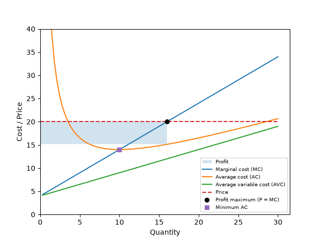
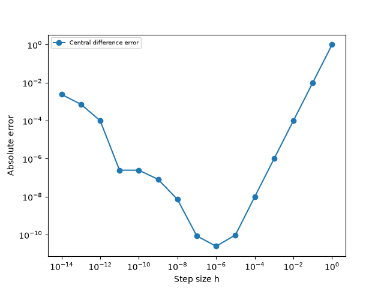

# 第 5 章: 1 変数の微分と利潤最大化

## 5.1 この章の地図

第 2 章では、独占企業の利潤を 2 次関数で表し、放物線の頂点で最大を求めました。費用が 3 次関数になると、頂点の公式は使えません。どんな形の関数でも使える道具が、この章の**微分**です。

微分は、関数の**傾き**を求める操作です。山の頂上では、傾きが 0 になります。傾きが 0 の点を探せば、最大・最小の候補が見つかります。経済学では、費用の傾きが**限界費用**です。価格を所与とする企業は、**価格 ＝ 限界費用**となる数量で、利潤を最大にします。



| 項目 | 内容 |
| :--- | :--- |
| 経済学の題材 | 費用関数（固定費用・可変費用）、限界費用・平均費用・平均可変費用、利潤最大化（P = MC）、操業停止点 |
| 数学 | 微分（傾きの極限）、冪・定数倍・和の公式、数値微分（中心差分）と誤差、増減、極値、2 階の導関数、凹関数・凸関数（発展） |
| 使う Python の機能 | `dataclass` のメソッド（`__call__`・`__add__`）、関数を引数に渡す、`max` の `default`、テスト（`pytest`） |
| 新しく導入するライブラリ | なし |
| 完成形 | `Polynomial`、`numerical_derivative`、`difference_quotient_errors`、`stationary_points`、`classify_stationary_point`、`is_concave_on`、`fixed_cost`、`variable_cost`、`average_cost`、`average_variable_cost`、`marginal_cost`、`competitive_profit`、`profit_maximizing_quantity`、`minimum_average_cost`、`minimum_average_variable_cost` |
| ファイル | 実装: `lib/chapter05/derivative.py`、`lib/chapter05/cost.py`、`lib/chapter05/plot.py`（図）／テスト: `test/chapter05/test_derivative.py`、`test/chapter05/test_cost.py`、`test/chapter05/test_plot.py` |
| データ | なし（手計算できる小さな例だけ） |

### 数学の式とコードの対応

| 経済学・数学 | 式 | コード |
| :--- | :--- | :--- |
| 多項式 | f(x) = c₀ + c₁x + c₂x² + c₃x³ | `Polynomial((c0, c1, c2, c3))` |
| 冪の公式（和・定数倍） | (x^n)' = n·x^(n−1) | `poly.derivative()` |
| 数値微分（中心差分） | (f(x + h) − f(x − h)) ÷ (2h) | `numerical_derivative(func, x, step)` |
| 極値の候補 | f'(x) = 0 | `stationary_points(poly)` |
| 極大・極小の判定 | f''(x) < 0 なら極大、> 0 なら極小 | `classify_stationary_point(poly, x)` |
| 限界費用 | MC = C'(q) | `marginal_cost(cost, q)` |
| 平均費用・平均可変費用 | AC = C(q) ÷ q、AVC = (C(q) − C(0)) ÷ q | `average_cost(cost, q)`、`average_variable_cost(cost, q)` |
| 利潤最大化 | P = MC（MC が右上がり） | `profit_maximizing_quantity(price, cost)` |

> **記号について**: 多項式の係数は、**次数の低い順**に並べます。C(q) = q² + 10q + 100 は `Polynomial((100, 10, 1))` です（定数項が先頭）。第 2 章の `quadratic_roots(a, b, c)` は、a·x² + b·x + c と**次数の高い順**なので、向きが逆です。指数関数は、この章では eˣ、第 6 章では e^x と書きます（同じものです）。

### 前提とする章

| できること | 場所 |
| :--- | :--- |
| 2 次関数の頂点・解の公式・格子探索、関数を引数に渡す（`lambda`）、`dataclass` | この連載の[第 2 章](02-quadratics-monopoly-and-oligopoly.md) |

費用曲線と供給の**経済学としての意味**は、[ミクロ経済学のためのプログラミング（初級）の第 5 章](../micro-basics-programming/05-cost-curves.md) と [第 7 章](../micro-basics-programming/07-profit-maximization-and-supply.md) で扱います。この章は、そこで使う数学（微分と最適化）を、関数とテストで確かめます。

## 5.2 準備

```bash
cd apps/math-for-economics-programming/python
uv run pytest test/chapter05
```

```text
47 passed
```

自分でコードを書くときは、`practice/chapter05/` に、完成形と同じ名前のファイル（`derivative.py`・`cost.py`・`plot.py`・`test_derivative.py`・`test_cost.py`・`test_plot.py`）を作ります。図を後回しにするなら、`plot.py` と `test_plot.py` は要らず、テストは 44 件になります。

- テスト・`plot.py`・check スクリプトの import を、`from practice.chapter05...` に書き換えます（書き換えないと、完成形を動かします）
- 第 2 章の関数（`quadratic_roots`・`parabola_vertex`・`argmax_on_grid`）は、自分で写した `practice.chapter02` から import します。写していなければ、`lib.chapter02` のままでかまいません
- テストの import の一覧は、完成形の**全関数**です。まだ書いていない関数を import すると、`ImportError` になります。関数を 1 つ書くたびに、名前を import に足してください

「予想の答え合わせ」のスクリプトは、`practice/chapter05/check.py` に保存し、`uv run python -m practice.chapter05.check` で実行します。

## 5.3 予想する

次の 4 つの問いに、**紙で、手計算で**答えてください。答えは、この節には書いてありません。「プログラミング」の節の「予想の答え合わせ」で確かめます。

- f(x) = x³ − 3x の導関数は、何ですか。f は、どの範囲で減少しますか。極大・極小になる x と、そのときの f の値は、いくつですか
- 費用が C(q) = q² + 10q + 100 の企業が、価格 50 で売ります。限界費用は、どんな式ですか。利潤を最大にする数量と、そのときの利潤は、いくつですか
- 同じ費用で、平均費用が最小になる数量と、その平均費用は、いくつですか。そこでの限界費用は、いくつですか。価格が 25 に下がると、この企業は生産を続けますか（利潤は、正ですか）
- x³ の x = 1 での傾き（正しくは 3）を、刻み幅 h = 0.1 の中心差分で近似すると、いくつになりますか。h を 10⁻¹³ まで小さくすると、h = 10⁻⁵ のときより、正確になりますか

## 5.4 微分と利潤最大化の考え方

### 微分とは

関数 f の、x から x + h までの**平均の傾き**は、(f(x + h) − f(x)) ÷ h です。h を 0 に近づけたときの値を、x での**微分係数**と言い、f'(x) と書きます。x ごとの f'(x) を並べた関数が、**導関数**です。

> f'(x) = lim_{h→0} (f(x + h) − f(x)) ÷ h

グラフでは、f'(x) は、x での**接線の傾き**です。f'(x) > 0 なら、f は x の近くで増加し、f'(x) < 0 なら減少します。

### 微分の公式

多項式の導関数は、次の 3 つの公式で求まります。

| 公式 | 式 | 例 |
| :--- | :--- | :--- |
| 冪の公式 | (x^n)' = n·x^(n−1)（定数の微分は 0） | (x³)' = 3x² |
| 定数倍 | (k·f)' = k·f' | (5x²)' = 10x |
| 和 | (f + g)' = f' + g' | (x² + 4x + 7)' = 2x + 4 |

係数を次数の低い順に並べると、導関数は、「各係数に次数を掛けて、1 つ左にずらす」操作です。(7, 4, 1) は (4, 2) になります。

多項式以外（分数の関数や、第 6 章の指数・対数の関数）には、次の 3 つの公式も使います。この章のコードは多項式の公式だけを実装し、この 3 つは、数値微分との一致をテストで確かめます。

| 公式 | 式 | 例 |
| :--- | :--- | :--- |
| 積 | (f·g)' = f'·g + f·g' | (x²·(x + 1))' = 2x·(x + 1) + x² |
| 商 | (f ÷ g)' = (f'·g − f·g') ÷ g² | (1 ÷ x)' = (0·x − 1·1) ÷ x² = −1 ÷ x² |
| 合成 | (f(g(x)))' = f'(g(x))·g'(x) | ((x² + 1)³)' = 3(x² + 1)²·2x |

### 数値微分と刻み幅

公式を使わずに、傾きを**数値**で求めることもできます。h を小さな正の数にして、x の左右の値の差を使います（**中心差分**）。

> f'(x) ≈ (f(x + h) − f(x − h)) ÷ (2h)

h を小さくするほど正確、とは限りません。h が大きいと、曲線を直線で近似した**打ち切りの誤差**が出ます。h が小さすぎると、ほぼ等しい 2 つの数の引き算で、浮動小数点の**丸めの誤差**が大きくなります（桁落ち）。誤差が最も小さい h は、その間にあります。

### 増減と極値

f'(x) = 0 の点（**停留点**）は、極大・極小の候補です。2 階の導関数 f''（導関数の導関数）の符号で、どちらかを判定します。

| f'(x) | f''(x) | 判定 |
| :--- | :--- | :--- |
| 0 | 負（傾きが減っていく。山） | **極大** |
| 0 | 正（傾きが増えていく。谷） | **極小** |
| 0 | 0 | この方法では判定できない（x³ の x = 0 は、極値ではない） |

2 次関数 a·x² + b·x + c なら、f'(x) = 2ax + b = 0 から x = −b ÷ (2a) で、**第 2 章の頂点と同じ**です。微分は、頂点の公式を、どんな関数にも広げた方法です。

### 費用の諸概念

費用関数 C(q) は、q 作るときの総費用です。

| 概念 | 式 | 意味 |
| :--- | :--- | :--- |
| 固定費用 FC | C(0) | 作らなくてもかかる（工場の賃料） |
| 可変費用 VC | C(q) − C(0) | 作る量に応じてかかる（材料費） |
| 平均費用 AC | C(q) ÷ q | 1 単位あたりの費用 |
| 平均可変費用 AVC | VC ÷ q | 1 単位あたりの可変費用 |
| 限界費用 MC | C'(q) | あと 1 単位作るときに増える費用 |

2 次の費用 C(q) = c₀ + c₁q + c₂q² の平均費用は、AC = c₀ ÷ q + c₁ + c₂q です。微分して 0 とおくと、−c₀ ÷ q² + c₂ = 0 から、q = √(c₀ ÷ c₂) で最小です。この点で、**MC と AC が等しく**なります（AC が下がっている間は MC < AC、上がり始めると MC > AC）。

### 利潤最大化: P = MC

価格 P を所与とする企業の利潤は、π(q) = P·q − C(q) です。微分して 0 とおくと、

> π'(q) = P − C'(q) = 0　つまり　**P = MC**

経済学の意味を 1 行で言うと、P = MC は、「**あと 1 個作って得る収入と、かかる費用が等しい**」点です。MC < P なら、もう 1 個作ると利潤が増えます。2 階の条件は π''(q) = −C''(q) < 0、つまり **MC が右上がり**です。

### 操業停止点

P = MC の数量でも、利潤が負になることがあります。それでも、作らない（利潤は −固定費用）より損が小さければ、生産を続けます。条件は、収入が可変費用を上回ること、つまり **P ≥ AVC** です。P が **AVC の最小値**（操業停止点）より低いと、どの数量でも可変費用すら回収できず、生産をやめます。

??? note "発展: 凹関数・凸関数"

    区間のどの点でも f''(x) ≤ 0 の関数を、その区間で**凹関数**（上に凸）、f''(x) ≥ 0 の関数を**凸関数**（下に凸）と言います。凹関数では、停留点が**区間の最大**になります（極大が 1 つだけで、ほかに山がない）。

    費用 C(q) = q² + 10q + 100 は、C'' = 2 > 0 で凸です。利潤 π = P·q − C(q) は、π'' = −2 < 0 で凹なので、P = MC の点が、利潤の最大です。−f が凹なら、f は凸です。x³ − 3x は、f'' = 6x なので、x ≤ 0 で凹、x ≥ 0 で凸です。

## 5.5 プログラミング

### Red: 多項式と導関数のテスト

`test_derivative.py` の先頭の import です（完成形の全関数）。自分で書くときは、まだ書いていない名前を外しておき、関数を 1 つ書くたびに足してください（最初から全部写すと、`ImportError` になります）。

```python
import math

import pytest

from lib.chapter02.quadratic import parabola_vertex
from lib.chapter05.derivative import (
    Polynomial,
    classify_stationary_point,
    difference_quotient_errors,
    is_concave_on,
    numerical_derivative,
    stationary_points,
)
```

最初のテストは、多項式の値と、冪の公式です。和と定数倍の公式も、ここで確かめます。

```python
def test_多項式は係数の低い次数から並べて値を計算する() -> None:
    cost = Polynomial((100, 10, 1))  # C(q) = 100 + 10q + q²
    assert cost(0) == 100
    assert cost(20) == 700
    assert cost(0.5) == pytest.approx(105.25)
    assert Polynomial((0, -3, 0, 1))(2) == 2  # x³ − 3x


def test_導関数は冪の公式で係数をずらす() -> None:
    # (x^n)' = n·x^(n−1)。100 + 10q + q² の導関数は 10 + 2q
    assert Polynomial((100, 10, 1)).derivative() == Polynomial((10, 2))
    assert Polynomial((0, -3, 0, 1)).derivative() == Polynomial((-3, 0, 3))
    assert Polynomial((7,)).derivative() == Polynomial((0,))


def test_和と定数倍の導関数は導関数の和と定数倍() -> None:
    revenue = Polynomial((0, 50))  # 50q
    cost = Polynomial((100, 10, 1))
    profit = revenue + cost.scale(-1)
    assert profit == Polynomial((-100, 40, -1))
    assert profit.derivative() == revenue.derivative() + cost.derivative().scale(-1)
    assert cost.scale(0.5) == Polynomial((50, 5, 0.5))
```

`lib.chapter05.derivative` がないので、収集の時点で失敗します（**Red**）。

### Green: 多項式のクラス

`derivative.py` の先頭の import です。

```python
from collections.abc import Callable
from dataclasses import dataclass

from lib.chapter02.quadratic import quadratic_roots
```

```python
@dataclass(frozen=True)
class Polynomial:
    """多項式 c₀ + c₁x + c₂x² + …。係数は、次数の低い順に並べる。"""

    coefficients: tuple[float, ...]

    def __post_init__(self) -> None:
        trimmed = list(self.coefficients)
        while len(trimmed) > 1 and trimmed[-1] == 0:
            trimmed.pop()
        object.__setattr__(self, "coefficients", tuple(trimmed or [0]))

    def __call__(self, x: float) -> float:
        """ホーナー法: ((c_n·x + c_{n−1})·x + …)·x + c₀。"""
        value: float = 0
        for c in reversed(self.coefficients):
            value = value * x + c
        return value

    def derivative(self) -> "Polynomial":
        """冪の公式 (x^n)' = n·x^(n−1) を、項ごとに当てる（和と定数倍の公式）。"""
        terms = [k * c for k, c in enumerate(self.coefficients)]
        return Polynomial(tuple(terms[1:]))

    def __add__(self, other: "Polynomial") -> "Polynomial":
        """和: 同じ次数の係数どうしを足す（短いほうは 0 で埋める）。"""
        size = max(len(self.coefficients), len(other.coefficients))
        left = self.coefficients + (0,) * (size - len(self.coefficients))
        right = other.coefficients + (0,) * (size - len(other.coefficients))
        return Polynomial(tuple(a + b for a, b in zip(left, right, strict=True)))

    def scale(self, factor: float) -> "Polynomial":
        """定数倍: すべての係数に factor を掛ける。"""
        return Polynomial(tuple(factor * c for c in self.coefficients))
```

`__call__` を書くと、`cost(20)` のように、関数として呼べます。`__add__` は `+` の、`__post_init__` は作った直後の処理です。末尾の 0 の係数を取り除くので、(1, 2, 0) と (1, 2) は等しくなります。

### 数値微分: 公式と数値の 2 つの答え

公式の導関数と、数値微分が**一致する**ことを、4 つの多項式・5 つの点（負・0・0 < x < 1 を含む）で確かめます。片方を書き間違えると、一致しません。

```python
def test_数値微分は中心差分で傾きを近似する() -> None:
    # x² の x = 3 での傾きは 6。中心差分は 2 次関数なら（丸めを除き）正確
    assert numerical_derivative(lambda x: x**2, 3) == pytest.approx(6)
    # eˣ・ln x の微分（eˣ と 1 ÷ x）は、第 6 章で説明する
    assert numerical_derivative(math.exp, 0) == pytest.approx(1)
    assert numerical_derivative(math.log, 0.5) == pytest.approx(2)


@pytest.mark.parametrize(
    "coefficients", [(100, 10, 1), (50, 4, 0.5), (0, -3, 0, 1), (20, 15, -6, 1)]
)
def test_公式の導関数と数値微分が一致する(coefficients: tuple[float, ...]) -> None:
    poly = Polynomial(coefficients)
    slope = poly.derivative()
    for x in [-2, 0, 0.3, 1, 7.5]:
        assert numerical_derivative(poly, x) == pytest.approx(slope(x), abs=1e-6)
```

```python
def numerical_derivative(
    func: Callable[[float], float], x: float, step: float = 1e-5
) -> float:
    """中心差分 (f(x + h) − f(x − h)) ÷ (2h) で、x での傾きを近似する。"""
    if step <= 0:
        raise ValueError("刻み幅 h は、正でなければなりません")
    return (func(x + step) - func(x - step)) / (2 * step)
```

数値微分の最初のテストの eˣ・ln x の傾き（x = 0 で 1、x = 0.5 で 2）は、第 6 章で説明します。ここでは、数値微分が、そうした関数にも使えることだけを見ます。

??? note "積・商・合成の公式を、数値微分で確かめる（`test_derivative.py` に書く。件数を合わせるため、ここに載せます）"

    5.4 節の表の 3 つの例を、負・0 < x < 1・正の点で、数値微分と比べます。公式を書き間違えると（積の片方の項を落とすなど）、一致しません。

    ```python
    def test_積と商と合成関数の公式は数値微分と一致する() -> None:
        for x in [-1.5, 0.3, 2]:
            # 積: (f·g)' = f'·g + f·g'。(x²·(x + 1))' = 2x·(x + 1) + x²
            product = numerical_derivative(lambda t: t**2 * (t + 1), x)
            assert product == pytest.approx(2 * x * (x + 1) + x**2)
            # 商: (f ÷ g)' = (f'·g − f·g') ÷ g²。(1 ÷ x)' = −1 ÷ x²
            quotient = numerical_derivative(lambda t: 1 / t, x)
            assert quotient == pytest.approx(-1 / x**2)
            # 合成: (f(g(x)))' = f'(g(x))·g'(x)。((x² + 1)³)' = 3(x² + 1)²·2x
            chain = numerical_derivative(lambda t: (t**2 + 1) ** 3, x)
            assert chain == pytest.approx(3 * (x**2 + 1) ** 2 * 2 * x)
    ```

### 刻み幅と誤差の実験

x³ の x = 1 での中心差分は、展開すると 3 + h² です。打ち切りの誤差は h² なので、h を 1/10 にすると、誤差は 1/100 になります。逆に、h が小さすぎると、丸めの誤差で悪くなります。

```python
def test_刻み幅が大きいと打ち切りの誤差が出る() -> None:
    # x³ の x = 1 での中心差分は 3 + h²。誤差は h² で、h を 1/10 にすると 1/100
    cube = Polynomial((0, 0, 0, 1))
    errors = difference_quotient_errors(cube, 3, 1, [1, 0.1, 0.01])
    assert errors == pytest.approx([1, 0.01, 0.0001], rel=1e-6)


def test_刻み幅が小さすぎると丸めの誤差で悪くなる() -> None:
    cube = Polynomial((0, 0, 0, 1))
    good, tiny = difference_quotient_errors(cube, 3, 1, [1e-5, 1e-13])
    assert good < 1e-9
    assert tiny > 1e-5
    assert tiny > 1000 * good
```

```python
def difference_quotient_errors(
    func: Callable[[float], float], exact_slope: float, x: float, steps: list[float]
) -> list[float]:
    """刻み幅ごとの、数値微分と正しい傾きの差（絶対値）。"""
    return [abs(numerical_derivative(func, x, h) - exact_slope) for h in steps]
```

h を 1 から 10⁻¹⁴ まで変えた誤差を、両対数目盛で描くと、V 字になります。右側が打ち切りの誤差（傾き 2 の直線）、左側が丸めの誤差です。`numerical_derivative` の既定の刻み幅 10⁻⁵ は、谷の近くです。



### 増減と極値

停留点は、導関数 = 0 の解です。3 次以下の多項式なら、導関数は 2 次以下なので、第 2 章の `quadratic_roots` で解けます。第 2 章の独占の利潤 −Q² + 80Q の停留点が、頂点の公式の答えと一致することも確かめます。

```python
def test_導関数の符号で増減がわかる() -> None:
    # x³ − 3x の導関数 3x² − 3 は、−1 < x < 1 で負（減少）、その外で正（増加）
    slope = Polynomial((0, -3, 0, 1)).derivative()
    assert all(slope(x) > 0 for x in [-2, -1.01, 1.01, 2])
    assert all(slope(x) < 0 for x in [-0.99, -0.5, 0, 0.5, 0.99])
    assert slope(-1) == slope(1) == 0


def test_x3乗引く3xの極値はプラスマイナス1() -> None:
    cubic = Polynomial((0, -3, 0, 1))
    assert stationary_points(cubic) == (-1, 1)
    assert classify_stationary_point(cubic, -1) == "maximum"
    assert classify_stationary_point(cubic, 1) == "minimum"
    # 符号を反対にすると、極大と極小が入れ替わる
    assert classify_stationary_point(cubic.scale(-1), -1) == "minimum"
    # 導関数 3x² − 12x + 9 の係数が対称でない例（係数の順の取り違えを見つける）
    assert stationary_points(Polynomial((0, 9, -6, 1))) == (1, 3)


def test_2次関数の極値は第2章の頂点と一致する() -> None:
    profit = Polynomial((0, 80, -1))  # 第 2 章の独占の利潤 −Q² + 80Q
    assert stationary_points(profit) == (40,)
    assert stationary_points(profit) == (parabola_vertex(-1, 80, 0)[0],)
    assert classify_stationary_point(profit, 40) == "maximum"
    assert stationary_points(Polynomial((100, 10, 2))) == (-2.5,)


def test_2階の導関数が0なら極大か極小かは判定できない() -> None:
    cube = Polynomial((0, 0, 0, 1))  # x³ は x = 0 で傾き 0 だが、極値ではない
    assert stationary_points(cube) == (0,)
    assert classify_stationary_point(cube, 0) == "undetermined"
    # 2 階の導関数が小さくても、正なら極小（0.25x² の f'' は 0.5）
    assert classify_stationary_point(Polynomial((0, 0, 0.25)), 0) == "minimum"
```

```python
def stationary_points(poly: Polynomial) -> tuple[float, ...]:
    """f'(x) = 0 の点を、小さい順に返す（3 次以下の多項式。導関数が 2 次以下）。"""
    if len(poly.coefficients) > 4:
        raise ValueError("3 次以下の多項式だけを扱います")
    d0, d1, d2 = (poly.derivative().coefficients + (0, 0))[:3]
    if d2 != 0:
        return quadratic_roots(d2, d1, d0)
    if d1 != 0:
        return (-d0 / d1,)
    if d0 == 0:
        raise ValueError("定数関数は、すべての点で傾きが 0 です")
    return ()


def classify_stationary_point(poly: Polynomial, x: float) -> str:
    """2 階の導関数の符号で、極大（負）・極小（正）・判定できない（0）に分ける。"""
    curvature = poly.derivative().derivative()(x)
    if curvature < 0:
        return "maximum"
    if curvature > 0:
        return "minimum"
    return "undetermined"
```

導関数の係数は、次数の低い順 (d₀, d₁, d₂) です。`quadratic_roots` には、**次数の高い順** (d₂, d₁, d₀) で渡します。x³ − 3x の導関数 −3 + 3x² は、逆に渡しても解が同じ ±1 なので、取り違えを見逃します。そこで、係数が対称でない x³ − 6x² + 9x（極値は 1 と 3。逆に渡すと 1/3 と 1）も、テストに入れています。

### 費用の諸概念

`test_cost.py` の先頭です（ここも、名前は関数を書くたびに足します）。`COST`・`COST_HALF`・`COST_CUBIC` は、この章で使い回す費用関数です。

```python
import pytest

from lib.chapter02.quadratic import argmax_on_grid
from lib.chapter05.cost import (
    average_cost,
    average_variable_cost,
    competitive_profit,
    fixed_cost,
    marginal_cost,
    minimum_average_cost,
    minimum_average_variable_cost,
    profit_maximizing_quantity,
    variable_cost,
)
from lib.chapter05.derivative import Polynomial, numerical_derivative
```

```python
COST = Polynomial((100, 10, 1))  # C(q) = q² + 10q + 100


COST_HALF = Polynomial((50, 4, 0.5))  # C(q) = 0.5q² + 4q + 50


COST_CUBIC = Polynomial((20, 15, -6, 1))  # C(q) = q³ − 6q² + 15q + 20


def test_費用は固定費用と可変費用に分かれる() -> None:
    assert fixed_cost(COST) == 100
    assert variable_cost(COST, 20) == 600
    assert fixed_cost(COST_HALF) == 50
    assert variable_cost(COST_HALF, 10) == 90
    assert variable_cost(COST, 0) == 0


def test_平均費用と平均可変費用は1単位あたりの費用() -> None:
    assert average_cost(COST, 20) == 35
    assert average_variable_cost(COST, 20) == 30
    assert average_cost(COST_HALF, 10) == 14
    assert average_variable_cost(COST_HALF, 10) == 9
    assert average_cost(COST, 0.5) == pytest.approx(210.5)


def test_限界費用は費用関数の導関数() -> None:
    assert marginal_cost(COST, 20) == 50  # MC = 2q + 10
    assert marginal_cost(COST_HALF, 10) == 14  # MC = q + 4
    for cost in [COST, COST_HALF, COST_CUBIC]:
        for q in [0.5, 3, 12]:
            slope = numerical_derivative(cost, q)
            assert marginal_cost(cost, q) == pytest.approx(slope, abs=1e-6)
```

費用の例を 1 つにすると、係数の取り違えを見逃します。最初から、2 乗の係数が 1 でない例（0.5q² + 4q + 50）と、3 次の例を入れています。

`cost.py` の先頭の import です。

```python
import math

from lib.chapter05.derivative import (
    Polynomial,
    classify_stationary_point,
    stationary_points,
)
```

```python
def _require_positive(quantity: float) -> None:
    if quantity <= 0:
        raise ValueError("平均費用は、正の数量でだけ定義されます")


def fixed_cost(cost: Polynomial) -> float:
    """固定費用: 作らなくてもかかる費用 C(0)。"""
    return cost(0)


def variable_cost(cost: Polynomial, quantity: float) -> float:
    """可変費用: 作る量に応じてかかる費用 C(q) − C(0)。"""
    return cost(quantity) - fixed_cost(cost)


def average_cost(cost: Polynomial, quantity: float) -> float:
    """平均費用 AC = C(q) ÷ q。"""
    _require_positive(quantity)
    return cost(quantity) / quantity


def average_variable_cost(cost: Polynomial, quantity: float) -> float:
    """平均可変費用 AVC = (C(q) − C(0)) ÷ q。"""
    _require_positive(quantity)
    return variable_cost(cost, quantity) / quantity


def marginal_cost(cost: Polynomial, quantity: float) -> float:
    """限界費用 MC = C'(q): あと 1 単位作るときに増える費用（の近似）。"""
    return cost.derivative()(quantity)
```

### 利潤最大化

利潤 P·q − C(q) も多項式なので、停留点のうち、**正で、極大**のものを探します。最後に、作らないとき（利潤 −固定費用）と比べます。テストは、4 つの価格 × 3 つの費用で、**P = MC** と、**格子探索の答え**（第 2 章の `argmax_on_grid`）の両方を確かめます。

```python
def test_価格50なら限界費用50の数量20で利潤300() -> None:
    assert profit_maximizing_quantity(50, COST) == 20
    assert competitive_profit(50, COST, 20) == 300  # 1000 − 700
    assert profit_maximizing_quantity(20, COST_HALF) == 16
    assert competitive_profit(20, COST_HALF, 16) == 78  # 320 − 242


@pytest.mark.parametrize("cost", [COST, COST_HALF, COST_CUBIC])
@pytest.mark.parametrize("price", [15, 30, 50, 80])
def test_利潤最大の数量では価格と限界費用が等しく格子探索と一致する(
    price: float, cost: Polynomial
) -> None:
    best = profit_maximizing_quantity(price, cost)
    assert marginal_cost(cost, best) == pytest.approx(price)
    grid = argmax_on_grid(lambda q: competitive_profit(price, cost, q), 0, 100, 10001)
    assert best == pytest.approx(grid, abs=0.01)
```

```python
def competitive_profit(price: float, cost: Polynomial, quantity: float) -> float:
    """価格 P を所与とする企業の利潤 π(q) = P·q − C(q)。"""
    return price * quantity - cost(quantity)


def _require_convex_cost(cost: Polynomial) -> None:
    degree = len(cost.coefficients) - 1
    if degree not in (2, 3) or cost.coefficients[-1] <= 0:
        raise ValueError("最高次の係数が正の、2 次か 3 次の費用だけを扱います")


def profit_maximizing_quantity(price: float, cost: Polynomial) -> float:
    """P = MC（MC が右上がり）の数量。利潤が、作らないとき（−固定費用）未満なら 0。"""
    _require_convex_cost(cost)
    profit = Polynomial((0, price)) + cost.scale(-1)
    candidates = [
        q
        for q in stationary_points(profit)
        if q > 0 and classify_stationary_point(profit, q) == "maximum"
    ]
    best = max(candidates, key=profit, default=0.0)
    return best if profit(best) >= profit(0) else 0.0
```

費用が 1 次関数（C = 100 + 10q）だと、P > 10 なら作るほど利潤が増え、最大がありません。そこで、最高次の係数が正の、2 次か 3 次の費用だけを扱います。

### 利潤最大化の解の性質: 価格と数量

P = MC の解は、**価格が上がると増えます**。MC が右上がりなので、P が上がると、MC が P に追いつく数量も大きくなるからです。価格ごとの最適な数量を並べたものが、企業の**供給曲線**で、MC の右上がりの部分（操業停止点より上）に一致します。MC = 2q + 10 なら、q = (P − 10) ÷ 2 です。

```python
def test_価格が上がると最適な数量が増える() -> None:
    # 供給曲線は MC の右上がりの部分。MC = 2q + 10 なら q = (P − 10) ÷ 2
    prices = [12, 20, 35, 50, 80]
    quantities = [profit_maximizing_quantity(p, COST) for p in prices]
    assert quantities == pytest.approx([(p - 10) / 2 for p in prices])
    for cost in [COST_HALF, COST_CUBIC]:
        supply = [profit_maximizing_quantity(p, cost) for p in prices]
        # 隣どうしを比べる。supply[1:] は 1 つ短いので、strict=False（長さが違っても可）
        assert all(q1 < q2 for q1, q2 in zip(supply, supply[1:], strict=False))
```

### 平均費用の最小と操業停止点

```python
def test_平均費用は限界費用と交わる点で最小() -> None:
    assert minimum_average_cost(COST) == (10, 30)
    assert marginal_cost(COST, 10) == 30
    assert minimum_average_cost(COST_HALF) == (10, 14)
    assert marginal_cost(COST_HALF, 10) == 14
    # 固定費用が 1 より小さくても、q = √(c₀ ÷ c₂) で最小（√(0.5 ÷ 2) = 0.5）
    assert minimum_average_cost(Polynomial((0.5, 0, 2))) == (0.5, 2)
    grid = argmax_on_grid(lambda q: -average_cost(COST, q), 1, 40, 3901)
    assert grid == pytest.approx(10)


def test_価格が平均可変費用の最小値より低ければ生産しない() -> None:
    # 3 次の費用: AVC = q² − 6q + 15 は q = 3 で最小 6（そこで MC = AVC）
    assert minimum_average_variable_cost(COST_CUBIC) == (3, 6)
    assert marginal_cost(COST_CUBIC, 3) == 6
    assert profit_maximizing_quantity(15, COST_CUBIC) == 4
    assert competitive_profit(15, COST_CUBIC, 4) == 12
    assert profit_maximizing_quantity(6.1, COST_CUBIC) > 3
    # ちょうど AVC の最小値では、作っても作らなくても利潤は −20。作るほうを選ぶ
    assert profit_maximizing_quantity(6, COST_CUBIC) == 3
    assert profit_maximizing_quantity(5.9, COST_CUBIC) == 0
    assert profit_maximizing_quantity(5, COST_CUBIC) == 0
```

```python
def minimum_average_cost(cost: Polynomial) -> tuple[float, float]:
    """2 次の費用 c₀ + c₁q + c₂q² の平均費用の最小点。AC' = −c₀ ÷ q² + c₂ = 0。"""
    if len(cost.coefficients) != 3:
        raise ValueError("2 次の費用だけを扱います")
    c0, _, c2 = cost.coefficients
    if c0 <= 0 or c2 <= 0:
        raise ValueError("固定費用と 2 乗の係数は、正でなければなりません")
    q = math.sqrt(c0 / c2)
    return q, average_cost(cost, q)


def minimum_average_variable_cost(cost: Polynomial) -> tuple[float, float]:
    """平均可変費用 c₁ + c₂q + c₃q² の最小点（操業停止点）。頂点が負なら q → 0。"""
    _require_convex_cost(cost)
    avc = Polynomial(cost.coefficients[1:])
    if len(avc.coefficients) == 3:
        (q,) = stationary_points(avc)
        if q > 0:
            return q, avc(q)
    return 0.0, avc(0)
```

3 次の費用 q³ − 6q² + 15q + 20 の AVC は q² − 6q + 15 で、U 字です。最小は q = 3 で 6 です。価格 6.1 では生産し、5.9 では生産しません（P = MC の極大はあるが、利潤が −固定費用より低い）。2 次の費用の AVC は c₁ + c₂q で右上がりなので、最小は q → 0 の極限 c₁ です。

### 発展: 凹関数の判定

??? note "凹関数の判定のテストと実装（発展。後回しにすると、テストは 45 件、図も外すと 42 件）"

    後回しにするなら、テストの import から `is_concave_on` を外します。区間を格子に区切り、どの点でも 2 階の導関数が 0 以下かを調べます。凸の判定は、−f が凹かどうかで代用します。

    ```python
    def test_2階の導関数が0以下の区間で関数は凹() -> None:
        profit = Polynomial((-100, 40, -1))  # 価格 50 の利潤 −q² + 40q − 100
        assert is_concave_on(profit, 0, 100)
        cost = Polynomial((100, 10, 1))
        assert not is_concave_on(cost, 0, 100)
        assert is_concave_on(cost.scale(-1), 0, 100)  # −C が凹 ⇔ C は凸
        cubic = Polynomial((0, -3, 0, 1))  # 2 階の導関数 6x
        assert is_concave_on(cubic, -2, 0)
        assert not is_concave_on(cubic, -1, 1)
        assert not is_concave_on(cubic, 0.001, 2)
        assert not is_concave_on(Polynomial((0, 0, 0.25)), -1, 1)  # f'' = 0.5


    def test_凹の判定は区間と点の数が正しくなければ行わない() -> None:
        line = Polynomial((1, 2))
        assert is_concave_on(line, 0, 1, points=2)  # 1 次関数は凹でもあり凸でもある
        # 2 点だけなら、両端だけを調べる（右端の 0.01 で f'' = 0.06 > 0）
        assert not is_concave_on(Polynomial((0, -3, 0, 1)), -1, 0.01, points=2)
        for low, high, points in [(1, 1, 11), (2, 1, 11), (0, 1, 1)]:
            with pytest.raises(ValueError):
                is_concave_on(line, low, high, points)
    ```

    ```python
    def is_concave_on(poly: Polynomial, low: float, high: float, points: int = 101) -> bool:
        """区間を points 個の点に区切り、どの点でも 2 階の導関数が 0 以下なら凹。"""
        if points < 2 or low >= high:
            raise ValueError("区間は low < high で、点は 2 つ以上必要です")
        curvature = poly.derivative().derivative()
        step = (high - low) / (points - 1)
        return all(curvature(low + i * step) <= 0 for i in range(points))
    ```

### 予想の答え合わせ

```python
from lib.chapter05.cost import (
    competitive_profit,
    marginal_cost,
    minimum_average_cost,
    profit_maximizing_quantity,
)
from lib.chapter05.derivative import (
    Polynomial,
    classify_stationary_point,
    numerical_derivative,
    stationary_points,
)

cubic = Polynomial((0, -3, 0, 1))
print(cubic.derivative(), stationary_points(cubic))
print([(x, classify_stationary_point(cubic, x), cubic(x)) for x in (-1, 1)])
cost = Polynomial((100, 10, 1))
best = profit_maximizing_quantity(50, cost)
print(best, competitive_profit(50, cost, best))
print(minimum_average_cost(cost), marginal_cost(cost, 10))
low = profit_maximizing_quantity(25, cost)
print(low, competitive_profit(25, cost, low), competitive_profit(25, cost, 0))
cube = Polynomial((0, 0, 0, 1))
print(round(numerical_derivative(cube, 1, 0.1), 6))
print(round(numerical_derivative(cube, 1, 1e-5), 6))
print(round(numerical_derivative(cube, 1, 1e-13), 6))
```

```text
Polynomial(coefficients=(-3, 0, 3)) (-1.0, 1.0)
[(-1, 'maximum', 2), (1, 'minimum', -2)]
20.0 300.0
(10.0, 30.0) 30
7.5 -43.75 -100
3.01
3.0
2.999268
```

- **1 つ目の問い**: f'(x) = 3x² − 3 です。−1 < x < 1 で f' < 0 なので、減少します。x = −1 で極大 2、x = 1 で極小 −2 です（f''(x) = 6x が、−1 で負、1 で正）
- **2 つ目の問い**: MC = 2q + 10 です。2q + 10 = 50 から q = 20、利潤は 50 × 20 − (400 + 200 + 100) = 1000 − 700 = 300 です
- **3 つ目の問い**: AC = 100 ÷ q + 10 + q は、q = √(100 ÷ 1) = 10 で最小 30 です。そこで MC = 2 × 10 + 10 = 30 で、**MC = AC** です。価格 25 では、q = 7.5 で利潤 −43.75 と**赤字**ですが、作らないとき（−100）より損が小さいので、**生産を続けます**（25 は AVC の最小値 10 より高い）
- **4 つ目の問い**: h = 0.1 では (1.331 − 0.729) ÷ 0.2 = 3.01 で、誤差は h² = 0.01 です。h = 10⁻⁵ ではほぼ 3 ですが、10⁻¹³ では 2.999268 と、**かえって悪く**なります（丸めの誤差）

### 境界のテスト

完成形には、ほかに**境界**を確かめるテストがあります。刻み幅が 0・負、末尾の 0 の係数と空の係数、1 次関数（極値なし）・定数関数・4 次以上、数量が 0・負、価格が MC の切片以下、AVC の頂点が負、扱えない費用の形です。テストの件数を合わせるため、ここに載せます。

??? note "境界のテスト"

    ```python
    def test_刻み幅が正でなければ数値微分しない() -> None:
        for step in [0, -0.1]:
            with pytest.raises(ValueError):
                numerical_derivative(math.exp, 1, step)


    def test_末尾の0の係数は取り除き空の係数は0の多項式() -> None:
        assert Polynomial((1, 2, 0, 0)) == Polynomial((1, 2))
        assert Polynomial((3, 0)) == Polynomial((3,))
        assert Polynomial(()) == Polynomial((0,))
        assert Polynomial(())(5) == 0
        # 最高次の項が打ち消し合うと、次数が下がる
        assert Polynomial((1, 2, 3)) + Polynomial((0, 0, -3)) == Polynomial((1, 2))
        assert Polynomial((1,)) + Polynomial((0, 0, 4)) == Polynomial((1, 0, 4))
        assert Polynomial((0, 0, 4)) + Polynomial((1,)) == Polynomial((1, 0, 4))


    def test_1次関数には極値がなく定数関数と4次以上は扱わない() -> None:
        assert stationary_points(Polynomial((5, -2))) == ()
        assert classify_stationary_point(Polynomial((5, -2)), 3) == "undetermined"
        with pytest.raises(ValueError):
            stationary_points(Polynomial((7,)))
        with pytest.raises(ValueError):
            stationary_points(Polynomial((0, 0, 1, 0, 1)))  # x⁴ + x²
    ```

    ```python
    def test_数量が正でなければ平均費用は決まらない() -> None:
        for quantity in [0, -1]:
            with pytest.raises(ValueError):
                average_cost(COST, quantity)
            with pytest.raises(ValueError):
                average_variable_cost(COST, quantity)


    def test_2次の費用では価格が限界費用の切片以下なら生産しない() -> None:
        # MC = 2q + 10 なので、価格 10 以下では、正の数量で P = MC にならない
        assert minimum_average_variable_cost(COST) == (0, 10)
        assert profit_maximizing_quantity(10, COST) == 0
        assert profit_maximizing_quantity(8, COST) == 0
        assert profit_maximizing_quantity(10.5, COST) == pytest.approx(0.25)
        assert competitive_profit(8, COST, 0) == -fixed_cost(COST)


    def test_平均可変費用の頂点が負なら最小は数量0の極限() -> None:
        cost = Polynomial((5, 1, 3, 1))  # AVC = q² + 3q + 1 の頂点は q = −1.5
        assert minimum_average_variable_cost(cost) == (0, 1)
        # 頂点が 0 < q < 1 なら、そこが最小（AVC = q² − q + 1 は q = 0.5 で 0.75）
        assert minimum_average_variable_cost(Polynomial((5, 1, -1, 1))) == (0.5, 0.75)


    def test_利潤最大化は上に凸の利潤になる費用だけを扱う() -> None:
        for cost in [Polynomial((100, 10)), Polynomial((0, 30, 0, -1))]:
            with pytest.raises(ValueError):
                profit_maximizing_quantity(50, cost)


    def test_平均費用の最小は固定費用と2乗の係数が正の2次の費用だけ() -> None:
        for cost in [COST_CUBIC, Polynomial((100, 10))]:
            with pytest.raises(ValueError, match="2 次の費用"):
                minimum_average_cost(cost)
        for cost in [Polynomial((0, 10, 1)), Polynomial((100, 10, -1))]:
            with pytest.raises(ValueError, match="正でなければ"):
                minimum_average_cost(cost)
    ```

### 図

図の実装の import です。

```python
from collections.abc import Callable

import matplotlib.pyplot as plt
import numpy as np
from matplotlib.figure import Figure

from lib.chapter05.cost import (
    average_cost,
    average_variable_cost,
    marginal_cost,
    minimum_average_cost,
    profit_maximizing_quantity,
)
from lib.chapter05.derivative import Polynomial, difference_quotient_errors
```

5.1 節の費用曲線と、刻み幅と誤差の図です。テストでは、線の各点が MC・AC・AVC の値であること、利潤の長方形の面積が (P − AC)·q であることを確かめます。

??? note "描画のテストと実装（後回しにしても、学習は成り立ちます）"

    テストの import:

    ```python
    import numpy as np
    import pytest
    from matplotlib.axes import Axes

    from lib.chapter05.cost import average_cost, average_variable_cost, marginal_cost
    from lib.chapter05.derivative import Polynomial, difference_quotient_errors
    from lib.chapter05.plot import plot_cost_curves, plot_derivative_errors
    ```

    ```python
    def _line(ax: Axes, label: str) -> tuple[list[float], list[float]]:
        line = next(x for x in ax.lines if x.get_label() == label)
        xs = np.asarray(line.get_xdata(), dtype=float).tolist()
        ys = np.asarray(line.get_ydata(), dtype=float).tolist()
        return xs, ys


    def test_費用曲線の各点は限界費用と平均費用の値() -> None:
        cost = Polynomial((50, 4, 0.5))
        ax = plot_cost_curves(cost, 20, 30).axes[0]
        for label, curve in [
            ("Marginal cost (MC)", marginal_cost),
            ("Average cost (AC)", average_cost),
            ("Average variable cost (AVC)", average_variable_cost),
        ]:
            xs, ys = _line(ax, label)
            assert (xs[0], xs[-1]) == pytest.approx((0.3, 30))
            assert ys == pytest.approx([curve(cost, q) for q in xs])
        assert (ax.get_xlabel(), ax.get_ylabel()) == ("Quantity", "Cost / Price")
        assert ax.get_legend() is not None
        assert (ax.get_xlim()[0], ax.get_ylim()) == (0, (0, 40))


    def test_利潤最大の点と利潤の長方形() -> None:
        ax = plot_cost_curves(Polynomial((100, 10, 1)), 50, 30).axes[0]
        assert _line(ax, "Price") == ([0, 30], [50, 50])
        assert _line(ax, "Profit maximum (P = MC)") == ([20], [50])
        assert _line(ax, "Minimum AC") == ([10], [30])
        # 長方形の高さは P − AC(20) = 50 − 35、幅は 20。面積は利潤 300
        box = ax.collections[0].get_paths()[0].get_extents()
        assert (box.x0, box.x1, box.y0, box.y1) == pytest.approx((0, 20, 35, 50))
        assert ax.collections[0].get_label() == "Profit"


    def test_誤差の図は刻み幅ごとの誤差を両対数で描く() -> None:
        cube = Polynomial((0, 0, 0, 1))
        steps = [10.0**-k for k in range(1, 15)]
        ax = plot_derivative_errors(cube, 3, 1, steps).axes[0]
        xs, ys = _line(ax, "Central difference error")
        assert xs == steps
        assert ys == pytest.approx(difference_quotient_errors(cube, 3, 1, steps))
        assert (ax.get_xscale(), ax.get_yscale()) == ("log", "log")
        assert (ax.get_xlabel(), ax.get_ylabel()) == ("Step size h", "Absolute error")
        assert ax.get_legend() is not None
    ```

    ```python
    def plot_cost_curves(cost: Polynomial, price: float, q_max: float) -> Figure:
        """2 次の費用の MC・AC・AVC と価格の線。P = MC の点と、利潤の長方形を描く。"""
        quantities = np.linspace(q_max / 100, q_max, 100).tolist()
        best = profit_maximizing_quantity(price, cost)
        low_q, low_ac = minimum_average_cost(cost)
        fig, ax = plt.subplots()
        ax.fill_between(
            [0, best], average_cost(cost, best), price, alpha=0.2, label="Profit"
        )
        curves = [
            ("Marginal cost (MC)", marginal_cost),
            ("Average cost (AC)", average_cost),
            ("Average variable cost (AVC)", average_variable_cost),
        ]
        for label, curve in curves:
            ax.plot(quantities, [curve(cost, q) for q in quantities], label=label)
        ax.plot([0, q_max], [price, price], "--", label="Price")
        ax.plot([best], [price], "ko", label="Profit maximum (P = MC)")
        ax.plot([low_q], [low_ac], "s", label="Minimum AC")
        ax.set_xlabel("Quantity")
        ax.set_ylabel("Cost / Price")
        ax.set_xlim(left=0)
        ax.set_ylim(0, 2 * price)
        ax.legend(fontsize="x-small")
        plt.close(fig)
        return fig


    def plot_derivative_errors(
        func: Callable[[float], float], exact_slope: float, x: float, steps: list[float]
    ) -> Figure:
        """刻み幅 h ごとの、中心差分の誤差を、両対数目盛で描く。"""
        errors = difference_quotient_errors(func, exact_slope, x, steps)
        fig, ax = plt.subplots()
        ax.plot(steps, errors, "o-", label="Central difference error")
        ax.set_xscale("log")
        ax.set_yscale("log")
        ax.set_xlabel("Step size h")
        ax.set_ylabel("Absolute error")
        ax.legend(fontsize="x-small")
        plt.close(fig)
        return fig
    ```

### 実行結果

```bash
uv run pytest test/chapter05
```

```text
47 passed
```

## 5.6 規則で言うと

1. **導関数は、傾きの関数である。** 多項式なら、冪・定数倍・和の公式で求まる。数値微分（中心差分）と一致する
2. **数値微分の刻み幅は、大きすぎても小さすぎても悪い。** 大きいと打ち切りの誤差、小さいと丸めの誤差。中心差分では 10⁻⁵ 前後がよい
3. **極値の候補は f'(x) = 0 の点。** f'' が負なら極大、正なら極小、0 なら判定できない
4. **価格を所与とする企業は、P = MC で利潤を最大にする。** MC が右上がりの部分で。P が AVC の最小値より低ければ、生産しない。価格が上がると、最適な数量は増える（供給曲線は MC の右上がりの部分）
5. **AC は、MC と交わる点で最小。** 2 次の費用なら q = √(c₀ ÷ c₂)

混同しやすい点を、表にまとめます。

| 混同しやすい点 | 違い |
| :--- | :--- |
| 限界費用と平均費用 | MC は、あと 1 単位の費用（傾き）。AC は、これまでの 1 単位あたり（総費用 ÷ 数量） |
| 損益分岐点と操業停止点 | 損益分岐点は AC の最小値（それ以下では赤字）。操業停止点は AVC の最小値（それ以下では生産をやめる）。間の価格では、赤字でも生産を続ける |
| 係数の並び | `Polynomial` は次数の低い順、第 2 章の `quadratic_roots(a, b, c)` は高い順 |
| 極大と最大 | 極大は、近くで一番高い点。区間の最大は、端の値や、ほかの極大と比べて決まる（作らない q = 0 と比べたのは、このため） |

### このモデルが成り立たない場面

- **数量は、連続とは限りません。** 車や家は、0.5 台作れません。微分は、q を連続に動かせると仮定しています。整数の数量では、P = MC の前後の整数を比べます
- **価格を所与とするのは、完全競争の企業だけです。** 独占企業は、数量を増やすと価格が下がるので、条件は P = MC ではなく、**限界収入 ＝ 限界費用**になります（練習問題の交互で確かめます）
- **費用関数が、なめらかとは限りません。** 工場の生産能力の上限を超えると、費用が跳ね上がります（微分できない点）。そこでは、P = MC の条件が使えません
- **数値微分は、ノイズのあるデータには弱いです。** 実際に測った費用のデータを差分すると、測定の誤差が h で割られて、大きく膨らみます

## 5.7 練習問題

| 種類 | 問題 |
| :--- | :--- |
| 想起 | 本文を閉じて、`profit_maximizing_quantity` の最初のテスト（費用 q² + 10q + 100・価格 50 で、数量 20・利潤 300）を書いてください |
| 生成 | 解説を見る前に、**損益分岐点**（利潤がちょうど 0 になる最低の価格。AC の最小値）を返す `break_even_price(cost)` を、テストから書いてください。その価格で `profit_maximizing_quantity` を呼ぶと、利潤が 0 になることも、確かめてください |
| 多様 | 費用 C(q) = 2q² + 8q + 200・価格 48 の企業の、利潤を最大にする数量と、そのときの利潤は、いくつですか。平均費用の最小値と比べてください。先に手計算で予想してから、確かめてください |
| 交互 | [第 2 章](02-quadratics-monopoly-and-oligopoly.md) の独占（逆需要 P = 100 − 2Q・費用 20Q）の利潤を `Polynomial` で表し、`stationary_points` の答えが、`monopoly_outcome`（自分で写した `practice.chapter02.monopoly` から import します。第 2 章を写していなければ、`lib.chapter02.monopoly` のままでかまいません）の数量と一致することを確かめてください。最適な数量で、**限界収入**（収入 100Q − 2Q² の導関数）が、限界費用 20 に等しいことも確かめてください |

??? note "解答（先に自分で取り組んでから、開いてください）"

    解答のテストと関数の import です（`practice` で書くときは、`lib` を `practice` に書き換えます）。

    ```python
    import pytest

    from lib.chapter02.monopoly import monopoly_outcome
    from lib.chapter05.cost import (
        competitive_profit,
        minimum_average_cost,
        profit_maximizing_quantity,
    )
    from lib.chapter05.derivative import Polynomial, stationary_points
    ```

    **想起**:

    ```python
    def test_最初の利潤最大化のテスト() -> None:
        cost = Polynomial((100, 10, 1))
        assert profit_maximizing_quantity(50, cost) == 20
        assert competitive_profit(50, cost, 20) == 300
    ```

    **生成**: AC の最小値を返すだけです。置き場所は、どこでもかまいません（例: `practice/chapter05/exercises.py`）。

    ```python
    def break_even_price(cost: Polynomial) -> float:
        return minimum_average_cost(cost)[1]
    ```

    ```python
    def test_損益分岐点の価格では利潤が0() -> None:
        examples = [(Polynomial((100, 10, 1)), 30), (Polynomial((50, 4, 0.5)), 14)]
        for cost, expected in examples:
            price = break_even_price(cost)
            assert price == pytest.approx(expected)
            best = profit_maximizing_quantity(price, cost)
            assert competitive_profit(price, cost, best) == pytest.approx(0)
    ```

    **多様**: MC = 4q + 8 = 48 から q = 10 で、利潤は 480 − (200 + 80 + 200) = 0 です。AC の最小は q = √(200 ÷ 2) = 10 で 20 + 8 + 20 = 48 なので、価格 48 は、ちょうど**損益分岐点**です。

    ```python
    def test_価格が平均費用の最小値なら利潤は0() -> None:
        cost = Polynomial((200, 8, 2))
        assert profit_maximizing_quantity(48, cost) == 10
        assert competitive_profit(48, cost, 10) == 0
        assert minimum_average_cost(cost) == (10, 48)
    ```

    **交互**: 独占の利潤は −2Q² + 80Q です。収入 100Q − 2Q² の導関数（限界収入）は 100 − 4Q で、Q = 20 で 20 になり、限界費用に等しくなります。

    ```python
    def test_独占の利潤を微分で解く() -> None:
        profit = Polynomial((0, 100 - 20, -2))
        (quantity,) = stationary_points(profit)
        assert quantity == monopoly_outcome(100, 2, 20).quantity
        marginal_revenue = Polynomial((0, 100, -2)).derivative()
        assert marginal_revenue(quantity) == 20
    ```

## 5.8 振り返り

- うまくいったこと:
- 詰まったこと:
- 次に試すこと:

## 5.9 まとめ

- 導関数は、各点の傾きを並べた関数。多項式なら、冪・定数倍・和の公式で求まり、中心差分の数値微分と一致する
- 数値微分の刻み幅は、大きすぎると打ち切りの誤差、小さすぎると丸めの誤差で、誤差が大きくなる
- 極値の候補は f'(x) = 0 の点で、f'' の符号で極大・極小を判定する。2 次関数では、第 2 章の頂点と一致する
- 費用関数から、固定費用・可変費用・AC・AVC・MC が求まる。AC は MC と交わる点で最小
- 価格を所与とする企業は P = MC（MC が右上がり）で利潤を最大にし、P が AVC の最小値より低ければ生産しない

次の章では、**指数・対数の微分**と**弾力性**を学びます。この章の `numerical_derivative` を使い、需要曲線の各点で、価格が 1% 変わると需要量が何 % 変わるかを求めます。[第 1 章](01-linear-functions-and-markets.md) の豊作貧乏（豊作で、農家の収入が減る）も、弾力性で説明できます。
