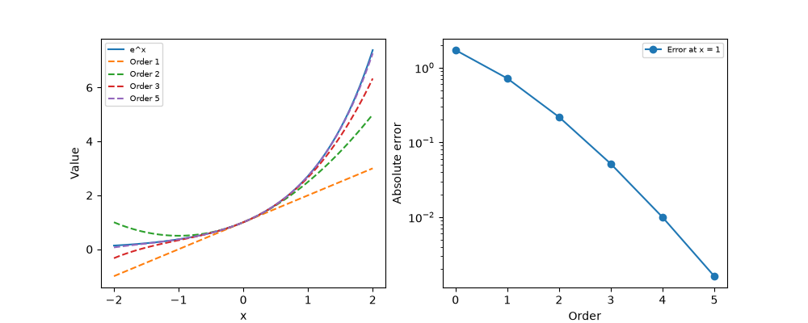
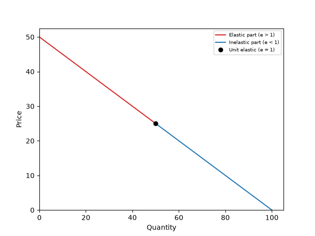

# 第 6 章: 指数・対数の微分と弾力性

## 6.1 この章の地図

ある商品の価格が 10 円上がると、需要量が 20 個減るとします。これは大きな反応でしょうか。100 円の商品と 10,000 円の商品とでは、同じ 10 円でも意味が違います。売れる量が 50 個か 50,000 個かでも違います。単位に左右されない比べ方が要ります。

この章の道具は、**変化率どうしの比**です。価格が 1% 変わると、需要量が何 % 変わるかを、**需要の価格弾力性**と言います。弾力性は、第 5 章の微分（傾き）に、価格と数量の比を掛けて求まります。対数を使うと、弾力性は「対数どうしの傾き」とも読めます。そこで、指数関数・対数関数の微分と、成長率も、あわせて扱います。



| 項目 | 内容 |
| :--- | :--- |
| 経済学の題材 | 需要の価格弾力性（点弾力性・弧弾力性）、弾力性と収入、豊作貧乏、連続時間の成長率、企業の供給と総供給 |
| 数学 | 変化率の比、指数関数・対数関数の微分、合成関数の微分（対数の傾き）、テイラー展開、極限（発展） |
| 使う Python の機能 | 関数を引数に渡す、関数の中で関数を定義する、`math.exp`・`math.log`・`math.factorial`、`sum` とジェネレーター式 |
| 新しく導入するライブラリ | なし |
| 完成形 | `point_price_elasticity`、`linear_demand_elasticity`、`classify_elasticity`、`sales_revenue`、`revenue_price_slope`、`arc_price_elasticity`、`constant_elasticity_demand`、`elasticity_by_logs`、`instantaneous_growth_rate`、`taylor_exp_approximation`、`aggregate_supply_quantity`、`exponential_difference_quotient`・`euler_limit_term`（発展） |
| ファイル | 実装: `lib/chapter06/elasticity.py`、`lib/chapter06/growth.py`、`lib/chapter06/supply.py`、`lib/chapter06/plot.py`（図）／テスト: `test/chapter06/test_elasticity.py`、`test/chapter06/test_growth.py`、`test/chapter06/test_supply.py`、`test/chapter06/test_plot.py` |
| データ | なし（手計算できる小さな例だけ） |

### 数学の式とコードの対応

| 経済学・数学 | 式 | コード |
| :--- | :--- | :--- |
| 点弾力性 | ε = −(dq/dp)·(p/q) | `point_price_elasticity(demand, p)` |
| 直線の需要 q = a − b·p の弾力性 | ε = b·p ÷ q | `linear_demand_elasticity(p, a, b)` |
| 収入と、その価格についての傾き | R = p·q、dR/dp = q·(1 − ε) | `sales_revenue`、`revenue_price_slope` |
| 弧弾力性 | −(Δq ÷ q̄) ÷ (Δp ÷ p̄)（q̄・p̄ は両端の平均） | `arc_price_elasticity(demand, p0, p1)` |
| 対数の傾きとしての弾力性 | ε = −d ln q ÷ d ln p | `elasticity_by_logs(demand, p)` |
| 指数関数・対数関数の微分 | (e^x)' = e^x、(ln x)' = 1 ÷ x | `numerical_derivative(math.exp, x)` で確かめる |
| 連続時間の成長率 | g = d ln y ÷ dt | `instantaneous_growth_rate(path, t)` |
| テイラー展開 | e^x ≈ 1 + x + x²/2! + … + xⁿ/n! | `taylor_exp_approximation(x, n)` |
| 総供給 | 同じ価格での各企業の供給量の和 | `aggregate_supply_quantity(p, costs)` |

> **記号について**: 需要曲線は右下がりなので、dq/dp は負です。この章の弾力性 ε は、**負の符号を付けて正の数**にします（ε = 2 は、「価格が 1% 上がると、需要量が 2% 減る」）。符号を付けない流儀の教科書では、ε = −2 と書きます。ln は、底が e の自然対数です（第 3 章）。

### 前提とする章

| できること | 場所 |
| :--- | :--- |
| 需要曲線 q = a − b·p と均衡、豊作貧乏 | [第 1 章](01-linear-functions-and-markets.md) |
| 指数・対数、自然対数 e、連続複利、対数収益率 | [第 3 章](03-exponents-logarithms-and-interest.md) |
| 数値微分（中心差分）、費用関数、P = MC の利潤最大化 | [第 5 章](05-derivatives-and-profit-maximization.md) |

第 5 章の `numerical_derivative`・`Polynomial`・`profit_maximizing_quantity` を、そのまま import して使います。この章に、その実装は再掲しません。需要曲線と弾力性の**経済学としての意味**は、[ミクロ経済学のためのプログラミング（初級）の第 3 章](../micro-basics-programming/03-demand-curve-and-elasticity.md) で扱います。供給曲線は、[同じ連載の第 7 章](../micro-basics-programming/07-profit-maximization-and-supply.md) です。

## 6.2 準備

```bash
cd apps/math-for-economics-programming/python
uv run pytest test/chapter06
```

```text
51 passed
```

自分でコードを書くときは、`practice/chapter06/` に、完成形と同じ名前のファイルを作ります（`elasticity.py`・`growth.py`・`supply.py`・`plot.py`・`test_elasticity.py`・`test_growth.py`・`test_supply.py`・`test_plot.py`）。図を後回しにするなら、`plot.py` と `test_plot.py` は要らず、テストは 48 件になります。

- テスト・`plot.py`・check スクリプトの import を、`from practice.chapter06...` に書き換えます（書き換えないと、完成形を動かします）
- 前の章の関数（第 1 章の `demand_quantity`・`equilibrium`、第 3 章の `log_return`・`effective_annual_rate`、第 5 章の `numerical_derivative`・`Polynomial`・`profit_maximizing_quantity`）は、自分で写した `practice.chapter01`・`practice.chapter03`・`practice.chapter05` から import します。写していなければ、`lib` のままでかまいません
- テストの import の一覧は、完成形の**全関数**です。まだ書いていない関数を import すると、`ImportError` になります。関数を 1 つ書くたびに、名前を import に足してください

「予想の答え合わせ」のスクリプトは、`practice/chapter06/check.py` に保存し、`uv run python -m practice.chapter06.check` で実行します。

## 6.3 予想する

次の 5 つの問いに、**紙で、手計算で**答えてください。答えは、この節には書いてありません。「プログラミング」の節の「予想の答え合わせ」で確かめます。

- 需要が q = 120 − 2p です。価格 40 での弾力性は、いくつですか。弾力的（1 より大きい）ですか。価格を 1% 下げて 39.6 にすると、収入（今は 40 × 40 = 1600）は、増えますか、減りますか
- 第 1 章の豊作貧乏の需要 q = 100 − 0.5p で、豊作の前（価格 60）と後（価格 40）の弾力性は、いくつですか。それぞれ、1 より大きいですか
- 同じ q = 120 − 2p で、価格が 40 から 30 に下がります。区間の両端の平均で測った弾力性（弧弾力性）は、いくつですか。価格 40 と価格 30 での弾力性と、同じですか
- e^0.1 を、テイラー展開の 2 次まで（1 + x + x²/2）と、3 次まで（さらに x³/6 を足す）で近似すると、いくつですか。本当の値と、どの桁まで一致しますか
- 費用が C(q) = q² + 10q + 100 の企業（第 5 章）が 10 社あります。価格 30 と価格 8 での、10 社の総供給は、いくつですか

## 6.4 弾力性と指数・対数の微分の考え方

### 弾力性: 変化率の比

価格が p から Δp 変わり、需要量が q から Δq 変わったとします。変化**率**は Δp ÷ p と Δq ÷ q です。弾力性は、その比に負の符号を付けたものです。

> ε = −(Δq ÷ q) ÷ (Δp ÷ p) = −(Δq ÷ Δp)·(p ÷ q)

Δp を 0 に近づけると、Δq ÷ Δp は微分 dq/dp になります。これが**点弾力性**です。

> ε = −(dq/dp)·(p ÷ q)

| 弾力性 | 呼び方 | 意味 |
| :--- | :--- | :--- |
| ε > 1 | 弾力的 | 価格の変化より、需要量の変化（%）が大きい |
| ε = 1 | 単位弾力的 | 同じ割合で変わる |
| ε < 1 | 非弾力的 | 需要量が、価格にあまり反応しない（米・電気・薬） |

経済学の意味を 1 行で言うと、弾力性は「**価格が 1% 変わると、需要量が何 % 変わるか**」です。% どうしの比なので、円とドル・個とトンのような単位によりません。

### 直線の需要の弾力性

直線の需要 q = a − b·p では、dq/dp = −b なので、ε = b·p ÷ q です。傾きは一定でも、**弾力性は場所によって違います**。価格が高い（q が小さい）ほど大きく、中点（p = a ÷ (2b)）でちょうど 1 です。



### 弾力性と収入: 豊作貧乏の説明

売り手の収入は R = p·q です。積の微分（(fg)' = f'g + fg'）で、価格について微分します。

> dR/dp = q + p·(dq/dp) = q·(1 − ε)

ε > 1（弾力的）なら dR/dp < 0 で、**値下げで収入が増えます**。ε < 1（非弾力的）なら dR/dp > 0 で、値下げで収入が減ります。

[第 1 章](01-linear-functions-and-markets.md) の豊作貧乏は、「豊作で価格が下がり、収入が減る」話でした。第 1 章では「需要が非弾力的なら」と言葉で書き、定義は後回しにしました。この式が、その定義と理由です。均衡が需要曲線の非弾力的な部分にあれば、供給が増えて価格が下がると、収入が減ります。

### 点弾力性と弧弾力性

価格が 2 点の間で変わったときに、2 点のデータだけで弾力性を測りたいことがあります。変化率の分母を、始点にするか終点にするかで、値が変わってしまいます。そこで、**両端の平均（中点）**で割ります。これを**弧弾力性**と言います。

> 弧弾力性 = −(Δq ÷ q̄) ÷ (Δp ÷ p̄)（q̄・p̄ は、両端の値の平均）

弧弾力性は、区間の「平均的な」値です。区間の両端の点弾力性とは、一般に違います。区間を狭めると、点弾力性に近づきます。

### 指数関数・対数関数の微分

| 関数 | 導関数 | 例 |
| :--- | :--- | :--- |
| e^x | e^x（自分自身） | (e^(0.03t))' = 0.03·e^(0.03t) |
| ln x | 1 ÷ x | (ln 4)' = 0.25 |
| a^x | a^x·ln a | (2^x)' = 2^x·ln 2 ≈ 0.693·2^x |

e^x は、微分しても形が変わらない、ただ 1 つの指数関数です。第 3 章で自然対数の底に e を使ったのは、このためです。

関数の中に関数がある**合成関数**は、外側の微分 × 内側の微分で微分します（合成関数の微分）。たとえば、ln y(t) を t で微分すると、(1 ÷ y)·y' = y' ÷ y です。

### 連続時間の成長率

量 y(t) の、時点 t での**成長率**は、増える速さを、今の大きさで割った y' ÷ y です。上の合成関数の微分から、

> g = y' ÷ y = d ln y ÷ dt

y = y₀·e^(g·t) なら、ln y = ln y₀ + g·t なので、成長率は g で一定です。第 3 章の**連続複利**の r が、この g です。年率 10% で増える量（y = y₀·1.1^t）の連続の成長率は、ln 1.1 ≈ 0.0953 で、0.1 より少し小さくなります。

対数を使うと、積の成長率は和に、商の成長率は差になります（ln(xz) = ln x + ln z）。名目 GDP ＝ 実質 GDP × 物価なので、**名目の成長率 ＝ 実質の成長率 ＋ インフレ率**です。

### 対数で見る弾力性

弾力性の式 −(dq/dp)·(p ÷ q) は、ln q を ln p で微分したものに等しくなります（合成関数の微分で、d ln q = dq ÷ q、d ln p = dp ÷ p）。

> ε = −d ln q ÷ d ln p

縦軸・横軸とも対数目盛にした需要曲線の、傾きが弾力性です。q = A·p^(−ε) の形の需要は、ln q = ln A − ε·ln p と直線になり、**どの価格でも弾力性が ε** です（一定弾力性の需要）。計量経済学で ln q を ln p に回帰するのは、係数がそのまま弾力性になるからです。

### テイラー展開

なめらかな関数は、0 の近くで、多項式で近似できます。e^x の場合は、次の形です。

> e^x = 1 + x + x²/2! + x³/3! + … （n! = 1·2·…·n）

右辺の各項を微分すると、1 つ前の項になります。だから、全体を微分しても形が変わらず、e^x の性質と合います。n 次で打ち切った誤差は、**次の項 x^(n+1)/(n+1)! と同じくらい**です。x が小さければ、少ない項で十分です。「e^x ≈ 1 + x（x が小さいとき）」は、経済学でよく使う近似です（利子率 5% の連続複利は、ほぼ 5%）。

### 企業の供給と総供給

価格を所与とする企業は、P = MC の数量を作ります（第 5 章）。MC = 2q + 10 なら、価格 p での供給量は q = (p − 10) ÷ 2 です（p > 10 のとき。それ以下では作らない）。これが、**企業の供給関数**です。供給曲線は、MC 曲線の右上がりの部分です。

経済全体の**総供給**は、同じ価格での各企業の供給量の和です。グラフでは、供給曲線を**横に足します**（価格を縦軸に取ったとき、数量の方向に足す）。同じ企業が 10 社なら、総供給は 10 × (p − 10) ÷ 2 = 5(p − 10) です。

??? note "発展: 指数関数の微分公式の導出と、e の極限"

    a^x の微分を、定義から求めます。

    > (a^(x+h) − a^x) ÷ h = a^x·(a^h − 1) ÷ h

    h → 0 のとき、(a^h − 1) ÷ h が近づく値を c(a) とおくと、(a^x)' = c(a)·a^x です。c(a) = 1 となる a が e で、c(a) = ln a です。

    e は、(1 + 1/n)^n の n → ∞ の極限としても定義できます。第 3 章の言葉では、「年利 100% を、年 n 回の複利にしたときの、1 年後の倍率」です。n を増やすほど e = 2.71828… に近づきますが、e を超えません。

??? note "発展: ちょっと複雑な費用関数（3 次）の供給"

    第 5 章の 3 次の費用 C(q) = q³ − 6q² + 15q + 20 では、MC が U 字です。AVC の最小値（操業停止点）は、q = 3 で 6 です。価格が 6 を下回ると、生産をやめて供給は 0 になります。6 を上回ると、q = 3 より右の、MC の右上がりの部分を作ります。供給曲線は、操業停止点で**飛びます**（連続でない）。

## 6.5 プログラミング

### Red: 点弾力性のテスト

`test_elasticity.py` の先頭の import です（完成形の全関数）。

```python
import pytest

from lib.chapter01.market import demand_quantity, equilibrium
from lib.chapter06.elasticity import (
    arc_price_elasticity,
    classify_elasticity,
    constant_elasticity_demand,
    elasticity_by_logs,
    linear_demand_elasticity,
    point_price_elasticity,
    revenue_price_slope,
    sales_revenue,
)
```

テストで使い回す需要曲線を、関数で書いておきます。第 1 章の `demand_quantity` を使います。

```python
def _demand(price: float) -> float:
    """第 1 章の需要 q = 120 − 2p（この章で使い回す）。"""
    return demand_quantity(price, 120, 2)


def _harvest_demand(price: float) -> float:
    """第 1 章の豊作貧乏の需要 q = 100 − 0.5p。"""
    return demand_quantity(price, 100, 0.5)
```

最初のテストは、直線の需要の公式と、数値微分の一致です。数値微分は、第 5 章の `numerical_derivative` です。公式が 1 つ、数値が 1 つで、片方を書き間違えれば一致しません。b = 2 だけにせず、b = 0.5・3 と、0 に近い価格 0.5 も入れています。

```python
def test_直線の需要の点弾力性は公式で求まる() -> None:
    assert linear_demand_elasticity(40, 120, 2) == 2  # 2 × 40 ÷ 40
    assert linear_demand_elasticity(60, 100, 0.5) == pytest.approx(3 / 7)
    assert linear_demand_elasticity(25, 90, 3) == pytest.approx(5)  # 75 ÷ 15


@pytest.mark.parametrize(
    ("a", "b", "price"), [(120, 2, 40), (120, 2, 0.5), (100, 0.5, 60), (90, 3, 25)]
)
def test_点弾力性は公式と数値微分で一致する(a: float, b: float, price: float) -> None:
    numeric = point_price_elasticity(lambda p: demand_quantity(p, a, b), price)
    assert numeric == pytest.approx(linear_demand_elasticity(price, a, b))


def test_直線の需要の弾力性は価格が高いほど大きく中点で1() -> None:
    assert linear_demand_elasticity(30, 120, 2) == 1  # 中点 p = a ÷ (2b)
    assert linear_demand_elasticity(100, 100, 0.5) == 1
    assert linear_demand_elasticity(0, 120, 2) == 0
    values = [linear_demand_elasticity(p, 120, 2) for p in [5, 20, 35, 50]]
    assert values == sorted(values)
```

`lib.chapter06.elasticity` がないので、収集の時点で失敗します（**Red**）。

### Green: 点弾力性を実装する

`elasticity.py` の先頭の import です。

```python
import math
from collections.abc import Callable

from lib.chapter01.market import demand_quantity
from lib.chapter05.derivative import numerical_derivative
```

```python
def _require_elasticity_point(price: float, quantity: float) -> None:
    if price < 0:
        raise ValueError("価格は、負であってはなりません")
    if quantity <= 0:
        raise ValueError("需要量が正の点でだけ、弾力性を求めます")


def point_price_elasticity(
    demand: Callable[[float], float], price: float, step: float = 1e-5
) -> float:
    """点弾力性 ε = −(dq/dp)·(p/q)。傾き dq/dp は、中心差分で求める。"""
    quantity = demand(price)
    _require_elasticity_point(price, quantity)
    return -numerical_derivative(demand, price, step) * price / quantity


def linear_demand_elasticity(price: float, a: float, b: float) -> float:
    """直線の需要 q = a − b·p の点弾力性 ε = b·p ÷ q（公式）。"""
    quantity = demand_quantity(price, a, b)
    _require_elasticity_point(price, quantity)
    return b * price / quantity


def classify_elasticity(elasticity: float) -> str:
    """|ε| > 1 なら弾力的、< 1 なら非弾力的、ほぼ 1 なら単位弾力的。"""
    if math.isclose(elasticity, 1, abs_tol=1e-9):
        return "unit elastic"
    return "elastic" if elasticity > 1 else "inelastic"
```

`demand` は、価格を受け取って需要量を返す**関数**です。型は `Callable[[float], float]` です。需要量が 0 の点では p ÷ q が計算できないので、エラーにします。`classify_elasticity` は、浮動小数点の誤差で 1.0000000001 になっても単位弾力的と判定するよう、`math.isclose` を使います。

### 弾力性と収入

収入の傾きが q·(1 − ε) になることを、4 つの価格で確かめます。価格 30 では傾きが 0 なので、`pytest.approx` の相対誤差では比べられません。`abs=1e-6` で、絶対誤差を指定します。豊作貧乏は、第 1 章の `equilibrium` で求めた均衡での弾力性で確かめます。

```python
def test_収入の価格についての傾きは需要量かける1引く弾力性() -> None:
    assert sales_revenue(_demand, 40) == 1600
    for price in [10, 30, 40, 55]:
        expected = _demand(price) * (1 - point_price_elasticity(_demand, price))
        slope = revenue_price_slope(_demand, price)
        assert slope == pytest.approx(expected, abs=1e-6)
    assert revenue_price_slope(_demand, 40) == pytest.approx(-40)  # 40 × (1 − 2)


def test_弾力的なら値下げで収入が増え非弾力的なら減る() -> None:
    assert sales_revenue(_demand, 39.6) > sales_revenue(_demand, 40)
    assert sales_revenue(_harvest_demand, 59.4) < sales_revenue(_harvest_demand, 60)
    assert revenue_price_slope(_demand, 40) < 0
    assert revenue_price_slope(_harvest_demand, 60) > 0


def test_豊作貧乏は均衡が需要の非弾力的な部分にあるときに起きる() -> None:
    # 第 1 章: 需要 q = 100 − 0.5p、供給 q = 10 + p が、q = 40 + p に増える
    before, after = equilibrium(100, 0.5, 10, 1), equilibrium(100, 0.5, 40, 1)
    assert linear_demand_elasticity(before.price, 100, 0.5) == pytest.approx(3 / 7)
    assert linear_demand_elasticity(after.price, 100, 0.5) == pytest.approx(0.25)
    assert after.revenue < before.revenue
    # 第 1 章の弾力的な例: 需要 q = 120 − 2p、供給 q = p が、q = 20 + p に増える
    before, after = equilibrium(120, 2, 0, 1), equilibrium(120, 2, 20, 1)
    assert linear_demand_elasticity(before.price, 120, 2) == pytest.approx(2)
    assert linear_demand_elasticity(after.price, 120, 2) == pytest.approx(1.25)
    assert after.revenue > before.revenue
```

```python
def sales_revenue(demand: Callable[[float], float], price: float) -> float:
    """売り手の収入 R(p) = p·q(p)。"""
    return price * demand(price)


def revenue_price_slope(
    demand: Callable[[float], float], price: float, step: float = 1e-5
) -> float:
    """収入の価格についての傾き dR/dp（数値微分）。公式では q·(1 − ε)。"""
    return numerical_derivative(lambda p: sales_revenue(demand, p), price, step)
```

`lambda p: sales_revenue(demand, p)` は、「価格を受け取って収入を返す関数」をその場で作ります。それを `numerical_derivative` に渡します。

### 弧弾力性

```python
def test_弧弾力性は区間の中点で測り両端の点弾力性とは違う() -> None:
    # p: 40 → 30 で q: 40 → 60。(20 ÷ 50) ÷ (10 ÷ 35) = 1.4
    assert arc_price_elasticity(_demand, 40, 30) == pytest.approx(1.4)
    assert arc_price_elasticity(_demand, 30, 40) == pytest.approx(1.4)
    assert linear_demand_elasticity(40, 120, 2) == 2
    assert linear_demand_elasticity(30, 120, 2) == 1
    # 区間を狭めると、点弾力性に近づく
    assert arc_price_elasticity(_demand, 40, 39.99) == pytest.approx(2, abs=1e-3)
```

```python
def arc_price_elasticity(
    demand: Callable[[float], float], price0: float, price1: float
) -> float:
    """弧弾力性: 変化率を、区間の両端の平均（中点）で割って測る。"""
    if price0 == price1:
        raise ValueError("弧弾力性には、違う 2 つの価格が必要です")
    q0, q1 = demand(price0), demand(price1)
    quantity_change = (q1 - q0) / ((q0 + q1) / 2)
    price_change = (price1 - price0) / ((price0 + price1) / 2)
    return -quantity_change / price_change
```

### 指数関数・対数関数の微分

`test_growth.py` の先頭の import です。

```python
import math

import pytest

from lib.chapter03.interest import effective_annual_rate, log_return
from lib.chapter05.derivative import numerical_derivative
from lib.chapter06.growth import (
    euler_limit_term,
    exponential_difference_quotient,
    instantaneous_growth_rate,
    taylor_exp_approximation,
)
```

最初の 2 つは、新しい関数を書かずに、`math.exp` と `math.log` を `numerical_derivative` に渡すだけで確かめます。負・0・0 < x < 1 の点を含めます。

```python
@pytest.mark.parametrize("x", [-1, 0, 0.5, 2])
def test_指数関数の導関数は自分自身(x: float) -> None:
    assert numerical_derivative(math.exp, x) == pytest.approx(math.exp(x))


@pytest.mark.parametrize("x", [0.5, 1, 4])
def test_対数関数の導関数は1分のx(x: float) -> None:
    assert numerical_derivative(math.log, x) == pytest.approx(1 / x)
```

### 対数で見る弾力性

弾力性が一定の需要 q = 50·p^(−1.5) を、テストの関数にします。弾力性が 1.5 と 0.4 の 2 つで、どの価格でも同じことを確かめます。対数の傾きで求めた弾力性が、点弾力性と一致することも確かめます。

```python
def _curved_demand(price: float) -> float:
    """弾力性が 1.5 で一定の需要 q = 50·p^(−1.5)。"""
    return constant_elasticity_demand(price, 50, 1.5)


@pytest.mark.parametrize("price", [0.5, 2, 10])
def test_一定弾力性の需要はどの価格でも弾力性が同じ(price: float) -> None:
    assert _curved_demand(4) == pytest.approx(6.25)  # 50 ÷ 4^1.5
    assert point_price_elasticity(_curved_demand, price) == pytest.approx(1.5)
    inelastic = point_price_elasticity(
        lambda p: constant_elasticity_demand(p, 50, 0.4), price
    )
    assert inelastic == pytest.approx(0.4)


def test_対数の傾きで求めた弾力性は点弾力性と一致する() -> None:
    for demand, price in [(_demand, 40), (_demand, 0.5), (_curved_demand, 3)]:
        expected = point_price_elasticity(demand, price)
        assert elasticity_by_logs(demand, price) == pytest.approx(expected)
```

```python
def constant_elasticity_demand(price: float, scale: float, elasticity: float) -> float:
    """弾力性が一定の需要 q = A·p^(−ε)。"""
    if price <= 0:
        raise ValueError("価格が正のときだけ、p^(−ε) を計算します")
    factor: float = price**-elasticity
    return scale * factor


def elasticity_by_logs(
    demand: Callable[[float], float], price: float, step: float = 1e-5
) -> float:
    """ε = −d ln q ÷ d ln p。u = ln p とおき、ln q(e^u) を u で微分する。"""
    if price <= 0:
        raise ValueError("価格が正のときだけ、ln p を計算します")
    _require_elasticity_point(price, demand(price))

    def log_demand(u: float) -> float:
        return math.log(demand(math.exp(u)))

    return -numerical_derivative(log_demand, math.log(price), step)
```

`elasticity_by_logs` の中の `log_demand` は、**関数の中で定義した関数**です。u = ln p を受け取り、ln q(e^u) を返します。これを u で微分すると、d ln q ÷ d ln p です。`factor: float = ...` と型を書くのは、`**` の結果の型を mypy に伝えるためです。

### 連続時間の成長率

成長率は、ln y(t) の傾きです。指数的に増える量・減る量で、指数の係数が出ることを確かめます。年率 10% の量の成長率が、第 3 章の対数収益率 ln(110 ÷ 100) と一致することも確かめます。

```python
def test_指数的に増える量の瞬間の成長率は指数の係数() -> None:
    for t in [0, 5, 20]:
        rate = instantaneous_growth_rate(lambda s: 100 * math.exp(0.03 * s), t)
        assert rate == pytest.approx(0.03)
        decline = instantaneous_growth_rate(lambda s: 50 * math.exp(-0.02 * s), t)
        assert decline == pytest.approx(-0.02)


def test_年率10パーセントで増える量の連続の成長率はln1点1() -> None:
    rate = instantaneous_growth_rate(lambda t: 100 * 1.1**t, 3)
    assert rate == pytest.approx(math.log(1.1))  # 0.0953… < 0.1
    assert rate == pytest.approx(log_return(100, 110))  # 第 3 章の対数収益率


def test_積の成長率は成長率の和で商の成長率は差() -> None:
    def real(t: float) -> float:
        return 500 * math.exp(0.02 * t)

    def prices(t: float) -> float:
        return 1.2 * math.exp(0.01 * t)

    nominal = instantaneous_growth_rate(lambda t: real(t) * prices(t), 4)
    assert nominal == pytest.approx(0.03)
    deflated = instantaneous_growth_rate(lambda t: real(t) / prices(t), 4)
    assert deflated == pytest.approx(0.01)
```

`growth.py` の先頭の import です。

```python
import math
from collections.abc import Callable

from lib.chapter05.derivative import numerical_derivative
```

```python
def instantaneous_growth_rate(
    path: Callable[[float], float], t: float, step: float = 1e-5
) -> float:
    """連続時間の成長率 g = d ln y ÷ dt（= y' ÷ y）。ln y(t) を数値微分する。"""
    if path(t) <= 0:
        raise ValueError("量が正の時点でだけ、成長率（ln y の傾き）を求めます")
    return numerical_derivative(lambda s: math.log(path(s)), t, step)
```

### テイラー展開

```python
def test_テイラー展開は1たすxたすxの2乗の2分の1と続く() -> None:
    assert taylor_exp_approximation(0.1, 0) == 1
    assert taylor_exp_approximation(0.1, 1) == pytest.approx(1.1)
    assert taylor_exp_approximation(0.1, 2) == pytest.approx(1.105)
    assert taylor_exp_approximation(0.1, 3) == pytest.approx(1.1051666667)
    assert taylor_exp_approximation(-0.5, 2) == pytest.approx(0.625)  # 1 − 0.5 + 0.125
    assert taylor_exp_approximation(2, 3) == pytest.approx(19 / 3)  # 1 + 2 + 2 + 4/3


@pytest.mark.parametrize("x", [-0.5, 0.1, 1])
def test_テイラー展開は次数を上げるほどeのx乗に近づく(x: float) -> None:
    errors = [abs(taylor_exp_approximation(x, n) - math.exp(x)) for n in range(8)]
    assert errors == sorted(errors, reverse=True)
    # n 次で打ち切った誤差は、次の項 |x|^(n+1) ÷ (n+1)! と同じくらい
    for n in [1, 2, 3]:
        next_term = abs(x) ** (n + 1) / math.factorial(n + 1)
        assert next_term / 2 < errors[n] < next_term * 2
```

```python
def taylor_exp_approximation(x: float, order: int) -> float:
    """e^x のテイラー展開を order 次まで足す: 1 + x + x²/2! + … + x^n/n!。"""
    if order < 0:
        raise ValueError("次数は、0 以上の整数でなければなりません")
    return sum(x**k / math.factorial(k) for k in range(order + 1))
```

`sum(... for k in range(order + 1))` は、0 次から order 次までの項を足します（`range` の終わりは含まないので、`+ 1`）。`math.factorial(k)` は k! です。誤差のテストは、「次の項の半分より大きく、2 倍より小さい」という幅で、誤差の大きさの目安を確かめます。

### 総供給

`test_supply.py` の先頭です。`COST`・`COST_HALF`・`COST_CUBIC` は、第 5 章と同じ費用関数です。

```python
import pytest

from lib.chapter05.derivative import Polynomial
from lib.chapter06.supply import aggregate_supply_quantity
```

```python
COST = Polynomial((100, 10, 1))  # C(q) = q² + 10q + 100、MC = 2q + 10


COST_HALF = Polynomial((50, 4, 0.5))  # C(q) = 0.5q² + 4q + 50、MC = q + 4


COST_CUBIC = Polynomial((20, 15, -6, 1))  # AVC の最小は q = 3 で 6


@pytest.mark.parametrize("price", [12, 25, 30, 50])
def test_1社の供給は限界費用の右上がりの部分(price: float) -> None:
    assert aggregate_supply_quantity(price, [COST]) == pytest.approx((price - 10) / 2)


@pytest.mark.parametrize("price", [12, 30, 50])
def test_同じ企業10社の総供給は5かけるp引く10(price: float) -> None:
    total = aggregate_supply_quantity(price, [COST] * 10)
    assert total == pytest.approx(5 * (price - 10))


def test_費用の違う企業の総供給は同じ価格での供給量を足す() -> None:
    # p = 20: (20 − 10) ÷ 2 = 5 と 20 − 4 = 16。p = 8: 0 と 4
    assert aggregate_supply_quantity(20, [COST, COST_HALF]) == pytest.approx(21)
    assert aggregate_supply_quantity(8, [COST, COST_HALF]) == pytest.approx(4)
    assert aggregate_supply_quantity(20, []) == 0
```

`supply.py` の先頭の import です。

```python
from collections.abc import Sequence

from lib.chapter05.cost import profit_maximizing_quantity
from lib.chapter05.derivative import Polynomial
```

```python
def aggregate_supply_quantity(price: float, costs: Sequence[Polynomial]) -> float:
    """総供給: 同じ価格での各企業の供給量（P = MC の数量）を、横に足す。"""
    return sum(profit_maximizing_quantity(price, cost) for cost in costs)
```

企業の供給は、第 5 章の `profit_maximizing_quantity` そのものです（P = MC。作らないほうがよければ 0）。総供給は、それを企業ごとに呼んで足すだけです。費用の違う 2 社では、価格 8 で一方だけが作ります。総供給曲線は、価格 10 で折れ曲がります。

### 発展: 指数関数の微分公式と、e の極限

??? note "差分商と e の極限のテストと実装（発展。後回しにしても、学習は成り立ちます）"

    底 a ごとに (a^h − 1) ÷ h が ln a に近づくこと、(1 + 1/n)^n が増えながら e に近づくことを確かめます。0 < a < 1 の底 0.5 では、ln 0.5 < 0 に近づきます。最後の行は、第 3 章の実効年利との関係です。

    ```python
    def test_底がaの指数関数の差分商はlnaに近づく() -> None:
        assert exponential_difference_quotient(2, 1) == 1  # (2 − 1) ÷ 1
        for base in [math.e, 2, 0.5, 10]:
            quotient = exponential_difference_quotient(base, 1e-6)
            assert quotient == pytest.approx(math.log(base), abs=1e-5)
        # 刻みを負にしても、同じ値に近づく
        assert exponential_difference_quotient(2, -1e-6) == pytest.approx(math.log(2))


    def test_差分商は刻みが0でなく底が正のときだけ() -> None:
        with pytest.raises(ValueError, match="刻み"):
            exponential_difference_quotient(2, 0)
        with pytest.raises(ValueError, match="底"):
            exponential_difference_quotient(0, 0.1)


    def test_1たす1分のnのn乗は増えながらeに近づく() -> None:
        assert euler_limit_term(1) == 2
        assert euler_limit_term(2) == 2.25
        terms = [euler_limit_term(n) for n in [1, 2, 10, 100, 1000]]
        assert terms == sorted(terms)
        assert all(term < math.e for term in terms)
        assert euler_limit_term(10**6) == pytest.approx(math.e, abs=2e-6)
        # 第 3 章の実効年利: 年利 100% を年 n 回の複利にすると、1 年で (1 + 1/n)^n 倍
        assert euler_limit_term(12) == pytest.approx(1 + effective_annual_rate(1, 12))


    def test_eの極限の項はnが1以上() -> None:
        with pytest.raises(ValueError, match="n"):
            euler_limit_term(0)
    ```

    ```python
    def exponential_difference_quotient(base: float, step: float) -> float:
        """a^x の x = 0 での差分商 (a^h − 1) ÷ h。h → 0 で ln a に近づく。"""
        if step == 0:
            raise ValueError("刻み h は、0 であってはなりません")
        if base <= 0:
            raise ValueError("指数関数の底は、正でなければなりません")
        growth: float = base**step
        return (growth - 1) / step


    def euler_limit_term(n: int) -> float:
        """(1 + 1/n)^n。n を大きくすると、e = 2.71828… に近づく。"""
        if n < 1:
            raise ValueError("n は、1 以上の整数でなければなりません")
        return (1 + 1 / n) ** n
    ```

    3 次の費用の供給が、操業停止点で飛ぶことも確かめます。

    ```python
    def test_3次の費用の供給は操業停止点で飛ぶ() -> None:
        assert aggregate_supply_quantity(5.9, [COST_CUBIC]) == 0
        jump = aggregate_supply_quantity(6.1, [COST_CUBIC])
        assert jump > 3  # P = MC の右上がりの部分（AVC の最小点 q = 3 より右）
        assert aggregate_supply_quantity(15, [COST_CUBIC] * 2) == pytest.approx(
            2 * aggregate_supply_quantity(15, [COST_CUBIC])
        )
    ```

### 予想の答え合わせ

```python
import math
from functools import partial

from lib.chapter01.market import demand_quantity
from lib.chapter05.derivative import Polynomial
from lib.chapter06.elasticity import (
    arc_price_elasticity,
    classify_elasticity,
    linear_demand_elasticity,
    point_price_elasticity,
    sales_revenue,
)
from lib.chapter06.growth import taylor_exp_approximation
from lib.chapter06.supply import aggregate_supply_quantity

demand = partial(demand_quantity, a=120, b=2)  # 需要 q = 120 − 2p
e = linear_demand_elasticity(40, 120, 2)
print(e, round(point_price_elasticity(demand, 40), 6), classify_elasticity(e))
print(sales_revenue(demand, 40), round(sales_revenue(demand, 39.6), 2))
for price in (60, 40):
    e = linear_demand_elasticity(price, 100, 0.5)
    print(price, round(e, 6), classify_elasticity(e))
print(round(arc_price_elasticity(demand, 40, 30), 6))
print([linear_demand_elasticity(p, 120, 2) for p in (40, 30)])
print([round(taylor_exp_approximation(0.1, n), 9) for n in (2, 3)])
print(round(math.exp(0.1), 9))
cost = Polynomial((100, 10, 1))
print([aggregate_supply_quantity(p, [cost] * 10) for p in (30, 8)])
```

```text
2.0 2.0 elastic
1600 1615.68
60 0.428571 inelastic
40 0.25 inelastic
1.4
[2.0, 1.0]
[1.105, 1.105166667]
1.105170918
[100.0, 0.0]
```

`partial(demand_quantity, a=120, b=2)` は、`demand_quantity` の a と b を固定して、価格だけを受け取る関数を作ります（標準ライブラリ `functools`）。

- **1 つ目の問い**: ε = 2 × 40 ÷ 40 = 2 で、**弾力的**です。値下げすると、収入は 39.6 × 40.8 = 1615.68 に**増えます**（dR/dp = 40 × (1 − 2) = −40 < 0）
- **2 つ目の問い**: 豊作の前は 0.5 × 60 ÷ 70 ≈ 0.43、後は 0.5 × 40 ÷ 80 = 0.25 で、どちらも**非弾力的**です。だから、豊作で価格が下がると、収入が減りました（4200 → 3200）
- **3 つ目の問い**: 数量は 40 → 60 です。(20 ÷ 50) ÷ (10 ÷ 35) = **1.4** です。価格 40 では 2、価格 30 では 1 で、弧弾力性は、そのどちらとも違います
- **4 つ目の問い**: 2 次までで 1.105、3 次までで 1.105166667 です。本当の値は 1.105170918 で、3 次までの近似は、小数第 4 位まで一致します（1.1051…）。誤差 0.0000043 は、次の項 0.1⁴ ÷ 24 ≈ 0.0000042 とほぼ同じです
- **5 つ目の問い**: 価格 30 では 1 社 (30 − 10) ÷ 2 = 10 で、10 社で **100** です（5 × (30 − 10)）。価格 8 は MC の切片 10 より低いので、どの企業も作らず **0** です

### 境界のテスト

完成形には、ほかに**境界**を確かめるテストがあります。弾力性の分類（ちょうど 1 と、誤差で 1 からわずかにずれた値）、需要量が 0・0 < q < 1、価格が負・0、対数を取れない価格 0、弧弾力性の 2 つの価格が同じ、テイラー展開の負の次数、量が 0 以下・0 < y < 1 の成長率、MC の切片以下の価格です。テストの件数を合わせるため、ここに載せます。

??? note "境界のテスト"

    ```python
    def test_弾力性が1より大きければ弾力的で小さければ非弾力的() -> None:
        assert classify_elasticity(2) == "elastic"
        assert classify_elasticity(0.43) == "inelastic"
        assert classify_elasticity(1) == "unit elastic"
        assert classify_elasticity(1 + 1e-12) == "unit elastic"
        assert classify_elasticity(1.01) == "elastic"
        assert classify_elasticity(0) == "inelastic"


    def test_需要量が正で価格が負でないときだけ弾力性を求める() -> None:
        with pytest.raises(ValueError, match="需要量"):
            point_price_elasticity(_demand, 60)  # q = 0
        with pytest.raises(ValueError, match="需要量"):
            linear_demand_elasticity(70, 120, 2)
        with pytest.raises(ValueError, match="価格"):
            point_price_elasticity(_demand, -1)
        with pytest.raises(ValueError, match="価格"):
            linear_demand_elasticity(-1, 120, 2)
        assert point_price_elasticity(_demand, 0) == pytest.approx(0)
        # 需要量が 0 < q < 1 でも、正なら求める（q = 0.5 で 2 × 59.75 ÷ 0.5）
        assert point_price_elasticity(_demand, 59.75) == pytest.approx(239)


    def test_対数を使う計算は価格が正のときだけ() -> None:
        with pytest.raises(ValueError, match="価格"):
            constant_elasticity_demand(0, 50, 1.5)
        with pytest.raises(ValueError, match="価格"):
            elasticity_by_logs(lambda p: 10.0, 0)
        with pytest.raises(ValueError, match="需要量"):
            elasticity_by_logs(_demand, 60)


    def test_弧弾力性は2つの価格が違うときだけ() -> None:
        with pytest.raises(ValueError, match="価格"):
            arc_price_elasticity(_demand, 40, 40)
    ```

    ```python
    def test_テイラー展開の次数は0以上() -> None:
        with pytest.raises(ValueError, match="次数"):
            taylor_exp_approximation(0.1, -1)


    def test_成長率は量が正の時点でだけ求める() -> None:
        with pytest.raises(ValueError, match="正"):
            instantaneous_growth_rate(lambda t: t - 1, 1)
        with pytest.raises(ValueError, match="正"):
            instantaneous_growth_rate(lambda t: -5.0, 0)
        small = instantaneous_growth_rate(lambda t: 0.5 * math.exp(0.03 * t), 0)
        assert small == pytest.approx(0.03)  # 0 < y < 1 でも、正なら求める
    ```

    ```python
    def test_価格が限界費用の切片以下なら1社の供給は0() -> None:
        assert aggregate_supply_quantity(10, [COST]) == 0
        assert aggregate_supply_quantity(4, [COST]) == 0
    ```

### 図

図の実装の import です。

```python
import math

import matplotlib.pyplot as plt
import numpy as np
from matplotlib.figure import Figure

from lib.chapter06.growth import taylor_exp_approximation
```

6.1 節のテイラー近似の図と、6.4 節の弾力的・非弾力的な部分の図です。テストでは、線の端点が中点で分かれること、近似の線の各点がテイラー展開の値であること、誤差の図が対数目盛であることを確かめます。

??? note "描画のテストと実装（後回しにしても、学習は成り立ちます）"

    テストの import:

    ```python
    import math

    import numpy as np
    import pytest
    from matplotlib.axes import Axes

    from lib.chapter06.elasticity import linear_demand_elasticity
    from lib.chapter06.growth import taylor_exp_approximation
    from lib.chapter06.plot import plot_elasticity_regions, plot_taylor_exp
    ```

    ```python
    def _line(ax: Axes, label: str) -> tuple[list[float], list[float]]:
        line = next(x for x in ax.lines if x.get_label() == label)
        xs = np.asarray(line.get_xdata(), dtype=float).tolist()
        ys = np.asarray(line.get_ydata(), dtype=float).tolist()
        return xs, ys


    def test_需要曲線は中点を境に弾力的な部分と非弾力的な部分に分かれる() -> None:
        ax = plot_elasticity_regions(100, 2).axes[0]
        assert _line(ax, "Elastic part (e > 1)") == ([0, 50], [50, 25])
        assert _line(ax, "Inelastic part (e < 1)") == ([50, 100], [25, 0])
        assert _line(ax, "Unit elastic (e = 1)") == ([50], [25])
        assert linear_demand_elasticity(25, 100, 2) == 1
        assert (ax.get_xlabel(), ax.get_ylabel()) == ("Quantity", "Price")
        assert ax.get_legend() is not None
        assert (ax.get_xlim()[0], ax.get_ylim()[0]) == (0, 0)


    def test_テイラー近似の図は次数ごとの近似とeのx乗を描く() -> None:
        curves = plot_taylor_exp(-2, 2, [1, 2, 3], 1).axes[0]
        xs, ys = _line(curves, "e^x")
        assert (xs[0], xs[-1]) == pytest.approx((-2, 2))
        assert ys == pytest.approx([math.exp(x) for x in xs])
        for order in [1, 2, 3]:
            line = next(x for x in curves.lines if x.get_label() == f"Order {order}")
            assert line.get_linestyle() == "--"
            xs, ys = _line(curves, f"Order {order}")
            assert ys == pytest.approx([taylor_exp_approximation(x, order) for x in xs])
        assert curves.get_legend() is not None


    def test_誤差の図は次数ごとの誤差を対数目盛で描く() -> None:
        _, errors = plot_taylor_exp(-2, 2, [1, 2, 3], 1).axes
        orders, values = _line(errors, "Error at x = 1")
        assert orders == [0, 1, 2, 3]
        expected = [abs(taylor_exp_approximation(1, n) - math.e) for n in range(4)]
        assert values == pytest.approx(expected)
        assert errors.get_yscale() == "log"
        assert (errors.get_xlabel(), errors.get_ylabel()) == ("Order", "Absolute error")
        assert errors.get_legend() is not None
    ```

    ```python
    def plot_elasticity_regions(a: float, b: float) -> Figure:
        """直線の需要 q = a − b·p を、中点（ε = 1）の上下で塗り分けて描く。"""
        mid_q, mid_p = a / 2, a / (2 * b)
        fig, ax = plt.subplots()
        ax.plot([0, mid_q], [a / b, mid_p], color="tab:red", label="Elastic part (e > 1)")
        ax.plot([mid_q, a], [mid_p, 0], color="tab:blue", label="Inelastic part (e < 1)")
        ax.plot([mid_q], [mid_p], "ko", label="Unit elastic (e = 1)")
        ax.set_xlabel("Quantity")
        ax.set_ylabel("Price")
        ax.set_xlim(left=0)
        ax.set_ylim(bottom=0)
        ax.legend(fontsize="x-small")
        plt.close(fig)
        return fig


    def plot_taylor_exp(
        x_low: float, x_high: float, orders: list[int], x_error: float
    ) -> Figure:
        """左: e^x と、次数ごとのテイラー近似。右: x_error での誤差を、次数ごとに。"""
        xs = np.linspace(x_low, x_high, 101).tolist()
        fig, (curves, errors) = plt.subplots(1, 2, figsize=(10, 4))
        curves.plot(xs, [math.exp(x) for x in xs], label="e^x")
        for order in orders:
            approx = [taylor_exp_approximation(x, order) for x in xs]
            curves.plot(xs, approx, "--", label=f"Order {order}")
        curves.set_xlabel("x")
        curves.set_ylabel("Value")
        curves.legend(fontsize="x-small")
        degrees = list(range(max(orders) + 1))
        gaps = [
            abs(taylor_exp_approximation(x_error, n) - math.exp(x_error)) for n in degrees
        ]
        errors.plot(degrees, gaps, "o-", label=f"Error at x = {x_error:g}")
        errors.set_yscale("log")
        errors.set_xlabel("Order")
        errors.set_ylabel("Absolute error")
        errors.legend(fontsize="x-small")
        plt.close(fig)
        return fig
    ```

### 実行結果

```bash
uv run pytest test/chapter06
```

```text
51 passed
```

## 6.6 規則で言うと

1. **弾力性は、変化率の比。** 点弾力性 ε = −(dq/dp)·(p ÷ q)。単位によらない
2. **直線の需要でも、弾力性は場所で変わる。** ε = b·p ÷ q。価格が高いほど大きく、中点で 1
3. **弾力的なら値下げで収入が増え、非弾力的なら減る。** dR/dp = q·(1 − ε)。豊作貧乏は、非弾力的な部分で起きる
4. **弾力性は、対数どうしの傾き。** ε = −d ln q ÷ d ln p。q = A·p^(−ε) なら、どこでも同じ
5. **成長率は、対数の傾き。** g = d ln y ÷ dt。積の成長率は和、商の成長率は差
6. **(e^x)' = e^x、(ln x)' = 1 ÷ x。** e^x は、0 の近くで 1 + x + x²/2 + … と近似できる。誤差は、次の項くらい
7. **総供給は、企業の供給を横に足す。** 同じ価格での供給量の和

混同しやすい点を、表にまとめます。

| 混同しやすい点 | 違い |
| :--- | :--- |
| 傾きと弾力性 | 傾き dq/dp は単位に左右される。弾力性は % どうしの比。直線の需要は、傾きが一定でも、弾力性は場所で変わる |
| 点弾力性と弧弾力性 | 点弾力性は 1 点での値（微分）。弧弾力性は、2 点の間の平均的な値。区間が広いと、両端の点弾力性と違う |
| 弾力性の符号 | この章は、負の符号を付けて正の数にする。符号を付けない流儀では、需要の弾力性は負の数 |
| 年率の成長率と連続の成長率 | 年率 10%（(1 + 0.1)^t）の連続の成長率は ln 1.1 ≈ 0.0953。連続の成長率 g の年率は e^g − 1（第 3 章） |
| 総供給の足し方 | 価格を縦軸に取った図では、**横に**足す（同じ価格での数量の和）。縦に足す（同じ数量での価格の和）のではない |

### このモデルが成り立たない場面

- **弾力性は、ほかの条件を一定にした値です。** 所得やほかの財の価格が同時に変わると、需要曲線そのものが動きます。2 時点の価格と数量のデータから計算した弧弾力性は、需要曲線の上の動きとは限りません
- **短期と長期で、弾力性は違います。** ガソリンの値上がりに、すぐには車を替えられません。長い時間がたつと、燃費のよい車や公共交通に移り、需要の反応が大きくなります
- **テイラー展開は、0 から離れると多くの項が要ります。** e^x ≈ 1 + x は、x = 0.05 なら十分ですが、x = 2 では 3 と 7.39 で、まったく違います
- **総供給を横に足すのは、企業の数が一定の短期だけです。** 長期には、利潤があれば企業が参入し、損失があれば退出します。企業の数そのものが、価格で変わります

## 6.7 練習問題

| 種類 | 問題 |
| :--- | :--- |
| 想起 | 本文を閉じて、`linear_demand_elasticity` の最初のテスト（需要 q = 120 − 2p・価格 40 で、弾力性 2）と、数値微分との一致のテストを書いてください |
| 生成 | 解説を見る前に、直線の需要 q = a − b·p で**収入を最大にする価格**を返す `revenue_maximizing_price(a, b)` を、テストから書いてください。その価格で、弾力性が 1、`revenue_price_slope` が 0 になることも確かめてください |
| 多様 | 弾力性が一定の需要 q = 200·p^(−0.5) で、価格を 4 から 4.4 に 10% 上げます。収入は増えますか、減りますか。先に、弾力性から予想してから、確かめてください |
| 交互 | [第 3 章](03-exponents-logarithms-and-interest.md) の `continuous_compound_amount`（連続複利）と `compound_amount`（年 1 回の複利）を、年利 5% で `instantaneous_growth_rate` に渡してください（自分で写した `practice.chapter03.interest` から import します）。それぞれの成長率は、いくつですか |

??? note "解答（先に自分で取り組んでから、開いてください）"

    **想起**:

    ```python
    def test_最初の弾力性のテスト() -> None:
        assert linear_demand_elasticity(40, 120, 2) == 2
        numeric = point_price_elasticity(lambda p: demand_quantity(p, 120, 2), 40)
        assert numeric == pytest.approx(2)
    ```

    **生成**: 弾力性が 1 になる中点です。置き場所は、どこでもかまいません（例: `practice/chapter06/exercises.py`）。

    ```python
    def revenue_maximizing_price(a: float, b: float) -> float:
        return a / (2 * b)
    ```

    ```python
    def test_収入を最大にする価格では弾力性が1() -> None:
        for a, b, expected in [(120, 2, 30), (100, 0.5, 100)]:
            price = revenue_maximizing_price(a, b)
            assert price == expected
            assert linear_demand_elasticity(price, a, b) == 1
            slope = revenue_price_slope(lambda p: demand_quantity(p, a, b), price)
            assert slope == pytest.approx(0, abs=1e-6)
    ```

    **多様**: 弾力性 0.5 は非弾力的なので、値上げで収入は**増えます**。収入は 200·p^0.5 で、4 では 400、4.4 では約 419.52 です。

    ```python
    def test_非弾力的な需要では値上げで収入が増える() -> None:
        def demand(price: float) -> float:
            return constant_elasticity_demand(price, 200, 0.5)

        assert point_price_elasticity(demand, 4) == pytest.approx(0.5)
        assert sales_revenue(demand, 4) == pytest.approx(400)
        assert sales_revenue(demand, 4.4) == pytest.approx(419.52, abs=0.01)
    ```

    **交互**: 連続複利の成長率は 0.05 です。年 1 回の複利は、連続の成長率が ln 1.05 ≈ 0.04879 で、0.05 より少し小さくなります。

    ```python
    def test_連続複利と年1回の複利の成長率() -> None:
        def continuous(t: float) -> float:
            return continuous_compound_amount(100, 0.05, t)

        def yearly(t: float) -> float:
            return compound_amount(100, 0.05, t)

        assert instantaneous_growth_rate(continuous, 7) == pytest.approx(0.05)
        assert instantaneous_growth_rate(yearly, 7) == pytest.approx(math.log(1.05))
    ```

## 6.8 振り返り

- うまくいったこと:
- 詰まったこと:
- 次に試すこと:

## 6.9 まとめ

- 弾力性は、価格が 1% 変わると需要量が何 % 変わるか。点弾力性は −(dq/dp)·(p ÷ q) で、公式と数値微分が一致する
- 直線の需要でも、弾力性は場所で変わり、中点で 1。弧弾力性は 2 点の間の平均的な値で、点弾力性とは違う
- 収入の傾きは q·(1 − ε)。弾力的なら値下げで収入が増え、非弾力的なら減る。第 1 章の豊作貧乏は、均衡が非弾力的な部分にあったから起きた
- (e^x)' = e^x、(ln x)' = 1 ÷ x。弾力性は対数どうしの傾き、成長率は ln y の時間についての傾き。e^x は、0 の近くでテイラー展開で近似できる
- 企業の供給は MC の右上がりの部分で、総供給は、それを横に足したもの

第 5・6 章では、1 つの変数の関数を微分しました。次の [第 7 章](07-vectors-and-budget-constraint.md) では、2 つ以上の財を同時に扱うため、**ベクトル**を導入します。価格と数量を、それぞれ数の並びとして表し、予算制約を内積 p·x ≤ m の 1 行で書きます。
