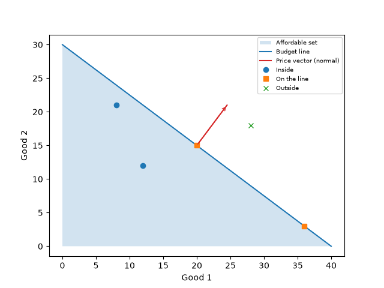
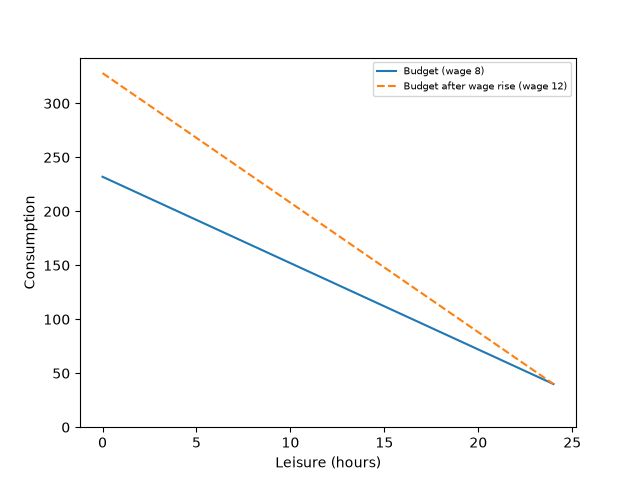

# 第 7 章: ベクトルと予算制約

## 7.1 この章の地図

所得 m で、2 つの財を買います。価格が p₁・p₂、数量が x₁・x₂ なら、支出は p₁x₁ + p₂x₂ です。財が 3 つ、10 個と増えても、「価格 × 数量を、財ごとに足す」形は変わりません。

この章の道具は、**ベクトル**と**内積**です。価格を並べた**価格ベクトル** p と、数量を並べた**数量ベクトル** x の内積 p·x が、支出です。予算制約は、財の数によらず、**p·x ≤ m** の 1 行で書けます。さらに、内積には図形の意味があります。価格ベクトルは、予算線と**直交する**向きを指します。



| 項目 | 内容 |
| :--- | :--- |
| 経済学の題材 | 予算制約、予算線と予算集合、労働と余暇、消費と貯蓄（2 期間）、証券の価格（発展） |
| 数学 | ベクトル、内積、大きさ、なす角、直交、直線の式と法線ベクトル、平均・分散の内積表示 |
| 使う Python の機能 | リスト、`zip`（`strict=True`）、`sum`、`math.acos`、`math.isclose`、`Literal`、テスト（`pytest`） |
| 新しく導入するライブラリ | **NumPy** を、正面から説明する（配列・`np.dot`・`np.linalg.norm` など。これまでは図のテストで、説明なしに使ってきた） |
| 完成形 | `vector_dot`、`vector_length`、`vector_angle_degrees`、`mean_by_dot`、`variance_by_dot`、`line_normal_form`、`budget_expenditure`、`budget_status`、`budget_intercepts`、`budget_line_quantity`、`full_income`、`consumption_given_leisure`、`second_period_consumption`、`lifetime_income_present_value`、`security_price` |
| ファイル | 実装: `lib/chapter07/vectors.py`（標準ライブラリ）、`lib/chapter07/budget.py`（NumPy）、`lib/chapter07/plot.py`（図）／テスト: `test/chapter07/test_vectors.py`、`test/chapter07/test_budget.py`、`test/chapter07/test_plot.py` |
| データ | なし（手計算できる小さな例だけ） |

### 数学の式とコードの対応

| 経済学・数学 | 式 | コード |
| :--- | :--- | :--- |
| 内積 | u·v = u₁v₁ + u₂v₂ + … + uₙvₙ | `vector_dot(u, v)` |
| 大きさ | \|v\| = √(v·v) | `vector_length(v)` |
| なす角 | cos θ = u·v ÷ (\|u\|\|v\|) | `vector_angle_degrees(u, v)` |
| 平均・分散 | x·1 ÷ n、d·d ÷ n（d は偏差） | `mean_by_dot(xs)`、`variance_by_dot(xs)` |
| 直線の式 | n·x = c（n は法線ベクトル） | `line_normal_form(p, q)` |
| 支出 | p·x | `budget_expenditure(prices, bundle)` |
| 予算制約 | p·x ≤ m | `budget_status(prices, bundle, income)` |
| 予算線の切片 | m ÷ pᵢ | `budget_intercepts(prices, income)` |
| 予算線（2 財） | x₂ = (m − p₁x₁) ÷ p₂ | `budget_line_quantity(prices, income, x1)` |
| 労働と余暇 | c + w·l = w·T + 非労働所得 | `full_income`、`consumption_given_leisure` |
| 消費と貯蓄 | c₁ + c₂ ÷ (1 + r) = y₁ + y₂ ÷ (1 + r) | `second_period_consumption`、`lifetime_income_present_value` |
| 証券の価格（発展） | ペイオフ · 状態価格 | `security_price(payoffs, state_prices)` |

> **記号について**: 太字や矢印の代わりに、ベクトルを p・x のような 1 文字で書きます。成分は p₁・p₂ のように添字で書きます。コードでは、ベクトルを Python のリスト（`[2, 3]`）で表します。p·x の「·」は、内積です（数どうしの掛け算と区別します）。

### 前提とする章

| できること | 場所 |
| :--- | :--- |
| 関数とテストを書く、リストと `zip` を使う | [第 1 シリーズ](../economics-programming/index.md)の第 1〜6 章 |
| 直線の式（傾きと切片）を書く | この連載の[第 1 章](01-linear-functions-and-markets.md) |
| 割引現在価値（将来のお金を、今のお金に換算する）を計算する | この連載の[第 3 章](03-exponents-logarithms-and-interest.md) |

NumPy は、第 1〜6 章の図のテスト（`np.asarray(...).tolist()`）や、第 2・3 章の `plot.py`（`np.linspace`）で、説明なしに使ってきました。この章で、正面から説明します。第 1 シリーズの NumPy の章は、前提にしません。予算制約と最適な消費の**経済学**は、[ミクロ経済学のためのプログラミング（初級）の第 2 章](../micro-basics-programming/02-budget-and-optimal-choice.md)で扱います。この章は、そこで使う数学（ベクトルと内積）を、関数とテストで確かめます。

## 7.2 準備

```bash
cd apps/math-for-economics-programming/python
uv run pytest test/chapter07
```

```text
59 passed
```

自分でコードを書くときは、`practice/chapter07/` に、完成形と同じ名前のファイル（`vectors.py`・`budget.py`・`plot.py`・`test_vectors.py`・`test_budget.py`・`test_plot.py`）を作ります。図の節を後回しにするなら、`plot.py` と `test_plot.py` は要らず、テストは 48 件になります。テスト・`plot.py`・下の check スクリプトの import は、`from practice.chapter07...` に書き換えます（書き換えないと、完成形を動かすことになります）。

テストの import の一覧は、完成形の**全関数**です。まだ書いていない関数を import すると、`ImportError` になります。関数を 1 つ書くたびに、その名前を import に足してください。「予想の答え合わせ」のスクリプトは、`practice/chapter07/check.py` に保存し、`uv run python -m practice.chapter07.check` で実行します。

## 7.3 予想する

次の 5 つの問いに、**紙で、手計算で**答えてください。答えは、この節には書いてありません。「プログラミング」の節の「予想の答え合わせ」で確かめます。

- 価格が (2, 3)、所得が 60 です。財の組合せ (15, 10)・(10, 12)・(12, 13) は、それぞれ、予算線上・予算内・予算外のどれですか
- (1, 2) と (3, 4) の内積は、いくつですか。(1, 0) と (1, 1) のなす角は、何度ですか。(2, 3) と (3, −2) のなす角は、何度ですか
- データ 1・2・3・4・5 の平均と分散を、**内積で**求めてください（平均は、成分がすべて 1 のベクトルとの内積を 5 で割る。分散は、平均からの偏差のベクトルと、自分自身との内積を 5 で割る）
- 1 日 24 時間、時給 10 で、働いた分だけ稼げます（ほかの収入はありません）。24 時間すべて働いたときの所得は、いくつですか。余暇を 16 時間とると、消費に使えるお金は、いくつですか
- （発展）明日の状態が 2 つあり、ある証券は、状態 1 で 10、状態 2 で 20 を払います。状態 1 で 1 を払う権利の今の値段が 0.4、状態 2 で 1 を払う権利が 0.5 のとき、この証券の今の値段は、いくつですか。発展の節を飛ばす方は、この問いも、飛ばしてかまいません

## 7.4 ベクトルと予算制約の考え方

### 予算制約

所得 m で、価格 p₁ の財 1 を x₁、価格 p₂ の財 2 を x₂ 買います。支出が所得を超えない条件が、**予算制約**です。

> p₁x₁ + p₂x₂ ≤ m

等号が成り立つ (x₁, x₂) の集まりが**予算線**、不等号を満たす組合せの集まりが**予算集合**です。予算線は、x₂ = (m − p₁x₁) ÷ p₂ と書くと、傾き −p₁ ÷ p₂ の直線です。財 1 だけを買えば m ÷ p₁、財 2 だけを買えば m ÷ p₂ で、これが予算線と軸の交点（**切片**）です。

### ベクトルのいろいろ

数を順番に並べたものを、**ベクトル**と言います。並べた数の個数を、ベクトルの**次元**と言います。

| 見方 | 例 | 経済学の例 |
| :--- | :--- | :--- |
| 数ベクトル（数の並び） | (2, 3)、(1.5, 0.2, 8) | 価格ベクトル、数量ベクトル、データの並び |
| 幾何ベクトル（向きと長さを持つ矢印） | 原点から (2, 3) へ向かう矢印 | 価格ベクトルの向き（予算線と直交する） |
| 位置ベクトル（点の座標） | 点 (15, 10) | 財の組合せ（グラフ上の点） |

同じ (2, 3) を、数の並びとも、矢印とも、点とも読めます。この章は、3 つの見方を、場面ごとに使い分けます。

### 内積

同じ次元のベクトル u と v の**内積**は、成分ごとの積の和です。

> u·v = u₁v₁ + u₂v₂ + … + uₙvₙ

支出 p₁x₁ + p₂x₂ は、価格ベクトル p と数量ベクトル x の内積 p·x です。財が n 個でも、予算制約は **p·x ≤ m** と書けます。次元が違うベクトルの内積は、決まりません。

内積には、図形の意味があります。ベクトルの**大きさ**（矢印の長さ）は、自分自身との内積の平方根 |v| = √(v·v) です（三平方の定理）。2 本のベクトルの**なす角** θ は、

> cos θ = u·v ÷ (|u||v|)

で決まります。内積が正なら鋭角、0 なら**直角**、負なら鈍角です。内積が 0 のとき、2 本のベクトルは**直交する**と言います。0 ベクトル（成分がすべて 0）は、向きがないので、なす角は決まりません。

### 直線の式と法線ベクトル

直線は、「ある向き n との内積が一定の点の集まり」とも書けます。

> n·x = c

このとき、n は、直線と直交します。直線上の 2 点 x と y では n·x = n·y = c なので、差 y − x（直線の向き）と n の内積は、0 になるからです。直線と直交するベクトル n を、直線の**法線ベクトル**と言います。

予算線 p·x = m では、**価格ベクトル p が、法線ベクトル**です。予算線上を動くと（財 1 を減らして、財 2 を増やす）、その動き Δx は、p と直交します（p·Δx = 0。支出は変わらない）。p の向きに動くと、支出が最も速く増えます。

1 次関数との関係も見ておきます。y = a·x + b は、−a·x + y = b と書き直すと、法線ベクトル (−a, 1) の直線です。財が 3 つなら、p₁x₁ + p₂x₂ + p₃x₃ = m は、3 次元の空間の**平面**で、その法線ベクトルも p です。

### 平均と分散を、内積で表す

データ x = (x₁, …, xₙ) の和は、成分がすべて 1 のベクトル 1 = (1, …, 1) との内積 x·1 です。

> 平均 = x·1 ÷ n、分散 = d·d ÷ n（d = (x₁ − 平均, …, xₙ − 平均) は、偏差のベクトル）

分散は、偏差のベクトルの大きさの 2 乗を n で割ったものです。標準偏差は、その平方根で、「偏差のベクトルの長さ ÷ √n」です。この見方は、第 9 章の回帰で、もう一度使います。

### もう少し練習: 労働と余暇

1 日 T 時間のうち、l 時間を余暇にとり、残りの T − l 時間を、時給 w で働きます。非労働所得（仕送り・利子など）を N とすると、消費 c は、

> c = w·(T − l) + N、書き直すと c + w·l = w·T + N

です。右辺 w·T + N は、全部の時間を働いたときの所得（**完全所得**）です。左辺は、価格ベクトル (1, w) と、(c, l) の内積です。**余暇の価格は、賃金**です（1 時間休むと、1 時間分の賃金をあきらめる）。賃金が上がると、予算線は、余暇 T 時間の点（c = N）を中心に、急になります（7.5 節の図）。

### もう少し練習: 消費と貯蓄

今期の所得 y₁、来期の所得 y₂、利子率 r の 2 期間で、今期 c₁ 消費します。残り y₁ − c₁ を貯蓄すると、来期は利子が付いて (y₁ − c₁)(1 + r) になります（c₁ > y₁ なら、借りて、利子付きで返します）。

> c₂ = (y₁ − c₁)(1 + r) + y₂、書き直すと c₁ + c₂ ÷ (1 + r) = y₁ + y₂ ÷ (1 + r)

右辺は、所得の**割引現在価値**（[第 3 章](03-exponents-logarithms-and-interest.md)）です。左辺は、価格ベクトル (1, 1 ÷ (1 + r)) と (c₁, c₂) の内積です。**来期の消費の価格は、1 ÷ (1 + r)**（今の 1 ÷ (1 + r) を貯蓄すれば、来期の 1 になる）です。

??? note "発展: 証券の価格"

    明日の世界が、いくつかの**状態**（好況・不況など）のどれかになるとします。証券は、状態ごとに違う額を払います。その額を並べたものが、**ペイオフのベクトル**です。「状態 s で 1 を払い、ほかの状態では何も払わない権利」の今の値段を、状態 s の**状態価格**と言います。

    ペイオフ (a₁, a₂) の証券は、状態 1 の権利を a₁ 個と、状態 2 の権利を a₂ 個、まとめたものと同じです。したがって、その値段は、

    > 証券の価格 = a₁q₁ + a₂q₂ = ペイオフ · 状態価格

    で、内積です。予算制約の「価格 · 数量」と同じ形です。どの状態でも 1 を払う証券（安全資産）の価格は、状態価格の和で、その逆数が 1 + 利子率です。

## 7.5 プログラミング

### Red: 内積のテスト

`test_vectors.py` の先頭の import です。

```python
import math

import numpy as np
import pytest

from lib.chapter07.vectors import (
    line_normal_form,
    mean_by_dot,
    variance_by_dot,
    vector_angle_degrees,
    vector_dot,
    vector_length,
)
```

最初のテストは、手計算できる内積 1×3 + 2×4 = 11 と、3 財の例（2×10 + 3×4 + 0.5×6 = 35）です。長さが違うときは、エラーにします。

```python
def test_1と2と3と4の内積は11() -> None:
    assert vector_dot([1, 2], [3, 4]) == 11


def test_3財のベクトルの内積は成分ごとの積の和() -> None:
    assert vector_dot([2, 3, 0.5], [10, 4, 6]) == pytest.approx(35)


def test_長さの違うベクトルの内積は決まらない() -> None:
    with pytest.raises(ValueError):
        vector_dot([1, 2, 3], [1, 2])
```

`vectors.py` がないので、収集の時点で失敗します（**Red**）。

### Green: 内積を、リストで実装する

```python
import math
from collections.abc import Sequence
```

```python
def vector_dot(u: Sequence[float], v: Sequence[float]) -> float:
    """内積 u·v = u₁v₁ + u₂v₂ + … + uₙvₙ。長さが違えば ValueError（zip の strict）。"""
    return sum(a * b for a, b in zip(u, v, strict=True))
```

`zip` で成分を組にして、積を足します。`strict=True` を付けると、長さが違うとき `zip` が `ValueError` を出します（自分で書いた長さの検査は、重複するので消しました）。

### 大きさとなす角

```python
def test_ベクトルの大きさは自分との内積の平方根() -> None:
    assert vector_length([3, 4]) == 5
    assert vector_length([1, 2, 2]) == 3


def test_1と0と1と1のなす角は45度() -> None:
    assert vector_angle_degrees([1, 0], [1, 1]) == pytest.approx(45)


def test_内積が0のベクトルは直交する() -> None:
    assert vector_dot([2, 3], [3, -2]) == 0
    assert vector_angle_degrees([2, 3], [3, -2]) == pytest.approx(90)
    assert vector_angle_degrees([1, 0, 0], [0, 0, 5]) == pytest.approx(90)


def test_丸め誤差でcosが1を超えても角は0度() -> None:
    # 0.1 は 2 進数で割り切れず、cos θ が 1.0000000000000002 になる
    assert vector_angle_degrees([0.1, 1], [0.2, 2]) == pytest.approx(0, abs=1e-5)
    assert vector_angle_degrees([0.1, 1], [-0.2, -2]) == pytest.approx(180, abs=1e-5)
```

```python
def vector_length(v: Sequence[float]) -> float:
    """大きさ |v| = √(v·v)。"""
    return math.sqrt(vector_dot(v, v))


def vector_angle_degrees(u: Sequence[float], v: Sequence[float]) -> float:
    """2 本のベクトルのなす角（度）。cos θ = u·v ÷ (|u||v|)。"""
    lengths = vector_length(u) * vector_length(v)
    if lengths == 0:
        raise ValueError("0 ベクトルとのなす角は、決まりません")
    cosine = vector_dot(u, v) / lengths
    # 丸め誤差で ±1 をわずかに超えると、acos が ValueError を出すので、範囲に収める
    return math.degrees(math.acos(max(-1.0, min(1.0, cosine))))
```

最初は `math.acos(vector_dot(u, v) / lengths)` と素直に書き、2 つの問題が出ました。

- (0.1, 1) と (0.2, 2)（同じ向き）では、cos θ が **1.0000000000000002** になり、`acos` が `ValueError`（math domain error）を出しました。0.1 が 2 進数で割り切れないためです。cos θ を [−1, 1] に収めて直しました
- (1, 2) と (2, 4) の角は、0 でなく **1.2e-6 度**になりました。cos θ = 1 の近くでは、`acos` が cos の丸め誤差を大きく拡大します。0 度・180 度のテストは、許容誤差を `abs=1e-5` にしています（境界のテスト）

### 平均と分散を、内積で

```python
def test_5つの値の平均3は1のベクトルとの内積を5で割る() -> None:
    assert mean_by_dot([1, 2, 3, 4, 5]) == 3


def test_5つの値の分散2は偏差の内積を5で割る() -> None:
    assert variance_by_dot([1, 2, 3, 4, 5]) == 2
```

```python
def mean_by_dot(xs: Sequence[float]) -> float:
    """平均 = x·1 ÷ n（1 は、成分がすべて 1 のベクトル）。"""
    if not xs:
        raise ValueError("空のデータの平均は、決まりません")
    return vector_dot(xs, [1] * len(xs)) / len(xs)


def variance_by_dot(xs: Sequence[float]) -> float:
    """分散 = d·d ÷ n（d は、平均からの偏差のベクトル）。"""
    mean = mean_by_dot(xs)
    deviations = [x - mean for x in xs]
    return vector_dot(deviations, deviations) / len(xs)
```

### NumPy を導入する

ここまでの `vectors.py` は、標準ライブラリ（リストと `zip`）だけで書き、内積の仕組みを自分で確かめました。仕組みがわかったので、ここから先（`budget.py`）は、道具の **NumPy** を使います。

NumPy は、数の並び（**配列**）の計算を、まとめて行うライブラリです。第 1〜6 章の図のテストで、説明なしに `import numpy as np` と書いてきた `np` が、これです。`pyproject.toml` の依存に入っていて、`uv sync` で入るので、`uv add` は要りません。この章で使う道具は、次のとおりです。

| 道具 | 意味 |
| :--- | :--- |
| `np.array(リスト, dtype=np.float64)` | リストを、浮動小数点数（`float64`）の配列にする |
| `np.asarray(値, dtype=np.float64)` | `np.array` と同じ。ただし、すでに同じ型の配列なら、コピーせずにそのまま返す |
| `np.dot(u, v)` | 内積（自作の `vector_dot`）。リストをそのまま渡しても、内部で配列に変換される |
| `np.linalg.norm(v)` | 大きさ（自作の `vector_length`） |
| `np.mean`・`np.var`・`np.std` | 平均・分散・標準偏差。`np.var` は **n で割る**分散（`statistics.variance` は n − 1 で割るので、値が違う） |
| `u * v`、`.sum()` | 配列どうしの `*` は**成分ごとの積**（内積ではない）。`.sum()` は成分の和 |
| `60 / 配列`、`配列 <= 0` | 数と配列の計算・比較は、**成分ごと**に行われる（ブロードキャスト） |
| `np.any(配列 <= 0)` | 「どれか 1 つでも 0 以下か」 |
| `.tolist()` | 配列を、Python のリストに戻す |
| `NDArray[np.float64]` | 「`float64` の配列」という型ヒント（`from numpy.typing import NDArray`） |

NumPy の計算結果の数は、Python の `float` でなく `np.float64` です（配列を `for` で回して取り出した成分も同じ）。値は同じですが型が違うので、この連載では、公開する関数の戻り値を `float(...)` で `float` に変換します（型ヒントと mypy をそろえるため）。

自作の関数と NumPy の関数が一致することを、テストにします（0 < x < 1 の成分・負の成分・0 ベクトル・4 次元も試す）。2 つの計算を突き合わせる考え方は、第 4 章の「公式と、項を足した値の一致」と同じです。

```python
def test_自作の内積と大きさはNumPyと一致する() -> None:
    pairs: list[tuple[list[float], list[float]]] = [
        ([1, 2], [3, 4]),
        ([2, 3, 0.5], [10, 4, 6]),
        ([0.1, -0.7, 0.3, 2], [-5, 0.25, 4, 0]),
        ([0, 0, 0], [1, 2, 3]),
    ]
    for u, v in pairs:
        assert vector_dot(u, v) == pytest.approx(float(np.dot(u, v)))
        assert vector_length(u) == pytest.approx(float(np.linalg.norm(u)))


def test_NumPyの配列の掛け算は成分ごとで内積は和をとる() -> None:
    u = np.array([1, 2, 3], dtype=np.float64)
    v = np.array([4, 5, 6], dtype=np.float64)
    assert (u * v).tolist() == [4, 10, 18]
    assert float(np.dot(u, v)) == float((u * v).sum()) == 32


def test_内積の平均と分散は統計の公式と一致する() -> None:
    for xs in ([1, 2, 3, 4, 5], [2.5, -1, 0.3, 8], [10, 10, 10], [0.2, 0.9]):
        assert mean_by_dot(xs) == pytest.approx(float(np.mean(xs)))
        assert variance_by_dot(xs) == pytest.approx(float(np.var(xs)))
        assert math.sqrt(variance_by_dot(xs)) == pytest.approx(float(np.std(xs)))
```

この 3 つは、新しい関数なしで最初から通ります（NumPy の使い方を確かめるテストです）。

### Red: 支出と予算制約のテスト

`test_budget.py` の先頭の import です。

```python
import pytest

from lib.chapter07.budget import (
    budget_expenditure,
    budget_intercepts,
    budget_line_quantity,
    budget_status,
    consumption_given_leisure,
    full_income,
    lifetime_income_present_value,
    second_period_consumption,
    security_price,
)
from lib.chapter07.vectors import vector_dot
```

```python
def test_価格2と3で15と10を買う支出は60() -> None:
    assert budget_expenditure([2, 3], [15, 10]) == 60


def test_予算線上と予算内と予算外() -> None:
    assert budget_status([2, 3], [15, 10], 60) == "on"
    assert budget_status([2, 3], [10, 12], 60) == "inside"
    assert budget_status([2, 3], [12, 13], 60) == "outside"


def test_丸め誤差があっても予算線上と判定する() -> None:
    # 0.1 × 1 + 0.2 × 1 は、浮動小数点では 0.30000000000000004
    assert budget_status([0.1, 0.2], [1, 1], 0.3) == "on"
```

### Green: 予算制約を、NumPy で実装する

`budget.py` では、NumPy を使います。

```python
import math
from collections.abc import Sequence
from typing import Literal

import numpy as np
from numpy.typing import NDArray
```

```python
def _as_vector(values: Sequence[float]) -> NDArray[np.float64]:
    """リストを、浮動小数点数の NumPy の配列にする。"""
    return np.asarray(values, dtype=np.float64)


def _check_prices(prices: Sequence[float]) -> None:
    """価格は、すべて正でなければならない。"""
    if np.any(_as_vector(prices) <= 0):
        raise ValueError("価格は、すべて正でなければなりません")


def budget_expenditure(prices: Sequence[float], bundle: Sequence[float]) -> float:
    """支出 p·x（価格ベクトルと数量ベクトルの内積）。"""
    return float(np.dot(_as_vector(prices), _as_vector(bundle)))


def budget_status(
    prices: Sequence[float], bundle: Sequence[float], income: float
) -> Literal["inside", "on", "outside"]:
    """財の組合せが、予算線上（p·x = m）・予算内（<）・予算外（>）のどれか。"""
    _check_prices(prices)
    if np.any(_as_vector(bundle) < 0):
        raise ValueError("数量は 0 以上でなければなりません")
    spending = budget_expenditure(prices, bundle)
    # 0.1 + 0.2 = 0.30000000000000004 のような丸め誤差を、予算線上とみなす
    if math.isclose(spending, income):
        return "on"
    return "inside" if spending < income else "outside"
```

- `_as_vector` は、リストを `dtype=np.float64`（浮動小数点数）の配列にします。`[2, 3]` のような整数のリストから作ると、`dtype` が `int64` の配列になります。`dtype` を指定して、型ヒントを `NDArray[np.float64]` の 1 つにそろえます
- `np.any(配列 <= 0)` は、「どれか 1 つでも 0 以下か」を、まとめて調べます。`budget_intercepts`（次の節）の `income / 配列` も、成分ごとの割り算です
- 予算線上かどうかは、`==` でなく、`math.isclose` で比べます。0.1 × 1 + 0.2 × 1 は、浮動小数点では 0.30000000000000004 で、`==` では所得 0.3 と等しくなりません。`==` で書いて、このテストが落ちることを確かめてから、直しました
- 戻り値の型 `Literal["inside", "on", "outside"]` は、「この 3 つの文字列のどれか」という意味です

### 予算線と法線ベクトル

予算線上の 2 点の差が、価格ベクトルと直交すること（価格ベクトルが法線ベクトルであること）を、テストにします。2 点を通る直線を n·x = c の形にする `line_normal_form` は、`vectors.py` に置きます（予算に限らない、直線の数学なので）。

```python
def test_予算線の切片は所得を各財の価格で割る() -> None:
    assert budget_intercepts([2, 3], 60) == [30, 20]
    assert budget_intercepts([1, 2, 5], 30) == [30, 15, 6]


def test_予算線上の2点の差は価格ベクトルと直交する() -> None:
    # 価格ベクトルは、予算線の法線ベクトル
    for prices, income, x1, x2 in [([2, 3], 60, 3, 21), ([4, 5], 100, 1, 24.5)]:
        y1 = budget_line_quantity(prices, income, x1)
        y2 = budget_line_quantity(prices, income, x2)
        assert vector_dot(prices, [x2 - x1, y2 - y1]) == pytest.approx(0)
```

```python
def test_2点を通る直線の法線ベクトルと定数() -> None:
    assert line_normal_form([30, 0], [0, 20]) == ([20, 30], 600)
```

```python
def budget_intercepts(prices: Sequence[float], income: float) -> list[float]:
    """所得をすべて 1 つの財に使ったときの数量 m ÷ pᵢ（予算線と各軸の交点）。"""
    _check_prices(prices)
    return [float(q) for q in income / _as_vector(prices)]


def budget_line_quantity(
    prices: Sequence[float], income: float, first_quantity: float
) -> float:
    """2 財の予算線 p₁x₁ + p₂x₂ = m の上で、財 1 が first_quantity のときの財 2。"""
    if len(prices) != 2:
        raise ValueError("予算線の式は、2 財のときだけ使います")
    _check_prices(prices)
    second_quantity = (income - prices[0] * first_quantity) / prices[1]
    if first_quantity < 0 or second_quantity < 0:
        raise ValueError("予算線上で、数量が負になる点はありません")
    return second_quantity
```

```python
def line_normal_form(
    p: Sequence[float], q: Sequence[float]
) -> tuple[list[float], float]:
    """2 点 p・q を通る直線を、n·x = c（n は法線ベクトル）の形で表す。"""
    direction = [q[0] - p[0], q[1] - p[1]]
    if direction == [0, 0]:
        raise ValueError("同じ 2 点では、直線が決まりません")
    normal = [direction[1], -direction[0]]
    return normal, vector_dot(normal, p)
```

2 点 (30, 0)・(0, 20) は、価格 (2, 3)・所得 60 の予算線の切片です。`line_normal_form` は、法線ベクトル (20, 30) を返します。これは、価格ベクトル (2, 3) の 10 倍で、同じ向きです。法線ベクトルは、向きだけが決まり、長さは決まりません。

### 労働と余暇

```python
def test_24時間で賃金10なら消費と余暇の予算は240() -> None:
    assert full_income(10, 24) == 240
    assert full_income(8, 24, 40) == 232


def test_余暇16時間なら8時間働いて消費は80() -> None:
    assert consumption_given_leisure(16, 10, 24) == 80
    assert consumption_given_leisure(24, 10, 24, 50) == 50
    assert consumption_given_leisure(0, 8, 24, 40) == 232


def test_消費と余暇は価格1と賃金の予算線上にある() -> None:
    # 余暇の価格は賃金（1 時間休むと、賃金を 1 時間分あきらめる）
    for leisure, wage, nonlabor in [(16, 10, 0), (10, 12.5, 30), (20.5, 8, 40)]:
        c = consumption_given_leisure(leisure, wage, 24, nonlabor)
        assert budget_expenditure([1, wage], [c, leisure]) == pytest.approx(
            full_income(wage, 24, nonlabor)
        )
```

```python
def full_income(wage: float, total_hours: float, nonlabor_income: float = 0) -> float:
    """すべての時間を働いたときの所得 w·T + 非労働所得（消費と余暇の予算）。"""
    return wage * total_hours + nonlabor_income


def consumption_given_leisure(
    leisure: float, wage: float, total_hours: float, nonlabor_income: float = 0
) -> float:
    """余暇 l のときの消費 c = w·(T − l) + 非労働所得。"""
    if not 0 <= leisure <= total_hours:
        raise ValueError("余暇は、0 時間以上、総時間以下でなければなりません")
    return wage * (total_hours - leisure) + nonlabor_income
```

3 つ目のテストは、労働と余暇が、**価格 (1, w) の予算制約**と同じであることを、この章の `budget_expenditure` で確かめます。

### 消費と貯蓄

```python
def test_2期間の予算で今期100のうち60を消費すると来期は利子付きで() -> None:
    assert second_period_consumption(60, 100, 0, 0.05) == pytest.approx(42)
    assert second_period_consumption(60, 100, 50, 0.1) == pytest.approx(94)


def test_2期間の消費は価格1と1割る1プラスrの予算線上にある() -> None:
    for c1, y1, y2, rate in [(60, 100, 50, 0.1), (120, 100, 50, 0.1), (30, 80, 20, 0)]:
        c2 = second_period_consumption(c1, y1, y2, rate)
        assert budget_expenditure([1, 1 / (1 + rate)], [c1, c2]) == pytest.approx(
            lifetime_income_present_value(y1, y2, rate)
        )
```

```python
def _check_rate(rate: float) -> None:
    """利子率が −100% 以下では、割り引けない。"""
    if rate <= -1:
        raise ValueError("利子率が −100% 以下では、割り引けません")


def second_period_consumption(
    first_consumption: float, income1: float, income2: float, rate: float
) -> float:
    """2 期間の予算で、今期 c₁ 消費したときの来期の消費 (y₁ − c₁)(1 + r) + y₂。"""
    _check_rate(rate)
    second = (income1 - first_consumption) * (1 + rate) + income2
    if second < 0:
        raise ValueError("来期に返せないほど、今期に借りることはできません")
    return second


def lifetime_income_present_value(income1: float, income2: float, rate: float) -> float:
    """2 期間の所得の現在価値 y₁ + y₂ ÷ (1 + r)。"""
    _check_rate(rate)
    return income1 + income2 / (1 + rate)
```

来期に返せないほど借りると（c₂ < 0）、エラーにします。境界のテストの利子率は 25% です。10% だと、ちょうど返し切る点が浮動小数点で −7.1e-15 になり、「ちょうど 0」を試せないからです（1.25 は 2 進数で割り切れます）。

### 発展: 証券の価格

??? note "証券の価格のテストと実装（発展。後回しにしても、学習は成り立ちます）"

    ```python
    def test_ペイオフ10と20で状態価格0点4と0点5の証券の価格は14() -> None:
        assert security_price([10, 20], [0.4, 0.5]) == pytest.approx(14)


    def test_どの状態でも1を払う安全な証券の価格から利子率がわかる() -> None:
        price = security_price([1, 1, 1], [0.3, 0.45, 0.2])
        assert price == pytest.approx(0.95)
        assert 1 / price - 1 == pytest.approx(0.05263, abs=1e-5)


    def test_負の状態価格では証券の価格は決まらない() -> None:
        with pytest.raises(ValueError):
            security_price([10, 20], [0.4, -0.1])
        assert security_price([10, 20], [0, 0.5]) == 10
    ```

    ```python
    def security_price(payoffs: Sequence[float], state_prices: Sequence[float]) -> float:
        """証券の価格 = ペイオフのベクトルと状態価格のベクトルの内積。"""
        if np.any(_as_vector(state_prices) < 0):
            raise ValueError("状態価格は 0 以上でなければなりません")
        return float(np.dot(_as_vector(payoffs), _as_vector(state_prices)))
    ```

    安全資産の価格 0.3 + 0.45 + 0.2 = 0.95 から、利子率は 1 ÷ 0.95 − 1 ≈ 5.26% です。

### 予想の答え合わせ

```python
from lib.chapter07.budget import (
    budget_status,
    consumption_given_leisure,
    full_income,
    security_price,
)
from lib.chapter07.vectors import (
    mean_by_dot,
    variance_by_dot,
    vector_angle_degrees,
    vector_dot,
)

print([budget_status([2, 3], b, 60) for b in ([15, 10], [10, 12], [12, 13])])
print(vector_dot([1, 2], [3, 4]), round(vector_angle_degrees([1, 0], [1, 1]), 6))
print(vector_dot([2, 3], [3, -2]), round(vector_angle_degrees([2, 3], [3, -2]), 6))
print(mean_by_dot([1, 2, 3, 4, 5]), variance_by_dot([1, 2, 3, 4, 5]))
print(full_income(10, 24), consumption_given_leisure(16, 10, 24))
print(round(security_price([10, 20], [0.4, 0.5]), 6))
```

```text
['on', 'inside', 'outside']
11 45.0
0 90.0
3.0 2.0
240 80
14.0
```

- **1 つ目の問い**: 支出は 2×15 + 3×10 = 60（予算線上）、2×10 + 3×12 = 56（予算内）、2×12 + 3×13 = 63（予算外）です
- **2 つ目の問い**: 内積は 11 です。(1, 0) と (1, 1) は 45 度です。(2, 3) と (3, −2) は、内積が 2×3 + 3×(−2) = 0 なので、**直交**（90 度）します。(3, −2) は、価格 (2, 3) の予算線に沿った向きです
- **3 つ目の問い**: 平均は (1 + 2 + 3 + 4 + 5) ÷ 5 = 3、偏差は (−2, −1, 0, 1, 2) で、自分との内積 4 + 1 + 0 + 1 + 4 = 10 を 5 で割って、分散は 2 です
- **4 つ目の問い**: 完全所得は 10 × 24 = 240、余暇 16 時間なら 8 時間働いて、消費は 80 です
- **5 つ目の問い**（発展）: 10 × 0.4 + 20 × 0.5 = 14 です

角度は、`round(..., 6)` で丸めて表示しています。0 度・180 度の近くと同じく、`acos` の丸め誤差が、末尾の桁に出ることがあるからです。

### 境界のテスト

完成形には、本文に載せなかったテストがあります。同じ向きの角・直線上の点・借りる場合・生涯所得の例と、**境界**（0 ベクトル、空のデータ、値が 1 つ、縦・横の直線、同じ 2 点、3 財、長さの違い、負の数量・正でない価格、数量 0、切片を超える量、余暇が 0〜T の外、利子率 −100% 以下、借りすぎ）です。テストの件数を合わせるため、ここに全件載せます。

??? note "境界のテスト"

    ```python
    def test_同じ向きは0度で逆向きは180度() -> None:
        # 0 度・180 度の近くでは、acos が丸め誤差を拡大する（cos の誤差 1e-16 が、1e-6 度に）
        assert vector_angle_degrees([1, 2], [2, 4]) == pytest.approx(0, abs=1e-5)
        assert vector_angle_degrees([1, 2], [-3, -6]) == pytest.approx(180, abs=1e-5)


    def test_直線上の点は法線ベクトルとの内積が定数() -> None:
        pairs: list[tuple[list[float], list[float]]] = [
            ([30, 0], [0, 20]),
            ([1, 5], [4, -1]),
            ([0.5, 0.5], [2, 3.5]),
        ]
        for p, q in pairs:
            normal, constant = line_normal_form(p, q)
            middle = [(a + b) / 2 for a, b in zip(p, q, strict=True)]
            for point in (p, q, middle):
                assert vector_dot(normal, point) == pytest.approx(constant)
            direction = [b - a for a, b in zip(p, q, strict=True)]
            assert vector_dot(normal, direction) == pytest.approx(0)


    def test_0ベクトルとのなす角は決まらない() -> None:
        with pytest.raises(ValueError):
            vector_angle_degrees([0, 0], [1, 1])
        with pytest.raises(ValueError):
            vector_angle_degrees([1, 1], [0, 0])


    def test_空のデータの平均と分散は決まらない() -> None:
        with pytest.raises(ValueError):
            mean_by_dot([])
        with pytest.raises(ValueError):
            variance_by_dot([])


    def test_1つだけの値の平均はその値で分散は0() -> None:
        assert mean_by_dot([7]) == 7
        assert variance_by_dot([7]) == 0


    def test_縦の直線と横の直線の法線ベクトル() -> None:
        assert line_normal_form([5, 0], [5, 10]) == ([10, 0], 50)
        assert line_normal_form([0, 2], [4, 2]) == ([0, -4], -8)


    def test_同じ2点では直線が決まらない() -> None:
        with pytest.raises(ValueError):
            line_normal_form([1, 2], [1, 2])
    ```

    ```python
    def test_支出は価格ベクトルと数量ベクトルの内積() -> None:
        pairs: list[tuple[list[float], list[float]]] = [
            ([2, 3], [4, 7]),
            ([1.5, 0.2, 8], [2, 10, 0.5]),
        ]
        for prices, bundle in pairs:
            assert budget_expenditure(prices, bundle) == pytest.approx(
                vector_dot(prices, bundle)
            )


    def test_支出は浮動小数点の数を返す() -> None:
        assert type(budget_expenditure([2, 3], [15, 10])) is float


    def test_予算線上の財2の数量() -> None:
        assert budget_line_quantity([2, 3], 60, 15) == 10
        assert budget_line_quantity([2, 3], 60, 0) == 20
        assert budget_line_quantity([4, 5], 100, 10) == 12


    def test_今期に借りると来期の消費は利子の分だけ減る() -> None:
        assert second_period_consumption(120, 100, 50, 0.1) == pytest.approx(28)


    def test_生涯所得の現在価値は来期の所得を割り引いて足す() -> None:
        assert lifetime_income_present_value(100, 110, 0.1) == pytest.approx(200)
        assert lifetime_income_present_value(100, 0, 0.05) == 100


    def test_3財の予算の判定() -> None:
        assert budget_status([1, 2, 5], [10, 5, 2], 30) == "on"
        assert budget_status([1, 2, 5], [10, 5, 2.1], 30) == "outside"


    def test_長さの違う価格と数量の支出は決まらない() -> None:
        with pytest.raises(ValueError):
            budget_expenditure([2, 3], [1, 2, 3])


    def test_負の数量や正でない価格では予算を判定しない() -> None:
        with pytest.raises(ValueError):
            budget_status([2, 3], [-1, 5], 60)
        with pytest.raises(ValueError):
            budget_status([2, 0], [1, 5], 60)
        with pytest.raises(ValueError):
            budget_status([-2, 3], [1, 5], 60)


    def test_数量0の組合せは所得が正なら予算内で0なら予算線上() -> None:
        assert budget_status([2, 3], [0, 0], 60) == "inside"
        assert budget_status([2, 3], [0, 0], 0) == "on"


    def test_正でない価格では切片も予算線も決まらない() -> None:
        with pytest.raises(ValueError):
            budget_intercepts([2, 0], 60)
        with pytest.raises(ValueError):
            budget_line_quantity([0, 3], 60, 5)
        with pytest.raises(ValueError):
            budget_line_quantity([2, -3], 60, 5)


    def test_財1を切片より多く買うと財2の数量は負になるので決まらない() -> None:
        assert budget_line_quantity([2, 3], 60, 30) == 0
        with pytest.raises(ValueError):
            budget_line_quantity([2, 3], 60, 30.5)
        with pytest.raises(ValueError):
            budget_line_quantity([2, 3], 60, -1)


    def test_予算線上の数量は2財のときだけ() -> None:
        with pytest.raises(ValueError):
            budget_line_quantity([1, 2, 5], 30, 4)


    def test_余暇は0時間以上で総時間以下() -> None:
        assert consumption_given_leisure(24, 10, 24) == 0
        with pytest.raises(ValueError):
            consumption_given_leisure(-1, 10, 24)
        with pytest.raises(ValueError):
            consumption_given_leisure(24.5, 10, 24)


    def test_利子率がマイナス100パーセント以下なら2期間の予算は決まらない() -> None:
        with pytest.raises(ValueError):
            second_period_consumption(60, 100, 0, -1)
        with pytest.raises(ValueError):
            lifetime_income_present_value(100, 50, -1.5)
        assert second_period_consumption(60, 100, 0, -0.5) == pytest.approx(20)


    def test_来期に返せないほど借りると来期の消費は決まらない() -> None:
        # 40 借りると、来期に 40 × 1.25 = 50 返す。来期の所得 50 で、ちょうど返し切る
        assert second_period_consumption(140, 100, 50, 0.25) == 0
        with pytest.raises(ValueError):
            second_period_consumption(141, 100, 50, 0.25)
    ```

### 図

図には、次の import が要ります。

```python
from collections.abc import Sequence

import matplotlib.pyplot as plt
from matplotlib.axes import Axes
from matplotlib.figure import Figure

from lib.chapter07.budget import (
    budget_intercepts,
    budget_status,
    consumption_given_leisure,
)
from lib.chapter07.vectors import vector_length
```

章の冒頭の図（予算線・予算集合・価格ベクトル）と、労働と余暇の予算線の図を描きます。テストでは、価格ベクトルの矢印が予算線と直交すること（内積 0）、点が予算内・予算線上・予算外に正しく分かれること、予算集合が原点と 2 つの切片の三角形であることを、確かめます。



??? note "描画のテストと実装（後回しにしても、学習は成り立ちます）"

    テストの import:

    ```python
    import matplotlib.pyplot as plt
    import numpy as np
    import pytest
    from matplotlib.axes import Axes

    from lib.chapter07.budget import budget_intercepts, consumption_given_leisure
    from lib.chapter07.plot import plot_budget_set, plot_labor_leisure
    from lib.chapter07.vectors import vector_angle_degrees, vector_dot, vector_length
    ```

    ```python
    def _series(ax: Axes, label: str) -> tuple[list[float], list[float]]:
        line = next(x for x in ax.lines if x.get_label() == label)
        xs = np.asarray(line.get_xdata(), dtype=float).tolist()
        ys = np.asarray(line.get_ydata(), dtype=float).tolist()
        return xs, ys


    def test_予算線は2つの切片を結ぶ() -> None:
        ax = plot_budget_set([3, 4], 120, []).axes[0]
        xs, ys = _series(ax, "Budget line")
        assert xs == pytest.approx([0, 40])
        assert ys == pytest.approx([30, 0])
        assert budget_intercepts([3, 4], 120) == [40, 30]


    def test_価格ベクトルの矢印は予算線と直交し価格と同じ向き() -> None:
        prices = [3, 4]
        ax = plot_budget_set(prices, 120, []).axes[0]
        xs, ys = _series(ax, "Price vector (normal)")
        arrow = [xs[1] - xs[0], ys[1] - ys[0]]
        assert vector_dot(arrow, [40, -30]) == pytest.approx(0)
        assert vector_angle_degrees(arrow, prices) == pytest.approx(0, abs=1e-5)
        # 矢印は、予算線の中点から出る
        assert (xs[0], ys[0]) == pytest.approx((20, 15))


    def test_価格ベクトルの矢印の長さは小さい切片の4分の1() -> None:
        xs, ys = _series(plot_budget_set([3, 4], 120, []).axes[0], "Price vector (normal)")
        assert vector_length([xs[1] - xs[0], ys[1] - ys[0]]) == pytest.approx(30 / 4)
        xs, ys = _series(plot_budget_set([2, 3], 60, []).axes[0], "Price vector (normal)")
        assert vector_length([xs[1] - xs[0], ys[1] - ys[0]]) == pytest.approx(20 / 4)


    def test_財の組合せは予算内と予算線上と予算外に分けて描く() -> None:
        bundles = [[12, 12], [20, 15], [28, 18], [4, 3]]
        ax = plot_budget_set([3, 4], 120, bundles).axes[0]
        assert _series(ax, "Inside") == ([12, 4], [12, 3])
        assert _series(ax, "On the line") == ([20], [15])
        assert _series(ax, "Outside") == ([28], [18])


    def test_組合せがない分類は凡例に載せない() -> None:
        ax = plot_budget_set([3, 4], 120, [[1, 1]]).axes[0]
        labels = {x.get_label() for x in ax.lines}
        assert "Inside" in labels
        assert not {"On the line", "Outside"} & labels


    def test_予算内の領域は予算線の下を塗る() -> None:
        ax = plot_budget_set([2, 3], 60, []).axes[0]
        area = next(c for c in ax.collections if c.get_label() == "Affordable set")
        vertices = np.asarray(area.get_paths()[0].vertices, dtype=float).tolist()
        # 原点と 2 つの切片を頂点とする三角形
        assert {(x, y) for x, y in vertices} == {(0, 0), (0, 20), (30, 0)}


    def test_予算の図の軸と凡例() -> None:
        ax = plot_budget_set([2, 3], 60, [[1, 1]]).axes[0]
        assert ax.get_xlabel() == "Good 1"
        assert ax.get_ylabel() == "Good 2"
        assert ax.get_legend() is not None
        assert ax.get_aspect() == 1
        plt.close("all")


    def test_3財の予算は図にしない() -> None:
        with pytest.raises(ValueError):
            plot_budget_set([1, 2, 3], 60, [])


    def test_労働と余暇の予算線は余暇0から総時間まで() -> None:
        ax = plot_labor_leisure(8, 12, 24, 40).axes[0]
        xs, ys = _series(ax, "Budget (wage 8)")
        assert (xs[0], xs[-1]) == (0, 24)
        assert ys == pytest.approx([consumption_given_leisure(x, 8, 24, 40) for x in xs])


    def test_賃金が上がった後の予算線は点線で余暇24時間の点で交わる() -> None:
        ax = plot_labor_leisure(8, 12, 24, 40).axes[0]
        line = next(
            x for x in ax.lines if x.get_label() == "Budget after wage rise (wage 12)"
        )
        xs, ys = _series(ax, "Budget after wage rise (wage 12)")
        assert line.get_linestyle() == "--"
        assert ys[0] == pytest.approx(12 * 24 + 40)
        assert (xs[-1], ys[-1]) == pytest.approx((24, 40))


    def test_労働と余暇の図の軸と凡例() -> None:
        ax = plot_labor_leisure(8, 12, 24, 40).axes[0]
        assert ax.get_xlabel() == "Leisure (hours)"
        assert ax.get_ylim()[0] == 0
        assert ax.get_ylabel() == "Consumption"
        assert ax.get_legend() is not None
        plt.close("all")
    ```

    ```python
    _STATUS_STYLES = {
        "inside": ("Inside", "o"),
        "on": ("On the line", "s"),
        "outside": ("Outside", "x"),
    }


    def _plot_price_vector(ax: Axes, prices: Sequence[float], income: float) -> None:
        """予算線の中点から、価格ベクトルの向きに矢印を描く（長さは、小さい切片の 1/4）。"""
        x_end, y_end = budget_intercepts(prices, income)
        start = (x_end / 2, y_end / 2)
        scale = min(x_end, y_end) / 4 / vector_length(prices)
        end = (start[0] + scale * prices[0], start[1] + scale * prices[1])
        ax.plot(
            [start[0], end[0]],
            [start[1], end[1]],
            color="C3",
            label="Price vector (normal)",
        )
        ax.annotate(
            "", xy=end, xytext=start, arrowprops={"arrowstyle": "->", "color": "C3"}
        )


    def plot_budget_set(
        prices: Sequence[float], income: float, bundles: Sequence[Sequence[float]]
    ) -> Figure:
        """2 財の予算線・予算内の領域・価格ベクトル（法線）と、財の組合せの点を描く。"""
        if len(prices) != 2:
            raise ValueError("予算の図は、2 財のときだけ描きます")
        x_end, y_end = budget_intercepts(prices, income)
        fig, ax = plt.subplots()
        ax.fill_between([0, x_end], [y_end, 0], alpha=0.2, label="Affordable set")
        ax.plot([0, x_end], [y_end, 0], color="C0", label="Budget line")
        _plot_price_vector(ax, prices, income)
        for status, (label, marker) in _STATUS_STYLES.items():
            group = [b for b in bundles if budget_status(prices, b, income) == status]
            if group:
                ax.plot([b[0] for b in group], [b[1] for b in group], marker, label=label)
        ax.set_aspect("equal")
        ax.set_xlabel("Good 1")
        ax.set_ylabel("Good 2")
        ax.legend(fontsize="x-small")
        plt.close(fig)
        return fig


    def plot_labor_leisure(
        wage: float, new_wage: float, total_hours: float, nonlabor_income: float
    ) -> Figure:
        """消費と余暇の予算線（賃金 wage）と、賃金が new_wage に上がった後の予算線。"""
        hours = [0, total_hours]
        fig, ax = plt.subplots()
        for w, style, label in [
            (wage, "-", f"Budget (wage {wage:g})"),
            (new_wage, "--", f"Budget after wage rise (wage {new_wage:g})"),
        ]:
            consumption = [
                consumption_given_leisure(h, w, total_hours, nonlabor_income) for h in hours
            ]
            ax.plot(hours, consumption, style, label=label)
        ax.set_ylim(bottom=0)
        ax.set_xlabel("Leisure (hours)")
        ax.set_ylabel("Consumption")
        ax.legend(fontsize="x-small")
        plt.close(fig)
        return fig
    ```

### 実行結果

```bash
uv run pytest test/chapter07
```

```text
59 passed
```

## 7.6 規則で言うと

1. **支出は、価格ベクトルと数量ベクトルの内積である。** 予算制約は、財の数によらず p·x ≤ m
2. **内積は、なす角を決める。** cos θ = u·v ÷ (|u||v|)。内積 0 は直交
3. **価格ベクトルは、予算線の法線ベクトルである。** 予算線上の動きは、価格ベクトルと直交する（支出が変わらない）
4. **「価格」は、あきらめるものの量である。** 余暇の価格は賃金、来期の消費の価格は 1 ÷ (1 + r)。労働と余暇・消費と貯蓄も、予算制約 p·x = m の形になる

混同しやすい点を、表にまとめます。

| 混同しやすい点 | 違い |
| :--- | :--- |
| NumPy の `u * v` と、内積 | `u * v` は成分ごとの積（配列）。内積は、その和（数）。`np.dot(u, v)` |
| 法線ベクトルと、直線の向き | 法線ベクトルは、直線と**直交する**向き。直線に沿った向きとは、内積が 0 |
| 予算線上と、予算内 | 予算線上は p·x = m（所得を使い切る）。予算内は p·x < m。浮動小数点では、「= m」を `math.isclose` で判定する |
| `np.float64` と `float` | 値は同じでも、型が違う。公開する関数は `float(...)` で返す |
| 分散の n と n − 1 | `np.var` は n で割る（この章）。`statistics.variance` は n − 1 で割る |

### このモデルが成り立たない場面

- **価格が、買う量によらず一定とは限りません。** まとめ買いの割引や、使用量で単価が変わる電気料金では、支出が数量の 1 次式にならず、予算線が折れ曲がります
- **借りる利子率と、貯める利子率は、ふつう違います。** 借入の利子率が高いと、2 期間の予算線は、今期の所得の点で折れます。この章の式は、同じ r で貸し借りできると仮定しています
- **働く時間を、自由に選べるとは限りません。** 週 40 時間か 0 時間かしか選べない仕事では、予算線上の点のうち、選べるのは 2 点だけです。税や社会保険料があれば、手取りの時給は w より低くなります
- **財は、いくらでも細かく分けられるとは限りません。** 車や家は、1 台・1 軒の単位でしか買えません。予算線上の点の多くは、実際には選べません

## 7.7 練習問題

| 種類 | 問題 |
| :--- | :--- |
| 想起 | 本文を閉じて、`vector_dot` の最初のテスト（(1, 2) と (3, 4) の内積 11）と、(1, 0) と (1, 1) のなす角 45 度のテストを書いてください |
| 生成 | 解説を見る前に、支出に占める各財の割合（**支出シェア**）pᵢxᵢ ÷ p·x を返す関数 `budget_share(prices, bundle)` を、テストから書いてください。価格 (2, 3)・数量 (15, 10) なら (0.5, 0.5) です。シェアの和は、いつも 1 になりますか |
| 多様 | 価格が (2, 3) から (4, 3) に変わります（財 1 の値上がり。所得 60 のまま）。予算線の切片は、どう変わりますか。(15, 10) は、予算内・予算線上・予算外のどれになりますか。価格ベクトルの向きは、何度回りますか。先に手計算で予想してから、確かめてください |
| 交互 | [第 3 章](03-exponents-logarithms-and-interest.md)の `discount_to_present` で、来期の所得 110 を利子率 10% で割り引き、今期の所得 100 に足してください。この章の `lifetime_income_present_value(100, 110, 0.1)` と、一致しますか |

??? note "解答（先に自分で取り組んでから、開いてください）"

    解答のテストの import です（自分で写した関数を使うなら、`lib` を `practice` に書き換えます）。

    ```python
    import pytest

    from lib.chapter03.interest import discount_to_present
    from lib.chapter07.budget import (
        budget_intercepts,
        budget_status,
        lifetime_income_present_value,
    )
    from lib.chapter07.vectors import vector_angle_degrees, vector_dot
    ```

    **想起**:

    ```python
    def test_最初の内積となす角のテスト() -> None:
        assert vector_dot([1, 2], [3, 4]) == 11
        assert vector_angle_degrees([1, 0], [1, 1]) == pytest.approx(45)
    ```

    **生成**: 各財の支出 pᵢxᵢ を、支出の合計 p·x で割ります。シェアの和は、(p₁x₁ + … + pₙxₙ) ÷ p·x = 1 です。置き場所は、どこでもかまいません（例: `practice/chapter07/exercises.py`）。

    ```python
    def budget_share(prices: list[float], bundle: list[float]) -> list[float]:
        total = vector_dot(prices, bundle)
        return [p * x / total for p, x in zip(prices, bundle, strict=True)]
    ```

    ```python
    def test_支出シェア() -> None:
        assert budget_share([2, 3], [15, 10]) == pytest.approx([0.5, 0.5])
        shares = budget_share([1.5, 0.2, 8], [2, 10, 0.5])
        assert shares == pytest.approx([3 / 9, 2 / 9, 4 / 9])
        assert sum(shares) == pytest.approx(1)
    ```

    **多様**: 財 1 の切片は 60 ÷ 4 = 15 に半減し、財 2 の切片 20 は変わりません（予算線は、財 2 の切片を中心に、急になります）。(15, 10) の支出は 4 × 15 + 3 × 10 = 90 で、予算外です。価格ベクトルは、(2, 3) から (4, 3) へ、約 19.44 度、財 1 の軸の側に回ります。

    ```python
    def test_財1の値上がり() -> None:
        assert budget_intercepts([4, 3], 60) == [15, 20]
        assert budget_status([4, 3], [15, 10], 60) == "outside"
        assert vector_angle_degrees([2, 3], [4, 3]) == pytest.approx(19.44, abs=0.01)
    ```

    **交互**: どちらも、来期の 110 を、今の 100 に換算して足しています。

    ```python
    def test_2期間の所得の現在価値と割引() -> None:
        total = 100 + discount_to_present(110, 0.1, 1)
        assert total == pytest.approx(200)
        assert lifetime_income_present_value(100, 110, 0.1) == pytest.approx(total)
    ```

## 7.8 振り返り

- うまくいったこと:
- 詰まったこと:
- 次に試すこと:

## 7.9 まとめ

- ベクトルは、数の並び・矢印・点の 3 通りに読める。内積は、成分ごとの積の和
- 支出は、価格ベクトルと数量ベクトルの内積で、予算制約は p·x ≤ m。財の数によらず、同じ式で書ける
- 内積は、なす角を決める（cos θ = u·v ÷ (|u||v|)）。内積 0 は直交で、価格ベクトルは、予算線の法線ベクトル
- 平均・分散も、内積で書ける（x·1 ÷ n、d·d ÷ n）。労働と余暇（余暇の価格は賃金）、消費と貯蓄（来期の消費の価格は 1 ÷ (1 + r)）も、予算制約の形になる
- 自作の内積・大きさを、NumPy の `np.dot`・`np.linalg.norm` と突き合わせて、テストで確かめた。浮動小数点の丸め誤差（`acos` の定義域、`==` の比較）は、テストで見つけて直す

この章では、「何が買えるか」（予算制約）を、ベクトルで表しました。次の第 8 章では、買えるものの中から「何を選ぶか」を考えます。効用を、2 つの財の量の関数（多変数関数）として表し、**偏微分**で限界効用と限界代替率を求めて、予算線と無差別曲線が接する点（効用最大化）を求めます。そこでは、この章の予算線と価格ベクトルを、そのまま使います。
