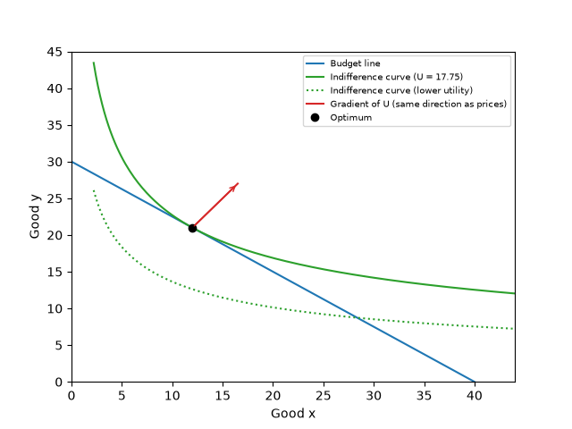
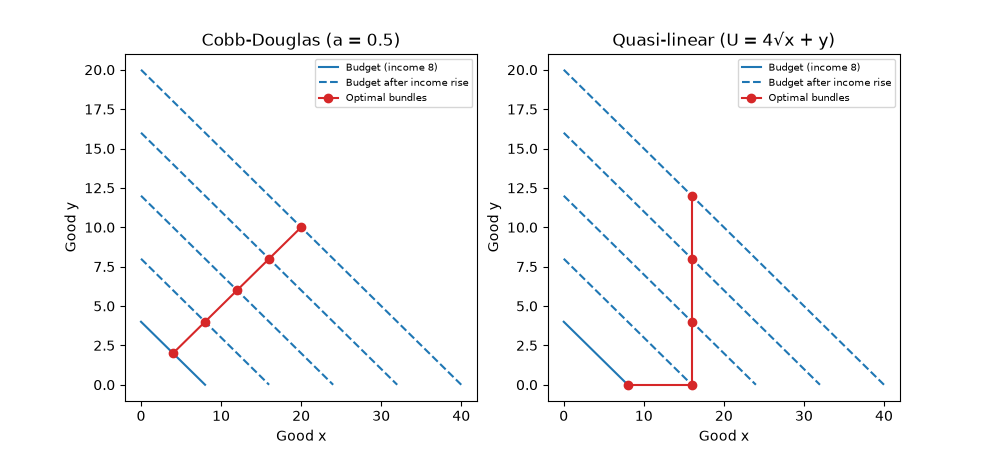
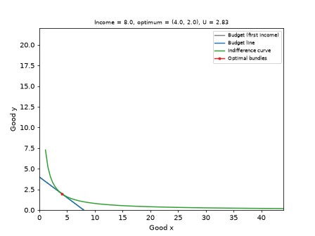

# 第 8 章: 多変数の微分と効用最大化

## 8.1 この章の地図

第 7 章では、「何が買えるか」を予算制約 p·x ≤ m で表しました。この章では、買えるものの中から「何を選ぶか」を考えます。

満足の度合い（**効用**）は、2 つの財の量 x・y で決まる、**2 変数の関数** U(x, y) です。1 つの変数だけを動かして、ほかを固定した微分が**偏微分**です。偏微分を使うと、「予算線と無差別曲線が接する点が、効用が最大の点」という条件を、式とコードにできます。この章は、第 2 部（第 5〜8 章）の最後で、**到達チェック**も行います。



| 項目 | 内容 |
| :--- | :--- |
| 経済学の題材 | 効用最大化、限界効用、限界代替率、ラグランジュ乗数（所得の限界効用）、準線形効用と端点解、部分均衡分析、労働と余暇、消費と貯蓄、2 製品の企業の利潤最大化 |
| 数学 | 2 変数関数、偏微分（数値と公式）、制約なしの最適化（2 階の偏微分とヘッセ行列）、制約付きの最適化（ラグランジュの未定乗数法）、準凹関数とオイラーの定理（発展） |
| 使う Python の機能 | 関数を返す関数（`lambda` で変数を固定する）、`itertools.combinations`、`pytest.mark.parametrize`、テスト（`pytest`） |
| 新しく導入するライブラリ | なし（第 7 章の NumPy を、図で使う） |
| 完成形 | `numerical_partial_x`、`numerical_partial_y`、`numerical_hessian_2d`、`classify_critical_point_2d`、`quadratic_2d_critical_point`、`euler_degree_of_homogeneity`、`is_quasi_concave_on_points`、`cobb_douglas_utility`、`cobb_douglas_indifference_y`、`cobb_douglas_marginal_utilities`、`cobb_douglas_mrs`、`numerical_mrs`、`cobb_douglas_demand`、`cobb_douglas_lagrange_multiplier`、`budget_line_bundles`、`best_bundle_on_budget_line`、`quasilinear_utility`、`quasilinear_demand` |
| ファイル | 実装: `lib/chapter08/partial.py`（偏微分と最適化）、`lib/chapter08/utility.py`（効用最大化）、`lib/chapter08/plot.py`（図）／テスト: `test/chapter08/test_partial.py`、`test/chapter08/test_utility.py`、`test/chapter08/test_plot.py` |
| データ | なし（手計算できる小さな例だけ） |

### 数学の式とコードの対応

| 経済学・数学 | 式 | コード |
| :--- | :--- | :--- |
| 偏微分（数値） | ∂f/∂x ≈ (f(x + h, y) − f(x − h, y)) ÷ (2h) | `numerical_partial_x(func, x, y)` |
| ヘッセ行列の判定 | D = f_xx·f_yy − f_xy² と f_xx の符号 | `classify_critical_point_2d(fxx, fxy, fyy)` |
| コブ・ダグラス型の効用 | U = x^a·y^(1−a) | `cobb_douglas_utility(x, y, a)` |
| 限界効用 | U_x = ∂U/∂x、U_y = ∂U/∂y | `cobb_douglas_marginal_utilities(x, y, a)` |
| 限界代替率 | MRS = U_x ÷ U_y | `cobb_douglas_mrs(x, y, a)`、`numerical_mrs(utility, x, y)` |
| 効用最大化 | MRS = p_x ÷ p_y と p_x·x + p_y·y = m を連立する | `cobb_douglas_demand(prices, m, a)` |
| ラグランジュ乗数 | λ = U_x ÷ p_x = U_y ÷ p_y | `cobb_douglas_lagrange_multiplier(prices, m, a)` |
| 格子探索 | 予算線上の点で、U が最大の点 | `best_bundle_on_budget_line(utility, prices, m, points)` |
| 準線形効用 | U = b·√x + y | `quasilinear_utility`、`quasilinear_demand` |

> **記号について**: 偏微分 ∂U/∂x を、U_x と短く書きます。2 階の偏微分 ∂²f/∂x∂y は f_xy です。2 つの財を x・y、価格を p_x・p_y、所得を m と書きます。コードでは、第 7 章と同じく、価格をリスト `[p_x, p_y]` で渡します。

### 前提とする章

| できること | 場所 |
| :--- | :--- |
| 数値微分（中心差分）と、導関数の符号で最大・最小を判定する | [第 5 章](05-derivatives-and-profit-maximization.md) |
| 予算線・切片・価格ベクトル（法線ベクトル）を扱う | [第 7 章](07-vectors-and-budget-constraint.md) |
| 格子探索で最大の点を探す | [第 2 章](02-quadratics-monopoly-and-oligopoly.md) |

効用最大化の**経済学**は、[ミクロ経済学のためのプログラミング（初級）の第 1 章](../micro-basics-programming/01-utility-and-indifference-curves.md)（効用と無差別曲線）と[第 2 章](../micro-basics-programming/02-budget-and-optimal-choice.md)（予算制約と最適な消費）で扱います。この章は、そこで使う数学（偏微分と制約付きの最適化）を、関数とテストで確かめます。

## 8.2 準備

```bash
cd apps/math-for-economics-programming/python
uv run pytest test/chapter08
```

```text
59 passed
```

自分でコードを書くときは、`practice/chapter08/` に、完成形と同じ名前のファイル（`partial.py`・`utility.py`・`plot.py`・`test_partial.py`・`test_utility.py`・`test_plot.py`）を作ります。図を後回しにするなら、`plot.py` と `test_plot.py` は要らず、テストは 50 件になります。

- テスト・`utility.py`・`plot.py`・check スクリプトの import を、`from practice.chapter08...` に書き換えます（`utility.py` は `partial` を、`plot.py` は `utility` を import します。書き換えないと、完成形を動かします）
- 第 5 章の `numerical_derivative` と、第 7 章の `budget_intercepts` などは、自分で写した `practice.chapter05`・`practice.chapter07` から import します。写していなければ、`lib.chapter05`・`lib.chapter07` のままでかまいません。この章では、それらの実装を再掲しません
- テストの import の一覧は、完成形の**全関数**です。まだ書いていない関数を import すると、`ImportError` になります。関数を 1 つ書くたびに、名前を import に足してください

「予想の答え合わせ」のスクリプトは、`practice/chapter08/check.py` に保存し、`uv run python -m practice.chapter08.check` で実行します。

## 8.3 予想する

次の 5 つの問いに、**紙で、手計算で**答えてください。答えは、この節には書いてありません。「プログラミング」の節の「予想の答え合わせ」で確かめます。

- 効用 U = √(xy)、価格 (2, 5)、所得 100 です。効用を最大にする x・y と、そのときの効用（小数第 2 位まで）は、いくつですか。その点の限界代替率は、価格比 2 ÷ 5 と比べて、どうなっていますか。1 円あたりの限界効用 U_x ÷ p_x は、いくつですか
- 効用を U = x^0.3·y^0.7 に変え、価格 (2, 7)、所得 140 にします。最適な x・y は、いくつですか。所得の何割を x に使いますか
- 2 つの製品を作る企業の利潤が π = 50x + 40y − x² − xy − y² です。利潤を最大にする (x, y) と、最大の利潤は、いくつですか。その点は、本当に最大ですか（最小や鞍点ではありませんか）
- 効用 U = 4√x + y、価格 (1, 2) です。所得が 10 のときと 30 のときの、最適な (x, y) は、それぞれいくつですか
- （発展）U = √(xy) の点 (25, 10) で、x·U_x + y·U_y は、いくつですか。発展の節を飛ばす方は、この問いも、飛ばしてかまいません

## 8.4 偏微分と効用最大化の考え方

### 多変数関数と偏微分

2 つの量で決まる関数 f(x, y) を、**2 変数関数**と言います。グラフは、平面の上の曲面です。y を固定して、x だけを動かしたときの傾きが、x についての**偏微分** f_x = ∂f/∂x です。

> f(x, y) = x²y + 3y² なら、f_x = 2xy（y は定数とみなす）、f_y = x² + 6y

計算は、1 変数の微分と同じです。数値でも、第 5 章の中心差分を、1 つの変数にだけ当てれば求まります。

### 限界効用と限界代替率

効用 U(x, y) の偏微分 U_x を、x の**限界効用**と言います（x をもう少し増やしたときの、効用の増え方）。この章の中心の例は、**コブ・ダグラス型**の効用です。

> U = x^a·y^(1−a)（0 < a < 1）、U_x = a·U ÷ x、U_y = (1 − a)·U ÷ y

効用が同じ水準の (x, y) を結んだ曲線が、**無差別曲線**です。無差別曲線の上で x を少し増やすと、効用を保つために y を減らす必要があります。その交換の比率（無差別曲線の傾きの大きさ）が、**限界代替率**です。

> MRS = U_x ÷ U_y（コブ・ダグラス型なら (a ÷ (1 − a))·(y ÷ x)）

無差別曲線の上では、U_x·Δx + U_y·Δy = 0（効用が変わらない）なので、傾きは Δy ÷ Δx = −U_x ÷ U_y です。

### 制約なしの最適化

制約がなければ、最大の点では、**どの方向の偏微分も 0** です（f_x = f_y = 0。1 変数の f'(x) = 0 と同じ）。この点を**停留点**と言います。停留点が最大か最小かは、2 階の偏微分を並べた**ヘッセ行列** [[f_xx, f_xy], [f_xy, f_yy]] で判定します。

| 行列式 D = f_xx·f_yy − f_xy² | f_xx | 停留点 |
| :--- | :--- | :--- |
| 正 | 負 | 極大 |
| 正 | 正 | 極小 |
| 負 | — | 鞍点（ある方向には最大、別の方向には最小） |
| 0（数値では、ほぼ 0） | — | この方法では判定できない |

f_xx と f_yy が両方負でも、f_xy が大きいと D < 0 で鞍点です。対角だけでは決まりません。

2 次関数 f = ax² + bxy + cy² + dx + ey なら、f_x = 2ax + by + d = 0 と f_y = bx + 2cy + e = 0 は、**連立 1 次方程式**です。行列式 4ac − b² が 0 でなければ、停留点は 1 つに決まります。

### 制約付きの最適化: 効用最大化

予算制約 p_x·x + p_y·y = m のもとで、効用を最大にします。予算線の上を動くとき、効用が増える方向が残っていれば、まだ最大ではありません。最大の点では、**無差別曲線が予算線に接します**。傾きが等しいので、

> MRS = U_x ÷ U_y = p_x ÷ p_y（**限界代替率 ＝ 価格比**）

です。言い換えると、U_x ÷ p_x = U_y ÷ p_y（**1 円あたりの限界効用が、どちらの財でも等しい**）。等しくなければ、1 円を、限界効用の低い財から高い財へ移すと、効用が増えます。

この条件と予算制約を連立すると、コブ・ダグラス型では、**解析解**が求まります。(a ÷ (1 − a))·(y ÷ x) = p_x ÷ p_y から、p_y·y = ((1 − a) ÷ a)·p_x·x です。予算制約に入れると、p_x·x ÷ a = m なので、

> x* = a·m ÷ p_x、y* = (1 − a)·m ÷ p_y

です。**所得の割合 a を x に使う**のが、コブ・ダグラス型の特徴です。

**ラグランジュの未定乗数法**は、同じ条件を、機械的に導く方法です。L = U(x, y) + λ(m − p_x·x − p_y·y) を、x・y・λ で偏微分して 0 とおくと、U_x = λ·p_x、U_y = λ·p_y、予算制約、の 3 つの式が出ます。**乗数 λ は、1 円あたりの限界効用**で、「所得が 1 増えたときに、最大の効用がどれだけ増えるか」（**所得の限界効用**）でもあります。

数式に頼らない確かめ方もあります。予算線の上に点を細かく並べ、効用が最大の点を探す（**格子探索**。第 2 章）。解析解と、格子探索の答えが一致すれば、どちらかの書き間違いを見つけられます。

### 準線形効用と端点解

**準線形効用** U = b·√x + y は、y について 1 次の効用です。U_x = b ÷ (2√x)、U_y = 1 なので、MRS = 価格比 から、x* = (b·p_y ÷ (2p_x))² です。**x の需要が、所得によりません**（所得が増えた分は、すべて y に回る）。

所得が少なくて、x* を買えないときは、所得をすべて x に使い、y = 0 にします。最適点が予算線の端（軸の上）にあるので、**端点解**と言います。端点解では、MRS ＝ 価格比 が成り立ちません（MRS > 価格比。x をもっと欲しいが、y をこれ以上減らせない）。

### 部分均衡分析との関係

y を「ほかのすべての財に使うお金」とみなし、その価格を 1 にします。準線形効用なら、MRS = p_x から、**価格 p_x ＝ x の限界効用 b ÷ (2√x)** です。これは、x の**需要曲線**（逆需要曲線）です。第 1 章で、天下り的に与えた需要曲線は、こうして効用最大化から導けます。ほかの財への影響（所得効果）を無視して、1 つの市場だけを見るのが、**部分均衡分析**です。準線形効用は、その仮定を、効用の形で表したものです。

### もう少し練習: 労働と余暇、消費と貯蓄

第 7 章で、労働と余暇・消費と貯蓄の予算線を、価格ベクトルと所得の形にしました。

| 題材 | 2 つの「財」 | 価格ベクトル | 所得 |
| :--- | :--- | :--- | :--- |
| 労働と余暇 | 消費 c、余暇 l | (1, w) | 完全所得 w·T + N |
| 消費と貯蓄 | 今期の消費 c₁、来期の消費 c₂ | (1, 1 ÷ (1 + r)) | 所得の割引現在価値 y₁ + y₂ ÷ (1 + r) |

形が同じなので、効用最大化の関数を、**そのまま**使えます。コブ・ダグラス型なら、完全所得の割合 1 − a を、余暇に使います。

??? note "発展: 準凹関数とオイラーの定理"

    **準凹関数**: 無差別曲線が原点に向かって凸（予算線に接する点が 1 つ）になるのは、効用が**準凹**のときです。準凹とは、どの 2 点 A・B を結ぶ線分の上でも、f の値が、f(A) と f(B) の小さいほう以上であることです。凹関数（第 5 章）なら準凹ですが、逆は成り立ちません。U = xy は、ヘッセ行列が [[0, 1], [1, 0]]（D = −1）で凹ではありませんが、準凹です。U = x² + y² は、(2, 0) と (0, 2) の中点 (1, 1) で 2 になり、両端の 4 より小さいので、準凹ではありません。準凹でない効用では、MRS ＝ 価格比 の点が、効用の**最小**になることがあります。

    **オイラーの定理**: すべての量を t 倍すると、値が t^k 倍になる関数を、**k 次同次**と言います。k 次同次の関数では、

    > x·f_x + y·f_y = k·f

    です。コブ・ダグラス型の効用 x^a·y^(1−a) は 1 次同次なので、x·U_x + y·U_y = U です。生産関数 F(K, L) が 1 次同次なら、資本と労働に、それぞれの限界生産物（K·F_K と L·F_L）を払うと、生産物がちょうど分け尽くされます（**完全分配定理**）。

## 8.5 プログラミング

### Red: 偏微分のテスト

`test_partial.py` の先頭の import です（完成形の全関数）。

```python
import pytest

from lib.chapter08.partial import (
    classify_critical_point_2d,
    euler_degree_of_homogeneity,
    is_quasi_concave_on_points,
    numerical_hessian_2d,
    numerical_partial_x,
    numerical_partial_y,
    quadratic_2d_critical_point,
)
```

最初のテストは、手計算できる f = x²y + 3y² の偏微分です（(2, 5) で f_x = 20、f_y = 34）。2 つ目は、負・0・0 < x < 1 の点で、公式 2xy・x² + 6y と一致することを確かめます。

```python
def _surface(x: float, y: float) -> float:
    """f(x, y) = x²y + 3y²。f_x = 2xy、f_y = x² + 6y。"""
    return x**2 * y + 3 * y**2


def test_偏微分はほかの変数を固定して微分する() -> None:
    assert numerical_partial_x(_surface, 2, 5) == pytest.approx(20)
    assert numerical_partial_y(_surface, 2, 5) == pytest.approx(34)


def test_偏微分の数値は公式と負や0や1未満の点でも一致する() -> None:
    for x, y in [(-1.5, 2), (0, 0.4), (0.3, -2), (4, 0)]:
        assert numerical_partial_x(_surface, x, y) == pytest.approx(2 * x * y, abs=1e-6)
        assert numerical_partial_y(_surface, x, y) == pytest.approx(
            x**2 + 6 * y, abs=1e-6
        )
```

`lib.chapter08.partial` がないので、収集の時点で失敗します（**Red**）。

### Green: 偏微分を、第 5 章の数値微分で

`partial.py` の先頭の import です。第 5 章の `numerical_derivative` を使います（実装は、[第 5 章](05-derivatives-and-profit-maximization.md)を見てください）。

```python
from collections.abc import Callable, Sequence
from itertools import combinations

from lib.chapter05.derivative import numerical_derivative
```

```python
Surface = Callable[[float, float], float]


def numerical_partial_x(func: Surface, x: float, y: float, step: float = 1e-5) -> float:
    """y を固定して、x で微分する: ∂f/∂x。"""
    return numerical_derivative(lambda t: func(t, y), x, step)


def numerical_partial_y(func: Surface, x: float, y: float, step: float = 1e-5) -> float:
    """x を固定して、y で微分する: ∂f/∂y。"""
    return numerical_derivative(lambda t: func(x, t), y, step)
```

`lambda t: func(t, y)` は、「y を固定して、x だけを動かす 1 変数の関数」です。それを第 5 章の中心差分に渡せば、偏微分になります。`Surface` は、「2 つの数を受け取って、数を返す関数」の型の別名です。

### 制約なしの最適化

2 製品の企業の利潤 π = 50x + 40y − x² − xy − y² を、停留点（連立方程式）・偏微分 = 0・ヘッセ行列の 3 つで調べます。

```python
def _two_product_profit(x: float, y: float) -> float:
    """2 つの製品を作る企業の利潤 π = 50x + 40y − x² − xy − y²。"""
    return 50 * x + 40 * y - x**2 - x * y - y**2


def test_2製品の利潤は偏微分が両方0になる点で最大() -> None:
    x, y = quadratic_2d_critical_point(-1, -1, -1, 50, 40)
    assert (x, y) == pytest.approx((20, 10))
    assert _two_product_profit(x, y) == pytest.approx(700)
    assert numerical_partial_x(_two_product_profit, x, y) == pytest.approx(0, abs=1e-6)
    assert numerical_partial_y(_two_product_profit, x, y) == pytest.approx(0, abs=1e-6)


def test_ヘッセ行列の数値は2階の偏微分の公式と一致する() -> None:
    assert numerical_hessian_2d(_two_product_profit, 20, 10) == pytest.approx(
        (-2, -1, -2), abs=1e-6
    )
    # f = x²y + 3y² の 2 階の偏微分: f_xx = 2y、f_xy = 2x、f_yy = 6
    assert numerical_hessian_2d(_surface, 1.5, -0.4) == pytest.approx(
        (-0.8, 3, 6), abs=1e-6
    )


def test_ヘッセ行列の行列式と左上の符号で極大と極小を分ける() -> None:
    assert classify_critical_point_2d(-2, -1, -2) == "maximum"
    assert classify_critical_point_2d(2, 1, 3) == "minimum"
    assert classify_critical_point_2d(2, 0, -2) == "saddle"


def test_対角が両方負でも行列式が負なら鞍点() -> None:
    assert classify_critical_point_2d(-1, 2, -1) == "saddle"
```

```python
def numerical_hessian_2d(
    func: Surface, x: float, y: float, step: float = 1e-3
) -> tuple[float, float, float]:
    """2 階の偏微分 (f_xx, f_xy, f_yy) を、差分で近似する（ヘッセ行列の成分）。"""
    h = step
    center = func(x, y)
    fxx = (func(x + h, y) - 2 * center + func(x - h, y)) / h**2
    fyy = (func(x, y + h) - 2 * center + func(x, y - h)) / h**2
    fxy = (
        func(x + h, y + h)
        - func(x + h, y - h)
        - func(x - h, y + h)
        + func(x - h, y - h)
    ) / (4 * h**2)
    return fxx, fxy, fyy


def classify_critical_point_2d(
    fxx: float, fxy: float, fyy: float, tolerance: float = 1e-9
) -> str:
    """ヘッセ行列の行列式 D = f_xx·f_yy − f_xy² と f_xx の符号で、停留点を分ける。

    数値のヘッセ行列では D がちょうど 0 にならないので、成分の大きさに比べて
    |D| が tolerance 倍以下なら、0 とみなす（判定できない）。
    """
    determinant = fxx * fyy - fxy**2
    if abs(determinant) <= tolerance * (fxx**2 + fxy**2 + fyy**2):
        return "undetermined"
    if determinant < 0:
        return "saddle"
    return "maximum" if fxx < 0 else "minimum"


def quadratic_2d_critical_point(
    a: float, b: float, c: float, d: float, e: float
) -> tuple[float, float]:
    """f = ax² + bxy + cy² + dx + ey の停留点。f_x = f_y = 0 の連立方程式を解く。"""
    determinant = 4 * a * c - b**2
    if determinant == 0:
        raise ValueError("連立方程式の行列式が 0 で、停留点が 1 つに決まりません")
    x = (b * e - 2 * c * d) / determinant
    y = (b * d - 2 * a * e) / determinant
    return x, y
```

- 2 階の偏微分は、f_xx ≈ (f(x + h) − 2f(x) + f(x − h)) ÷ h² です。f_xy は、4 隅の値の組み合わせで近似します。刻み幅 h を 10⁻⁵ にすると、h² = 10⁻¹⁰ で割るので、丸めの誤差が大きくなります。既定は 10⁻³ にしました（2 次関数なら、打ち切りの誤差は 0）
- 数値のヘッセ行列では、行列式がちょうど 0 にならず、10⁻¹⁵ ほどの丸め誤差が残ります（−(x + y)² の (1, −1) など）。そこで、成分の 2 乗和の `tolerance` 倍（既定 10⁻⁹）以下の |D| を、0 とみなします（境界のテストを参照）
- 停留点は、2 つの 1 次方程式を、**クラメルの公式**で解きます。係数が対称でない例（f = 2x² + xy + 3y² − 9x − 13y）もテストにして、x と y の式の取り違えを防ぎます（境界のテストを参照）

### Red: 効用関数のテスト

`test_utility.py` の先頭です。`_cobb_douglas` は、指数 a を決めて、効用を 2 変数の関数にします（偏微分や格子探索に渡すため）。

```python
import pytest

from lib.chapter05.derivative import numerical_derivative
from lib.chapter07.budget import (
    budget_status,
    consumption_given_leisure,
    full_income,
    lifetime_income_present_value,
    second_period_consumption,
)
from lib.chapter08.partial import Surface, numerical_partial_x, numerical_partial_y
from lib.chapter08.utility import (
    best_bundle_on_budget_line,
    budget_line_bundles,
    cobb_douglas_demand,
    cobb_douglas_indifference_y,
    cobb_douglas_lagrange_multiplier,
    cobb_douglas_marginal_utilities,
    cobb_douglas_mrs,
    cobb_douglas_utility,
    numerical_mrs,
    quasilinear_demand,
    quasilinear_utility,
)
```

```python
def _cobb_douglas(share: float) -> Surface:
    """効用 U = x^a·y^(1−a) を、2 変数の関数にする（偏微分に渡すため）。"""
    return lambda x, y: cobb_douglas_utility(x, y, share)


def test_コブダグラス型の効用はxのa乗とyの1マイナスa乗の積() -> None:
    assert cobb_douglas_utility(25, 10, 0.5) == pytest.approx(250**0.5)
    assert cobb_douglas_utility(8, 27, 1 / 3) == pytest.approx(18)


def test_限界効用の公式は偏微分の数値と一致する() -> None:
    for x, y, share in [(25, 10, 0.5), (21, 14, 0.3), (0.4, 3, 0.8), (3, 0.6, 0.3)]:
        mu_x, mu_y = cobb_douglas_marginal_utilities(x, y, share)
        utility = _cobb_douglas(share)
        assert mu_x == pytest.approx(numerical_partial_x(utility, x, y))
        assert mu_y == pytest.approx(numerical_partial_y(utility, x, y))


def test_限界代替率は限界効用の比() -> None:
    assert cobb_douglas_mrs(25, 10, 0.5) == pytest.approx(0.4)
    assert cobb_douglas_mrs(21, 14, 0.3) == pytest.approx(0.3 / 0.7 * 14 / 21)
    assert numerical_mrs(_cobb_douglas(0.5), 25, 10) == pytest.approx(0.4)
```

### Green: 限界効用と限界代替率

`utility.py` の先頭の import です。第 7 章の `budget_intercepts`（予算線の切片 m ÷ pᵢ）を使います。

```python
from collections.abc import Sequence

from lib.chapter07.budget import budget_intercepts
from lib.chapter08.partial import Surface, numerical_partial_x, numerical_partial_y
```

```python
def _check_share(share: float) -> None:
    if not 0 < share < 1:
        raise ValueError("指数 a は、0 より大きく 1 より小さくなければなりません")


def cobb_douglas_utility(x: float, y: float, share: float) -> float:
    """コブ・ダグラス型の効用 U = x^a·y^(1−a)。"""
    _check_share(share)
    if x < 0 or y < 0:
        raise ValueError("数量は 0 以上でなければなりません")
    return float(x**share * y ** (1 - share))


def cobb_douglas_marginal_utilities(
    x: float, y: float, share: float
) -> tuple[float, float]:
    """限界効用 (U_x, U_y) = (a·U ÷ x, (1 − a)·U ÷ y)（偏微分の公式）。"""
    if x <= 0 or y <= 0:
        raise ValueError("数量が 0 の点では、限界効用が決まりません")
    utility = cobb_douglas_utility(x, y, share)
    return share * utility / x, (1 - share) * utility / y


def cobb_douglas_mrs(x: float, y: float, share: float) -> float:
    """限界代替率 MRS = U_x ÷ U_y = (a ÷ (1 − a))·(y ÷ x)。"""
    mu_x, mu_y = cobb_douglas_marginal_utilities(x, y, share)
    return mu_x / mu_y


def numerical_mrs(utility: Surface, x: float, y: float) -> float:
    """どんな効用関数でも、偏微分の数値の比で、限界代替率を求める。"""
    return numerical_partial_x(utility, x, y) / numerical_partial_y(utility, x, y)
```

限界効用の公式と、偏微分の数値の一致を、a = 0.5 だけでなく 0.3・0.8 でも確かめます。a = 0.5 だけでは、U_x と U_y の式で、a と 1 − a を取り違えても気づきません。`numerical_mrs` は、効用の式を問いません（準線形効用でも使います）。

### 無差別曲線

無差別曲線は、U = x^a·y^(1−a) を y について解いた y = (U ÷ x^a)^(1 ÷ (1 − a)) です。図で使いますが、図を後回しにする方も、ここで書きます。

```python
def test_無差別曲線上の点は効用が同じ水準() -> None:
    for x in [1, 6.25, 25, 0.4]:
        y = cobb_douglas_indifference_y(250**0.5, x, 0.5)
        assert cobb_douglas_utility(x, y, 0.5) == pytest.approx(250**0.5)
    assert cobb_douglas_indifference_y(18, 8, 1 / 3) == pytest.approx(27)


def test_無差別曲線はxが正のときだけ描ける() -> None:
    with pytest.raises(ValueError):
        cobb_douglas_indifference_y(10, 0, 0.5)
```

```python
def cobb_douglas_indifference_y(level: float, x: float, share: float) -> float:
    """無差別曲線 x^a·y^(1−a) = U の上で、x のときの y = (U ÷ x^a)^(1 ÷ (1 − a))。"""
    _check_share(share)
    if x <= 0 or level < 0:
        raise ValueError("x が 0 以下か、効用水準が負では、無差別曲線が決まりません")
    return float((level / x**share) ** (1 / (1 - share)))
```

### 効用最大化: 解析解とラグランジュ乗数

```python
def test_価格2と5で所得100ならxは25でyは10() -> None:
    assert cobb_douglas_demand([2, 5], 100, 0.5) == pytest.approx((25, 10))
    assert cobb_douglas_utility(25, 10, 0.5) == pytest.approx(15.81, abs=0.01)


def test_最適点では限界代替率が価格比に等しく予算線上にある() -> None:
    for prices, income, share in [([2, 5], 100, 0.5), ([2, 7], 140, 0.3)]:
        x, y = cobb_douglas_demand(prices, income, share)
        assert cobb_douglas_mrs(x, y, share) == pytest.approx(prices[0] / prices[1])
        assert budget_status(prices, [x, y], income) == "on"


def test_ラグランジュ乗数は1円あたりの限界効用でどちらの財でも等しい() -> None:
    multiplier = cobb_douglas_lagrange_multiplier([2, 5], 100, 0.5)
    assert multiplier == pytest.approx(0.158, abs=1e-3)
    mu_x, mu_y = cobb_douglas_marginal_utilities(25, 10, 0.5)
    assert mu_x / 2 == pytest.approx(multiplier)
    assert mu_y / 5 == pytest.approx(multiplier)


@pytest.mark.parametrize(
    ("prices", "income", "share"), [([2, 5], 100, 0.5), ([2, 7], 140, 0.3)]
)
def test_ラグランジュ乗数は所得が1増えたときの効用の増え方(
    prices: list[float], income: float, share: float
) -> None:
    slope = numerical_derivative(
        lambda m: cobb_douglas_utility(*cobb_douglas_demand(prices, m, share), share),
        income,
    )
    assert slope == pytest.approx(
        cobb_douglas_lagrange_multiplier(prices, income, share)
    )
```

```python
def _two_good_intercepts(prices: Sequence[float], income: float) -> list[float]:
    """2 財の予算線の切片 [m ÷ p_x, m ÷ p_y]（第 7 章）。所得は 0 以上。"""
    if len(prices) != 2 or income < 0:
        raise ValueError("2 財の価格と、0 以上の所得が必要です")
    return budget_intercepts(prices, income)


def cobb_douglas_demand(
    prices: Sequence[float], income: float, share: float
) -> tuple[float, float]:
    """効用最大化の解析解 x* = a·m ÷ p_x、y* = (1 − a)·m ÷ p_y。"""
    _check_share(share)
    x_max, y_max = _two_good_intercepts(prices, income)
    return share * x_max, (1 - share) * y_max


def cobb_douglas_lagrange_multiplier(
    prices: Sequence[float], income: float, share: float
) -> float:
    """最適点でのラグランジュ乗数 λ = U_x ÷ p_x（1 円あたりの限界効用）。"""
    x, y = cobb_douglas_demand(prices, income, share)
    mu_x, _ = cobb_douglas_marginal_utilities(x, y, share)
    return mu_x / prices[0]
```

- 最適点が予算線上にあることを、第 7 章の `budget_status` で確かめます
- 最後のテストは、λ が「所得が 1 増えたときの、最大の効用の増え方」であることを、**最大の効用を所得の関数とみて、第 5 章の数値微分**で確かめます。`pytest.mark.parametrize` は、同じテストを、引数の組ごとに実行します（2 件と数えます）

### 格子探索との一致

```python
def test_予算線上の格子は2つの切片を結び全部が予算線上() -> None:
    bundles = budget_line_bundles([2, 5], 100, 5)
    assert bundles == [(0, 20), (12.5, 15), (25, 10), (37.5, 5), (50, 0)]
    assert all(budget_status([2, 5], list(b), 100) == "on" for b in bundles)


def test_格子探索の最大は解析解と一致する() -> None:
    for prices, income, share in [([2, 5], 100, 0.5), ([2, 7], 140, 0.3)]:
        best = best_bundle_on_budget_line(_cobb_douglas(share), prices, income, 2001)
        expected = cobb_douglas_demand(prices, income, share)
        assert best == pytest.approx(expected, abs=0.05)
```

```python
def budget_line_bundles(
    prices: Sequence[float], income: float, points: int
) -> list[tuple[float, float]]:
    """予算線を points 個の点に等分する。財 2 の切片から、財 1 の切片まで。"""
    if points < 2:
        raise ValueError("格子の点は、2 つ以上必要です")
    x_max, y_max = _two_good_intercepts(prices, income)
    shares = [i / (points - 1) for i in range(points)]
    return [(t * x_max, (1 - t) * y_max) for t in shares]


def best_bundle_on_budget_line(
    utility: Surface, prices: Sequence[float], income: float, points: int
) -> tuple[float, float]:
    """格子探索: 予算線上の点を並べて、効用が最大の点を返す。"""
    bundles = budget_line_bundles(prices, income, points)
    return max(bundles, key=lambda bundle: utility(*bundle))
```

格子は、予算線を t : (1 − t) に内分する点 (t·m ÷ p_x, (1 − t)·m ÷ p_y) です。どの点も、支出は t·m + (1 − t)·m = m で、予算線上にあります。2001 点の格子の間隔は 0.025 なので、許容誤差を 0.05 にしています。

### 準線形効用と端点解

```python
def _quasilinear(weight: float) -> Surface:
    """効用 U = b·√x + y を、2 変数の関数にする。"""
    return lambda x, y: quasilinear_utility(x, y, weight)


def test_準線形効用の最適点は限界代替率が価格比に等しい() -> None:
    assert quasilinear_demand([2, 1], 20, 4) == pytest.approx((1, 18))
    x, y = quasilinear_demand([1, 2], 10, 1)
    assert (x, y) == pytest.approx((1, 4.5))
    assert numerical_mrs(_quasilinear(1), x, y) == pytest.approx(1 / 2)


def test_準線形効用ではxの需要が所得によらない() -> None:
    for income in [20, 50, 1000]:
        x, _ = quasilinear_demand([2, 1], income, 4)
        assert x == pytest.approx(1)


def test_準線形効用では価格と限界効用が等しい点が需要曲線になる() -> None:
    # y の価格を 1（お金）にすると、x の価格 p ＝ x の限界効用。逆需要曲線 p = 2 ÷ √x
    for price in [0.5, 1, 2.5]:
        x, _ = quasilinear_demand([price, 1], 1000, 4)
        assert numerical_partial_x(_quasilinear(4), x, 1) == pytest.approx(price)
        assert price == pytest.approx(2 / x**0.5)


def test_所得が少ないと準線形効用の最適点はyが0の端点解() -> None:
    assert quasilinear_demand([1, 2], 10, 4) == pytest.approx((10, 0))
    best = best_bundle_on_budget_line(_quasilinear(4), [1, 2], 10, 2001)
    assert best == pytest.approx((10, 0))
    # 端点では、U_x ÷ U_y（U_y = 1）が価格比 1/2 より大きい。x をもっと買いたいが、所得が尽きた
    assert numerical_partial_x(_quasilinear(4), 10, 0) > 1 / 2
```

```python
def quasilinear_utility(x: float, y: float, weight: float) -> float:
    """準線形効用 U = b·√x + y（y について線形）。"""
    if x < 0 or y < 0:
        raise ValueError("数量は 0 以上でなければなりません")
    return float(weight * x**0.5 + y)


def quasilinear_demand(
    prices: Sequence[float], income: float, weight: float
) -> tuple[float, float]:
    """MRS = b ÷ (2√x) = p_x ÷ p_y の x。所得で買えなければ、y = 0 の端点解。"""
    if weight <= 0:
        raise ValueError("重み b は、正でなければなりません")
    x_max, y_max = _two_good_intercepts(prices, income)
    x = (weight * prices[1] / (2 * prices[0])) ** 2
    if x >= x_max:
        return x_max, 0.0
    return x, y_max - prices[0] * x / prices[1]
```

端点解も、格子探索で確かめます。格子の端の点は、ちょうど (m ÷ p_x, 0) です。3 つ目のテストは、部分均衡分析の考え方（価格 ＝ 限界効用 が需要曲線）を、y の価格を 1 にして確かめます。

### 労働と余暇、消費と貯蓄

新しい関数は要りません。第 7 章の `full_income`・`lifetime_income_present_value` で所得を作り、価格ベクトルを (1, w)・(1, 1 ÷ (1 + r)) にして、`cobb_douglas_demand` に渡します。

```python
def test_労働と余暇は価格1と賃金の予算での効用最大化() -> None:
    consumption, leisure = cobb_douglas_demand([1, 10], full_income(10, 24), 0.5)
    assert (consumption, leisure) == pytest.approx((120, 12))
    consumption, leisure = cobb_douglas_demand([1, 8], full_income(8, 24, 40), 0.6)
    assert (consumption, leisure) == pytest.approx((139.2, 11.6))
    assert consumption == pytest.approx(consumption_given_leisure(leisure, 8, 24, 40))


def test_消費と貯蓄は来期の価格1割る1プラスrの予算での効用最大化() -> None:
    wealth = lifetime_income_present_value(100, 110, 0.1)
    first, second = cobb_douglas_demand([1, 1 / 1.1], wealth, 0.6)
    assert (first, second) == pytest.approx((120, 88))
    assert second == pytest.approx(second_period_consumption(first, 100, 110, 0.1))
```

時給 8・非労働所得 40・a = 0.6 なら、完全所得 8 × 24 + 40 = 232 の 4 割を余暇に使い、余暇 11.6 時間・消費 139.2 です。消費と貯蓄の例では、今期の消費 120 が所得 100 を上回り、20 を借りています。

### 発展: 準凹関数とオイラーの定理

??? note "準凹とオイラーの定理のテストと実装（発展。後回しにしても、学習は成り立ちます）"

    `test_partial.py` に足すテストです。

    ```python
    def _cobb_douglas_03(x: float, y: float) -> float:
        """U = x^0.3·y^0.7（1 次同次）。"""
        return float(x**0.3 * y**0.7)


    def _product(x: float, y: float) -> float:
        """U = xy（2 次同次）。"""
        return x * y


    def _sum_of_squares(x: float, y: float) -> float:
        return x**2 + y**2


    def _quasilinear_root(x: float, y: float) -> float:
        """U = √x + y（同次でない）。"""
        return float(x**0.5 + y)


    def test_オイラーの定理で1次同次なら偏微分と量の積の和が元の値() -> None:
        for x, y in [(25, 10), (0.5, 3), (7, 7)]:
            assert euler_degree_of_homogeneity(_cobb_douglas_03, x, y) == pytest.approx(1)


    def test_xyは2次同次で同次でない関数は点によって値が変わる() -> None:
        assert euler_degree_of_homogeneity(_product, 3, 5) == pytest.approx(2)
        assert euler_degree_of_homogeneity(_quasilinear_root, 1, 1) == pytest.approx(0.75)
        assert euler_degree_of_homogeneity(_quasilinear_root, 4, 4) == pytest.approx(5 / 6)


    def test_関数の値が0の点では同次の次数を求めない() -> None:
        with pytest.raises(ValueError):
            euler_degree_of_homogeneity(_product, 0, 5)


    _SAMPLE_POINTS = [(1, 9), (4, 4), (9, 1), (2, 6), (0.5, 0.5), (6, 3)]


    def test_コブダグラス型とxyは準凹で2乗の和は準凹でない() -> None:
        assert is_quasi_concave_on_points(_cobb_douglas_03, _SAMPLE_POINTS)
        assert is_quasi_concave_on_points(_product, _SAMPLE_POINTS)
        assert not is_quasi_concave_on_points(_sum_of_squares, _SAMPLE_POINTS)


    def test_準凹の判定は2点の間の点が両端の小さいほう以上かを見る() -> None:
        # (2, 0) と (0, 2) の中点 (1, 1) では、x² + y² = 2 が、両端の 4 より小さい
        assert not is_quasi_concave_on_points(_sum_of_squares, [(2, 0), (0, 2)])
        assert is_quasi_concave_on_points(_sum_of_squares, [(2, 0), (3, 0)])


    def _negative_sum(x: float, y: float) -> float:
        """f = −x − y（1 次関数。凹なので準凹）。"""
        return -x - y


    def test_1次関数は線分の上で両端の間の値をとるので準凹() -> None:
        assert is_quasi_concave_on_points(_negative_sum, [(1, 0), (0, 1), (2, 0)])


    def test_分割が2つだと両端しか調べないので準凹でない関数を見逃す() -> None:
        assert is_quasi_concave_on_points(_sum_of_squares, [(2, 0), (0, 2)], steps=2)
        assert not is_quasi_concave_on_points(_sum_of_squares, [(2, 0), (0, 2)], steps=3)


    def test_準凹の判定には2点以上と2つ以上の分割が必要() -> None:
        with pytest.raises(ValueError):
            is_quasi_concave_on_points(_product, [(1, 1)])
        with pytest.raises(ValueError):
            is_quasi_concave_on_points(_product, _SAMPLE_POINTS, steps=1)
    ```

    `partial.py` に足す実装です（`combinations` の import は、先頭で済ませています）。

    ```python
    def euler_degree_of_homogeneity(func: Surface, x: float, y: float) -> float:
        """(x·f_x + y·f_y) ÷ f。k 次同次の関数なら、どの点でも k（オイラーの定理）。"""
        value = func(x, y)
        if value == 0:
            raise ValueError("関数の値が 0 の点では、比が決まりません")
        weighted = x * numerical_partial_x(func, x, y) + y * numerical_partial_y(func, x, y)
        return weighted / value


    def is_quasi_concave_on_points(
        func: Surface, points: Sequence[tuple[float, float]], steps: int = 11
    ) -> bool:
        """どの 2 点を結ぶ線分上でも、f が両端の小さいほう以上か（準凹）を調べる。"""
        if len(points) < 2 or steps < 2:
            raise ValueError("点は 2 つ以上、分割は 2 つ以上必要です")
        weights = [i / (steps - 1) for i in range(steps)]
        for (x1, y1), (x2, y2) in combinations(points, 2):
            lowest = min(func(x1, y1), func(x2, y2))
            for t in weights:
                mixed = func(t * x1 + (1 - t) * x2, t * y1 + (1 - t) * y2)
                if mixed < lowest - 1e-12 * (1 + abs(lowest)):
                    return False
        return True
    ```

    `euler_degree_of_homogeneity` は、(x·f_x + y·f_y) ÷ f を返します。k 次同次なら、どの点でも k です。同次でない √x + y では、点によって値が変わります。`is_quasi_concave_on_points` は、与えた点の**すべての組**（`combinations`）の線分を 11 等分して調べます。有限個の点で調べるので、False なら「準凹でない」と言えますが、True は「調べた範囲では、反例がない」だけです。分割を 2 にすると両端しか調べないので、x² + y² の反例を見逃します（テストで確かめています）。

### 予想の答え合わせ

```python
from functools import partial

from lib.chapter08.partial import (
    classify_critical_point_2d,
    euler_degree_of_homogeneity,
    numerical_partial_x,
    numerical_partial_y,
    quadratic_2d_critical_point,
)
from lib.chapter08.utility import (
    cobb_douglas_demand,
    cobb_douglas_lagrange_multiplier,
    cobb_douglas_mrs,
    cobb_douglas_utility,
    quasilinear_demand,
)

x, y = cobb_douglas_demand([2, 5], 100, 0.5)
print(x, y, round(cobb_douglas_utility(x, y, 0.5), 6))
print(round(cobb_douglas_mrs(x, y, 0.5), 6))
print(round(cobb_douglas_lagrange_multiplier([2, 5], 100, 0.5), 6))
print(cobb_douglas_demand([2, 7], 140, 0.3))
x, y = quadratic_2d_critical_point(-1, -1, -1, 50, 40)
print(x, y, 50 * x + 40 * y - x**2 - x * y - y**2)
print(classify_critical_point_2d(-2, -1, -2))
print(quasilinear_demand([1, 2], 10, 4), quasilinear_demand([1, 2], 30, 4))
utility = partial(cobb_douglas_utility, share=0.5)
ux = numerical_partial_x(utility, 25, 10)
uy = numerical_partial_y(utility, 25, 10)
print(round(25 * ux + 10 * uy, 6))
print(round(euler_degree_of_homogeneity(utility, 25, 10), 6))
```

```text
25.0 10.0 15.811388
0.4
0.158114
(21.0, 14.0)
20.0 10.0 700.0
maximum
(10.0, 0.0) (16.0, 7.0)
15.811388
1.0
```

- **1 つ目の問い**: x = 0.5 × 100 ÷ 2 = 25、y = 0.5 × 100 ÷ 5 = 10、U = √250 ≈ 15.81 です。MRS = (10 ÷ 25) = 0.4 で、価格比 2 ÷ 5 に**等しい**です。1 円あたりの限界効用は、U_x ÷ 2 = (0.5 × 15.81 ÷ 25) ÷ 2 ≈ 0.158 です（U_y ÷ 5 も同じ）
- **2 つ目の問い**: 所得の 3 割（42）を x に使い、x = 42 ÷ 2 = 21、y = 98 ÷ 7 = 14 です
- **3 つ目の問い**: 50 − 2x − y = 0、40 − x − 2y = 0 から (20, 10)、利潤は 1000 + 400 − 400 − 200 − 100 = 700 です。ヘッセ行列は [[−2, −1], [−1, −2]] で、D = 4 − 1 = 3 > 0、f_xx < 0 なので、極大です
- **4 つ目の問い**: MRS = 4 ÷ (2√x) = 1 ÷ 2 から x* = 16 ですが、所得 10 では買えないので、**端点解** (10, 0) です。所得 30 なら (16, 7) です（増えた所得は、すべて y に回る）
- **5 つ目の問い**（発展）: 1 次同次なので、x·U_x + y·U_y = U = √250 ≈ 15.81 です（最後から 2 行目の出力）。最後の行は、`euler_degree_of_homogeneity` が返す U との比 1 です。`functools.partial` は、`share=0.5` を固定した 2 変数の関数を作ります（`lambda` を変数に入れる書き方の代わり）

### 境界のテスト

完成形には、本文に載せなかったテストがあります。係数が対称でない 2 次関数、2 階の偏微分が 0 < |f_xx| < 1、行列式が 0 か、数値でほぼ 0（係数が負の場合・0 とみなす幅が係数の大きさに比例すること。判定できない・停留点が決まらない）、a = 0.3 の需要、数量 0、a が 0〜1 の外、負の数量、所得 0・負の所得・2 財でない予算・正でない価格、所得がちょうど足りる端点、2 点だけの格子、負の効用水準、正でない重みです。テストの件数を合わせるため、ここに全件載せます。

??? note "境界のテスト"

    `test_partial.py` に足すテストです。

    ```python
    def test_停留点は係数が対称でない2次関数でも連立方程式の解() -> None:
        # f = 2x² + xy + 3y² − 9x − 13y。f_x = 4x + y − 9、f_y = x + 6y − 13
        assert quadratic_2d_critical_point(2, 1, 3, -9, -13) == pytest.approx(
            (41 / 23, 43 / 23)
        )


    def test_2階の偏微分が1未満の小さい値でも符号で判定する() -> None:
        assert classify_critical_point_2d(0.5, 0.1, 0.5) == "minimum"
        assert classify_critical_point_2d(-0.5, -0.1, -0.5) == "maximum"


    def test_ヘッセ行列の行列式が0なら判定できない() -> None:
        assert classify_critical_point_2d(1, 1, 1) == "undetermined"
        assert classify_critical_point_2d(2, -2, 2) == "undetermined"


    def _negative_square_of_sum(x: float, y: float) -> float:
        """f = −(x + y)²。ヘッセ行列は (−2, −2, −2) で、行列式は 0。"""
        return -((x + y) ** 2)


    def test_数値のヘッセ行列で行列式がほぼ0なら判定できない() -> None:
        # 差分の丸め誤差で、行列式は ちょうど 0 にならない（1e-15 ほど）
        hessian = numerical_hessian_2d(_negative_square_of_sum, 1, -1)
        assert classify_critical_point_2d(*hessian) == "undetermined"
        assert classify_critical_point_2d(-2, -2 + 1e-12, -2) == "undetermined"


    def test_係数が負でも行列式がちょうど0なら判定できない() -> None:
        for hessian in [(-4, 0, 0), (0, 0, -4), (-1, -1, -1), (-2, 2, -2)]:
            assert classify_critical_point_2d(*hessian) == "undetermined"


    def test_行列式を0とみなす幅は係数の大きさに比例する() -> None:
        # D = 1 でも、係数が 10⁶ と大きければ、0 とみなす
        assert classify_critical_point_2d(1e6, 0, 1e-6) == "undetermined"
        assert classify_critical_point_2d(1, 0, 1e-6) == "minimum"
        # 幅は 10⁻⁹ × (1 + 1 + 1) = 3 × 10⁻⁹。f_xy が負でも、2 乗で足す
        assert classify_critical_point_2d(1, -1, 1 + 2.5e-9) == "undetermined"
        assert classify_critical_point_2d(1, -1, 1 + 4e-9) == "minimum"


    def test_行列式が0の2次関数には停留点が1つに決まらない() -> None:
        with pytest.raises(ValueError):
            quadratic_2d_critical_point(1, 2, 1, -4, -4)
    ```

    `test_utility.py` に足すテストです。

    ```python
    def test_aが0点3なら所得の3割をxに使う() -> None:
        x, y = cobb_douglas_demand([2, 7], 140, 0.3)
        assert (x, y) == pytest.approx((21, 14))
        assert 2 * x == pytest.approx(0.3 * 140)


    def test_準線形効用は重み付きの平方根とyの和() -> None:
        assert quasilinear_utility(9, 2.5, 4) == pytest.approx(14.5)


    def test_数量が0なら効用は0で限界効用は決まらない() -> None:
        assert cobb_douglas_utility(0, 7, 0.4) == 0
        with pytest.raises(ValueError):
            cobb_douglas_marginal_utilities(0, 7, 0.4)
        with pytest.raises(ValueError):
            cobb_douglas_marginal_utilities(3, 0, 0.4)


    def test_指数aは0より大きく1より小さい() -> None:
        for share in [0, 1, -0.2, 1.5]:
            with pytest.raises(ValueError):
                cobb_douglas_utility(2, 3, share)
            with pytest.raises(ValueError):
                cobb_douglas_demand([2, 5], 100, share)


    def test_負の数量の効用は決まらない() -> None:
        with pytest.raises(ValueError):
            cobb_douglas_utility(-1, 3, 0.5)
        with pytest.raises(ValueError):
            cobb_douglas_utility(1, -3, 0.5)
        with pytest.raises(ValueError):
            quasilinear_utility(-1, 3, 2)
        with pytest.raises(ValueError):
            quasilinear_utility(1, -3, 2)


    def test_所得0なら何も買わない() -> None:
        assert cobb_douglas_demand([2, 5], 0, 0.5) == (0, 0)
        assert quasilinear_demand([2, 1], 0, 4) == (0, 0)


    def test_負の所得や2財でない予算では効用最大化は決まらない() -> None:
        for prices, income in [([2, 5], -1), ([2, 5, 1], 100), ([0, 5], 100)]:
            with pytest.raises(ValueError):
                cobb_douglas_demand(prices, income, 0.5)
            with pytest.raises(ValueError):
                quasilinear_demand(prices, income, 4)
            with pytest.raises(ValueError):
                budget_line_bundles(prices, income, 5)


    def test_所得がちょうど足りるとき準線形効用の最適点はyが0() -> None:
        # x* = (4 × 2 ÷ 2)² = 16 で、所得 16 をちょうど使い切る
        assert quasilinear_demand([1, 2], 16, 4) == pytest.approx((16, 0))
        assert quasilinear_demand([1, 2], 16.5, 4) == pytest.approx((16, 0.25))


    def test_格子は2点以上必要で2点なら2つの切片() -> None:
        assert budget_line_bundles([2, 5], 100, 2) == [(0, 20), (50, 0)]
        with pytest.raises(ValueError):
            budget_line_bundles([2, 5], 100, 1)


    def test_負の効用水準の無差別曲線は決まらない() -> None:
        assert cobb_douglas_indifference_y(0, 4, 0.5) == 0
        with pytest.raises(ValueError):
            cobb_douglas_indifference_y(-1, 4, 0.5)


    def test_準線形効用の重みが正でなければ需要は決まらない() -> None:
        for weight in [0, -4]:
            with pytest.raises(ValueError):
                quasilinear_demand([1, 2], 10, weight)
    ```

### 図

章の冒頭の図（無差別曲線と予算線の接点）と、所得を変えたときの最適点の軌跡を描きます。無差別曲線は、`cobb_douglas_indifference_y` で描きます。テストでは、無差別曲線上の点の効用が一定であること、その曲線が予算線より下に出ないこと（接する）、効用の勾配 (U_x, U_y) が価格ベクトルと同じ向きであること（第 7 章の法線ベクトル）を、確かめます。



??? note "描画のテストと実装（後回しにしても、学習は成り立ちます）"

    テストの import:

    ```python
    import numpy as np
    import pytest
    from matplotlib.axes import Axes

    from lib.chapter07.budget import budget_expenditure
    from lib.chapter07.vectors import vector_angle_degrees, vector_length
    from lib.chapter08.plot import plot_income_expansion_paths, plot_utility_maximization
    from lib.chapter08.utility import cobb_douglas_utility
    ```

    ```python
    def _series(ax: Axes, label: str) -> tuple[list[float], list[float]]:
        line = next(x for x in ax.lines if x.get_label() == label)
        xs = np.asarray(line.get_xdata(), dtype=float).tolist()
        ys = np.asarray(line.get_ydata(), dtype=float).tolist()
        return xs, ys


    def _labels(ax: Axes) -> list[str]:
        return [str(x.get_label()) for x in ax.lines]


    def test_効用最大化の図は予算線と最適点を描く() -> None:
        ax = plot_utility_maximization([3, 4], 120, 0.3).axes[0]
        assert _series(ax, "Budget line") == ([0, 40], [30, 0])
        xs, ys = _series(ax, "Optimum")
        assert (xs, ys) == ([pytest.approx(12)], [pytest.approx(21)])


    def test_最適点を通る無差別曲線は予算線に接して予算線より下に出ない() -> None:
        prices = [3, 4]
        ax = plot_utility_maximization(prices, 120, 0.3).axes[0]
        label = next(x for x in _labels(ax) if x.startswith("Indifference curve (U ="))
        xs, ys = _series(ax, label)
        level = cobb_douglas_utility(12, 21, 0.3)
        assert label == f"Indifference curve (U = {level:.2f})"
        for x, y in zip(xs, ys, strict=True):
            assert cobb_douglas_utility(x, y, 0.3) == pytest.approx(level)
            assert budget_expenditure(prices, [x, y]) >= 120 - 1e-9
        # 接点の近くでは、支出が所得にほぼ等しい
        assert min(
            budget_expenditure(prices, [x, y]) for x, y in zip(xs, ys, strict=True)
        ) == (pytest.approx(120, abs=0.1))


    def test_効用が7割の無差別曲線は予算線と交わる() -> None:
        ax = plot_utility_maximization([3, 4], 120, 0.3).axes[0]
        xs, ys = _series(ax, "Indifference curve (lower utility)")
        lower = 0.7 * cobb_douglas_utility(12, 21, 0.3)
        assert all(
            cobb_douglas_utility(x, y, 0.3) == pytest.approx(lower)
            for x, y in zip(xs, ys, strict=True)
        )
        spending = [budget_expenditure([3, 4], [x, y]) for x, y in zip(xs, ys, strict=True)]
        assert min(spending) < 120 < max(spending)


    def test_効用の勾配の矢印は価格ベクトルと同じ向き() -> None:
        ax = plot_utility_maximization([3, 4], 120, 0.3).axes[0]
        xs, ys = _series(ax, "Gradient of U (same direction as prices)")
        arrow = [xs[1] - xs[0], ys[1] - ys[0]]
        assert (xs[0], ys[0]) == pytest.approx((12, 21))
        assert vector_angle_degrees(arrow, [3, 4]) == pytest.approx(0, abs=1e-4)
        assert vector_length(arrow) == pytest.approx(30 / 4)


    def test_効用最大化の図の軸と凡例() -> None:
        ax = plot_utility_maximization([3, 4], 120, 0.3).axes[0]
        assert (ax.get_xlabel(), ax.get_ylabel()) == ("Good x", "Good y")
        assert ax.get_xlim() == pytest.approx((0, 44))
        assert ax.get_ylim() == pytest.approx((0, 45))
        legend = ax.get_legend()
        assert legend is not None
        assert "Optimum" in {t.get_text() for t in legend.get_texts()}


    def test_所得を変えた最適点の軌跡はコブダグラス型なら原点を通る直線() -> None:
        fig = plot_income_expansion_paths([1, 2], [8, 16, 24], 0.5, 4)
        xs, ys = _series(fig.axes[0], "Optimal bundles")
        assert xs == pytest.approx([4, 8, 12])
        assert ys == pytest.approx([2, 4, 6])
        assert fig.axes[0].get_title() == "Cobb-Douglas (a = 0.5)"


    def test_準線形効用の軌跡は端点を通ってから縦にのびる() -> None:
        fig = plot_income_expansion_paths([1, 2], [8, 16, 24, 32], 0.5, 4)
        xs, ys = _series(fig.axes[1], "Optimal bundles")
        assert xs == pytest.approx([8, 16, 16, 16])
        assert ys == pytest.approx([0, 0, 4, 8])
        assert fig.axes[1].get_title() == "Quasi-linear (U = 4√x + y)"


    def test_所得が増えた後の予算線は破線() -> None:
        for ax in plot_income_expansion_paths([1, 2], [8, 16, 24], 0.5, 4).axes:
            budgets = [x for x in ax.lines if x.get_color() == "C0"]
            assert [x.get_label() for x in budgets] == [
                "Budget (income 8)",
                "Budget after income rise",
                "_nolegend_",
            ]
            assert [x.get_linestyle() for x in budgets] == ["-", "--", "--"]
            assert _series(ax, "Budget (income 8)") == ([0, 8], [4, 0])
            assert _series(ax, "_nolegend_") == ([0, 24], [12, 0])
            assert (ax.get_xlabel(), ax.get_ylabel()) == ("Good x", "Good y")
            assert ax.get_legend() is not None


    def test_所得の軌跡には所得が1つ以上必要() -> None:
        with pytest.raises(ValueError):
            plot_income_expansion_paths([1, 2], [], 0.5, 4)
    ```

    `plot.py` の import と実装です。

    ```python
    from collections.abc import Callable, Sequence

    import matplotlib.pyplot as plt
    import numpy as np
    from matplotlib.axes import Axes
    from matplotlib.figure import Figure

    from lib.chapter07.budget import budget_intercepts
    from lib.chapter07.vectors import vector_length
    from lib.chapter08.utility import (
        cobb_douglas_demand,
        cobb_douglas_indifference_y,
        cobb_douglas_marginal_utilities,
        cobb_douglas_utility,
        quasilinear_demand,
    )
    ```

    ```python
    def _plot_indifference(
        ax: Axes, level: float, share: float, x_end: float, style: str, label: str
    ) -> None:
        """効用が level の無差別曲線を、x = x_end ÷ 20 から x_end まで描く。"""
        xs = np.linspace(x_end / 20, x_end, 200)
        ys = [cobb_douglas_indifference_y(level, float(x), share) for x in xs]
        ax.plot(xs, ys, style, color="C2", label=label)


    def _plot_gradient(
        ax: Axes, optimum: tuple[float, float], share: float, length: float
    ) -> None:
        """最適点から、効用の勾配 (U_x, U_y) の向きに、長さ length の矢印を描く。"""
        x, y = optimum
        gradient = cobb_douglas_marginal_utilities(x, y, share)
        scale = length / vector_length(list(gradient))
        end = (x + scale * gradient[0], y + scale * gradient[1])
        ax.plot(
            [x, end[0]],
            [y, end[1]],
            color="C3",
            label="Gradient of U (same direction as prices)",
        )
        ax.annotate(
            "", xy=end, xytext=optimum, arrowprops={"arrowstyle": "->", "color": "C3"}
        )


    def plot_utility_maximization(
        prices: Sequence[float], income: float, share: float
    ) -> Figure:
        """予算線・最適点を通る無差別曲線・効用の低い無差別曲線・効用の勾配を描く。"""
        x_end, y_end = budget_intercepts(prices, income)
        optimum = cobb_douglas_demand(prices, income, share)
        level = cobb_douglas_utility(*optimum, share)
        fig, ax = plt.subplots()
        ax.plot([0, x_end], [y_end, 0], color="C0", label="Budget line")
        right = 1.1 * x_end
        _plot_indifference(
            ax, level, share, right, "-", f"Indifference curve (U = {level:.2f})"
        )
        _plot_indifference(
            ax, 0.7 * level, share, right, ":", "Indifference curve (lower utility)"
        )
        _plot_gradient(ax, optimum, share, min(x_end, y_end) / 4)
        ax.plot([optimum[0]], [optimum[1]], "ko", label="Optimum")
        ax.set_xlim(0, right)
        ax.set_ylim(0, 1.5 * y_end)
        ax.set_xlabel("Good x")
        ax.set_ylabel("Good y")
        ax.legend(fontsize="x-small")
        plt.close(fig)
        return fig


    def _plot_expansion(
        ax: Axes,
        demand: Callable[[float], tuple[float, float]],
        prices: Sequence[float],
        incomes: Sequence[float],
    ) -> None:
        labels = [f"Budget (income {incomes[0]:g})", "Budget after income rise"]
        for i, income in enumerate(incomes):
            x_end, y_end = budget_intercepts(prices, income)
            # 3 本目からの予算線は、凡例に重ねて載せない
            label = labels[i] if i < len(labels) else "_nolegend_"
            ax.plot(
                [0, x_end], [y_end, 0], "-" if i == 0 else "--", color="C0", label=label
            )
        bundles = [demand(income) for income in incomes]
        ax.plot(
            [b[0] for b in bundles],
            [b[1] for b in bundles],
            "o-",
            color="C3",
            label="Optimal bundles",
        )
        ax.set_xlabel("Good x")
        ax.set_ylabel("Good y")
        ax.legend(fontsize="x-small")


    def plot_income_expansion_paths(
        prices: Sequence[float], incomes: Sequence[float], share: float, weight: float
    ) -> Figure:
        """所得を変えたときの最適点の軌跡。左はコブ・ダグラス型、右は準線形効用。"""
        if not incomes:
            raise ValueError("所得を 1 つ以上与えてください")
        fig, (left, right) = plt.subplots(1, 2, figsize=(10, 4.5))
        _plot_expansion(
            left, lambda m: cobb_douglas_demand(prices, m, share), prices, incomes
        )
        left.set_title(f"Cobb-Douglas (a = {share:g})")
        _plot_expansion(
            right, lambda m: quasilinear_demand(prices, m, weight), prices, incomes
        )
        right.set_title(f"Quasi-linear (U = {weight:g}√x + y)")
        plt.close(fig)
        return fig
    ```

### ノートブックで試す

数字を書き換えて、結果と図が変わるのを、手軽に確かめられます。`apps/math-for-economics-programming/python/notebooks/ch08_partial_derivatives_and_utility_maximization.ipynb` を開き、「Parameters」のセルの数字（2 つの価格、所得、コブ・ダグラス型の指数 a、準線形効用の重み b）を書き換えて、上から順に実行します。起動は、アプリのディレクトリで `uv run --with jupyterlab jupyter lab notebooks/` です。

### 動かして見る

価格 (1, 2)・a = 0.5 で、所得を 8 から 40 へ増やします。予算線（青）が外へ平行に動き、最適点（赤）は、無差別曲線（緑）との接点として、原点を通る直線（所得拡張経路）の上を動きます。



このアニメーションは、`lib/animations/` の関数で作っています（`uv run python -m tools.render_animations` で、GIF を書き出します）。**写経は、不要**です。動きを見て、式と図の対応を、確かめてください。

### 実行結果

```bash
uv run pytest test/chapter08
```

```text
59 passed
```

## 8.6 規則で言うと

1. **偏微分は、ほかの変数を固定した微分である。** 数値でも、1 つの変数にだけ中心差分を当てれば求まる
2. **制約のない最大は、すべての偏微分が 0 の点にある。** 最大か最小か鞍点かは、ヘッセ行列の行列式と f_xx の符号で決まる
3. **予算制約のもとでの最大は、限界代替率 ＝ 価格比 の点にある。** 1 円あたりの限界効用が、どの財でも等しい。その値がラグランジュ乗数 λ（所得の限界効用）
4. **端点解では、限界代替率 ＝ 価格比 が成り立たない。** 条件を当てはめる前に、解が予算線の内側にあるかを確かめる
5. **解析解は、格子探索と数値微分で確かめられる。** 公式と数値の 2 つの答えを突き合わせる

混同しやすい点を、表にまとめます。

| 混同しやすい点 | 違い |
| :--- | :--- |
| 偏微分と、全体の変化 | 偏微分は、1 つの変数だけを動かした傾き。両方を動かした変化は、U_x·Δx + U_y·Δy |
| 限界代替率と、価格比 | 限界代替率は、好み（無差別曲線の傾き）。価格比は、市場（予算線の傾き）。等しくなるのは、内側の最適点だけ |
| 効用の値と、効用の順序 | 効用の値そのもの（15.81 など）に意味はなく、大小の順序だけに意味がある。U を 2 倍しても、最適点は変わらない（λ の値は変わる） |
| 凹と、準凹 | 凹は、関数の値が線分の上で直線以上。準凹は、両端の小さいほう以上（弱い条件）。U = xy は準凹だが凹でない |
| 鞍点と、極大 | f_xx < 0・f_yy < 0 でも、D < 0 なら鞍点 |

### このモデルが成り立たない場面

- **効用は、数で測れません。** 効用の値の大きさは、順序を表すだけです。λ の値（「1 円で効用が 0.158 増える」）も、効用の目盛りの取り方で変わります
- **好みは、ほかの人や過去に左右されます。** 流行・見せびらかし・習慣は、U(x, y) が自分の消費量だけで決まるという仮定を破ります
- **予算線の内側の解とは、限りません。** 多くの財は、ほとんどの人が買わない（x = 0 の端点解）ものです。端点解に MRS ＝ 価格比 を当てはめると、負の数量が出ます
- **無差別曲線が、原点に向かって凸とは限りません。** 準凹でない効用（2 つの財を混ぜるより、片方だけが好き）では、接点が効用の最小になり、最適点は端点に飛びます
- **財は、細かく分けられるとは限りません。** 車や家は、1 台・1 軒の単位でしか買えず、微分の条件は近似にすぎません

## 8.7 第 2 部の到達チェック

第 2 部（第 5〜8 章）の終わりです。何も見ずに、できるかどうかを、自分で確かめます。**先に、次の「時間を決めて書く課題」を、何も見ずに試してください。** 課題の解答（実行できるテスト）は、8.8 節の練習問題の解答のあとに、折りたたんで置きます。自分のコードは、関数を `practice/chapter08/checkpoint.py` に、テストを `practice/chapter08/test_checkpoint.py` に書きます。第 5・7 章の関数は、自分で写した `practice.chapter05`・`practice.chapter07` から import します（写していなければ、`lib` の完成形でかまいません）。

### 時間を決めて書く課題

何も見ずに、時間を計って、関数とテストを書きます。どの課題も、**期待値を、先に手計算で書いてから**、関数を書きます。

| 課題 | 目安の時間 |
| :--- | :--- |
| 費用 C(q) = q² + 4q + 25 の企業が、価格 24 で売るときの、利潤を最大にする数量と利潤。平均費用が最小になる数量と、その平均費用（第 5 章の関数を使う。この課題だけ、関数の名前のヒントがあります: `Polynomial`（係数は次数の低い順）・`profit_maximizing_quantity`・`competitive_profit`・`minimum_average_cost`・`marginal_cost`） | 10 分 |
| 需要 q = 90 − 3p の点弾力性を、数値微分で返す関数と、テスト。価格 10 と 20 で、弾力的か非弾力的か。価格を 1 下げると、収入は増えるか | 15 分 |
| 価格 (4, 5)・所得 100 の予算線の切片。(10, 12) と (15, 9) は、予算内・予算線上・予算外のどれか。予算線上の 2 点の差が、価格ベクトルと直交すること（第 7 章の関数を使う） | 10 分 |
| U = x^0.25·y^0.75・価格 (1, 3)・所得 80 の最適点を、解析解で返す関数と、テスト。格子探索（この章の関数）と一致すること、MRS ＝ 価格比 を確かめる | 15 分 |

### できること

| できること | 確かめ方（値は、解答の折りたたみにあります） | 戻る章 |
| :--- | :--- | :--- |
| 費用関数を微分して、限界費用と平均費用を求め、P = MC で利潤を最大にする | MC = P の数量を求め、平均費用の最小点で MC = AC になることを確かめる | [第 5 章](05-derivatives-and-profit-maximization.md) |
| 需要の点弾力性を、数値微分で求め、収入の増減と結びつける | 弾力性が 1 より大きい価格では、値下げで収入が増えることを確かめる | [第 6 章](06-elasticity-and-growth-rates.md) |
| 予算制約を内積で書き、価格ベクトルが予算線の法線であることを使う | 支出を内積で求め、予算線上の 2 点の差と価格ベクトルの内積が 0 になることを確かめる | [第 7 章](07-vectors-and-budget-constraint.md) |
| 偏微分で限界代替率を求め、予算制約のもとで効用を最大にする | 解析解と格子探索の一致、最適点での MRS ＝ 価格比 を確かめる | この章 |

### 誤りの原因の分類

できなかった課題は、原因を、次の 4 つに分けて、記録します。

| 分類 | 例 | 対策 |
| :--- | :--- | :--- |
| 知識の不足 | 弾力性に、価格 ÷ 数量 を掛けるのを忘れた。端点解を知らなかった | その章の「規則で言うと」を、読み直す |
| 式の取り違え | MRS を U_y ÷ U_x にした。x* = a·m ÷ p_x の a と 1 − a を逆にした | 式とコードの対応表を、書き写す |
| 手順の誤り | P = MC の数量で、利潤が負（操業停止）かを確かめなかった | 式を、言葉で書いてから、コードにする |
| 不注意 | 価格の順番 (p_x, p_y) を逆に渡した。a = 0.5 だけでテストした | テストの期待値を、先に手計算で書く。対称でない値を使う |

## 8.8 練習問題

| 種類 | 問題 |
| :--- | :--- |
| 想起 | 本文を閉じて、`numerical_partial_x` の最初のテスト（f = x²y + 3y² の (2, 5) で f_x = 20）と、`cobb_douglas_demand` のテスト（価格 (2, 5)・所得 100 で (25, 10)）を書いてください |
| 生成 | 解説を見る前に、コブ・ダグラス型の最大の効用を、価格と所得の関数として返す `cobb_douglas_max_utility(prices, income, a)`（**間接効用関数**）を、テストから書いてください。価格 (2, 5)・所得 100・a = 0.5 で √250 です。所得を 2 倍にすると、最大の効用は何倍になりますか |
| 多様 | U = √(xy)・所得 100 で、x の価格だけを 2 から 4 に上げます。x と y の最適な量は、それぞれどう変わりますか。MRS は、いくつになりますか。先に手計算で予想してから、確かめてください |
| 交互 | [第 5 章](05-derivatives-and-profit-maximization.md)の `classify_stationary_point` は 1 変数、この章の `classify_critical_point_2d` は 2 変数の判定です。y を含まない利潤 π = 50x − x² を 2 変数の関数とみると、ヘッセ行列は (−2, 0, 0) で、この章の関数は何を返しますか。1 変数の判定と、なぜ食い違うのですか |

??? note "解答（先に自分で取り組んでから、開いてください）"

    解答のテストの import です（写したものを使うなら、`practice` に書き換えます）。

    ```python
    import pytest

    from lib.chapter05.derivative import Polynomial, classify_stationary_point
    from lib.chapter08.partial import classify_critical_point_2d, numerical_partial_x
    from lib.chapter08.utility import (
        cobb_douglas_demand,
        cobb_douglas_mrs,
        cobb_douglas_utility,
    )
    ```

    **想起**:

    ```python
    def test_最初の偏微分と効用最大化のテスト() -> None:
        def surface(x: float, y: float) -> float:
            return x**2 * y + 3 * y**2

        assert numerical_partial_x(surface, 2, 5) == pytest.approx(20)
        assert cobb_douglas_demand([2, 5], 100, 0.5) == pytest.approx((25, 10))
    ```

    **生成**: 解析解を、効用関数に入れるだけです。置き場所は、どこでもかまいません（例: 関数を `practice/chapter08/exercises.py` に、テストを `test_exercises.py` に書き、`from practice.chapter08.exercises import cobb_douglas_max_utility` で import する）。コブ・ダグラス型は 1 次同次なので、所得を 2 倍にすると、x・y がともに 2 倍になり、最大の効用も 2 倍です。

    ```python
    def cobb_douglas_max_utility(prices: list[float], income: float, a: float) -> float:
        return cobb_douglas_utility(*cobb_douglas_demand(prices, income, a), a)
    ```

    ```python
    def test_間接効用関数() -> None:
        assert cobb_douglas_max_utility([2, 5], 100, 0.5) == pytest.approx(250**0.5)
        assert cobb_douglas_max_utility([2, 7], 280, 0.3) == pytest.approx(
            2 * cobb_douglas_max_utility([2, 7], 140, 0.3)
        )
    ```

    **多様**: x は 25 から 12.5 に半減し、y は 10 のまま変わりません（a = 0.5 なので、所得の半分 50 を x に使い続ける）。MRS は y ÷ x = 10 ÷ 12.5 = 0.8 で、新しい価格比 4 ÷ 5 に等しくなります。

    ```python
    def test_xの値上がり() -> None:
        x, y = cobb_douglas_demand([4, 5], 100, 0.5)
        assert (x, y) == pytest.approx((12.5, 10))
        assert cobb_douglas_mrs(x, y, 0.5) == pytest.approx(0.8)
    ```

    **交互**: D = (−2)·0 − 0² = 0 なので、`classify_critical_point_2d` は "undetermined" を返します。2 変数とみると、y の方向には傾きも曲がりもなく（どの y でも同じ利潤）、停留点が x = 25 の直線全体に広がるので、「この点が唯一の極大」とは言えません。1 変数の判定は、y を考えないので、"maximum" です。

    ```python
    def test_1変数と2変数の判定() -> None:
        assert classify_stationary_point(Polynomial((0, 50, -1)), 25) == "maximum"
        assert classify_critical_point_2d(-2, 0, 0) == "undetermined"
    ```

??? note "解答: 第 2 部の到達チェック（先に自分で取り組んでから、開いてください）"

    関数（`checkpoint_point_elasticity`・`checkpoint_cobb_douglas_optimum`）は `practice/chapter08/checkpoint.py` に、テストは `practice/chapter08/test_checkpoint.py` に書きます。`checkpoint.py` の import は、弾力性の解答の直前に置きます。`test_checkpoint.py` の先頭の import は、次のとおりです（写したものを使うなら、`lib` を `practice` に書き換えます）。自分で書いた関数は、`from practice.chapter08.checkpoint import checkpoint_cobb_douglas_optimum, checkpoint_point_elasticity` で import します（この行は、記事の検査では実行しないので、コードブロックの外に書いています）。

    ```python
    import pytest

    from lib.chapter05.cost import (
        competitive_profit,
        marginal_cost,
        minimum_average_cost,
        profit_maximizing_quantity,
    )
    from lib.chapter05.derivative import Polynomial
    from lib.chapter07.budget import budget_intercepts, budget_status
    from lib.chapter07.vectors import vector_dot
    from lib.chapter08.utility import best_bundle_on_budget_line, numerical_mrs
    ```

    **微分と利潤最大化**（第 5 章の関数）: MC = 2q + 4 = 24 から q = 10、利潤は 240 − (100 + 40 + 25) = 75 です。平均費用 q + 4 + 25 ÷ q は、q = 5 で最小 14 で、そこで MC = 2 × 5 + 4 = 14 = AC です。

    ```python
    def test_到達チェックの利潤最大化() -> None:
        cost = Polynomial((25, 4, 1))
        quantity = profit_maximizing_quantity(24, cost)
        assert quantity == pytest.approx(10)
        assert competitive_profit(24, cost, quantity) == pytest.approx(75)
        assert minimum_average_cost(cost) == pytest.approx((5, 14))
        assert marginal_cost(cost, 5) == pytest.approx(14)
    ```

    **弾力性**: 点弾力性は −(dq/dp)·(p ÷ q) です。価格 10 では 3 × 10 ÷ 60 = 0.5（非弾力的）、価格 20 では 3 × 20 ÷ 30 = 2（弾力的）です。弾力的な価格 20 で 1 下げると、収入は 600 から 19 × 33 = 627 に増えます。非弾力的な価格 10 で 1 下げると、600 から 9 × 63 = 567 に減ります。

    `checkpoint.py` の import と関数です。

    ```python
    from collections.abc import Callable

    from lib.chapter05.derivative import numerical_derivative
    ```

    ```python
    def checkpoint_point_elasticity(
        demand: Callable[[float], float], price: float
    ) -> float:
        return -numerical_derivative(demand, price) * price / demand(price)
    ```

    ```python
    def test_到達チェックの弾力性() -> None:
        def demand(p: float) -> float:
            return 90 - 3 * p

        assert checkpoint_point_elasticity(demand, 10) == pytest.approx(0.5)
        assert checkpoint_point_elasticity(demand, 20) == pytest.approx(2)
        assert 19 * demand(19) > 20 * demand(20)
        assert 9 * demand(9) < 10 * demand(10)
    ```

    **ベクトルと予算制約**（第 7 章の関数）: 切片は 100 ÷ 4 = 25 と 100 ÷ 5 = 20 です。(10, 12) の支出は 40 + 60 = 100（予算線上）、(15, 9) は 60 + 45 = 105（予算外）です。

    ```python
    def test_到達チェックの予算制約() -> None:
        assert budget_intercepts([4, 5], 100) == [25, 20]
        assert budget_status([4, 5], [10, 12], 100) == "on"
        assert budget_status([4, 5], [15, 9], 100) == "outside"
        assert vector_dot([10 - 25, 12 - 0], [4, 5]) == 0
    ```

    **効用最大化**: x* = 0.25 × 80 ÷ 1 = 20、y* = 0.75 × 80 ÷ 3 = 20 です。MRS = (0.25 ÷ 0.75)·(20 ÷ 20) = 1/3 で、価格比 1 ÷ 3 に等しくなります。

    ```python
    def checkpoint_cobb_douglas_optimum(
        prices: list[float], income: float, a: float
    ) -> tuple[float, float]:
        return a * income / prices[0], (1 - a) * income / prices[1]
    ```

    ```python
    def test_到達チェックの効用最大化() -> None:
        x, y = checkpoint_cobb_douglas_optimum([1, 3], 80, 0.25)
        assert (x, y) == pytest.approx((20, 20))

        def utility(u: float, v: float) -> float:
            return u**0.25 * v**0.75

        best = best_bundle_on_budget_line(utility, [1, 3], 80, 4001)
        assert best == pytest.approx((x, y), abs=0.05)
        assert numerical_mrs(utility, x, y) == pytest.approx(1 / 3)
    ```

## 8.9 振り返り

- うまくいったこと:
- 詰まったこと:
- 次に試すこと:

## 8.10 まとめ

- 偏微分は、ほかの変数を固定した微分で、第 5 章の数値微分を 1 つの変数に当てれば求まる。限界効用は効用の偏微分、限界代替率はその比
- 制約のない最大は、偏微分がすべて 0 の点で、ヘッセ行列の行列式と f_xx の符号で、極大・極小・鞍点を判定する
- 予算制約のもとでの効用最大化は、限界代替率 ＝ 価格比（1 円あたりの限界効用が等しい）。コブ・ダグラス型では、所得の割合 a を x に使う。ラグランジュ乗数 λ は、所得の限界効用
- 準線形効用では、x の需要が所得によらず、価格 ＝ 限界効用 が需要曲線になる（部分均衡分析）。所得が少ないと、端点解になり、限界代替率 ＝ 価格比 は成り立たない
- 労働と余暇・消費と貯蓄も、第 7 章の価格ベクトルと所得を渡せば、同じ関数で解ける
- 解析解を、格子探索と数値微分（λ ＝ 最大の効用の所得による微分）で突き合わせて、テストで確かめた

これで、第 2 部（微分と最適化）は終わりです。この章の効用最大化を、経済学として深めるなら、[ミクロ経済学のためのプログラミング（初級）の第 2 章](../micro-basics-programming/02-budget-and-optimal-choice.md)へ進んでください（第 3・4 章では、価格が変わったときの需要の変化を、この章の最適点の動きとして扱います）。次の第 9 章から、第 3 部に入ります。第 9 章では、この章で 2 つの式を連立して解いた方法を、**行列**で一般化し、データに直線を当てはめる**回帰**（最小 2 乗法）を、偏微分 = 0 の条件から導きます。
