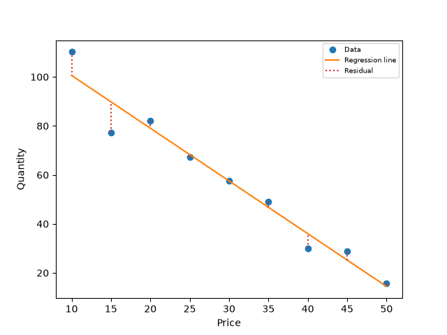
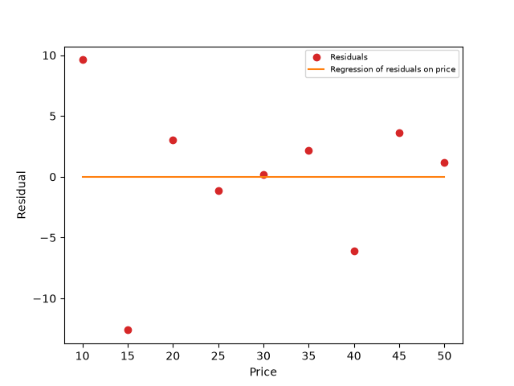

# 第 9 章: 行列と回帰分析

## 9.1 この章の地図

第 1 章では、需要曲線 q = 120 − 2p を、天下り的に与えました。実際の経済では、需要曲線は見えません。見えるのは、価格と数量の**データ**だけです。データは、直線の上にちょうど並びません。

この章では、データに「最も近い直線」を引く**最小 2 乗法**を、**行列**で書きます。行列を使うと、説明変数が 1 つ（単回帰）でも、2 つ以上（重回帰）でも、係数を同じ 1 行の式 β = (XᵀX)⁻¹Xᵀy で求められます。第 3 部（第 9〜12 章）の最初の章です。



| 項目 | 内容 |
| :--- | :--- |
| 経済学の題材 | 経済理論（需要関数）と経済データの照合、係数の推定、重回帰（価格と所得） |
| 数学 | 行列、行列の積・転置・単位行列、行列式（余因子展開）、逆行列、特異行列、最小 2 乗法、正規方程式、残差の直交、決定係数、射影（発展） |
| 使う Python の機能 | リストのリスト、内包表記、`enumerate`、`zip(*列)`（転置）、`math.prod`、テスト（`pytest`） |
| 新しく使う NumPy の道具 | `@`・`.T`・`np.linalg`（`det`・`inv`・`solve`・`lstsq`）・`np.random.default_rng` |
| 完成形 | `matrix_shape`、`matrix_transpose`、`matrix_product`、`identity_matrix`、`matrix_trace`、`matrix_determinant`、`is_singular_matrix`、`matrix_inverse`、`simple_regression_coefficients`、`regression_design_matrix`、`least_squares_beta`、`regression_fitted_values`、`regression_residuals`、`coefficient_of_determination`、`regression_projection_matrix`、`noisy_regression_sample` |
| ファイル | 実装: `lib/chapter09/matrix.py`（行列。標準ライブラリ）、`lib/chapter09/regression.py`（最小 2 乗法）、`lib/chapter09/plot.py`（図）／テスト: `test/chapter09/test_matrix.py`、`test/chapter09/test_regression.py`、`test/chapter09/test_plot.py` |
| データ | なし（手計算できる小さな例と、種を固定した乱数で作る架空のデータ） |

### 数学の式とコードの対応

| 経済学・数学 | 式 | コード |
| :--- | :--- | :--- |
| 行列の積 | (AB)ᵢⱼ = A の第 i 行 · B の第 j 列 | `matrix_product(a, b)` |
| 転置 | (Aᵀ)ᵢⱼ = Aⱼᵢ | `matrix_transpose(a)` |
| 行列式 | 2 行 2 列なら ad − bc。一般には余因子展開 | `matrix_determinant(a)` |
| 逆行列 | AA⁻¹ = A⁻¹A = I | `matrix_inverse(a)` |
| 特異の判定 | \|det A\| ÷ (行の長さの積) ≤ 10⁻¹² | `is_singular_matrix(a)` |
| 単回帰 | β₁ = Σ(x − x̄)(y − ȳ) ÷ Σ(x − x̄)²、β₀ = ȳ − β₁x̄ | `simple_regression_coefficients(xs, ys)` |
| 計画行列 | 各行が (1, x₁, x₂, …) | `regression_design_matrix(regressors)` |
| 正規方程式 | β = (XᵀX)⁻¹Xᵀy | `least_squares_beta(design, ys)` |
| 残差 | e = y − Xβ | `regression_residuals(design, ys, beta)` |
| 決定係数 | R² = 1 − e·e ÷ Σ(y − ȳ)² | `coefficient_of_determination(ys, residuals)` |
| 射影行列（発展） | P = X(XᵀX)⁻¹Xᵀ | `regression_projection_matrix(design)` |

> **記号について**: 行列を A・X のような大文字、ベクトルを β・y・e のような小文字で書きます。Aᵢⱼ は、A の第 i 行・第 j 列の成分です。コードでは、行列を「行のリスト」で表します。[[2, 1], [1, 3]] は、1 行目が (2, 1)、2 行目が (1, 3) の行列です。ベクトルは、第 7 章と同じく、ただのリストです。

### 前提とする章

| できること | 場所 |
| :--- | :--- |
| 内積・大きさ・平均を、リストで計算する（`vector_dot`・`vector_length`・`mean_by_dot`） | [第 7 章](07-vectors-and-budget-constraint.md) |
| 偏微分 = 0 の条件で、2 変数関数の最小の点を求める | [第 8 章](08-partial-derivatives-and-utility-maximization.md) |
| 需要関数 q = a − b·p を読む | [第 1 章](01-linear-functions-and-markets.md) |

回帰分析の**統計学**（係数の標準誤差・検定・信頼区間）は、この章では扱いません。[計量経済学のためのプログラミングの第 2 章](../econometrics-programming/02-simple-regression.md)（単回帰）と[第 3 章](../econometrics-programming/03-multiple-regression.md)（重回帰）で扱います。この章は、そこで使う数学（行列と最小 2 乗法）を、関数とテストで確かめます。

## 9.2 準備

```bash
cd apps/math-for-economics-programming/python
uv run pytest test/chapter09
```

```text
57 passed
```

自分でコードを書くときは、`practice/chapter09/` に、完成形と同じ名前のファイル（`matrix.py`・`regression.py`・`plot.py`・`test_matrix.py`・`test_regression.py`・`test_plot.py`）を作ります。図を後回しにするなら、`plot.py` と `test_plot.py` は要らず、テストは 48 件になります。

- テスト・`regression.py`・`plot.py`・check スクリプトの import を、`from practice.chapter09...` に書き換えます（`regression.py` は `matrix` を、`plot.py` は `regression` を import します。書き換えないと、完成形を動かします）
- 第 7 章の `vector_dot`・`vector_length`・`mean_by_dot` は、前の章を写していなければ、`lib.chapter07...` のままでかまいません（写したなら、`practice.chapter07...` に書き換えます）。この章では、それらの実装を再掲しません
- テストの import の一覧は、完成形の**全関数**です。まだ書いていない関数を import すると、`ImportError` になります。関数を 1 つ書くたびに、名前を import に足してください

「予想の答え合わせ」のスクリプトは、`practice/chapter09/check.py` に保存し、`uv run python -m practice.chapter09.check` で実行します。

## 9.3 予想する

次の 5 つの問いに、**紙で、手計算で**答えてください。答えは、この節には書いてありません。「プログラミング」の節の「予想の答え合わせ」で確かめます。

- 行列 A = [[2, 1], [1, 3]] の行列式と、逆行列は、何ですか。A に逆行列を掛けると、何になりますか
- 行列 [[1, 2], [2, 4]] の行列式は、いくつですか。逆行列は、ありますか
- 価格 p = 2・4・6・8・10 のとき、数量 q = 18・15・13・8・6 でした。q = β₀ + β₁p の直線を、最小 2 乗法で当てはめると、β₀・β₁ は、いくつですか。決定係数 R² は、いくつですか（小数第 3 位まで）
- 3 つ目の問いの直線で、残差 e = q − (β₀ + β₁p) を 5 つ求めます。残差の和と、価格と残差の内積 Σp·e は、いくつですか。また、4 点 (1, 3)・(2, 5)・(3, 7)・(4, 9) に直線を当てはめると、β₀・β₁ と R² は、いくつですか
- （発展）3 つ目の問いのデータで、射影行列 P = X(XᵀX)⁻¹Xᵀ（5 行 5 列）の対角成分の和（トレース）は、いくつですか。説明変数に所得を加えて 3 列の X にすると、どうなりますか。発展の節を飛ばす方は、この問いも、飛ばしてかまいません

## 9.4 行列と回帰分析の考え方

### 数とベクトルと行列

1 つの数を**スカラー**、数を 1 列に並べたものを**ベクトル**（第 7 章）、数を縦横の長方形に並べたものを**行列**と言います。m 行 n 列の行列を、**m × n 行列**と言います。

> A = [[a, b], [c, d]] は 2 × 2 行列。ベクトル (x₁, x₂, x₃) は、1 列に立てれば 3 × 1 行列

データの表は、行列です。観測（行）ごとに、変数（列）の値が並びます。

### 行列の積と転置

A（m × n）と B（n × k）の**積** AB は、m × k 行列で、(i, j) 成分は **A の第 i 行と B の第 j 列の内積**です。A の列の数と B の行の数が等しくないと、積は決まりません。

> [[1, 2], [3, 4]] × [[5, 6], [7, 8]] = [[1·5 + 2·7, 1·6 + 2·8], [3·5 + 4·7, 3·6 + 4·8]] = [[19, 22], [43, 50]]

数の掛け算と違い、**順番を入れ替えると、ふつう結果が変わります**（AB ≠ BA）。

**転置** Aᵀ は、行と列を入れ替えた行列です。(AB)ᵀ = BᵀAᵀ（順番が逆になる）が成り立ちます。**単位行列** I は、対角が 1・ほかが 0 の正方行列で、AI = IA = A です（数の 1 にあたる）。対角成分の和を、**トレース**と言います。

### 行列式と逆行列

正方行列 A に対して、AA⁻¹ = A⁻¹A = I となる行列 A⁻¹ を、**逆行列**と言います（数の逆数にあたる）。逆行列があるかどうかは、**行列式** det A で決まります。

> 2 × 2 行列: det [[a, b], [c, d]] = ad − bc、逆行列 = (1 ÷ (ad − bc)) × [[d, −b], [−c, a]]

例えば、[[4, 7], [2, 6]] は、det = 24 − 14 = 10、逆行列は [[0.6, −0.7], [−0.2, 0.4]] です。

3 × 3 以上は、**余因子展開**で計算します。1 行目の各成分 a₁ⱼ に、その行と列を取り除いた小さな行列の行列式を掛け、符号を + − + … と交互に付けて足します。

> det [[3, 1, 2], [0, 4, 1], [2, −1, 5]] = 3·det[[4, 1], [−1, 5]] − 1·det[[0, 1], [2, 5]] + 2·det[[0, 4], [2, −1]] = 3·21 − 1·(−2) + 2·(−8) = 49

符号付きの小さな行列式を**余因子**と言います。逆行列の (i, j) 成分は、**(j, i) の余因子 ÷ det A** です（添字が入れ替わることに注意）。

det A = 0 の行列を、**特異行列**と言い、逆行列はありません。ある行が、ほかの行の定数倍（や組み合わせ）になっているときです。数の世界の「0 で割れない」にあたります。

コンピューターでは、det A が「ちょうど 0」になるとは限りません。丸め誤差で 10⁻¹⁵ のような値が出ます。一方で、成分がすべて 10⁻⁸ の行列は、det が 10⁻¹⁶ でも特異ではありません。そこで、**行列の大きさに対する相対的な基準**で判定します。|det A| は、行の長さ（第 7 章の `vector_length`）の積を超えません（アダマールの不等式）。その比が 10⁻¹² 以下なら、特異とみなします。

### 経済理論と経済データ

需要の理論は、「価格が上がると、数量が減る」と言います。1 次関数で書くと、q = β₀ + β₁p（β₁ < 0）です。係数 β₀・β₁ を、理論は教えてくれません。データから推し量ります（**推定**）。

ところが、データは直線にちょうど乗りません。価格以外の要因（天候・好み・測定の誤差）が、数量を動かすからです。各観測 i について、

> qᵢ = β₀ + β₁pᵢ + eᵢ

と書き、直線からのずれ eᵢ を**残差**と言います。

### 理論とデータの照合: 最小 2 乗法

「最も近い直線」を、**残差の 2 乗の和 S = Σeᵢ² が最小の直線**と決めます。これが**最小 2 乗法**です。2 乗するのは、正と負の残差が打ち消し合わないようにするためです。

S(β₀, β₁) = Σ(qᵢ − β₀ − β₁pᵢ)² は、β₀・β₁ の 2 変数の 2 次関数です。最小の点では、第 8 章と同じく、**偏微分が 0** です。

> ∂S/∂β₀ = −2Σ(qᵢ − β₀ − β₁pᵢ) = 0、∂S/∂β₁ = −2Σpᵢ(qᵢ − β₀ − β₁pᵢ) = 0

この 2 つの式を、**正規方程式**と言います。解くと、

> β₁ = Σ(p − p̄)(q − q̄) ÷ Σ(p − p̄)²（共分散 ÷ 分散）、β₀ = q̄ − β₁p̄

です。p̄・q̄ は平均です。β₀ の式から、**回帰直線は、平均の点 (p̄, q̄) を通ります**。p がすべて同じ値だと、分母 Σ(p − p̄)² が 0 で、傾きは決まりません。

### 行列演算による最小 2 乗法

データを行列で書きます。1 の列と価格の列を並べた行列 X を、**計画行列**と言います。

> X = [[1, p₁], [1, p₂], …, [1, pₙ]]、β = (β₀, β₁)、y = (q₁, …, qₙ)

すると、当てはめた値は ŷ = Xβ、残差は e = y − Xβ です。2 つの正規方程式は、まとめて

> XᵀXβ = Xᵀy、したがって **β = (XᵀX)⁻¹Xᵀy**

と書けます。XᵀX は 2 × 2 行列です。説明変数を所得 m にも増やすと（**重回帰** q = β₀ + β₁p + β₂m）、X に m の列を足すだけで、XᵀX が 3 × 3 行列になり、**同じ式**で β が求まります。

### 行列演算の理解と解釈

正規方程式 XᵀXβ = Xᵀy を移項すると、**Xᵀ(y − Xβ) = Xᵀe = 0** です。Xᵀe の各成分は、X の各列と残差 e の内積なので、

- 1 の列との内積 0: **残差の和は 0**
- 価格の列との内積 0: **残差は、価格と直交する**（第 7 章の意味で）

です。残差に、価格で説明できる部分が残っていない、ということです。

当てはまりの良さは、**決定係数**で測ります。

> R² = 1 − (残差の 2 乗和 e·e) ÷ (y の平均からの偏差の 2 乗和)

y の変動のうち、直線で説明できた割合です。データが直線にちょうど乗れば 1、価格と関係がなければ 0 に近くなります（定数項を入れた最小 2 乗法では、0 と 1 の間です）。y がすべて同じ値だと、分母が 0 で、決まりません。

### より進んだ行列演算: XᵀX が特異になるとき

XᵀX の逆行列がないと、β は決まりません。代表的な場合は、次の 3 つです。

| 場合 | 理由 |
| :--- | :--- |
| 価格が、すべて同じ値 | 価格の列が、1 の列の定数倍 |
| 所得が、価格の定数倍（m = 3p など） | 列どうしが比例する（**多重共線性**） |
| データの数が、係数の数より少ない | 方程式が足りない |

経済データでは、所得と価格が同時に上がるなど、列どうしが「ほぼ」比例することがよくあります。行列式が 0 に近いと、逆行列の成分が非常に大きくなり、β が少しのデータの違いで大きく動きます。

??? note "発展: 最小 2 乗法の図形的意味"

    データ y（n 個の数）を、n 次元の空間の 1 点（ベクトル）とみます。X の列（1 の列と価格の列）を、β₀ 倍・β₁ 倍して足したもの Xβ は、X の列が張る平面（n 次元の中の 2 次元の平面）の上を動きます。

    最小 2 乗法は、この平面の上で、y に**最も近い点** ŷ = Xβ を探すことです。最も近い点は、y から平面に下ろした垂線の足です。垂線 e = y − ŷ は、平面と直交するので、平面を張る X の各列と直交します（Xᵀe = 0）。これが、正規方程式の図形的な意味です。

    y を ŷ に移す行列 **P = X(XᵀX)⁻¹Xᵀ** を、**射影行列**と言います（ŷ = Py）。射影したものをもう一度射影しても変わらないので、**PP = P** です。P は対称（Pᵀ = P）で、トレースは X の列の数（係数の数）に等しくなります。ŷ と e も直交します（ŷ·e = 0）。この直交から、三平方の定理 y·y = ŷ·ŷ + e·e が成り立ち、決定係数の分解（全変動 ＝ 説明された変動 ＋ 残差の変動）につながります。

## 9.5 プログラミング

### Red: 行列の積のテスト

`test_matrix.py` の先頭の import です（完成形の全関数）。`_array` は、テストの補助です。`pytest.approx` は、入れ子のリスト（行列）を比べられないので、NumPy の配列にして比べます。

```python
import numpy as np
import pytest
from numpy.typing import NDArray

from lib.chapter09.matrix import (
    Matrix,
    identity_matrix,
    is_singular_matrix,
    matrix_determinant,
    matrix_inverse,
    matrix_product,
    matrix_shape,
    matrix_trace,
    matrix_transpose,
)
```

```python
def _array(a: Matrix) -> NDArray[np.float64]:
    """pytest.approx は入れ子のリストを比べられないので、配列にして比べる。"""
    return np.array(a, dtype=np.float64)


def test_行列の積は行と列の内積を並べる() -> None:
    a = [[1, 2], [3, 4]]
    b = [[5, 6], [7, 8]]
    assert matrix_product(a, b) == [[19, 22], [43, 50]]


def test_行列の積は順番を入れ替えると変わる() -> None:
    a = [[1, 2], [3, 4]]
    b = [[0, 1], [1, 0]]
    assert matrix_product(a, b) == [[2, 1], [4, 3]]
    assert matrix_product(b, a) == [[3, 4], [1, 2]]


def test_転置は行と列を入れ替える() -> None:
    assert matrix_transpose([[1, 2, 3], [4, 5, 6]]) == [[1, 4], [2, 5], [3, 6]]
```

`lib.chapter09.matrix` がないので、収集の時点で失敗します（**Red**）。

### Green: 積と転置を、リストのリストで

`matrix.py` の先頭の import です。第 7 章の `vector_dot`（内積）と `vector_length`（大きさ）を使います（実装は、[第 7 章](07-vectors-and-budget-constraint.md)を見てください）。

```python
import math
from collections.abc import Sequence

from lib.chapter07.vectors import vector_dot, vector_length
```

```python
Matrix = Sequence[Sequence[float]]


def matrix_shape(a: Matrix) -> tuple[int, int]:
    """行列の形（行の数, 列の数）。空の行列や、長さのそろわない行は、行列でない。"""
    if not a or not a[0]:
        raise ValueError("行列は、1 行 1 列以上でなければなりません")
    columns = len(a[0])
    if any(len(row) != columns for row in a):
        raise ValueError("行列の行は、すべて同じ長さでなければなりません")
    return len(a), columns


def matrix_transpose(a: Matrix) -> list[list[float]]:
    """転置（行と列を入れ替える）。"""
    _, columns = matrix_shape(a)
    return [[row[j] for row in a] for j in range(columns)]


def matrix_product(a: Matrix, b: Matrix) -> list[list[float]]:
    """行列の積 AB。(i, j) 成分は、A の第 i 行と B の第 j 列の内積。"""
    if matrix_shape(a)[1] != matrix_shape(b)[0]:
        raise ValueError("A の列の数と、B の行の数が、等しくなければなりません")
    b_columns = matrix_transpose(b)
    return [[vector_dot(row, column) for column in b_columns] for row in a]
```

- `Matrix` は、「数の並びの並び」という型の別名です。リストのリストも、タプルのリストも、受け取れます
- 積の (i, j) 成分は、A の第 i 行と B の第 j 列の内積です。B を転置すると、B の列が、行として取り出せます。内積は、第 7 章の `vector_dot` をそのまま使います
- 最初のテストを書いたとき、`pytest.approx([[0], [4.5]])` と書いて `TypeError`（入れ子は比べられない）が出ました。テストの補助 `_array` は、そのために足しました

### 行列式と逆行列

```python
def test_2行2列の行列式はadからbcを引く() -> None:
    assert matrix_determinant([[2, 1], [1, 3]]) == 5
    assert matrix_determinant([[4, 7], [2, 6]]) == 10


def test_3行3列の行列式は1行目で余因子展開する() -> None:
    a = [[3, 1, 2], [0, 4, 1], [2, -1, 5]]
    # 3(20 + 1) − 1(0 − 2) + 2(0 − 8) = 63 + 2 − 16
    assert matrix_determinant(a) == 49


def test_2行2列の逆行列() -> None:
    inverse = matrix_inverse([[2, 1], [1, 3]])
    assert _array(inverse) == pytest.approx(_array([[0.6, -0.2], [-0.2, 0.4]]))


def test_逆行列を掛けると単位行列になる() -> None:
    for a in ([[4, 7], [2, 6]], [[3, 1, 2], [0, 4, 1], [2, -1, 5]]):
        n = len(a)
        inverse = matrix_inverse(a)
        assert _array(matrix_product(a, inverse)) == pytest.approx(
            _array(identity_matrix(n))
        )
        assert _array(matrix_product(inverse, a)) == pytest.approx(
            _array(identity_matrix(n))
        )


def test_行列式が0の行列は特異で逆行列がない() -> None:
    # 2 行目は 1 行目の 2 倍。3 行 3 列では、3 行目が 1 行目と 2 行目の和
    for singular in ([[1, 2], [2, 4]], [[2, 0, 1], [1, 3, 2], [3, 3, 3]]):
        assert matrix_determinant(singular) == 0
        assert is_singular_matrix(singular)
        with pytest.raises(ValueError):
            matrix_inverse(singular)
```

```python
def identity_matrix(size: int) -> list[list[float]]:
    """n 行 n 列の単位行列（対角が 1、ほかが 0）。"""
    return [[1 if i == j else 0 for j in range(size)] for i in range(size)]


def _square_size(a: Matrix) -> int:
    """正方行列の大きさ。正方でなければ、エラー。"""
    rows, columns = matrix_shape(a)
    if rows != columns:
        raise ValueError("正方行列（行と列の数が等しい）でなければなりません")
    return rows


def matrix_trace(a: Matrix) -> float:
    """トレース（対角成分の和）。"""
    return sum(a[i][i] for i in range(_square_size(a)))


def _minor(a: Matrix, row: int, column: int) -> list[list[float]]:
    """第 row 行と第 column 列を取り除いた行列。"""
    return [
        [x for j, x in enumerate(r) if j != column] for i, r in enumerate(a) if i != row
    ]


def _cofactor(a: Matrix, row: int, column: int) -> float:
    """余因子 (−1)^(row + column) × (第 row 行と第 column 列を除いた行列式)。"""
    sign = 1 if (row + column) % 2 == 0 else -1
    return sign * matrix_determinant(_minor(a, row, column))


def matrix_determinant(a: Matrix) -> float:
    """行列式。1 行目で余因子展開する（2 行 2 列なら ad − bc）。"""
    size = _square_size(a)
    if size == 1:
        return a[0][0]
    return sum(a[0][j] * _cofactor(a, 0, j) for j in range(size))


def is_singular_matrix(a: Matrix, tolerance: float = 1e-12) -> bool:
    """行列式が、行の長さの積に比べて 0 とみなせるほど小さいか（相対的な判定）。

    |det A| は、行の長さの積を超えない（アダマールの不等式）。
    その比が tolerance 以下なら、特異とみなす。
    """
    _square_size(a)
    scale = math.prod(vector_length(row) for row in a)
    return abs(matrix_determinant(a)) <= tolerance * scale


def matrix_inverse(a: Matrix) -> list[list[float]]:
    """逆行列 A⁻¹ = 余因子行列の転置 ÷ 行列式。特異なら、エラー。"""
    size = _square_size(a)
    if is_singular_matrix(a):
        raise ValueError("特異な行列（行列式が 0）には、逆行列がありません")
    det = matrix_determinant(a)
    if size == 1:
        return [[1 / det]]
    # (i, j) 成分は、(j, i) の余因子（余因子行列の転置）
    return [[_cofactor(a, j, i) / det for j in range(size)] for i in range(size)]
```

- 行列式は、1 行目で余因子展開し、小さな行列の行列式を、同じ関数で求めます（**再帰**）。1 × 1 まで小さくなったら、その成分を返します
- 最初は、余因子の符号を `(-1) ** (i + j)` と書きました。mypy が「戻り値が `Any`」と指摘しました（整数の負の累乗は、小数になり得るため）。偶奇で `1` か `-1` を選ぶ `_cofactor` に括り出し、行列式と逆行列で使い回しました
- 逆行列の (i, j) 成分は、`_cofactor(a, j, i)`（添字が逆）です。2 × 2 だけのテストでは、対称な行列 [[2, 1], [1, 3]] だと、添字を取り違えても気づきません。対称でない [[4, 7], [2, 6]] と 3 × 3 でも、AA⁻¹ = I を確かめます
- 3 × 3 の特異行列 [[2, 0, 1], [1, 3, 2], [3, 3, 3]] は、3 行目が 1 行目と 2 行目の和です

### NumPy の行列の道具

自作の行列を、NumPy と突き合わせます。この章で新しく使う道具は、次のとおりです（配列 `np.array`・`dtype`・`.tolist()` は、第 7 章で導入しました）。

| 道具 | 意味 |
| :--- | :--- |
| `a @ b` | 配列どうしの**行列の積**（`a * b` は、成分ごとの積） |
| `a.T` | 転置 |
| `np.linalg.det(a)` | 行列式。LU 分解という方法で計算するので、整数の行列でも、末尾に丸め誤差が出る（[[2, 1], [1, 3]] で 5.000000000000001） |
| `np.linalg.inv(a)` | 逆行列。特異なら `np.linalg.LinAlgError`（`ValueError` の一種）を出す |
| `np.linalg.solve(a, b)` | 連立方程式 Ax = b の解。逆行列を作らずに解くので、速く、誤差も小さい |
| `np.linalg.lstsq(x, y, rcond=None)` | 最小 2 乗法の係数。戻り値は 4 つ組（係数・残差の 2 乗和・階数・特異値）で、最初だけを使う。`rcond=None` は、小さい特異値を 0 とみなす基準を、既定（機械精度 × 行列の大きさ）にする指定 |
| `np.random.default_rng(種)` | 種を固定した乱数の生成器（同じ種なら、同じ乱数が出る） |
| `rng.normal(平均, 標準偏差, size=n)` | 正規分布の乱数を n 個、配列で返す |
| `pytest.approx(配列)` | 配列どうしを、成分ごとに、近似で比べる |

```python
def test_自作の積と転置はNumPyと一致する() -> None:
    a: Matrix = [[1.5, -2, 0.25], [3, 0, -1]]
    b: Matrix = [[2, 1], [-0.5, 4], [1, 0.1]]
    expected = np.array(a) @ np.array(b)
    assert _array(matrix_product(a, b)) == pytest.approx(expected)
    assert matrix_transpose(a) == np.array(a).T.tolist()


def test_自作の行列式と逆行列はNumPyと一致する() -> None:
    a = [[3, 1, 2], [0, 4, 1], [2, -1, 5]]
    assert matrix_determinant(a) == pytest.approx(np.linalg.det(np.array(a)))
    assert _array(matrix_inverse(a)) == pytest.approx(np.linalg.inv(np.array(a)))
```

この 2 つは、新しい関数なしで通ります。

### 特異の判定は、相対的に

```python
def test_成分が小さくても行の長さに比べて行列式が大きければ特異でない() -> None:
    tiny = [[1e-8, 0], [0, 1e-8]]
    # 行列式 1e-16 は、絶対値で 0 と比べると「0 とみなせる」が、成分の大きさに比べれば大きい
    assert matrix_determinant(tiny) == pytest.approx(1e-16)
    assert not is_singular_matrix(tiny)
    assert _array(matrix_inverse(tiny)) == pytest.approx(_array([[1e8, 0], [0, 1e8]]))


def test_ほぼ比例する行は丸め誤差の範囲で特異とみなす() -> None:
    nearly: Matrix = [[1, 2], [2, 4 + 1e-15]]
    assert matrix_determinant(nearly) != 0
    assert is_singular_matrix(nearly)
    assert not is_singular_matrix([[1, 2], [2, 4.001]])
```

- 1 つ目は、「det A の絶対値が 10⁻¹² 以下なら特異」という**絶対的な**基準では、特異と誤判定する例です。行の長さの積 10⁻¹⁶ と比べれば、比は 1 で、特異ではありません
- 2 つ目の 4 + 10⁻¹⁵ は、浮動小数点では 4.000000000000001 です。det は 0 でなく約 8.9 × 10⁻¹⁶ ですが、行の長さの積（約 10）との比は約 8.9 × 10⁻¹⁷ で、特異とみなします。この行列の逆行列を計算すると、成分が 10¹⁵ 程度の、意味のない値になります

### Red: 単回帰のテスト

`test_regression.py` の先頭の import と、テストで使うデータです。

```python
import numpy as np
import pytest

from lib.chapter07.vectors import vector_dot
from lib.chapter09.matrix import (
    matrix_product,
    matrix_trace,
    matrix_transpose,
)
from lib.chapter09.regression import (
    coefficient_of_determination,
    least_squares_beta,
    noisy_regression_sample,
    regression_design_matrix,
    regression_fitted_values,
    regression_projection_matrix,
    regression_residuals,
    simple_regression_coefficients,
)
```

```python
PRICES = [2, 4, 6, 8, 10]


QUANTITIES = [18, 15, 13, 8, 6]
```

最初のテストは、単回帰の公式です。手計算の途中の値を、コメントに残します。

```python
def test_単回帰の傾きは共分散を分散で割る() -> None:
    # 偏差の積の和 −62 ÷ 偏差の2乗の和 40 = −1.55、切片 12 + 1.55 × 6 = 21.3
    intercept, slope = simple_regression_coefficients(PRICES, QUANTITIES)
    assert slope == pytest.approx(-1.55)
    assert intercept == pytest.approx(21.3)
```

### Green: 単回帰の公式

`regression.py` の先頭の import です。第 7 章の `mean_by_dot`（平均）と `vector_dot` を使います。

```python
from collections.abc import Sequence

import numpy as np

from lib.chapter07.vectors import mean_by_dot, vector_dot
from lib.chapter09.matrix import (
    Matrix,
    matrix_inverse,
    matrix_product,
    matrix_transpose,
)
```

```python
def simple_regression_coefficients(
    xs: Sequence[float], ys: Sequence[float]
) -> tuple[float, float]:
    """単回帰 y = β₀ + β₁x の係数。β₁ = x と y の共分散 ÷ x の分散、β₀ = ȳ − β₁x̄。"""
    if len(xs) < 2:
        raise ValueError("回帰には、2 点以上のデータが要ります")
    x_bar, y_bar = mean_by_dot(xs), mean_by_dot(ys)
    dx = [x - x_bar for x in xs]
    dy = [y - y_bar for y in ys]
    sxx = vector_dot(dx, dx)
    if sxx == 0:
        raise ValueError("x がすべて同じ値では、傾きが決まりません")
    slope = vector_dot(dx, dy) / sxx
    return y_bar - slope * x_bar, slope
```

偏差のベクトル dx・dy を作り、内積で、共分散と分散（の n 倍）を求めます。n で割る前の値どうしの比なので、n は消えます。

### 正規方程式で、行列の 1 行に

```python
def test_計画行列は1の列と説明変数の列を並べる() -> None:
    assert regression_design_matrix([[2, 4, 6]]) == [[1, 2], [1, 4], [1, 6]]
    assert regression_design_matrix([[2, 4], [20, 10]]) == [[1, 2, 20], [1, 4, 10]]


def test_正規方程式の係数は単回帰の公式と一致する() -> None:
    design = regression_design_matrix([PRICES])
    beta = least_squares_beta(design, QUANTITIES)
    assert beta == pytest.approx(simple_regression_coefficients(PRICES, QUANTITIES))
    assert beta == pytest.approx([21.3, -1.55])


def test_直線にちょうど乗る4点では係数がその直線になる() -> None:
    design = regression_design_matrix([[1, 2, 3, 4]])
    ys = [3, 5, 7, 9]
    beta = least_squares_beta(design, ys)
    assert beta == pytest.approx([1, 2])
    residuals = regression_residuals(design, ys, beta)
    assert residuals == pytest.approx([0, 0, 0, 0], abs=1e-9)
    assert coefficient_of_determination(ys, residuals) == pytest.approx(1)
```

```python
def _matrix_times_vector(a: Matrix, v: Sequence[float]) -> list[float]:
    """行列とベクトルの積 Av（各行と v の内積）。"""
    return [vector_dot(row, v) for row in a]


def regression_design_matrix(
    regressors: Sequence[Sequence[float]],
) -> list[list[float]]:
    """計画行列 X。各行は (1, x₁, x₂, …)。regressors は、説明変数ごとの列のリスト。"""
    return [[1, *row] for row in zip(*regressors, strict=True)]


def least_squares_beta(design: Matrix, ys: Sequence[float]) -> list[float]:
    """正規方程式 XᵀXβ = Xᵀy の解 β = (XᵀX)⁻¹Xᵀy。"""
    xt = matrix_transpose(design)
    return _matrix_times_vector(
        matrix_inverse(matrix_product(xt, design)), _matrix_times_vector(xt, ys)
    )
```

- `zip(*regressors)` は、説明変数の列のリストを、観測ごとの行に組み替えます（転置）。各行の先頭に 1 を付けて、計画行列にします
- `least_squares_beta` は、正規方程式 β = (XᵀX)⁻¹Xᵀy を、この章の行列の関数で、そのまま書いたものです。2 つ目のテストで、**単回帰の公式と、行列の正規方程式の 2 つの答え**を突き合わせます

### 残差・決定係数・直交

```python
def test_当てはめた値と残差() -> None:
    design = regression_design_matrix([PRICES])
    beta = [21.3, -1.55]
    fitted = regression_fitted_values(design, beta)
    assert fitted == pytest.approx([18.2, 15.1, 12, 8.9, 5.8])
    residuals = regression_residuals(design, QUANTITIES, beta)
    assert residuals == pytest.approx([-0.2, -0.1, 1, -0.9, 0.2])


def test_決定係数は1から残差の2乗和と全変動の比を引く() -> None:
    design = regression_design_matrix([PRICES])
    beta = least_squares_beta(design, QUANTITIES)
    residuals = regression_residuals(design, QUANTITIES, beta)
    # 残差の2乗和 1.9、平均 12 からの偏差の2乗和 98
    assert coefficient_of_determination(QUANTITIES, residuals) == pytest.approx(
        1 - 1.9 / 98
    )


def test_残差は説明変数の列と直交する() -> None:
    design = regression_design_matrix([PRICES])
    beta = least_squares_beta(design, QUANTITIES)
    residuals = regression_residuals(design, QUANTITIES, beta)
    for column in matrix_transpose(design):
        assert vector_dot(column, residuals) == pytest.approx(0, abs=1e-9)
```

```python
def regression_fitted_values(design: Matrix, beta: Sequence[float]) -> list[float]:
    """当てはめた値 ŷ = Xβ。"""
    return _matrix_times_vector(design, beta)


def regression_residuals(
    design: Matrix, ys: Sequence[float], beta: Sequence[float]
) -> list[float]:
    """残差 e = y − Xβ。"""
    fitted = regression_fitted_values(design, beta)
    return [y - f for y, f in zip(ys, fitted, strict=True)]


def coefficient_of_determination(
    ys: Sequence[float], residuals: Sequence[float]
) -> float:
    """決定係数 R² = 1 − e·e ÷ (y − ȳ)·(y − ȳ)。"""
    y_bar = mean_by_dot(ys)
    deviations = [y - y_bar for y in ys]
    total = vector_dot(deviations, deviations)
    if total == 0:
        raise ValueError("y がすべて同じ値では、決定係数が決まりません")
    return 1 - vector_dot(residuals, residuals) / total
```

3 つ目のテストは、Xᵀe = 0（X の各列と残差の内積が 0）を、浮動小数点の許容誤差 10⁻⁹ で確かめます。

### 重回帰: 説明変数が 2 つ

価格に加えて、所得 m で数量を説明します。XᵀX は 3 × 3 行列になりますが、`least_squares_beta` は、そのまま使えます。

```python
def test_説明変数が2つの重回帰はちょうど乗るデータの係数を当てる() -> None:
    incomes = [20, 10, 40, 30, 50]
    quantities = [30 - 2 * p + 0.5 * m for p, m in zip(PRICES, incomes, strict=True)]
    design = regression_design_matrix([PRICES, incomes])
    assert least_squares_beta(design, quantities) == pytest.approx([30, -2, 0.5])


def test_ノイズ入りの重回帰はNumPyの最小2乗法と一致する() -> None:
    incomes = [20, 10, 40, 30, 50, 25, 35, 15]
    prices = [2, 4, 6, 8, 10, 3, 7, 9]
    design = regression_design_matrix([prices, incomes])
    ys = noisy_regression_sample(design, [30, -2, 0.5], 0.5, seed=9)
    beta = least_squares_beta(design, ys)
    x = np.array(design, dtype=np.float64)
    expected, *_ = np.linalg.lstsq(x, np.array(ys), rcond=None)
    assert beta == pytest.approx(expected.tolist())
    assert beta == pytest.approx(np.linalg.solve(x.T @ x, x.T @ np.array(ys)).tolist())
    residuals = regression_residuals(design, ys, beta)
    for column in matrix_transpose(design):
        assert vector_dot(column, residuals) == pytest.approx(0, abs=1e-9)


def test_説明変数が比例していると重回帰の係数は決まらない() -> None:
    incomes = [3 * p for p in PRICES]
    design = regression_design_matrix([PRICES, incomes])
    with pytest.raises(ValueError):
        least_squares_beta(design, QUANTITIES)
```

```python
def noisy_regression_sample(
    design: Matrix, beta: Sequence[float], noise_sd: float, seed: int
) -> list[float]:
    """y = Xβ + 誤差（平均 0・標準偏差 noise_sd の正規分布。種 seed で固定）。"""
    if noise_sd < 0:
        raise ValueError("誤差の標準偏差は、0 以上でなければなりません")
    rng = np.random.default_rng(seed)
    noise = rng.normal(0, noise_sd, size=len(design))
    fitted = regression_fitted_values(design, beta)
    return [float(f + e) for f, e in zip(fitted, noise, strict=True)]
```

- 2 つ目のテストは、架空のデータ y = 30 − 2p + 0.5m + 誤差 を、`noisy_regression_sample` で作ります。誤差は、平均 0・標準偏差 0.5 の正規分布で、種 9 で固定します。自作の β が、`np.linalg.lstsq`・`np.linalg.solve` と一致し、残差が X の 3 つの列と直交することを確かめます
- 3 つ目は、所得が価格の 3 倍（多重共線性）で、XᵀX が特異になり、`matrix_inverse` が `ValueError` を出すことを確かめます

### 発展: 射影行列

??? note "射影行列のテストと実装（発展。後回しにしても、学習は成り立ちます）"

    `test_regression.py` に足すテストです。

    ```python
    def test_射影行列を掛けると当てはめた値になる() -> None:
        design = regression_design_matrix([PRICES])
        projection = regression_projection_matrix(design)
        fitted = [vector_dot(row, QUANTITIES) for row in projection]
        assert fitted == pytest.approx([18.2, 15.1, 12, 8.9, 5.8])


    def test_射影行列は2回掛けても同じで対称でトレースは係数の数() -> None:
        incomes = [20, 10, 40, 30, 50]
        for design in (
            regression_design_matrix([PRICES]),
            regression_design_matrix([PRICES, incomes]),
        ):
            projection = np.array(regression_projection_matrix(design))
            twice = np.array(matrix_product(projection.tolist(), projection.tolist()))
            assert twice == pytest.approx(projection)
            assert projection.T == pytest.approx(projection)
            assert matrix_trace(projection.tolist()) == pytest.approx(len(design[0]))


    def test_当てはめた値と残差は直交する() -> None:
        design = regression_design_matrix([PRICES])
        beta = least_squares_beta(design, QUANTITIES)
        fitted = regression_fitted_values(design, beta)
        residuals = regression_residuals(design, QUANTITIES, beta)
        assert vector_dot(fitted, residuals) == pytest.approx(0, abs=1e-9)
    ```

    `regression.py` に足す実装です。

    ```python
    def regression_projection_matrix(design: Matrix) -> list[list[float]]:
        """射影行列 P = X(XᵀX)⁻¹Xᵀ。y に掛けると、当てはめた値 ŷ = Py になる。"""
        xt = matrix_transpose(design)
        return matrix_product(
            matrix_product(design, matrix_inverse(matrix_product(xt, design))), xt
        )
    ```

    5 行 5 列の P を、y に掛けると、当てはめた値 ŷ になります。2 つ目のテストは、PP = P・Pᵀ = P・トレース ＝ 列の数 を、単回帰（2 列）と重回帰（3 列）で確かめます。

### 予想の答え合わせ

```python
from lib.chapter07.vectors import vector_dot
from lib.chapter09.matrix import (
    is_singular_matrix,
    matrix_determinant,
    matrix_inverse,
    matrix_product,
    matrix_trace,
)
from lib.chapter09.regression import (
    coefficient_of_determination,
    least_squares_beta,
    regression_design_matrix,
    regression_projection_matrix,
    regression_residuals,
)

a = [[2, 1], [1, 3]]
print(matrix_determinant(a), matrix_inverse(a))
print(matrix_product(a, matrix_inverse(a)))
print(matrix_determinant([[1, 2], [2, 4]]), is_singular_matrix([[1, 2], [2, 4]]))

prices = [2, 4, 6, 8, 10]
quantities = [18, 15, 13, 8, 6]
design = regression_design_matrix([prices])
beta = least_squares_beta(design, quantities)
residuals = regression_residuals(design, quantities, beta)
print([round(b, 6) for b in beta])
print(round(coefficient_of_determination(quantities, residuals), 6))
print([round(e, 6) + 0.0 for e in residuals])
print(round(sum(residuals), 6) + 0.0, round(vector_dot(prices, residuals), 6) + 0.0)

line = regression_design_matrix([[1, 2, 3, 4]])
beta_line = least_squares_beta(line, [3, 5, 7, 9])
residuals_line = regression_residuals(line, [3, 5, 7, 9], beta_line)
print(beta_line, coefficient_of_determination([3, 5, 7, 9], residuals_line))

print(round(matrix_trace(regression_projection_matrix(design)), 6))
with_income = regression_design_matrix([prices, [20, 10, 40, 30, 50]])
print(round(matrix_trace(regression_projection_matrix(with_income)), 6))
```

```text
5 [[0.6, -0.2], [-0.2, 0.4]]
[[1.0, 0.0], [-1.1102230246251565e-16, 1.0000000000000002]]
0 True
[21.3, -1.55]
0.980612
[-0.2, -0.1, 1.0, -0.9, 0.2]
0.0 0.0
[1.0, 2.0] 1.0
2.0
3.0
```

- **1 つ目の問い**: det A = 2·3 − 1·1 = 5、逆行列は (1 ÷ 5)·[[3, −1], [−1, 2]] = [[0.6, −0.2], [−0.2, 0.4]] です。AA⁻¹ は単位行列 [[1, 0], [0, 1]] ですが、2 行目に 1.1 × 10⁻¹⁶ ほどの丸め誤差が出ています。0.6 や 0.2 が 2 進数で割り切れないためで、テストを `pytest.approx` で書く理由です
- **2 つ目の問い**: det = 1·4 − 2·2 = 0 で、特異です。2 行目が 1 行目の 2 倍なので、逆行列はありません
- **3 つ目の問い**: p̄ = 6、q̄ = 12、偏差の積の和は −62、p の偏差の 2 乗和は 40 なので、β₁ = −62 ÷ 40 = −1.55、β₀ = 12 + 1.55 × 6 = 21.3 です。残差の 2 乗和は 1.9、q の偏差の 2 乗和は 98 なので、R² = 1 − 1.9 ÷ 98 ≈ 0.981 です
- **4 つ目の問い**: 残差は (−0.2, −0.1, 1, −0.9, 0.2) で、和も、価格との内積も 0 です（Xᵀe = 0）。4 点は直線 y = 1 + 2x にちょうど乗るので、β = (1, 2)、残差はすべて 0 で、R² = 1 です。`round(..., 6) + 0.0` の `+ 0.0` は、丸めで出る `-0.0`（負の 0）を `0.0` にするためです
- **5 つ目の問い**（発展）: トレースは係数の数で、単回帰は 2、所得を加えると 3 です

### 境界のテスト

完成形には、本文に載せなかったテストがあります。行列の形、2 × 3 と 3 × 1 の積、積の転置、単位行列、トレース、0 < 成分 の小さい値・大きい値の特異、0 の行、1 × 1、空・長さのそろわない行、形の合わない積、正方でない行列、特異の閾値と、回帰の 2 点だけ、負や 0 < x < 1 の x、x と関係のないデータ（R² = 0）、誤差 0・種・負の標準偏差・誤差の中身、1 点・x がすべて同じ、データが係数より少ない、長さの違い、y がすべて同じ、です。テストの件数を合わせるため、ここに全件載せます。

??? note "境界のテスト"

    `test_matrix.py` に足すテストです。

    ```python
    def test_2行3列の行列の形() -> None:
        assert matrix_shape([[1, 2, 3], [4, 5, 6]]) == (2, 3)


    def test_2行3列と3行1列の積は2行1列() -> None:
        a = [[1, 2, 3], [4, 5, 6]]
        b: Matrix = [[2], [0.5], [-1]]
        assert _array(matrix_product(a, b)) == pytest.approx(_array([[0], [4.5]]))


    def test_積の転置は転置の積を逆順にしたもの() -> None:
        a = [[1, 2, 3], [4, 5, 6]]
        b: Matrix = [[2, -1], [0.5, 3], [1, 0]]
        left = matrix_transpose(matrix_product(a, b))
        right = matrix_product(matrix_transpose(b), matrix_transpose(a))
        assert _array(left) == pytest.approx(_array(right))


    def test_単位行列は掛けても変わらない() -> None:
        a = [[3, 1, 2], [0, 4, 1], [2, -1, 5]]
        assert identity_matrix(3) == [[1, 0, 0], [0, 1, 0], [0, 0, 1]]
        assert matrix_product(a, identity_matrix(3)) == a
        assert matrix_product(identity_matrix(3), a) == a


    def test_トレースは対角成分の和() -> None:
        assert matrix_trace([[3, 1, 2], [0, 4, 1], [2, -1, 5]]) == 12


    def test_成分が大きくても行が比例していれば特異() -> None:
        assert is_singular_matrix([[1e12, 2e12], [2e12, 4e12]])


    def test_0の行がある行列は特異() -> None:
        assert is_singular_matrix([[0, 0], [1, 2]])


    def test_1行1列の行列式と逆行列() -> None:
        assert matrix_determinant([[4]]) == 4
        assert matrix_inverse([[4]]) == [[0.25]]


    def test_空の行列や長さのそろわない行は行列でない() -> None:
        bad_matrices: list[Matrix] = [[], [[]], [[1, 2], [3]]]
        for bad in bad_matrices:
            with pytest.raises(ValueError):
                matrix_shape(bad)


    def test_列と行の数が合わない積は決まらない() -> None:
        with pytest.raises(ValueError):
            matrix_product([[1, 2, 3], [4, 5, 6]], [[1, 2], [3, 4]])


    def test_正方でない行列には行列式もトレースも逆行列もない() -> None:
        a = [[1, 2, 3], [4, 5, 6]]
        for func in (matrix_determinant, matrix_trace, matrix_inverse, is_singular_matrix):
            with pytest.raises(ValueError):
                func(a)


    def test_特異の閾値は行の長さの積の1兆分の1() -> None:
        # [[1, 1], [1, 1 + d]] の行列式は d、行の長さの積は約 2。比は約 d ÷ 2
        assert not is_singular_matrix([[1, 1], [1, 1 + 2.4e-12]])
        assert is_singular_matrix([[1, 1], [1, 1 + 1.6e-12]])
        assert not is_singular_matrix([[1, 1], [1, 1 + 1.6e-12]], tolerance=1e-13)
    ```

    `test_regression.py` に足すテストです。

    ```python
    def test_2点だけなら回帰直線は2点を通る() -> None:
        assert simple_regression_coefficients([1, 3], [5, 1]) == pytest.approx((7, -2))
        design = regression_design_matrix([[1, 3]])
        assert least_squares_beta(design, [5, 1]) == pytest.approx([7, -2])


    def test_負や1未満のxでも公式と正規方程式は一致する() -> None:
        xs = [-1.5, -0.25, 0.1, 0.6, 2]
        design = regression_design_matrix([xs])
        ys = noisy_regression_sample(design, [-3, 0.4], 0.3, seed=2)
        expected = simple_regression_coefficients(xs, ys)
        assert least_squares_beta(design, ys) == pytest.approx(list(expected))


    def test_xと関係のないデータでは傾きも決定係数も0() -> None:
        xs, ys = [1, 2, 3, 4], [1, 3, 3, 1]
        intercept, slope = simple_regression_coefficients(xs, ys)
        assert (intercept, slope) == pytest.approx((2, 0))
        design = regression_design_matrix([xs])
        residuals = regression_residuals(design, ys, [intercept, slope])
        assert coefficient_of_determination(ys, residuals) == pytest.approx(0)


    def test_誤差の標準偏差が0ならデータは式にちょうど乗る() -> None:
        design = regression_design_matrix([[1, 2, 3]])
        assert noisy_regression_sample(design, [4, -0.5], 0, seed=1) == [3.5, 3, 2.5]


    def test_同じ種なら同じデータで種が違えば違うデータ() -> None:
        design = regression_design_matrix([PRICES])
        first = noisy_regression_sample(design, [21.3, -1.55], 1, seed=5)
        assert noisy_regression_sample(design, [21.3, -1.55], 1, seed=5) == first
        assert noisy_regression_sample(design, [21.3, -1.55], 1, seed=6) != first
        assert all(isinstance(y, float) for y in first)


    def test_負の標準偏差の誤差は作れない() -> None:
        with pytest.raises(ValueError):
            noisy_regression_sample(regression_design_matrix([PRICES]), [1, 2], -1, seed=0)


    def test_誤差は同じ種の正規乱数を式の値に足したもの() -> None:
        design = regression_design_matrix([PRICES])
        ys = noisy_regression_sample(design, [21.3, -1.55], 2, seed=5)
        fitted = regression_fitted_values(design, [21.3, -1.55])
        noise = np.random.default_rng(5).normal(0, 2, size=5)
        errors = [y - f for y, f in zip(ys, fitted, strict=True)]
        assert errors == pytest.approx(noise.tolist())


    def test_1点だけやxがすべて同じでは単回帰の係数は決まらない() -> None:
        with pytest.raises(ValueError):
            simple_regression_coefficients([3], [5])
        with pytest.raises(ValueError):
            simple_regression_coefficients([2, 2, 2], [1, 2, 3])
        with pytest.raises(ValueError):
            least_squares_beta(regression_design_matrix([[2, 2, 2]]), [1, 2, 3])


    def test_係数の数よりデータが少ないと係数は決まらない() -> None:
        design = regression_design_matrix([[2, 4], [20, 10]])
        with pytest.raises(ValueError):
            least_squares_beta(design, [30, 27])


    def test_長さの違うデータでは回帰は決まらない() -> None:
        with pytest.raises(ValueError):
            simple_regression_coefficients([1, 2, 3], [1, 2])
        with pytest.raises(ValueError):
            regression_design_matrix([[1, 2, 3], [4, 5]])
        with pytest.raises(ValueError):
            least_squares_beta(regression_design_matrix([PRICES]), [1, 2, 3])


    def test_yがすべて同じでは決定係数は決まらない() -> None:
        with pytest.raises(ValueError):
            coefficient_of_determination([4, 4, 4], [0, 0, 0])
    ```

### 図

章の冒頭の図（データ・回帰直線・残差）と、残差と価格の散布図を描きます。図のデータは、需要 q = 120 − 2p に、標準偏差 5 の誤差を加えた架空のデータ（`noisy_regression_sample`、種 3）です。テストでは、回帰直線が当てはめた値を結ぶこと、残差の線分が各点から直線まで縦にのびること、**残差を価格に回帰した直線の傾きと切片が 0** であること（残差の直交）を、確かめます。



??? note "描画のテストと実装（後回しにしても、学習は成り立ちます）"

    テストの import:

    ```python
    import numpy as np
    import pytest
    from matplotlib.axes import Axes
    from matplotlib.lines import Line2D

    from lib.chapter09.plot import plot_regression_with_residuals, plot_residuals_against_x
    from lib.chapter09.regression import simple_regression_coefficients
    ```

    ```python
    PRICES = [2, 4, 6, 8, 10]


    QUANTITIES = [18, 15, 13, 8, 6]


    def _line(ax: Axes, label: str) -> Line2D:
        return next(x for x in ax.lines if x.get_label() == label)


    def _series(ax: Axes, label: str) -> tuple[list[float], list[float]]:
        line = _line(ax, label)
        xs = np.asarray(line.get_xdata(), dtype=float).tolist()
        ys = np.asarray(line.get_ydata(), dtype=float).tolist()
        return xs, ys


    def _residual_segments(ax: Axes) -> list[Line2D]:
        return [x for x in ax.lines if x.get_gid() == "residual"]


    def test_回帰の図はデータの点を描く() -> None:
        ax = plot_regression_with_residuals(PRICES, QUANTITIES).axes[0]
        assert _series(ax, "Data") == (PRICES, QUANTITIES)


    def test_回帰直線はxの最小から最大まで当てはめた値を結ぶ() -> None:
        ax = plot_regression_with_residuals(PRICES, QUANTITIES).axes[0]
        xs, ys = _series(ax, "Regression line")
        assert xs == pytest.approx([2, 10])
        # q = 21.3 − 1.55p
        assert ys == pytest.approx([18.2, 5.8])


    def test_残差の線分はデータの点から回帰直線まで縦にのびる() -> None:
        ax = plot_regression_with_residuals(PRICES, QUANTITIES).axes[0]
        segments = _residual_segments(ax)
        assert len(segments) == len(PRICES)
        fitted = [18.2, 15.1, 12, 8.9, 5.8]
        for segment, x, y, f in zip(segments, PRICES, QUANTITIES, fitted, strict=True):
            xs = np.asarray(segment.get_xdata(), dtype=float).tolist()
            ys = np.asarray(segment.get_ydata(), dtype=float).tolist()
            assert xs == [x, x]
            assert ys == pytest.approx([y, f])


    def test_残差の線分は凡例に1つだけ載る() -> None:
        ax = plot_regression_with_residuals(PRICES, QUANTITIES).axes[0]
        labels = [str(x.get_label()) for x in _residual_segments(ax)]
        assert labels.count("Residual") == 1
        legend = ax.get_legend()
        assert legend is not None
        shown = [t.get_text() for t in legend.get_texts()]
        assert shown == ["Data", "Regression line", "Residual"]


    def test_回帰の図の軸() -> None:
        ax = plot_regression_with_residuals(PRICES, QUANTITIES).axes[0]
        assert ax.get_xlabel() == "Price"
        assert ax.get_ylabel() == "Quantity"


    def test_残差の散布図は価格ごとの残差を描く() -> None:
        ax = plot_residuals_against_x(PRICES, QUANTITIES).axes[0]
        xs, ys = _series(ax, "Residuals")
        assert xs == PRICES
        assert ys == pytest.approx([-0.2, -0.1, 1, -0.9, 0.2])


    def test_残差を価格に回帰した直線は傾きも切片も0() -> None:
        ax = plot_residuals_against_x(PRICES, QUANTITIES).axes[0]
        xs, ys = _series(ax, "Regression of residuals on price")
        assert xs == pytest.approx([2, 10])
        assert ys == pytest.approx([0, 0], abs=1e-9)
        residuals = _series(ax, "Residuals")[1]
        assert simple_regression_coefficients(PRICES, residuals) == pytest.approx(
            (0, 0), abs=1e-9
        )


    def test_残差の散布図の軸と凡例() -> None:
        ax = plot_residuals_against_x(PRICES, QUANTITIES).axes[0]
        assert ax.get_xlabel() == "Price"
        assert ax.get_ylabel() == "Residual"
        legend = ax.get_legend()
        assert legend is not None
        shown = {t.get_text() for t in legend.get_texts()}
        assert shown == {"Residuals", "Regression of residuals on price"}


    def test_1点だけでは回帰の図は描けない() -> None:
        with pytest.raises(ValueError):
            plot_regression_with_residuals([3], [5])
        with pytest.raises(ValueError):
            plot_residuals_against_x([3], [5])
    ```

    `plot.py` の import と実装です。残差の線分は、`gid="residual"` で目印を付け、テストで取り出します。凡例には、1 本目の線分だけを載せます（`"_nolegend_"` は、凡例に載せないラベル）。

    ```python
    from collections.abc import Sequence

    import matplotlib.pyplot as plt
    from matplotlib.figure import Figure

    from lib.chapter09.regression import (
        regression_design_matrix,
        regression_fitted_values,
        regression_residuals,
        simple_regression_coefficients,
    )
    ```

    ```python
    def _fit_line(
        xs: Sequence[float], ys: Sequence[float]
    ) -> tuple[list[float], list[float]]:
        """単回帰の直線を、x の最小から最大まで結ぶ 2 点。"""
        intercept, slope = simple_regression_coefficients(xs, ys)
        ends = [min(xs), max(xs)]
        return ends, [intercept + slope * x for x in ends]


    def plot_regression_with_residuals(xs: Sequence[float], ys: Sequence[float]) -> Figure:
        """データの点、単回帰の直線、各点から直線までの残差（縦の線分）。"""
        beta = list(simple_regression_coefficients(xs, ys))
        fitted = regression_fitted_values(regression_design_matrix([xs]), beta)
        fig, ax = plt.subplots()
        ax.plot(xs, ys, "o", color="C0", label="Data")
        ax.plot(*_fit_line(xs, ys), color="C1", label="Regression line")
        for i, (x, y, f) in enumerate(zip(xs, ys, fitted, strict=True)):
            label = "Residual" if i == 0 else "_nolegend_"
            ax.plot([x, x], [y, f], ":", color="C3", label=label, gid="residual")
        ax.set_xlabel("Price")
        ax.set_ylabel("Quantity")
        ax.legend(fontsize="x-small")
        plt.close(fig)
        return fig


    def plot_residuals_against_x(xs: Sequence[float], ys: Sequence[float]) -> Figure:
        """残差と x の散布図に、残差を x に回帰した直線（傾き 0）を重ねる。"""
        design = regression_design_matrix([xs])
        beta = list(simple_regression_coefficients(xs, ys))
        residuals = regression_residuals(design, ys, beta)
        fig, ax = plt.subplots()
        ax.plot(xs, residuals, "o", color="C3", label="Residuals")
        ax.plot(
            *_fit_line(xs, residuals), color="C1", label="Regression of residuals on price"
        )
        ax.set_xlabel("Price")
        ax.set_ylabel("Residual")
        ax.legend(fontsize="x-small")
        plt.close(fig)
        return fig
    ```

### 実行結果

```bash
uv run pytest test/chapter09
```

```text
57 passed
```

## 9.6 規則で言うと

1. **行列の積は、行と列の内積を並べたものである。** 順番を入れ替えると、ふつう結果が変わる（AB ≠ BA）。(AB)ᵀ = BᵀAᵀ
2. **逆行列は、行列式が 0 でないときだけある。** 特異の判定は、行列の大きさに対する相対的な基準で行う
3. **最小 2 乗法は、残差の 2 乗和を最小にする。** 偏微分 = 0 の正規方程式 XᵀXβ = Xᵀy の解 β = (XᵀX)⁻¹Xᵀy。単回帰なら、傾き ＝ 共分散 ÷ 分散
4. **残差は、説明変数の各列と直交する（Xᵀe = 0）。** 定数項があれば、残差の和は 0 で、回帰直線は平均の点を通る
5. **公式と行列、自作と NumPy の、2 つの答えを突き合わせる。** 添字の取り違えは、対称でない行列で見つける

混同しやすい点を、表にまとめます。

| 混同しやすい点 | 違い |
| :--- | :--- |
| `a @ b` と `a * b`（NumPy） | `@` は行列の積。`*` は成分ごとの積 |
| 逆行列の (i, j) 成分 | (i, j) でなく、(j, i) の余因子 ÷ det A |
| 「行列式がちょうど 0」と「特異」 | 浮動小数点では、ちょうど 0 になるとは限らない。行の大きさとの比で判定する |
| 残差と誤差 | 残差 e は、推定した直線からのずれ（計算できる）。誤差は、真の直線からのずれ（データを作った式を知らなければ、見えない） |
| 決定係数と、理論の正しさ | R² が高くても、因果（価格が数量を決める）とは限らない。R² は、当てはまりの良さだけを測る |

### このモデルが成り立たない場面

- **関係が直線とは限りません。** 需要が q = 100 ÷ p のような曲線なら、直線を当てはめても、残差に曲がりが残ります。両辺の対数をとれば（第 6 章の弾力性一定の需要）、直線の回帰になることがあります
- **価格と数量は、需要と供給の両方で決まります。** 観測された点は、需要曲線と供給曲線の交点です。需要と供給が同時に動くと、回帰直線は、需要曲線でも供給曲線でもありません（**同時性**）。これを扱うのが、[計量経済学のためのプログラミングの第 11 章](../econometrics-programming/11-endogeneity.md)（内生性）と[第 12 章](../econometrics-programming/12-instrumental-variables.md)（操作変数法）です
- **大きく外れた 1 点に、直線が引っ張られます。** 2 乗するので、残差の大きい点の影響が大きくなります
- **説明変数がほぼ比例すると、係数が不安定です。** 行列式が 0 に近いと、データが少し変わるだけで、β が大きく動きます
- **係数がどれくらい確かかは、この章ではわかりません。** データが偶然違えば、β も違います。係数の標準誤差や検定は、[計量経済学のためのプログラミングの第 2 章](../econometrics-programming/02-simple-regression.md)以降で扱います

## 9.7 練習問題

| 種類 | 問題 |
| :--- | :--- |
| 想起 | 本文を閉じて、`matrix_determinant` と `matrix_inverse` の最初のテスト（[[2, 1], [1, 3]] の行列式 5・逆行列 [[0.6, −0.2], [−0.2, 0.4]]）を書いてください |
| 生成 | 解説を見る前に、[第 1 章](01-linear-functions-and-markets.md)の市場（需要 q = 120 − 2p、供給 q = p）の均衡を、連立方程式 q + 2p = 120、q − p = 0 として、**逆行列で**解く関数 `solve_by_inverse(a, b)`（Ax = b の x を返す）を、テストから書いてください。第 1 章の `equilibrium` と一致しますか |
| 多様 | 重回帰のテストのデータ（価格 2・4・6・8・10、所得 20・10・40・30・50、数量 = 30 − 2p + 0.5m）で、**所得を説明変数に入れずに**、数量を価格だけで回帰します。価格の係数は、いくつになりますか。−2 と違うのは、なぜですか。先に手計算で予想してから、確かめてください |
| 交互 | 需要のデータ（価格 2〜10、数量 18・15・13・8・6）の残差の 2 乗和 S(β₀, β₁) を、β₀・β₁ の 2 次関数 aβ₀² + bβ₀β₁ + cβ₁² + dβ₀ + eβ₁ + 定数 に展開し、[第 8 章](08-partial-derivatives-and-utility-maximization.md)の `quadratic_2d_critical_point` で停留点を求めてください。`least_squares_beta` と一致しますか。`classify_critical_point_2d` は、何を返しますか |

??? note "解答（先に自分で取り組んでから、開いてください）"

    解答のテストの import です。前の章を写していなければ、`lib.chapter01...`・`lib.chapter08...` のままでかまいません（写したなら、`practice.chapter01...`・`practice.chapter08...` に書き換えます）。この章の関数も、写したものを使うなら、`practice.chapter09...` に書き換えます。

    ```python
    import pytest

    from lib.chapter01.market import equilibrium
    from lib.chapter07.vectors import vector_dot
    from lib.chapter08.partial import (
        classify_critical_point_2d,
        quadratic_2d_critical_point,
    )
    from lib.chapter09.matrix import Matrix, matrix_determinant, matrix_inverse
    from lib.chapter09.regression import (
        least_squares_beta,
        regression_design_matrix,
        simple_regression_coefficients,
    )
    ```

    **想起**: 行列を、成分ごとに比べます（`pytest.approx` は、入れ子のリストを比べられないので、行ごとに比べます）。

    ```python
    def test_最初の行列式と逆行列のテスト() -> None:
        assert matrix_determinant([[2, 1], [1, 3]]) == 5
        inverse = matrix_inverse([[2, 1], [1, 3]])
        assert inverse[0] == pytest.approx([0.6, -0.2])
        assert inverse[1] == pytest.approx([-0.2, 0.4])
    ```

    **生成**: x = A⁻¹b です。A⁻¹ の各行と b の内積を並べます。置き場所は、どこでもかまいません（例: `practice/chapter09/exercises.py`）。未知数の並びを (q, p) とすると、A = [[1, 2], [1, −1]]、b = (120, 0) で、det A = −3、x = (40, 40) です。第 1 章の均衡（価格 40・数量 40）と一致します。

    ```python
    def solve_by_inverse(a: Matrix, b: list[float]) -> list[float]:
        return [vector_dot(row, b) for row in matrix_inverse(a)]
    ```

    ```python
    def test_市場均衡を逆行列で解く() -> None:
        quantity, price = solve_by_inverse([[1, 2], [1, -1]], [120, 0])
        assert (quantity, price) == pytest.approx((40, 40))
        market = equilibrium(120, 2, 0, 1)
        assert (market.price, market.quantity) == pytest.approx((price, quantity))
    ```

    **多様**: 価格だけで回帰すると、価格の係数は **0** です（数量の偏差 (3, −6, 5, −4, 2) と、価格の偏差 (−4, −2, 0, 2, 4) の内積が 0）。このデータでは、所得が、価格の高いところで高い（所得を価格に回帰した傾きは 4）ので、「値上げで減る分（−2）」を、「所得が高いので増える分（0.5 × 4 = 2）」が打ち消して、見かけ上、価格の効果が消えます。数量に効く変数を入れ忘れると、係数がずれます（**欠落変数バイアス**。計量経済学の第 3 章）。

    ```python
    def test_所得を入れないと価格の係数がずれる() -> None:
        prices = [2, 4, 6, 8, 10]
        incomes = [20, 10, 40, 30, 50]
        quantities = [30 - 2 * p + 0.5 * m for p, m in zip(prices, incomes, strict=True)]
        _, slope = simple_regression_coefficients(prices, quantities)
        assert slope == pytest.approx(0, abs=1e-9)
        _, income_on_price = simple_regression_coefficients(prices, incomes)
        assert income_on_price == pytest.approx(4)
        assert slope == pytest.approx(-2 + 0.5 * income_on_price, abs=1e-9)
    ```

    **交互**: n = 5、Σp = 30、Σp² = 220、Σq = 60、Σpq = 298 なので、S = 5β₀² + 60β₀β₁ + 220β₁² − 120β₀ − 596β₁ + 定数 です。停留点は (21.3, −1.55) で、`least_squares_beta` と一致します。2 階の偏微分は S_β₀β₀ = 10、S_β₀β₁ = 60、S_β₁β₁ = 440 で、D = 4400 − 3600 = 800 > 0、S_β₀β₀ > 0 なので、"minimum"（最小）です。最小 2 乗法は、第 8 章の「偏微分 = 0」そのものです。

    ```python
    def test_残差の2乗和の停留点が最小2乗法の係数() -> None:
        prices = [2, 4, 6, 8, 10]
        quantities = [18, 15, 13, 8, 6]
        point = quadratic_2d_critical_point(5, 60, 220, -120, -596)
        design = regression_design_matrix([prices])
        assert point == pytest.approx(tuple(least_squares_beta(design, quantities)))
        assert classify_critical_point_2d(10, 60, 440) == "minimum"
    ```

## 9.8 振り返り

- うまくいったこと:
- 詰まったこと:
- 次に試すこと:

## 9.9 まとめ

- 行列の積は、行と列の内積を並べたもの。転置・単位行列・トレースを、リストのリストで書いた
- 行列式は余因子展開で、逆行列は「(j, i) の余因子 ÷ 行列式」で求まる。行列式が 0（特異）なら逆行列はなく、判定は行の長さの積に対する相対的な基準で行う
- 最小 2 乗法は、残差の 2 乗和を最小にする直線を選ぶ。単回帰の公式（共分散 ÷ 分散）と、行列の正規方程式 β = (XᵀX)⁻¹Xᵀy は、同じ値になる。重回帰も、同じ式で解ける
- 残差は、説明変数の各列と直交する（Xᵀe = 0）。決定係数は、y の変動のうち直線で説明できた割合
- 自作の行列を、NumPy の `np.linalg`（`det`・`inv`・`solve`・`lstsq`）と突き合わせて、テストで確かめた。添字の取り違えは、対称でない行列で見つけた

回帰直線は、「データに最も近い直線」です。経済理論が形だけを決めたパラメーター（需要の傾きなど）を、データから推定します。この章の回帰を、統計学として深めるなら、[計量経済学のためのプログラミングの第 2 章](../econometrics-programming/02-simple-regression.md)へ進んでください。

次の第 10 章では、データの「ばらつき」を扱う道具、**確率**に進みます。標本空間・条件付き確率・ベイズの定理と、リスクのある選択を評価する**期待効用**を、関数とテストで確かめます。この章でデータを作るのに使った乱数を、確率の考え方から、もう一度見ます。
