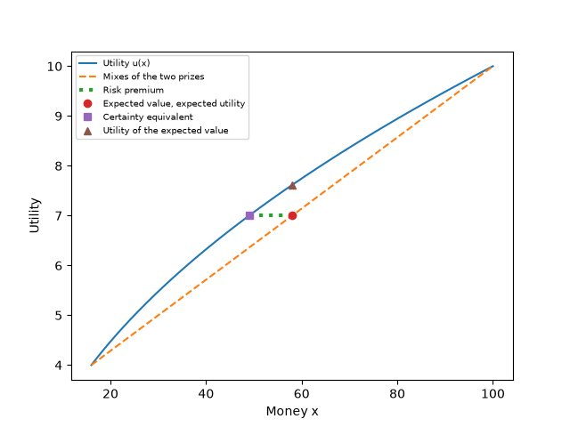
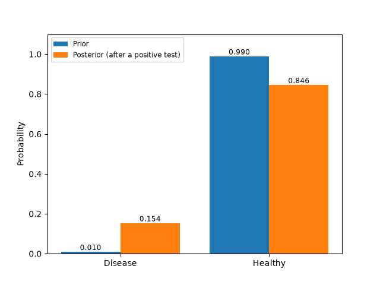

# 第 10 章: 確率とリスク

## 10.1 この章の地図

50% で 0 円、50% で 100 円もらえる賭けと、確実にもらえる 40 円。どちらを選びますか。賭けの平均は 50 円ですが、確実な 40 円を選ぶ人は少なくありません。保険に入る人は、平均すると損をする保険料を払って、リスクを手放しています。

この章の道具は、**確率**と**期待値**です。前半で、サイコロを例に、確率を数え上げで求めます。条件が分かったときの確率（**条件付き確率**）と、検査の結果から確率を更新する**ベイズの定理**も扱います。後半で、賭けを確率変数として表し、**期待効用**で「リスクの嫌い方」を数値にします。



| 項目 | 内容 |
| :--- | :--- |
| 経済学の題材 | 不確実性の下の選択、ベイズの更新（検査の陽性）、期待効用、確実性等価、危険プレミアム、危険回避・危険中立・危険愛好、保険 |
| 数学 | 標本空間と事象（集合）、確率の基本的性質、均等確率、条件付き確率、独立、ベイズの定理、確率変数・期待値・分散、ジェンセンの不等式、大数の法則、アロー・プラットの尺度（発展） |
| 使う Python の機能 | `fractions.Fraction`、集合（`frozenset` と、集合の演算子）、`itertools.product`、型変数（`def f[T](...)`）、`random.Random`、`collections.Counter`、`Literal` |
| 新しく導入するライブラリ | なし（すべて標準ライブラリ。図だけ Matplotlib・NumPy） |
| 完成形 | `dice_sample_space`、`outcomes_where`、`equally_likely_probability`、`conditional_probability`、`are_independent_events`、`require_probability`、`bayes_posteriors`、`positive_test_probability`、`disease_probability_given_positive`、`random_variable_distribution`、`require_probability_distribution`、`discrete_expected_value`、`discrete_variance`、`expected_utility_of_lottery`、`certainty_equivalent_of_lottery`、`risk_premium_of_lottery`、`classify_risk_attitude`、`simulate_dice_sum_frequencies`、`absolute_risk_aversion`・`relative_risk_aversion`（発展） |
| ファイル | 実装: `lib/chapter10/probability.py`、`bayes.py`、`expectation.py`、`risk.py`、`simulation.py`、`plot.py`（図）／テスト: `test/chapter10/test_probability.py`、`test_bayes.py`、`test_expectation.py`、`test_risk.py`、`test_simulation.py`、`test_plot.py` |
| データ | なし（サイコロと、手計算できる小さな賭けだけ） |

### 数学の式とコードの対応

| 経済学・数学 | 式 | コード |
| :--- | :--- | :--- |
| 標本空間 | Ω = {(1, 1), (1, 2), …, (6, 6)} | `dice_sample_space(dice, faces)` |
| 事象 | A = {ω ∈ Ω ∣ 条件} | `outcomes_where(space, condition)` |
| 均等確率 | P(A) = \|A\| ÷ \|Ω\| | `equally_likely_probability(event, space)` |
| 条件付き確率 | P(A∣B) = P(A∩B) ÷ P(B) | `conditional_probability(event, given, space)` |
| 独立 | P(A∩B) = P(A)·P(B) | `are_independent_events(a, b, space)` |
| ベイズの定理 | P(H∣E) = P(H)·P(E∣H) ÷ Σ P(H')·P(E∣H') | `bayes_posteriors(priors, likelihoods)` |
| 陽性のとき病気である確率 | 有病率 × 感度 ÷ P(陽性) | `disease_probability_given_positive(...)` |
| 期待値・分散 | E[X] = Σ x·P(x)、Var[X] = E[(X − E[X])²] | `discrete_expected_value`、`discrete_variance` |
| 期待効用 | E[u(X)] = Σ u(x)·P(x) | `expected_utility_of_lottery(lottery, utility)` |
| 確実性等価 | u(CE) = E[u(X)] | `certainty_equivalent_of_lottery(lottery, utility)` |
| 危険プレミアム | E[X] − CE | `risk_premium_of_lottery(lottery, utility)` |
| 絶対的危険回避度（発展） | −u''(w) ÷ u'(w) | `absolute_risk_aversion(utility, wealth)` |

> **記号について**: P(A) は事象 A の確率、\|A\| は A に含まれる結果の個数です。A∩B は「A かつ B」、A∪B は「A または B」です。P(A∣B) は「B が起きたと分かったときの A の確率」と読みます。この章の**くじ**（賭け）は、「金額 → その金額をもらう確率」の表で表します。コードでは、辞書 `{0: Fraction(1, 2), 100: Fraction(1, 2)}` です。

### 前提とする章

| できること | 場所 |
| :--- | :--- |
| 分数 `Fraction` で、厳密に計算する | [第 3 章](03-exponents-logarithms-and-interest.md) |
| 数値微分（中心差分）、凹関数（f'' < 0） | [第 5 章](05-derivatives-and-profit-maximization.md) |
| 平均・分散を、内積で求める | [第 7 章](07-vectors-and-budget-constraint.md) |

第 5 章の `numerical_derivative` を、発展の節でそのまま import して使います。この章に、その実装は再掲しません。リスクと保険が、売り手と買い手の**情報の違い**で、うまく働かなくなる話は、[ミクロ経済学のためのプログラミング（初級）の第 16 章](../micro-basics-programming/16-information-asymmetry.md) で扱います。

## 10.2 準備

```bash
cd apps/math-for-economics-programming/python
uv run pytest test/chapter10
```

```text
46 passed
```

自分でコードを書くときは、`practice/chapter10/` に、完成形と同じ名前のファイル（`probability.py`・`bayes.py`・`expectation.py`・`risk.py`・`simulation.py`・`plot.py`・`test_probability.py`・`test_bayes.py`・`test_expectation.py`・`test_risk.py`・`test_simulation.py`・`test_plot.py`）を作ります。図を後回しにするなら、`plot.py` と `test_plot.py` は要らず、テストは 43 件になります。

- テスト・check スクリプトの import を、`from practice.chapter10...` に書き換えます。**ほかのファイルを import している実装ファイル**（`bayes.py` は `probability` を、`expectation.py` は `probability` を、`risk.py` は `expectation` を、`plot.py` は `bayes`・`expectation`・`risk` を import します）も、同じく書き換えます。書き換えないと、完成形を動かすことになります
- 第 5 章の `numerical_derivative`（発展の節だけで使う）は、自分で写した `practice.chapter05` から import します。写していなければ、`lib.chapter05` のままでかまいません。この章では、その実装を再掲しません
- テストの import の一覧は、完成形の**全関数**です。まだ書いていない関数を import すると、`ImportError` になります。関数を 1 つ書くたびに、名前を import に足してください

「予想の答え合わせ」のスクリプトは、`practice/chapter10/check.py` に保存し、`uv run python -m practice.chapter10.check` で実行します。

## 10.3 予想する

次の 5 つの問いに、**紙で、手計算で**答えてください。答えは、この節には書いてありません。「プログラミング」の節の「予想の答え合わせ」で確かめます。

- サイコロを 2 個投げます。目の和が 7 になる確率は、いくつですか。和が 8 になる確率は。「和が 8 または、2 個の目が同じ（ゾロ目）」になる確率は
- 1 個目の目が 6 だと分かりました。和が 7 になる確率は、分かる前より上がりますか、下がりますか、変わりませんか。和が 8 のほうは、どうですか
- ある病気の有病率は 1% です。検査は、病気の人の 90% を陽性と判定し（感度）、健康な人の 5% も陽性と判定します（偽陽性）。陽性と判定された人が、本当に病気である確率は、いくつですか。90% に近いですか
- 効用が √x の人が、50% で 0、50% で 100 をもらえる賭けを持っています。賭けの期待値・期待効用は、いくつですか。この賭けと同じ満足をくれる**確実な金額**（確実性等価）は、いくつですか。期待値と、その金額の差は
- サイコロ 2 個を、6 万回投げます。和が 7 になる回数は、およそ何回ですか

## 10.4 確率とリスクの考え方

### 標本と事象

サイコロ 2 個を投げたときに起こりうる結果は、(1, 1) から (6, 6) までの 36 通りです。起こりうる結果をすべて集めた集合を、**標本空間** Ω と言います。その一部分（部分集合）を、**事象**と言います。「和が 7」は、{(1, 6), (2, 5), (3, 4), (4, 3), (5, 2), (6, 1)} という事象です。

事象どうしは、集合の演算で組み合わせます。

| 事象 | 意味 |
| :--- | :--- |
| A∩B（共通部分） | A かつ B |
| A∪B（和集合） | A または B |
| Aᶜ（余事象） | A でない |
| ∅（空事象） | 決して起きない |

Python の集合では、A∩B を `a & b`、A∪B を `a | b`、Aᶜ を `space - a`、∅ を `frozenset()` と書きます。

### 確率の定義と基本的性質

確率 P は、事象に 0 から 1 の数を割り当てる規則で、次を満たします。

1. どの事象 A でも、0 ≤ P(A) ≤ 1
2. 全事象（標本空間そのもの）の確率は 1、空事象の確率は 0
3. **余事象**の確率は P(Aᶜ) = 1 − P(A)
4. **加法定理**: P(A∪B) = P(A) + P(B) − P(A∩B)。重なり（A∩B）を 2 回数えないよう、1 回引く。重ならない（**排反な**）事象なら、足すだけ

「少なくとも 1 回 6 が出る」のような事象は、余事象「1 回も 6 が出ない」の確率を 1 から引くと、簡単に求まります。

### 均等確率の場合

どの結果も同じ確からしさで起きるなら、確率は数え上げで求まります。

> P(A) = A に含まれる結果の数 ÷ 標本空間の結果の数

この章では、確率を分数 `Fraction` で計算します。1/6 は小数では 0.1666… と割り切れませんが、分数なら**厳密に**扱え、`==` で比べられます（第 3 章）。

### 条件付き確率と独立

B が起きたと分かると、起こりうる結果は B の中に絞られます。その中で A が起きる割合が、**条件付き確率**です。

> P(A∣B) = P(A∩B) ÷ P(B)（P(B) > 0 のとき）

P(B) = 0 の事象を、条件にはできません。P(A∣B) と P(B∣A) は、一般に違います（「和が 12 なら、1 個目は必ず 6」ですが、「1 個目が 6 でも、和が 12 とは限らない」）。

B が分かっても A の確率が変わらない（P(A∣B) = P(A)）とき、A と B は**独立**です。式を変形すると、P(A∩B) = P(A)·P(B) です。

### ベイズの定理

原因（仮説 H）から結果（観測 E）の確率 P(E∣H) は分かっていて、知りたいのは、結果から見た原因の確率 P(H∣E) だ、という場面がよくあります。**ベイズの定理**は、向きを逆にします。

> P(H∣E) = P(H)·P(E∣H) ÷ P(E)、P(E) = Σ P(H')·P(E∣H')（すべての仮説 H' について足す）

P(H) を**事前確率**、P(E∣H) を**尤度**、P(H∣E) を**事後確率**と言います。分母の P(E) は、すべての仮説で「事前確率 × 尤度」を足したもの（**全確率の公式**）です。事後確率は、「事前確率 × 尤度」を、合計が 1 になるよう割ったものです。

検査の例では、仮説が「病気」と「健康」、観測が「陽性」です。尤度は、病気なら感度 P(陽性∣病気)、健康なら**偽陽性率** P(陽性∣健康)（健康な人のうち、陽性になる割合）です。偽陽性率 5% は、「陽性の人の 5% が健康」という意味ではありません。1 − 偽陽性率（ここでは 95%）を**特異度**と言います（健康な人を、正しく陰性と判定する割合）。**よくある誤解**は、「感度 90% の検査で陽性なら、90% の確率で病気」というものです。90% は P(陽性∣病気) で、知りたい P(病気∣陽性) ではありません。病気がまれ（事前確率が小さい）だと、陽性の人の多くは、数の多い健康な人からの偽陽性になります。

事後確率は、次の観測の事前確率になります。2 回目の検査も陽性なら、1 回目の事後確率を事前確率にして、もう一度ベイズの定理を使います。ただし、これには「病気か健康かが決まれば、2 回の検査結果は独立」という仮定が要ります。同じ人に同じ検査を繰り返すと、同じ理由で間違えやすく（誤りが独立でない）、2 回目の陽性の情報は、計算より少なくなります。

### 確率変数・期待値・分散

結果ごとに数を割り当てたものを、**確率変数**と言います。サイコロ 2 個の「目の和」は、結果 (2, 5) に 7 を割り当てる確率変数です。値ごとの確率の表を、**分布**と言います。

| 量 | 式 | 意味 |
| :--- | :--- | :--- |
| 期待値 | E[X] = Σ x·P(X = x) | 確率で重みを付けた平均 |
| 分散 | Var[X] = E[(X − E[X])²] | 期待値からのずれの 2 乗の、期待値（ばらつき） |

値を a 倍して b を足すと、期待値は a·E[X] + b、分散は a²·Var[X] です（分散は、足した b の影響を受けない）。サイコロ 1 個の分散は 35/12 で、**独立な** 2 個の和の分散は、その 2 倍の 35/6 です。

### 期待効用

賭け（くじ）を、金額の確率変数 X として表します。お金そのものでなく、お金から得る満足（**効用** u）の期待値で選ぶ、という考え方が、**期待効用理論**です。

> 期待効用 E[u(X)] = Σ u(x)·P(X = x)

### 確実性等価と危険プレミアム

賭けと同じ効用を、確実にくれる金額を、**確実性等価** CE と言います。u(CE) = E[u(X)] を満たす CE です。期待値との差を、**危険プレミアム**と言います。

> 危険プレミアム = E[X] − CE

| 効用の形 | 例 | 危険プレミアム | 呼び方 |
| :--- | :--- | :--- | :--- |
| 凹（u'' < 0） | √x、ln x | 正（CE < E[X]） | 危険回避 |
| 直線 | x | 0（CE = E[X]） | 危険中立 |
| 凸（u'' > 0） | x² | 負（CE > E[X]） | 危険愛好 |

凹の効用では、2 つの金額を結ぶ線分（弦）が、曲線の下にあります。弦の上の点は、2 つの金額の効用を確率で平均した値（期待効用）です。だから、**u(E[X]) ≥ E[u(X)]** です。これを、**ジェンセンの不等式**と言います。10.1 節の図で、三角（期待値の効用）が、丸（期待効用）より上にあるのが、それです。

経済学の意味を 1 行で言うと、危険プレミアムは「**リスクを手放すためなら、平均からあきらめてもよい額**」です。保険・分散投資は、危険プレミアムを払ってでもリスクを避ける選好で説明できます。

### 大数の法則

確率 1/6 の事象は、6 回に 1 回、きっちり起きるわけではありません。しかし、同じ試行を何度も独立に繰り返すと、起きた回数の割合（**相対頻度**）は、確率に近づきます。これを**大数の法則**と言います。相対頻度と確率のずれは、おおよそ √(p(1 − p) ÷ n) の大きさ（**標準誤差**）で、回数 n を 100 倍にすると 1/10 になります。

??? note "発展: 危険回避の尺度（アロー・プラットの尺度）"

    危険回避の強さは、効用の曲がり具合（u''）で決まります。ただし、u を 2 倍しても選好は変わらないので、u' で割って比べます。

    > 絶対的危険回避度 A(w) = −u''(w) ÷ u'(w)、相対的危険回避度 R(w) = w·A(w)

    | 効用 | A(w) | R(w) |
    | :--- | :--- | :--- |
    | √w | 1 ÷ (2w)（富が増えると小さい） | 1/2（一定） |
    | ln w | 1 ÷ w | 1（一定） |
    | −e^(−a·w) | a（一定） | a·w |

    小さなリスクなら、危険プレミアムは **½·A(w)·Var[X]** で近似できます（w は期待値）。ばらつき（分散）が大きいほど、危険回避度が大きいほど、プレミアムは大きくなります。

## 10.5 プログラミング

### Red: 標本空間と均等確率のテスト

`test_probability.py` の先頭の import と、テストで使い回す標本空間・事象です（完成形の全関数）。

```python
from fractions import Fraction

import pytest

from lib.chapter10.probability import (
    are_independent_events,
    conditional_probability,
    dice_sample_space,
    equally_likely_probability,
    outcomes_where,
    require_probability,
)
```

```python
SPACE = dice_sample_space()


def _sum_is(total: int) -> frozenset[tuple[int, ...]]:
    return outcomes_where(SPACE, lambda o: sum(o) == total)
```

最初のテストは、標本空間の大きさと、数え上げの確率です。6 面のサイコロだけにせず、4 面のサイコロ・3 個・1 個も入れています。

```python
def test_サイコロ2個の標本空間は36通り() -> None:
    assert len(SPACE) == 36
    assert (1, 6) in SPACE and (6, 1) in SPACE
    assert len(dice_sample_space(3)) == 216
    assert len(dice_sample_space(2, faces=4)) == 16
    assert dice_sample_space(1) == {(1,), (2,), (3,), (4,), (5,), (6,)}
    assert dice_sample_space(2, faces=1) == {(1, 1)}


def test_均等確率の確率は事象の数を標本の数で割る() -> None:
    assert equally_likely_probability(_sum_is(7), SPACE) == Fraction(1, 6)
    assert equally_likely_probability(_sum_is(2), SPACE) == Fraction(1, 36)
    assert equally_likely_probability(_sum_is(8), SPACE) == Fraction(5, 36)
    four = dice_sample_space(2, faces=4)
    five = outcomes_where(four, lambda o: sum(o) == 5)
    assert equally_likely_probability(five, four) == Fraction(4, 16)
```

`lib.chapter10.probability` がないので、収集の時点で失敗します（**Red**）。

### Green: 標本空間と事象を、集合で作る

`probability.py` の先頭の import です。

```python
import itertools
from collections.abc import Callable, Set
from fractions import Fraction
```

```python
def dice_sample_space(dice: int = 2, faces: int = 6) -> frozenset[tuple[int, ...]]:
    """サイコロ dice 個の目の組の集合（標本空間）。2 個なら 6 × 6 = 36 通り。"""
    if dice < 1 or faces < 1:
        raise ValueError("サイコロの個数と面の数は、1 以上でなければなりません")
    return frozenset(itertools.product(range(1, faces + 1), repeat=dice))


def outcomes_where[T](space: Set[T], condition: Callable[[T], bool]) -> frozenset[T]:
    """標本空間のうち、条件を満たす結果の集合（事象）。"""
    return frozenset(o for o in space if condition(o))


def equally_likely_probability[T](event: Set[T], space: Set[T]) -> Fraction:
    """どの結果も同じ確からしさのとき、P(A) = A の結果の数 ÷ 標本空間の結果の数。"""
    if not space:
        raise ValueError("標本空間が空では、確率は決まりません")
    if not event <= space:
        raise ValueError("事象は、標本空間の部分集合でなければなりません")
    return Fraction(len(event), len(space))
```

- `itertools.product(range(1, 7), repeat=2)` は、(1, 1)・(1, 2)・…・(6, 6) の 36 通りの組を、順に作ります。`repeat` がサイコロの個数です
- `frozenset` は、変更できない集合です。`|`（和集合）・`&`（共通部分）・`-`（差）・`<=`（部分集合か）が使えます。`Set` は、`set` と `frozenset` のどちらも受け付ける型です
- `def outcomes_where[T](...)` の `[T]` は、**型変数**です。結果の型が何でも（目の組でも、文字列でも）よく、受け取った結果と同じ型の集合を返す、と mypy に伝えます（Python 3.12 の書き方）

### 確率の基本的性質

0 ≤ P ≤ 1、全事象と空事象、余事象、加法定理を確かめます。これらは、`equally_likely_probability` が正しければ成り立つ**性質**のテストです。新しい関数は要りません。余事象は `SPACE - seven`、和集合は `eight | doubles` と、集合の演算で作ります。

```python
def test_確率は0以上1以下で全事象は1で空事象は0() -> None:
    for total in range(1, 14):
        assert 0 <= equally_likely_probability(_sum_is(total), SPACE) <= 1
    assert equally_likely_probability(SPACE, SPACE) == 1
    assert equally_likely_probability(frozenset(), SPACE) == 0
    assert equally_likely_probability(_sum_is(13), SPACE) == 0


def test_余事象の確率は1から引く() -> None:
    seven = _sum_is(7)
    assert equally_likely_probability(SPACE - seven, SPACE) == Fraction(5, 6)
    at_least_one_six = outcomes_where(SPACE, lambda o: 6 in o)
    no_six = SPACE - at_least_one_six
    assert equally_likely_probability(no_six, SPACE) == Fraction(25, 36)
    assert equally_likely_probability(at_least_one_six, SPACE) == Fraction(11, 36)


def test_加法定理は重なりを1回引く() -> None:
    eight = _sum_is(8)
    doubles = outcomes_where(SPACE, lambda o: o[0] == o[1])
    union = equally_likely_probability(eight | doubles, SPACE)
    p_eight = equally_likely_probability(eight, SPACE)
    p_doubles = equally_likely_probability(doubles, SPACE)
    overlap = equally_likely_probability(eight & doubles, SPACE)
    assert union == p_eight + p_doubles - overlap == Fraction(5, 18)
    assert overlap == Fraction(1, 36)
    # 重ならない（排反な）事象なら、確率は足すだけ
    seven = _sum_is(7)
    assert equally_likely_probability(seven | doubles, SPACE) == Fraction(1, 3)
```

### 条件付き確率と独立

```python
def test_条件付き確率は重なりの確率をBの確率で割る() -> None:
    first_six = outcomes_where(SPACE, lambda o: o[0] == 6)
    assert conditional_probability(_sum_is(8), first_six, SPACE) == Fraction(1, 6)
    high = outcomes_where(SPACE, lambda o: sum(o) >= 10)
    assert conditional_probability(high, first_six, SPACE) == Fraction(1, 2)
    assert equally_likely_probability(high, SPACE) == Fraction(1, 6)
    # 条件付き確率は、向きを入れ替えると、一般に違う
    assert conditional_probability(_sum_is(12), first_six, SPACE) == Fraction(1, 6)
    assert conditional_probability(first_six, _sum_is(12), SPACE) == 1


def test_1個目が6でも和が7の確率は変わらず独立() -> None:
    first_six = outcomes_where(SPACE, lambda o: o[0] == 6)
    seven = _sum_is(7)
    assert conditional_probability(seven, first_six, SPACE) == Fraction(1, 6)
    assert are_independent_events(seven, first_six, SPACE)
    # 和が 8 は、1 個目が 6 だと確率が上がる（5/36 → 1/6）ので、独立でない
    assert not are_independent_events(_sum_is(8), first_six, SPACE)
```

```python
def conditional_probability[T](event: Set[T], given: Set[T], space: Set[T]) -> Fraction:
    """B が起きたと分かったときの A の確率 P(A|B) = P(A∩B) ÷ P(B)。"""
    p_given = equally_likely_probability(given, space)
    if p_given == 0:
        raise ValueError("確率 0 の事象を、条件にはできません")
    return equally_likely_probability(event & given, space) / p_given


def are_independent_events[T](a: Set[T], b: Set[T], space: Set[T]) -> bool:
    """A と B が独立か（P(A∩B) = P(A)·P(B)）。分数なので、== で厳密に比べられる。"""
    p_both = equally_likely_probability(a & b, space)
    p_a = equally_likely_probability(a, space)
    return p_both == p_a * equally_likely_probability(b, space)
```

分数なので、独立の判定 `p_both == p_a * ...` を、誤差を気にせず `==` で書けます。浮動小数点数なら、`math.isclose` が要るところです。

### ベイズの定理

`test_bayes.py` の先頭です。有病率・感度・偽陽性率（健康な人のうち陽性になる割合）を、定数にしておきます。

```python
from fractions import Fraction

import pytest

from lib.chapter10.bayes import (
    bayes_posteriors,
    disease_probability_given_positive,
    positive_test_probability,
)
```

```python
PREVALENCE = Fraction(1, 100)


SENSITIVITY = Fraction(9, 10)


FALSE_POSITIVE = Fraction(5, 100)
```

検査の形の関数（`disease_probability_given_positive`）と、仮説がいくつでもよい一般の形（`bayes_posteriors`）の 2 つを書き、**同じ答えになる**ことを確かめます。片方を書き間違えれば、一致しません。

```python
def test_陽性になる確率は病気の人と健康な人の陽性を足す() -> None:
    p = positive_test_probability(PREVALENCE, SENSITIVITY, FALSE_POSITIVE)
    assert p == Fraction(1, 100) * Fraction(9, 10) + Fraction(99, 100) * Fraction(
        5, 100
    )
    assert p == Fraction(117, 2000)


def test_陽性のとき病気である確率は感度の90パーセントよりずっと低い() -> None:
    p = disease_probability_given_positive(PREVALENCE, SENSITIVITY, FALSE_POSITIVE)
    assert p == Fraction(2, 13)
    assert float(p) == pytest.approx(0.1538, abs=1e-4)
    assert p < SENSITIVITY


def test_事後確率は事前確率かける尤度を全体で割る() -> None:
    priors = {"disease": PREVALENCE, "healthy": 1 - PREVALENCE}
    likelihoods = {"disease": SENSITIVITY, "healthy": FALSE_POSITIVE}
    posteriors = bayes_posteriors(priors, likelihoods)
    assert posteriors == {"disease": Fraction(2, 13), "healthy": Fraction(11, 13)}
    assert sum(posteriors.values()) == 1
    # 2 つの関数（一般の形と、検査の形）が、同じ答えを出す
    assert posteriors["disease"] == disease_probability_given_positive(
        PREVALENCE, SENSITIVITY, FALSE_POSITIVE
    )


def test_2回続けて陽性なら事後確率を事前確率にして更新する() -> None:
    likelihoods = {"disease": SENSITIVITY, "healthy": FALSE_POSITIVE}
    once = bayes_posteriors(
        {"disease": PREVALENCE, "healthy": 1 - PREVALENCE}, likelihoods
    )
    twice = bayes_posteriors(once, likelihoods)
    assert twice["disease"] == Fraction(36, 47)
    assert float(twice["disease"]) == pytest.approx(0.766, abs=1e-3)


def test_有病率が高いほど陽性の意味は大きく0と1では動かない() -> None:
    def posterior(prevalence: Fraction) -> Fraction:
        return disease_probability_given_positive(
            prevalence, SENSITIVITY, FALSE_POSITIVE
        )

    assert posterior(Fraction(1, 10)) == Fraction(2, 3)
    assert posterior(Fraction(0)) == 0
    assert posterior(Fraction(1)) == 1
```

確率が 0 以上 1 以下かを確かめる関数を、`probability.py` に足します（`bayes.py` と、あとの `expectation.py` で使います）。

```python
def require_probability(p: Fraction) -> None:
    """確率は 0 以上 1 以下。外れていれば ValueError。"""
    if not 0 <= p <= 1:
        raise ValueError(f"確率は 0 以上 1 以下でなければなりません: {p}")
```

`bayes.py` の先頭の import です。

```python
from collections.abc import Mapping
from fractions import Fraction

from lib.chapter10.probability import require_probability
```

```python
def bayes_posteriors[K](
    priors: Mapping[K, Fraction], likelihoods: Mapping[K, Fraction]
) -> dict[K, Fraction]:
    """事後確率 P(H|E) = P(H)·P(E|H) ÷ Σ P(H')·P(E|H')（H は仮説、E は観測）。"""
    if priors.keys() != likelihoods.keys():
        raise ValueError("事前確率と尤度は、同じ仮説について与えます")
    for p in [*priors.values(), *likelihoods.values()]:
        require_probability(p)
    if sum(priors.values()) != 1:
        raise ValueError("事前確率の和は、1 でなければなりません")
    joint = {h: priors[h] * likelihoods[h] for h in priors}
    evidence = sum(joint.values(), Fraction(0))
    if evidence == 0:
        raise ValueError("観測の確率が 0 では、更新できません")
    return {h: p / evidence for h, p in joint.items()}


def positive_test_probability(
    prevalence: Fraction, sensitivity: Fraction, false_positive_rate: Fraction
) -> Fraction:
    """陽性になる確率（全確率の公式）。病気の人の陽性 ＋ 健康な人の陽性（偽陽性）。"""
    for p in (prevalence, sensitivity, false_positive_rate):
        require_probability(p)
    return prevalence * sensitivity + (1 - prevalence) * false_positive_rate


def disease_probability_given_positive(
    prevalence: Fraction, sensitivity: Fraction, false_positive_rate: Fraction
) -> Fraction:
    """陽性のとき病気である確率 P(病気|陽性) = P(病気)·P(陽性|病気) ÷ P(陽性)。"""
    positive = positive_test_probability(prevalence, sensitivity, false_positive_rate)
    if positive == 0:
        raise ValueError("陽性になる確率が 0 では、決まりません")
    return prevalence * sensitivity / positive
```

`bayes_posteriors` は、仮説の名前（`"disease"` など）をキーにした辞書を受け取ります。`joint` が「事前確率 × 尤度」、`evidence` がその合計 P(E) です。`sum(..., Fraction(0))` の第 2 引数は、足し始めの値です（省くと、結果の型が `Fraction` だと mypy に伝わりません）。

### 確率変数・期待値・分散

`test_expectation.py` の先頭です。

```python
from fractions import Fraction

import pytest

from lib.chapter10.expectation import (
    discrete_expected_value,
    discrete_variance,
    random_variable_distribution,
)
from lib.chapter10.probability import dice_sample_space
```

```python
HALF = Fraction(1, 2)


def test_目の和の分布は和ごとの確率() -> None:
    sums = random_variable_distribution(dice_sample_space(), sum)
    assert sums[7] == Fraction(1, 6)
    assert sums[2] == sums[12] == Fraction(1, 36)
    assert sorted(sums) == list(range(2, 13))
    assert sum(sums.values()) == 1


def test_期待値は値かける確率の和() -> None:
    one_die = random_variable_distribution(dice_sample_space(1), sum)
    assert discrete_expected_value(one_die) == Fraction(7, 2)
    two_dice = random_variable_distribution(dice_sample_space(), sum)
    assert discrete_expected_value(two_dice) == 7
    assert discrete_expected_value({0: HALF, 100: HALF}) == 50
    assert discrete_expected_value({16: HALF, 100: HALF}) == 58
    assert discrete_expected_value({0: Fraction(3, 4), 40: Fraction(1, 4)}) == 10


def test_分散は期待値からのずれの2乗の期待値() -> None:
    one_die = random_variable_distribution(dice_sample_space(1), sum)
    assert discrete_variance(one_die) == Fraction(35, 12)
    two_dice = random_variable_distribution(dice_sample_space(), sum)
    # 独立な 2 個の和の分散は、1 個の分散の 2 倍
    assert discrete_variance(two_dice) == Fraction(35, 6)
    assert discrete_variance({0: HALF, 100: HALF}) == 2500
    assert discrete_variance({0: Fraction(3, 4), 40: Fraction(1, 4)}) == 300


def test_値を3倍して2を足すと期待値も3倍して2を足し分散は9倍() -> None:
    space = dice_sample_space()
    scaled = random_variable_distribution(space, lambda o: 3 * sum(o) + 2)
    assert discrete_expected_value(scaled) == 3 * 7 + 2
    assert discrete_variance(scaled) == 9 * Fraction(35, 6)
    halved = random_variable_distribution(space, lambda o: Fraction(sum(o), 2))
    assert discrete_expected_value(halved) == Fraction(7, 2)
    assert discrete_variance(halved) == Fraction(35, 24)
```

`random_variable_distribution(space, sum)` の `sum` は、Python の組み込み関数 `sum` です。結果 (2, 5) を受け取り、和 7 を返す関数として、そのまま渡せます。

`expectation.py` の先頭の import です。

```python
from collections.abc import Callable, Collection, Mapping, Set
from fractions import Fraction

from lib.chapter10.probability import equally_likely_probability, require_probability
```

```python
def random_variable_distribution[T](
    space: Set[T], value: Callable[[T], int | Fraction]
) -> dict[int | Fraction, Fraction]:
    """均等確率の標本空間の、各結果に値を割り当てた確率変数の分布（値 → 確率）。"""
    groups: dict[int | Fraction, set[T]] = {}
    for outcome in space:
        groups.setdefault(value(outcome), set()).add(outcome)
    return {v: equally_likely_probability(e, space) for v, e in groups.items()}


def require_probability_distribution(probabilities: Collection[Fraction]) -> None:
    """分布の確率は、どれも 0 以上 1 以下で、合計がちょうど 1。違えば ValueError。"""
    if not probabilities:
        raise ValueError("空の分布は、扱えません")
    for p in probabilities:
        require_probability(p)
    if sum(probabilities) != 1:
        raise ValueError("確率の合計は、1 でなければなりません")


def discrete_expected_value[V: int | Fraction](
    distribution: Mapping[V, Fraction],
) -> Fraction:
    """期待値 E[X] = Σ x·P(X = x)。分布は、値 → その値をとる確率の辞書。"""
    require_probability_distribution(distribution.values())
    return sum((x * p for x, p in distribution.items()), Fraction(0))


def discrete_variance[V: int | Fraction](
    distribution: Mapping[V, Fraction],
) -> Fraction:
    """分散 Var[X] = E[(X − E[X])²]。期待値からのずれの 2 乗の期待値。"""
    mean = discrete_expected_value(distribution)
    return sum(((x - mean) ** 2 * p for x, p in distribution.items()), Fraction(0))
```

- `groups.setdefault(v, set())` は、値 v の集合がまだなければ空の集合を作り、その集合を返します。値ごとに結果を集め、集めた事象の確率を求めます
- （型の細かい話なので、読み飛ばしてもかまいません）`[V: int | Fraction]` は、`int` か `Fraction` に限る型変数です。`{0: ..., 100: ...}` のような `int` のキーの辞書も、`random_variable_distribution` が返す辞書も、そのまま渡せます。`Mapping[int | Fraction, Fraction]` と書くと、`int` のキーの辞書を変数に入れてから渡したとき、mypy が「型が違う」と言います（辞書のキーの型は、ちょうど一致を求められるため）

### 期待効用・確実性等価・危険プレミアム

`test_risk.py` の先頭です。発展の節の関数（`absolute_risk_aversion`・`relative_risk_aversion`）も、import の一覧に入っています。

```python
import math
from fractions import Fraction

import pytest

from lib.chapter10.expectation import discrete_expected_value, discrete_variance
from lib.chapter10.risk import (
    absolute_risk_aversion,
    certainty_equivalent_of_lottery,
    classify_risk_attitude,
    expected_utility_of_lottery,
    relative_risk_aversion,
    risk_premium_of_lottery,
)
```

効用関数は、金額を受け取って効用を返す関数です。√x は `math.sqrt`、ln x は `math.log` を、そのまま渡します。直線と 2 乗は、テストの中で定義します。くじは、テストで使い回す定数にします。

```python
HALF = Fraction(1, 2)


COIN_FLIP = {0: HALF, 100: HALF}  # 50% で 0、50% で 100 の賭け


SIXTEEN_OR_HUNDRED = {16: HALF, 100: HALF}


UNEVEN = {0: Fraction(3, 4), 40: Fraction(1, 4)}


def _linear(x: float) -> float:
    return x


def _square(x: float) -> float:
    return x**2
```

確実性等価は、**公式と数値**の 2 つで確かめます。効用 √x なら、√CE = 期待効用なので、CE は期待効用の 2 乗（公式）です。実装は、2 分法（数値）で求めます。ln x なら、CE は e の期待効用乗です。

```python
def test_期待効用は効用かける確率の和() -> None:
    assert expected_utility_of_lottery(COIN_FLIP, math.sqrt) == 5
    assert expected_utility_of_lottery(SIXTEEN_OR_HUNDRED, math.sqrt) == 7
    eu = expected_utility_of_lottery(UNEVEN, math.sqrt)
    assert eu == pytest.approx(math.sqrt(40) / 4)
    assert expected_utility_of_lottery(COIN_FLIP, _linear) == 50


def test_確実性等価は期待効用と同じ効用を確実にくれる金額() -> None:
    assert certainty_equivalent_of_lottery(COIN_FLIP, math.sqrt) == pytest.approx(25)
    ce = certainty_equivalent_of_lottery(SIXTEEN_OR_HUNDRED, math.sqrt)
    assert ce == pytest.approx(49)
    # 効用 √x なら、確実性等価は期待効用の 2 乗（公式）。2 分法の数値と一致する
    expected = expected_utility_of_lottery(UNEVEN, math.sqrt) ** 2
    assert certainty_equivalent_of_lottery(UNEVEN, math.sqrt) == pytest.approx(expected)
    # 効用 ln x なら、確実性等価は e の期待効用乗（ここでは 25 と 100 の幾何平均 50）
    log_lottery = {25: HALF, 100: HALF}
    assert certainty_equivalent_of_lottery(log_lottery, math.log) == pytest.approx(50)


def test_危険プレミアムは期待値と確実性等価の差() -> None:
    assert risk_premium_of_lottery(COIN_FLIP, math.sqrt) == pytest.approx(25)
    assert risk_premium_of_lottery(SIXTEEN_OR_HUNDRED, math.sqrt) == pytest.approx(9)
    assert risk_premium_of_lottery(UNEVEN, math.sqrt) == pytest.approx(7.5)
    premium = risk_premium_of_lottery({25: HALF, 100: HALF}, math.log)
    assert premium == pytest.approx(12.5)


def test_凹の効用では期待値の効用が期待効用以上になる() -> None:
    for lottery in [COIN_FLIP, SIXTEEN_OR_HUNDRED, UNEVEN]:
        mean = float(discrete_expected_value(lottery))
        assert math.sqrt(mean) > expected_utility_of_lottery(lottery, math.sqrt)
        assert _square(mean) < expected_utility_of_lottery(lottery, _square)
        linear = expected_utility_of_lottery(lottery, _linear)
        assert _linear(mean) == pytest.approx(linear)


def test_効用の形で危険回避か危険中立か危険愛好かが決まる() -> None:
    assert classify_risk_attitude(COIN_FLIP, math.sqrt) == "averse"
    assert classify_risk_attitude(COIN_FLIP, _linear) == "neutral"
    assert classify_risk_attitude(COIN_FLIP, _square) == "loving"
    assert risk_premium_of_lottery(COIN_FLIP, _linear) == pytest.approx(0, abs=1e-9)
    # 凸の効用 x² では、確実性等価 √5000 ≈ 70.71 が期待値 50 を上回り、プレミアムは負
    ce = certainty_equivalent_of_lottery(COIN_FLIP, _square)
    assert ce == pytest.approx(math.sqrt(5000))
    assert risk_premium_of_lottery(COIN_FLIP, _square) < 0
    # 危険プレミアムが 1 より小さくても、正なら危険回避
    small = {90: HALF, 110: HALF}
    assert 0 < risk_premium_of_lottery(small, math.sqrt) < 1
    assert classify_risk_attitude(small, math.sqrt) == "averse"
```

`risk.py` の先頭の import です。第 5 章の `numerical_derivative` は、発展の節だけで使います（発展を飛ばすなら、この行は要りません）。

```python
import math
from collections.abc import Callable, Mapping
from fractions import Fraction
from typing import Literal

from lib.chapter05.derivative import numerical_derivative
from lib.chapter10.expectation import (
    discrete_expected_value,
    require_probability_distribution,
)
```

```python
UtilityFunction = Callable[[float], float]


def expected_utility_of_lottery[V: int | Fraction](
    lottery: Mapping[V, Fraction], utility: UtilityFunction
) -> float:
    """期待効用 E[u(X)] = Σ u(x)·P(X = x)。"""
    require_probability_distribution(lottery.values())
    return sum(float(p) * utility(float(x)) for x, p in lottery.items())


def certainty_equivalent_of_lottery[V: int | Fraction](
    lottery: Mapping[V, Fraction], utility: UtilityFunction
) -> float:
    """u(CE) = E[u(X)] となる確実な金額 CE を、2 分法で求める（u は増加関数）。"""
    target = expected_utility_of_lottery(lottery, utility)
    low, high = float(min(lottery)), float(max(lottery))
    for _ in range(100):
        middle = (low + high) / 2
        if utility(middle) < target:
            low = middle
        else:
            high = middle
    return (low + high) / 2


def risk_premium_of_lottery[V: int | Fraction](
    lottery: Mapping[V, Fraction], utility: UtilityFunction
) -> float:
    """危険プレミアム = 期待値 − 確実性等価。リスクを避けるために、あきらめてよい額。"""
    mean = float(discrete_expected_value(lottery))
    return mean - certainty_equivalent_of_lottery(lottery, utility)


def classify_risk_attitude[V: int | Fraction](
    lottery: Mapping[V, Fraction], utility: UtilityFunction
) -> Literal["averse", "neutral", "loving"]:
    """危険プレミアムが正なら危険回避、0 なら危険中立、負なら危険愛好。"""
    premium = risk_premium_of_lottery(lottery, utility)
    if math.isclose(premium, 0, abs_tol=1e-9):
        return "neutral"
    return "averse" if premium > 0 else "loving"
```

`certainty_equivalent_of_lottery` は、**2 分法**で、u(CE) = 期待効用となる CE を探します。効用は増加関数なので、CE は最小の賞金と最大の賞金の間にあります。区間の中点の効用が目標より小さければ、CE は中点より右にあるので、左端を中点に動かします。そうでなければ、右端を動かします。100 回半分にすると、区間の幅は、元の幅の 2^(−100) 倍になり、浮動小数点数で表せる精度に届きます。

`classify_risk_attitude` は、直線の効用のプレミアムが、誤差で 0 からわずかにずれても危険中立と判定するよう、`math.isclose` を使います。

### シミュレーション: 相対頻度は確率に近づく

`test_simulation.py` の先頭です。

```python
import pytest

from lib.chapter10.expectation import random_variable_distribution
from lib.chapter10.probability import dice_sample_space
from lib.chapter10.simulation import simulate_dice_sum_frequencies
```

乱数の結果は、毎回違います。テストでは、**種**（seed）を固定して、毎回同じ乱数の列にします。それでも、確率とぴったりは一致しないので、許容誤差（`abs=0.01`）を付けて比べます。許容誤差は、標準誤差の 6 倍ほどにしています。狭すぎると、種を変えただけで落ちるテストになります。

```python
def test_6万回投げると和が7の相対頻度は6分の1に近い() -> None:
    frequencies = simulate_dice_sum_frequencies(60_000, seed=1)
    # 標準誤差は √(1/6 × 5/6 ÷ 60000) ≈ 0.0015。その 6 倍ほどの幅で比べる
    assert frequencies[7] == pytest.approx(1 / 6, abs=0.01)
    assert frequencies[2] == pytest.approx(1 / 36, abs=0.005)


def test_どの和の相対頻度も分数で求めた確率に近い() -> None:
    exact = random_variable_distribution(dice_sample_space(), sum)
    frequencies = simulate_dice_sum_frequencies(60_000, seed=4)
    for total, p in exact.items():
        assert frequencies[int(total)] == pytest.approx(float(p), abs=0.01)


def test_回数を増やすほど相対頻度は確率に近づく() -> None:
    exact = {7: 1 / 6, 2: 1 / 36, 12: 1 / 36}

    def worst_error(trials: int) -> float:
        frequencies = simulate_dice_sum_frequencies(trials, seed=3)
        return max(abs(frequencies[s] - p) for s, p in exact.items())

    errors = [worst_error(n) for n in (100, 10_000, 100_000)]
    assert errors[0] > errors[1] > errors[2]
    assert errors[2] < 0.005
```

`simulation.py` の先頭の import です。

```python
import random
from collections import Counter
```

```python
def simulate_dice_sum_frequencies(
    trials: int, seed: int, dice: int = 2, faces: int = 6
) -> dict[int, float]:
    """サイコロ dice 個を trials 回投げ、目の和ごとの相対頻度（回数 ÷ 投げた回数）。"""
    if trials < 1:
        raise ValueError("投げる回数は、1 以上でなければなりません")
    rng = random.Random(seed)
    counts = Counter(
        sum(rng.randint(1, faces) for _ in range(dice)) for _ in range(trials)
    )
    return {s: counts[s] / trials for s in range(dice, dice * faces + 1)}
```

- `random.Random(seed)` は、種 seed から始まる、自分専用の乱数の発生器です。同じ種なら、同じ列が出ます。`rng.randint(1, 6)` は、1 以上 6 以下（6 も含む）の整数を、等しい確率で返します
- `Counter(...)` は、値ごとの出現回数を数えます。出なかった和は、`counts[s]` が 0 を返します

### 発展: 危険回避度

??? note "危険回避度のテストと実装（発展。後回しにしても、学習は成り立ちます）"

    テストは `test_risk.py` に、実装は `risk.py` に書きます。2 階微分は、第 5 章の `numerical_derivative` を 2 回使って求めます（傾きの傾き）。外側の刻み幅を 1e−3 と大きめにするのは、内側の数値微分の小さな誤差を、小さな刻み幅で割って大きくしないためです（第 5 章の、刻み幅が小さすぎるときの誤差）。

    ```python
    def _exponential_utility(x: float) -> float:
        return -math.exp(-0.5 * x)


    def test_絶対的危険回避度は2階微分を1階微分で割って符号を変える() -> None:
        # √x の絶対的危険回避度は 1 ÷ (2x)。富が増えるほど小さい
        assert absolute_risk_aversion(math.sqrt, 25) == pytest.approx(0.02, rel=1e-4)
        assert absolute_risk_aversion(math.sqrt, 4) == pytest.approx(0.125, rel=1e-4)
        # −e^(−0.5x) は、どの富でも 0.5（絶対的危険回避度一定）
        for wealth in (1, 3, 0.5):
            assert absolute_risk_aversion(_exponential_utility, wealth) == pytest.approx(
                0.5, rel=1e-4
            )
        assert absolute_risk_aversion(_linear, 10) == pytest.approx(0, abs=1e-6)
        assert absolute_risk_aversion(_square, 10) == pytest.approx(-0.1, rel=1e-4)


    def test_相対的危険回避度は富かける絶対的危険回避度() -> None:
        for wealth in (4, 25, 100):
            assert relative_risk_aversion(math.sqrt, wealth) == pytest.approx(0.5, rel=1e-4)
            assert relative_risk_aversion(math.log, wealth) == pytest.approx(1, rel=1e-4)
        assert relative_risk_aversion(_exponential_utility, 3) == pytest.approx(
            1.5, rel=1e-4
        )


    def test_小さなリスクの危険プレミアムは2分の1かける危険回避度かける分散() -> None:
        small = {90: HALF, 110: HALF}
        approximation = (
            absolute_risk_aversion(math.sqrt, 100) * float(discrete_variance(small)) / 2
        )
        assert approximation == pytest.approx(0.25, rel=1e-4)
        assert risk_premium_of_lottery(small, math.sqrt) == pytest.approx(
            approximation, rel=0.01
        )


    def test_限界効用が0の点では危険回避度は決まらない() -> None:
        with pytest.raises(ValueError):
            absolute_risk_aversion(lambda x: 5.0, 10)
        with pytest.raises(ValueError):
            relative_risk_aversion(lambda x: (x - 10) ** 2, 10)
    ```

    ```python
    def absolute_risk_aversion(utility: UtilityFunction, wealth: float) -> float:
        """アロー・プラットの絶対的危険回避度 −u''(w) ÷ u'(w)（数値微分を 2 回使う）。"""
        first = numerical_derivative(utility, wealth)
        if math.isclose(first, 0, abs_tol=1e-12):
            raise ValueError("限界効用が 0 の点では、危険回避度は決まりません")
        second = numerical_derivative(
            lambda w: numerical_derivative(utility, w), wealth, step=1e-3
        )
        return -second / first


    def relative_risk_aversion(utility: UtilityFunction, wealth: float) -> float:
        """相対的危険回避度 −w·u''(w) ÷ u'(w)。富に対する割合で測ったリスクの嫌い方。"""
        return wealth * absolute_risk_aversion(utility, wealth)
    ```

    最後から 2 つ目のテストは、90 と 110 が半々の小さな賭けで、近似 ½·A(100)·Var = ½ × 0.005 × 100 = 0.25 が、正確な危険プレミアム（約 0.2506）に、1% 以内で一致することを確かめます。

### 予想の答え合わせ

```python
import math
from fractions import Fraction

from lib.chapter10.bayes import disease_probability_given_positive
from lib.chapter10.expectation import discrete_expected_value
from lib.chapter10.probability import (
    conditional_probability,
    dice_sample_space,
    equally_likely_probability,
    outcomes_where,
)
from lib.chapter10.risk import (
    certainty_equivalent_of_lottery,
    expected_utility_of_lottery,
    risk_premium_of_lottery,
)
from lib.chapter10.simulation import simulate_dice_sum_frequencies

space = dice_sample_space()
seven = outcomes_where(space, lambda o: sum(o) == 7)
eight = outcomes_where(space, lambda o: sum(o) == 8)
doubles = outcomes_where(space, lambda o: o[0] == o[1])
print(equally_likely_probability(seven, space), equally_likely_probability(eight, space))
print(equally_likely_probability(eight | doubles, space))
first_six = outcomes_where(space, lambda o: o[0] == 6)
print(conditional_probability(seven, first_six, space))
print(conditional_probability(eight, first_six, space))
p = disease_probability_given_positive(Fraction(1, 100), Fraction(9, 10), Fraction(5, 100))
print(p, round(float(p), 4))
bet = {0: Fraction(1, 2), 100: Fraction(1, 2)}
print(discrete_expected_value(bet), expected_utility_of_lottery(bet, math.sqrt))
print(round(certainty_equivalent_of_lottery(bet, math.sqrt), 6))
print(round(risk_premium_of_lottery(bet, math.sqrt), 6))
frequencies = simulate_dice_sum_frequencies(60_000, seed=1)
print(round(frequencies[7] * 60_000), round(frequencies[7], 3))
```

```text
1/6 5/36
5/18
1/6
1/6
2/13 0.1538
50 5.0
25.0
25.0
10049 0.167
```

- **1 つ目の問い**: 和が 7 は 6 通りで **1/6**、和が 8 は (2, 6)・(3, 5)・(4, 4)・(5, 3)・(6, 2) の 5 通りで **5/36** です。ゾロ目は 6 通りで、和が 8 と重なるのは (4, 4) の 1 通りです。加法定理で、5/36 + 6/36 − 1/36 = 10/36 = **5/18** です
- **2 つ目の問い**: 和が 7 は、1 個目が何でも、2 個目がちょうど 1 通り（6 通り中）あるので、**1/6 のまま変わりません**（独立）。和が 8 は、5/36 から 1/6（= 6/36）に**上がります**。和が 8 は、1 個目が 1 だと起きないので、1 個目が 6 と分かると、起きやすくなります（独立でない）
- **3 つ目の問い**: **2/13 ≈ 0.1538** で、90% には遠く及びません。1 万人で数えると、病気の 100 人のうち 90 人が陽性、健康な 9900 人のうち 495 人が陽性です。陽性 585 人のうち病気は 90 人で、90 ÷ 585 = 2/13 です。下の図のように、陽性で、病気の確率は 1% から約 15% に**上がる**けれど、まだ健康である確率のほうが高いのです
- **4 つ目の問い**: 期待値は **50**、期待効用は ½·√0 + ½·√100 = **5** です。確実性等価は、√CE = 5 から **25** です。期待値との差（危険プレミアム）は **25** です。この人は、50 の賭けを、確実な 25 と同じに評価します。10.1 節の「確実な 40 円」は、25 より多いので、この人は 40 円を選びます
- **5 つ目の問い**: 60000 × 1/6 = 10000 回くらいです。この種では 10049 回、相対頻度は 0.167 で、1/6 ≈ 0.1667 に近い値です。ぴったり 10000 回にはなりません



### 境界のテスト

完成形には、ほかに**境界**を確かめるテストがあります。空の標本空間・標本空間の外の事象・個数や面の数が 0 以下のサイコロ、確率 0 の事象を条件にする、確率の値の範囲、仮説が 3 つ、尤度がどれも同じ、合計が 1 でない事前確率、仮説の食い違い、観測の確率が 0、確率 1 の値だけの分布と確率 0 の値、確率の合計が 1 でない分布、確実なくじ、確実性等価が賞金の間にあること、相対頻度の並び、種の再現性、投げる回数が 0 以下です。テストの件数を合わせるため、ここに載せます。

??? note "境界のテスト"

    `test_probability.py` に書くテスト:

    ```python
    def test_標本空間は空でなく事象はその部分集合() -> None:
        with pytest.raises(ValueError):
            equally_likely_probability(frozenset(), frozenset())
        with pytest.raises(ValueError):
            equally_likely_probability(frozenset({(7, 7)}), SPACE)
        for dice, faces in [(0, 6), (2, 0), (-1, 6)]:
            with pytest.raises(ValueError):
                dice_sample_space(dice, faces)


    def test_確率0の事象を条件にはできない() -> None:
        with pytest.raises(ValueError):
            conditional_probability(_sum_is(7), _sum_is(13), SPACE)
        assert conditional_probability(_sum_is(13), _sum_is(7), SPACE) == 0


    def test_確率の値は0以上1以下だけを受け付ける() -> None:
        for ok in [Fraction(0), Fraction(1, 2), Fraction(1)]:
            require_probability(ok)
        for bad in [Fraction(-1, 100), Fraction(101, 100)]:
            with pytest.raises(ValueError):
                require_probability(bad)
    ```

    `test_bayes.py` に書くテスト:

    ```python
    def test_仮説が3つでも尤度の比で事後確率が決まる() -> None:
        priors = {"A": Fraction(1, 2), "B": Fraction(3, 10), "C": Fraction(1, 5)}
        likelihoods = {"A": Fraction(1, 10), "B": Fraction(1, 2), "C": Fraction(1, 4)}
        posteriors = bayes_posteriors(priors, likelihoods)
        assert posteriors == {"A": Fraction(1, 5), "B": Fraction(3, 5), "C": Fraction(1, 5)}


    def test_どの仮説でも尤度が同じなら事後確率は事前確率のまま() -> None:
        priors = {"disease": PREVALENCE, "healthy": 1 - PREVALENCE}
        same = {"disease": Fraction(3, 10), "healthy": Fraction(3, 10)}
        assert bayes_posteriors(priors, same) == priors


    def test_確率は0以上1以下で事前確率の和は1() -> None:
        p, s, f = PREVALENCE, SENSITIVITY, FALSE_POSITIVE
        for bad in [Fraction(-1, 10), Fraction(11, 10)]:
            for args in [(bad, s, f), (p, bad, f), (p, s, bad)]:
                with pytest.raises(ValueError):
                    disease_probability_given_positive(*args)
        halves = {"A": Fraction(1, 2), "B": Fraction(1, 2)}
        with pytest.raises(ValueError):
            bayes_posteriors({"A": Fraction(1, 2), "B": Fraction(1, 4)}, halves)


    def test_仮説がそろい観測の確率が0でないときだけ更新する() -> None:
        with pytest.raises(ValueError):
            bayes_posteriors({"A": Fraction(1)}, {"B": Fraction(1, 2)})
        with pytest.raises(ValueError):
            bayes_posteriors(
                {"A": Fraction(1, 2), "B": Fraction(1, 2)},
                {"A": Fraction(0), "B": Fraction(0)},
            )
        with pytest.raises(ValueError):
            disease_probability_given_positive(Fraction(0), SENSITIVITY, Fraction(0))
    ```

    `test_expectation.py` に書くテスト:

    ```python
    def test_確率1の値だけなら期待値はその値で分散は0() -> None:
        assert discrete_expected_value({40: Fraction(1)}) == 40
        assert discrete_variance({40: Fraction(1)}) == 0
        # 確率 0 の値は、期待値にも分散にも効かない
        assert discrete_expected_value({40: Fraction(1), 1000: Fraction(0)}) == 40
        assert discrete_variance({-5: Fraction(0), 40: Fraction(1)}) == 0


    def test_分布の確率は0以上1以下で合計は1() -> None:
        bad_distributions: list[dict[int, Fraction]] = [
            {},
            {0: HALF, 100: Fraction(1, 4)},
            {0: Fraction(3, 2), 100: -HALF},
            {0: HALF, 100: HALF, 200: Fraction(1, 100)},
        ]
        for bad in bad_distributions:
            with pytest.raises(ValueError):
                discrete_expected_value(bad)
            with pytest.raises(ValueError):
                discrete_variance(bad)
    ```

    `test_risk.py` に書くテスト:

    ```python
    def test_確実なくじの確実性等価はその金額でプレミアムは0() -> None:
        sure = {40: Fraction(1)}
        assert expected_utility_of_lottery(sure, math.sqrt) == pytest.approx(math.sqrt(40))
        assert certainty_equivalent_of_lottery(sure, math.sqrt) == 40
        assert risk_premium_of_lottery(sure, math.sqrt) == 0
        assert classify_risk_attitude(sure, math.sqrt) == "neutral"
        # 確率 0 の賞金は、確実性等価に効かない
        assert certainty_equivalent_of_lottery(
            {40: Fraction(1), 100: Fraction(0)}, math.sqrt
        ) == pytest.approx(40)


    def test_確実性等価は最小の賞金と最大の賞金の間にある() -> None:
        lottery = {9: Fraction(1, 3), 36: Fraction(1, 3), 81: Fraction(1, 3)}
        for utility in (math.sqrt, _linear, _square, math.log):
            value = certainty_equivalent_of_lottery(lottery, utility)
            assert 9 < value < 81
        assert certainty_equivalent_of_lottery(lottery, math.sqrt) == pytest.approx(36)


    def test_くじの確率は0以上1以下で合計は1() -> None:
        for bad in [{0: HALF}, {0: HALF, 100: Fraction(3, 2)}]:
            with pytest.raises(ValueError):
                expected_utility_of_lottery(bad, math.sqrt)
            with pytest.raises(ValueError):
                certainty_equivalent_of_lottery(bad, math.sqrt)
            with pytest.raises(ValueError):
                risk_premium_of_lottery(bad, math.sqrt)
    ```

    `test_simulation.py` に書くテスト:

    ```python
    def test_相対頻度はとりうる和ごとに並び合計は1() -> None:
        frequencies = simulate_dice_sum_frequencies(1_000, seed=2)
        assert list(frequencies) == list(range(2, 13))
        assert sum(frequencies.values()) == pytest.approx(1)
        three = simulate_dice_sum_frequencies(500, seed=2, dice=3, faces=4)
        assert list(three) == list(range(3, 13))


    def test_種が同じなら結果も同じ() -> None:
        first = simulate_dice_sum_frequencies(200, seed=7)
        assert first == simulate_dice_sum_frequencies(200, seed=7)
        assert first != simulate_dice_sum_frequencies(200, seed=8)


    def test_投げる回数は1以上() -> None:
        for trials in (0, -5):
            with pytest.raises(ValueError):
                simulate_dice_sum_frequencies(trials, seed=1)
        # 1 回だけなら、出た和の相対頻度が 1 で、ほかは 0
        once = simulate_dice_sum_frequencies(1, seed=1)
        assert sorted(once.values()) == [0] * 10 + [1]
    ```

### 図

図の実装の import です。

```python
from collections.abc import Mapping
from fractions import Fraction

import matplotlib.pyplot as plt
import numpy as np
from matplotlib.figure import Figure

from lib.chapter10.bayes import bayes_posteriors
from lib.chapter10.expectation import discrete_expected_value
from lib.chapter10.risk import (
    UtilityFunction,
    certainty_equivalent_of_lottery,
    expected_utility_of_lottery,
)
```

10.1 節の確実性等価の図と、予想の答え合わせのベイズの更新の図です。テストでは、棒の高さが事前確率・事後確率であること、事前確率の棒が左に重ならずに並ぶこと、効用曲線の各点が u(x) であること、期待値・確実性等価・危険プレミアムの位置を確かめます。

??? note "描画のテストと実装（後回しにしても、学習は成り立ちます）"

    テストの import:

    ```python
    import math
    from fractions import Fraction

    import numpy as np
    import pytest
    from matplotlib.axes import Axes

    from lib.chapter10.bayes import bayes_posteriors
    from lib.chapter10.plot import plot_bayes_update, plot_certainty_equivalent
    ```

    ```python
    HALF = Fraction(1, 2)


    PRIORS = {"Disease": Fraction(1, 100), "Healthy": Fraction(99, 100)}


    LIKELIHOODS = {"Disease": Fraction(9, 10), "Healthy": Fraction(5, 100)}


    def _series(ax: Axes, label: str) -> tuple[list[float], list[float]]:
        line = next(x for x in ax.lines if x.get_label() == label)
        xs = np.asarray(line.get_xdata(), dtype=float).tolist()
        ys = np.asarray(line.get_ydata(), dtype=float).tolist()
        return xs, ys


    def test_ベイズの図は事前確率と事後確率の棒を重ならずに左右に並べる() -> None:
        ax = plot_bayes_update(PRIORS, LIKELIHOODS).axes[0]
        prior, posterior = ax.containers
        assert [b.get_height() for b in prior] == pytest.approx([0.01, 0.99])
        expected = [float(p) for p in bayes_posteriors(PRIORS, LIKELIHOODS).values()]
        assert [b.get_height() for b in posterior] == pytest.approx(expected)
        labels = [prior.get_label(), posterior.get_label()]
        assert labels == ["Prior", "Posterior (after a positive test)"]
        for left, right in zip(prior, posterior, strict=True):
            assert left.get_x() + left.get_width() <= right.get_x() + 1e-9
        assert [t.get_text() for t in ax.get_xticklabels()] == ["Disease", "Healthy"]
        # 確率の軸は 0 から始まり、1 の棒の上に値の文字が入る余白がある
        assert ax.get_ylim()[0] == 0 and ax.get_ylim()[1] > 1


    def test_確実性等価の図は効用曲線と弦と確実性等価と危険プレミアムを描く() -> None:
        ax = plot_certainty_equivalent({16: HALF, 100: HALF}, math.sqrt).axes[0]
        xs, ys = _series(ax, "Utility u(x)")
        assert ys == pytest.approx([math.sqrt(x) for x in xs])
        assert (xs[0], xs[-1]) == pytest.approx((16, 100))
        assert _series(ax, "Mixes of the two prizes") == ([16, 100], [4, 10])
        assert _series(ax, "Expected value, expected utility") == ([58], [7])
        for label, points in [
            ("Certainty equivalent", [49, 7]),
            ("Risk premium", [49, 58, 7, 7]),
            ("Utility of the expected value", [58, math.sqrt(58)]),
        ]:
            xs, ys = _series(ax, label)
            assert xs + ys == pytest.approx(points)


    def test_確実性等価の図は賞金が2つの賭けだけ() -> None:
        three = {9: Fraction(1, 3), 36: Fraction(1, 3), 81: Fraction(1, 3)}
        with pytest.raises(ValueError):
            plot_certainty_equivalent(three, math.sqrt)
        with pytest.raises(ValueError):
            plot_certainty_equivalent({40: Fraction(1)}, math.sqrt)
    ```

    ```python
    def plot_bayes_update(
        priors: Mapping[str, Fraction], likelihoods: Mapping[str, Fraction]
    ) -> Figure:
        """仮説ごとに、事前確率と、観測のあとの事後確率の棒を並べる。"""
        posteriors = bayes_posteriors(priors, likelihoods)
        names = list(priors)
        positions = np.arange(len(names))
        fig, ax = plt.subplots()
        for shift, label, values in [
            (-0.2, "Prior", priors),
            (0.2, "Posterior (after a positive test)", posteriors),
        ]:
            heights = [float(values[n]) for n in names]
            bars = ax.bar(positions + shift, heights, width=0.4, label=label)
            ax.bar_label(bars, fmt="%.3f", fontsize="small")
        ax.set_xticks(positions, names)
        ax.set_ylim(0, 1.1)
        ax.set_ylabel("Probability")
        ax.legend(fontsize="small")
        plt.close(fig)
        return fig


    def plot_certainty_equivalent[V: int | Fraction](
        lottery: Mapping[V, Fraction], utility: UtilityFunction
    ) -> Figure:
        """賞金が 2 つの賭けの、効用曲線・賞金を結ぶ弦・確実性等価・危険プレミアム。"""
        if len(lottery) != 2:
            raise ValueError("この図は、賞金が 2 つの賭けだけを描きます")
        low, high = float(min(lottery)), float(max(lottery))
        mean = float(discrete_expected_value(lottery))
        expected = expected_utility_of_lottery(lottery, utility)
        certain = certainty_equivalent_of_lottery(lottery, utility)
        xs = np.linspace(low, high, 101).tolist()
        fig, ax = plt.subplots()
        ax.plot(xs, [utility(x) for x in xs], label="Utility u(x)")
        ax.plot(
            [low, high],
            [utility(low), utility(high)],
            "--",
            label="Mixes of the two prizes",
        )
        ax.plot([certain, mean], [expected, expected], ":", lw=3, label="Risk premium")
        ax.plot([mean], [expected], "o", label="Expected value, expected utility")
        ax.plot([certain], [expected], "s", label="Certainty equivalent")
        ax.plot([mean], [utility(mean)], "^", label="Utility of the expected value")
        ax.set_xlabel("Money x")
        ax.set_ylabel("Utility")
        ax.legend(fontsize="x-small")
        plt.close(fig)
        return fig
    ```

    `ax.bar(位置, 高さ, width=...)` は棒グラフを描き、棒の集まりを返します（`ax.containers` に、描いた順に入ります）。`ax.bar_label` は、棒の上に値を書きます。2 組の棒を、仮説の位置から左右に 0.2 ずつずらして並べています。

### 実行結果

```bash
uv run pytest test/chapter10
```

```text
46 passed
```

## 10.6 規則で言うと

1. **確率は、標本空間の部分集合（事象）に割り当てる数。** 0 ≤ P ≤ 1、全事象は 1、余事象は 1 − P、和事象は重なりを 1 回引く
2. **均等確率なら、数え上げ。** P(A) = \|A\| ÷ \|Ω\|。分数で計算すれば、`==` で厳密に比べられる
3. **条件付き確率は、条件の中での割合。** P(A∣B) = P(A∩B) ÷ P(B)。P(A∣B) と P(B∣A) は別物
4. **ベイズの定理は、事前確率 × 尤度を、合計 1 に割り直す。** まれな病気では、陽性でも病気である確率は低い
5. **期待値は確率で重みを付けた平均、分散はずれの 2 乗の期待値。** aX + b の期待値は a·E[X] + b、分散は a²·Var[X]
6. **凹の効用は、危険回避。** u(E[X]) ≥ E[u(X)]（ジェンセン）。確実性等価は期待値より小さく、危険プレミアムは正
7. **相対頻度は、回数を増やすと確率に近づく。** ずれは √(p(1 − p) ÷ n) くらい。シミュレーションは、種を固定し、許容誤差を付けてテストする

混同しやすい点を、表にまとめます。

| 混同しやすい点 | 違い |
| :--- | :--- |
| P(陽性∣病気) と P(病気∣陽性) | 前者は検査の性能（感度）。後者は、陽性の人が病気である確率で、有病率に大きく左右される |
| 偽陽性率 P(陽性∣健康) と P(健康∣陽性) | 前者は「健康な人のうち陽性になる割合」（5%。1 − 特異度）。後者は「陽性の人のうち健康な割合」（11/13）で、まったく違う |
| 排反と独立 | 排反は「同時に起きない」（P(A∩B) = 0）。独立は「片方が分かっても、もう片方の確率が変わらない」。確率が正の排反な事象は、独立ではない |
| 期待値と期待効用 | 期待値は金額の平均。期待効用は効用の平均。賭けを比べるのは、期待効用 |
| 確実性等価と危険プレミアム | 確実性等価は、賭けと同じ満足の確実な金額。危険プレミアムは、期待値から確実性等価を引いた差 |
| 確率と相対頻度 | 確率はモデルの数。相対頻度は、実際に数えた割合。回数を増やすと近づくが、一致はしない |

### このモデルが成り立たない場面

- **均等確率は、「同じ確からしさ」が言えるときだけです。** 現実の事故・病気・景気は、サイコロのように数え上げられません。過去のデータや判断で、確率を置くことになります
- **有病率は、集団で違います。** 症状があって受診した人の中では、病気の人の割合は 1% よりずっと高く、同じ検査の陽性の意味が変わります。ベイズの定理は、事前確率を何に置くかで答えが変わります
- **人は、期待効用のとおりには選びません。** 同じ人が、保険（危険回避）と宝くじ（危険愛好）を同時に買います。小さな確率を大きく感じる、損失を利得より重く感じる、といった傾向が知られています（行動経済学のプロスペクト理論）
- **繰り返した検査の結果は、独立とは限りません。** 同じ人に同じ検査をすると、同じ理由で誤りやすいので、2 回陽性のときの病気の確率は、独立を仮定した計算より低くなりえます
- **独立は、危機のときに崩れます。** 平時はばらばらに動く資産も、金融危機では一斉に値下がりします。独立を仮定した分散投資の効果は、いちばん必要なときに小さくなります

## 10.7 練習問題

| 種類 | 問題 |
| :--- | :--- |
| 想起 | 本文を閉じて、サイコロ 2 個の標本空間が 36 通りで、和が 7 の確率が 1/6、その余事象の確率が 5/6 になるテストを書いてください |
| 生成 | 解説を見る前に、確率 p の事象が、独立な n 回の試行で**少なくとも 1 回**起きる確率を返す `probability_of_at_least_one(p, trials)` を、テストから書いてください（余事象を使います）。サイコロを 4 回投げて少なくとも 1 回 6 が出る確率が、4 個のサイコロの標本空間で数え上げた値と一致すること、1/2 より大きいことも確かめてください |
| 多様 | 財産 100 の人（効用 √x）が、10% の確率で 75 を失います（残りは 25）。財産のくじの期待値・期待効用・確実性等価・危険プレミアムを求めてください。損失をすべて補う保険に、最大いくらまで払ってよいですか。損失の期待値と比べてください |
| 交互 | [第 7 章](07-vectors-and-budget-constraint.md) の `mean_by_dot`・`variance_by_dot`（内積で求める平均と分散）を、サイコロの目 [1, 2, 3, 4, 5, 6] に使ってください（自分で写した `practice.chapter07.vectors` から import します。写していなければ、`lib.chapter07.vectors` のままでかまいません）。サイコロ 1 個の分布の `discrete_expected_value`・`discrete_variance` と一致しますか |

??? note "解答（先に自分で取り組んでから、開いてください）"

    解答のテストの import です（写経では、`lib.chapter10` を `practice.chapter10` に書き換えます。交互の `lib.chapter07` も、写したなら `practice.chapter07` に書き換えます）。

    ```python
    import math
    from fractions import Fraction

    import pytest

    from lib.chapter07.vectors import mean_by_dot, variance_by_dot
    from lib.chapter10.expectation import (
        discrete_expected_value,
        discrete_variance,
        random_variable_distribution,
    )
    from lib.chapter10.probability import (
        dice_sample_space,
        equally_likely_probability,
        outcomes_where,
    )
    from lib.chapter10.risk import (
        certainty_equivalent_of_lottery,
        expected_utility_of_lottery,
        risk_premium_of_lottery,
    )
    ```

    **想起**:

    ```python
    def test_最初の確率のテスト() -> None:
        space = dice_sample_space()
        seven = outcomes_where(space, lambda o: sum(o) == 7)
        assert len(space) == 36
        assert equally_likely_probability(seven, space) == Fraction(1, 6)
        assert equally_likely_probability(space - seven, space) == Fraction(5, 6)
    ```

    **生成**: 「1 回も起きない」確率 (1 − p)^n を、1 から引きます。関数は `practice/chapter10/exercises.py` に書き、テストからは `from practice.chapter10.exercises import probability_of_at_least_one` で import します。

    ```python
    def probability_of_at_least_one(p: Fraction, trials: int) -> Fraction:
        return 1 - (1 - p) ** trials
    ```

    ```python
    def test_4回投げて少なくとも1回6が出る確率() -> None:
        p = probability_of_at_least_one(Fraction(1, 6), 4)
        assert p == Fraction(671, 1296)
        space = dice_sample_space(4)
        some_six = outcomes_where(space, lambda o: 6 in o)
        assert equally_likely_probability(some_six, space) == p
        assert p > Fraction(1, 2)
        assert probability_of_at_least_one(Fraction(1, 6), 0) == 0
    ```

    **多様**: 期待値は 0.1 × 25 + 0.9 × 100 = 92.5、期待効用は 0.1 × 5 + 0.9 × 10 = 9.5 です。確実性等価は 9.5² = 90.25、危険プレミアムは 92.5 − 90.25 = 2.25 です。保険に入れば財産は確実に「100 − 保険料」なので、保険料が 100 − 90.25 = **9.75** までなら、保険に入るほうが効用が高くなります。損失の期待値 0.1 × 75 = 7.5 より、2.25（危険プレミアム）だけ多く払ってもよいのです。

    ```python
    def test_保険に払ってよい最大の額() -> None:
        wealth = {25: Fraction(1, 10), 100: Fraction(9, 10)}
        assert discrete_expected_value(wealth) == Fraction(185, 2)
        assert expected_utility_of_lottery(wealth, math.sqrt) == pytest.approx(9.5)
        certain = certainty_equivalent_of_lottery(wealth, math.sqrt)
        assert certain == pytest.approx(90.25)
        assert risk_premium_of_lottery(wealth, math.sqrt) == pytest.approx(2.25)
        assert 100 - certain == pytest.approx(9.75)
    ```

    **交互**: 平均 3.5、分散 35/12 ≈ 2.917 で、一致します。第 7 章の分散（偏差の内積 ÷ n）は、どの値も確率 1/n の分布の分散です。

    ```python
    def test_内積で求めた平均と分散はサイコロ1個の分布と同じ() -> None:
        faces = [1, 2, 3, 4, 5, 6]
        one_die = random_variable_distribution(dice_sample_space(1), sum)
        assert mean_by_dot(faces) == float(discrete_expected_value(one_die)) == 3.5
        assert variance_by_dot(faces) == pytest.approx(float(discrete_variance(one_die)))
        assert discrete_variance(one_die) == Fraction(35, 12)
    ```

## 10.8 振り返り

- うまくいったこと:
- 詰まったこと:
- 次に試すこと:

## 10.9 まとめ

- 標本空間は起こりうる結果の集合、事象はその部分集合。均等確率なら、確率は数え上げで、分数で厳密に求まる
- 確率の基本的性質（0 ≤ P ≤ 1、余事象、加法定理）は、集合の演算で確かめられる
- 条件付き確率は、条件の中での割合。B が分かっても A の確率が変わらなければ、独立
- ベイズの定理は、事前確率 × 尤度を割り直して、事後確率を求める。有病率 1% では、感度 90%・偽陽性率 5% の検査で陽性でも、病気である確率は約 15%
- 凹の効用を持つ人は、危険回避。確実性等価は期待値より小さく、その差の危険プレミアムが、保険を買う理由になる
- 相対頻度は、回数を増やすと確率に近づく（大数の法則）。シミュレーションのテストは、種を固定し、許容誤差を付ける

この章の確率は、サイコロの目のように、とびとびの値（**離散**）でした。次の第 11 章では、評価額が 0 から 1 のどの値もとりうる（**連続**）場合に進みます。和 Σ の代わりに**積分** ∫ を使い、2 つのオークションで、売り手の期待収入を比べます。
