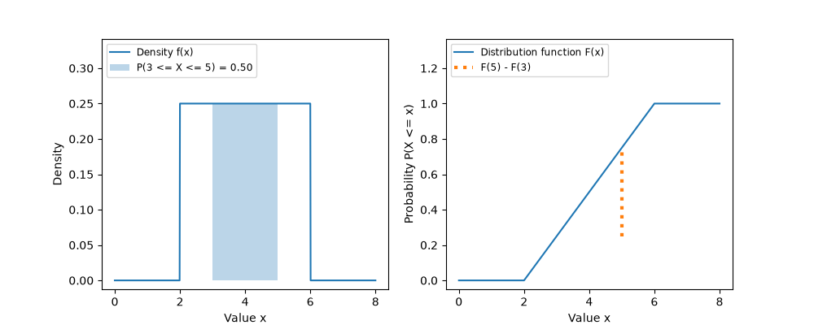
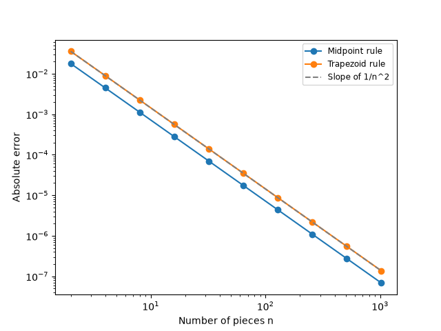
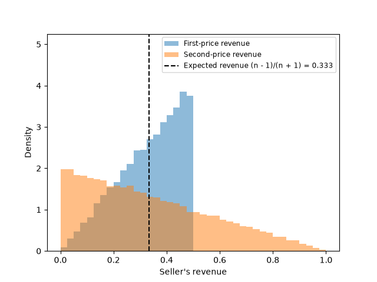

# 第 11 章: 積分とオークション

## 11.1 この章の地図

1 枚の絵を、2 人が競って買います。最も高い値を付けた人が買いますが、払う額の決め方は 2 通りあります。**自分の付けた値を払う**（ファーストプライス）か、**2 番目に高い値を払う**（セカンドプライス）かです。売り手にとって、どちらが得でしょうか。

答えを出すには、相手の評価額のように、0 から 1 のどの値もとりうる（**連続**の）量の確率と期待値が要ります。第 10 章の和 Σ に代わる道具が、**積分** ∫ です。この章では、積分を「細かく分けて足す」計算として作り、公式と数値の 2 つで確かめます。そのうえで、確率・オークション・消費者余剰・割引現在価値に使います。



| 項目 | 内容 |
| :--- | :--- |
| 経済学の題材 | オークション（ファーストプライス・セカンドプライス）、収入同値、正直な入札、消費者余剰、連続時間の割引現在価値、連続の期待効用 |
| 数学 | 積分の定義（区分求積）、中点法・台形法と誤差の次数、不定積分・定積分、微積分学の基本定理、密度関数・分布関数、連続確率変数の期待値、順序統計量（発展） |
| 使う Python の機能 | `functools.partial`、`math.comb`、`statistics`、`Literal`、`np.random.default_rng` と `rng.random`・`np.sort`、`ax.hist`・`ax.fill_between` |
| 新しく導入するライブラリ | なし（NumPy は第 7 章、乱数の生成器は第 9 章で導入済み） |
| 完成形 | `midpoint_rule_integral`、`trapezoid_rule_integral`、`quadrature_errors`、`polynomial_antiderivative`、`polynomial_definite_integral`、`uniform_density`、`uniform_cdf`、`continuous_expectation`、`continuous_expected_value`、`discretized_uniform_distribution`、`area_under_demand`、`continuous_present_value`、`order_statistic_density`、`expected_auction_revenue_formula`、`second_price_payoff`、`second_price_expected_revenue`、`first_price_equilibrium_bid`、`first_price_expected_revenue`、`simulate_auction_revenues`、`expected_order_statistic`・`first_price_expected_payoff`（発展） |
| ファイル | 実装: `lib/chapter11/integral.py`、`distribution.py`、`applications.py`、`auction.py`、`plot.py`（図）／テスト: `test/chapter11/test_integral.py`、`test_distribution.py`、`test_applications.py`、`test_auction.py`、`test_plot.py` |
| データ | なし（手計算できる関数と、種を固定した乱数だけ） |

### 数学の式とコードの対応

| 経済学・数学 | 式 | コード |
| :--- | :--- | :--- |
| 中点法 | ∫ f(x) dx ≈ Σ f(小区間の中点) × 幅 | `midpoint_rule_integral(func, low, high, pieces)` |
| 台形法 | ∫ f(x) dx ≈ Σ (両端の高さの平均) × 幅 | `trapezoid_rule_integral(func, low, high, pieces)` |
| 不定積分・定積分 | F' = f、∫ₐᵇ f(x) dx = F(b) − F(a) | `polynomial_antiderivative`、`polynomial_definite_integral` |
| 一様分布 | f(x) = 1 ÷ (b − a)、F(x) = (x − a) ÷ (b − a) | `uniform_density`、`uniform_cdf` |
| 連続の期待値 | E[g(X)] = ∫ g(x)·f(x) dx | `continuous_expectation`、`continuous_expected_value` |
| 消費者余剰 | ∫ q(p) dp（価格から、需要が 0 になる価格まで） | `area_under_demand(demand, low_price, high_price)` |
| 連続時間の割引現在価値 | ∫₀ᵀ c·e^(−rt) dt = c(1 − e^(−rT)) ÷ r | `continuous_present_value(flow, rate, horizon)` |
| k 番目に高い評価額の密度 | n·C(n − 1, k − 1)·v^(n−k)·(1 − v)^(k−1) | `order_statistic_density(value, bidders, rank)` |
| 期待収入（両方式） | (n − 1) ÷ (n + 1) | `expected_auction_revenue_formula(bidders)` |
| ファーストプライスの均衡入札 | b(v) = (n − 1) ÷ n × v | `first_price_equilibrium_bid(value, bidders)` |

> **記号について**: ∫ₐᵇ f(x) dx は「a から b まで、f(x) のグラフと横軸の間の面積」と読みます（横軸より下の部分は、負の面積として数えます）。dx は「x の小さな幅」を表す印です。この章のオークションでは、参加者 n 人の**評価額**（その品物に払ってよい最大の額）が、互いに独立に、0 から 1 の一様分布に従う、と置きます。

### 前提とする章

| できること | 場所 |
| :--- | :--- |
| 需要 q = a − b·p と消費者余剰（三角形の面積） | [第 1 章](01-linear-functions-and-markets.md) |
| 連続複利 e^(rt)、年金・永久債の現在価値 | [第 3 章](03-exponents-logarithms-and-interest.md)・[第 4 章](04-sequences-and-saving.md) |
| 多項式 `Polynomial`、数値微分 `numerical_derivative` | [第 5 章](05-derivatives-and-profit-maximization.md) |
| 離散の期待値・分散、期待効用と確実性等価 | [第 10 章](10-probability-and-risk.md) |

前の章の関数（第 1 章の `consumer_surplus`・`demand_quantity`、第 2 章の `argmax_on_grid`、第 3 章の `continuous_compound_amount`、第 4 章の `annuity_present_value`・`perpetuity_present_value`、第 5 章の `Polynomial`・`numerical_derivative`、第 10 章の `discrete_expected_value`・`discrete_variance`・`certainty_equivalent_of_lottery`）は、import して使います。この章に、その実装は再掲しません。消費者余剰の経済学（税と死荷重）は、[ミクロ経済学のためのプログラミング（初級）の第 9 章](../micro-basics-programming/09-surplus-and-tax.md) で扱います。

## 11.2 準備

```bash
cd apps/math-for-economics-programming/python
uv run pytest test/chapter11
```

```text
33 passed
```

自分でコードを書くときは、`practice/chapter11/` に、完成形と同じ名前のファイル（`integral.py`・`distribution.py`・`applications.py`・`auction.py`・`plot.py`・`test_integral.py`・`test_distribution.py`・`test_applications.py`・`test_auction.py`・`test_plot.py`）を作ります。図を後回しにするなら、`plot.py` と `test_plot.py` は要らず、テストは 30 件になります。

- テスト・check スクリプトの import を、`from practice.chapter11...` に書き換えます。**ほかのファイルを import している実装ファイル**（`distribution.py` と `applications.py` は `integral` を、`auction.py` は `distribution` を、`plot.py` は `integral`・`distribution`・`auction` を import します）も、同じく書き換えます。書き換えないと、完成形を動かすことになります
- 第 1〜5 章・第 10 章の関数（11.1 節の一覧）は、前の章を写していなければ、`lib.chapterNN...` のままでかまいません（写したなら、`practice.chapterNN...` に書き換えます）。`integral.py` も、第 5 章の `Polynomial` を import します。この章では、それらの実装を再掲しません
- テストの import の一覧は、完成形の**全関数**です。まだ書いていない関数を import すると、`ImportError` になります。関数を 1 つ書くたびに、名前を import に足してください

「予想の答え合わせ」のスクリプトは、`practice/chapter11/check.py` に保存し、`uv run python -m practice.chapter11.check` で実行します。

## 11.3 予想する

次の 5 つの問いに、**紙で、手計算で**答えてください。答えは、この節には書いてありません。「プログラミング」の節の「予想の答え合わせ」で確かめます。

- y = x² のグラフと横軸の間の、x = 0 から 1 までの面積は、いくつですか。区間を 4 等分し、各小区間の**中点の高さ**の長方形で近似すると、正しい面積より大きくなりますか、小さくなりますか
- 4 等分を 40 等分に変えると、近似の誤差は、およそ何分の 1 になりますか
- 第 1 章の需要 q = 120 − 2p で、価格 40 の消費者余剰を、需要曲線の下の面積（積分）で求めると、いくつですか。需要が曲線 q = 100 − p² のとき、価格 6 の消費者余剰は、2 点 (0, 10) と (64, 6) を結んだ三角形の面積 128 より、大きいですか、小さいですか
- 2 人の評価額が、独立に 0 から 1 の一様分布に従います。セカンドプライスなら、2 人とも評価額どおりに入札します。売り手の期待収入は、いくつですか。ファーストプライスなら、評価額 v の人は v/2 を入札します。期待収入は、セカンドプライスより多いですか、少ないですか
- 毎年 10 を、20 年間、途切れなく流れで受け取ります（割引率 5%、連続時間）。現在価値は、毎年末に 10 を受け取る年金の現在価値 124.62（第 4 章）より、大きいですか、小さいですか

## 11.4 積分とオークションの考え方

### オークションのいろいろ

| 方式 | 勝つ人 | 払う額 | 例 |
| :--- | :--- | :--- | :--- |
| ファーストプライス（封印入札） | 最高の入札者 | 自分の入札額 | 公共工事の入札（価格の低さを競う逆の形） |
| セカンドプライス（封印入札） | 最高の入札者 | 2 番目に高い入札額 | ネット広告の枠の販売の一部 |
| 競り上げ（イングリッシュ） | 最後まで残った人 | 2 番目の人が降りた額 | 美術品・魚の競り |

競り上げは、2 番目の人が降りたところで終わるので、払う額は、セカンドプライスと同じです。

### 分布関数と密度関数

評価額 X が、0 から 1 のどの値もとりうるとき、「X がちょうど 0.5」の確率は 0 です。連続の量では、**区間**に確率を割り当てます。

| 関数 | 定義 | 一様分布 [a, b] |
| :--- | :--- | :--- |
| 分布関数 F(x) | P(X ≤ x)（x 以下になる確率） | 区間の中で (x − a) ÷ (b − a)、左は 0、右は 1 |
| 密度関数 f(x) | 確率は、密度の下の面積 P(c ≤ X ≤ d) = ∫꜀ᵈ f(x) dx | 区間の中で 1 ÷ (b − a)、外は 0 |

11.1 節の図の左で塗った面積と、右の点線の長さが、同じ確率 P(3 ≤ X ≤ 5) です。密度の全体の面積は 1 です。密度は確率そのものでなく、「単位の幅あたりの確率」なので、1 を超えることもあります（[0, 0.5] の一様分布の密度は 2）。

### 積分の定義: 細かく分けて足す

区間 [a, b] を n 等分すると、小区間の幅は h = (b − a) ÷ n です。各小区間を、長方形か台形で近似して、面積を足します。

| 方法 | 小区間の面積 | 直線（1 次関数）なら |
| :--- | :--- | :--- |
| 中点法 | f(中点) × h | 正確 |
| 台形法 | (f(左端) + f(右端)) ÷ 2 × h | 正確 |

n を限りなく大きくした極限が、**定積分** ∫ₐᵇ f(x) dx です。滑らかな曲線なら、どちらの方法も、誤差がおよそ **1/n²** に比例します（誤差の次数が 2）。n を 2 倍にすると、誤差は約 1/4 です。同じ n なら、中点法の誤差は、台形法の約半分で、符号が逆です。

### 微積分学の基本定理

a から x までの面積を、x の関数 F(x) = ∫ₐˣ f(t) dt と見ます。x を少し動かすと、面積は、幅 × 高さ f(x) だけ増えます。だから **F'(x) = f(x)**、積分してから微分すると元に戻ります。逆に、微分すると f になる関数（**不定積分**、原始関数）F が分かれば、定積分は F(b) − F(a) で求まります。

多項式なら、冪の公式（第 5 章）を逆に使います。x^k の不定積分は x^(k+1) ÷ (k + 1) です（定数を足しても微分は同じなので、この章では定数を 0 にします）。

### 連続確率変数の期待値

離散の期待値 Σ x·P(X = x) の、和を積分に、確率を「密度 × 幅」に替えます。

> E[X] = ∫ x·f(x) dx、E[g(X)] = ∫ g(x)·f(x) dx

一様分布 [a, b] の期待値は、区間の真ん中 (a + b) ÷ 2、分散は (b − a)² ÷ 12 です。[0, 1] を n 個の値 1/n, 2/n, …, 1（どれも確率 1/n）で近似すると、離散の期待値は (n + 1) ÷ (2n) で、n を増やすと 1/2 に近づきます。期待効用も同じで、効用 u の期待値 E[u(X)] = ∫ u(x)·f(x) dx です。

### セカンドプライス・オークションの期待収入

セカンドプライスでは、**評価額どおりに入札するのが最適**です。勝ったときに払う額（相手の最高の入札額）は、自分の入札額で変わりません。自分の入札額が決めるのは、勝つか負けるかだけです。評価額どおりに入札すれば、「相手の最高の入札が評価額より低い（勝つと得をする）」ときに、ちょうど勝ちます。

全員が正直に入札すると、売り手の収入は、**2 番目に高い評価額**です。n 人の評価額のうち、k 番目に高い値の密度は、次の数え上げで求まります。

> n·C(n − 1, k − 1)·v^(n−k)·(1 − v)^(k−1)

その値を出す人の選び方が n 通り、残りの n − 1 人から、v より上の k − 1 人を選ぶ選び方が C(n − 1, k − 1) 通りです。v より下の n − k 人の確率が v^(n−k)、上の k − 1 人の確率が (1 − v)^(k−1) です。最高（k = 1）なら n·v^(n−1)、2 番目（k = 2）なら n(n − 1)·v^(n−2)·(1 − v) です。2 番目の密度に v を掛けて積分すると、期待収入が求まります。

> E[2 番目の評価額] = ∫₀¹ v·n(n − 1)·v^(n−2)·(1 − v) dv = (n − 1) ÷ (n + 1)

### ファーストプライス・オークションの期待収入

ファーストプライスでは、評価額どおりに入札すると、勝っても利得が 0 です。だから評価額より低く入札します。相手が全員、評価額の一定割合で入札するとき、互いに最適になる（**ナッシュ均衡**の）入札は、次のとおりです（導出は発展）。

> b(v) = (n − 1) ÷ n × v

入札額は評価額の増加関数なので、最高の評価額の人が勝ち、b(最高の評価額) を払います。期待収入は、最高の評価額の密度 n·v^(n−1) を使って、∫₀¹ b(v)·n·v^(n−1) dv です。

経済学の意味を 1 行で言うと、オークションの決め方の違いは、入札の仕方を変えるが、売り手の期待収入は変えない（**収入同値定理**）。値を手で計算する前に、プログラムで 2 つの積分を比べます。

### 積分の応用: 余剰と割引現在価値

| 応用 | 積分 | 離散の版（前の章） |
| :--- | :--- | :--- |
| 消費者余剰 | 価格 p から、需要が 0 になる価格までの ∫ q(p) dp | 直線の需要なら三角形の面積（第 1 章） |
| 価格の上昇による余剰の減少 | 上がる前の価格から上がった後の価格までの ∫ q(p) dp | なし |
| 連続時間の割引現在価値 | ∫₀ᵀ c·e^(−rt) dt = c(1 − e^(−rT)) ÷ r | 年金 C(1 − (1 + r)^(−n)) ÷ r（第 4 章） |

消費者余剰は、価格が p から少し上がるたびに失う需要量 q(p) を、足し合わせたものです。需要が曲線なら、三角形では求まらず、積分が要ります。q = 100/p のように需要が 0 にならない曲線では、余剰そのものが有限になりません。それでも、価格が変わったときの余剰の**変化**は、区間の積分で求まります。

割引現在価値は、時刻 t の受け取り c·dt を、連続複利で割り引いた c·e^(−rt) dt を、足し合わせたものです。r = 0 なら、割り引かないので、c·T です。

??? note "発展: 順序統計量と、ファーストプライスのナッシュ均衡"

    **順序統計量**: n 個の一様乱数を大きい順に並べた k 番目の値の期待値は、密度に v を掛けて積分すると、(n − k + 1) ÷ (n + 1) です。n 個の値が、[0, 1] を平均して n + 1 等分する位置に並ぶ、と覚えられます。セカンドプライスの期待収入は k = 2 の場合、最高の評価額の期待値は k = 1 の場合 n ÷ (n + 1) です。

    **ナッシュ均衡の導出**: 相手が全員 β(v) = c·v（c は定数）で入札するとします。自分が b を入札して勝つのは、n − 1 人の相手全員の入札が b 未満のときで、その確率は (b ÷ c)^(n−1) です（b ≤ c のとき）。評価額 v の人の期待利得は、

    > π(b) = (v − b)·(b ÷ c)^(n−1)

    です。b で微分して 0 と置くと、−b^(n−1) + (n − 1)(v − b)·b^(n−2) = 0 から、b = (n − 1) ÷ n × v です。この最適な入札も「評価額の一定割合」なので、全員がこの入札をすると、誰も入札を変える理由がありません（c = (n − 1) ÷ n）。これが、均衡入札です。

## 11.5 プログラミング

### Red: 数値積分のテスト

`test_integral.py` の先頭の import と、テストで使い回す 3 次の多項式・x³ の関数です（完成形の全関数）。

```python
import functools
import math

import pytest

from lib.chapter05.derivative import Polynomial, numerical_derivative
from lib.chapter11.integral import (
    midpoint_rule_integral,
    polynomial_antiderivative,
    polynomial_definite_integral,
    quadrature_errors,
    trapezoid_rule_integral,
)
```

```python
CUBIC = Polynomial((1, -2, 0, 3))


def _cube(x: float) -> float:
    return x**3
```

最初のテストは、手で計算できる面積です。直線なら、どちらの方法も、1 等分でも正確です。x³ では、1 等分・2 等分の値を手計算で確かめ、1000 等分で正しい面積 4 に近いことを見ます。

```python
def test_直線の下の面積は中点法でも台形法でも台形の面積に一致する() -> None:
    # 2x + 1 の 1 から 4 までの面積: 台形 (3 + 9) × 3 ÷ 2 = 18
    for rule in (midpoint_rule_integral, trapezoid_rule_integral):
        assert rule(lambda x: 2 * x + 1, 1, 4, 3) == pytest.approx(18)
        assert rule(lambda x: 2 * x + 1, 1, 4, 1) == pytest.approx(18)


def test_曲線では分割を細かくするほど正しい面積に近づく() -> None:
    # x³ の 0 から 2 までの面積は 2⁴ ÷ 4 = 4
    assert midpoint_rule_integral(_cube, 0, 2, 1) == pytest.approx(2)
    assert trapezoid_rule_integral(_cube, 0, 2, 1) == pytest.approx(8)
    assert midpoint_rule_integral(_cube, 0, 2, 2) == pytest.approx(3.5)
    assert trapezoid_rule_integral(_cube, 0, 2, 2) == pytest.approx(5)
    assert midpoint_rule_integral(_cube, 0, 2, 1000) == pytest.approx(4, abs=1e-5)
    assert trapezoid_rule_integral(_cube, 0, 2, 1000) == pytest.approx(4, abs=1e-5)
```

`lib.chapter11.integral` がないので、収集の時点で失敗します（**Red**）。

### Green: 中点法と台形法

`integral.py` の先頭の import です。

```python
from collections.abc import Callable, Sequence

from lib.chapter05.derivative import Polynomial
```

```python
IntegrationRule = Callable[[Callable[[float], float], float, float, int], float]


def _require_pieces(pieces: int) -> None:
    if pieces < 1:
        raise ValueError("分割数は、1 以上でなければなりません")


def midpoint_rule_integral(
    func: Callable[[float], float], low: float, high: float, pieces: int
) -> float:
    """中点法: 区間を pieces 等分し、各小区間の中点の高さ × 幅を足す。"""
    _require_pieces(pieces)
    width = (high - low) / pieces
    return sum(func(low + (i + 0.5) * width) for i in range(pieces)) * width


def trapezoid_rule_integral(
    func: Callable[[float], float], low: float, high: float, pieces: int
) -> float:
    """台形法: 各小区間の両端の高さの平均 × 幅を足す（両端の点は半分だけ数える）。"""
    _require_pieces(pieces)
    width = (high - low) / pieces
    inner = sum(func(low + i * width) for i in range(1, pieces))
    return (func(low) / 2 + inner + func(high) / 2) * width
```

- 中点法の i 番目の小区間の中点は、low + (i + 0.5) × 幅 です。足してから、最後に 1 回だけ幅を掛けます
- 台形法は、隣り合う台形が辺を共有するので、内側の点は 1 回、両端の点は半分だけ数えます
- `IntegrationRule` は、「関数・下端・上端・分割数を受け取り、面積を返す関数」の型の別名です。2 つの方法を、同じ形の引数として渡せます

### 分割数と誤差

```python
def test_分割数を2倍にすると誤差はおよそ4分の1になる() -> None:
    pieces = [10, 20, 40, 80]
    for rule in (midpoint_rule_integral, trapezoid_rule_integral):
        errors = quadrature_errors(rule, math.exp, math.e - 1, 0, 1, pieces)
        for coarse, fine in zip(errors, errors[1:], strict=False):
            assert coarse / fine == pytest.approx(4, rel=0.01)
    # 同じ分割数なら、中点法の誤差は台形法の誤差のおよそ半分
    midpoint = quadrature_errors(
        midpoint_rule_integral, math.exp, math.e - 1, 0, 1, [10]
    )
    trapezoid = quadrature_errors(
        trapezoid_rule_integral, math.exp, math.e - 1, 0, 1, [10]
    )
    assert midpoint[0] / trapezoid[0] == pytest.approx(0.5, rel=0.01)
```

```python
def quadrature_errors(
    rule: IntegrationRule,
    func: Callable[[float], float],
    exact: float,
    low: float,
    high: float,
    pieces: Sequence[int],
) -> list[float]:
    """分割数ごとの、数値積分と正しい値の差（絶対値）。"""
    if not pieces:
        raise ValueError("分割数を、1 つ以上与えてください")
    return [abs(rule(func, low, high, n) - exact) for n in pieces]
```

e^x の 0 から 1 までの正しい面積は e − 1 です。分割数を 2 倍にするたびに、誤差の比がほぼ 4 になることで、誤差の次数が 2 だと分かります。

### 公式の積分と、微積分学の基本定理

```python
def test_多項式の不定積分は冪の公式の逆で微分すると元に戻る() -> None:
    # 1 − 2x + 3x³ の不定積分は x − x² + (3/4)x⁴（定数は 0）
    antiderivative = polynomial_antiderivative(CUBIC)
    assert antiderivative.coefficients == pytest.approx((0, 1, -1, 0, 0.75))
    assert antiderivative.derivative() == CUBIC
    assert polynomial_antiderivative(Polynomial((5,))).coefficients == (0, 5)


def test_定積分は不定積分の差で数値積分と一致する() -> None:
    # F(2) − F(−1) = (2 − 4 + 12) − (−1 − 1 + 0.75) = 11.25
    assert polynomial_definite_integral(CUBIC, -1, 2) == pytest.approx(11.25)
    for low, high in [(-1, 2), (0, 0.5), (1.5, 3)]:
        exact = polynomial_definite_integral(CUBIC, low, high)
        assert midpoint_rule_integral(CUBIC, low, high, 2000) == pytest.approx(exact)
        assert trapezoid_rule_integral(CUBIC, low, high, 2000) == pytest.approx(exact)


def test_積分してから微分すると元の関数に戻る() -> None:
    # 微積分学の基本定理: F(x) = ∫₀ˣ f(t) dt なら F'(x) = f(x)
    for func in (math.cos, math.exp, lambda t: 1 / (1 + t)):
        area = functools.partial(midpoint_rule_integral, func, 0, pieces=2000)
        for x in (0.3, 1.0, 2.5):
            slope = numerical_derivative(area, x, step=1e-3)
            assert slope == pytest.approx(func(x), rel=1e-5)
```

```python
def polynomial_antiderivative(poly: Polynomial) -> Polynomial:
    """不定積分: x^k を x^(k+1) ÷ (k + 1) にする（冪の公式の逆。積分定数は 0）。"""
    terms = [c / (k + 1) for k, c in enumerate(poly.coefficients)]
    return Polynomial((0, *terms))


def polynomial_definite_integral(poly: Polynomial, low: float, high: float) -> float:
    """定積分 ∫ f(x) dx = F(high) − F(low)。F は不定積分。"""
    antiderivative = polynomial_antiderivative(poly)
    return antiderivative(high) - antiderivative(low)
```

- 不定積分は、係数 c_k を c_k ÷ (k + 1) にして、次数を 1 つ上げます。先頭に定数項 0 を足すと、全体が 1 つずれます。第 5 章の `Polynomial` の `derivative` で微分すると、元の多項式に戻ります（**公式どうしの確認**）
- 最後のテストは、基本定理を**数値どうし**で確かめます。`functools.partial(midpoint_rule_integral, func, 0, pieces=2000)` は、関数と下端と分割数を固定し、上端 x だけを受け取る関数 F(x) を作ります（第 8 章）。その F を、第 5 章の `numerical_derivative` で微分すると、元の関数の値に戻ります

### 密度関数・分布関数と、連続の期待値

`test_distribution.py` の先頭です。第 10 章の離散の期待値・分散と、確実性等価も import します。

```python
import functools
import math
from fractions import Fraction

import pytest

from lib.chapter05.derivative import numerical_derivative
from lib.chapter10.expectation import discrete_expected_value, discrete_variance
from lib.chapter10.risk import certainty_equivalent_of_lottery
from lib.chapter11.distribution import (
    continuous_expectation,
    continuous_expected_value,
    discretized_uniform_distribution,
    uniform_cdf,
    uniform_density,
)
from lib.chapter11.integral import midpoint_rule_integral
```

```python
TWO_TO_SIX = functools.partial(uniform_density, low=2, high=6)


def test_一様分布の密度は区間の中で一定で外では0() -> None:
    assert uniform_density(0.3) == 1
    assert [TWO_TO_SIX(x) for x in (2, 3, 5.5, 6)] == [0.25] * 4
    assert [TWO_TO_SIX(x) for x in (1.9, 6.1, -4)] == [0, 0, 0]
    # 密度の下の面積（全体の確率）は 1
    assert midpoint_rule_integral(TWO_TO_SIX, 2, 6, 100) == pytest.approx(1)


def test_分布関数はその値以下になる確率で密度の下の面積() -> None:
    def cdf(x: float) -> float:
        return uniform_cdf(x, low=2, high=6)

    assert [cdf(x) for x in (1, 2, 3, 4, 6, 9)] == [0, 0, 0.25, 0.5, 1, 1]
    assert [uniform_cdf(x) for x in (-1, 0.3, 2)] == [0, 0.3, 1]
    # 3 と 5 の間になる確率 = F(5) − F(3) = 密度の下の面積
    assert cdf(5) - cdf(3) == pytest.approx(0.5)
    assert midpoint_rule_integral(TWO_TO_SIX, 3, 5, 10) == pytest.approx(0.5)
    # 分布関数を微分すると、密度に戻る（微積分学の基本定理）
    for x in (2.5, 4.2, 5.9):
        assert numerical_derivative(cdf, x, step=1e-4) == pytest.approx(TWO_TO_SIX(x))


def test_連続の期待値はxかける密度の積分で一様分布なら区間の真ん中() -> None:
    assert continuous_expected_value(uniform_density, 0, 1) == pytest.approx(0.5)
    for low, high in [(2, 6), (-3, 1), (10, 10.5)]:
        density = functools.partial(uniform_density, low=low, high=high)
        mean = continuous_expected_value(density, low, high)
        assert mean == pytest.approx((low + high) / 2)
```

`distribution.py` の先頭の import です。

```python
from collections.abc import Callable
from fractions import Fraction

from lib.chapter11.integral import midpoint_rule_integral
```

```python
def _require_interval(low: float, high: float) -> None:
    if low >= high:
        raise ValueError("区間は、下端より上端が大きくなければなりません")


def uniform_density(x: float, low: float = 0, high: float = 1) -> float:
    """一様分布の密度 f(x) = 1 ÷ (high − low)（区間の中）、区間の外では 0。"""
    _require_interval(low, high)
    return 1 / (high - low) if low <= x <= high else 0


def uniform_cdf(x: float, low: float = 0, high: float = 1) -> float:
    """一様分布の分布関数 F(x) = P(X ≤ x)。区間の中では (x − low) ÷ (high − low)。"""
    _require_interval(low, high)
    return min(max((x - low) / (high - low), 0), 1)


def continuous_expectation(
    value: Callable[[float], float],
    density: Callable[[float], float],
    low: float,
    high: float,
    pieces: int = 10_000,
) -> float:
    """E[g(X)] = ∫ g(x)·f(x) dx。離散の Σ g(x)·P(x) の、和を積分に替えたもの。"""
    return midpoint_rule_integral(lambda x: value(x) * density(x), low, high, pieces)


def continuous_expected_value(
    density: Callable[[float], float], low: float, high: float, pieces: int = 10_000
) -> float:
    """連続確率変数の期待値 E[X] = ∫ x·f(x) dx。"""
    return continuous_expectation(lambda x: x, density, low, high, pieces)
```

- `low <= x <= high` は、2 つの比較をつないだ書き方で、「low ≤ x かつ x ≤ high」です
- 分布関数は、(x − low) ÷ (high − low) を、`max(..., 0)` で 0 以上に、`min(..., 1)` で 1 以下に切りそろえます
- `continuous_expectation` は、g(x)·f(x) を中点法で積分します。期待値は g(x) = x の場合です。分割数の既定値は 10000 にしています（√x のように、端で傾きが急な関数でも、誤差を小さくするため）

### 離散と連続の対比

第 10 章の `discrete_expected_value`・`discrete_variance` は、値 → 確率の辞書を受け取りました。[0, 1] の一様分布を、n 個の値の辞書で近似して、連続の値と比べます。

```python
def test_一様分布を細かく離散化すると離散の期待値と分散が連続の値に近づく() -> None:
    ten = discretized_uniform_distribution(10)
    assert list(ten) == [Fraction(k, 10) for k in range(1, 11)]
    assert set(ten.values()) == {Fraction(1, 10)}
    assert discrete_expected_value(ten) == Fraction(11, 20)
    assert discrete_variance(ten) == Fraction(99, 1200)
    # 点を増やすと、期待値のずれは 1 ÷ (2n) で 0 に近づく
    for points in (10, 100, 1000):
        mean = discrete_expected_value(discretized_uniform_distribution(points))
        assert mean - Fraction(1, 2) == Fraction(1, 2 * points)
    fine = discretized_uniform_distribution(1000)
    variance = continuous_expectation(lambda x: (x - 0.5) ** 2, uniform_density, 0, 1)
    assert variance == pytest.approx(1 / 12)
    assert float(discrete_variance(fine)) == pytest.approx(variance, rel=1e-5)


def test_連続の期待効用は効用かける密度の積分() -> None:
    # 0 から 100 の一様分布で、効用 √x: (1/100)·∫₀¹⁰⁰ √x dx = 20/3
    density = functools.partial(uniform_density, low=0, high=100)
    expected_utility = continuous_expectation(math.sqrt, density, 0, 100)
    assert expected_utility == pytest.approx(20 / 3, rel=1e-6)
    # 確実性等価は (20/3)² ≈ 44.4。0 か 100 の賭け（第 10 章）の 25 より大きい
    certainty_equivalent = expected_utility**2
    assert certainty_equivalent == pytest.approx(400 / 9, rel=1e-5)
    coin = {0: Fraction(1, 2), 100: Fraction(1, 2)}
    assert certainty_equivalent > certainty_equivalent_of_lottery(coin, math.sqrt)
    assert continuous_expected_value(density, 0, 100) == pytest.approx(50)
```

```python
def discretized_uniform_distribution(points: int) -> dict[Fraction, Fraction]:
    """[0, 1] の一様分布を、1/n, 2/n, …, 1 の n 個の値（どれも確率 1/n）で近似する。"""
    if points < 1:
        raise ValueError("点の数は、1 以上でなければなりません")
    return {Fraction(k, points): Fraction(1, points) for k in range(1, points + 1)}
```

離散の期待値は、分数で**厳密に** (n + 1) ÷ (2n) です。1/2 とのずれ 1 ÷ (2n) は、右端の高さで長方形を作った近似の誤差です。期待効用のテストでは、0 から 100 の一様分布の確実性等価（約 44.4）が、0 か 100 かの賭け（第 10 章）の 25 より大きいことも確かめます。期待値は同じ 50 でも、一様分布のほうが、端の値になりにくく、リスクが小さいからです。

### 消費者余剰と、連続時間の割引現在価値

`test_applications.py` の先頭です。第 1・3・4・5 章の関数を import します。

```python
import functools
import math

import pytest

from lib.chapter01.market import consumer_surplus, demand_quantity
from lib.chapter03.interest import continuous_compound_amount
from lib.chapter04.sequence import annuity_present_value, perpetuity_present_value
from lib.chapter05.derivative import Polynomial
from lib.chapter11.applications import area_under_demand, continuous_present_value
from lib.chapter11.integral import midpoint_rule_integral, polynomial_definite_integral
```

```python
def test_直線の需要の消費者余剰は積分でも第1章の三角形と同じ400() -> None:
    demand = functools.partial(demand_quantity, a=120, b=2)
    # 需要がちょうど 0 になる価格 60 まで、需要曲線の下を積分する
    assert area_under_demand(demand, 40, 60) == pytest.approx(400)
    assert consumer_surplus(40, 120, 2) == pytest.approx(400)
    for a, b, price in [(90, 3, 10), (50, 0.5, 64)]:
        demand = functools.partial(demand_quantity, a=a, b=b)
        area = area_under_demand(demand, price, a / b)
        assert area == pytest.approx(consumer_surplus(price, a, b))


def test_曲線の需要の消費者余剰は三角形では求まらない() -> None:
    # q = 100 − p²。価格 6 で q = 64、需要が 0 になる価格は 10
    demand = Polynomial((100, 0, -1))
    exact = polynomial_definite_integral(demand, 6, 10)
    assert exact == pytest.approx(416 / 3)
    assert area_under_demand(demand, 6, 10) == pytest.approx(exact)
    triangle = (10 - 6) * demand(6) / 2
    assert triangle == 128
    assert exact - triangle == pytest.approx(32 / 3)


def test_価格が上がったときの余剰の減少は価格の区間の積分() -> None:
    # q = 100/p は、需要が 0 になる価格がない。2 から 4 への値上げの減少は 100·ln 2
    loss = area_under_demand(lambda p: 100 / p, 2, 4)
    assert loss == pytest.approx(100 * math.log(2), rel=1e-6)
    # 上端を 4 倍にするたびに、面積は 100·ln 4 ずつ増え続け、上限がない
    highs = (8, 32, 128)
    areas = [area_under_demand(lambda p: 100 / p, 2, high) for high in highs]
    assert areas == pytest.approx([100 * math.log(h / 2) for h in highs], rel=1e-3)


def test_連続時間の割引現在価値は割引かけた流れの積分() -> None:
    # 毎年 10 の流れを 20 年、割引率 5%: 10(1 − e^(−1)) ÷ 0.05 ≈ 126.42
    value = continuous_present_value(10, 0.05, 20)
    assert value == pytest.approx(200 * (1 - math.exp(-1)))
    assert round(value, 2) == 126.42

    def discounted(t: float) -> float:
        return 10 / continuous_compound_amount(1, 0.05, t)

    assert midpoint_rule_integral(discounted, 0, 20, 1000) == pytest.approx(value)
    assert continuous_present_value(4, 0.1, 5) == pytest.approx(
        40 * (1 - math.exp(-0.5))
    )


def test_連続の流れは期末払いの年金より早く受け取るので価値が高く永久なら同じ() -> None:
    annuity = annuity_present_value(10, 0.05, 20)
    assert round(annuity, 2) == 124.62
    assert continuous_present_value(10, 0.05, 20) > annuity
    long = continuous_present_value(10, 0.05, 1000)
    assert long == pytest.approx(perpetuity_present_value(10, 0.05))
```

`applications.py` の先頭の import です。

```python
import math
from collections.abc import Callable

from lib.chapter11.integral import midpoint_rule_integral
```

```python
def area_under_demand(
    demand: Callable[[float], float],
    low_price: float,
    high_price: float,
    pieces: int = 1000,
) -> float:
    """需要曲線の下、価格 low から high までの面積 ∫ q(p) dp。"""
    if low_price > high_price:
        raise ValueError("下の価格は、上の価格以下でなければなりません")
    return midpoint_rule_integral(demand, low_price, high_price, pieces)


def continuous_present_value(flow: float, rate: float, horizon: float) -> float:
    """毎年 flow の流れを horizon 年受け取る現在価値 ∫₀ᵀ c·e^(−rt) dt。"""
    if horizon < 0:
        raise ValueError("期間は、0 以上でなければなりません")
    if rate == 0:
        return flow * horizon
    return flow * (1 - math.exp(-rate * horizon)) / rate
```

- `functools.partial(demand_quantity, a=120, b=2)` は、第 1 章の `demand_quantity(price, a, b)` の a と b を固定し、価格だけを受け取る需要関数を作ります
- 第 5 章の `Polynomial` は、呼び出すと値を返すので、需要関数としてそのまま渡せます。公式の定積分（`polynomial_definite_integral`）と数値積分を、同じ多項式で比べられます
- 割引の係数 e^(−rt) は、第 3 章の連続複利の元利合計 e^(rt) の逆数です。テストでは、`continuous_compound_amount(1, 0.05, t)` で割って、積分の中身を作っています

### オークション

`test_auction.py` の先頭です。発展の節の関数（`expected_order_statistic`・`first_price_expected_payoff`）と、第 2 章の `argmax_on_grid` も、import の一覧に入っています。

```python
import functools
import statistics
from fractions import Fraction

import pytest

from lib.chapter02.quadratic import argmax_on_grid
from lib.chapter11.auction import (
    expected_auction_revenue_formula,
    expected_order_statistic,
    first_price_equilibrium_bid,
    first_price_expected_payoff,
    first_price_expected_revenue,
    order_statistic_density,
    second_price_expected_revenue,
    second_price_payoff,
    simulate_auction_revenues,
)
from lib.chapter11.distribution import continuous_expected_value
from lib.chapter11.integral import midpoint_rule_integral
```

まず、k 番目に高い評価額の密度と、セカンドプライスの「正直が最適」です。正直のテストは、いろいろな相手の入札に対して、0 から 1 まで 0.05 刻みのどの入札も、評価額どおりの入札より利得が大きくならないことを確かめます。

```python
def test_最高の評価額と2番目の評価額の密度() -> None:
    # 3 人なら、最高は 3v²、2 番目は 6v(1 − v)
    assert order_statistic_density(0.5, 3, 1) == pytest.approx(0.75)
    assert order_statistic_density(0.5, 3, 2) == pytest.approx(1.5)
    assert order_statistic_density(0.2, 4, 2) == pytest.approx(12 * 0.2**2 * 0.8)
    # 1 人なら、最高の評価額は一様分布そのもの
    assert order_statistic_density(0.3, 1, 1) == 1
    for bidders, rank in [(2, 1), (2, 2), (5, 1), (5, 2), (5, 4)]:
        density = functools.partial(order_statistic_density, bidders=bidders, rank=rank)
        assert midpoint_rule_integral(density, 0, 1, 1000) == pytest.approx(1, rel=1e-5)
    # 3 人の最高が 0.5 以下になる確率 = 3 人とも 0.5 以下 = (1/2)³
    below_half = midpoint_rule_integral(
        lambda v: order_statistic_density(v, 3, 1), 0, 0.5, 1000
    )
    assert below_half == pytest.approx(1 / 8, rel=1e-5)


def test_セカンドプライスでは評価額どおりの入札がどの入札より悪くない() -> None:
    assert second_price_payoff(0.7, 0.7, [0.4, 0.2]) == pytest.approx(0.3)
    # 高く入札しすぎると、評価額より高く払って損をする
    assert second_price_payoff(0.7, 0.9, [0.8]) == pytest.approx(-0.1)
    # 低く入札しすぎると、得られた 0.1 を逃す
    assert second_price_payoff(0.7, 0.5, [0.6]) == 0
    # 同じ入札額なら、勝たない（この章の約束）
    assert second_price_payoff(0.7, 0.6, [0.6]) == 0
    bids = [i / 20 for i in range(21)]
    for value in (0.25, 0.7):
        for rivals in ([0.1], [0.5, 0.3], [0.65, 0.9], [0.2, 0.24, 0.6]):
            truthful = second_price_payoff(value, value, rivals)
            assert all(truthful >= second_price_payoff(value, b, rivals) for b in bids)
```

`auction.py` の先頭の import です。

```python
import functools
import math
from collections.abc import Sequence
from fractions import Fraction
from typing import Literal

import numpy as np

from lib.chapter11.distribution import continuous_expectation, continuous_expected_value
```

```python
def _require_bidders(bidders: int) -> None:
    if bidders < 2:
        raise ValueError("オークションには、2 人以上の参加者が必要です")


def _require_rank(bidders: int, rank: int) -> None:
    if not 1 <= rank <= bidders:
        raise ValueError("順位は、1 から人数までです")


def order_statistic_density(value: float, bidders: int, rank: int) -> float:
    """n 人で rank 番目に高い評価額の密度 n·C(n−1, k−1)·v^(n−k)·(1 − v)^(k−1)。"""
    _require_rank(bidders, rank)
    ways = bidders * math.comb(bidders - 1, rank - 1)
    return float(ways * value ** (bidders - rank) * (1 - value) ** (rank - 1))


def second_price_payoff(value: float, bid: float, rival_bids: Sequence[float]) -> float:
    """セカンドプライス: 最高の入札なら勝ち、相手の最高の入札額を払う。利得を返す。"""
    if not rival_bids:
        raise ValueError("競争相手が、1 人以上必要です")
    highest_rival = max(rival_bids)
    return value - highest_rival if bid > highest_rival else 0
```

- `math.comb(n, k)` は、n 個から k 個を選ぶ組合せの数 C(n, k) です
- 同じ入札額のときは、勝たないことにしています（`bid > highest_rival`）。評価額は連続なので、同点になる確率は 0 です

次に、2 つの方式の期待収入を、積分と公式で比べます。

```python
def test_セカンドプライスの期待収入は2番目の評価額の期待値() -> None:
    assert expected_auction_revenue_formula(2) == Fraction(1, 3)
    assert second_price_expected_revenue(2) == pytest.approx(1 / 3, rel=1e-5)
    for bidders in (3, 4, 6):
        formula = expected_auction_revenue_formula(bidders)
        assert formula == Fraction(bidders - 1, bidders + 1)
        revenue = second_price_expected_revenue(bidders)
        assert revenue == pytest.approx(float(formula), rel=1e-5)


def test_ファーストプライスの均衡入札は評価額を割り引き期待収入は同じ() -> None:
    assert first_price_equilibrium_bid(0.6, 2) == pytest.approx(0.3)
    assert first_price_equilibrium_bid(0.9, 3) == pytest.approx(0.6)
    assert first_price_equilibrium_bid(0.8, 5) == pytest.approx(0.64)
    # 収入同値: 入札は低いが、最高の評価額の人が払うので、期待収入は同じ
    for bidders in (2, 3, 5):
        first = first_price_expected_revenue(bidders)
        assert first == pytest.approx(second_price_expected_revenue(bidders), rel=1e-5)
        formula = float(expected_auction_revenue_formula(bidders))
        assert first == pytest.approx(formula, rel=1e-5)
```

```python
def expected_auction_revenue_formula(bidders: int) -> Fraction:
    """売り手の期待収入の公式 (n − 1) ÷ (n + 1)（2 番目に高い評価額の期待値）。"""
    _require_bidders(bidders)
    return Fraction(bidders - 1, bidders + 1)


def second_price_expected_revenue(bidders: int, pieces: int = 1000) -> float:
    """セカンドプライスの期待収入 = 2 番目に高い評価額の期待値 ∫ v·f₍₂₎(v) dv。"""
    _require_bidders(bidders)
    second = functools.partial(order_statistic_density, bidders=bidders, rank=2)
    return continuous_expected_value(second, 0, 1, pieces)


def first_price_equilibrium_bid(value: float, bidders: int) -> float:
    """ファーストプライスの均衡入札 b(v) = (n − 1) ÷ n × v（評価額を割り引く）。"""
    _require_bidders(bidders)
    return (bidders - 1) / bidders * value


def first_price_expected_revenue(bidders: int, pieces: int = 1000) -> float:
    """ファーストプライスの期待収入 = 最高の評価額の人の入札 ∫ b(v)·f₍₁₎(v) dv。"""
    _require_bidders(bidders)
    bid = functools.partial(first_price_equilibrium_bid, bidders=bidders)
    highest = functools.partial(order_statistic_density, bidders=bidders, rank=1)
    return continuous_expectation(bid, highest, 0, 1, pieces)
```

`functools.partial(order_statistic_density, bidders=bidders, rank=2)` は、評価額だけを受け取る密度関数です。それを `continuous_expected_value` に渡すと、2 番目の評価額の期待値が求まります。ファーストプライスは、入札の関数 b(v) と最高の評価額の密度を、`continuous_expectation` に渡します。積分の部品（期待値の関数）を、オークションにそのまま使い回しています。

### シミュレーション: 乱数でオークションを繰り返す

積分の答えを、乱数で評価額を引く実験で確かめます。第 10 章と同じく、種を固定し、許容誤差を付けて比べます。

```python
def test_シミュレーションの平均収入は公式に近い() -> None:
    for bidders in (2, 5):
        formula = float(expected_auction_revenue_formula(bidders))
        for rule in ("first", "second"):
            revenues = simulate_auction_revenues(bidders, 20_000, seed=1, rule=rule)
            assert len(revenues) == 20_000
            # 標準誤差は 0.002 以下。その 5 倍ほどの幅で比べる
            assert statistics.fmean(revenues) == pytest.approx(formula, abs=0.01)


def test_平均は同じでもセカンドプライスの収入のほうがばらつく() -> None:
    first = simulate_auction_revenues(2, 20_000, seed=2, rule="first")
    second = simulate_auction_revenues(2, 20_000, seed=2, rule="second")
    # 2 人なら、分散はファーストが 1/72、セカンドが 1/18
    assert statistics.pvariance(first) == pytest.approx(1 / 72, abs=0.002)
    assert statistics.pvariance(second) == pytest.approx(1 / 18, abs=0.004)
    # 2 人なら、ファーストの収入は最高の評価額の半分で 0.5 を超えない。セカンドは超える
    assert all(f <= 0.5 for f in first)
    assert max(second) > 0.9
```

```python
def simulate_auction_revenues(
    bidders: int, rounds: int, seed: int, rule: Literal["first", "second"]
) -> list[float]:
    """評価額を乱数で引き、rounds 回のオークションの、各回の売り手の収入を返す。"""
    _require_bidders(bidders)
    if rounds < 1:
        raise ValueError("回数は、1 以上でなければなりません")
    rng = np.random.default_rng(seed)
    values = np.sort(rng.random((rounds, bidders)), axis=1)
    if rule == "second":
        return [float(v) for v in values[:, -2]]
    return [first_price_equilibrium_bid(float(v), bidders) for v in values[:, -1]]
```

この章で新しく使う NumPy の道具は、次の 3 つです。

| 書き方 | 意味 |
| :--- | :--- |
| `rng.random((rounds, bidders))` | 0 以上 1 未満の一様乱数を、rounds 行 × bidders 列の表に並べる（1 行が 1 回のオークション） |
| `np.sort(表, axis=1)` | 各行の中を、小さい順に並べ替える |
| `表[:, -2]` | すべての行の、右から 2 番目の列（各回の 2 番目に高い評価額） |

`statistics.fmean`・`statistics.pvariance` は、標準ライブラリの平均・分散です。2 人なら、セカンドプライスの収入（2 人のうち低いほうの評価額）の分散は 1/18、ファーストプライスの収入（高いほうの評価額の半分）の分散は 1/72 で、平均が同じでも、ばらつきは 4 倍違います。

### 発展: 順序統計量と、ファーストプライスの均衡

??? note "順序統計量と均衡入札のテストと実装（発展。後回しにしても、学習は成り立ちます）"

    1 つ目のテストは、k 番目に高い値の期待値の公式を、密度の積分と比べます。2 つ目は、相手が均衡入札をするときの期待利得を、第 2 章の `argmax_on_grid` で 0 から評価額まで 10001 点探し、最大になる入札が (n − 1) ÷ n × v になることを確かめます。

    ```python
    def test_k番目に高い評価額の期待値は人数と順位で決まる() -> None:
        # (n − k + 1) ÷ (n + 1)。4 人なら、4/5・3/5・2/5・1/5 と等間隔に並ぶ
        assert [expected_order_statistic(4, k) for k in (1, 2, 3, 4)] == [
            Fraction(4, 5),
            Fraction(3, 5),
            Fraction(2, 5),
            Fraction(1, 5),
        ]
        for bidders, rank in [(2, 2), (5, 1), (5, 3), (7, 6)]:
            density = functools.partial(order_statistic_density, bidders=bidders, rank=rank)
            mean = continuous_expected_value(density, 0, 1, 1000)
            expected = float(expected_order_statistic(bidders, rank))
            assert mean == pytest.approx(expected, rel=1e-5)
        with pytest.raises(ValueError):
            expected_order_statistic(3, 4)


    def test_ファーストプライスで相手が均衡入札なら自分も均衡入札が最適() -> None:
        # 相手が 1 人で v/2 を入札するとき、評価額 0.8 の人の期待利得は (0.8 − b)·2b
        assert first_price_expected_payoff(0.8, 0.3, 2) == pytest.approx(0.5 * 0.6)
        # 入札が高すぎて、相手の入札の上限を超えると、必ず勝つ
        assert first_price_expected_payoff(0.8, 0.6, 2) == pytest.approx(0.2)
        for value, bidders in [(0.8, 2), (0.6, 3), (0.9, 5)]:
            payoff = functools.partial(first_price_expected_payoff, value, bidders=bidders)
            best = argmax_on_grid(payoff, 0, value, 10_001)
            expected = first_price_equilibrium_bid(value, bidders)
            assert best == pytest.approx(expected, abs=1e-3)
    ```

    ```python
    def expected_order_statistic(bidders: int, rank: int) -> Fraction:
        """n 個の一様乱数の、rank 番目に大きい値の期待値 (n − k + 1) ÷ (n + 1)。"""
        _require_rank(bidders, rank)
        return Fraction(bidders - rank + 1, bidders + 1)


    def first_price_expected_payoff(value: float, bid: float, bidders: int) -> float:
        """相手が全員 b(v) で入札するとき、bid で入札する人の期待利得 (v − b)·P(勝つ)。"""
        rival_below = min(bid * bidders / (bidders - 1), 1)
        return (value - bid) * rival_below ** (bidders - 1)
    ```

    相手 1 人の入札 c·V（c = (n − 1) ÷ n）が b 未満になる確率は、b ÷ c です。b が c 以上なら必ず勝つので、`min(..., 1)` で 1 に抑えます。

### 予想の答え合わせ

```python
import math

from lib.chapter01.market import consumer_surplus
from lib.chapter04.sequence import annuity_present_value
from lib.chapter05.derivative import Polynomial
from lib.chapter11.applications import area_under_demand, continuous_present_value
from lib.chapter11.auction import (
    expected_auction_revenue_formula,
    first_price_equilibrium_bid,
    first_price_expected_revenue,
    second_price_expected_revenue,
    simulate_auction_revenues,
)
from lib.chapter11.integral import (
    midpoint_rule_integral,
    polynomial_definite_integral,
    quadrature_errors,
)

print(midpoint_rule_integral(lambda x: x**2, 0, 1, 4))
errors = quadrature_errors(midpoint_rule_integral, lambda x: x**2, 1 / 3, 0, 1, [4, 40])
print([f"{e:.3e}" for e in errors], round(errors[0] / errors[1], 3))
print(round(area_under_demand(lambda p: 120 - 2 * p, 40, 60), 6))
print(consumer_surplus(40, 120, 2))
curve = Polynomial((100, 0, -1))
print(round(polynomial_definite_integral(curve, 6, 10), 4), (10 - 6) * curve(6) / 2)
print(expected_auction_revenue_formula(2), round(second_price_expected_revenue(2), 6))
print(first_price_equilibrium_bid(0.8, 2), round(first_price_expected_revenue(2), 6))
for rule in ("second", "first"):
    revenues = simulate_auction_revenues(2, 20_000, seed=1, rule=rule)
    print(rule, round(sum(revenues) / len(revenues), 3))
print(round(continuous_present_value(10, 0.05, 20), 2))
print(round(annuity_present_value(10, 0.05, 20), 2))
```

```text
0.328125
['5.208e-03', '5.208e-05'] 100.0
400.0
400.0
138.6667 128.0
1/3 0.333334
0.4 0.333333
second 0.333
first 0.333
126.42
124.62
```

- **1 つ目の問い**: 正しい面積は、x² の不定積分 x³/3 から、1/3 − 0 = **1/3**（約 0.3333）です。中点法の 4 等分は (0.125² + 0.375² + 0.625² + 0.875²) × 0.25 = **0.328125** で、正しい値より**小さい**です。下に凸（谷形）の曲線では、中点の高さの長方形が、曲線の盛り上がりを取りこぼします
- **2 つ目の問い**: 誤差は 5.208 × 10⁻³ から 5.208 × 10⁻⁵ へ、**約 1/100** です。分割数を 10 倍にすると、誤差は 10² 分の 1 です（誤差の次数 2）。下の図は、e^x の積分で、分割数と誤差を両対数で描いたものです。2 つの方法の線が、傾き −2 の灰色の点線と平行です
- **3 つ目の問い**: 積分は **400** で、第 1 章の三角形の面積と同じです。曲線 q = 100 − p² の余剰は、不定積分 100p − p³/3 から **416/3 ≈ 138.67** で、三角形の 128 より**大きい**です。需要曲線が上に膨らんでいる（凹）ので、2 点を結んだ直線より、曲線の下の面積が大きくなります
- **4 つ目の問い**: セカンドプライスの期待収入は、2 人のうち低いほうの評価額の期待値で、(2 − 1) ÷ (2 + 1) = **1/3** です。ファーストプライスは、高いほうの評価額（期待値 2/3）の半分を払うので、期待収入は**同じ 1/3** です（収入同値）。積分の値の末尾のずれ（0.333334）は、中点法（1000 等分）の誤差です。シミュレーションでも、どちらも約 0.333 です。ただし、下の図のように、収入の**ばらつき**は違います。ファーストプライスの収入は 0.5 を超えず、真ん中に集まります
- **5 つ目の問い**: 流れの現在価値は **126.42** で、年金の 124.62 より**大きい**です。年金は、各年の受け取りが年末まで待たされますが、流れは年の途中から少しずつ受け取るので、早く受け取る分だけ、割り引かれ方が小さいのです





### 境界のテスト

完成形には、ほかに**境界**を確かめるテストがあります。上端と下端の入れ替え・同じ点、分割数が 0 以下、区間の下端と上端が同じか逆の一様分布、点の数が 0、割引率 0・期間 0・期間が負、価格の区間が逆、種の再現性、参加者が 1 人以下、順位が 0 や人数を超える、競争相手がいない、オークションの回数が 0 です。テストの件数を合わせるため、ここに載せます。

??? note "境界のテスト"

    ```python
    def test_上端と下端を入れ替えると符号が変わり同じ点なら0() -> None:
        for rule in (midpoint_rule_integral, trapezoid_rule_integral):
            assert rule(math.exp, 1, 0, 100) == pytest.approx(-rule(math.exp, 0, 1, 100))
            assert rule(math.exp, 0.7, 0.7, 10) == 0
        assert polynomial_definite_integral(CUBIC, 2, -1) == pytest.approx(-11.25)


    def test_分割数は1以上() -> None:
        for rule in (midpoint_rule_integral, trapezoid_rule_integral):
            for pieces in (0, -3):
                with pytest.raises(ValueError):
                    rule(math.exp, 0, 1, pieces)
        with pytest.raises(ValueError):
            quadrature_errors(midpoint_rule_integral, math.exp, 1, 0, 1, [])
    ```

    ```python
    def test_一様分布の区間は下端より上端が大きい() -> None:
        for low, high in [(1, 1), (3, 2)]:
            with pytest.raises(ValueError):
                uniform_density(1.5, low, high)
            with pytest.raises(ValueError):
                uniform_cdf(1.5, low, high)
        with pytest.raises(ValueError):
            discretized_uniform_distribution(0)
        assert discretized_uniform_distribution(1) == {Fraction(1): Fraction(1)}
    ```

    ```python
    def test_割引率0なら流れの合計で期間は0以上で価格の区間は下から上() -> None:
        assert continuous_present_value(10, 0, 20) == 200
        assert continuous_present_value(10, 0.05, 0) == 0
        with pytest.raises(ValueError):
            continuous_present_value(10, 0.05, -1)
        with pytest.raises(ValueError):
            area_under_demand(lambda p: 100 / p, 4, 2)
        assert area_under_demand(lambda p: 100 / p, 3, 3) == 0
    ```

    ```python
    def test_種が同じなら結果も同じ() -> None:
        first = simulate_auction_revenues(3, 50, seed=7, rule="second")
        assert first == simulate_auction_revenues(3, 50, seed=7, rule="second")
        assert first != simulate_auction_revenues(3, 50, seed=8, rule="second")


    def test_オークションは2人以上で順位は1から人数まで() -> None:
        for bad in (1, 0):
            with pytest.raises(ValueError):
                second_price_expected_revenue(bad)
            with pytest.raises(ValueError):
                first_price_equilibrium_bid(0.5, bad)
            with pytest.raises(ValueError):
                simulate_auction_revenues(bad, 10, seed=1, rule="first")
            with pytest.raises(ValueError):
                expected_auction_revenue_formula(bad)
        with pytest.raises(ValueError):
            simulate_auction_revenues(2, 0, seed=1, rule="first")
        assert len(simulate_auction_revenues(2, 1, seed=1, rule="first")) == 1
        for bidders, rank in [(3, 0), (3, 4), (0, 1)]:
            with pytest.raises(ValueError):
                order_statistic_density(0.5, bidders, rank)
        with pytest.raises(ValueError):
            second_price_payoff(0.5, 0.5, [])
    ```

### 図

図の実装の import です。

```python
from collections.abc import Callable, Sequence
from typing import Literal

import matplotlib.pyplot as plt
import numpy as np
from matplotlib.figure import Figure

from lib.chapter11.auction import (
    expected_auction_revenue_formula,
    simulate_auction_revenues,
)
from lib.chapter11.distribution import uniform_cdf, uniform_density
from lib.chapter11.integral import (
    midpoint_rule_integral,
    quadrature_errors,
    trapezoid_rule_integral,
)
```

11.1 節の一様分布の図と、予想の答え合わせの誤差の図・オークションの図です。テストでは、密度・分布関数の各点の値、塗った領域の端、点線の長さ F(5) − F(3)、ヒストグラムの棒の高さ（`np.histogram` で数え直した値）、期待収入の縦線の位置、誤差の各点と傾き −2 の直線を確かめます。

??? note "描画のテストと実装（後回しにしても、学習は成り立ちます）"

    テストの import:

    ```python
    import math

    import matplotlib.pyplot as plt
    import numpy as np
    import pytest
    from matplotlib.axes import Axes

    from lib.chapter11.auction import (
        expected_auction_revenue_formula,
        simulate_auction_revenues,
    )
    from lib.chapter11.integral import (
        midpoint_rule_integral,
        quadrature_errors,
        trapezoid_rule_integral,
    )
    from lib.chapter11.plot import (
        plot_auction_revenues,
        plot_integration_errors,
        plot_uniform_distribution,
    )
    ```

    ```python
    def _series(ax: Axes, label: str) -> tuple[list[float], list[float]]:
        line = next(x for x in ax.lines if x.get_label() == label)
        xs = np.asarray(line.get_xdata(), dtype=float).tolist()
        ys = np.asarray(line.get_ydata(), dtype=float).tolist()
        return xs, ys


    def test_分布の図は密度の下の面積と分布関数の差で同じ確率を示す() -> None:
        density_ax, cdf_ax = plot_uniform_distribution(2, 6, 3, 5).axes
        xs, ys = _series(density_ax, "Density f(x)")
        assert (xs[0], xs[-1]) == (0, 8)
        assert ys == pytest.approx([0.25 if 2 <= x <= 6 else 0 for x in xs])
        (area,) = density_ax.collections
        assert area.get_label() == "P(3 <= X <= 5) = 0.50"
        corners = np.asarray(area.get_paths()[0].vertices, dtype=float)
        assert (corners[:, 0].min(), corners[:, 0].max()) == pytest.approx((3, 5))
        assert (corners[:, 1].min(), corners[:, 1].max()) == pytest.approx((0, 0.25))
        xs, ys = _series(cdf_ax, "Distribution function F(x)")
        assert ys == pytest.approx([min(max((x - 2) / 4, 0), 1) for x in xs])
        assert _series(cdf_ax, "F(5) - F(3)") == ([5, 5], [0.25, 0.75])
        # 凡例が線に重ならないよう、縦軸の上に余白がある
        assert density_ax.get_ylim()[1] > 0.3 and cdf_ax.get_ylim()[1] > 1.2
        for ax in (density_ax, cdf_ax):
            assert ax.get_xlabel() == "Value x"
            assert ax.get_legend() is not None
        plt.close("all")


    def test_オークションの図は2つの方式の収入の分布と公式の平均() -> None:
        ax = plot_auction_revenues(2, 2000, seed=3).axes[0]
        first, second = ax.containers
        # ヒストグラムの名前は、最初の棒に付く
        assert first[0].get_label() == "First-price revenue"
        assert second[0].get_label() == "Second-price revenue"
        heights = [b.get_height() for b in first]
        expected, _ = np.histogram(
            simulate_auction_revenues(2, 2000, seed=3, rule="first"),
            bins=np.linspace(0, 1, 41),
            density=True,
        )
        assert heights == pytest.approx(expected.tolist())
        tallest = max(b.get_height() for bars in ax.containers for b in bars)
        assert ax.get_ylim()[1] > tallest * 1.2
        mean = float(expected_auction_revenue_formula(2))
        xs, _ = _series(ax, "Expected revenue (n - 1)/(n + 1) = 0.333")
        assert xs == pytest.approx([mean, mean])
        assert ax.get_xlabel() == "Seller's revenue"
        assert ax.get_legend() is not None
        plt.close("all")


    def test_誤差の図は分割数と誤差を両対数で描く() -> None:
        pieces = [2, 4, 8, 16]
        ax = plot_integration_errors(math.exp, math.e - 1, 0, 1, pieces).axes[0]
        for label, rule in [
            ("Midpoint rule", midpoint_rule_integral),
            ("Trapezoid rule", trapezoid_rule_integral),
        ]:
            xs, ys = _series(ax, label)
            assert xs == pieces
            assert ys == pytest.approx(
                quadrature_errors(rule, math.exp, math.e - 1, 0, 1, pieces)
            )
        xs, ys = _series(ax, "Slope of 1/n^2")
        assert xs == pieces
        # 台形法の最初の点から始まり、n を 2 倍にするたびに 1/4 になる
        assert ys[0] == _series(ax, "Trapezoid rule")[1][0]
        assert [y * n**2 for y, n in zip(ys, xs, strict=True)] == pytest.approx(
            [ys[0] * 4] * 4
        )
        assert ax.get_xscale() == "log" and ax.get_yscale() == "log"
        assert ax.get_xlabel() == "Number of pieces n"
        assert ax.get_legend() is not None
        plt.close("all")
    ```

    ```python
    def plot_uniform_distribution(
        low: float, high: float, shaded_low: float, shaded_high: float
    ) -> Figure:
        """左に密度（塗った面積が確率）、右に分布関数（2 点の高さの差が、同じ確率）。"""
        margin = (high - low) / 2
        xs = np.linspace(low - margin, high + margin, 801).tolist()
        probability = uniform_cdf(shaded_high, low, high) - uniform_cdf(
            shaded_low, low, high
        )
        fig, (density_ax, cdf_ax) = plt.subplots(1, 2, figsize=(10, 4))
        density_ax.plot(
            xs, [uniform_density(x, low, high) for x in xs], label="Density f(x)"
        )
        shaded = np.linspace(shaded_low, shaded_high, 101).tolist()
        density_ax.fill_between(
            shaded,
            [uniform_density(x, low, high) for x in shaded],
            alpha=0.3,
            label=f"P({shaded_low:g} <= X <= {shaded_high:g}) = {probability:.2f}",
        )
        cdf_ax.plot(
            xs, [uniform_cdf(x, low, high) for x in xs], label="Distribution function F(x)"
        )
        cdf_ax.plot(
            [shaded_high, shaded_high],
            [uniform_cdf(shaded_low, low, high), uniform_cdf(shaded_high, low, high)],
            ":",
            lw=3,
            label=f"F({shaded_high:g}) - F({shaded_low:g})",
        )
        for ax, ylabel in [(density_ax, "Density"), (cdf_ax, "Probability P(X <= x)")]:
            ax.set_xlabel("Value x")
            ax.set_ylabel(ylabel)
            ax.set_ylim(top=ax.get_ylim()[1] * 1.3)
            ax.legend(fontsize="small", loc="upper left")
        plt.close(fig)
        return fig


    def plot_auction_revenues(bidders: int, rounds: int, seed: int) -> Figure:
        """2 つの方式の、売り手の収入のヒストグラムと、公式の期待収入の縦線。"""
        bins = np.linspace(0, 1, 41).tolist()
        rules: list[tuple[Literal["first", "second"], str]] = [
            ("first", "First-price"),
            ("second", "Second-price"),
        ]
        fig, ax = plt.subplots()
        for rule, label in rules:
            revenues = simulate_auction_revenues(bidders, rounds, seed, rule=rule)
            ax.hist(revenues, bins=bins, density=True, alpha=0.5, label=f"{label} revenue")
        mean = float(expected_auction_revenue_formula(bidders))
        ax.axvline(
            mean,
            ls="--",
            color="black",
            label=f"Expected revenue (n - 1)/(n + 1) = {mean:.3f}",
        )
        ax.set_xlabel("Seller's revenue")
        ax.set_ylabel("Density")
        ax.set_ylim(top=ax.get_ylim()[1] * 1.3)
        ax.legend(fontsize="small")
        plt.close(fig)
        return fig


    def plot_integration_errors(
        func: Callable[[float], float],
        exact: float,
        low: float,
        high: float,
        pieces: Sequence[int],
    ) -> Figure:
        """分割数と誤差を両対数で描く。傾き −2 の直線（誤差 ∝ 1/n²）と比べる。"""
        pieces = list(pieces)
        fig, ax = plt.subplots()
        for label, rule in [
            ("Midpoint rule", midpoint_rule_integral),
            ("Trapezoid rule", trapezoid_rule_integral),
        ]:
            errors = quadrature_errors(rule, func, exact, low, high, pieces)
            ax.plot(pieces, errors, "o-", label=label)
        # 台形法（最後に描いた線）の、最初の点を通る、傾き −2 の直線
        reference = [errors[0] * (pieces[0] / n) ** 2 for n in pieces]
        ax.plot(pieces, reference, "--", color="gray", label="Slope of 1/n^2")
        ax.set_xscale("log")
        ax.set_yscale("log")
        ax.set_xlabel("Number of pieces n")
        ax.set_ylabel("Absolute error")
        ax.legend(fontsize="small")
        plt.close(fig)
        return fig
    ```

    - `ax.fill_between(xs, ys)` は、曲線と横軸の間を塗ります（第 5 章）。塗った領域は `ax.collections` に入ります
    - `ax.hist(値の並び, bins=区切り, density=True)` は、ヒストグラムを、面積の合計が 1 になる高さ（密度）で描きます。`np.histogram` は、描かずに、同じ高さを数えます
    - `ax.axvline(x)` は、x の位置に縦線を引きます。`ax.set_xscale("log")` で、横軸を対数目盛にします

### 実行結果

```bash
uv run pytest test/chapter11
```

```text
33 passed
```

## 11.6 規則で言うと

1. **積分は、細かく分けて足した極限。** 中点法・台形法は、分割数 n で誤差がおよそ 1/n² に減る。直線なら、どちらも正確
2. **微積分学の基本定理。** 積分してから微分すると元に戻る。だから、不定積分 F が分かれば、∫ₐᵇ f(x) dx = F(b) − F(a)
3. **連続の量の確率は、密度の下の面積。** P(c ≤ X ≤ d) = F(d) − F(c)。1 点の確率は 0
4. **連続の期待値は、和を積分に替える。** E[g(X)] = ∫ g(x)·f(x) dx。一様分布 [a, b] の平均は (a + b) ÷ 2
5. **消費者余剰は、需要曲線の下の面積。** 直線なら三角形、曲線なら積分。余剰の変化は、価格の区間の積分
6. **セカンドプライスでは、正直な入札が最適。** ファーストプライスでは、(n − 1) ÷ n × v に割り引く。期待収入は、どちらも (n − 1) ÷ (n + 1)
7. **公式・数値積分・シミュレーションの 3 つの答えを、突き合わせる。** シミュレーションは、種を固定し、許容誤差を付ける

混同しやすい点を、表にまとめます。

| 混同しやすい点 | 違い |
| :--- | :--- |
| 密度と確率 | 密度は単位の幅あたりの確率で、1 を超えることもある。確率は、密度の下の面積 |
| 不定積分と定積分 | 不定積分は関数（微分すると f になる F）。定積分は数（F(b) − F(a)） |
| 中点法と台形法 | どちらも誤差の次数は 2。同じ分割数なら、中点法の誤差は台形法の約半分で、符号が逆 |
| 期待収入と収入のばらつき | 収入同値は、期待値が同じという主張。ばらつき（分散）は、方式で違う |
| 消費者余剰と余剰の変化 | q = 100/p のように、余剰そのものが有限にならない需要もある。価格が変わったときの変化は、区間の積分で求まる |

### このモデルが成り立たない場面

- **評価額が独立とは限りません。** 油田の採掘権のように、品物の価値が全員に共通で、各自が不確かな見積もりを持つなら、最高の見積もりの人が勝つこと自体が、「見積もりが高すぎた」知らせになります（勝者の呪い）。収入同値は、そのままでは成り立ちません
- **入札者が危険回避なら、収入は同じになりません。** 危険回避の入札者は、ファーストプライスで負けるのを嫌って、高めに入札します。そのため、ファーストプライスの期待収入のほうが大きくなります
- **数値積分は、とがった関数・端で発散する関数に弱い。** 1/√x の 0 から 1 までの積分（答えは 2）は、中点法でも誤差がゆっくりとしか減りません。台形法は、端の値が無限大で計算できません。誤差の次数 2 は、滑らかな関数の話です
- **連続の量は、モデルの近似です。** 実際の入札は円単位で、同点もありえます。同点の決め方（くじ・先着）を、決めておく必要があります

## 11.7 練習問題

| 種類 | 問題 |
| :--- | :--- |
| 想起 | 本文を閉じて、2x + 1 の 1 から 4 までの面積が、中点法でも台形法でも 18 になるテストと、第 1 章の需要 q = 120 − 2p の価格 40 の消費者余剰が、`area_under_demand` で 400 になるテストを書いてください |
| 生成 | 解説を見る前に、中点法の 2 倍と台形法を足して 3 で割る `simpson_rule_integral(func, low, high, pieces)` を、テストから書いてください（シンプソン法）。x³ の 0 から 2 までの面積が 1 等分でも正確に 4 になること、e^x の積分で、分割数を 2 倍にすると誤差がおよそ何分の 1 になるかも、確かめてください |
| 多様 | 第 1 章の供給 q = −20 + 2p（`supply_quantity(price, c=-20, d=2)`）で、価格 40 の**生産者余剰**を、積分で求めてください。供給が 0 になる価格から、価格 40 までの、供給曲線の下の面積です。第 1 章の `producer_surplus` と一致しますか |
| 交互 | [第 4 章](04-sequences-and-saving.md) の `annuity_present_value` で、毎年 10 を、1 年を m 回に分けて（1 回 10/m、利子率 0.05/m、20m 回）受け取る年金の現在価値を、m = 1, 12, 365 で求めてください。前の章を写していなければ、`lib.chapter04...` のままでかまいません（写したなら、`practice.chapter04...` に書き換えます）。m を増やすと、`continuous_present_value(10, 0.05, 20)` に近づきますか |

??? note "解答（先に自分で取り組んでから、開いてください）"

    解答のテストの import です（写経では、`lib.chapter11` を `practice.chapter11` に書き換えます。第 1・4 章の関数は、前の章を写していなければ、`lib.chapterNN...` のままでかまいません（写したなら、`practice.chapterNN...` に書き換えます））。

    ```python
    import functools
    import math
    from collections.abc import Callable

    import pytest

    from lib.chapter01.market import demand_quantity, producer_surplus, supply_quantity
    from lib.chapter04.sequence import annuity_present_value
    from lib.chapter11.applications import area_under_demand, continuous_present_value
    from lib.chapter11.integral import (
        midpoint_rule_integral,
        quadrature_errors,
        trapezoid_rule_integral,
    )
    ```

    **想起**:

    ```python
    def test_最初の積分のテスト() -> None:
        for rule in (midpoint_rule_integral, trapezoid_rule_integral):
            assert rule(lambda x: 2 * x + 1, 1, 4, 3) == pytest.approx(18)
        demand = functools.partial(demand_quantity, a=120, b=2)
        assert area_under_demand(demand, 40, 60) == pytest.approx(400)
    ```

    **生成**: 中点法と台形法の誤差は、符号が逆で、大きさが約 1 : 2 です。中点法を 2 倍して台形法と足すと、2 次の誤差が打ち消し合います。3 次の多項式まで正確で、誤差は約 1/16（次数 4）に減ります。関数は `practice/chapter11/exercises.py` に書き、テストからは `from practice.chapter11.exercises import simpson_rule_integral` で import します。

    ```python
    def simpson_rule_integral(
        func: Callable[[float], float], low: float, high: float, pieces: int
    ) -> float:
        midpoint = midpoint_rule_integral(func, low, high, pieces)
        trapezoid = trapezoid_rule_integral(func, low, high, pieces)
        return (2 * midpoint + trapezoid) / 3
    ```

    ```python
    def test_シンプソン法は3次式まで正確で誤差は16分の1ずつ減る() -> None:
        assert simpson_rule_integral(lambda x: x**3, 0, 2, 1) == pytest.approx(4)
        errors = quadrature_errors(simpson_rule_integral, math.exp, math.e - 1, 0, 1, [2, 4, 8])
        assert errors[0] / errors[1] == pytest.approx(16, rel=0.01)
        assert errors[1] / errors[2] == pytest.approx(16, rel=0.01)
    ```

    **多様**: 供給が 0 になる価格は 10 です。∫₁₀⁴⁰ (−20 + 2p) dp = [p² − 20p]₁₀⁴⁰ = 800 − (−100) = **900** で、第 1 章の `producer_surplus` と一致します。

    ```python
    def test_生産者余剰も積分で求まる() -> None:
        supply = functools.partial(supply_quantity, c=-20, d=2)
        area = midpoint_rule_integral(supply, 10, 40, 100)
        assert area == pytest.approx(900)
        assert producer_surplus(40, -20, 2) == pytest.approx(area)
    ```

    **交互**: m = 1 で 124.62、m = 12 で約 126.27、m = 365 で約 126.42 と増え、連続の 126.42 に近づきます。受け取りを細かく分けるほど、平均して早く受け取り、割引も連続複利に近づくからです。

    ```python
    def test_年金を細かく分けると連続の流れの現在価値に近づく() -> None:
        values = [annuity_present_value(10 / m, 0.05 / m, 20 * m) for m in (1, 12, 365)]
        assert values[0] < values[1] < values[2]
        flow = continuous_present_value(10, 0.05, 20)
        assert values[2] == pytest.approx(flow, abs=0.01)
        assert values[2] < flow
    ```

## 11.8 振り返り

- うまくいったこと:
- 詰まったこと:
- 次に試すこと:

## 11.9 まとめ

- 積分は、区間を細かく分けて足した極限。中点法・台形法の誤差は、分割数 n の 2 乗に反比例して減ることを、実験で確かめた
- 微積分学の基本定理で、積分と微分は逆の操作。多項式なら、不定積分の公式で、定積分が正確に求まる
- 連続の量の確率は密度の下の面積、期待値は ∫ x·f(x) dx。離散の値を細かくすると、第 10 章の離散の期待値が、連続の期待値に近づく
- 消費者余剰は需要曲線の下の面積。直線の需要では、第 1 章の三角形の 400 と一致し、曲線の需要では、積分でしか求まらない
- 評価額が一様分布なら、セカンドプライス（正直な入札）とファーストプライス（割り引いた入札）の期待収入は、どちらも (n − 1) ÷ (n + 1)。積分・公式・シミュレーションの 3 つの答えが一致した

この章は、時間の流れを、連続の量として積分で扱いました。次の第 12 章では、時間を 1 期・2 期ととびとびに進め、今期の値から来期の値を決める**漸化式**で、経済の成長を追います。
