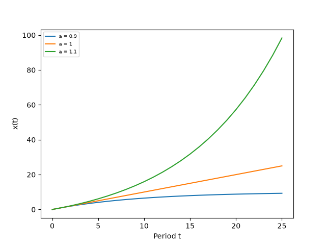
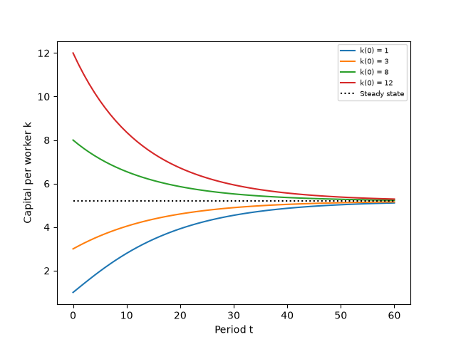
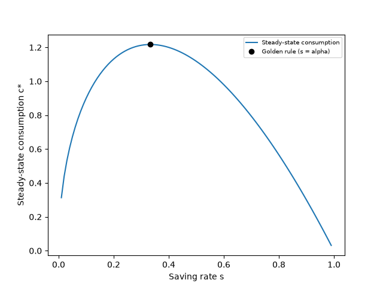
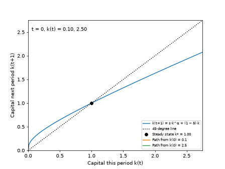

# 第 12 章: 漸化式と経済成長

## 12.1 この章の地図

第 4 章の発展で、漸化式 x(t + 1) = a·x(t) + b を、`iterate_map` で反復しました。反復は、t 期の値を知るのに、t 回の計算が要ります。この章では、反復せずに t 期の値を求める**閉じた解**を導き、反復と一致することをテストにします。

経済成長の基本モデル（**ソロー・モデル**）は、「今期の資本から、来期の資本が決まる」漸化式です。ただし、1 次式ではありません。それでも、**定常状態**（動かなくなる点）・**収束するか**・**どれだけ速く収束するか**は、この章の 1 次の漸化式の道具で調べられます。この章は、第 3 部（第 9〜12 章）と、連載の最後の章で、**到達チェック**も行います。



| 項目 | 内容 |
| :--- | :--- |
| 経済学の題材 | 経済成長、ソロー・モデル（資本の蓄積・定常状態）、黄金律の貯蓄率、収束の速さ、人口成長と技術進歩（発展） |
| 数学 | 1 次の漸化式の閉じた解、収束・発散・振動の分類、半減期（対数）、非線形の漸化式の不動点、不動点の近くでの線形近似（数値微分） |
| 使う Python の機能 | `pytest.mark.parametrize`、`lambda`、テスト（`pytest`） |
| 新しく導入するライブラリ | なし |
| 完成形 | `recurrence_closed_form`、`classify_linear_recurrence`、`recurrence_half_life`、`solow_next_capital`、`solow_capital_path`、`solow_steady_state_capital`、`solow_steady_state_consumption`、`golden_rule_saving_by_grid`、`solow_convergence_factor`、`solow_next_capital_with_growth`、`solow_steady_state_with_growth` |
| ファイル | 実装: `lib/chapter12/recurrence.py`（1 次の漸化式）、`lib/chapter12/solow.py`（ソロー・モデル）、`lib/chapter12/plot.py`（図）／テスト: `test/chapter12/test_recurrence.py`、`test/chapter12/test_solow.py`、`test/chapter12/test_plot.py` |
| データ | なし（手計算できる小さな例だけ） |

### 数学の式とコードの対応

| 経済学・数学 | 式 | コード |
| :--- | :--- | :--- |
| 1 次の漸化式の閉じた解 | x(t) = a^t·(x(0) − x*) + x*、x* = b ÷ (1 − a) | `recurrence_closed_form(a, b, start, t)` |
| ふるまいの分類 | \|a\| < 1 なら収束、\|a\| > 1 なら発散、a < 0 なら振動 | `classify_linear_recurrence(a)` |
| 半減期 | \|a\|^n = 1/2 を解いた n = ln 2 ÷ (−ln \|a\|) | `recurrence_half_life(a)` |
| 資本の蓄積 | k(t + 1) = s·k(t)^α + (1 − δ)·k(t) | `solow_next_capital(k, s, alpha, delta)` |
| 定常状態 | s·k^α = δ·k から k* = (s ÷ δ)^(1 ÷ (1 − α)) | `solow_steady_state_capital(s, alpha, delta)` |
| 定常状態の消費 | c* = k*^α − δ·k* | `solow_steady_state_consumption(s, alpha, delta)` |
| 収束の速さ | 定常状態での傾き 1 − δ(1 − α) | `solow_convergence_factor(alpha, delta)` |

> **記号について**: k は労働者 1 人あたりの資本、s は貯蓄率、α は資本の分配率（生産関数 f(k) = k^α の指数）、δ は資本の減耗率です。x* は、漸化式の不動点（定常状態）です。

### 前提とする章

| できること | 場所 |
| :--- | :--- |
| 漸化式を反復し、不動点 b ÷ (1 − a) を求める（`iterate_map`・`affine_fixed_point`） | [第 4 章](04-sequences-and-saving.md)の発展 |
| 対数で「何年で倍になるか」を解く（`years_to_multiply`） | [第 3 章](03-exponents-logarithms-and-interest.md) |
| 数値微分（`numerical_derivative`）で傾きを求める | [第 5 章](05-derivatives-and-profit-maximization.md) |
| 格子探索（`argmax_on_grid`）で最大の点を探す | [第 2 章](02-quadratics-monopoly-and-oligopoly.md) |

差分方程式とソロー・モデルの**経済学**（データとの比較・所得の調整・収束の議論）は、[マクロ経済学のためのプログラミング（中級＋）の第 4 章](../macro-programming/04-difference-equations.md)（差分方程式）と[第 5 章](../macro-programming/05-solow-model.md)（ソロー・モデル）で扱います。この章は、そこで使う数学（漸化式）を、関数とテストで確かめます。

## 12.2 準備

```bash
cd apps/math-for-economics-programming/python
uv run pytest test/chapter12
```

```text
62 passed
```

自分でコードを書くときは、`practice/chapter12/` に、完成形と同じ名前のファイル（`recurrence.py`・`solow.py`・`plot.py`・`test_recurrence.py`・`test_solow.py`・`test_plot.py`）を作ります。図を後回しにするなら、`plot.py` と `test_plot.py` は要らず、テストは 58 件になります。

- 3 つのテスト・`plot.py`・check スクリプトの import を、`from practice.chapter12...` に書き換えます（`test_solow.py` は `recurrence` を、`plot.py` は `solow` を import します。書き換えないと、完成形を動かします）
- 第 2〜5 章の関数（`argmax_on_grid`・`years_to_multiply`・`iterate_map`・`affine_fixed_point`・`numerical_derivative`）は、前の章を写していなければ、`lib.chapterNN...` のままでかまいません（写したなら、`practice.chapterNN...` に書き換えます）。この章では、それらの実装を再掲しません
- テストの import の一覧は、完成形の**全関数**です。まだ書いていない関数を import すると、`ImportError` になります。関数を 1 つ書くたびに、名前を import に足してください

「予想の答え合わせ」のスクリプトは、`practice/chapter12/check.py` に保存し、`uv run python -m practice.chapter12.check` で実行します。

## 12.3 予想する

次の 5 つの問いに、**紙で、手計算で**答えてください。答えは、この節には書いてありません。「プログラミング」の節の「予想の答え合わせ」で確かめます。

- x(t + 1) = 0.5·x(t) + 6、x(0) = 20 です。不動点と、x(1)・x(2)・x(3) は、いくつですか。a を −0.5 に変え、x(0) = 0 にすると、x(1)・x(2)・x(3) は、どう動きますか。収束しますか
- ソロー・モデルで、s = 0.3、α = 1/3、δ = 0.1 です。定常状態の資本 k*、1 人あたりの生産 y* = k*^α、消費 c* = (1 − s)·y* は、いくつですか（小数第 3 位まで）
- 貯蓄率を 0.3 から 1/3 に上げると、定常状態の資本と消費は、それぞれ増えますか、減りますか。定常状態の消費を最大にする貯蓄率は、いくつですか
- 2 つ目の問いのモデルで、定常状態の近くでは、定常状態からの差が、毎期、何倍になりますか。差が半分になるまで、何期かかりますか
- （発展）人口成長率 n = 0.02、技術進歩率 g = 0.01 を入れると、効率労働 1 単位あたりの定常状態の資本は、2 つ目の問いの k* より大きくなりますか、小さくなりますか。発展の節を飛ばす方は、この問いも、飛ばしてかまいません

## 12.4 漸化式と経済成長の考え方

### 1 次の漸化式の閉じた解

x(t + 1) = a·x(t) + b の不動点を x* = b ÷ (1 − a) とします（a ≠ 1）。x* = a·x* + b を引くと、

> x(t + 1) − x* = a·(x(t) − x*)

です。不動点からの差 d(t) = x(t) − x* は、**公比 a の等比数列**です（第 4 章）。d(t) = a^t·d(0) なので、

> x(t) = a^t·(x(0) − x*) + x*

です。これが、**閉じた解**です。反復しなくても、t を代入するだけで、t 期の値が求まります。a = 1 のときは、不動点がなく、x(t) = x(0) + b·t（公差 b の等差数列）です。

### a の大きさと符号で、ふるまいが決まる

差が毎期 a 倍なので、a だけで、ふるまいが決まります（b と x(0) によらない）。

| a | ふるまい | `classify_linear_recurrence` |
| :--- | :--- | :--- |
| 0 ≤ a < 1 | 不動点に、片側から近づく（収束） | `"converges"` |
| −1 < a < 0 | 不動点の上下を行き来しながら、近づく | `"converges with oscillation"` |
| a > 1 | 不動点から、片側に離れていく（発散） | `"diverges"` |
| a < −1 | 上下を行き来しながら、離れていく | `"diverges with oscillation"` |
| a = 1 | 等差数列（不動点がない） | `"arithmetic"` |
| a = −1 | 2 つの値を、交互にとる | `"two-cycle"` |

収束するとき、差が半分になるまでの期数（**半減期**）は、|a|^n = 1/2 を対数で解いた n = ln 2 ÷ (−ln |a|) です。第 3 章の「倍になる年数」と同じ形の計算です。

### ソロー・モデル

労働者 1 人あたりの資本を k、生産を y = f(k) = k^α（0 < α < 1）とします。生産のうち、割合 s を貯蓄し、それが投資になって資本に加わります。資本は、毎期、割合 δ だけ減耗します（古くなって使えなくなる）。来期の資本は、

> k(t + 1) = s·k(t)^α + (1 − δ)·k(t)

です。k^α があるので、1 次の漸化式ではありません。閉じた解も、ありません。それでも、次の 3 つは、求まります。

### 定常状態の求め方

**定常状態**は、k(t + 1) = k(t) = k* となる点（漸化式の不動点）です。代入すると、s·k*^α = δ·k*（**貯蓄 ＝ 減耗**。新しい投資が、古くなった分をちょうど補う）です。k*^(α − 1) = δ ÷ s なので、

> k* = (s ÷ δ)^(1 ÷ (1 − α))

です。反復して、k* に近づくことも、確かめます（公式と数値の 2 つの答え）。

### 収束の速さ: 不動点の近くの線形近似

k(t + 1) = g(k(t)) と書くと、定常状態の近くでは、g を接線で近似できます（第 5 章の微分）。

> k(t + 1) − k* ≈ g'(k*)·(k(t) − k*)

これは、**a = g'(k*) の 1 次の漸化式**です。g'(k) = s·α·k^(α − 1) + 1 − δ に、定常状態の条件 s·k*^(α − 1) = δ を入れると、g'(k*) = 1 − δ(1 − α) です。0 < g'(k*) < 1 なので、差は毎期この倍になって、片側から定常状態に近づきます。傾きが 1 に近いほど、収束は遅くなります。

### 黄金律

定常状態の消費は、生産から、資本の維持（減耗の補充）を引いた c* = f(k*) − δ·k* です。貯蓄率を上げると、k* は大きくなりますが、消費 c* が増えるとは限りません。c* を k* で微分して 0 とおくと、

> f'(k*) = α·k*^(α − 1) = δ（**資本の限界生産物 ＝ 減耗率**）

です。定常状態の条件 s·k*^(α − 1) = δ と比べると、**s = α** のときに、定常状態の消費が最大になります。これを**黄金律**の貯蓄率と言います。格子探索（第 2 章の `argmax_on_grid`）でも、確かめます。

### 解法のまとめ

| 手順 | すること | この章の例 |
| :--- | :--- | :--- |
| 1 | 漸化式を書く（来期の値を、今期の値の関数にする） | k(t + 1) = s·k^α + (1 − δ)·k |
| 2 | 定常状態: x(t + 1) = x(t) とおいて、解く | s·k^α = δ·k |
| 3 | 安定性: 定常状態での傾き g'(x*) の絶対値が 1 より小さいか | 1 − δ(1 − α) |
| 4 | 数値で確かめる: 反復して、定常状態に近づくか | `solow_capital_path` |

??? note "発展: 人口成長と技術進歩"

    人口が率 n で、労働の効率（技術）が率 g で増えるとします。資本を「効率労働 1 単位あたり」で測ると、分母が毎期 (1 + n)(1 + g) 倍になるので、

    > k(t + 1) = (s·k(t)^α + (1 − δ)·k(t)) ÷ ((1 + n)(1 + g))

    です。定常状態では、k·(1 + n)(1 + g) − (1 − δ)·k = s·k^α なので、

    > k* = (s ÷ (δ + n + g + n·g))^(1 ÷ (1 − α))

    です。分母 δ + n + g + n·g が、減耗率 δ の代わりになります（資本は、減耗に加え、増えた人数と効率に行き渡らせる分だけ、必要になる）。n = g = 0 なら、基本のモデルに戻ります。

## 12.5 プログラミング

### Red: 閉じた解のテスト

`test_recurrence.py` の先頭の import です（完成形の全関数）。第 3 章の `years_to_multiply` と、第 4 章の `iterate_map`・`affine_fixed_point` を使います。

```python
import math

import pytest

from lib.chapter03.interest import years_to_multiply
from lib.chapter04.sequence import affine_fixed_point, iterate_map
from lib.chapter12.recurrence import (
    classify_linear_recurrence,
    recurrence_closed_form,
    recurrence_half_life,
)
```

最初のテストは、手計算できる x(t + 1) = 0.5·x(t) + 6 です。2 つ目は、a を 0.9・−0.5・1.1・−1.5 にも変えて、閉じた解が、第 4 章の反復と一致することを確かめます（収束しない a も含む）。

```python
def test_閉じた解は不動点からの差を毎期a倍する() -> None:
    # x(t + 1) = 0.5·x(t) + 6、x(0) = 20。不動点 12、差 8 が 4、2、1 と半分になる
    assert [recurrence_closed_form(0.5, 6, 20, t) for t in range(4)] == [20, 16, 14, 13]


@pytest.mark.parametrize(
    ("a", "b", "start"),
    [(0.5, 6, 20), (0.9, 1, 0), (-0.5, 6, 0), (1.1, -2, 3), (-1.5, 4, 0.25)],
)
def test_閉じた解は反復と一致する(a: float, b: float, start: float) -> None:
    path = iterate_map(a, b, start, 12)
    closed = [recurrence_closed_form(a, b, start, t) for t in range(13)]
    assert closed == pytest.approx(path)


def test_aが1なら閉じた解は公差bの等差数列() -> None:
    assert [recurrence_closed_form(1, 3, 2, t) for t in range(4)] == [2, 5, 8, 11]
    assert recurrence_closed_form(1, -0.5, 4, 10) == pytest.approx(-1)
    assert recurrence_closed_form(1, 3, 2, 7) == pytest.approx(
        iterate_map(1, 3, 2, 7)[-1]
    )


def test_不動点から始めると動かない() -> None:
    fixed = affine_fixed_point(0.9, 1)
    assert recurrence_closed_form(0.9, 1, fixed, 25) == pytest.approx(fixed)
```

自分の `recurrence.py`（`practice.chapter12.recurrence`）がまだないので、収集の時点で `ModuleNotFoundError` で失敗します（**Red**）。

### Green: 閉じた解

`recurrence.py` の先頭の import です。不動点は、第 4 章の `affine_fixed_point` で求めます（実装は、[第 4 章](04-sequences-and-saving.md)を見てください）。`math` は、後の節の半減期で使います（この節では、まだ使いません）。

```python
import math

from lib.chapter04.sequence import affine_fixed_point
```

```python
def recurrence_closed_form(a: float, b: float, start: float, t: int) -> float:
    """t 期の値 x(t) = a^t·(x(0) − x*) + x*。a = 1 なら、等差数列 x(0) + b·t。"""
    if t < 0:
        raise ValueError("期 t は 0 以上でなければなりません")
    if a == 1:
        return start + b * t
    fixed = affine_fixed_point(a, b)
    return a**t * (start - fixed) + fixed
```

`a**t * (start - fixed) + fixed` が、式 a^t·(x(0) − x*) + x* そのものです。a = 1 を先に分けるのは、`affine_fixed_point` が a = 1 で `ValueError` を出すためです。a が 1 にごく近い（1 + 10⁻¹² など）と、桁落ちで、閉じた解が反復と末尾の桁でずれます（t = 100 で 100.0 と 100.00000000495）。この章では、その場合を扱いません。

### ふるまいの分類と半減期

```python
@pytest.mark.parametrize(
    ("a", "kind"),
    [
        (0.5, "converges"),
        (0.9, "converges"),
        (0, "converges"),
        (-0.5, "converges with oscillation"),
        (1.1, "diverges"),
        (-1.5, "diverges with oscillation"),
        (1, "arithmetic"),
        (-1, "two-cycle"),
    ],
)
def test_aの大きさと符号でふるまいを分ける(a: float, kind: str) -> None:
    assert classify_linear_recurrence(a) == kind


def test_aが負なら不動点の上下を行き来する() -> None:
    # x(t + 1) = −0.5·x(t) + 6 の不動点は 4。差 −4 が 2、−1、0.5 と符号を変える
    gaps = [recurrence_closed_form(-0.5, 6, 0, t) - 4 for t in range(5)]
    assert gaps == pytest.approx([-4, 2, -1, 0.5, -0.25])


def test_差が半分になる期数は対数で求まる() -> None:
    assert recurrence_half_life(0.5) == pytest.approx(1)
    assert recurrence_half_life(0.25) == pytest.approx(0.5)
    assert recurrence_half_life(0.9) == pytest.approx(math.log(2) / -math.log(0.9))
    assert 0.9 ** recurrence_half_life(0.9) == pytest.approx(0.5)


def test_半減期は割引の逆で第3章の倍になる年数と同じ形() -> None:
    assert recurrence_half_life(1 / 1.05) == pytest.approx(years_to_multiply(0.05, 2))
```

```python
def classify_linear_recurrence(a: float) -> str:
    """不動点からの差が、毎期 a 倍になることから、ふるまいを分ける。"""
    if a == 1:
        return "arithmetic"
    if a == -1:
        return "two-cycle"
    kind = "converges" if abs(a) < 1 else "diverges"
    return kind + " with oscillation" if a < 0 else kind


def recurrence_half_life(a: float) -> float:
    """不動点からの差が、半分になるまでの期数 n。|a|^n = 1/2 を、対数で解く。"""
    if not 0 < abs(a) < 1:
        raise ValueError("差が半分になるのは、0 < |a| < 1 のときだけです")
    return math.log(2) / -math.log(abs(a))
```

- a = ±1 を先に分けるので、`abs(a) < 1` の判定には、1 ちょうどが来ません
- 最後のテストは、半減期が第 3 章の「倍になる年数」と同じ計算であることを確かめます。a = 1 ÷ 1.05（割引）の差が半分になる期数は、利子率 5% で元本が倍になる年数と等しくなります

### Red: ソロー・モデルのテスト

`test_solow.py` の先頭です。`ALPHA` は、α = 1/3 を、テストで何度も使うための定数です。

```python
import pytest

from lib.chapter05.derivative import numerical_derivative
from lib.chapter12.recurrence import recurrence_half_life
from lib.chapter12.solow import (
    golden_rule_saving_by_grid,
    solow_capital_path,
    solow_convergence_factor,
    solow_next_capital,
    solow_next_capital_with_growth,
    solow_steady_state_capital,
    solow_steady_state_consumption,
    solow_steady_state_with_growth,
)
```

```python
ALPHA = 1 / 3


def test_来期の資本は貯蓄と減耗後の資本の和() -> None:
    # k = 8 なら f(k) = 2。0.3 × 2 + 0.9 × 8 = 7.8
    assert solow_next_capital(8, 0.3, ALPHA, 0.1) == pytest.approx(7.8)
    # k = 16・α = 0.5 なら f(k) = 4。0.2 × 4 + 0.95 × 16 = 16
    assert solow_next_capital(16, 0.2, 0.5, 0.05) == pytest.approx(16)


def test_資本の経路は来期の資本を順に計算した列() -> None:
    path = solow_capital_path(8, 0.3, ALPHA, 0.1, 2)
    assert path == pytest.approx([8, 7.8, solow_next_capital(7.8, 0.3, ALPHA, 0.1)])
```

k = 8・α = 1/3 なら、f(k) = 8^(1/3) = 2 なので、手計算できます。2 つ目の例は、α = 0.5・k = 16 で、来期の資本が今期と同じ 16 になる（定常状態の）例です。

### Green: 資本の蓄積

`solow.py` の先頭の import です。第 2 章の `argmax_on_grid` は、後の節（黄金律の格子探索）で使います。この節では、まだ使いません。

```python
from lib.chapter02.quadratic import argmax_on_grid
```

```python
def _check_solow(saving: float, alpha: float, depreciation: float) -> None:
    if not 0 <= saving <= 1:
        raise ValueError("貯蓄率 s は 0 以上 1 以下でなければなりません")
    if not 0 < alpha < 1:
        raise ValueError("資本の分配率 α は 0 < α < 1 でなければなりません")
    if not 0 < depreciation <= 1:
        raise ValueError("減耗率 δ は 0 より大きく 1 以下でなければなりません")


def solow_next_capital(
    capital: float, saving: float, alpha: float, depreciation: float
) -> float:
    """来期の資本 = 貯蓄（投資）s·k^α + 減耗の後に残る資本 (1 − δ)·k。"""
    _check_solow(saving, alpha, depreciation)
    if capital < 0:
        raise ValueError("資本は 0 以上でなければなりません")
    return float(saving * capital**alpha + (1 - depreciation) * capital)


def solow_capital_path(
    start: float, saving: float, alpha: float, depreciation: float, periods: int
) -> list[float]:
    """k(0) = start から、periods 期先までの資本の列（長さ periods + 1）。"""
    if periods < 0:
        raise ValueError("期数は 0 以上でなければなりません")
    path = [start]
    for _ in range(periods):
        path.append(solow_next_capital(path[-1], saving, alpha, depreciation))
    return path
```

`float(...)` で囲むのは、`float ** float` の型を、mypy が決められないためです（第 8 章と同じ）。

### 定常状態

```python
def test_定常状態の資本はsをδで割った値の1マイナスα分の1乗() -> None:
    assert solow_steady_state_capital(0.3, ALPHA, 0.1) == pytest.approx(3**1.5)
    assert solow_steady_state_capital(0.2, 0.5, 0.05) == pytest.approx(16)


def test_定常状態では貯蓄が減耗にちょうど等しい() -> None:
    for saving, alpha, delta in [(0.3, ALPHA, 0.1), (0.25, 0.4, 0.08), (0.6, 0.7, 0.3)]:
        k = solow_steady_state_capital(saving, alpha, delta)
        assert saving * k**alpha == pytest.approx(delta * k)
        assert solow_next_capital(k, saving, alpha, delta) == pytest.approx(k)


@pytest.mark.parametrize("start", [0.5, 1, 10, 30])
def test_初期値が定常状態より小さくても大きくても収束する(start: float) -> None:
    steady = solow_steady_state_capital(0.3, ALPHA, 0.1)
    path = solow_capital_path(start, 0.3, ALPHA, 0.1, 400)
    assert path[-1] == pytest.approx(steady, abs=1e-9)
    gaps = [k - steady for k in path[:100]]
    # 差の符号は変わらず（行き過ぎない）、大きさは毎期小さくなる
    assert all(g * gaps[0] > 0 for g in gaps)
    assert all(abs(g1) > abs(g2) for g1, g2 in zip(gaps, gaps[1:], strict=False))
```

```python
def solow_steady_state_capital(
    saving: float, alpha: float, depreciation: float
) -> float:
    """s·k^α = δ·k を解いた定常状態 k* = (s ÷ δ)^(1 ÷ (1 − α))。"""
    _check_solow(saving, alpha, depreciation)
    return float((saving / depreciation) ** (1 / (1 - alpha)))
```

- 2 つ目のテストは、定常状態の**定義**（貯蓄 ＝ 減耗、来期も同じ値）を、3 組のパラメーターで確かめます。公式の 1 ÷ (1 − α) を α ÷ (1 − α) と書き間違えると、ここで落ちます
- 3 つ目は、初期値 0.5・1（定常状態より小さい）と 10・30（大きい）から反復して、どれも定常状態に近づくこと、差の符号が変わらない（行き過ぎない）こと、差が毎期小さくなることを確かめます

### 黄金律

```python
def test_定常状態の消費は生産から減耗を引いた値() -> None:
    k = solow_steady_state_capital(0.3, ALPHA, 0.1)
    expected = k**ALPHA - 0.1 * k
    assert solow_steady_state_consumption(0.3, ALPHA, 0.1) == pytest.approx(expected)
    # 消費は、生産の 1 − s 倍でもある
    assert expected == pytest.approx(0.7 * k**ALPHA)
    assert solow_steady_state_consumption(0.2, 0.5, 0.05) == pytest.approx(3.2)


@pytest.mark.parametrize(("alpha", "delta"), [(ALPHA, 0.1), (0.4, 0.05), (0.25, 0.2)])
def test_定常状態の消費を最大にする貯蓄率は格子探索でもαになる(
    alpha: float, delta: float
) -> None:
    assert golden_rule_saving_by_grid(alpha, delta, 1001) == pytest.approx(
        alpha, abs=1e-3
    )


def test_黄金律では資本の限界生産物が減耗率に等しい() -> None:
    k = solow_steady_state_capital(ALPHA, ALPHA, 0.1)
    slope = numerical_derivative(lambda x: x**ALPHA, k)
    assert slope == pytest.approx(0.1)


def test_貯蓄率が黄金律より高くても低くても定常状態の消費は減る() -> None:
    best = solow_steady_state_consumption(ALPHA, ALPHA, 0.1)
    for saving in (0.2, 0.3, 0.4, 0.6):
        assert solow_steady_state_consumption(saving, ALPHA, 0.1) < best
    assert solow_steady_state_capital(0.6, ALPHA, 0.1) > solow_steady_state_capital(
        ALPHA, ALPHA, 0.1
    )
```

```python
def solow_steady_state_consumption(
    saving: float, alpha: float, depreciation: float
) -> float:
    """定常状態の消費 c* = f(k*) − δ·k*（生産のうち、資本の維持に使わない分）。"""
    capital = solow_steady_state_capital(saving, alpha, depreciation)
    return float(capital**alpha - depreciation * capital)


def golden_rule_saving_by_grid(alpha: float, depreciation: float, points: int) -> float:
    """0 から 1 までの貯蓄率の格子で、定常状態の消費が最大の貯蓄率（黄金律）。"""
    return argmax_on_grid(
        lambda s: solow_steady_state_consumption(s, alpha, depreciation), 0, 1, points
    )
```

格子探索は、貯蓄率 0〜1 を 1001 点（間隔 0.001）に区切るので、許容誤差を 0.001 にしています。α を 1/3 だけでなく 0.4・0.25 にも変え、減耗率も変えて、「最大になる貯蓄率は α で、δ によらない」ことを確かめます。

### 収束の速さ

```python
def test_収束の速さは定常状態での漸化式の傾き() -> None:
    factor = solow_convergence_factor(ALPHA, 0.1)
    assert factor == pytest.approx(1 - 0.1 * (2 / 3))
    k = solow_steady_state_capital(0.3, ALPHA, 0.1)
    slope = numerical_derivative(lambda x: solow_next_capital(x, 0.3, ALPHA, 0.1), k)
    assert slope == pytest.approx(factor)
    assert solow_convergence_factor(0.5, 0.05) == pytest.approx(0.975)


def test_定常状態の近くでは差が毎期ほぼ収束の速さ倍になる() -> None:
    steady = solow_steady_state_capital(0.3, ALPHA, 0.1)
    path = solow_capital_path(steady * 1.001, 0.3, ALPHA, 0.1, 2)
    ratio = (path[2] - steady) / (path[1] - steady)
    assert ratio == pytest.approx(solow_convergence_factor(ALPHA, 0.1), abs=1e-4)
    assert recurrence_half_life(solow_convergence_factor(ALPHA, 0.1)) == pytest.approx(
        10.05, abs=0.01
    )
```

```python
def solow_convergence_factor(alpha: float, depreciation: float) -> float:
    """定常状態での漸化式の傾き 1 − δ(1 − α)。差は、毎期ほぼこの倍になる。"""
    return 1 - depreciation * (1 - alpha)
```

1 つ目のテストは、公式 1 − δ(1 − α) と、`solow_next_capital` を k* で数値微分した傾き（第 5 章）が一致することを確かめます。2 つ目は、定常状態から 0.1% ずらして反復し、差の比が、その傾きに近いことを確かめます。

### 発展: 人口成長と技術進歩

??? note "人口成長と技術進歩のテストと実装（発展。後回しにしても、学習は成り立ちます）"

    `test_solow.py` に足すテストです（import は、先頭で済ませています）。

    ```python
    def test_人口成長も技術進歩もなければ基本のモデルと同じ() -> None:
        assert solow_next_capital_with_growth(8, 0.3, ALPHA, 0.1, 0, 0) == pytest.approx(
            solow_next_capital(8, 0.3, ALPHA, 0.1)
        )
        assert solow_steady_state_with_growth(0.3, ALPHA, 0.1, 0, 0) == pytest.approx(
            solow_steady_state_capital(0.3, ALPHA, 0.1)
        )


    def test_人口成長と技術進歩がある定常状態は反復の行き着く先() -> None:
        # 分母 δ + n + g + n·g = 0.1 + 0.02 + 0.01 + 0.0002 = 0.1302
        steady = solow_steady_state_with_growth(0.3, ALPHA, 0.1, 0.02, 0.01)
        assert steady == pytest.approx((0.3 / 0.1302) ** 1.5)
        k = 1.0
        for _ in range(400):
            k = solow_next_capital_with_growth(k, 0.3, ALPHA, 0.1, 0.02, 0.01)
        assert k == pytest.approx(steady)
        assert steady < solow_steady_state_capital(0.3, ALPHA, 0.1)
    ```

    `solow.py` に足す実装です。

    ```python
    def _checked_growth_factor(
        depreciation: float, population_growth: float, technology_growth: float
    ) -> float:
        growth = (1 + population_growth) * (1 + technology_growth)
        if depreciation + growth - 1 <= 0:
            raise ValueError("δ + n + g + n·g が正でなければ、定常状態は決まりません")
        return growth


    def solow_next_capital_with_growth(
        capital: float,
        saving: float,
        alpha: float,
        depreciation: float,
        population_growth: float,
        technology_growth: float,
    ) -> float:
        """効率労働 1 単位あたりの資本: 来期の資本を (1 + n)(1 + g) で割る。"""
        growth = _checked_growth_factor(depreciation, population_growth, technology_growth)
        return solow_next_capital(capital, saving, alpha, depreciation) / growth


    def solow_steady_state_with_growth(
        saving: float,
        alpha: float,
        depreciation: float,
        population_growth: float,
        technology_growth: float,
    ) -> float:
        """k* = (s ÷ (δ + n + g + n·g))^(1 ÷ (1 − α))。"""
        _check_solow(saving, alpha, depreciation)
        growth = _checked_growth_factor(depreciation, population_growth, technology_growth)
        return float((saving / (depreciation + growth - 1)) ** (1 / (1 - alpha)))
    ```

    `_checked_growth_factor` は、(1 + n)(1 + g) を返し、δ + n + g + n·g = δ + (1 + n)(1 + g) − 1 が正でなければ `ValueError` にします（人口が減りすぎると、定常状態が決まらない）。

### 予想の答え合わせ

```python
from lib.chapter12.recurrence import (
    classify_linear_recurrence,
    recurrence_closed_form,
    recurrence_half_life,
)
from lib.chapter12.solow import (
    golden_rule_saving_by_grid,
    solow_convergence_factor,
    solow_steady_state_capital,
    solow_steady_state_consumption,
    solow_steady_state_with_growth,
)

print([recurrence_closed_form(0.5, 6, 20, t) for t in range(4)])
print([recurrence_closed_form(-0.5, 6, 0, t) for t in range(4)])
print(classify_linear_recurrence(-0.5))
k = solow_steady_state_capital(0.3, 1 / 3, 0.1)
c = solow_steady_state_consumption(0.3, 1 / 3, 0.1)
print(round(k, 3), round(k ** (1 / 3), 3), round(c, 3))
k_gold = solow_steady_state_capital(1 / 3, 1 / 3, 0.1)
c_gold = solow_steady_state_consumption(1 / 3, 1 / 3, 0.1)
print(round(k_gold, 3), round(c_gold, 3))
print(round(golden_rule_saving_by_grid(1 / 3, 0.1, 1001), 3))
factor = solow_convergence_factor(1 / 3, 0.1)
print(round(factor, 4), round(recurrence_half_life(factor), 2))
print(round(solow_steady_state_with_growth(0.3, 1 / 3, 0.1, 0.02, 0.01), 3))
```

```text
[20.0, 16.0, 14.0, 13.0]
[0.0, 6.0, 3.0, 4.5]
converges with oscillation
5.196 1.732 1.212
6.086 1.217
0.333
0.9333 10.05
3.498
```

- **1 つ目の問い**: 不動点は 6 ÷ (1 − 0.5) = 12 です。差 8 が 4、2、1 と半分になり、x = 16、14、13 です。a = −0.5 なら、不動点は 6 ÷ 1.5 = 4 で、差 −4 が 2、−1 と符号を変えながら小さくなります。x = 6、3、4.5 と、4 の上下を行き来しながら**収束**します
- **2 つ目の問い**: k* = (0.3 ÷ 0.1)^1.5 = 3^1.5 ≈ 5.196、y* = 3^0.5 ≈ 1.732、c* = 0.7 × 1.732 ≈ 1.212 です
- **3 つ目の問い**: 貯蓄率 1/3 では、k* = (10/3)^1.5 ≈ 6.086、c* ≈ 1.217 で、**どちらも増えます**。定常状態の消費を最大にする貯蓄率は、α = 1/3 です（格子探索でも 0.333）。0.3 は黄金律より低いので、貯蓄率を上げると消費が増えました。黄金律より高い貯蓄率から、さらに上げると、資本は増えても消費は減ります
- **4 つ目の問い**: 1 − 0.1 × (2/3) ≈ 0.9333 倍です。半減期は ln 2 ÷ (−ln 0.9333) ≈ 10.05 期です
- **5 つ目の問い**（発展）: 分母が 0.1 から 0.1302 に大きくなるので、定常状態の資本は**小さく**なります（≈ 3.498）

### 境界のテスト

完成形には、本文に載せなかったテストがあります。負の期・0 期、負の a の半減期、半減期のない a、資本 0、減耗率 1、貯蓄率 0 と 1、0 期の経路、パラメーターの範囲の外、負の資本・負の期数、3 点だけの格子、人口が減りすぎるときです。テストの件数を合わせるため、ここに全件載せます。

??? note "境界のテスト"

    `test_recurrence.py` に足すテストです。

    ```python
    def test_負の期の閉じた解は求めない() -> None:
        with pytest.raises(ValueError):
            recurrence_closed_form(0.5, 6, 20, -1)


    def test_0期の閉じた解は初期値() -> None:
        assert recurrence_closed_form(1.1, -2, 3, 0) == 3
        assert recurrence_closed_form(1, 3, 2, 0) == 2


    def test_aが負でも半減期は差の大きさで測る() -> None:
        assert recurrence_half_life(-0.5) == pytest.approx(1)


    @pytest.mark.parametrize("a", [0, 1, -1, 1.1, -2])
    def test_収束しないかすぐ止まるaには半減期がない(a: float) -> None:
        # a = 0 は、対数の計算でなく、範囲の確かめで止める（メッセージで見分ける）
        with pytest.raises(ValueError, match="差が半分"):
            recurrence_half_life(a)
    ```

    `test_solow.py` に足すテストです。

    ```python
    def test_資本が0なら生産も貯蓄も0で0のまま() -> None:
        assert solow_capital_path(0, 0.3, ALPHA, 0.1, 3) == [0, 0, 0, 0]


    def test_減耗率が1なら来期の資本は貯蓄だけ() -> None:
        assert solow_next_capital(27, 0.3, ALPHA, 1) == pytest.approx(0.9)


    def test_貯蓄率0なら定常状態は0で貯蓄率1なら消費は0() -> None:
        assert solow_steady_state_capital(0, ALPHA, 0.1) == 0
        assert solow_steady_state_consumption(0, ALPHA, 0.1) == 0
        assert solow_steady_state_consumption(1, ALPHA, 0.1) == pytest.approx(0)


    def test_0期の経路は初期値だけ() -> None:
        assert solow_capital_path(5, 0.3, ALPHA, 0.1, 0) == [5]


    @pytest.mark.parametrize(
        ("saving", "alpha", "delta"),
        [
            (-0.1, ALPHA, 0.1),
            (1.1, ALPHA, 0.1),
            (0.3, 0, 0.1),
            (0.3, 1, 0.1),
            (0.3, ALPHA, 0),
            (0.3, ALPHA, 1.2),
        ],
    )
    def test_貯蓄率とαと減耗率の範囲の外では計算しない(
        saving: float, alpha: float, delta: float
    ) -> None:
        with pytest.raises(ValueError):
            solow_next_capital(8, saving, alpha, delta)
        with pytest.raises(ValueError):
            solow_steady_state_capital(saving, alpha, delta)


    def test_負の資本や負の期数では計算しない() -> None:
        with pytest.raises(ValueError):
            solow_next_capital(-1, 0.3, ALPHA, 0.1)
        with pytest.raises(ValueError):
            solow_capital_path(5, 0.3, ALPHA, 0.1, -1)


    def test_格子探索には2点以上が必要で3点なら真ん中の貯蓄率() -> None:
        with pytest.raises(ValueError):
            golden_rule_saving_by_grid(ALPHA, 0.1, 1)
        # 格子 0・0.5・1 のうち、両端の消費は 0（何も貯めない・全部貯める）
        assert golden_rule_saving_by_grid(ALPHA, 0.1, 3) == 0.5


    def test_人口が減りすぎて分母が正でなければ定常状態は決まらない() -> None:
        with pytest.raises(ValueError):
            solow_steady_state_with_growth(0.3, ALPHA, 0.1, -0.1, 0)
        with pytest.raises(ValueError):
            solow_next_capital_with_growth(8, 0.3, ALPHA, 0.1, -1, 0)
    ```

    - 資本 0 は、k^α も 0 なので、ずっと 0 のままです（定常状態は、k* と 0 の 2 つ）。初期値が正なら、k* に近づきます
    - 格子 0・1 の 2 点だけだと、両端の消費がどちらも 0 で、丸めの誤差で、どちらが選ばれるかが決まりません。テストは、3 点（0・0.5・1）にしています

### 図

章の冒頭の図（a を変えた 1 次の漸化式の経路。第 4 章の `iterate_map` で反復）と、資本の収束（初期値を変えた 4 つの経路と、定常状態）と、貯蓄率と定常状態の消費（黄金律の頂点）を描きます。





??? note "描画のテストと実装（後回しにしても、学習は成り立ちます）"

    テストの import:

    ```python
    import matplotlib.pyplot as plt
    import numpy as np
    import pytest
    from matplotlib.axes import Axes

    from lib.chapter04.sequence import iterate_map
    from lib.chapter12.plot import (
        plot_golden_rule,
        plot_linear_recurrence_paths,
        plot_solow_convergence,
    )
    from lib.chapter12.solow import (
        solow_capital_path,
        solow_steady_state_capital,
        solow_steady_state_consumption,
    )
    ```

    ```python
    ALPHA = 1 / 3


    def _series(ax: Axes, label: str) -> tuple[list[float], list[float]]:
        line = next(x for x in ax.lines if x.get_label() == label)
        xs = np.asarray(line.get_xdata(), dtype=float).tolist()
        ys = np.asarray(line.get_ydata(), dtype=float).tolist()
        return xs, ys


    def test_資本の収束の図は初期値ごとの経路と定常状態の水平の点線() -> None:
        ax = plot_solow_convergence([1, 12], 0.3, ALPHA, 0.1, 40).axes[0]
        for start in (1, 12):
            xs, ys = _series(ax, f"k(0) = {start}")
            assert xs == list(range(41))
            assert ys == pytest.approx(solow_capital_path(start, 0.3, ALPHA, 0.1, 40))
        line = next(x for x in ax.lines if x.get_label() == "Steady state")
        xs, ys = _series(ax, "Steady state")
        assert (xs[0], xs[-1]) == (0, 40)
        assert ys == pytest.approx([solow_steady_state_capital(0.3, ALPHA, 0.1)] * 2)
        assert line.get_linestyle() == ":"
        assert ax.get_xlabel() == "Period t"
        assert ax.get_ylabel() == "Capital per worker k"
        assert ax.get_legend() is not None
        plt.close("all")


    def test_黄金律の図は貯蓄率ごとの定常状態の消費と頂点() -> None:
        savings = [0.1, 0.2, 0.3, 0.5, 0.8]
        ax = plot_golden_rule(0.4, 0.05, savings).axes[0]
        xs, ys = _series(ax, "Steady-state consumption")
        assert xs == pytest.approx(savings)
        assert ys == pytest.approx(
            [solow_steady_state_consumption(s, 0.4, 0.05) for s in savings]
        )
        xs, ys = _series(ax, "Golden rule (s = alpha)")
        assert xs == pytest.approx([0.4])
        assert ys == pytest.approx([solow_steady_state_consumption(0.4, 0.4, 0.05)])
        assert ys[0] >= max(_series(ax, "Steady-state consumption")[1])
        assert ax.get_xlabel() == "Saving rate s"
        assert ax.get_ylabel() == "Steady-state consumption c*"
        assert ax.get_legend() is not None
        plt.close("all")


    def test_図には初期値や貯蓄率が1つ以上必要() -> None:
        with pytest.raises(ValueError):
            plot_solow_convergence([], 0.3, ALPHA, 0.1, 40)
        with pytest.raises(ValueError):
            plot_golden_rule(ALPHA, 0.1, [])


    def test_漸化式の経路の図はaごとの反復の列() -> None:
        ax = plot_linear_recurrence_paths([0.9, 1, 1.1], 1, 0, 25).axes[0]
        for a in (0.9, 1, 1.1):
            xs, ys = _series(ax, f"a = {a:g}")
            assert xs == list(range(26))
            assert ys == pytest.approx(iterate_map(a, 1, 0, 25))
        assert ax.get_xlabel() == "Period t"
        assert ax.get_ylabel() == "x(t)"
        assert ax.get_legend() is not None
        with pytest.raises(ValueError):
            plot_linear_recurrence_paths([], 1, 0, 25)
        plt.close("all")
    ```

    `plot.py` の import と実装です。

    ```python
    from collections.abc import Sequence

    import matplotlib.pyplot as plt
    from matplotlib.figure import Figure

    from lib.chapter04.sequence import iterate_map
    from lib.chapter12.solow import (
        solow_capital_path,
        solow_steady_state_capital,
        solow_steady_state_consumption,
    )
    ```

    ```python
    def plot_linear_recurrence_paths(
        slopes: Sequence[float], b: float, start: float, periods: int
    ) -> Figure:
        """x(t + 1) = a·x(t) + b を、a ごとに、x(0) = start から反復した経路を描く。"""
        if not slopes:
            raise ValueError("a が 1 つ以上必要です")
        fig, ax = plt.subplots()
        for a in slopes:
            path = iterate_map(a, b, start, periods)
            ax.plot(range(periods + 1), path, label=f"a = {a:g}")
        ax.set_xlabel("Period t")
        ax.set_ylabel("x(t)")
        ax.legend(fontsize="x-small")
        plt.close(fig)
        return fig


    def plot_solow_convergence(
        starts: Sequence[float],
        saving: float,
        alpha: float,
        depreciation: float,
        periods: int,
    ) -> Figure:
        """初期値ごとの資本の経路と、定常状態（水平の点線）を描く。"""
        if not starts:
            raise ValueError("初期値が 1 つ以上必要です")
        steady = solow_steady_state_capital(saving, alpha, depreciation)
        fig, ax = plt.subplots()
        for start in starts:
            path = solow_capital_path(start, saving, alpha, depreciation, periods)
            ax.plot(range(periods + 1), path, label=f"k(0) = {start:g}")
        ax.plot([0, periods], [steady, steady], ":", color="black", label="Steady state")
        ax.set_xlabel("Period t")
        ax.set_ylabel("Capital per worker k")
        ax.legend(fontsize="x-small")
        plt.close(fig)
        return fig


    def plot_golden_rule(
        alpha: float, depreciation: float, savings: Sequence[float]
    ) -> Figure:
        """貯蓄率（横軸）ごとの定常状態の消費と、黄金律 s = α の点を描く。"""
        if not savings:
            raise ValueError("貯蓄率が 1 つ以上必要です")
        fig, ax = plt.subplots()
        consumption = [
            solow_steady_state_consumption(s, alpha, depreciation) for s in savings
        ]
        ax.plot(savings, consumption, label="Steady-state consumption")
        best = solow_steady_state_consumption(alpha, alpha, depreciation)
        ax.plot([alpha], [best], "ko", label="Golden rule (s = alpha)")
        ax.set_xlabel("Saving rate s")
        ax.set_ylabel("Steady-state consumption c*")
        ax.legend(fontsize="x-small")
        plt.close(fig)
        return fig
    ```

### ノートブックで試す

数字を書き換えて、結果と図が変わるのを、手軽に確かめられます。`apps/math-for-economics-programming/python/notebooks/ch12_recurrence_and_economic_growth.ipynb` を開き、「Parameters」のセルの数字（漸化式の a・b・x(0)、ソロー・モデルの s・α・δ・k(0)）を書き換えて、上から順に実行します。起動は、アプリのディレクトリで `uv run --with jupyterlab jupyter lab notebooks/` です。

### 動かして見る

ソロー・モデルの**蜘蛛の巣図**です。横軸が今期の資本 k(t)、縦軸が来期の資本 k(t + 1) です。45 度線から曲線へ縦に進むと来期の資本が決まり、45 度線へ横に戻ると、それが次の期の出発点になります。s = 0.5・α = 1/3・δ = 0.5（定常状態 k* = 1）で、初期値 0.1 と 2.5 から、資本が階段状に、曲線と 45 度線の交点（定常状態）へ近づきます。交点での曲線の傾きが 1 より小さいので、収束します。



このアニメーションは、`lib/animations/` の関数で作っています（`uv run python -m tools.render_animations` で、GIF を書き出します）。**写経は、不要**です。動きを見て、式と図の対応を、確かめてください。

### 実行結果

```bash
uv run pytest test/chapter12
```

```text
62 passed
```

## 12.6 規則で言うと

1. **1 次の漸化式は、不動点からの差が等比数列になる。** だから、閉じた解 x(t) = a^t·(x(0) − x*) + x* が書ける
2. **ふるまいは、a だけで決まる。** |a| < 1 なら収束、|a| > 1 なら発散、a < 0 なら不動点の上下を行き来する
3. **定常状態は、x(t + 1) = x(t) とおいて解く。** ソロー・モデルでは、貯蓄 ＝ 減耗（s·k^α = δ·k）
4. **非線形の漸化式の安定性と速さは、定常状態での傾きで決まる。** 傾きを a とみなして、1 次の漸化式の規則を当てる
5. **貯蓄率が高いほど、定常状態の資本は大きい。消費が最大になるのは、s = α（資本の限界生産物 ＝ 減耗率）のとき。** 公式と、反復・格子探索・数値微分の 2 つの答えを突き合わせる

混同しやすい点を、表にまとめます。

| 混同しやすい点 | 違い |
| :--- | :--- |
| 不動点と、初期値 | 不動点は、b と a だけで決まる。初期値は、そこへ向かう出発点で、行き着く先を変えない（収束するとき） |
| 振動と、発散 | 振動は、符号が入れ替わること（a < 0）。発散は、差が大きくなること（\|a\| > 1）。振動しながら収束することもある |
| 資本の最大と、消費の最大 | 貯蓄率を上げるほど、定常状態の資本は大きい。消費は、s = α で最大で、それより高いと減る |
| 定常状態と、成長が止まること | 基本のモデルの定常状態では、1 人あたりの資本・生産が一定。発展の版では、効率労働あたりが一定で、1 人あたりの生産は率 g で伸び続ける |
| 線形近似と、閉じた解 | 線形近似（傾き 1 − δ(1 − α)）は、定常状態の近くでだけ正確。遠い初期値からの経路は、反復で求める |

### このモデルが成り立たない場面

- **貯蓄率は、一定とは限りません。** 人は、将来の消費と今の消費を比べて、貯蓄を選びます（ラムゼイ・モデル）。所得や利子率で、貯蓄率は変わります
- **技術進歩を、モデルの外から与えています。** 長期の成長率を決める技術進歩率 g が、なぜその値なのかを、このモデルは説明しません（内生的成長理論が扱う）
- **資本は、国を越えて動きます。** 閉鎖経済では貯蓄 ＝ 投資ですが、開放経済では、外国から借りて投資できます
- **定常状態への収束は、遅いです。** 半減期が 10 期（10 年）なら、差の 9 割が消えるのに、30 年以上かかります。現実の経済は、その間に、貯蓄率・技術・人口が変わります
- **生産関数が、k^α とは限りません。** α = 1（資本の限界生産物が一定。AK 型）なら、s > δ のとき、定常状態がなく、成長が続きます（s < δ なら縮み続け、s = δ ならどこでも止まる）。α < 1 なら k* は有限です。α → 1 では、収束が遅くなり、k* は s > δ なら大きく、s < δ なら 0 に近づきます

## 12.7 第 3 部の到達チェック

第 3 部（第 9〜12 章）の終わりです。何も見ずに、できるかどうかを、自分で確かめます。**先に、次の「時間を決めて書く課題」を、何も見ずに試してください。** 課題の解答（実行できるテスト）は、12.8 節の練習問題の解答のあとに、折りたたんで置きます。自分のコードは、関数を `practice/chapter12/checkpoint.py` に、テストを `practice/chapter12/test_checkpoint.py` に書きます。第 1・4・5・7・12 章の関数は、前の章を写していなければ、`lib.chapterNN...` のままでかまいません（写したなら、`practice.chapterNN...` に書き換えます）。行列・回帰・期待効用の関数は、**第 9・10 章の関数を使わずに**、自分で書きます（何も見ずに書けるかを確かめるため）。積分（[第 11 章](11-integrals-and-auctions.md)）は、課題に含めていません。台形法・中点法と消費者余剰の積分を、何も見ずに書けるかは、第 11 章の練習問題で確かめてください。

### 時間を決めて書く課題

何も見ずに、時間を計って、関数とテストを書きます。どの課題も、**期待値を、先に手計算で書いてから**、関数を書きます。

| 課題 | 目安の時間 |
| :--- | :--- |
| 需要 q = 90 − 2p・供給 q = −6 + p の均衡を、連立方程式 q + 2p = 90、q − p = −6 を**行列**で解いて求める関数 `checkpoint_solve_2x2(matrix, rhs)` と、テスト。第 1 章の `equilibrium(a, b, c, d)` と、`numpy.linalg.solve` と一致すること。行列式が 0 なら `ValueError` | 15 分 |
| 4 点 (0, 1)・(1, 4)・(2, 5)・(3, 8) に、最小 2 乗法で直線 y = β₀ + β₁x を当てはめる関数 `checkpoint_simple_regression(xs, ys)`（(β₀, β₁) を返す）と、テスト。第 9 章の `np.linalg.lstsq`（1 と x を並べた行列で）と一致すること。残差の和が 0、残差と x の内積が 0（第 7 章の `vector_dot`）になること | 15 分 |
| 確率 1/4 で 0、3/4 で 64 を受け取る賭けの確実性等価（効用 √x）を、確率を `Fraction` で受け取って返す関数 `checkpoint_certainty_equivalent(outcomes, probabilities)` と、期待値・期待効用・危険プレミアムも確かめるテスト。確率の和が 1 でなければ `ValueError` | 10 分 |
| x(t + 1) = 0.8·x(t) + 4・x(0) = 0 の x(3) を、閉じた解で返す関数 `checkpoint_closed_form` と、テスト（第 4 章の `iterate_map` と一致） | 10 分 |
| s = 0.2・α = 0.5・δ = 0.05 のソロー・モデルの定常状態の資本と消費を、手計算で求めるテスト。来期も同じ値になること（`solow_next_capital`）、定常状態での傾きが 1 − δ(1 − α) であること（第 5 章の数値微分）、貯蓄率を α に上げると消費が増えることを確かめる | 10 分 |

### できること

| できること | 確かめ方（値は、解答の折りたたみにあります） | 戻る章 |
| :--- | :--- | :--- |
| 連立 1 次方程式を、行列式と逆行列で解き、特異な行列を見分ける | 均衡の公式と NumPy の答えと一致し、行列式 0 で止まることを確かめる | [第 9 章](09-matrices-and-regression.md)、[第 1 章](01-linear-functions-and-markets.md) |
| 最小 2 乗法で直線を当てはめ、残差の性質を説明する | NumPy と一致し、残差が x と直交することを確かめる | [第 9 章](09-matrices-and-regression.md)、[第 7 章](07-vectors-and-budget-constraint.md) |
| 確率を厳密に扱い、期待効用・確実性等価・危険プレミアムを求める | 凹の効用で、確実性等価が期待値より小さいことを確かめる | [第 10 章](10-probability-and-risk.md) |
| 1 次の漸化式の閉じた解を書く | 閉じた解が、反復と一致することを確かめる | この章、[第 4 章](04-sequences-and-saving.md) |
| 非線形の漸化式の定常状態と安定性を調べる | 定常状態で来期も同じ値になり、傾きが公式と一致することを確かめる | この章、[第 5 章](05-derivatives-and-profit-maximization.md) |

### 誤りの原因の分類

できなかった課題は、原因を、次の 4 つに分けて、記録します。

| 分類 | 例 | 対策 |
| :--- | :--- | :--- |
| 知識の不足 | 回帰の傾きが「共分散 ÷ 分散」と出てこなかった。確実性等価を、効用の逆関数で戻すのを忘れた | その章の「規則で言うと」を、読み直す |
| 式の取り違え | 2×2 の逆行列で、対角の入れ替えと、非対角の符号を逆にした。k* の指数を α ÷ (1 − α) にした | 式とコードの対応表を、書き写す |
| 手順の誤り | 行列式が 0 かを確かめずに割った。定常状態を、反復で確かめなかった | 式を、言葉で書いてから、コードにする |
| 不注意 | 確率を小数で書いて、和が 1 にならなかった。連立方程式の未知数の順 (q, p) を逆にした | テストの期待値を、先に手計算で書く。対称でない値を使う |

## 12.8 練習問題

| 種類 | 問題 |
| :--- | :--- |
| 想起 | 本文を閉じて、`recurrence_closed_form` の最初のテスト（x(t + 1) = 0.5·x(t) + 6・x(0) = 20 の 4 期分）と、`solow_steady_state_capital` のテスト（s = 0.3・α = 1/3・δ = 0.1 で 3^1.5）を書いてください |
| 生成 | 解説を見る前に、定常状態の 1 人あたりの生産 y* を返す `solow_steady_state_output(saving, alpha, depreciation)` を、テストから書いてください。k* を経由せず、s と δ から直接求める式は、どうなりますか |
| 多様 | s = 0.3・α = 1/3 のまま、減耗率を 0.1 から 0.05 に下げます。定常状態の資本と、収束の速さ（傾き）と、半減期は、それぞれどう変わりますか。先に手計算で予想してから、確かめてください |
| 交互 | [第 4 章](04-sequences-and-saving.md)の `affine_fixed_point(a, b)` に、ソロー・モデルの線形近似 k(t + 1) ≈ a·k(t) + b（a = 1 − δ(1 − α)、b = (1 − a)·k*）を渡すと、何が返りますか。前の章を写していなければ、`lib.chapter04...` のままでかまいません（写したなら、`practice.chapter04...` に書き換えます） |

??? note "解答（先に自分で取り組んでから、開いてください）"

    解答のテストの import です。前の章を写していなければ、`lib.chapterNN...` のままでかまいません（写したなら、`practice.chapterNN...` に書き換えます）。

    ```python
    import pytest

    from lib.chapter04.sequence import affine_fixed_point
    from lib.chapter12.recurrence import recurrence_closed_form, recurrence_half_life
    from lib.chapter12.solow import (
        solow_capital_path,
        solow_convergence_factor,
        solow_steady_state_capital,
    )
    ```

    **想起**:

    ```python
    def test_閉じた解と定常状態の最初のテスト() -> None:
        closed = [recurrence_closed_form(0.5, 6, 20, t) for t in range(4)]
        assert closed == [20, 16, 14, 13]
        assert solow_steady_state_capital(0.3, 1 / 3, 0.1) == pytest.approx(3**1.5)
    ```

    **生成**: y* = k*^α = ((s ÷ δ)^(1 ÷ (1 − α)))^α = (s ÷ δ)^(α ÷ (1 − α)) です。置き場所は、どこでもかまいません（例: `practice/chapter12/exercises.py`）。s = 0.3・α = 1/3・δ = 0.1 なら 3^0.5、s = 0.2・α = 0.5・δ = 0.05 なら 4 です。

    ```python
    def solow_steady_state_output(saving: float, alpha: float, depreciation: float) -> float:
        return float((saving / depreciation) ** (alpha / (1 - alpha)))
    ```

    ```python
    def test_定常状態の生産() -> None:
        assert solow_steady_state_output(0.3, 1 / 3, 0.1) == pytest.approx(3**0.5)
        assert solow_steady_state_output(0.2, 0.5, 0.05) == pytest.approx(4)
        k = solow_steady_state_capital(0.25, 0.4, 0.08)
        assert solow_steady_state_output(0.25, 0.4, 0.08) == pytest.approx(k**0.4)
    ```

    **多様**: k* = (0.3 ÷ 0.05)^1.5 = 6^1.5 ≈ 14.70 に増えます。傾きは 1 − 0.05 × (2/3) ≈ 0.967 で 1 に近づき、半減期は約 10.05 期から約 20.45 期に延びます（収束が遅くなる）。減耗が少ないと、資本は大きく育ちますが、そこへ近づくのに時間がかかります。

    ```python
    def test_減耗率を下げると定常状態は大きく収束は遅い() -> None:
        assert solow_steady_state_capital(0.3, 1 / 3, 0.05) == pytest.approx(6**1.5)
        slow = solow_convergence_factor(1 / 3, 0.05)
        assert slow == pytest.approx(1 - 0.05 * 2 / 3)
        assert recurrence_half_life(slow) == pytest.approx(20.45, abs=0.01)
        assert recurrence_half_life(slow) > recurrence_half_life(
            solow_convergence_factor(1 / 3, 0.1)
        )
    ```

    **交互**: b ÷ (1 − a) = (1 − a)·k* ÷ (1 − a) = k* なので、**定常状態 k* そのもの**が返ります。線形近似は、定常状態を不動点にもつ 1 次の漸化式です。定常状態の近くから 1 期進めると、近似と本当の値は、ほとんど同じです。

    ```python
    def test_線形近似の不動点は定常状態() -> None:
        steady = solow_steady_state_capital(0.3, 1 / 3, 0.1)
        a = solow_convergence_factor(1 / 3, 0.1)
        b = (1 - a) * steady
        assert affine_fixed_point(a, b) == pytest.approx(steady)
        start = steady * 1.01
        exact = solow_capital_path(start, 0.3, 1 / 3, 0.1, 1)[1]
        assert a * start + b == pytest.approx(exact, rel=1e-4)
    ```

??? note "解答: 第 3 部の到達チェック（先に自分で取り組んでから、開いてください）"

    関数（`checkpoint_solve_2x2`・`checkpoint_simple_regression`・`checkpoint_certainty_equivalent`・`checkpoint_closed_form`）は `practice/chapter12/checkpoint.py` に、テストは `practice/chapter12/test_checkpoint.py` に書きます。`checkpoint.py` の先頭には、`import math` と `from fractions import Fraction` を書きます。`test_checkpoint.py` の先頭の import は、次のとおりです。前の章を写していなければ、`lib.chapterNN...` のままでかまいません（写したなら、`practice.chapterNN...` に書き換えます）。自分で書いた関数は、次の import で読み込みます（この import は、記事の検査では実行しないので、Python のコードブロックの外に書いています）。

    ```text
    from practice.chapter12.checkpoint import (
        checkpoint_certainty_equivalent,
        checkpoint_closed_form,
        checkpoint_simple_regression,
        checkpoint_solve_2x2,
    )
    ```

    テストの先頭の import は、次のとおりです。

    ```python
    import math
    from fractions import Fraction

    import numpy as np
    import pytest

    from lib.chapter01.market import equilibrium
    from lib.chapter04.sequence import iterate_map
    from lib.chapter05.derivative import numerical_derivative
    from lib.chapter07.vectors import vector_dot
    from lib.chapter12.solow import solow_next_capital, solow_steady_state_consumption
    ```

    **行列で連立方程式を解く**（第 9 章・第 1 章）: 行列 [[1, 2], [1, −1]] の行列式は 1 × (−1) − 2 × 1 = −3 です。逆行列は、対角を入れ替え、非対角の符号を変えて、行列式で割った (1/−3)·[[−1, −2], [−1, 1]] です。右辺 (90, −6) に掛けると、q = (−90 + 12) ÷ (−3) = 26、p = (−90 − 6) ÷ (−3) = 32 です。行列式 0 の判定は、行列の大きさに対して相対的に行います。

    ```python
    def checkpoint_solve_2x2(
        matrix: list[list[float]], rhs: list[float]
    ) -> tuple[float, float]:
        (a, b), (c, d) = matrix
        det = a * d - b * c
        scale = max(abs(v) for row in matrix for v in row)
        if abs(det) <= 1e-12 * scale**2:
            raise ValueError("行列式が 0 の行列には、逆行列がありません")
        return (d * rhs[0] - b * rhs[1]) / det, (a * rhs[1] - c * rhs[0]) / det
    ```

    ```python
    def test_到達チェックの連立方程式() -> None:
        q, p = checkpoint_solve_2x2([[1, 2], [1, -1]], [90, -6])
        assert (q, p) == pytest.approx((26, 32))
        market = equilibrium(90, 2, -6, 1)
        assert (market.quantity, market.price) == pytest.approx((q, p))
        expected = np.linalg.solve([[1, 2], [1, -1]], [90, -6])
        assert (q, p) == pytest.approx(tuple(expected))
        with pytest.raises(ValueError):
            checkpoint_solve_2x2([[1, 2], [2, 4]], [3, 6])
    ```

    **最小 2 乗法**（第 9 章・第 7 章）: x の平均 1.5、y の平均 4.5 です。偏差の積の和は 11、x の偏差の 2 乗の和は 5 なので、β₁ = 11 ÷ 5 = 2.2、β₀ = 4.5 − 2.2 × 1.5 = 1.2 です。

    ```python
    def checkpoint_simple_regression(
        xs: list[float], ys: list[float]
    ) -> tuple[float, float]:
        n = len(xs)
        mean_x, mean_y = sum(xs) / n, sum(ys) / n
        sxy = sum((x - mean_x) * (y - mean_y) for x, y in zip(xs, ys, strict=True))
        sxx = sum((x - mean_x) ** 2 for x in xs)
        if sxx == 0:
            raise ValueError("x がすべて同じ値では、傾きが決まりません")
        slope = sxy / sxx
        return mean_y - slope * mean_x, slope
    ```

    ```python
    def test_到達チェックの最小2乗法() -> None:
        xs, ys = [0, 1, 2, 3], [1, 4, 5, 8]
        b0, b1 = checkpoint_simple_regression(xs, ys)
        assert (b0, b1) == pytest.approx((1.2, 2.2))
        design = np.array([[1, x] for x in xs], dtype=float)
        expected, *_ = np.linalg.lstsq(design, np.array(ys, dtype=float), rcond=None)
        assert (b0, b1) == pytest.approx(tuple(expected))
        residuals = [y - (b0 + b1 * x) for x, y in zip(xs, ys, strict=True)]
        assert sum(residuals) == pytest.approx(0, abs=1e-12)
        assert vector_dot(residuals, xs) == pytest.approx(0, abs=1e-12)
    ```

    **期待効用**（第 10 章）: 期待値は 3/4 × 64 = 48、期待効用は 3/4 × √64 = 6 です。確実性等価は、効用が 6 になる確実な金額 6² = 36、危険プレミアムは 48 − 36 = 12 です。確実に 49 を受け取る場合は、確実性等価は 49、危険プレミアムは 0 です。

    ```python
    def checkpoint_certainty_equivalent(
        outcomes: list[float], probabilities: list[Fraction]
    ) -> float:
        if sum(probabilities) != 1:
            raise ValueError("確率の和は 1 でなければなりません")
        pairs = zip(outcomes, probabilities, strict=True)
        expected_utility = sum(p * math.sqrt(x) for x, p in pairs)
        return float(expected_utility**2)
    ```

    ```python
    def test_到達チェックの期待効用() -> None:
        probabilities = [Fraction(1, 4), Fraction(3, 4)]
        mean = sum(p * x for x, p in zip([0, 64], probabilities, strict=True))
        assert mean == 48
        pairs = zip([0, 64], probabilities, strict=True)
        expected_utility = sum(p * math.sqrt(x) for x, p in pairs)
        assert expected_utility == pytest.approx(6)
        certain = checkpoint_certainty_equivalent([0, 64], probabilities)
        assert certain == pytest.approx(36)
        assert mean - certain == pytest.approx(12)
        assert checkpoint_certainty_equivalent([49], [Fraction(1)]) == pytest.approx(49)
        with pytest.raises(ValueError):
            checkpoint_certainty_equivalent([0, 64], [Fraction(1, 4), Fraction(1, 2)])
    ```

    **漸化式の閉じた解**（この章・第 4 章）: 不動点は 4 ÷ 0.2 = 20 で、x(3) = 0.8³ × (0 − 20) + 20 = 20 − 10.24 = 9.76 です。

    ```python
    def checkpoint_closed_form(a: float, b: float, start: float, t: int) -> float:
        fixed = b / (1 - a)
        return a**t * (start - fixed) + fixed
    ```

    ```python
    def test_到達チェックの閉じた解() -> None:
        assert checkpoint_closed_form(0.8, 4, 0, 3) == pytest.approx(9.76)
        assert checkpoint_closed_form(0.8, 4, 0, 3) == pytest.approx(
            iterate_map(0.8, 4, 0, 3)[-1]
        )
    ```

    **ソロー・モデル**（この章・第 5 章）: k* = (0.2 ÷ 0.05)^(1 ÷ 0.5) = 16、c* = 0.8 × √16 = 3.2 です。定常状態での傾きは 1 − 0.05 × 0.5 = 0.975 です。貯蓄率を α = 0.5 に上げると、k* = 10² = 100、c* = 0.5 × 10 = 5 に増えます。

    ```python
    def test_到達チェックのソローモデル() -> None:
        assert solow_next_capital(16, 0.2, 0.5, 0.05) == pytest.approx(16)
        assert solow_steady_state_consumption(0.2, 0.5, 0.05) == pytest.approx(3.2)
        slope = numerical_derivative(lambda k: solow_next_capital(k, 0.2, 0.5, 0.05), 16)
        assert slope == pytest.approx(0.975)
        assert solow_steady_state_consumption(0.5, 0.5, 0.05) == pytest.approx(5)
    ```

## 12.9 振り返り

- うまくいったこと:
- 詰まったこと:
- 次に試すこと:

## 12.10 まとめ

- 1 次の漸化式は、不動点からの差が公比 a の等比数列なので、閉じた解 x(t) = a^t·(x(0) − x*) + x* が書ける。反復（第 4 章）と一致することを、収束しない a でも確かめた
- ふるまいは a だけで決まる。|a| < 1 なら収束、|a| > 1 なら発散、a < 0 なら振動。収束の半減期は ln 2 ÷ (−ln |a|) で、第 3 章の「倍になる年数」と同じ形
- ソロー・モデルの資本の蓄積は、非線形の漸化式。定常状態は「貯蓄 ＝ 減耗」から k* = (s ÷ δ)^(1 ÷ (1 − α))。どの正の初期値からも、反復で k* に近づく
- 定常状態の近くでは、傾き 1 − δ(1 − α) の 1 次の漸化式で近似できる。数値微分（第 5 章）で、傾きを確かめた
- 定常状態の消費は、貯蓄率 s = α（資本の限界生産物 ＝ 減耗率）で最大になる（黄金律）。格子探索（第 2 章）で確かめた

### 連載のまとめ

これで、この連載は終わりです。第 1 部（第 1〜4 章）では 1 次・2 次関数と指数・対数・数列で市場と金利を、第 2 部（第 5〜8 章）では微分と偏微分で最適化を、第 3 部（第 9〜12 章）では行列（[第 9 章](09-matrices-and-regression.md)）・確率（[第 10 章](10-probability-and-risk.md)）・積分（[第 11 章](11-integrals-and-auctions.md)）・漸化式（この章）で、データ・リスク・オークション・成長を扱いました。どの章でも、**式を関数にして、公式と数値の 2 つの答えを、テストで突き合わせる**、という同じ方法を使いました。

次は、この連載の数学を使う、経済学の連載へ進んでください。

| 次に読む連載 | この連載の、どの章が土台か |
| :--- | :--- |
| [ミクロ経済学のためのプログラミング（初級）](../micro-basics-programming/index.md) | 第 1・2 章（市場・独占）、第 5〜8 章（費用・弾力性・効用最大化）、第 10 章（リスク）、第 11 章（余剰の積分・オークション） |
| [マクロ経済学のためのプログラミング（初級）](../macro-basics-programming/index.md) | 第 1 章（連立方程式）、第 3・4 章（金利・割引現在価値。第 4 章の無限級数は、乗数の土台） |
| [マクロ経済学のためのプログラミング（中級＋）](../macro-programming/index.md) | 第 4・12 章（漸化式・ソロー・モデル）、第 6 章（成長率） |
| [計量経済学のためのプログラミング](../econometrics-programming/index.md) | 第 7 章（内積・平均・分散）、第 9 章（行列と回帰）、第 10 章（確率） |
