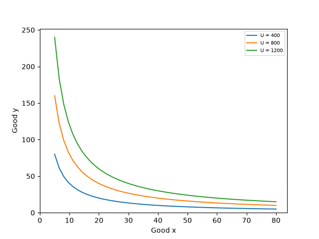
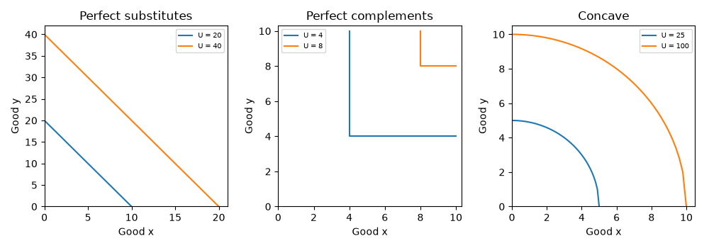

# 第 1 章: 効用と無差別曲線

## 1.1 この章の地図

ミクロ経済学は、**消費者**と**企業**の選択から、**市場**で価格が決まるまでを、順に説明します。この連載の見取り図は、次のとおりです。

| 部 | 題材 | 問い |
| :--- | :--- | :--- |
| 第 1 部（第 1〜4 章） | 消費者行動と需要曲線 | 消費者は、何を、どれだけ買うか |
| 第 2 部（第 5〜7 章） | 企業行動と供給曲線 | 企業は、いくつ作るか |
| 第 3 部（第 8〜10 章） | 市場均衡と余剰 | 需要と供給で、価格はどう決まるか。誰が得をするか |
| 第 4 部（第 11〜16 章） | 不完全競争と市場の失敗 | 市場が、うまくいかないのは、どんなときか |

需要曲線は右下がり、供給曲線は右上がりで、交点で価格が決まります。供給が需要を上回れば価格が下がり、需要が供給を上回れば価格が上がります。この章は、その出発点の、**消費者の好み**を扱います。

好みは、**効用関数**で表します。2 つの財 x・y の量から、満足の度合い（**効用**）を決める式です。効用が同じになる点を結んだ線が、**無差別曲線**です。地図の等高線と同じで、右上の線ほど、効用が高く、線どうしは交わりません。



| 項目 | 内容 |
| :--- | :--- |
| 経済学の題材 | 効用関数、無差別曲線（等高線・交わらない・右下がり・原点に凸）、限界代替率と逓減、完全代替財・完全補完財、マイナスの財、原点に凹の形 |
| 使う Python の機能 | 関数、リスト、`zip`、テスト（`pytest`）。NumPy は、この章では使いません |
| 新しく導入するライブラリ | Matplotlib（図。[第 1 シリーズ](../economics-programming/index.md) の第 7 章で学習済み） |
| 完成形 | `cobb_douglas_utility`、`indifference_curve_y`、`marginal_rate_of_substitution`、`perfect_substitutes_utility`、`perfect_substitutes_curve_y`、`perfect_complements_utility`、`perfect_complements_curve`、`bad_good_utility`、`bad_good_curve_y`、`concave_utility`、`concave_curve_y`、`is_convex_to_origin` |
| ファイル | 実装: `lib/chapter01/utility.py`、`lib/chapter01/plot.py`（図）、`lib/chapter01/validation.py`（入力の検証の共通関数）／テスト: `test/chapter01/test_utility.py`、`test/chapter01/test_plot.py`、`test/chapter01/test_validation.py`（自分で書くときは、`practice/chapter01/` に、同じ名前で作ります） |
| データ | なし（手計算できる小さな例だけ） |

### 経済学の式とコードの対応

| 経済学 | 式 | コード |
| :--- | :--- | :--- |
| 効用（コブ・ダグラス型） | U = x^a · y^b（a = b = 1 なら U = x·y） | `cobb_douglas_utility(x, y, a, b)` |
| 無差別曲線 | 効用 U が一定の点の y = (U ÷ x^a)^(1/b) | `indifference_curve_y(level, x, a, b)` |
| 限界代替率 | MRS = (a·y) ÷ (b·x) | `marginal_rate_of_substitution(x, y, a, b)` |
| 完全代替財 | U = a·x + b·y（直線） | `perfect_substitutes_utility`、`perfect_substitutes_curve_y` |
| 完全補完財 | U = min(x, y)（L 字） | `perfect_complements_utility`、`perfect_complements_curve` |
| マイナスの財 | U = y − w·x（右上がり） | `bad_good_utility`、`bad_good_curve_y` |
| 原点に凹 | U = x² + y² | `concave_utility`、`concave_curve_y` |
| 原点に凸かの判定 | 傾きが、x とともに増える | `is_convex_to_origin(xs, ys)` |

### 前提とする第 1 シリーズの章

この記事は、Python の基礎を繰り返しません。次ができれば、読み進められます。

| できること | 第 1 シリーズの章 |
| :--- | :--- |
| 関数と pytest のテストを書く（Red → Green → Refactor） | 第 1〜6 章 |
| リスト・辞書・内包表記を使う | 第 2〜4 章 |
| Matplotlib で、折れ線グラフを描く | 第 7 章 |

効用最大化や最適化は、第 1 シリーズの第 10 章（SciPy）と**題材が重なる**章があります（第 2 章以降）。この記事は、独立して読めるように、自分のコードで書き、SciPy は使いません。

## 1.2 準備

サンプルコードは、リポジトリの `apps/micro-basics-programming/python/` にあります。uv のインストールは、[第 1 シリーズの第 1 章](../economics-programming/01-preparation-and-first-test.md) を参照してください。

```bash
cd apps/micro-basics-programming/python
uv sync
uv run pytest test/chapter01
```

```text
61 passed
```

自分でコードを書くときは、`practice/chapter01/` を作って、完成形と同じ名前（`utility.py`・`test_utility.py`）のファイルに書きます。テストは、`uv run pytest practice/chapter01` で動かします。テストの import は、`from lib.chapter01.utility import ...` を、**`from practice.chapter01.utility import ...` に書き換えて**ください（書き換えないと、完成形を読み込んで、最初から通ってしまい、Red になりません）。**完成形（`lib/` と `test/`）は、答え合わせ用です。** 自分で書き終えてから、開いてください。入力の検証の共通関数（`validate_positive`・`validate_non_negative`）は、`lib/chapter01/validation.py` から import してかまいません。import と補助関数（先頭が `_` の関数）は、記事の抜粋に出ません。各章の折りたたみ「import と補助関数」に、写す内容があります（完成形は、見なくてかまいません）。「予想の答え合わせ」のスクリプトは、`practice/chapter01/check.py` に保存し、アプリのディレクトリ（`apps/micro-basics-programming/python`）で `uv run python -m practice.chapter01.check` と実行します（`python practice/...` と、ファイルのパスで実行すると、`lib` が見つからず、`ModuleNotFoundError` になります。**`-m` で、モジュールとして実行**してください。自分のコードを確かめるときは、スクリプトの import を `from practice.chapterNN...` に書き換えます。Windows のシェルで、日本語が文字化けするときは、`PYTHONUTF8=1` を付けます）。

## 1.3 予想する

効用が U = x·y で表される消費者がいます（x・y は、2 つの財の量）。**紙で、手計算で**答えてください。答えは、この節には書いてありません。「プログラミング」の節の「予想の答え合わせ」で、プログラムを動かして確かめます。

- 点 (20, 40)、(40, 20)、(10, 80) の**効用**は、それぞれ、いくつですか。3 点は、同じ無差別曲線の上にありますか
- 効用が 800 の無差別曲線の上で、x = 10 のとき、y は、いくつですか。x = 80 のときは、いくつですか。曲線は、右下がりですか、右上がりですか
- 点 (20, 40) での**限界代替率**（MRS = y ÷ x）は、いくつですか。点 (40, 20) では、いくつですか。無差別曲線に沿って**右へ進む**と、限界代替率は、大きくなりますか、小さくなりますか
- 完全代替財（U = 2x + y）で、点 (10, 20) の効用は、いくつですか。効用 40 の線の上で x = 5 のとき、y は、いくつですか。完全補完財（U = min(x, y)）で、点 (3, 5) の効用は、いくつですか

## 1.4 効用と無差別曲線の考え方

### 効用と無差別曲線

**効用**は、財の量から、満足の度合いを決める数値です。この記事では、2 つの財 x・y の量だけを考えます。

> 効用 U = U(x, y)

効用が同じになる点を結んだ線が、**無差別曲線**です。次の性質があります。

- 地図の**等高線**と同じで、右上にある線ほど、効用が高い
- 異なる無差別曲線は、**互いに交わらない**
- ふつうの財（多いほど嬉しい）の無差別曲線は、**右下がり**（財 x を減らされたら、財 y を増やしてもらわないと、効用が保てない）

効用の値は、**順序**だけに意味があります。「800 は 400 の 2 倍、嬉しい」とは、言えません。「800 のほうが、嬉しい」と、言えるだけです。

### 無差別曲線の形

形は、財の性質で決まります。

| 形 | 財の性質 | 例 |
| :--- | :--- | :--- |
| 右下がり | 多いほど嬉しい（**単調性**） | ふつうの財 |
| 右上がり | 一方が、**マイナスの財**（多いと嫌） | 騒音（x）と、お金（y） |
| 原点に凸（下に凸） | **偏らずに、組み合わせたい**（混ぜる方が、偏るより好き） | 主食とおかずを、バランスよく |
| 原点に凹（上に凸） | **別々に消費したい** | 辛い料理と甘い料理 |
| 直線 | **完全代替財**（交換比率が一定） | 同じ性能の 2 つの鉛筆 |
| L 字 | **完全補完財**（一定の比率で、一緒に使う） | 右の靴と左の靴 |

傾きが急な無差別曲線は、「財 x を、高く評価している」ことを表します（x を 1 単位あきらめるのに、y を、たくさん、もらわないといけない）。

### 限界代替率

**限界代替率（MRS）**は、財 x を 1 単位減らすとき、効用を保つために必要な、財 y の増加量です。**財 y で測った、財 x の価値**です。無差別曲線の、接線の傾きの大きさと、一致します。

> MRS = (a · y) ÷ (b · x)（U = x^a · y^b のとき）

「限界」は、「1 単位追加したときの変化」で、数学では、微分です。ふつうの無差別曲線では、右へ進むほど、財 x が増えて、財 x の価値が下がるので、MRS が小さくなります。これを、**限界代替率逓減**と言います。**限界代替率が逓減することと、無差別曲線が原点に凸であることは、同じ意味です。**

## 1.5 プログラミング

### Red: 効用と無差別曲線のテスト

最初のテストを書きます。点 (20, 40) の効用は、手計算できます。

```python
import math

import pytest

from lib.chapter01.utility import (
    bad_good_curve_y,
    bad_good_utility,
    cobb_douglas_utility,
    concave_curve_y,
    concave_utility,
    indifference_curve_y,
    is_convex_to_origin,
    marginal_rate_of_substitution,
    perfect_complements_curve,
    perfect_complements_utility,
    perfect_substitutes_curve_y,
    perfect_substitutes_utility,
)
```

```python
XS = [10, 20, 40, 80]


def test_効用は財の量の積() -> None:
    assert cobb_douglas_utility(20, 40) == 800
    assert cobb_douglas_utility(40, 20) == 800


def test_べき乗の効用() -> None:
    assert cobb_douglas_utility(4, 9, 0.5, 0.5) == pytest.approx(6)


def test_財が増えると効用は増える() -> None:
    assert cobb_douglas_utility(21, 40) > cobb_douglas_utility(20, 40)
    assert cobb_douglas_utility(20, 41) > cobb_douglas_utility(20, 40)
```

`cobb_douglas_utility` がまだないので、テストは失敗します（**Red**）。

テストの import の一覧は、完成形の**全関数**です。自分で書くときは、関数を 1 つ書くたびに、その名前を、import に足していってかまいません（まだ書いていない関数を import すると、`ImportError` になり、Green になりません）。


### Green: 効用を実装する

入力の検証には、共通の関数（`validate_positive`・`validate_non_negative`）を使います。メッセージは、呼び出す側が決めます。

```python
def validate_positive(value: float, message: str) -> None:
    """value が、正（0 より大きい）でなければ、message のエラーにする。"""
    if value <= 0:
        raise ValueError(message)


def validate_non_negative(value: float, message: str) -> None:
    """value が、負なら、message のエラーにする（0 は、許す）。"""
    if value < 0:
        raise ValueError(message)
```

??? note "import と補助関数（写すときに足す）"

    記事の抜粋には、import と、先頭が `_` の補助関数・定数を、省いています。完成形のファイルの先頭にある、次の部分を、写してください。

    **lib/chapter01/plot.py**

    ```python
    from collections.abc import Sequence
    ```

    ```python
    import matplotlib.pyplot as plt
    from matplotlib.axes import Axes
    from matplotlib.figure import Figure
    ```

    ```python
    from lib.chapter01.utility import (
        concave_curve_y,
        indifference_curve_y,
        perfect_complements_curve,
        perfect_substitutes_curve_y,
    )
    ```

    ```python
    _POINTS = 50
    ```

    ```python
    def _grid(start: float, stop: float) -> list[float]:
        """start から stop までを、_POINTS 点に等分する。"""
        step = (stop - start) / (_POINTS - 1)
        return [start + i * step for i in range(_POINTS)]
    ```

    ```python
    def _style(ax: Axes, title: str | None = None) -> None:
        ax.set_xlabel("Good x")
        ax.set_ylabel("Good y")
        ax.set_xlim(left=0)
        ax.set_ylim(bottom=0)
        if title is not None:
            ax.set_title(title)
        ax.legend(fontsize="x-small")
    ```

    **lib/chapter01/utility.py**

    ```python
    import math
    from collections.abc import Sequence
    ```

    ```python
    from lib.chapter01.validation import validate_non_negative, validate_positive
    ```

    ```python
    # 凸の判定で、直線（2 階差分が 0）に乗る、浮動小数点の誤差を許す
    _CONVEX_TOLERANCE = 1e-9
    ```

    ```python
    def _check_goods(x: float, y: float) -> None:
        validate_non_negative(x, "財 x の量は、0 以上にする")
        validate_non_negative(y, "財 y の量は、0 以上にする")
    ```

    ```python
    def _check_exponents(a: float, b: float) -> None:
        validate_positive(a, "べき指数 a は、正にする")
        validate_positive(b, "べき指数 b は、正にする")
    ```

    **test/chapter01/test_plot.py**

    ```python
    from collections.abc import Sequence
    from typing import cast
    ```

    ```python
    import pytest
    from matplotlib.axes import Axes
    from matplotlib.lines import Line2D
    ```

    ```python
    from lib.chapter01.plot import plot_indifference_curves, plot_special_utilities
    from lib.chapter01.utility import (
        cobb_douglas_utility,
        concave_utility,
        perfect_complements_utility,
        perfect_substitutes_utility,
    )
    ```

```python
def cobb_douglas_utility(x: float, y: float, a: float = 1.0, b: float = 1.0) -> float:
    """コブ・ダグラス型の効用 U = x^a · y^b。a = b = 1 なら、財の量の積。"""
    _check_goods(x, y)
    _check_exponents(a, b)
    return float(x**a * y**b)
```

```python
from lib.chapter01.utility import cobb_douglas_utility

print(cobb_douglas_utility(20, 40))
print(cobb_douglas_utility(40, 20))
```

```text
800.0
800.0
```

(20, 40) と (40, 20) の効用は、どちらも 800 で、**同じ無差別曲線の上**にあります。

### 無差別曲線を求める

効用が level になる点の y は、U = x^a · y^b を y について解いて、y = (level ÷ x^a)^(1/b) です。曲線の上の点は、効用が、水準と等しく、右下がりで、効用の高い曲線ほど右上にあります。これを、先にテストにします。

```python
def test_無差別曲線は同じ効用の点を結ぶ() -> None:
    for x in XS:
        y = indifference_curve_y(800, x)
        assert cobb_douglas_utility(x, y) == pytest.approx(800)


def test_無差別曲線は右下がり() -> None:
    ys = [indifference_curve_y(800, x) for x in XS]
    assert ys == pytest.approx([80, 40, 20, 10])
    assert all(a > b for a, b in zip(ys, ys[1:], strict=False))


def test_効用の高い無差別曲線は右上にあり交わらない() -> None:
    for x in XS:
        assert indifference_curve_y(1200, x) > indifference_curve_y(800, x)
```

```python
def indifference_curve_y(
    level: float, x: float, a: float = 1.0, b: float = 1.0
) -> float:
    """効用が level になる点の、財 y の量。

    U = x^a · y^b から、y = (level ÷ x^a)^(1/b)。
    """
    validate_positive(level, "効用の水準は、正にする")
    validate_positive(
        x, "財 x の量は、正にする（無差別曲線は、x = 0 で、無限大になる）"
    )
    _check_exponents(a, b)
    return float((level / x**a) ** (1 / b))
```

x = 0 では、y が無限大になるので、x は**正**に限ります（`ValueError`。テストは、`test_無差別曲線のxは正でなければエラー`）。0 より大きく 1 未満の x（0.5 など）は、有効な値で、y は大きくなります（`test_xが1未満の正の値でも無差別曲線を描ける`）。

### 限界代替率と、原点に凸

限界代替率は、無差別曲線の接線の傾きの大きさと、一致するはずです。**割線の傾き**（x の前後 ±0.001 の 2 点を結ぶ線の傾き）で、確かめます。

```python
def test_限界代替率は無差別曲線の接線の傾きの大きさ() -> None:
    # 点 (20, 40) の前後 ±0.001 の割線の傾きの大きさ
    h = 0.001
    slope = (indifference_curve_y(800, 20 - h) - indifference_curve_y(800, 20 + h)) / (
        2 * h
    )
    assert slope == pytest.approx(marginal_rate_of_substitution(20, 40), rel=1e-6)


def test_限界代替率は無差別曲線に沿って右へ進むほど小さくなる() -> None:
    values = [
        marginal_rate_of_substitution(x, indifference_curve_y(800, x)) for x in XS
    ]
    assert values == pytest.approx([8, 2, 0.5, 0.125])
    assert all(a > b for a, b in zip(values, values[1:], strict=False))


def test_原点に凸の無差別曲線は限界代替率逓減() -> None:
    ys = [indifference_curve_y(800, x) for x in XS]
    assert is_convex_to_origin(XS, ys)
```

```python
def marginal_rate_of_substitution(
    x: float, y: float, a: float = 1.0, b: float = 1.0
) -> float:
    """限界代替率 MRS = (a · y) ÷ (b · x)。

    財 x を 1 単位減らすとき、効用を保つのに必要な財 y の増加量。
    """
    validate_positive(x, "財 x の量は、正にする")
    validate_non_negative(y, "財 y の量は、0 以上にする")
    _check_exponents(a, b)
    return (a * y) / (b * x)


_CONVEX_TOLERANCE = 1e-9


def is_convex_to_origin(xs: Sequence[float], ys: Sequence[float]) -> bool:
    """曲線 y(x) が、原点に凸（下に凸）か。

    傾きが、x とともに増える（傾きの大きさは、小さくなる）なら、凸。
    """
    if len(xs) != len(ys):
        raise ValueError("x と y は、同じ長さにする")
    if len(xs) < 3:
        raise ValueError("凸の判定には、3 点以上が必要")
    if any(b <= a for a, b in zip(xs, xs[1:], strict=False)):
        raise ValueError("x は、昇順にする")
    slopes = [
        (y2 - y1) / (x2 - x1)
        for (x1, y1), (x2, y2) in zip(
            zip(xs, ys, strict=True), zip(xs[1:], ys[1:], strict=True), strict=False
        )
    ]
    return all(
        b - a >= -_CONVEX_TOLERANCE for a, b in zip(slopes, slopes[1:], strict=False)
    )
```

`is_convex_to_origin` は、曲線の傾き（隣り合う 2 点の傾き）が、x とともに、**増える**（傾きの大きさは、小さくなる）かを調べます。直線は、傾きが一定で、ぎりぎり凸と見なします。浮動小数点の誤差（1e-15 など）で、判定が変わらないように、**許容誤差**（`_CONVEX_TOLERANCE`）を持たせます。

### いろいろな形

完全代替財・完全補完財・マイナスの財・原点に凹の曲線を、関数にします。どれも、テストが、曲線の上の点で、効用が一定であることを確かめます。同じ型の関数なので、テストと実装は、折りたたみにしました（読むだけで、かまいません）。

??? note "いろいろな形のテストと実装"

    ```python
    def test_完全代替財の無差別曲線は直線で限界代替率は一定() -> None:
        assert perfect_substitutes_utility(10, 20, 2, 1) == 40
        ys = [perfect_substitutes_curve_y(40, x, 2, 1) for x in (0, 5, 10, 20)]
        assert ys == pytest.approx([40, 30, 20, 0])
        slopes = [b - a for a, b in zip(ys, ys[1:], strict=False)]
        assert slopes[0] / 5 == pytest.approx(-2)
        assert slopes[1] / 5 == pytest.approx(-2)
        assert slopes[2] / 10 == pytest.approx(-2)


    def test_完全補完財の無差別曲線はL字() -> None:
        assert perfect_complements_curve(4, 10) == [(4, 10), (4, 4), (10, 4)]


    def test_マイナスの財があると無差別曲線は右上がり() -> None:
        assert bad_good_utility(2, 10) == 8
        ys = [bad_good_curve_y(8, x) for x in (0, 2, 4)]
        assert ys == pytest.approx([8, 10, 12])
        assert all(a < b for a, b in zip(ys, ys[1:], strict=False))


    def test_別々に消費したいときの無差別曲線は原点に凹() -> None:
        assert concave_utility(3, 4) == 25
        xs = [0, 1, 2, 3, 4]
        ys = [concave_curve_y(25, x) for x in xs]
        assert ys[0] == pytest.approx(5)
        assert ys[-1] == pytest.approx(3)
        assert not is_convex_to_origin(xs, ys)
        for x, y in zip(xs, ys, strict=True):
            assert concave_utility(x, y) == pytest.approx(25)
    ```

    ```python
    def perfect_substitutes_utility(
        x: float, y: float, a: float = 1.0, b: float = 1.0
    ) -> float:
        """完全代替財の効用 U = a·x + b·y。限界代替率は、いつも a ÷ b。"""
        _check_goods(x, y)
        _check_exponents(a, b)
        return a * x + b * y


    def perfect_substitutes_curve_y(
        level: float, x: float, a: float = 1.0, b: float = 1.0
    ) -> float:
        """完全代替財の無差別曲線（直線）。y = (level − a·x) ÷ b。"""
        _check_exponents(a, b)
        return (level - a * x) / b


    def perfect_complements_utility(x: float, y: float) -> float:
        """完全補完財の効用 U = min(x, y)。多すぎるほうの量は、効用を増やさない。"""
        _check_goods(x, y)
        return min(x, y)


    def perfect_complements_curve(level: float, x_max: float) -> list[tuple[float, float]]:
        """完全補完財の無差別曲線（L 字）の 3 点。折れ点は (level, level)。"""
        validate_positive(level, "効用の水準は、正にする")
        if x_max < level:
            raise ValueError("L 字の端は、効用の水準以上にする")
        return [(level, x_max), (level, level), (x_max, level)]


    def bad_good_utility(x: float, y: float, weight: float = 1.0) -> float:
        """財 x がマイナスの財（騒音など）のときの効用 U = y − weight·x。"""
        validate_positive(weight, "マイナスの財の重みは、正にする")
        return y - weight * x


    def bad_good_curve_y(level: float, x: float, weight: float = 1.0) -> float:
        """マイナスの財の無差別曲線。y = level + weight·x（右上がり）。"""
        validate_positive(weight, "マイナスの財の重みは、正にする")
        return level + weight * x


    def concave_utility(x: float, y: float) -> float:
        """別々に消費したいときの効用 U = x² + y²。無差別曲線は、原点に凹。"""
        _check_goods(x, y)
        return x**2 + y**2


    def concave_curve_y(level: float, x: float) -> float:
        """U = x² + y² の無差別曲線。y = √(level − x²)。x は √level 以下の範囲だけ。"""
        if x**2 > level:
            raise ValueError("x が、曲線の範囲（√効用の水準）を、超えている")
        return math.sqrt(level - x**2)
    ```

### 予想の答え合わせ

予想した答えを、プログラムで確かめます。

> このスクリプトは、**完成形**（`lib/`）を読みます。**自分のコードで確かめる**ときは、import を、`from practice.chapterNN...` に書き換えてください。

```python
from lib.chapter01.utility import (
    cobb_douglas_utility,
    indifference_curve_y,
    marginal_rate_of_substitution,
    perfect_complements_utility,
    perfect_substitutes_curve_y,
    perfect_substitutes_utility,
)

for point in ((20, 40), (40, 20), (10, 80)):
    print("効用", point, cobb_douglas_utility(*point))
print("U = 800 で x = 10 のとき y:", indifference_curve_y(800, 10))
print("U = 800 で x = 80 のとき y:", indifference_curve_y(800, 80))
print("MRS (20, 40):", marginal_rate_of_substitution(20, 40))
print("MRS (40, 20):", marginal_rate_of_substitution(40, 20))
print("完全代替財 (10, 20) の効用:", perfect_substitutes_utility(10, 20, 2, 1))
print("U = 40 で x = 5 のとき y:", perfect_substitutes_curve_y(40, 5, 2, 1))
print("完全補完財 (3, 5) の効用:", perfect_complements_utility(3, 5))
```

```text
効用 (20, 40) 800.0
効用 (40, 20) 800.0
効用 (10, 80) 800.0
U = 800 で x = 10 のとき y: 80.0
U = 800 で x = 80 のとき y: 10.0
MRS (20, 40): 2.0
MRS (40, 20): 0.5
完全代替財 (10, 20) の効用: 40
U = 40 で x = 5 のとき y: 30.0
完全補完財 (3, 5) の効用: 3
```

- **1 つ目の問い**: 3 点の効用は、どれも 800 で、**同じ無差別曲線の上**にあります。x を増やすと、y が減る（右下がり）関係です
- **2 つ目の問い**: x = 10 のとき y = 80、x = 80 のとき y = 10 です。x が増えると、y が減る、**右下がり**です
- **3 つ目の問い**: MRS は、(20, 40) で 2、(40, 20) で 0.5 です。右へ進むほど、MRS が**小さくなる**（逓減）ので、曲線は**原点に凸**です。(20, 40) では、財 x を 1 単位あきらめるとき、財 y を 2 単位もらえば、効用が保てます
- **4 つ目の問い**: 完全代替財 U = 2x + y の、(10, 20) の効用は 40 です。効用 40 の線は、x = 5 のとき y = 30 で、傾きは −2（直線）です。完全補完財の (3, 5) の効用は、少ないほうの 3 です

### 図

（図の関数の import と補助関数（`_POINTS`・`_style` など）は、上の折りたたみ「import と補助関数」の、`plot.py` と `test_plot.py` の項目にあります。）

無差別曲線を描く関数と、座標のテストです。曲線の上の点の効用が、水準と等しいこと、右下がりであること、効用の高い曲線ほど右上にあることを、確かめます。

??? note "描画のテストと実装（後回しにしても、学習は成り立ちます）"

    ```python
    def xs(line: Line2D) -> list[float]:
        return [float(v) for v in cast(Sequence[float], line.get_xdata())]


    def ys(line: Line2D) -> list[float]:
        return [float(v) for v in cast(Sequence[float], line.get_ydata())]


    def curves() -> Axes:
        return plot_indifference_curves([400, 800, 1200], 5, 80).axes[0]


    def test_無差別曲線の族は水準ごとに1本ずつ() -> None:
        ax = curves()
        assert [line.get_label() for line in ax.lines] == [
            "U = 400",
            "U = 800",
            "U = 1200",
        ]


    def test_曲線の上の点は効用が水準と等しい() -> None:
        for line, level in zip(curves().lines, [400, 800, 1200], strict=True):
            for x, y in zip(xs(line), ys(line), strict=True):
                assert cobb_douglas_utility(x, y) == pytest.approx(level)


    def test_曲線は指定した範囲のxで右下がり() -> None:
        line = curves().lines[1]
        assert xs(line)[0] == pytest.approx(5)
        assert xs(line)[-1] == pytest.approx(80)
        assert ys(line)[0] == pytest.approx(160)
        assert ys(line)[-1] == pytest.approx(10)
        assert all(a > b for a, b in zip(ys(line), ys(line)[1:], strict=False))


    def test_効用の高い曲線ほど右上にある() -> None:
        lines = curves().lines
        for a, b in zip(lines, lines[1:], strict=False):
            assert all(y2 > y1 for y1, y2 in zip(ys(a), ys(b), strict=True))
    ```

    ```python
    def plot_indifference_curves(
        levels: Sequence[float], x_min: float, x_max: float
    ) -> Figure:
        """効用 U = x·y の無差別曲線を、水準ごとに 1 本描く。右上の曲線ほど、効用が高い。"""
        xs = _grid(x_min, x_max)
        fig, ax = plt.subplots()
        for level in levels:
            ax.plot(xs, [indifference_curve_y(level, x) for x in xs], label=f"U = {level}")
        _style(ax)
        plt.close(fig)
        return fig
    ```

完全代替財（直線）・完全補完財（L 字）・原点に凹の曲線も、左右に並べて描きます。



??? note "描画のテストと実装（後回しにしても、学習は成り立ちます）"

    ```python
    def special() -> list[Axes]:
        return plot_special_utilities().axes


    def test_完全代替財は直線() -> None:
        ax = special()[0]
        for line, level in zip(ax.lines, [20, 40], strict=True):
            assert line.get_label() == f"U = {level}"
            for x, y in zip(xs(line), ys(line), strict=True):
                assert perfect_substitutes_utility(x, y, 2, 1) == pytest.approx(level)
            slope = (ys(line)[1] - ys(line)[0]) / (xs(line)[1] - xs(line)[0])
            assert slope == pytest.approx(-2)


    def test_完全補完財はL字() -> None:
        ax = special()[1]
        first = ax.lines[0]
        assert first.get_label() == "U = 4"
        assert list(zip(xs(first), ys(first), strict=True)) == [(4, 10), (4, 4), (10, 4)]
        for line, level in zip(ax.lines, [4, 8], strict=True):
            for x, y in zip(xs(line), ys(line), strict=True):
                assert perfect_complements_utility(x, y) == level


    def test_別々に消費したいときは円の一部() -> None:
        ax = special()[2]
        for line, level in zip(ax.lines, [25, 100], strict=True):
            assert line.get_label() == f"U = {level}"
            for x, y in zip(xs(line), ys(line), strict=True):
                assert concave_utility(x, y) == pytest.approx(level)
            assert xs(line)[0] == pytest.approx(0)
            assert ys(line)[0] > ys(line)[-1]
    ```

    ```python
    def plot_special_utilities() -> Figure:
        """完全代替財（直線）・完全補完財（L 字）・原点に凹の曲線を、左右に並べて描く。"""
        fig, (left, middle, right) = plt.subplots(1, 3, figsize=(10, 3.5))
        for level in (20, 40):
            left.plot(
                [0, level / 2],
                [perfect_substitutes_curve_y(level, x, 2, 1) for x in (0, level / 2)],
                label=f"U = {level}",
            )
        _style(left, "Perfect substitutes")
        for level in (4, 8):
            points = perfect_complements_curve(level, 10)
            middle.plot(
                [x for x, _ in points], [y for _, y in points], label=f"U = {level}"
            )
        _style(middle, "Perfect complements")
        for level in (25, 100):
            xs = _grid(0, level**0.5)
            right.plot(xs, [concave_curve_y(level, x) for x in xs], label=f"U = {level}")
        _style(right, "Concave")
        fig.tight_layout()
        plt.close(fig)
        return fig
    ```

### ノートブックで試す

数字を書き換えて、結果と図が変わるのを、手軽に確かめられます。`apps/micro-basics-programming/python/notebooks/ch01_utility_and_indifference_curves.ipynb` を開き、「Parameters」のセルの数字（効用のべき指数、調べる点、無差別曲線の水準）を書き換えて、上から順に実行します。起動は、アプリのディレクトリで `uv run --with jupyterlab jupyter lab notebooks/` です。

### 実行結果

```bash
uv run pytest test/chapter01
```

```text
61 passed
```

## 1.6 規則で言うと

1. **無差別曲線は、等高線である。** 効用が同じ点を結ぶ。右上ほど効用が高く、交わらない
2. **限界代替率の逓減は、原点に凸と、同じ意味である。** 右へ進むほど、傾きの大きさが小さくなる
3. **曲線の形は、効用の式の形で決まる。** 数値は、曲線の上の点で、効用が一定であることを確かめる

混同しやすい点を、表にまとめます。

| 混同しやすい点 | 違い |
| :--- | :--- |
| 無差別曲線の右下がりと、右上がり | 右下がりは、ふつうの財（多いほど嬉しい）。右上がりは、一方が、マイナスの財（騒音など） |
| 原点に凸と、原点に凹 | 凸は、一緒に消費したい（MRS 逓減）。凹は、別々に消費したい（MRS 逓増） |
| 完全代替財と、完全補完財 | 代替財は直線（交換比率が一定）。補完財は L 字（比率が決まっている） |
| 限界代替率と、価格比 | 限界代替率は、**好み**から決まる、交換比率。価格比は、**市場**が決める、交換比率（第 2 章で、2 つが一致する点を探す） |

### このモデルが成り立たない場面

- **効用は、測れません。** 順序だけに意味があり、人どうしで、効用の大きさを比べることは、できません
- **好みが、安定していて、一貫している（完全に合理的）という仮定です。** 実際の人は、状況や、見せられ方で、選択が変わります
- **無差別曲線は、観察できません。** 選択のデータから、推定するものです。この章の曲線は、**式を仮定して**描いています
- **2 つの財だけを考えています。** 実際の消費は、多くの財の組み合わせです

## 1.7 練習問題

| 種類 | 問題 |
| :--- | :--- |
| 想起 | 本文を閉じて、`cobb_douglas_utility` の最初のテスト（(20, 40) の効用が 800、(40, 20) の効用も 800）を書いてください |
| 生成 | 解説を見る前に、財 x の値のリストから、無差別曲線の点 (x, y) のリストを返す `indifference_points(level, xs)` を、テストから書いてください。効用 800、x = 10・20・40 で、[(10, 80), (20, 40), (40, 20)] になります |
| 多様 | べき指数を a = b = 0.5 に変えます。点 (4, 9) の効用と、効用が同じ曲線の上で x = 4 のときの y は、いくつですか。限界代替率は、いくつですか |
| 交互 | [第 1 シリーズ](../economics-programming/index.md)の第 3 章のリスト内包表記で、効用 800 の曲線上の 4 点（x = 10・20・40・80）の限界代替率を、一度に計算してください。右へ進むと、小さくなっていますか |

??? note "解答（先に自分で取り組んでから、開いてください）"

    **想起**:

    ```python
    def test_最初の効用のテスト() -> None:
        assert cobb_douglas_utility(20, 40) == 800
        assert cobb_douglas_utility(40, 20) == 800
    ```

    **生成**: x のリストの、それぞれについて、`indifference_curve_y` を呼びます。

    ```python
    def indifference_points(level, xs):
        return [(x, indifference_curve_y(level, x)) for x in xs]
    ```

    ```python
    def test_無差別曲線の点のリスト() -> None:
        points = indifference_points(800, [10, 20, 40])
        assert points == [(10, 80), (20, 40), (40, 20)]
    ```

    **多様**: (4, 9) の効用は √4 × √9 = 6 で、効用 6 の曲線の上で x = 4 のとき y = 9 です。限界代替率は、(0.5 × 9) ÷ (0.5 × 4) = 2.25 です。

    ```python
    def test_べき指数が0_5のときの効用と限界代替率() -> None:
        assert cobb_douglas_utility(4, 9, 0.5, 0.5) == pytest.approx(6)
        assert indifference_curve_y(6, 4, 0.5, 0.5) == pytest.approx(9)
        assert marginal_rate_of_substitution(4, 9, 0.5, 0.5) == pytest.approx(2.25)
    ```

    **交互**:

    ```python
    def test_曲線の上の限界代替率は右へ進むほど小さい() -> None:
        xs = [10, 20, 40, 80]
        values = [marginal_rate_of_substitution(x, indifference_curve_y(800, x)) for x in xs]
        assert values == pytest.approx([8, 2, 0.5, 0.125])
        assert all(a > b for a, b in zip(values, values[1:]))
    ```

## 1.8 振り返り

- うまくいったこと:
- 詰まったこと:
- 次に試すこと:

## 1.9 まとめ

- 効用関数は、財の量から、満足の度合いを決める。効用が同じになる点を結んだ線が、無差別曲線で、等高線と同じく、右上ほど高く、交わらない
- ふつうの財の無差別曲線は、右下がりで、原点に凸。限界代替率（財 y で測った財 x の価値）が、右へ進むほど小さくなる（逓減）ことと、同じ意味
- 完全代替財は直線、完全補完財は L 字、マイナスの財は右上がり、別々に消費したい財は原点に凹
- 効用の値は、順序だけに意味がある。曲線は、式を仮定して、描いている
- 入力の検証は、共通の関数（`validate_positive`・`validate_non_negative`）にまとめた

次の章では、**予算制約**（買える組み合わせ）を引いて、無差別曲線と接する点、つまり**最適消費点**を求めます。そこで、限界代替率が、**価格比**と等しくなることを、確かめます。
