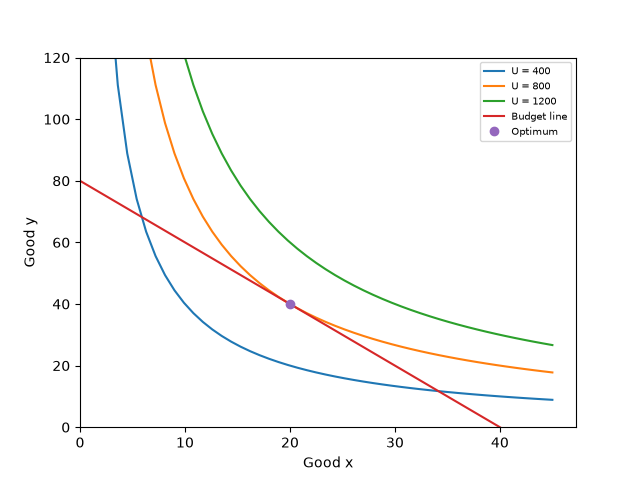
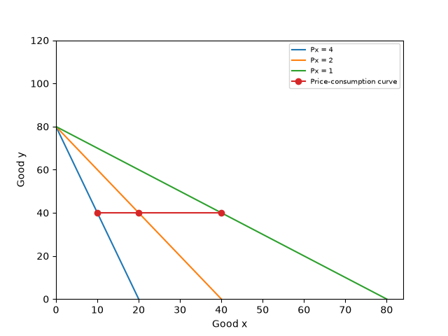

# 第 2 章: 予算制約と最適消費

## 2.1 この章の地図

前の章で、消費者の好みを、無差別曲線で表しました。右上の曲線ほど効用が高いので、消費者は、できるだけ右上の点を選びたくなります。しかし、**所得には限りがあります**。買える組み合わせは、**予算制約線**の内側に限られます。この章では、予算線と無差別曲線を重ねて、**効用が最大になる点**（最適消費点）を探します。



| 項目 | 内容 |
| :--- | :--- |
| 経済学の題材 | 予算制約線（傾き・切片・価格と所得の変化）、最適消費点（限界代替率 = 価格比） |
| 使う Python の機能 | 関数、リスト内包表記、`max`（`key` 引数）、テスト（`pytest`）。NumPy は、この章では使いません |
| 新しく導入するライブラリ | なし（Matplotlib は第 1 章から） |
| 完成形 | `budget_line_y`、`budget_slope`、`budget_intercepts`、`is_affordable`、`optimal_bundle`、`optimal_bundle_by_grid`、`tangency_gap` |
| ファイル | 実装: `lib/chapter02/budget.py`、`lib/chapter02/plot.py`（図）／テスト: `test/chapter02/test_budget.py`、`test/chapter02/test_plot.py`（自分で書くときは、`practice/chapter02/` に、同じ名前で作ります） |
| データ | なし（手計算できる小さな例だけ） |

### 経済学の式とコードの対応

| 経済学 | 式 | コード |
| :--- | :--- | :--- |
| 予算制約線 | Px·x + Py·y = m（y = (m − Px·x) ÷ Py） | `budget_line_y(income, px, py, x)` |
| 予算線の傾き | −Px ÷ Py（価格比のマイナス） | `budget_slope(px, py)` |
| 予算線の切片 | (m ÷ Px, m ÷ Py) | `budget_intercepts(income, px, py)` |
| 買える組み合わせ | Px·x + Py·y ≤ m | `is_affordable(x, y, income, px, py)` |
| 最適消費点（コブ・ダグラス型） | x = a/(a+b) · m/Px、y = b/(a+b) · m/Py | `optimal_bundle(income, px, py, a, b)` |
| 最適消費点（格子点の探索） | 予算線の上で、効用が最大の点 | `optimal_bundle_by_grid(income, px, py, a, b, steps)` |
| 接点の条件 | MRS = Px ÷ Py | `tangency_gap(x, y, px, py, a, b)`（差が 0） |

### 前提とする章

| できること | 場所 |
| :--- | :--- |
| 効用・無差別曲線・限界代替率を、関数にする | この連載の[第 1 章](01-utility-and-indifference-curves.md) |
| 関数と pytest のテストを書く、リスト内包表記を使う | [第 1 シリーズ](../economics-programming/index.md)の第 1〜6 章 |

効用最大化は、第 1 シリーズの第 10 章（SciPy による最適化）と**題材が重なります**。この記事は、SciPy を使わず、**閉じた式**と**格子点の探索**の 2 通りで解き、答えが一致することを、テストにします。

## 2.2 準備

```bash
cd apps/micro-basics-programming/python
uv sync
uv run pytest test/chapter02
```

```text
40 passed
```

自分でコードを書くときは、`practice/chapter02/` に、`budget.py` と `test_budget.py` を作ります。テストの import は、`from practice.chapter02.budget import ...` に書き換えます（[この記事の読み方](how-to-read.md)を参照）。第 1 章の関数（`cobb_douglas_utility` など）は、完成形の `lib/chapter01/` から import してかまいません。

## 2.3 予想する

効用が U = x·y の消費者がいます。所得は 80、財 x の価格は Px = 2、財 y の価格は Py = 1 です。**紙で、手計算で**答えてください。答えは、この節には書いてありません。「プログラミング」の節の「予想の答え合わせ」で、プログラムを動かして確かめます。

- **予算線の傾き**と、**切片**（x 切片と y 切片）は、いくつですか
- **最適消費点**（効用が最大になる (x, y)）は、どこですか。そのときの**効用**は、いくつですか
- 最適消費点で、限界代替率（MRS = y ÷ x）と、価格比（Px ÷ Py）の差は、いくつですか
- 財 x の価格が 2 から 1 に下がると、最適消費点は、どう動きますか。所得が 160 に増えると、どう動きますか

## 2.4 予算制約と最適消費の考え方

### 予算制約線

財 x の価格が Px、財 y の価格が Py、所得が m のとき、**使い切る組み合わせ**は、次の式を満たします。

> Px · x + Py · y = m

この式を y について解くと、**予算線**です。

- **傾き**は、**−Px ÷ Py**（価格比のマイナス）。財 x を 1 単位増やすために、あきらめる財 y の量
- **切片**は、**m ÷ Px**（全部を x に使った量）と、**m ÷ Py**（全部を y に使った量）
- **価格が変わる**と、その財の側の切片が動き、傾きが変わる（財 x が値下がりすると、x 切片だけが右へ動く）
- **所得が変わる**と、傾きは同じまま、**平行に**動く

予算線の上と内側が、**買える組み合わせ**です。

### 最適消費点

消費者は、買える組み合わせのうち、**効用が最大の点**を選びます。ふつうの無差別曲線では、予算線と**接する点**です。

> 最適消費点では、限界代替率（無差別曲線の接線の傾きの大きさ）= 価格比（予算線の傾きの大きさ）

限界代替率は「**自分にとっての**、財 x の価値（財 y で測る）」、価格比は「**市場での**、財 x の値段（財 y で測る）」です。自分の評価が市場の値段より高ければ、もっと買いたく、低ければ、買いすぎなので、2 つが等しくなる点で、落ち着きます。

コブ・ダグラス型 U = x^a · y^b では、**所得のうち、a/(a+b) を財 x に、b/(a+b) を財 y に使う**ことが、式から分かります（閉じた式）。

## 2.5 プログラミング

### Red: 予算線のテスト

最初のテストを書きます。所得 80、Px = 2、Py = 1 で、予算線は、手計算できます。

```python
import pytest

from lib.chapter01.utility import (
    cobb_douglas_utility,
    marginal_rate_of_substitution,
)
from lib.chapter02.budget import (
    budget_intercepts,
    budget_line_y,
    budget_slope,
    is_affordable,
    optimal_bundle,
    optimal_bundle_by_grid,
    tangency_gap,
)
```

```python
M, PX, PY = 80, 2, 1


def test_予算線は所得を使い切る点を結ぶ() -> None:
    assert budget_line_y(M, PX, PY, 0) == 80
    assert budget_line_y(M, PX, PY, 20) == 40
    assert budget_line_y(M, PX, PY, 40) == 0


def test_予算線の傾きは価格比のマイナス() -> None:
    assert budget_slope(PX, PY) == -2
    assert budget_slope(1, 2) == pytest.approx(-0.5)


def test_予算線の切片は所得を価格で割った値() -> None:
    assert budget_intercepts(M, PX, PY) == (40, 80)


def test_財xが値下がりするとx切片だけが右へ動く() -> None:
    assert budget_intercepts(M, 1, PY) == (80, 80)
    assert budget_slope(1, PY) == -1


def test_所得が増えると予算線は平行に動く() -> None:
    assert budget_intercepts(160, PX, PY) == (80, 160)
    assert budget_slope(PX, PY) == -2
```

`budget_line_y` などがまだないので、テストは失敗します（**Red**）。

### Green: 予算線を実装する

```python
def _check_budget(income: float, px: float, py: float) -> None:
    validate_non_negative(income, "所得は、0 以上にする")
    validate_positive(px, "財 x の価格は、正にする")
    validate_positive(py, "財 y の価格は、正にする")


def budget_line_y(income: float, px: float, py: float, x: float) -> float:
    """予算線の上の、財 y の量。y = (m − Px·x) ÷ Py。"""
    _check_budget(income, px, py)
    return (income - px * x) / py


def budget_slope(px: float, py: float) -> float:
    """予算線の傾き −Px ÷ Py（価格比のマイナス）。"""
    validate_positive(px, "財 x の価格は、正にする")
    validate_positive(py, "財 y の価格は、正にする")
    return -px / py


def budget_intercepts(income: float, px: float, py: float) -> tuple[float, float]:
    """予算線の切片 (m ÷ Px, m ÷ Py)。全部を、財 x だけ・財 y だけに使った量。"""
    _check_budget(income, px, py)
    return income / px, income / py


def is_affordable(x: float, y: float, income: float, px: float, py: float) -> bool:
    """組み合わせ (x, y) が、所得で買えるか（予算線の上か内側か）。"""
    _check_budget(income, px, py)
    return px * x + py * y <= income + _AFFORDABLE_TOLERANCE
```

??? note "import と補助関数（写すときに足す）"

    記事の抜粋には、import と、先頭が `_` の補助関数・定数を、省いています。完成形のファイルの先頭にある、次の部分を、写してください。

    **lib/chapter02/budget.py**

    ```python
    from lib.chapter01.utility import (
        cobb_douglas_utility,
        marginal_rate_of_substitution,
    )
    from lib.chapter01.validation import validate_non_negative, validate_positive
    ```

    ```python
    # 予算線の上かの判定で、浮動小数点の誤差を許す
    _AFFORDABLE_TOLERANCE = 1e-9
    ```

    ```python
    def _check_budget(income: float, px: float, py: float) -> None:
        validate_non_negative(income, "所得は、0 以上にする")
        validate_positive(px, "財 x の価格は、正にする")
        validate_positive(py, "財 y の価格は、正にする")
    ```

    ```python
    def _check_exponents(a: float, b: float) -> None:
        validate_positive(a, "べき指数 a は、正にする")
        validate_positive(b, "べき指数 b は、正にする")
    ```

入力のチェックは、第 1 章の共通関数 `validate_positive`・`validate_non_negative` を使います。**価格は正**、**所得は 0 以上**です。価格が 0.5 や 0.25 のような、0 より大きく 1 未満の値も、有効です（テスト `test_価格が1未満の正の値でも予算線を引ける`）。

`is_affordable` は、浮動小数点の誤差を許します。予算線の**ちょうど上**の点は、買えるからです（許容誤差は 1e-9。テスト `test_予算線の上の点は買えるが誤差を許す`）。

### 最適消費点

最適消費点は、予算線の上で、効用が最大の点です。手計算では、所得を半分ずつ使うので、(20, 40) です。このとき、効用は 800 で、予算線の上の他の点（x = 5・10・15・25・30・35）は、どれも、効用が 800 より低くなります。先にテストにします。

```python
def test_最適消費点は予算を半分ずつ使う() -> None:
    assert optimal_bundle(M, PX, PY) == (20, 40)


def test_最適消費点は予算線の上にある() -> None:
    x, y = optimal_bundle(M, PX, PY)
    assert PX * x + PY * y == pytest.approx(M)


def test_最適点では限界代替率が価格比と等しい() -> None:
    x, y = optimal_bundle(M, PX, PY)
    assert marginal_rate_of_substitution(x, y) == pytest.approx(PX / PY)
    assert tangency_gap(x, y, PX, PY) == pytest.approx(0, abs=1e-12)


def test_予算線の上の他の点は効用が低い() -> None:
    best = cobb_douglas_utility(*optimal_bundle(M, PX, PY))
    assert best == 800
    for x in (5, 10, 15, 25, 30, 35):
        y = budget_line_y(M, PX, PY, x)
        assert cobb_douglas_utility(x, y) < best
```

```python
def _check_exponents(a: float, b: float) -> None:
    validate_positive(a, "べき指数 a は、正にする")
    validate_positive(b, "べき指数 b は、正にする")


def optimal_bundle(
    income: float, px: float, py: float, a: float = 1.0, b: float = 1.0
) -> tuple[float, float]:
    """コブ・ダグラス型の最適消費点（閉じた式）。

    x = a/(a+b) · m/Px、y = b/(a+b) · m/Py。所得の割合を、指数の比で配分する。
    """
    _check_budget(income, px, py)
    _check_exponents(a, b)
    share_x = a / (a + b)
    return share_x * income / px, (1 - share_x) * income / py


def tangency_gap(
    x: float, y: float, px: float, py: float, a: float = 1.0, b: float = 1.0
) -> float:
    """限界代替率と価格比の差 MRS − Px ÷ Py。

    最適消費点では 0（無差別曲線が、予算線に接する）。
    """
    validate_positive(px, "財 x の価格は、正にする")
    validate_positive(py, "財 y の価格は、正にする")
    return marginal_rate_of_substitution(x, y, a, b) - px / py
```

`tangency_gap` は、**限界代替率 − 価格比**です。最適消費点では、0 になります。最適点でない点（例えば (10, 60)）では、0 になりません（`test_最適点でない点は限界代替率と価格比が食い違う`）。

### 格子点の探索で確かめる

閉じた式は、コブ・ダグラス型だから使えます。一般の効用では、式が求まらないことがあるので、**予算線の上を細かく区切って、効用が最大の点を探す**方法も、書いておきます。2 通りの答えが一致すれば、どちらも正しいという、強い確認になります。

```python
def test_格子点の探索は閉じた式と一致する() -> None:
    x, y = optimal_bundle_by_grid(M, PX, PY)
    assert x == pytest.approx(20)
    assert y == pytest.approx(40)


def test_格子点の探索は別の価格でも一致する() -> None:
    assert optimal_bundle_by_grid(90, 3, 2) == pytest.approx((15, 22.5))
    assert optimal_bundle(90, 3, 2) == pytest.approx((15, 22.5))


def test_べき指数が違う効用でも格子点の探索は閉じた式に近い() -> None:
    closed = optimal_bundle(M, PX, PY, 1, 2)
    assert closed == pytest.approx((80 / 3 / 2, 160 / 3))
    grid = optimal_bundle_by_grid(M, PX, PY, 1, 2)
    assert grid == pytest.approx(closed, abs=0.1)
```

```python
def optimal_bundle_by_grid(
    income: float,
    px: float,
    py: float,
    a: float = 1.0,
    b: float = 1.0,
    steps: int = 400,
) -> tuple[float, float]:
    """予算線の上を steps 等分して、効用が最大の点を探す（閉じた式の答え合わせ用）。"""
    _check_budget(income, px, py)
    _check_exponents(a, b)
    validate_positive(steps - 1, "格子の分割数は、2 以上にする")
    x_max = income / px
    xs = [x_max * i / steps for i in range(steps + 1)]
    points = [(x, max(0.0, (income - px * x) / py)) for x in xs]
    # 効用が同じ点が複数あれば、先に見つけた点（x の小さいほう）を返す
    return max(points, key=lambda p: cobb_douglas_utility(p[0], p[1], a, b))
```

効用が同じ点が複数あれば、`max` は、**先に見つけた点**（x の小さいほう）を返します。格子点の探索は、区切りの幅（分割数 `steps`）の分だけ、誤差があります。指数が違うとき（a = 1、b = 2）は、最適な x = 13.33 が格子の上にないので、**幅（0.1）以内の誤差**で、一致を確かめます（`abs=0.1`）。

### 予想の答え合わせ

予想した答えを、プログラムで確かめます。

```python
from lib.chapter01.utility import cobb_douglas_utility
from lib.chapter02.budget import (
    budget_intercepts,
    budget_slope,
    optimal_bundle,
    optimal_bundle_by_grid,
    tangency_gap,
)

print("予算線の傾き:", budget_slope(2, 1))
print("予算線の切片:", budget_intercepts(80, 2, 1))
x, y = optimal_bundle(80, 2, 1)
print("最適消費点:", (x, y), "効用:", cobb_douglas_utility(x, y))
print("接点の条件 MRS − 価格比:", tangency_gap(x, y, 2, 1))
print("Px = 1 の最適消費点:", optimal_bundle(80, 1, 1))
print("所得 160 の最適消費点:", optimal_bundle(160, 2, 1))
print("格子点の探索:", optimal_bundle_by_grid(80, 2, 1))
```

```text
予算線の傾き: -2.0
予算線の切片: (40.0, 80.0)
最適消費点: (20.0, 40.0) 効用: 800.0
接点の条件 MRS − 価格比: 0.0
Px = 1 の最適消費点: (40.0, 40.0)
所得 160 の最適消費点: (40.0, 80.0)
格子点の探索: (20.0, 40.0)
```

- **1 つ目の問い**: 傾きは −2（価格比 −Px ÷ Py = −2）、切片は (40, 80) です。80 ÷ 2 = 40 と、80 ÷ 1 = 80 です
- **2 つ目の問い**: 最適消費点は (20, 40)、効用は 800 です。所得 80 の半分（40）を財 x に使い（40 ÷ 2 = 20 単位）、半分（40）を財 y に使います（40 単位）
- **3 つ目の問い**: 限界代替率（40 ÷ 20 = 2）と価格比（2 ÷ 1 = 2）の差は 0 です。**自分の評価と、市場の値段が、等しくなる点**です
- **4 つ目の問い**: 財 x が 2 から 1 に値下がりすると、最適点は (40, 40) に動きます。x が 20 から 40 に増え、y は 40 のまま変わりません（コブ・ダグラス型では、所得の半分を、いつも財 y に使うため）。所得が 160 に増えると、(40, 80) と、**どちらも 2 倍**になります
- 格子点の探索も、(20, 40) で、閉じた式と一致しました

### 図

予算線と無差別曲線を重ねる関数と、座標のテストです。予算線の両端が切片であること、最適点が接点であることを、確かめます。

??? note "描画のテストと実装（後回しにしても、学習は成り立ちます）"

    ```python
    def xs(line: Line2D) -> list[float]:
        return [float(v) for v in cast(Sequence[float], line.get_xdata())]


    def ys(line: Line2D) -> list[float]:
        return [float(v) for v in cast(Sequence[float], line.get_ydata())]


    def line(ax: Axes, label: str) -> Line2D:
        return next(item for item in ax.lines if item.get_label() == label)


    def choice() -> Axes:
        return plot_optimal_choice(80, 2, 1, [400, 800, 1200], 45).axes[0]


    def test_最適消費点の図の線() -> None:
        ax = choice()
        assert [item.get_label() for item in ax.lines] == [
            "U = 400",
            "U = 800",
            "U = 1200",
            "Budget line",
            "Optimum",
        ]


    def test_予算線の端は両軸の切片() -> None:
        budget = line(choice(), "Budget line")
        assert xs(budget) == [0, 40]
        assert ys(budget) == [80, 0]


    def test_最適消費点は予算線と無差別曲線の接点() -> None:
        ax = choice()
        optimum = line(ax, "Optimum")
        assert xs(optimum) == [20]
        assert ys(optimum) == [40]
        curve = line(ax, "U = 800")
        for x, y in zip(xs(curve), ys(curve), strict=True):
            assert cobb_douglas_utility(x, y) == pytest.approx(800)
    ```

    ```python
    def plot_optimal_choice(
        income: float, px: float, py: float, levels: Sequence[float], x_max: float
    ) -> Figure:
        """無差別曲線と予算線を重ね、接する点（最適消費点）に印をつける。"""
        step = x_max / _POINTS
        xs = [step * (i + 1) for i in range(_POINTS)]
        fig, ax = plt.subplots()
        for level in levels:
            ax.plot(xs, [indifference_curve_y(level, x) for x in xs], label=f"U = {level}")
        x_intercept, y_intercept = budget_intercepts(income, px, py)
        ax.plot([0, x_intercept], [y_intercept, 0], label="Budget line")
        x, y = optimal_bundle(income, px, py)
        ax.plot([x], [y], "o", label="Optimum")
        _style(ax, y_intercept)
        plt.close(fig)
        return fig
    ```

財 x の価格が下がると、予算線の x 切片だけが右へ動きます。各価格の最適点をつなぐと、**価格消費曲線**になります。第 3 章で、ここから**需要曲線**を作ります。



??? note "描画のテストと実装（後回しにしても、学習は成り立ちます）"

    ```python
    def price_change() -> Axes:
        return plot_price_change(80, [4, 2, 1], 1).axes[0]


    def test_価格変化の図は価格ごとに予算線と最適点() -> None:
        ax = price_change()
        assert [item.get_label() for item in ax.lines] == [
            "Px = 4",
            "Px = 2",
            "Px = 1",
            "Price-consumption curve",
        ]


    def test_価格が下がるとx切片だけが右へ動く() -> None:
        ax = price_change()
        assert [xs(line(ax, f"Px = {p}"))[1] for p in (4, 2, 1)] == [20, 40, 80]
        assert [ys(line(ax, f"Px = {p}"))[0] for p in (4, 2, 1)] == [80, 80, 80]


    def test_価格消費曲線は各価格の最適点をつなぐ() -> None:
        curve = line(price_change(), "Price-consumption curve")
        assert xs(curve) == pytest.approx([10, 20, 40])
        assert ys(curve) == pytest.approx([40, 40, 40])
    ```

    ```python
    def plot_price_change(income: float, prices: Sequence[float], py: float) -> Figure:
        """価格が下がると、予算線の x 切片だけが右へ動く。最適点をつなぐと価格消費曲線。"""
        fig, ax = plt.subplots()
        bundles = []
        y_intercept = income / py
        for price in prices:
            x_intercept, y_intercept = budget_intercepts(income, price, py)
            ax.plot([0, x_intercept], [y_intercept, 0], label=f"Px = {price}")
            bundles.append(optimal_bundle(income, price, py))
        ax.plot(
            [x for x, _ in bundles],
            [y for _, y in bundles],
            "o-",
            label="Price-consumption curve",
        )
        _style(ax, y_intercept)
        plt.close(fig)
        return fig
    ```

### 実行結果

```bash
uv run pytest test/chapter02
```

```text
40 passed
```

## 2.6 規則で言うと

1. **最適消費点は、無差別曲線と予算線が接する点である。** 限界代替率（自分の評価）が、価格比（市場の値段）と等しい
2. **価格が変わると、予算線の傾きと切片が変わる。所得が変わると、傾きは同じで、平行に動く**
3. **2 通りの方法で、同じ答えを確かめる。** 閉じた式と、格子点の探索が一致すれば、どちらも正しい

混同しやすい点を、表にまとめます。

| 混同しやすい点 | 違い |
| :--- | :--- |
| 予算線の傾きと、無差別曲線の傾き | 予算線の傾きは、**価格比**（市場が決める）。無差別曲線の傾きは、**限界代替率**（好みが決める）。2 つが等しい点が、最適 |
| 価格の変化と、所得の変化 | 価格が動くと、**傾きと切片**が変わる。所得が動くと、**平行**に動く |
| 買える点と、最適な点 | 予算線の内側は、買えるが、所得が余る。最適な点は、予算線の**上**にある（所得を使い切る） |
| 切片と、最適な量 | 切片は、全部を一方に使った量。最適な量は、コブ・ダグラス型では、切片の a/(a+b)・b/(a+b) 倍 |

### このモデルが成り立たない場面

- **貯蓄・借入はありません。** 所得を、その期に、使い切ると仮定しています。実際は、貯蓄や借入で、期をまたぎます
- **価格は、消費者が決められません**（プライステイカー）。大量に買えば、値段が上がる市場では、予算線は直線になりません
- **無差別曲線が、原点に凸のときだけ、接点が最適です。** 完全代替財や、原点に凹の曲線では、**端の点**（片方だけを買う）が最適になることがあります（角解）
- **財は、細かく分けられると仮定しています。** 車や家は、1 台・1 軒の単位でしか買えません

## 2.7 練習問題

| 種類 | 問題 |
| :--- | :--- |
| 想起 | 本文を閉じて、`budget_intercepts` の最初のテスト（所得 80、Px = 2、Py = 1 で、切片が (40, 80)）を書いてください |
| 生成 | 解説を見る前に、所得のうち、財 x と財 y に使う**割合**を返す `spending_shares(income, px, py, a, b)` を、テストから書いてください。a = b = 1 で、(0.5, 0.5) になります。a = 1、b = 3 では、いくつになりますか |
| 多様 | 財 x の価格を 4 に変えます（所得 80、Py = 1）。最適消費点は、どこですか。先に予想してから、テストで確かめてください |
| 交互 | [第 1 シリーズ](../economics-programming/index.md)の第 3 章のリスト内包表記で、Px = 4・2・1 の x 切片と、最適な x を、一度に計算してください。支出の割合は、どの価格でも変わりませんか |

??? note "解答（先に自分で取り組んでから、開いてください）"

    **想起**:

    ```python
    def test_予算線の切片() -> None:
        assert budget_intercepts(80, 2, 1) == (40, 80)
    ```

    **生成**: 財 x への支出は Px × x なので、所得で割ります。

    ```python
    def spending_shares(income, px, py, a=1.0, b=1.0):
        x, y = optimal_bundle(income, px, py, a, b)
        return px * x / income, py * y / income
    ```

    ```python
    def test_支出の割合は指数の比() -> None:
        assert spending_shares(80, 2, 1) == pytest.approx((0.5, 0.5))
        assert spending_shares(80, 2, 1, 1, 3) == pytest.approx((0.25, 0.75))
    ```

    a = 1、b = 3 では、(1 ÷ 4, 3 ÷ 4) = (0.25, 0.75) です。**支出の割合は、価格にも所得にも、よりません。指数の比だけで決まります。**

    **多様**: x = (1/2) × 80 ÷ 4 = 10、y = (1/2) × 80 ÷ 1 = 40 で、(10, 40) です。価格が 2 倍になったので、x が半分になりました。

    ```python
    def test_Pxが4のときの最適消費点() -> None:
        assert optimal_bundle(80, 4, 1) == (10, 40)
    ```

    **交互**:

    ```python
    def test_価格ごとの切片と最適なxと支出の割合() -> None:
        prices = [4, 2, 1]
        intercepts = [budget_intercepts(80, p, 1)[0] for p in prices]
        xs = [optimal_bundle(80, p, 1)[0] for p in prices]
        shares = [p * x / 80 for p, x in zip(prices, xs)]
        assert intercepts == [20, 40, 80]
        assert xs == [10, 20, 40]
        assert shares == [0.5, 0.5, 0.5]
    ```

## 2.8 振り返り

- うまくいったこと:
- 詰まったこと:
- 次に試すこと:

## 2.9 まとめ

- 予算制約線は、所得を使い切る組み合わせ。傾きは −Px ÷ Py（価格比）、切片は m ÷ Px と m ÷ Py。価格が変わると傾きと切片が変わり、所得が変わると平行に動く
- 最適消費点は、無差別曲線と予算線が接する点で、限界代替率が価格比と等しい。コブ・ダグラス型では、所得の a/(a+b) を財 x に、b/(a+b) を財 y に使う
- 閉じた式と、格子点の探索の 2 通りで解き、一致をテストにした。浮動小数点の誤差は、許容誤差で扱う
- 価格が下がると、予算線の x 切片だけが右へ動き、最適点をつなぐと、価格消費曲線になる

次の章では、価格を動かしながら最適消費点を求め、その財 x の量を価格に対して並べて、**需要曲線**を作ります。そして、価格が変わると需要がどれだけ動くかを表す**弾力性**を計算します。
