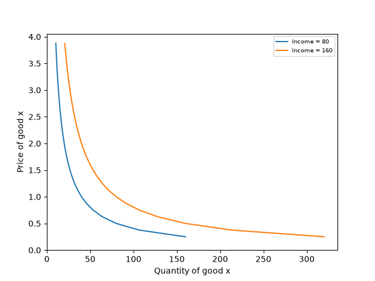
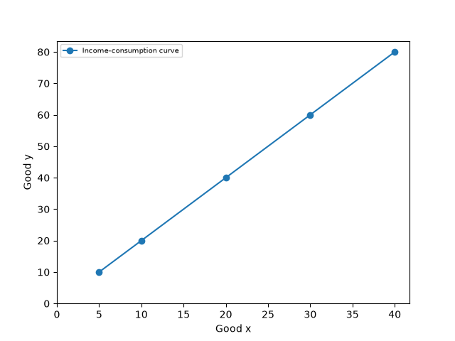
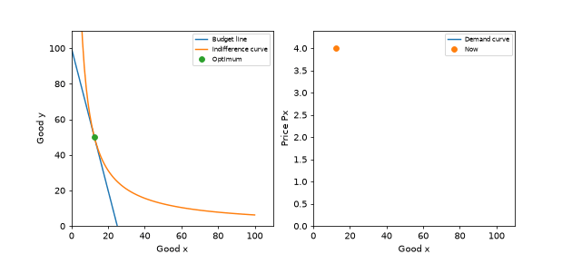

# 第 3 章: 需要曲線と弾力性

## 3.1 この章の地図

前の章で、価格が下がると、予算線の x 切片が右へ動き、最適消費点が動くことを見ました。**価格を動かしながら、最適消費点を求めて、財 x の量を価格に対して並べる**と、**需要曲線**になります。この章では、需要曲線を導き、**価格が変わると需要がどれだけ動くか**（価格弾力性）と、**所得が変わると需要がどれだけ動くか**（所得弾力性）を、計算します。



| 項目 | 内容 |
| :--- | :--- |
| 経済学の題材 | 需要曲線の導出、市場需要（横に足す）、価格弾力性（直線の需要曲線・ギッフェン財）、所得弾力性（奢侈品・必需品・下級財）、所得消費曲線 |
| 使う Python の機能 | 関数、関数を引数に渡す（`Callable`）、数値微分（中心差分）、`lambda`、テスト（`pytest`）。NumPy は、この章では使いません |
| 新しく導入するライブラリ | なし |
| 完成形 | `demand_x`、`demand_curve`、`market_demand`、`market_demand_curve`、`linear_demand_quantity`、`price_elasticity_linear`、`price_elasticity`、`elasticity_type`、`income_elasticity`、`classify_by_income_elasticity`、`income_consumption_curve` |
| ファイル | 実装: `lib/chapter03/demand.py`、`lib/chapter03/plot.py`（図）／テスト: `test/chapter03/test_demand.py`、`test/chapter03/test_plot.py`（自分で書くときは、`practice/chapter03/` に、同じ名前で作ります） |
| データ | なし（手計算できる小さな例だけ） |

### 経済学の式とコードの対応

| 経済学 | 式 | コード |
| :--- | :--- | :--- |
| 需要曲線 | 価格 P ごとの、最適消費点の x | `demand_x(income, px, py)`、`demand_curve(income, prices, py)` |
| 市場需要 | 個人の需要を、同じ価格で、横に足す | `market_demand(incomes, px, py)` |
| 価格弾力性 | e = −(ΔQ ÷ Q) ÷ (ΔP ÷ P) = −(dQ/dP) · P ÷ Q | `price_elasticity(demand, price)`（数値微分）、`price_elasticity_linear(intercept, slope, price)` |
| 弾力性の種類 | \|e\| > 1 は弾力的、= 1 は単位弾力的、< 1 は非弾力的 | `elasticity_type(e)` |
| 所得弾力性 | e = (dQ/dm) · m ÷ Q | `income_elasticity(demand, income)` |
| 財の種類（所得弾力性） | 1 以上は奢侈品、0〜1 は必需品、負は下級財 | `classify_by_income_elasticity(e)` |
| 所得消費曲線 | 所得を動かしたときの最適消費点 | `income_consumption_curve(incomes, px, py)` |

### 前提とする章

| できること | 場所 |
| :--- | :--- |
| 最適消費点を求める | この連載の[第 2 章](02-budget-and-optimal-choice.md) |
| 関数を引数に渡す、`lambda` を使う | [第 1 シリーズ](../economics-programming/index.md)の第 4〜6 章 |

## 3.2 準備

```bash
cd apps/micro-basics-programming/python
uv sync
uv run pytest test/chapter03
```

```text
38 passed
```

自分でコードを書くときは、`practice/chapter03/` に、`demand.py` と `test_demand.py` を作ります。第 2 章の関数（`optimal_bundle`）は、完成形の `lib/chapter02/` から import してかまいません（[この記事の読み方](how-to-read.md)を参照）。

## 3.3 予想する

効用が U = x·y、所得が 80、財 y の価格が Py = 1 の消費者がいます。**紙で、手計算で**答えてください。答えは、この節には書いてありません。「プログラミング」の節の「予想の答え合わせ」で、プログラムを動かして確かめます。

- 財 x の価格が 2・1・0.5 のとき、**需要量**（最適な x）は、それぞれ、いくつですか。需要曲線は、右下がりですか
- 所得 40 の人と、所得 120 の人がいます。Px = 2 での**市場需要**は、いくつですか
- 直線の需要曲線 Q = 100 − P で、P = 25・50・75 のときの**価格弾力性**は、それぞれ、いくつですか。この U = x·y の需要の価格弾力性は、いくつですか
- この U = x·y の需要の**所得弾力性**は、いくつですか。需要が 100 − 0.1m・10√m・0.01m² のとき、所得弾力性は、それぞれ、どの財（奢侈品・必需品・下級財）に当たりますか

## 3.4 需要曲線と弾力性の考え方

### 需要曲線の導出

他の財の価格と所得を一定にして、財 x の価格だけを動かします。価格が下がると、予算線が右へ広がり、最適消費点が動きます。**各価格での最適な x をつなぐ**と、需要曲線です。**価格が下がると需要が増える**ので、ふつう、右下がりです。

**市場需要**は、個人の需要を、同じ価格で、**横に足し合わせた**ものです。所得や好みの違う人が増えるほど、市場需要は大きくなります。

### 価格弾力性

**価格弾力性**は、価格が 1% 変わると、需要量が何% 変わるかを表します。

> e = −(需要量の変化率) ÷ (価格の変化率) = −(dQ/dP) × P ÷ Q

- **弾力的**（|e| > 1）: 価格が少し動くと、需要量が大きく動く。グラフで**緩やか**な需要曲線
- **非弾力的**（|e| < 1）: 価格が動いても、需要量はあまり動かない。グラフで**急**な需要曲線
- **直線の需要曲線でも、点の位置で弾力性は変わる**（高い価格の側ほど弾力的）
- **ギッフェン財**は、価格が上がると需要が増える（右上がり）ので、e が負になる（第 4 章で、理由を見ます）

### 所得弾力性

**所得弾力性**は、所得が 1% 変わると、需要量が何% 変わるかです。

> e = (dQ/dm) × m ÷ Q

| 所得弾力性 | 財の種類 | 例 |
| :--- | :--- | :--- |
| 1 以上 | **奢侈品**（所得が増えると、同じ割合以上に増やして買う。この連載では、1 ちょうども含める） | 旅行・外食 |
| 0 より大きく 1 未満 | **必需品**（増やすが、割合は減る） | 食料 |
| 負 | **下級財**（所得が増えると、買う量が減る） | 安い代用品 |
| 0 | 中立財 | — |

**所得消費曲線**は、所得を動かしたときの、最適消費点をつないだ線です。

## 3.5 プログラミング

### Red: 需要曲線のテスト

最初のテストを書きます。U = x·y では、財 x の需要は、所得の半分を価格で割った値（m ÷ 2Px）で、手計算できます。

```python
import pytest

from lib.chapter03.demand import (
    classify_by_income_elasticity,
    demand_curve,
    demand_x,
    elasticity_type,
    income_consumption_curve,
    income_elasticity,
    linear_demand_quantity,
    market_demand,
    market_demand_curve,
    price_elasticity,
    price_elasticity_linear,
)
```

```python
M, PY = 80, 1


def test_価格が下がると需要は増える() -> None:
    assert demand_x(M, 2, PY) == 20
    assert demand_x(M, 1, PY) == 40
    assert demand_x(M, 0.5, PY) == 80


def test_需要曲線は価格と需要量の組() -> None:
    assert demand_curve(M, [2, 1, 0.5], PY) == [(2, 20), (1, 40), (0.5, 80)]


def test_需要曲線は右下がり() -> None:
    quantities = [q for _, q in demand_curve(M, [4, 2, 1, 0.5], PY)]
    assert quantities == pytest.approx([10, 20, 40, 80])
    assert all(a < b for a, b in zip(quantities, quantities[1:], strict=False))


def test_他の財の価格が上がると需要曲線は動かない() -> None:
    # コブ・ダグラス型では、財 x の需要は、財 y の価格に依らない
    assert demand_x(M, 2, 1) == demand_x(M, 2, 5)


def test_所得が増えると需要曲線は右へ動く() -> None:
    assert demand_x(160, 2, PY) > demand_x(80, 2, PY)
    assert demand_x(160, 2, PY) == 40
```

`demand_x` がまだないので、テストは失敗します（**Red**）。

テストの import の一覧は、完成形の**全関数**です。自分で書くときは、関数を 1 つ書くたびに、その名前を、import に足していってかまいません（まだ書いていない関数を import すると、`ImportError` になり、Green になりません）。


### Green: 需要曲線を実装する

```python
def demand_x(
    income: float, px: float, py: float, a: float = 1.0, b: float = 1.0
) -> float:
    """財 x の需要量（最適消費点の x）。a = b なら、m ÷ (2·Px)。"""
    return optimal_bundle(income, px, py, a, b)[0]


def demand_curve(
    income: float, prices: Sequence[float], py: float, a: float = 1.0, b: float = 1.0
) -> list[tuple[float, float]]:
    """価格ごとの需要量 (価格, 需要量) の並び。価格を下げると、需要量が増える。"""
    return [(p, demand_x(income, p, py, a, b)) for p in prices]
```

??? note "import と補助関数（写すときに足す）"

    記事の抜粋には、import と、先頭が `_` の補助関数・定数を、省いています。完成形のファイルの先頭にある、次の部分を、写してください。

    **lib/chapter03/demand.py**

    ```python
    from collections.abc import Callable, Sequence
    from typing import Literal
    ```

    ```python
    from lib.chapter01.validation import validate_positive
    from lib.chapter02.budget import optimal_bundle
    ```

    ```python
    # 数値微分の幅と、弾力性の分類で、同じ値と見なす誤差
    _STEP = 1e-6
    _TOLERANCE = 1e-6
    ```

    **lib/chapter03/plot.py**

    ```python
    from collections.abc import Sequence
    ```

    ```python
    import matplotlib.pyplot as plt
    from matplotlib.figure import Figure
    ```

    ```python
    from lib.chapter03.demand import demand_curve, income_consumption_curve
    ```

    **test/chapter03/test_plot.py**

    ```python
    from collections.abc import Sequence
    from typing import cast
    ```

    ```python
    import pytest
    from matplotlib.axes import Axes
    from matplotlib.lines import Line2D
    ```

    ```python
    from lib.chapter03.plot import plot_demand_curve, plot_income_consumption
    ```

第 2 章の `optimal_bundle` の x を、返すだけです。コブ・ダグラス型では、財 x の需要は、**他の財の価格に依りません**（2 つ目のテスト）。所得が増えると、需要曲線は、**右へ動きます**（最後のテスト）。

### 市場需要

```python
def test_市場需要は個人の需要を横に足したもの() -> None:
    assert market_demand([80, 80], 2, PY) == 40
    assert market_demand([40, 120], 2, PY) == 10 + 30


def test_市場需要曲線は各価格の合計() -> None:
    curve = market_demand_curve([40, 120], [2, 1], PY)
    assert curve == [(2, 40), (1, 80)]
```

```python
def market_demand(
    incomes: Sequence[float], px: float, py: float, a: float = 1.0, b: float = 1.0
) -> float:
    """市場需要。所得の違う消費者の需要を、同じ価格で、横に足す。"""
    return sum(demand_x(m, px, py, a, b) for m in incomes)


def market_demand_curve(
    incomes: Sequence[float],
    prices: Sequence[float],
    py: float,
    a: float = 1.0,
    b: float = 1.0,
) -> list[tuple[float, float]]:
    """価格ごとの市場需要 (価格, 市場需要) の並び。"""
    return [(p, market_demand(incomes, p, py, a, b)) for p in prices]
```

### 価格弾力性

直線の需要曲線 Q = 100 − P の弾力性は、手計算できます。P = 25 で Q = 75 なので、e = 25 ÷ 75 = 1/3 です。P = 50 で 1、P = 75 で 3 です。**同じ直線でも、点の位置で、弾力性が変わります。**

```python
def test_直線の需要曲線の弾力性は点の位置で変わる() -> None:
    assert price_elasticity_linear(100, -1, 25) == pytest.approx(1 / 3)
    assert price_elasticity_linear(100, -1, 50) == pytest.approx(1)
    assert price_elasticity_linear(100, -1, 75) == pytest.approx(3)


def test_グラフで緩やかな需要曲線ほど弾力的() -> None:
    # 同じ点 (P = 50, Q = 50) を通る 2 本の直線。価格を縦軸にしたグラフで、
    # 緩やかなほう（価格が少し動くと、需要量が大きく動く。傾き −2）が、弾力的
    gentle = price_elasticity_linear(150, -2, 50)
    steep = price_elasticity_linear(75, -0.5, 50)
    assert linear_demand_quantity(150, -2, 50) == 50
    assert linear_demand_quantity(75, -0.5, 50) == 50
    assert gentle == pytest.approx(2)
    assert steep == pytest.approx(0.5)
    assert gentle > steep


def test_コブ_ダグラス型の価格弾力性はいつも1() -> None:
    for price in (0.5, 1, 2, 4):
        e = price_elasticity(lambda p: demand_x(M, p, PY), price)
        assert e == pytest.approx(1, rel=1e-6)
```

```python
_STEP = 1e-6


def linear_demand_quantity(intercept: float, slope: float, price: float) -> float:
    """直線の需要曲線 Q = 切片 + 傾き × P。需要量は、負にならない。"""
    return max(0.0, intercept + slope * price)


def price_elasticity_linear(intercept: float, slope: float, price: float) -> float:
    """直線の需要曲線の価格弾力性 e = −傾き × P ÷ Q。点の位置で変わる。"""
    quantity = linear_demand_quantity(intercept, slope, price)
    validate_positive(quantity, "需要量が 0 のとき、価格弾力性は求められない")
    return -slope * price / quantity


def price_elasticity(
    demand: Callable[[float], float], price: float, step: float = _STEP
) -> float:
    """価格弾力性 e = −(dQ/dP) × P ÷ Q（中心差分による数値微分）。"""
    validate_positive(price, "価格は、正にする")
    quantity = demand(price)
    validate_positive(quantity, "需要量が 0 のとき、価格弾力性は求められない")
    slope = (demand(price + step) - demand(price - step)) / (2 * step)
    return -slope * price / quantity


def elasticity_type(
    elasticity: float,
) -> Literal["単位弾力的", "弾力的", "非弾力的"]:
    """弾力性の大きさで、弾力的（> 1）・単位弾力的（= 1）・非弾力的（< 1）に分ける。"""
    size = abs(elasticity)
    if abs(size - 1) <= _TOLERANCE:
        return "単位弾力的"
    return "弾力的" if size > 1 else "非弾力的"
```

`price_elasticity` は、需要の式が分からなくても、**需要を返す関数**を渡せば、弾力性を求めます。価格の前後 ±1e-6 の需要から、傾きを求める**中心差分**（数値微分）です。需要量が 0 のとき（0 で割れない）と、価格が 0 以下のときは、エラーにします。

### 所得弾力性と財の種類

所得弾力性も、同じ数値微分で求めます。符号と大きさから、財の種類を決めます。

```python
def test_所得弾力性はコブ_ダグラス型で1() -> None:
    e = income_elasticity(lambda m: demand_x(m, 2, PY), 80)
    assert e == pytest.approx(1, rel=1e-6)


def test_所得弾力性の符号は財の種類を表す() -> None:
    assert income_elasticity(lambda m: 100 - 0.1 * m, 500) == pytest.approx(-1)
    assert income_elasticity(lambda m: 10 * m**0.5, 100) == pytest.approx(0.5)
    assert income_elasticity(lambda m: 0.01 * m**2, 100) == pytest.approx(2)
    assert income_elasticity(lambda m: 30.0, 100) == pytest.approx(0, abs=1e-9)


def test_所得弾力性による財の分類() -> None:
    assert classify_by_income_elasticity(2) == "奢侈品"
    assert classify_by_income_elasticity(1) == "奢侈品"
    assert classify_by_income_elasticity(0.5) == "必需品"
    assert classify_by_income_elasticity(0) == "中立財"
    assert classify_by_income_elasticity(-1) == "下級財"
```

```python
_TOLERANCE = 1e-6


def income_elasticity(
    demand: Callable[[float], float], income: float, step: float = _STEP
) -> float:
    """所得弾力性 e = (dQ/dm) × m ÷ Q（中心差分による数値微分）。"""
    validate_positive(income, "所得は、正にする")
    quantity = demand(income)
    validate_positive(quantity, "需要量が 0 のとき、所得弾力性は求められない")
    slope = (demand(income + step) - demand(income - step)) / (2 * step)
    return slope * income / quantity


def classify_by_income_elasticity(
    elasticity: float,
) -> Literal["下級財", "中立財", "奢侈品", "必需品"]:
    """所得弾力性で財を分ける。1 以上は奢侈品、0〜1 は必需品、負は下級財。"""
    if elasticity < -_TOLERANCE:
        return "下級財"
    if elasticity <= _TOLERANCE:
        return "中立財"
    return "奢侈品" if elasticity >= 1 - _TOLERANCE else "必需品"


def income_consumption_curve(
    incomes: Sequence[float], px: float, py: float, a: float = 1.0, b: float = 1.0
) -> list[tuple[float, float]]:
    """所得消費曲線。所得を動かしたときの、最適消費点 (x, y) の並び。"""
    return [optimal_bundle(m, px, py, a, b) for m in incomes]
```

数値微分の結果には、**微小な誤差**があります。この章の需要の所得弾力性は、理論値が 1 ですが、数値微分では 0.9999999974752427 になり、1 に**わずかに届きません**。そのまま「1 以上か」で判定すると、必需品に分類されてしまいます。**境界の判定**（1 以上は奢侈品、0 は中立財）では、許容誤差（1e-6）を持たせます（`test_所得弾力性の分類の許容誤差は1e_6`）。

### 予想の答え合わせ

予想した答えを、プログラムで確かめます。

> このスクリプトは、**完成形**（`lib/`）を読みます。**自分のコードで確かめる**ときは、import を、`from practice.chapterNN...` に書き換えてください。

```python
from lib.chapter03.demand import (
    classify_by_income_elasticity,
    demand_x,
    income_elasticity,
    market_demand,
    price_elasticity,
    price_elasticity_linear,
)

for price in (2, 1, 0.5):
    print("Px =", price, "の需要量:", demand_x(80, price, 1))
print("市場需要 (所得 40 と 120, Px = 2):", market_demand([40, 120], 2, 1))
for price in (25, 50, 75):
    print("Q = 100 − P の P =", price, "の価格弾力性:", round(price_elasticity_linear(100, -1, price), 4))
print("コブ・ダグラス型の価格弾力性:", round(price_elasticity(lambda p: demand_x(80, p, 1), 2), 4))
e = income_elasticity(lambda m: demand_x(m, 2, 1), 80)
print("所得弾力性:", round(e, 4), classify_by_income_elasticity(e))
for name, f, m in (
    ("100 − 0.1m", lambda m: 100 - 0.1 * m, 500),
    ("10√m", lambda m: 10 * m**0.5, 100),
    ("0.01m²", lambda m: 0.01 * m**2, 100),
):
    e = income_elasticity(f, m)
    print(name, "の所得弾力性:", round(e, 4), classify_by_income_elasticity(e))
```

```text
Px = 2 の需要量: 20.0
Px = 1 の需要量: 40.0
Px = 0.5 の需要量: 80.0
市場需要 (所得 40 と 120, Px = 2): 40.0
Q = 100 − P の P = 25 の価格弾力性: 0.3333
Q = 100 − P の P = 50 の価格弾力性: 1.0
Q = 100 − P の P = 75 の価格弾力性: 3.0
コブ・ダグラス型の価格弾力性: 1.0
所得弾力性: 1.0 奢侈品
100 − 0.1m の所得弾力性: -1.0 下級財
10√m の所得弾力性: 0.5 必需品
0.01m² の所得弾力性: 2.0 奢侈品
```

- **1 つ目の問い**: 需要量は、Px = 2 で 20、1 で 40、0.5 で 80 です。価格が下がると、需要が増える**右下がり**です
- **2 つ目の問い**: 市場需要は、所得 40 の人が 10、所得 120 の人が 30 で、合計 40 です（横に足す）
- **3 つ目の問い**: 直線の需要曲線の弾力性は、P = 25 で 1/3（非弾力的）、50 で 1（単位弾力的）、75 で 3（弾力的）です。**高い価格の側ほど、弾力的**です。U = x·y の需要の弾力性は、**どの価格でも 1** です
- **4 つ目の問い**: U = x·y の所得弾力性は 1（**奢侈品**の境界。需要が所得に比例する）です。100 − 0.1m は −1（**下級財**）、10√m は 0.5（**必需品**）、0.01m² は 2（**奢侈品**）です

### 図

（図の関数の import と補助関数（`_POINTS`・`_style` など）は、上の折りたたみ「import と補助関数」の、`plot.py` と `test_plot.py` の項目にあります。）

需要曲線を描く関数と、座標のテストです。横軸が数量、縦軸が価格であること、右下がりであること、所得が増えると右へ動くことを、確かめます。

??? note "描画のテストと実装（後回しにしても、学習は成り立ちます）"

    ```python
    def xs(line: Line2D) -> list[float]:
        return [float(v) for v in cast(Sequence[float], line.get_xdata())]


    def ys(line: Line2D) -> list[float]:
        return [float(v) for v in cast(Sequence[float], line.get_ydata())]


    def demand() -> Axes:
        return plot_demand_curve([80, 160], [4, 2, 1, 0.5], 1).axes[0]


    def test_需要曲線の図は所得ごとに1本ずつ() -> None:
        ax = demand()
        assert [line.get_label() for line in ax.lines] == ["Income = 80", "Income = 160"]


    def test_需要曲線は横軸が数量で縦軸が価格() -> None:
        ax = demand()
        first = ax.lines[0]
        assert xs(first) == pytest.approx([10, 20, 40, 80])
        assert ys(first) == [4, 2, 1, 0.5]
        assert ax.get_xlabel() == "Quantity of good x"
        assert ax.get_ylabel() == "Price of good x"


    def test_所得が増えると需要曲線は右へ動く() -> None:
        low, high = demand().lines
        assert all(
            h == pytest.approx(2 * lo) for lo, h in zip(xs(low), xs(high), strict=True)
        )
        assert ys(low) == ys(high)
    ```

    ```python
    def plot_demand_curve(
        incomes: Sequence[float], prices: Sequence[float], py: float
    ) -> Figure:
        """需要曲線を、所得ごとに描く（横軸が数量、縦軸が価格）。所得が増えると、右へ動く。"""
        fig, ax = plt.subplots()
        for income in incomes:
            points = demand_curve(income, prices, py)
            ax.plot(
                [q for _, q in points], [p for p, _ in points], label=f"Income = {income}"
            )
        ax.set_xlabel("Quantity of good x")
        ax.set_ylabel("Price of good x")
        ax.set_xlim(left=0)
        ax.set_ylim(bottom=0)
        ax.legend(fontsize="x-small")
        plt.close(fig)
        return fig
    ```

所得消費曲線は、所得を動かしたときの、最適消費点をつないだ線です。U = x·y では、**原点を通る直線**（財 x の量の 2 倍が財 y の量）になります。



??? note "描画のテストと実装（後回しにしても、学習は成り立ちます）"

    ```python
    def consumption() -> Axes:
        return plot_income_consumption([40, 80, 160], 2, 1).axes[0]


    def test_所得消費曲線の図() -> None:
        ax = consumption()
        line = ax.lines[0]
        assert line.get_label() == "Income-consumption curve"
        assert xs(line) == pytest.approx([10, 20, 40])
        assert ys(line) == pytest.approx([20, 40, 80])
        assert ax.get_xlabel() == "Good x"
        assert ax.get_ylabel() == "Good y"
        assert ax.get_xlim()[0] == 0
        assert ax.get_ylim()[0] == 0
        assert ax.get_legend() is not None
    ```

    ```python
    def plot_income_consumption(incomes: Sequence[float], px: float, py: float) -> Figure:
        """所得消費曲線。所得を動かしたときの、最適消費点をつなぐ。"""
        bundles = income_consumption_curve(incomes, px, py)
        fig, ax = plt.subplots()
        ax.plot(
            [x for x, _ in bundles],
            [y for _, y in bundles],
            "o-",
            label="Income-consumption curve",
        )
        ax.set_xlabel("Good x")
        ax.set_ylabel("Good y")
        ax.set_xlim(left=0)
        ax.set_ylim(bottom=0)
        ax.legend(fontsize="x-small")
        plt.close(fig)
        return fig
    ```

### ノートブックで試す

数字を書き換えて、結果と図が変わるのを、手軽に確かめられます。`apps/micro-basics-programming/python/notebooks/ch03_demand_curve_and_elasticity.ipynb` を開き、「Parameters」のセルの数字（所得、価格、直線の需要の切片と傾き）を書き換えて、上から順に実行します。起動は、アプリのディレクトリで `uv run --with jupyterlab jupyter lab notebooks/` です。

### 動かして見る

価格が 4 から 1 へ下がります。左: 予算線の x 切片が右へ伸び、最適点が動きます。右: 最適点の x と価格をつなぐと、**需要曲線**ができます。



このアニメーションは、`lib/animations/` の関数で作っています（`uv run python -m tools.render_animations` で、GIF を書き出します）。**写経は、不要**です。動きを見て、式と図の対応を、確かめてください。

### 実行結果

```bash
uv run pytest test/chapter03
```

```text
38 passed
```

## 3.6 規則で言うと

1. **需要曲線は、価格を動かしたときの、最適消費点を並べたものである。** 他の財の価格と所得は、一定とする
2. **弾力性は、変化率の比である。** 傾きではなく、**点の位置**（価格と数量）にも依る
3. **数値微分の結果は、誤差を含む。** 境界の判定には、許容誤差を使う

混同しやすい点を、表にまとめます。

| 混同しやすい点 | 違い |
| :--- | :--- |
| 需要の変化と、需要量の変化 | 価格が変わると、**需要量**が動く（曲線の上の動き）。所得や他の財の価格が変わると、**需要**（曲線そのもの）が動く |
| 傾きと、弾力性 | 傾きは、単位に依る（円・個）。弾力性は、**変化率の比**で、単位に依らない。同じ直線でも、点で弾力性が変わる |
| 緩やかと、急 | 価格を縦軸にしたグラフで、**緩やか**な曲線は**弾力的**、**急**な曲線は**非弾力的** |
| 奢侈品・必需品・下級財 | 所得弾力性で決まる。1 以上は奢侈品、0〜1 は必需品、**負**は下級財 |

### このモデルが成り立たない場面

- **コブ・ダグラス型は、弾力性が、いつも 1 です。** 実際の財では、価格弾力性は、財によって、大きく違います
- **需要曲線は、他の条件を一定にした、仮想の関係です。** 実際の価格と数量のデータは、需要と供給が、同時に動いた結果で、需要曲線を直接、見せてくれません
- **数値微分は、近似です。** 需要が、なめらかに動かない（段差のある）ときは、使えません

## 3.7 練習問題

| 種類 | 問題 |
| :--- | :--- |
| 想起 | 本文を閉じて、`demand_x` の最初のテスト（所得 80、Py = 1 で、Px = 2・1・0.5 の需要量が 20・40・80）を書いてください |
| 生成 | 解説を見る前に、**総支出**（価格 × 需要量）を返す `expenditure(income, px, py)` を、テストから書いてください。U = x·y では、価格弾力性が 1 なので、価格が変わっても、総支出は変わりません。本当ですか |
| 多様 | 需要の式を Q = 150 − 2P に変えます。P = 50 の価格弾力性は、いくつですか。先に予想してから、確かめてください。Q = 100 − P の P = 50 の弾力性（1）と、比べてください |
| 交互 | [第 1 シリーズ](../economics-programming/index.md)の第 3 章のリスト内包表記で、所得 20・40・80・160 の所得消費曲線の点を、一度に求めてください。どの点も、y が x の 2 倍ですか |

??? note "解答（先に自分で取り組んでから、開いてください）"

    **想起**:

    ```python
    def test_需要量は価格が下がると増える() -> None:
        assert [demand_x(80, p, 1) for p in (2, 1, 0.5)] == [20, 40, 80]
    ```

    **生成**: 総支出は、価格に、需要量を掛けます。

    ```python
    def expenditure(income, px, py):
        return px * demand_x(income, px, py)
    ```

    ```python
    def test_総支出は価格が変わっても一定() -> None:
        assert [expenditure(80, p, 1) for p in (4, 2, 1, 0.5)] == [40, 40, 40, 40]
    ```

    **価格弾力性が 1 なら、価格が下がると需要量が同じ割合で増え、総支出は変わりません。** どの価格でも、所得の半分（40）です。

    **多様**: Q = 150 − 2P の P = 50 では、Q = 50 なので、e = 2 × 50 ÷ 50 = 2 です。同じ点 (P = 50, Q = 50) を通る Q = 100 − P の e = 1 より、**大きく**（弾力的）、グラフでは、**緩やか**な曲線です。

    ```python
    def test_緩やかな需要曲線ほど弾力的() -> None:
        assert price_elasticity_linear(150, -2, 50) == pytest.approx(2)
        assert price_elasticity_linear(100, -1, 50) == pytest.approx(1)
    ```

    **交互**:

    ```python
    def test_所得消費曲線の点はyがxの2倍() -> None:
        curve = income_consumption_curve([20, 40, 80, 160], 2, 1)
        assert curve == [(5, 10), (10, 20), (20, 40), (40, 80)]
        assert all(y == 2 * x for x, y in curve)
    ```

## 3.8 振り返り

- うまくいったこと:
- 詰まったこと:
- 次に試すこと:

## 3.9 まとめ

- 需要曲線は、価格を動かしながら求めた、最適消費点の x を、価格に対して並べたもの。ふつう右下がりで、所得が増えると右へ動く。市場需要は、個人の需要を、横に足したもの
- 価格弾力性は、需要量の変化率を、価格の変化率で割った値。緩やかな曲線ほど弾力的で、直線の需要曲線でも、点の位置で変わる。コブ・ダグラス型では、いつも 1
- 所得弾力性で、財を、奢侈品（1 以上）・必需品（0〜1）・下級財（負）に分ける。所得消費曲線は、所得を動かしたときの最適消費点
- 数値微分は、中心差分で求め、境界の判定には、許容誤差を使う

次の章では、価格が変わったときの需要の変化を、**代替効果**と**所得効果**に分けます（スルツキー分解）。これで、**下級財**と**ギッフェン財**の違い（右上がりの需要曲線になりうるのは、ギッフェン財だけです）が、なぜ生じるかが分かります。第 1 部の**到達チェック**も、行います。
