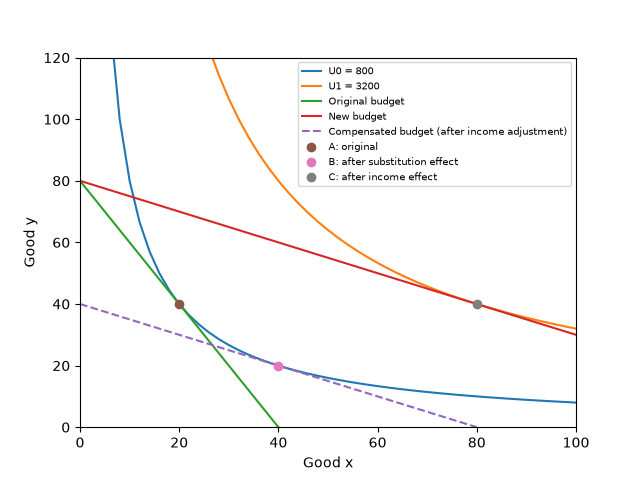
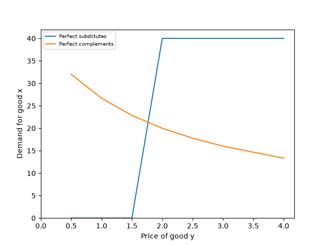

# 第 4 章: スルツキー分解と財の種類

## 4.1 この章の地図

財 x の価格が下がると、需要が増えます。この増え方には、**2 つの理由**があります。

- **代替効果**: 財 x が、財 y に比べて、**割安**になったので、財 x に乗り換える（同じ無差別曲線の上の動き）
- **所得効果**: 値下がりで、買える量が増え、**実質所得が上がった**ので、買い方が変わる（予算線の平行移動）

> 価格効果 = 代替効果 + 所得効果

この 2 つに分けることを、**スルツキー分解**と言います。所得効果の符号で、財は、**上級財**・**下級財**・**ギッフェン財**に分かれます。この章は、第 1 部（消費者行動と需要曲線）の最後で、**到達チェック**も行います。



| 項目 | 内容 |
| :--- | :--- |
| 経済学の題材 | スルツキー分解（代替効果・所得効果）、上級財・下級財・ギッフェン財、代替財・補完財・独立財 |
| 使う Python の機能 | 関数、`dataclass`（`frozen=True`）、タプル、テスト（`pytest`）。NumPy は、この章では使いません |
| 新しく導入するライブラリ | なし |
| 完成形 | `compensated_bundle`、`SlutskyResult`、`slutsky_decomposition`、`classify_by_effects`、`demand_perfect_substitutes`、`demand_perfect_complements`、`cross_price_relation` |
| ファイル | 実装: `lib/chapter04/slutsky.py`、`lib/chapter04/plot.py`（図）／テスト: `test/chapter04/test_slutsky.py`、`test/chapter04/test_plot.py`（自分で書くときは、`practice/chapter04/` に、同じ名前で作ります） |
| データ | なし（手計算できる小さな例だけ） |

### 経済学の式とコードの対応

| 経済学 | 式 | コード |
| :--- | :--- | :--- |
| 補償需要 | 新しい価格のもとで、元の効用を、最も安く達成する点 | `compensated_bundle(level, px, py)` |
| スルツキー分解 | 価格効果 = 代替効果 + 所得効果 | `slutsky_decomposition(income, px_old, px_new, py)` |
| 代替効果 | 補償需要の x − 元の x | `result.substitution_effect` |
| 所得効果 | 最終の x − 補償需要の x | `result.income_effect` |
| 財の種類 | 所得効果の符号と、代替効果との大きさの比較 | `classify_by_effects(substitution_effect, income_effect)` |
| 代替財・補完財 | 財 y の値上げで、財 x の需要が増えるか、減るか | `cross_price_relation(change_in_demand)` |

### 前提とする章

| できること | 場所 |
| :--- | :--- |
| 最適消費点を求める | この連載の[第 2 章](02-budget-and-optimal-choice.md) |
| 需要曲線・弾力性を求める | この連載の[第 3 章](03-demand-curve-and-elasticity.md) |

## 4.2 準備

```bash
cd apps/micro-basics-programming/python
uv sync
uv run pytest test/chapter04
```

```text
44 passed
```

自分でコードを書くときは、`practice/chapter04/` に、`slutsky.py` と `test_slutsky.py` を作ります。第 1〜3 章の関数は、完成形の `lib/` から import してかまいません（[この記事の読み方](how-to-read.md)を参照）。

## 4.3 予想する

効用が U = x·y、所得が 80、財 y の価格が Py = 1 の消費者がいます。財 x の価格が、Px = 2 から 0.5 に下がります。**紙で、手計算で**答えてください。答えは、この節には書いてありません。「プログラミング」の節の「予想の答え合わせ」で、プログラムを動かして確かめます。

- 値下げの**前**の最適消費点 A は、どこですか。**元の効用**（A の効用）を保ったまま、新しい価格比（0.5 ÷ 1）で、最も安く買える点 B は、どこですか
- **新しい価格**での最適消費点 C は、どこですか
- 財 x の量で見て、**代替効果**（A → B）、**所得効果**（B → C）、**価格効果**（A → C）は、それぞれ、いくつですか。この財は、上級財・下級財・ギッフェン財の、どれですか
- 代替効果が +20、所得効果が −30 の財は、何ですか。完全代替財（U = x + y）で、所得 80、Px = 2 のとき、Py = 1 と Py = 3 での財 x の需要は、いくつですか。完全補完財（U = min(x, y)）で、Py = 1 と Py = 2 では、いくつですか。それぞれ、代替財・補完財の、どちらですか

## 4.4 スルツキー分解の考え方

### 価格効果を 2 つに分ける

財 x の価格が下がると、予算線の x 切片が、右へ動きます。最適消費点は、A から C へ動きます。この動きを、**2 段階**に分けます。

1. **代替効果（A → B）**: **元の無差別曲線の上**で、新しい価格比の接点まで動く。実質所得（効用）は、同じまま。割安になった財 x が、増える
2. **所得効果（B → C）**: 予算線が、**平行に**動く。値下がりで、実質所得が上がったので、買い方が変わる

**代替効果は、値下げで、必ず正**（財 x が増える）です。所得効果の符号は、財の種類で決まります。

### 財の種類

| 財 | 所得効果（値下げのとき） | 価格効果 | 需要曲線 |
| :--- | :--- | :--- | :--- |
| **上級財** | 正（所得が上がると、増やす） | 正（代替 + 所得） | 右下がり |
| **下級財** | 負（所得が上がると、減らす）。ただし、**大きさは代替効果より小さい** | 正 | 右下がり |
| **ギッフェン財** | 負で、**大きさが代替効果より大きい** | **負**（値下げで、需要が減る） | **右上がり** |

ギッフェン財は、「下級財で、かつ、所得効果が代替効果を上回る」財です。値上げで、実質所得が下がり、より安い財（ギッフェン財）への依存が強まって、需要が増える、という珍しい財です。

### 代替財と補完財

| 関係 | 財 y の値上げで、財 x の需要は | 例 |
| :--- | :--- | :--- |
| **代替財** | 増える | パンと米 |
| **補完財** | 減る | パンとジャム |
| 独立財 | 変わらない | — |

完全代替財（U = x + y）の無差別曲線は直線で、**安いほうだけ**を買います。完全補完財（U = min(x, y)）は、L 字で、**一組の値段**（Px + Py）で、所得を割った量を買います。

## 4.5 プログラミング

### Red: 補償需要と、スルツキー分解のテスト

最初のテストを書きます。元の効用 800 を保つ点は、新しい価格比（0.5）での接点で、(40, 20) です。

```python
import pytest

from lib.chapter01.utility import cobb_douglas_utility
from lib.chapter02.budget import optimal_bundle
from lib.chapter04.slutsky import (
    classify_by_effects,
    compensated_bundle,
    cross_price_relation,
    demand_perfect_complements,
    demand_perfect_substitutes,
    slutsky_decomposition,
)
```

```python
M, PY = 80, 1


def test_補償された消費点は元の効用を保つ() -> None:
    x, y = compensated_bundle(800, 0.5, PY)
    assert (x, y) == pytest.approx((40, 20))
    assert cobb_douglas_utility(x, y) == pytest.approx(800)


def test_補償された消費点で限界代替率は新しい価格比と等しい() -> None:
    x, y = compensated_bundle(800, 0.5, PY)
    assert y / x == pytest.approx(0.5 / PY)


def test_値下げの価格効果は代替効果と所得効果の和() -> None:
    result = slutsky_decomposition(M, 2, 0.5, PY)
    assert result.original == (20, 40)
    assert result.substitution == pytest.approx((40, 20))
    assert result.final == pytest.approx((80, 40))
    assert result.substitution_effect == pytest.approx(20)
    assert result.income_effect == pytest.approx(40)
    assert result.price_effect == pytest.approx(60)


def test_代替効果のあとの点の支出は元の所得より少ない() -> None:
    result = slutsky_decomposition(M, 2, 0.5, PY)
    x, y = result.substitution
    assert 0.5 * x + PY * y == pytest.approx(40)
```

`compensated_bundle` がまだないので、テストは失敗します（**Red**）。

テストの import の一覧は、完成形の**全関数**です。自分で書くときは、関数を 1 つ書くたびに、その名前を、import に足していってかまいません（まだ書いていない関数を import すると、`ImportError` になり、Green になりません）。


### Green: スルツキー分解を実装する

**補償需要**は、新しい価格のもとで、元の効用を、最も安く達成する点です。最適点では、限界代替率 = 価格比なので、y = (b ÷ a)(Px ÷ Py)·x となり、これを効用の式に入れて、x を求めます（閉じた式）。

```python
@dataclass(frozen=True)
class SlutskyResult:
    """財 x のスルツキー分解。3 つの点と、3 つの効果（財 x の量の変化）。"""

    original: tuple[float, float]
    substitution: tuple[float, float]
    final: tuple[float, float]
    substitution_effect: float
    income_effect: float
    price_effect: float


def compensated_bundle(
    utility_level: float, px: float, py: float, a: float = 1.0, b: float = 1.0
) -> tuple[float, float]:
    """新しい価格のもとで、効用 utility_level を、最も安く達成する点（補償需要）。

    最適点では MRS = Px ÷ Py なので、y = (b ÷ a)(Px ÷ Py)·x。
    これを効用の式に入れて、x を求める。
    """
    validate_positive(utility_level, "効用の水準は、正にする")
    validate_positive(px, "財 x の価格は、正にする")
    validate_positive(py, "財 y の価格は、正にする")
    validate_positive(a, "べき指数 a は、正にする")
    validate_positive(b, "べき指数 b は、正にする")
    ratio = (b / a) * (px / py)
    x = (utility_level / ratio**b) ** (1 / (a + b))
    return x, ratio * x


def slutsky_decomposition(
    income: float,
    px_old: float,
    px_new: float,
    py: float,
    a: float = 1.0,
    b: float = 1.0,
) -> SlutskyResult:
    """財 x の価格が px_old から px_new に変わったときの、スルツキー分解。"""
    original = optimal_bundle(income, px_old, py, a, b)
    level = cobb_douglas_utility(*original, a, b)
    substitution = compensated_bundle(level, px_new, py, a, b)
    final = optimal_bundle(income, px_new, py, a, b)
    return SlutskyResult(
        original,
        substitution,
        final,
        substitution[0] - original[0],
        final[0] - substitution[0],
        final[0] - original[0],
    )
```

??? note "import と補助関数（写すときに足す）"

    記事の抜粋には、import と、先頭が `_` の補助関数・定数を、省いています。完成形のファイルの先頭にある、次の部分を、写してください。

    **lib/chapter04/plot.py**

    ```python
    from collections.abc import Sequence
    ```

    ```python
    import matplotlib.pyplot as plt
    from matplotlib.axes import Axes
    from matplotlib.figure import Figure
    ```

    ```python
    from lib.chapter01.utility import cobb_douglas_utility, indifference_curve_y
    from lib.chapter02.budget import budget_intercepts
    from lib.chapter04.slutsky import (
        demand_perfect_complements,
        demand_perfect_substitutes,
        slutsky_decomposition,
    )
    ```

    ```python
    _POINTS = 50
    ```

    ```python
    def _style(ax: Axes) -> None:
        ax.set_xlim(left=0)
        ax.set_ylim(bottom=0)
        ax.legend(fontsize="x-small")
    ```

    **lib/chapter04/slutsky.py**

    ```python
    from dataclasses import dataclass
    ```

    ```python
    from lib.chapter01.utility import cobb_douglas_utility
    from lib.chapter01.validation import validate_non_negative, validate_positive
    from lib.chapter02.budget import optimal_bundle
    ```

    ```python
    # 効果の符号の判定で、同じ値と見なす誤差
    _TOLERANCE = 1e-9
    ```

    ```python
    def _check_prices(income: float, px: float, py: float) -> None:
        validate_non_negative(income, "所得は、0 以上にする")
        validate_positive(px, "財 x の価格は、正にする")
        validate_positive(py, "財 y の価格は、正にする")
    ```

    **test/chapter04/test_plot.py**

    ```python
    from collections.abc import Sequence
    from typing import cast
    ```

    ```python
    import pytest
    from matplotlib.axes import Axes
    from matplotlib.lines import Line2D
    ```

    ```python
    from lib.chapter04.plot import plot_cross_price, plot_slutsky
    ```

結果は、`SlutskyResult`（`frozen=True` の `dataclass`）にまとめます。3 つの点（元・代替効果のあと・最終）と、3 つの効果（財 x の量の変化）です。価格効果は、**元の点と最終の点の差**と、一致します（`test_価格効果は元の点と最終の点の差`）。

値上げでは、効果の符号が、**逆**になります（代替効果は負。`test_値上げでは効果の符号が逆`）。**代替効果が正なのは、値下げのとき**です。

### 財の種類

```python
def test_上級財は代替効果も所得効果も正() -> None:
    assert classify_by_effects(20, 40) == "上級財"


def test_下級財は所得効果が負で代替効果のほうが大きい() -> None:
    assert classify_by_effects(20, -5) == "下級財"


def test_ギッフェン財は所得効果の負が代替効果より大きい() -> None:
    assert classify_by_effects(20, -30) == "ギッフェン財"
    # 値下げで、需要が減る（価格効果 = 20 − 30 < 0）
    assert 20 + (-30) < 0


def test_代替効果は値下げで必ず正() -> None:
    for a, b in ((1, 1), (1, 2), (2, 1), (0.5, 0.5)):
        for old, new in ((2, 1), (4, 1), (2, 1.9), (1, 0.1)):
            effect = slutsky_decomposition(M, old, new, PY, a, b).substitution_effect
            assert effect > 0
```

```python
_TOLERANCE = 1e-9


def classify_by_effects(substitution_effect: float, income_effect: float) -> str:
    """値下げのときの 2 つの効果から、財の種類を決める。

    代替効果は、値下げで必ず正。所得効果が正なら上級財、負なら下級財。
    所得効果の負が、代替効果より大きければ、価格効果が負になる、ギッフェン財。
    """
    validate_positive(substitution_effect, "代替効果は、値下げで必ず正になる")
    if abs(income_effect) <= _TOLERANCE:
        return "中立財"
    if income_effect > 0:
        return "上級財"
    if -income_effect > substitution_effect + _TOLERANCE:
        return "ギッフェン財"
    return "下級財"
```

`classify_by_effects` は、**値下げのときの 2 つの効果**を受け取ります。代替効果が正でなければ、**エラー**にします（値下げで、代替効果は必ず正だからです）。所得効果が 0 に近ければ中立財、正なら上級財、負で、大きさが代替効果以下なら下級財、**上回れば**ギッフェン財です。コブ・ダグラス型は、所得効果が正の上級財で、**ギッフェン財になりえません**。ギッフェン財の例は、代替効果と所得効果の**値を直接**、渡してテストします。

### 代替財と補完財

```python
def test_完全補完財の需要は所得を価格の和で割った値() -> None:
    assert demand_perfect_complements(M, 2, 1) == pytest.approx(80 / 3)
    assert demand_perfect_complements(M, 2, 2) == pytest.approx(20)


def test_完全代替財は安いほうだけを買う() -> None:
    assert demand_perfect_substitutes(M, 2, 1) == 0
    assert demand_perfect_substitutes(M, 2, 3) == 40
    assert demand_perfect_substitutes(M, 2, 2) == 40


def test_代替財は相手の値上げで需要が増える() -> None:
    change = demand_perfect_substitutes(M, 2, 3) - demand_perfect_substitutes(M, 2, 1)
    assert cross_price_relation(change) == "代替財"


def test_補完財は相手の値上げで需要が減る() -> None:
    change = demand_perfect_complements(M, 2, 2) - demand_perfect_complements(M, 2, 1)
    assert cross_price_relation(change) == "補完財"


def test_コブ_ダグラス型は相手の価格に影響されず独立財() -> None:
    change = optimal_bundle(M, 2, 5)[0] - optimal_bundle(M, 2, 1)[0]
    assert cross_price_relation(change) == "独立財"
```

```python
def _check_prices(income: float, px: float, py: float) -> None:
    validate_non_negative(income, "所得は、0 以上にする")
    validate_positive(px, "財 x の価格は、正にする")
    validate_positive(py, "財 y の価格は、正にする")


def demand_perfect_substitutes(income: float, px: float, py: float) -> float:
    """完全代替財（U = x + y）の財 x の需要。安いほうだけを買う（同じなら財 x）。"""
    _check_prices(income, px, py)
    return income / px if px <= py else 0.0


def demand_perfect_complements(income: float, px: float, py: float) -> float:
    """完全補完財（U = min(x, y)）の財 x の需要。1 組の値段 Px + Py で、所得を割る。"""
    _check_prices(income, px, py)
    return income / (px + py)


def cross_price_relation(change_in_demand: float) -> str:
    """財 y の値上げで財 x の需要が、増えれば代替財、減れば補完財、不変なら独立財。"""
    if change_in_demand > _TOLERANCE:
        return "代替財"
    if change_in_demand < -_TOLERANCE:
        return "補完財"
    return "独立財"
```

コブ・ダグラス型は、財 x の需要が、財 y の価格に**依らない**ので、**独立財**です。代替財・補完財を試すには、完全代替財（直線）と完全補完財（L 字）を使います。

### 予想の答え合わせ

予想した答えを、プログラムで確かめます。

> このスクリプトは、**完成形**（`lib/`）を読みます。**自分のコードで確かめる**ときは、import を、`from practice.chapterNN...` に書き換えてください。

```python
from lib.chapter04.slutsky import (
    classify_by_effects,
    cross_price_relation,
    demand_perfect_complements,
    demand_perfect_substitutes,
    slutsky_decomposition,
)

r = slutsky_decomposition(80, 2, 0.5, 1)
print("元の点:", r.original)
print("代替効果のあとの点:", r.substitution)
print("最終の点:", r.final)
print("代替効果:", round(r.substitution_effect, 4), "所得効果:", round(r.income_effect, 4))
print("価格効果:", round(r.price_effect, 4))
print("財の種類:", classify_by_effects(r.substitution_effect, r.income_effect))
print("代替効果 20・所得効果 −30:", classify_by_effects(20, -30))
subs = demand_perfect_substitutes(80, 2, 3) - demand_perfect_substitutes(80, 2, 1)
comp = demand_perfect_complements(80, 2, 2) - demand_perfect_complements(80, 2, 1)
print("完全代替財の需要の変化:", subs, cross_price_relation(subs))
print("完全補完財の需要の変化:", round(comp, 4), cross_price_relation(comp))
```

```text
元の点: (20.0, 40.0)
代替効果のあとの点: (40.0, 20.0)
最終の点: (80.0, 40.0)
代替効果: 20.0 所得効果: 40.0
価格効果: 60.0
財の種類: 上級財
代替効果 20・所得効果 −30: ギッフェン財
完全代替財の需要の変化: 40.0 代替財
完全補完財の需要の変化: -6.6667 補完財
```

- **1 つ目の問い**: 元の点 A は (20, 40) で、効用は 800 です。効用 800 を保つ点 B は、新しい価格比 0.5 の接点 (40, 20) です。財 x を増やし、財 y を減らして、割安な財 x に乗り換えます
- **2 つ目の問い**: 新しい価格での最適消費点 C は、(80, 40) です
- **3 つ目の問い**: 代替効果は +20（20 → 40）、所得効果は +40（40 → 80）、価格効果は +60 です。**上級財**です（所得効果が正）。価格効果 60 = 20 + 40 です
- **4 つ目の問い**: 代替効果 +20・所得効果 −30 は**ギッフェン財**です（値下げで、需要が 20 − 30 = −10 減る）。完全代替財の財 x の需要は、Py = 1 で 0（財 y が安い）、Py = 3 で 40（財 x が安い）で、**財 y の値上げで増える代替財**です。完全補完財は、Py = 1 で約 26.67、Py = 2 で 20 で、**減る補完財**です

### 図

（図の関数の import と補助関数（`_POINTS`・`_style` など）は、上の折りたたみ「import と補助関数」の、`plot.py` と `test_plot.py` の項目にあります。）

スルツキー分解の 3 点と、予算線・無差別曲線を重ねる関数と、座標のテストです。補償された予算線（点線）が、点 B を通り、新しい価格比と同じ傾きであることを、確かめます。

??? note "描画のテストと実装（後回しにしても、学習は成り立ちます）"

    ```python
    def xs(line: Line2D) -> list[float]:
        return [float(v) for v in cast(Sequence[float], line.get_xdata())]


    def ys(line: Line2D) -> list[float]:
        return [float(v) for v in cast(Sequence[float], line.get_ydata())]


    def line(ax: Axes, label: str) -> Line2D:
        return next(item for item in ax.lines if item.get_label() == label)


    def slutsky() -> Axes:
        return plot_slutsky(80, 2, 0.5, 1, 100).axes[0]


    def test_スルツキー分解の図の線() -> None:
        labels = [item.get_label() for item in slutsky().lines]
        assert labels == [
            "U0 = 800",
            "U1 = 3200",
            "Original budget",
            "New budget",
            "Compensated budget (after income adjustment)",
            "A: original",
            "B: after substitution effect",
            "C: after income effect",
        ]


    def test_3つの点は元の点と代替効果のあとと最終() -> None:
        ax = slutsky()
        points = {
            "A: original": (20, 40),
            "B: after substitution effect": (40, 20),
            "C: after income effect": (80, 40),
        }
        for label, (x, y) in points.items():
            assert xs(line(ax, label)) == pytest.approx([x])
            assert ys(line(ax, label)) == pytest.approx([y])


    def test_補償された予算線は代替効果のあとの点を通る点線() -> None:
        ax = slutsky()
        compensated = line(ax, "Compensated budget (after income adjustment)")
        assert compensated.get_linestyle() == "--"
        # x = 40 のとき y = 20（点 B）。x 切片は 80、y 切片は 40
        assert xs(compensated) == pytest.approx([0, 80])
        assert ys(compensated) == pytest.approx([40, 0])
    ```

    ```python
    def plot_slutsky(
        income: float, px_old: float, px_new: float, py: float, x_max: float
    ) -> Figure:
        """スルツキー分解の 3 点（A・B・C）を、無差別曲線と予算線に重ねて描く。

        A（元の点）から B（代替効果のあと）は、同じ無差別曲線の上の動き。
        B から C（最終）は、予算線の平行移動（所得効果）。
        """
        result = slutsky_decomposition(income, px_old, px_new, py)
        level_a = cobb_douglas_utility(*result.original)
        level_c = cobb_douglas_utility(*result.final)
        step = x_max / _POINTS
        xs = [step * (i + 1) for i in range(_POINTS)]
        fig, ax = plt.subplots()
        for name, level in (("U0", level_a), ("U1", level_c)):
            ax.plot(
                xs,
                [indifference_curve_y(level, x) for x in xs],
                label=f"{name} = {level:g}",
            )
        for label, price in (("Original budget", px_old), ("New budget", px_new)):
            x_intercept, y_intercept = budget_intercepts(income, price, py)
            ax.plot([0, x_intercept], [y_intercept, 0], label=label)
        x_b, y_b = result.substitution
        spend = px_new * x_b + py * y_b
        x_intercept, y_intercept = budget_intercepts(spend, px_new, py)
        ax.plot(
            [0, x_intercept],
            [y_intercept, 0],
            "--",
            label="Compensated budget (after income adjustment)",
        )
        for label, point in (
            ("A: original", result.original),
            ("B: after substitution effect", result.substitution),
            ("C: after income effect", result.final),
        ):
            ax.plot([point[0]], [point[1]], "o", label=label)
        ax.set_xlabel("Good x")
        ax.set_ylabel("Good y")
        _style(ax)
        # 無差別曲線は x が小さいと立ち上がるので、元の予算線の y 切片の 1.5 倍までを見せる
        ax.set_xlim(0, x_max)
        ax.set_ylim(0, 1.5 * income / py)
        plt.close(fig)
        return fig
    ```

財 y の価格を動かしたときの、財 x の需要です。代替財は増え、補完財は減ります。



??? note "描画のテストと実装（後回しにしても、学習は成り立ちます）"

    ```python
    def cross() -> Axes:
        return plot_cross_price(80, 2, [1, 2, 3, 4]).axes[0]


    def test_交差価格効果の図は代替財と補完財の2本() -> None:
        ax = cross()
        assert [item.get_label() for item in ax.lines] == [
            "Perfect substitutes",
            "Perfect complements",
        ]


    def test_代替財は相手が高くなると需要が増える() -> None:
        substitutes = line(cross(), "Perfect substitutes")
        assert xs(substitutes) == [1, 2, 3, 4]
        assert ys(substitutes) == [0, 40, 40, 40]


    def test_補完財は相手が高くなると需要が減る() -> None:
        complements = line(cross(), "Perfect complements")
        assert ys(complements) == pytest.approx([80 / 3, 20, 16, 80 / 6])
    ```

    ```python
    def plot_cross_price(income: float, px: float, py_values: Sequence[float]) -> Figure:
        """財 y の価格を動かしたときの、財 x の需要。代替財は増え、補完財は減る。"""
        fig, ax = plt.subplots()
        ax.plot(
            list(py_values),
            [demand_perfect_substitutes(income, px, py) for py in py_values],
            label="Perfect substitutes",
        )
        ax.plot(
            list(py_values),
            [demand_perfect_complements(income, px, py) for py in py_values],
            label="Perfect complements",
        )
        ax.set_xlabel("Price of good y")
        ax.set_ylabel("Demand for good x")
        _style(ax)
        plt.close(fig)
        return fig
    ```

### 実行結果

```bash
uv run pytest test/chapter04
```

```text
44 passed
```

## 4.6 規則で言うと

1. **価格効果 = 代替効果 + 所得効果である。** 代替効果は、同じ無差別曲線の上の動き。所得効果は、予算線の平行移動
2. **代替効果は、値下げで、必ず正である。** 財の種類を決めるのは、所得効果の符号と大きさ
3. **ギッフェン財は、下級財で、所得効果が代替効果を上回る。** 需要曲線が右上がりになる

混同しやすい点を、表にまとめます。

| 混同しやすい点 | 違い |
| :--- | :--- |
| 代替効果と所得効果 | 代替効果は、**価格比**の変化による乗り換え（効用は同じ）。所得効果は、**実質所得**の変化による買い方の変化（予算線の平行移動） |
| 下級財とギッフェン財 | 下級財は、所得効果が負。ギッフェン財は、さらに、**所得効果の大きさが代替効果を上回る**（価格効果が負になる）。下級財の需要曲線は、右下がり |
| 上級財と奢侈品 | 上級財は、所得効果が**正**。奢侈品は、所得弾力性が **1 以上**（上級財の一部） |
| 代替財と補完財 | 財 y の値上げで、財 x の需要が、**増えれば代替財、減れば補完財** |

### このモデルが成り立たない場面

- **ギッフェン財は、実際には、ほとんど見つかっていません。** 理論上ありうる、という位置づけです
- **補償需要は、仮想の点です。** 実際の消費者は、「元の効用を保つ」ように、調整してくれません。観察できるのは、A と C だけです
- **この章の例は、コブ・ダグラス型だけです。** 価格の下がり方によって、代替効果と所得効果の比は、変わります（上の出力では、1:2、1:4）。実際の財では、財によって、大きく違います
- **補償は、元の効用を一定にする方式（ヒックス型）です。** 元の消費点を買えるように所得を調整する方式（スルツキー型）とは、少し違います。教科書によって、呼び方が違うので、読み比べるときは、注意してください
- **完全代替財・完全補完財は、極端な形です。** 現実の財は、その間にあります

## 4.7 第 1 部の到達チェック

第 1 部（第 1〜4 章）の終わりです。何も見ずに、できるかどうかを、自分で確かめます。**先に、次の「時間を決めて書く課題」を、何も見ずに試してください。** そのあとで、「値の確かめ」と「できること」で、答えを見ます。

### 時間を決めて書く課題

何も見ずに、時間を計って、関数とテストを書きます。

| 課題 | 目安の時間 |
| :--- | :--- |
| U = x·y で、効用 800 の無差別曲線の y と、限界代替率（y ÷ x）を返す関数と、テスト（x = 10・20・40 で確かめる） | 10 分 |
| 予算線の切片と、最適消費点を返す関数と、テスト（U = x·y、所得 80、Px = 2、Py = 1） | 15 分 |
| 需要量（U = x·y、所得 80、Py = 1 で、Px = 2・1・0.5）と、直線の需要曲線 Q = 100 − P の P = 50 での価格弾力性を返す関数と、テスト | 15 分 |
| スルツキー分解（代替効果・所得効果・価格効果）を返す関数と、テスト（U = x·y、所得 80、Py = 1 で、Px が 2 から 0.5） | 20 分 |

### 値の確かめ

到達チェックの値を、プログラムで確かめます。各章の関数を、そのまま呼びます。

「値の確かめ」のスクリプトは、`practice/chapter04/reach.py` に保存し（04 は、この章の番号）、`uv run python -m practice.chapter04.reach` で実行します。

```python
from lib.chapter01.utility import (
    cobb_douglas_utility,
    indifference_curve_y,
    marginal_rate_of_substitution,
)
from lib.chapter02.budget import budget_intercepts, optimal_bundle
from lib.chapter03.demand import demand_x, price_elasticity, price_elasticity_linear
from lib.chapter04.slutsky import classify_by_effects, slutsky_decomposition

print("効用 (20, 40):", cobb_douglas_utility(20, 40))
for x in (10, 20, 40):
    y = indifference_curve_y(800, x)
    print("U = 800 で x =", x, "のとき y =", y, "、MRS =", marginal_rate_of_substitution(x, y))
print("予算線の切片:", budget_intercepts(80, 2, 1))
print("最適消費点:", optimal_bundle(80, 2, 1))
for price in (2, 1, 0.5):
    print("Px =", price, "の需要量:", demand_x(80, price, 1))
print("U = x·y の価格弾力性:", round(price_elasticity(lambda p: demand_x(80, p, 1), 2), 4))
print("直線 Q = 100 − P の P = 50 の価格弾力性:", price_elasticity_linear(100, -1, 50))
r = slutsky_decomposition(80, 2, 0.5, 1)
print("代替効果・所得効果・価格効果:", r.substitution_effect, r.income_effect, r.price_effect)
print("代替効果 20・所得効果 −30:", classify_by_effects(20, -30))
for new in (0.5, 0.125):
    q = slutsky_decomposition(80, 2, new, 1)
    print("Px = 2 →", new, ":", round(q.substitution_effect, 4), round(q.income_effect, 4), round(q.price_effect, 4))
```

```text
効用 (20, 40): 800.0
U = 800 で x = 10 のとき y = 80.0 、MRS = 8.0
U = 800 で x = 20 のとき y = 40.0 、MRS = 2.0
U = 800 で x = 40 のとき y = 20.0 、MRS = 0.5
予算線の切片: (40.0, 80.0)
最適消費点: (20.0, 40.0)
Px = 2 の需要量: 20.0
Px = 1 の需要量: 40.0
Px = 0.5 の需要量: 80.0
U = x·y の価格弾力性: 1.0
直線 Q = 100 − P の P = 50 の価格弾力性: 1.0
代替効果・所得効果・価格効果: 20.0 40.0 60.0
代替効果 20・所得効果 −30: ギッフェン財
Px = 2 → 0.5 : 20.0 40.0 60.0
Px = 2 → 0.125 : 60.0 240.0 300.0
```

### できること

| できること | 検証の方法 | 戻る章 |
| :--- | :--- | :--- |
| 無差別曲線と、限界代替率を求め、原点に凸の意味を言う | U = x·y で、(20, 40) の効用 800。効用 800 の曲線上で、x = 10・20・40 のとき y = 80・40・20、MRS = 8・2・0.5（右へ進むほど MRS が小さい） | [第 1 章](01-utility-and-indifference-curves.md) |
| 予算線と、最適消費点を求め、接点の条件を言う | 切片 (40, 80)、最適点 (20, 40)、MRS = 価格比 = 2 | [第 2 章](02-budget-and-optimal-choice.md) |
| 需要曲線を導き、弾力性を求める | Px = 2・1・0.5 で需要量 20・40・80。U = x·y の価格弾力性は 1。直線 Q = 100 − P の価格弾力性は P = 50 で 1 | [第 3 章](03-demand-curve-and-elasticity.md) |
| スルツキー分解を行い、財の種類を言う | 代替効果 20、所得効果 40、価格効果 60（上級財）。代替効果 20・所得効果 −30 はギッフェン財 | [この章](04-slutsky-decomposition-and-goods.md) |
| 代替財と補完財を見分ける | 完全代替財は、財 y の値上げで需要が増え、完全補完財は減る | この章 |

### 誤りの原因の分類

できなかった課題は、原因を、次の 4 つに分けて、記録します。

| 分類 | 例 | 対策 |
| :--- | :--- | :--- |
| 知識の不足 | 代替効果が、値下げで必ず正であることを忘れた | その章の「規則で言うと」を、読み直す |
| 式の取り違え | 限界代替率と、価格比を、取り違えた（予算線の傾きと、無差別曲線の傾き） | 式とコードの対応表を、書き写す |
| 手順の誤り | 補償需要を、新しい所得で計算した（元の効用を保つ点を求めていない） | A・B・C の 3 点を、図に書いて、確認する |
| 不注意 | 価格の単位（Px = 0.5）や、符号を、見間違えた | テストの期待値を、先に手計算で書く |

## 4.8 練習問題

| 種類 | 問題 |
| :--- | :--- |
| 想起 | 本文を閉じて、`slutsky_decomposition` の最初のテスト（所得 80、Px が 2 から 0.5、Py = 1 で、代替効果 20・所得効果 40・価格効果 60）を書いてください |
| 生成 | 解説を見る前に、代替効果と所得効果から、**価格効果の向き**（"需要増"・"需要減"）を返す `price_effect_direction(substitution_effect, income_effect)` を、テストから書いてください。(20, 40)・(20, −5) は需要増、(20, −30) は需要減です |
| 多様 | 値上げ（Px が 0.5 から 2）に変えます。代替効果・所得効果・価格効果は、いくつですか。先に予想してから、確かめてください |
| 交互 | [第 1 シリーズ](../economics-programming/index.md)の第 3 章のリスト内包表記で、Px が 2 から 0.5・0.125 に下がるときの、代替効果と価格効果を、一度に計算してください。価格効果が、代替効果と所得効果の和になっていますか |

??? note "解答（先に自分で取り組んでから、開いてください）"

    **想起**:

    ```python
    def test_スルツキー分解の3つの効果() -> None:
        result = slutsky_decomposition(80, 2, 0.5, 1)
        assert result.substitution_effect == pytest.approx(20)
        assert result.income_effect == pytest.approx(40)
        assert result.price_effect == pytest.approx(60)
    ```

    **生成**: 2 つの効果を足して、符号を見ます。

    ```python
    def price_effect_direction(substitution_effect, income_effect):
        return "需要増" if substitution_effect + income_effect > 0 else "需要減"
    ```

    ```python
    def test_価格効果の向き() -> None:
        assert price_effect_direction(20, 40) == "需要増"
        assert price_effect_direction(20, -5) == "需要増"
        assert price_effect_direction(20, -30) == "需要減"
    ```

    **多様**: 値上げでは、元の点が (80, 40)（効用 3200）です。効用 3200 を保ったまま、新しい価格比（2 ÷ 1）で最も安く買える点は (40, 80) なので、x は 80 → 40 と 40 減り、代替効果は −40 です。最終の点は (20, 40) なので、所得効果は 40 → 20 の −20、価格効果は −60 です。**符号が、値下げの逆**です。

    ```python
    def test_値上げの効果() -> None:
        result = slutsky_decomposition(80, 0.5, 2, 1)
        assert result.substitution_effect == pytest.approx(-40)
        assert result.income_effect == pytest.approx(-20)
        assert result.price_effect == pytest.approx(-60)
    ```

    **交互**: 0.125 まで下がると、代替効果は 60、所得効果は 240、価格効果は 300 です。

    ```python
    def test_価格効果は代替効果と所得効果の和() -> None:
        results = [slutsky_decomposition(80, 2, p, 1) for p in (0.5, 0.125)]
        assert [r.substitution_effect for r in results] == pytest.approx([20, 60])
        assert [r.price_effect for r in results] == pytest.approx([60, 300])
        assert all(
            r.price_effect == pytest.approx(r.substitution_effect + r.income_effect)
            for r in results
        )
    ```

## 4.9 振り返り

- うまくいったこと:
- 詰まったこと:
- 次に試すこと:

## 4.10 まとめ

- 価格効果は、代替効果（同じ無差別曲線の上で、新しい価格比の接点へ動く）と、所得効果（予算線の平行移動）の和。代替効果は、値下げで必ず正
- 所得効果が正なら上級財、負で、代替効果より小さければ下級財、代替効果を上回ればギッフェン財（需要曲線が右上がり）
- 財 y の値上げで、財 x の需要が増えれば代替財（完全代替財は直線）、減れば補完財（完全補完財は L 字）、変わらなければ独立財
- 第 1 部の到達チェックで、無差別曲線・最適消費点・需要曲線と弾力性・スルツキー分解を、何も見ずにできるかを確かめた

第 2 部（第 5〜7 章）では、**企業**の行動に移ります。次の章では、**費用曲線**（総費用・限界費用・平均費用・平均可変費用）の 3 本の関係を確かめます。そこで、**NumPy** を導入します。
