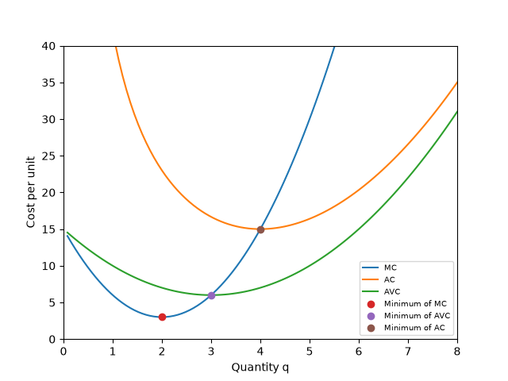
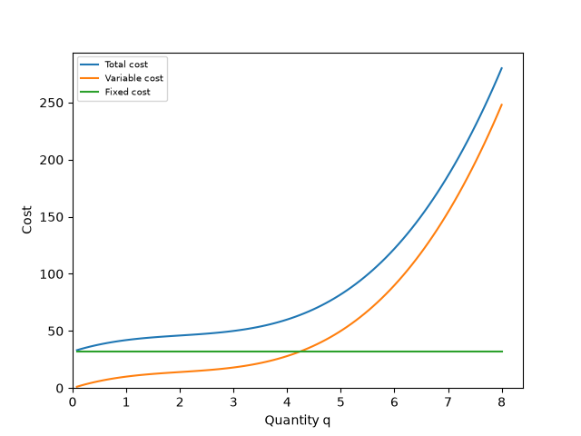

# 第 5 章: 費用曲線

## 5.1 この章の地図

第 1 部では、**消費者**の選択から、需要曲線を導きました。第 2 部では、**企業**の選択から、**供給曲線**を導きます。その出発点が、**費用**です。企業は、作る量が増えると、費用が増えます。この費用が、**どう増えるか**が、供給を決めます。

この章では、総費用の式から、**限界費用（MC）**・**平均費用（AC）**・**平均可変費用（AVC）**の 3 本の曲線を作り、**3 本の曲線の最低点の位置関係**（MC は、AVC と AC の最低点を通る）を、確かめます。この章で、**NumPy** を導入します。



| 項目 | 内容 |
| :--- | :--- |
| 経済学の題材 | 総費用・可変費用・固定費用、限界費用・平均費用・平均可変費用、3 本の関係（最低点の順） |
| 使う Python の機能 | `dataclass`（`frozen=True`、`__post_init__` で入力のチェック）、関数、リスト内包表記、テスト（`pytest`） |
| 新しく導入するライブラリ | **NumPy**（`np.linspace`・`np.argmin`・`np.gradient`・`np.asarray`） |
| 完成形 | `CostCurve`、`total_cost`、`variable_cost`、`marginal_cost`、`average_cost`、`average_variable_cost`、`marginal_cost_by_gradient`、`argmin_of`、`cost_minima` |
| ファイル | 実装: `lib/chapter05/cost.py`、`lib/chapter05/plot.py`（図）／テスト: `test/chapter05/test_cost.py`、`test/chapter05/test_plot.py`（自分で書くときは、`practice/chapter05/` に、同じ名前で作ります） |
| データ | なし（手計算できる小さな例だけ） |

### 経済学の式とコードの対応

| 経済学 | 式 | コード |
| :--- | :--- | :--- |
| 総費用 | C(q) = a·q³ + b·q² + c·q + F（F は固定費用） | `total_cost(curve, q)` |
| 可変費用 | VC(q) = C(q) − F | `variable_cost(curve, q)` |
| 限界費用 | MC = C'(q) = 3a·q² + 2b·q + c | `marginal_cost(curve, q)` |
| 平均費用 | AC = C(q) ÷ q | `average_cost(curve, q)` |
| 平均可変費用 | AVC = VC(q) ÷ q | `average_variable_cost(curve, q)` |
| 3 本の最低点 | MC・AVC・AC が最小になる q と値 | `cost_minima(curve)` |

### 前提とする章

| できること | 場所 |
| :--- | :--- |
| 関数・`dataclass`・テストを書く | [第 1 シリーズ](../economics-programming/index.md)の第 1〜6 章 |
| 第 1 部の道具（最低点を探す、格子点の探索） | この連載の[第 2 章](02-budget-and-optimal-choice.md)（格子点の探索） |

この章から、前の章の関数に依存せず、**企業の費用**を、新しく始めます。

## 5.2 準備

この章から、NumPy を使います。`uv sync` で、入ります。

```bash
cd apps/micro-basics-programming/python
uv sync
uv run pytest test/chapter05
```

```text
42 passed
```

自分でコードを書くときは、`practice/chapter05/` に、`cost.py` と `test_cost.py` を作ります（[この記事の読み方](how-to-read.md)を参照）。

## 5.3 予想する

総費用が C(q) = q³ − 6q² + 15q + 32（q は生産量、32 は固定費用）の企業がいます。**紙で、手計算で**答えてください。答えは、この節には書いてありません。「プログラミング」の節の「予想の答え合わせ」で、プログラムを動かして確かめます。

- q = 0・2・5 のときの**総費用**は、それぞれ、いくつですか
- q = 2・3・4 のときの**限界費用**（MC = 3q² − 12q + 15）は、それぞれ、いくつですか
- q = 4 の**平均費用**と、q = 3 の**平均可変費用**は、いくつですか。q = 3 で、限界費用と平均可変費用を比べると、どうですか
- MC・AVC・AC が**最小になる生産量**は、それぞれ、いくつですか（小さい順に並べてください）。そのときの**値**は、いくつですか

## 5.4 費用曲線の考え方

### 3 つの費用

- **固定費用（FC）**: 生産量に依らず、かかる費用（工場の賃料など）。作らなくても、かかる
- **可変費用（VC）**: 生産量とともに、増える費用（原材料など）
- **総費用（TC）** = 固定費用 + 可変費用。逆 S 字の形（増え方が、はじめは急で、次第に緩やかになり、のち再び急に）になることが、多い

### 3 つの「1 単位あたり」の費用

| 費用 | 定義 | グラフでの見え方 |
| :--- | :--- | :--- |
| **限界費用（MC）** | 1 単位追加で、増える費用 = 総費用の微分 | 総費用曲線の**接線の傾き**。固定費用とは、無関係 |
| **平均費用（AC）** | 総費用 ÷ 生産量 | **原点からの直線の傾き** |
| **平均可変費用（AVC）** | 可変費用 ÷ 生産量 | **固定費の切片からの直線の傾き**。いつも AC より下 |

限界費用は、逆 S 字の総費用では、**はじめは減り、のち増える**（U 字型）です。平均費用が逓減する範囲を**規模の経済**と言います（範囲の経済は、製品の幅の話で、別のものです）。

### 3 本の関係

> MC は、AVC の最低点と、AC の最低点を通る

平均は、限界が平均より**低い間**は下がり、**高くなる**と上がります。だから、限界が平均と**交わる点**が、平均の最低点です。最低点の順は、**MC → AVC → AC**（q の小さい順）です。

## 5.5 プログラミング

### NumPy を、なぜ使うのか

最低点を探すには、**たくさんの点**で値を計算して、**最小の点**を選びます。リストと `for` 文でも書けますが、NumPy を使うと、短く、速く書けます。この章で使う道具は、次の 4 つです。

- `np.linspace(a, b, n)`: a から b までを、n 点に**等分**した、配列を作る
- `np.argmin(values)`: 値の並びの、**最小値の位置**（同じ値が複数あれば、先の位置）
- `np.gradient(y, x)`: y を x で、**数値微分**した、並びを返す（総費用から、限界費用を求める）
- `np.asarray(values, dtype=float)`: リストを、配列にする

配列は、リストと違って、**1 つの型**（ここでは、浮動小数点数）の値が、並んだものです。

### Red: 総費用と限界費用のテスト

最初のテストを書きます。総費用 C(q) = q³ − 6q² + 15q + 32 の値は、手計算できます。

```python
import numpy as np
import pytest

from lib.chapter05.cost import (
    CostCurve,
    argmin_of,
    average_cost,
    average_variable_cost,
    cost_minima,
    marginal_cost,
    marginal_cost_by_gradient,
    total_cost,
    variable_cost,
)
```

```python
CURVE = CostCurve(cubic=1, quadratic=-6, linear=15, fixed=32)


def test_総費用は固定費用と可変費用の和() -> None:
    assert total_cost(CURVE, 0) == 32
    assert total_cost(CURVE, 2) == 46
    assert total_cost(CURVE, 5) == 82
    assert total_cost(CURVE, 5) == variable_cost(CURVE, 5) + CURVE.fixed


def test_限界費用は総費用の接線の傾き() -> None:
    assert marginal_cost(CURVE, 2) == 3
    assert marginal_cost(CURVE, 3) == 6
    assert marginal_cost(CURVE, 4) == 15
    assert marginal_cost(CURVE, 5) == 30


def test_限界費用は固定費用に依らない() -> None:
    bigger = CostCurve(1, -6, 15, 1000)
    assert marginal_cost(bigger, 4) == marginal_cost(CURVE, 4)


def test_限界費用は逓減のち逓増のU字型() -> None:
    values = [marginal_cost(CURVE, q) for q in (0, 1, 2, 3, 4)]
    assert values == [15, 6, 3, 6, 15]
```

`CostCurve` などがまだないので、テストは失敗します（**Red**）。

テストの import の一覧は、完成形の**全関数**です。自分で書くときは、関数を 1 つ書くたびに、その名前を、import に足していってかまいません（まだ書いていない関数を import すると、`ImportError` になり、Green になりません）。

### Green: 費用関数を実装する

費用関数の係数は、`dataclass`（`frozen=True`）に、まとめます。3 次の係数が正で、固定費用が 0 以上であることは、`__post_init__` で、確かめます。

```python
@dataclass(frozen=True)
class CostCurve:
    """総費用 C(q) = cubic·q³ + quadratic·q² + linear·q + fixed の係数。"""

    cubic: float
    quadratic: float
    linear: float
    fixed: float

    def __post_init__(self) -> None:
        validate_positive(self.cubic, "3 次の係数は、正にする")
        validate_non_negative(self.fixed, "固定費用は、0 以上にする")
        a, b, c = self.cubic, self.quadratic, self.linear
        if c < 0 or (b < 0 and b**2 > 3 * a * c):
            raise ValueError(
                "限界費用が負になる係数は、扱わない（c ≥ 0、b ≥ 0 または b² ≤ 3ac）"
            )


def _check_quantity(q: float) -> None:
    validate_non_negative(q, "生産量は、0 以上にする")


def variable_cost(curve: CostCurve, q: float) -> float:
    """可変費用 VC(q) = C(q) − F。生産量とともに増える。"""
    _check_quantity(q)
    return curve.cubic * q**3 + curve.quadratic * q**2 + curve.linear * q


def total_cost(curve: CostCurve, q: float) -> float:
    """総費用 C(q) = 可変費用 + 固定費用。"""
    return variable_cost(curve, q) + curve.fixed


def marginal_cost(curve: CostCurve, q: float) -> float:
    """限界費用 MC = C'(q) = 3a·q² + 2b·q + c。固定費用には依らない。"""
    _check_quantity(q)
    return 3 * curve.cubic * q**2 + 2 * curve.quadratic * q + curve.linear
```

??? note "import と補助関数（写すときに足す）"

    記事の抜粋には、import と、先頭が `_` の補助関数・定数を、省いています。完成形のファイルの先頭にある、次の部分を、写してください。

    **lib/chapter05/cost.py**

    ```python
    from dataclasses import dataclass
    ```

    ```python
    import numpy as np
    from numpy.typing import ArrayLike
    ```

    ```python
    from lib.chapter01.validation import validate_non_negative, validate_positive
    ```

    ```python
    def _check_quantity(q: float) -> None:
        validate_non_negative(q, "生産量は、0 以上にする")
    ```

    **lib/chapter05/plot.py**

    ```python
    import matplotlib.pyplot as plt
    import numpy as np
    from matplotlib.figure import Figure
    ```

    ```python
    from lib.chapter05.cost import (
        CostCurve,
        average_cost,
        average_variable_cost,
        cost_minima,
        marginal_cost,
        total_cost,
        variable_cost,
    )
    ```

    ```python
    _POINTS = 100
    ```

    ```python
    def _grid(q_max: float) -> list[float]:
        """q_max の 100 分の 1 から q_max までを、100 点に等分する（q = 0 は、除く）。"""
        return [float(q) for q in np.linspace(q_max / _POINTS, q_max, _POINTS)]
    ```

    **test/chapter05/test_plot.py**

    ```python
    from collections.abc import Sequence
    from typing import cast
    ```

    ```python
    import pytest
    from matplotlib.axes import Axes
    from matplotlib.lines import Line2D
    ```

    ```python
    from lib.chapter05.cost import (
        CostCurve,
        average_cost,
        average_variable_cost,
        marginal_cost,
        total_cost,
        variable_cost,
    )
    from lib.chapter05.plot import plot_cost_curves, plot_total_cost
    ```

作るときに、3 次の係数が正、固定費用が 0 以上であることに加えて、**限界費用が負にならない**こと（c ≥ 0、b ≥ 0 または b² ≤ 3ac）を検査します。限界費用が負になる係数では、可変費用が負になり、経済として成り立たないためです。

固定費用は、**総費用にだけ**入り、限界費用の式には、出てきません（`test_限界費用は固定費用に依らない`）。生産量が負のときは、エラーにします。

### 平均費用と、平均可変費用

平均費用と平均可変費用は、**生産量が 0 のとき、求められません**（0 で割れない）。**エラー**にします。0 より大きく 1 未満の生産量（0.5 など）は、有効です。

```python
def test_平均費用は総費用を生産量で割った値() -> None:
    assert average_cost(CURVE, 4) == 15
    assert average_cost(CURVE, 5) == pytest.approx(16.4)
    assert average_cost(CURVE, 3) == pytest.approx(50 / 3)


def test_平均可変費用は可変費用を生産量で割った値() -> None:
    assert average_variable_cost(CURVE, 3) == 6
    assert average_variable_cost(CURVE, 4) == 7


def test_平均費用はいつも平均可変費用より上() -> None:
    for q in (0.5, 1, 2, 3, 4, 8):
        gap = average_cost(CURVE, q) - average_variable_cost(CURVE, q)
        assert gap == pytest.approx(CURVE.fixed / q)
        assert gap > 0
```

```python
def average_cost(curve: CostCurve, q: float) -> float:
    """平均費用 AC = C(q) ÷ q。生産量が 0 のときは、求められない。"""
    validate_positive(q, "平均費用の生産量は、正にする")
    return total_cost(curve, q) / q


def average_variable_cost(curve: CostCurve, q: float) -> float:
    """平均可変費用 AVC = VC(q) ÷ q。いつも、平均費用より、固定費用 ÷ q だけ低い。"""
    validate_positive(q, "平均可変費用の生産量は、正にする")
    return variable_cost(curve, q) / q
```

平均費用と平均可変費用の差は、**固定費用 ÷ q**（平均固定費用）で、いつも正です（3 つ目のテスト）。だから、AC は、いつも AVC の上にあります。

### 限界費用を、数値微分で確かめる

限界費用は、総費用曲線の**接線の傾き**です。総費用を、細かい生産量で並べて、NumPy の**勾配**（`np.gradient`）で、傾きを求めて、限界費用の式と比べます。

```python
def test_限界費用は勾配の数値微分と一致する() -> None:
    qs = np.linspace(0, 10, 1001)
    costs = [total_cost(CURVE, float(q)) for q in qs]
    gradient = marginal_cost_by_gradient(costs, qs)
    expected = [marginal_cost(CURVE, float(q)) for q in qs]
    assert gradient[1:-1] == pytest.approx(expected[1:-1], abs=1e-3)
```

```python
def marginal_cost_by_gradient(costs: ArrayLike, quantities: ArrayLike) -> list[float]:
    """総費用の並びから、数値微分（NumPy の勾配）で、限界費用を求める。"""
    y = np.asarray(costs, dtype=float)
    x = np.asarray(quantities, dtype=float)
    if y.shape != x.shape:
        raise ValueError("総費用と生産量は、同じ長さにする")
    return [float(v) for v in np.gradient(y, x)]
```

端の点は、片側の差分なので、誤差が大きいので、**内側の点だけ**を比べます。内側の点の誤差は、刻みの 2 乗（h² × 3 次の係数）で、刻み 0.01 では、1e-4 です。

### 3 本の最低点を探す

最小の位置を返す `argmin_of` と、3 本の最低点を探す `cost_minima` です。生産量を、0 から上限まで、細かく並べて（格子点）、3 本それぞれの最小を探します。

```python
def test_最小値の位置と値() -> None:
    assert argmin_of([5, 3, 4], [0, 1, 2]) == (1, 3)


def test_3本の曲線の最低点() -> None:
    minima = cost_minima(CURVE)
    assert minima["MC"] == pytest.approx((2, 3), abs=1e-3)
    assert minima["AVC"] == pytest.approx((3, 6), abs=1e-3)
    assert minima["AC"] == pytest.approx((4, 15), abs=1e-3)


def test_最低点の順は限界費用_平均可変費用_平均費用() -> None:
    minima = cost_minima(CURVE)
    assert minima["MC"][0] < minima["AVC"][0] < minima["AC"][0]


def test_限界費用は平均可変費用と平均費用の最低点を通る() -> None:
    minima = cost_minima(CURVE)
    q_avc, v_avc = minima["AVC"]
    q_ac, v_ac = minima["AC"]
    assert marginal_cost(CURVE, q_avc) == pytest.approx(v_avc, abs=1e-2)
    assert marginal_cost(CURVE, q_ac) == pytest.approx(v_ac, abs=1e-2)
```

```python
def argmin_of(values: ArrayLike, positions: ArrayLike) -> tuple[float, float]:
    """値の並びの最小値と、その位置 (位置, 最小値)。同じ値が複数あれば、先の位置。"""
    v = np.asarray(values, dtype=float)
    x = np.asarray(positions, dtype=float)
    if v.shape != x.shape:
        raise ValueError("値と位置は、同じ長さにする")
    index = int(np.argmin(v))
    return float(x[index]), float(v[index])


def cost_minima(
    curve: CostCurve, q_max: float = 10.0, points: int = 10001
) -> dict[str, tuple[float, float]]:
    """MC・AVC・AC の最低点 (生産量, 値) を、格子点の探索で求める。"""
    validate_positive(q_max, "探索の上限は、正にする")
    validate_positive(points - 2, "点の数は、3 以上にする")
    grid = np.linspace(0.0, q_max, points)
    positive = grid[1:]
    minima = {
        "MC": argmin_of([marginal_cost(curve, float(q)) for q in grid], grid),
        "AVC": argmin_of(
            [average_variable_cost(curve, float(q)) for q in positive], positive
        ),
        "AC": argmin_of([average_cost(curve, float(q)) for q in positive], positive),
    }
    if any(q >= q_max for q, _ in minima.values()):
        raise ValueError("最低点が探索の上限に届いた。上限 q_max を大きくする")
    return minima
```

最低点が、探索の上限 `q_max` に届いたときは、**エラー**にします（黙って、端の値を返さないためです）。その場合は、`q_max` を大きくして、探索し直します。

MC・AVC・AC の最低点は、(q, 値) = (2, 3)、(3, 6)、(4, 15) です。限界費用は、AVC の最低点（q = 3）で 6、AC の最低点（q = 4）で 15 となり、**それぞれの最低値と、一致します**（最後のテスト）。平均費用と平均可変費用は、**q = 0 で求められない**ので、0 を除いた格子点で探します。

### 予想の答え合わせ

予想した答えを、プログラムで確かめます。

> このスクリプトは、**完成形**（`lib/`）を読みます。**自分のコードで確かめる**ときは、import を、`from practice.chapterNN...` に書き換えてください。

```python
from lib.chapter05.cost import (
    CostCurve,
    average_cost,
    average_variable_cost,
    cost_minima,
    marginal_cost,
    total_cost,
)

curve = CostCurve(cubic=1, quadratic=-6, linear=15, fixed=32)
print("総費用 q = 0・2・5:", [total_cost(curve, q) for q in (0, 2, 5)])
print("限界費用 q = 2・3・4:", [marginal_cost(curve, q) for q in (2, 3, 4)])
print("平均費用 q = 4:", average_cost(curve, 4))
print("平均可変費用 q = 3:", average_variable_cost(curve, 3))
minima = cost_minima(curve)
for name in ("MC", "AVC", "AC"):
    q, value = minima[name]
    print(name, "の最低点:", round(q, 3), round(value, 3))
```

```text
総費用 q = 0・2・5: [32, 46, 82]
限界費用 q = 2・3・4: [3, 6, 15]
平均費用 q = 4: 15.0
平均可変費用 q = 3: 6.0
MC の最低点: 2.0 3.0
AVC の最低点: 3.0 6.0
AC の最低点: 4.0 15.0
```

- **1 つ目の問い**: 総費用は、q = 0 で 32（固定費用だけ）、q = 2 で 46、q = 5 で 82 です。作らなくても、固定費用 32 は、かかります
- **2 つ目の問い**: 限界費用は、q = 2 で 3、q = 3 で 6、q = 4 で 15 です。q = 2 までは**減り**、それ以降は**増える**（U 字型）です
- **3 つ目の問い**: q = 4 の平均費用は 15、q = 3 の平均可変費用は 6 です。q = 3 で、限界費用（6）と平均可変費用（6）が、**等しくなります**
- **4 つ目の問い**: 最小になる生産量は、MC が 2（値 3）、AVC が 3（値 6）、AC が 4（値 15）で、**MC → AVC → AC の順**です。MC は、AVC の最低点（q = 3、値 6）と、AC の最低点（q = 4、値 15）を、**通ります**

### 図

3 本の曲線を描く関数と、座標のテストです。曲線の値が費用関数と一致すること、最低点の印が、(2, 3)・(3, 6)・(4, 15) にあること、AC がいつも AVC の上にあることを、確かめます。

??? note "描画のテストと実装（後回しにしても、学習は成り立ちます）"

    ```python
    CURVE = CostCurve(1, -6, 15, 32)


    def xs(line: Line2D) -> list[float]:
        return [float(v) for v in cast(Sequence[float], line.get_xdata())]


    def ys(line: Line2D) -> list[float]:
        return [float(v) for v in cast(Sequence[float], line.get_ydata())]


    def line(ax: Axes, label: str) -> Line2D:
        return next(item for item in ax.lines if item.get_label() == label)


    def unit() -> Axes:
        return plot_cost_curves(CURVE, 8, 40).axes[0]


    def test_費用曲線の図の線() -> None:
        assert [item.get_label() for item in unit().lines] == [
            "MC",
            "AC",
            "AVC",
            "Minimum of MC",
            "Minimum of AVC",
            "Minimum of AC",
        ]


    def test_曲線は100点で左端は上限の100分の1() -> None:
        mc = line(unit(), "MC")
        assert len(xs(mc)) == 100
        assert xs(mc)[0] == pytest.approx(8 / 100)
        assert xs(mc)[-1] == pytest.approx(8)


    def test_最低点の印は3本の最低点() -> None:
        ax = unit()
        for label, (q, value) in (
            ("Minimum of MC", (2, 3)),
            ("Minimum of AVC", (3, 6)),
            ("Minimum of AC", (4, 15)),
        ):
            point = line(ax, label)
            assert xs(point) == pytest.approx([q], abs=1e-3)
            assert ys(point) == pytest.approx([value], abs=1e-2)
    ```

    ```python
    def plot_cost_curves(curve: CostCurve, q_max: float, y_max: float) -> Figure:
        """MC・AC・AVC の 3 本と、最低点を描く。MC は、AVC と AC の最低点を通る。"""
        qs = _grid(q_max)
        fig, ax = plt.subplots()
        ax.plot(qs, [marginal_cost(curve, q) for q in qs], label="MC")
        ax.plot(qs, [average_cost(curve, q) for q in qs], label="AC")
        ax.plot(qs, [average_variable_cost(curve, q) for q in qs], label="AVC")
        minima = cost_minima(curve, q_max)
        for name in ("MC", "AVC", "AC"):
            q, value = minima[name]
            ax.plot([q], [value], "o", label=f"Minimum of {name}")
        ax.set_xlabel("Quantity q")
        ax.set_ylabel("Cost per unit")
        ax.set_xlim(0, q_max)
        ax.set_ylim(0, y_max)
        ax.legend(fontsize="x-small")
        plt.close(fig)
        return fig
    ```

総費用・可変費用・固定費用を、重ねて描くと、総費用が、**可変費用に、固定費用を足した**ものであることが、見えます。



??? note "描画のテストと実装（後回しにしても、学習は成り立ちます）"

    ```python
    CURVE = CostCurve(1, -6, 15, 32)


    def totals() -> Axes:
        return plot_total_cost(CURVE, 8).axes[0]


    def test_総費用は可変費用と固定費用の和() -> None:
        ax = totals()
        for q, tc, vc, fc in zip(
            xs(line(ax, "Total cost")),
            ys(line(ax, "Total cost")),
            ys(line(ax, "Variable cost")),
            ys(line(ax, "Fixed cost")),
            strict=True,
        ):
            assert tc == pytest.approx(total_cost(CURVE, q))
            assert vc == pytest.approx(variable_cost(CURVE, q))
            assert tc == pytest.approx(vc + fc)
            assert fc == 32
    ```

    ```python
    def plot_total_cost(curve: CostCurve, q_max: float) -> Figure:
        """総費用・可変費用・固定費用を描く。総費用 = 可変費用 + 固定費用（逆 S 字）。"""
        qs = _grid(q_max)
        fig, ax = plt.subplots()
        ax.plot(qs, [total_cost(curve, q) for q in qs], label="Total cost")
        ax.plot(qs, [variable_cost(curve, q) for q in qs], label="Variable cost")
        ax.plot(qs, [curve.fixed for _ in qs], label="Fixed cost")
        ax.set_xlabel("Quantity q")
        ax.set_ylabel("Cost")
        ax.set_xlim(left=0)
        ax.set_ylim(bottom=0)
        ax.legend(fontsize="x-small")
        plt.close(fig)
        return fig
    ```

### 実行結果

```bash
uv run pytest test/chapter05
```

```text
42 passed
```

## 5.6 規則で言うと

1. **限界費用は、平均費用と平均可変費用の最低点を通る。** 限界が平均より低いと、平均は下がり、高いと、上がる
2. **固定費用は、限界費用に影響しない。** 平均費用にだけ、影響する（AVC に、固定費用 ÷ q を足したものが、AC）
3. **最低点の順は、MC → AVC → AC である。**

混同しやすい点を、表にまとめます。

| 混同しやすい点 | 違い |
| :--- | :--- |
| 限界費用と平均費用 | 限界費用は、**追加の 1 単位**の費用。平均費用は、**全体を割った**値。限界が平均を下回る間は、平均は下がる |
| 平均費用と平均可変費用 | AC は、固定費用を**含む**。AVC は、含まない。差は、固定費用 ÷ q で、q が大きいほど、縮まる |
| 最低点の順 | q の小さい順に、MC・AVC・AC。**MC が最も早く**最低点に達する |
| 規模の経済と範囲の経済 | 規模の経済は、生産量が増えると、**平均費用が下がる**こと。範囲の経済は、**製品の幅**を広げると、費用が下がること |

### このモデルが成り立たない場面

- **費用関数は、仮定した式です。** 実際の企業の費用は、観察できず、推定するものです。この章の 3 次関数は、逆 S 字の形を、**例として**表したものです
- **固定費用は、短期の概念です。** 長期には、すべての費用が、可変になります
- **投入の価格は、一定と仮定しています。** 大量に買えば、割引される（または、値上がりする）企業は、費用の式が変わります
- **最低点は、格子点の探索による、近似です。** 格子の幅（上限 ÷ (点の数 − 1)）の分だけ、誤差があります

## 5.7 練習問題

| 種類 | 問題 |
| :--- | :--- |
| 想起 | 本文を閉じて、`total_cost` の最初のテスト（C(0) = 32、C(2) = 46）を書いてください |
| 生成 | 解説を見る前に、**平均固定費用**（固定費用 ÷ q）を返す `average_fixed_cost(curve, q)` を、テストから書いてください。q = 4 で、AVC（7）と足すと、AC（15）になります |
| 多様 | 固定費用を 32 から 0 に変えます。平均費用の最低点は、どこになりますか。先に予想してから、確かめてください |
| 交互 | [第 1 シリーズ](../economics-programming/index.md)の第 3 章のリスト内包表記で、q = 1〜6 の限界費用を、一度に求めてください。最小になるのは、どの q ですか |

??? note "解答（先に自分で取り組んでから、開いてください）"

    **想起**:

    ```python
    def test_総費用の最初のテスト() -> None:
        curve = CostCurve(1, -6, 15, 32)
        assert total_cost(curve, 0) == 32
        assert total_cost(curve, 2) == 46
    ```

    **生成**: 固定費用を、生産量で割ります。

    ```python
    def average_fixed_cost(curve, q):
        return curve.fixed / q
    ```

    ```python
    def test_平均費用は平均可変費用と平均固定費用の和() -> None:
        curve = CostCurve(1, -6, 15, 32)
        assert average_fixed_cost(curve, 4) == 8
        assert average_variable_cost(curve, 4) + average_fixed_cost(curve, 4) == average_cost(curve, 4)
    ```

    **多様**: 固定費用が 0 なら、AC = AVC です。最低点は、AVC の最低点と同じ q = 3（値 6）になります。**固定費用が、AC の最低点を、右（q = 4）へ動かしていた**のです。

    ```python
    def test_固定費用0なら平均費用の最低点は平均可変費用と同じ() -> None:
        curve = CostCurve(1, -6, 15, 0)
        minima = cost_minima(curve)
        assert minima["AC"] == pytest.approx((3, 6), abs=1e-3)
        assert minima["AC"] == pytest.approx(minima["AVC"])
    ```

    **交互**:

    ```python
    def test_限界費用の並びの最小は2() -> None:
        curve = CostCurve(1, -6, 15, 32)
        values = [marginal_cost(curve, q) for q in range(1, 7)]
        assert values == [6, 3, 6, 15, 30, 51]
        assert values.index(min(values)) + 1 == 2
    ```

## 5.8 振り返り

- うまくいったこと:
- 詰まったこと:
- 次に試すこと:

## 5.9 まとめ

- 総費用 = 固定費用 + 可変費用。限界費用（接線の傾き）・平均費用（原点からの傾き）・平均可変費用（切片からの傾き）の 3 本を、関数にした
- 限界費用は、固定費用に依らず、逆 S 字の総費用では、U 字型。平均費用は、いつも平均可変費用より、固定費用 ÷ q だけ上にある
- 限界費用は、AVC と AC の最低点を通る。最低点の順は、MC（q = 2）→ AVC（q = 3）→ AC（q = 4）
- NumPy の `linspace`・`argmin`・`gradient` で、最低点を探し、限界費用を数値微分で確かめた

次の章では、費用そのものを、**投入の組み合わせ**（労働と資本）から導きます。**生産関数**と、費用を最小にする投入の選択は、第 2 章の**効用最大化と、同じ形**をしていることが分かります。
