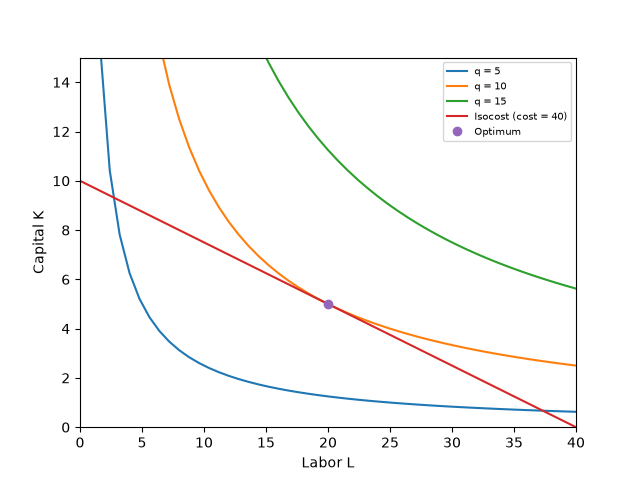
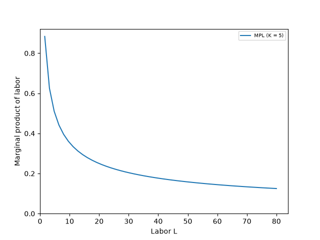

# 第 6 章: 生産関数と費用最小化

## 6.1 この章の地図

前の章では、総費用の**式**を、与えられたものとして使いました。この章では、費用が、**どこから来るか**を調べます。企業は、**労働 L** と**資本 K** を使って、生産物を作ります。労働と資本の組み合わせ方は、いろいろあり、そのうち**費用が最小**のものを選びます。

これは、第 2 章の**効用最大化**と、**同じ形**をしています。

| 消費者（第 2 章） | 企業（この章） |
| :--- | :--- |
| 無差別曲線（同じ効用の点） | **等産出量曲線**（同じ生産量の点） |
| 予算線（所得を使い切る点） | **等費用線**（同じ費用の点） |
| 限界代替率 MRS | **技術的限界代替率 MRTS** |
| 最適点: MRS = 価格比 | 最適点: **MRTS = w ÷ r**（賃金と資本の価格の比） |



| 項目 | 内容 |
| :--- | :--- |
| 経済学の題材 | 生産関数、限界生産性逓減、等産出量曲線、等費用線、技術的限界代替率、費用最小の投入 |
| 使う Python の機能 | 関数、リスト内包表記、`min`（`key` 引数）、テスト（`pytest`） |
| 新しく導入するライブラリ | なし（この章は、標準ライブラリだけで書きます） |
| 完成形 | `production`、`marginal_product_labor`、`marginal_product_capital`、`isocost_slope`、`isocost_k`、`isoquant_k`、`mrts`、`cost_minimizing_inputs`、`cost_minimizing_inputs_by_grid`、`minimum_cost` |
| ファイル | 実装: `lib/chapter06/production.py`、`lib/chapter06/plot.py`（図）／テスト: `test/chapter06/test_production.py`、`test/chapter06/test_plot.py`（自分で書くときは、`practice/chapter06/` に、同じ名前で作ります） |
| データ | なし（手計算できる小さな例だけ） |

### 経済学の式とコードの対応

| 経済学 | 式 | コード |
| :--- | :--- | :--- |
| 生産関数（コブ・ダグラス型） | q = L^α · K^β | `production(labor, capital, alpha, beta)` |
| 限界生産性 | MPL = α·q ÷ L、MPK = β·q ÷ K | `marginal_product_labor`、`marginal_product_capital` |
| 等費用線 | w·L + r·K = 費用（傾き −w ÷ r） | `isocost_k(cost, w, r, labor)`、`isocost_slope(w, r)` |
| 等産出量曲線 | q = L^α · K^β から、K = (q ÷ L^α)^(1/β) | `isoquant_k(quantity, labor, alpha, beta)` |
| 技術的限界代替率 | MRTS = MPL ÷ MPK = (α·K) ÷ (β·L) | `mrts(labor, capital, alpha, beta)` |
| 費用最小の投入 | MRTS = w ÷ r を満たし、q を作る (L, K) | `cost_minimizing_inputs(quantity, w, r)` |
| 最小の費用 | w·L + r·K | `minimum_cost(quantity, w, r)` |

### 前提とする章

| できること | 場所 |
| :--- | :--- |
| 最適消費点（接点の条件）を求める | この連載の[第 2 章](02-budget-and-optimal-choice.md) |
| 費用の概念（限界費用・平均費用） | この連載の[第 5 章](05-cost-curves.md) |

## 6.2 準備

```bash
cd apps/micro-basics-programming/python
uv sync
uv run pytest test/chapter06
```

```text
50 passed
```

自分でコードを書くときは、`practice/chapter06/` に、`production.py` と `test_production.py` を作ります（[この記事の読み方](how-to-read.md)を参照）。

## 6.3 予想する

生産関数が q = √(L·K)（労働 L と資本 K）の企業がいます。**紙で、手計算で**答えてください。答えは、この節には書いてありません。「プログラミング」の節の「予想の答え合わせ」で、プログラムを動かして確かめます。

- (L, K) = (20, 5) の**生産量**は、いくつですか。K = 5 のとき、L = 5・20・80 での、**労働の限界生産性**（MPL = 0.5 × q ÷ L）は、それぞれ、いくつですか。労働が増えると、MPL は、どうなりますか
- 賃金 w = 1、資本の価格 r = 4 のとき、生産量 10 を**最も安く**作る (L, K) は、どこですか。そのときの**費用**は、いくつですか。技術的限界代替率（MRTS = 0.5K ÷ 0.5L）と、価格比（w ÷ r）は、どうなりますか
- 賃金が 4、資本の価格が 1 に逆転すると、最適な (L, K) は、どうなりますか
- 生産量を 20 に増やすと、最小の費用は、いくつになりますか（10 のときの何倍ですか）

## 6.4 生産関数と費用最小化の考え方

### 生産関数と限界生産性

**生産関数**は、投入（労働 L・資本 K）から、生産量 q を決める式です。この章では、コブ・ダグラス型 q = L^α · K^β を使います（第 1 章の効用関数と、同じ形）。

**限界生産性**は、ある投入を 1 単位増やしたときの、生産量の増加です。

> MPL = α · q ÷ L、MPK = β · q ÷ K

**投入を増やすほど、限界生産性は小さくなります**（限界生産性逓減）。同じ土地に、人を増やし続けても、1 人あたりの増加は、減っていきます。

### 等産出量曲線と等費用線

- **等産出量曲線**: 同じ生産量になる (L, K) の組。無差別曲線と同じく、右上の曲線ほど、生産量が多く、右下がりで、原点に凸
- **等費用線**: 同じ費用になる (L, K) の組。w·L + r·K = 費用。**傾きは、−w ÷ r**（予算線と同じ形）

### 費用最小の投入

生産量 q を、**最も安く**作る (L, K) は、等産出量曲線と、**等費用線が接する点**です。

> 最適点では、技術的限界代替率 MRTS = MPL ÷ MPK = w ÷ r

**技術的限界代替率**は、労働を 1 単位減らすとき、同じ生産量を保つのに必要な、資本の増加量です。賃金が高い（w ÷ r が大きい）と、労働を減らして、資本を増やします。

## 6.5 プログラミング

### Red: 生産関数のテスト

最初のテストを書きます。q = √(L·K) で、(L, K) = (20, 5) の生産量は、√100 = 10 です。

```python
import pytest

from lib.chapter06.production import (
    cost_minimizing_inputs,
    cost_minimizing_inputs_by_grid,
    isocost_k,
    isocost_slope,
    isoquant_k,
    marginal_product_capital,
    marginal_product_labor,
    minimum_cost,
    mrts,
    production,
)
```

```python
W, R = 1, 4


def test_生産量は投入量の積のべき() -> None:
    assert production(20, 5) == pytest.approx(10)
    assert production(4, 9) == pytest.approx(6)
    assert production(8, 1, 1, 2) == 8


def test_労働の限界生産性は労働が増えると逓減する() -> None:
    values = [marginal_product_labor(labor, 5) for labor in (5, 20, 80)]
    assert values == pytest.approx([0.5, 0.25, 0.125])
    assert all(a > b for a, b in zip(values, values[1:], strict=False))
```

`production` がまだないので、テストは失敗します（**Red**）。

テストの import は、書いた関数だけを、1 つずつ足してかまいません（[第 5 章](05-cost-curves.md)の注意を参照）。

### Green: 生産関数と限界生産性を実装する

```python
def _check_exponents(alpha: float, beta: float) -> None:
    validate_positive(alpha, "べき指数 α は、正にする")
    validate_positive(beta, "べき指数 β は、正にする")


def _check_prices(w: float, r: float) -> None:
    validate_positive(w, "賃金（労働の価格）は、正にする")
    validate_positive(r, "資本の価格は、正にする")


def production(
    labor: float, capital: float, alpha: float = 0.5, beta: float = 0.5
) -> float:
    """生産量 q = L^α · K^β。投入量が増えると、生産量が増える。"""
    validate_non_negative(labor, "労働の投入量は、0 以上にする")
    validate_non_negative(capital, "資本の投入量は、0 以上にする")
    _check_exponents(alpha, beta)
    return float(labor**alpha * capital**beta)


def marginal_product_labor(
    labor: float, capital: float, alpha: float = 0.5, beta: float = 0.5
) -> float:
    """労働の限界生産性 MPL = α · q ÷ L。労働が増えると、逓減する。"""
    validate_positive(labor, "労働の投入量は、正にする")
    return alpha * production(labor, capital, alpha, beta) / labor


def marginal_product_capital(
    labor: float, capital: float, alpha: float = 0.5, beta: float = 0.5
) -> float:
    """資本の限界生産性 MPK = β · q ÷ K。資本が増えると、逓減する。"""
    validate_positive(capital, "資本の投入量は、正にする")
    return beta * production(labor, capital, alpha, beta) / capital
```

??? note "import と補助関数（写すときに足す）"

    記事の抜粋には、import と、先頭が `_` の補助関数・定数を、省いています。完成形のファイルの先頭にある、次の部分を、写してください。

    **lib/chapter06/plot.py**

    ```python
    from collections.abc import Sequence
    ```

    ```python
    import matplotlib.pyplot as plt
    from matplotlib.figure import Figure
    ```

    ```python
    from lib.chapter06.production import (
        cost_minimizing_inputs,
        isocost_k,
        isoquant_k,
        marginal_product_labor,
        minimum_cost,
    )
    ```

    ```python
    _POINTS = 50
    ```

    **lib/chapter06/production.py**

    ```python
    from lib.chapter01.validation import validate_non_negative, validate_positive
    ```

    ```python
    def _check_exponents(alpha: float, beta: float) -> None:
        validate_positive(alpha, "べき指数 α は、正にする")
        validate_positive(beta, "べき指数 β は、正にする")
    ```

    ```python
    def _check_prices(w: float, r: float) -> None:
        validate_positive(w, "賃金（労働の価格）は、正にする")
        validate_positive(r, "資本の価格は、正にする")
    ```

    **test/chapter06/test_plot.py**

    ```python
    from collections.abc import Sequence
    from typing import cast
    ```

    ```python
    import pytest
    from matplotlib.axes import Axes
    from matplotlib.lines import Line2D
    ```

    ```python
    from lib.chapter06.plot import plot_cost_minimization, plot_marginal_product
    from lib.chapter06.production import marginal_product_labor, production
    ```

浮動小数点数の誤差に、注意します。√100 は、10 に**ほぼ**等しい値（10.000000000000002）になるので、テストでは、`pytest.approx` で比べます。

### 等費用線と等産出量曲線

```python
def test_等費用線の傾きは賃金と資本の価格の比のマイナス() -> None:
    assert isocost_slope(W, R) == pytest.approx(-0.25)
    assert isocost_slope(4, 1) == -4


def test_等費用線は費用を使い切る点を結ぶ() -> None:
    assert isocost_k(40, W, R, 0) == 10
    assert isocost_k(40, W, R, 20) == 5
    assert isocost_k(40, W, R, 40) == 0


def test_等産出量曲線は同じ生産量の点を結ぶ() -> None:
    for labor in (5, 10, 20, 40):
        k = isoquant_k(10, labor)
        assert production(labor, k) == pytest.approx(10)
```

```python
def isocost_slope(w: float, r: float) -> float:
    """等費用線の傾き −w ÷ r（賃金と資本の価格の比のマイナス）。"""
    _check_prices(w, r)
    return -w / r


def isocost_k(cost: float, w: float, r: float, labor: float) -> float:
    """等費用線の上の、資本の量。K = (費用 − w·L) ÷ r。"""
    _check_prices(w, r)
    return (cost - w * labor) / r


def isoquant_k(
    quantity: float, labor: float, alpha: float = 0.5, beta: float = 0.5
) -> float:
    """等産出量曲線の上の、資本の量。q = L^α · K^β から、K = (q ÷ L^α)^(1/β)。"""
    validate_positive(quantity, "生産量は、正にする")
    validate_positive(labor, "労働の投入量は、正にする")
    _check_exponents(alpha, beta)
    return float((quantity / labor**alpha) ** (1 / beta))
```

### 技術的限界代替率

技術的限界代替率は、限界生産性の**比**（MPL ÷ MPK）で、コブ・ダグラス型では、(α·K) ÷ (β·L) です。等産出量曲線に沿って、右へ進むほど、小さくなります（第 1 章の限界代替率逓減と、同じ）。

```python
def test_技術的限界代替率は限界生産性の比() -> None:
    assert mrts(20, 5) == pytest.approx(0.25)
    assert mrts(20, 5) == pytest.approx(
        marginal_product_labor(20, 5) / marginal_product_capital(20, 5)
    )


def test_技術的限界代替率は等産出量曲線に沿って右へ進むほど小さくなる() -> None:
    values = [mrts(labor, isoquant_k(10, labor)) for labor in (5, 10, 20, 40)]
    assert values == pytest.approx([4, 1, 0.25, 0.0625])
```

```python
def mrts(labor: float, capital: float, alpha: float = 0.5, beta: float = 0.5) -> float:
    """技術的限界代替率 MRTS = MPL ÷ MPK = (α·K) ÷ (β·L)。

    等産出量曲線の、接線の傾きの大きさ。
    """
    validate_positive(labor, "労働の投入量は、正にする")
    validate_non_negative(capital, "資本の投入量は、0 以上にする")
    _check_exponents(alpha, beta)
    return (alpha * capital) / (beta * labor)
```

### 費用最小の投入

最適点では MRTS = w ÷ r なので、K = (β ÷ α)(w ÷ r)·L です。これを生産関数に入れて、L を求めます（閉じた式）。w = 1、r = 4、q = 10 では、(L, K) = (20, 5)、費用は 40 です。

```python
def test_費用最小の投入は20と5() -> None:
    assert cost_minimizing_inputs(10, W, R) == pytest.approx((20, 5))


def test_最適点で技術的限界代替率は価格比と等しい() -> None:
    labor, k = cost_minimizing_inputs(10, W, R)
    assert mrts(labor, k) == pytest.approx(W / R)


def test_最適点は等費用線と等産出量曲線の接点() -> None:
    labor, k = cost_minimizing_inputs(10, W, R)
    assert k == pytest.approx(isocost_k(40, W, R, labor))
    assert k == pytest.approx(isoquant_k(10, labor))


def test_賃金が上がると労働を減らして資本を増やす() -> None:
    assert cost_minimizing_inputs(10, 4, 1) == pytest.approx((5, 20))
    assert cost_minimizing_inputs(10, 1, 1) == pytest.approx((10, 10))
```

```python
def cost_minimizing_inputs(
    quantity: float, w: float, r: float, alpha: float = 0.5, beta: float = 0.5
) -> tuple[float, float]:
    """生産量 q を、最も安く作る (L, K)（閉じた式）。

    最適点では MRTS = w ÷ r なので、K = (β ÷ α)(w ÷ r)·L。
    これを生産関数に入れて、L を求める。
    """
    validate_positive(quantity, "生産量は、正にする")
    _check_prices(w, r)
    _check_exponents(alpha, beta)
    ratio = (beta / alpha) * (w / r)
    labor = (quantity / ratio**beta) ** (1 / (alpha + beta))
    return float(labor), float(ratio * labor)


def minimum_cost(
    quantity: float, w: float, r: float, alpha: float = 0.5, beta: float = 0.5
) -> float:
    """生産量 q を作る、最小の費用 w·L + r·K。"""
    labor, capital = cost_minimizing_inputs(quantity, w, r, alpha, beta)
    return w * labor + r * capital
```

### 格子点の探索で確かめる

第 2 章と同じように、**等産出量曲線の上を細かく区切って**、費用が最小の点を探す方法も、書いておきます。2 通りの答えが一致すれば、閉じた式が正しいという、強い確認になります。

```python
def test_格子点の探索は閉じた式と一致する() -> None:
    result = cost_minimizing_inputs_by_grid(10, W, R, l_max=40)
    assert result == pytest.approx((20, 5))


def test_格子点の探索は費用の低い点を選ぶ() -> None:
    labor, k = cost_minimizing_inputs_by_grid(10, W, R, l_max=40)
    best = W * labor + R * k
    for other in (5, 10, 30, 40):
        assert best <= W * other + R * isoquant_k(10, other) + 1e-9
```

```python
def cost_minimizing_inputs_by_grid(
    quantity: float,
    w: float,
    r: float,
    alpha: float = 0.5,
    beta: float = 0.5,
    steps: int = 400,
    l_max: float = 100.0,
) -> tuple[float, float]:
    """等産出量曲線の上を steps 等分して、費用が最小の点を探す（答え合わせ用）。"""
    validate_positive(steps - 1, "格子の分割数は、2 以上にする")
    validate_positive(l_max, "労働の探索の上限は、正にする")
    _check_prices(w, r)
    labors = [l_max * i / steps for i in range(1, steps + 1)]
    points = [(x, isoquant_k(quantity, x, alpha, beta)) for x in labors]
    return min(points, key=lambda p: w * p[0] + r * p[1])
```

格子は、`l_max` までを、`steps` 等分した、労働の値です。**最適な L が、`l_max` より大きい**と、探索の範囲の中で、いちばん費用の低い**端の点**を、返します（探索の範囲を、広げる必要があります）。

規模に関して収穫一定（α + β = 1）のとき、**最小の費用は、生産量に比例**します（生産量が 2 倍なら、費用も 2 倍）。

```python
def test_規模に関して収穫一定なら費用は生産量に比例する() -> None:
    assert minimum_cost(20, W, R) == pytest.approx(2 * minimum_cost(10, W, R))
    assert minimum_cost(30, W, R) == pytest.approx(3 * minimum_cost(10, W, R))
```

### 予想の答え合わせ

予想した答えを、プログラムで確かめます。

> このスクリプトは、**完成形**（`lib/`）を読みます。**自分のコードで確かめる**ときは、import を、`from practice.chapterNN...` に書き換えてください。

```python
from lib.chapter06.production import (
    cost_minimizing_inputs,
    cost_minimizing_inputs_by_grid,
    marginal_product_labor,
    minimum_cost,
    mrts,
    production,
)

print("生産量 (L, K) = (20, 5):", round(production(20, 5), 4))
print("労働の限界生産性 L = 5・20・80 (K = 5):", [round(marginal_product_labor(l, 5), 4) for l in (5, 20, 80)])
labor, capital = cost_minimizing_inputs(10, 1, 4)
print("費用最小の投入 (L, K):", (round(labor, 4), round(capital, 4)), "費用:", round(minimum_cost(10, 1, 4), 4))
print("技術的限界代替率:", round(mrts(labor, capital), 4), "価格比 w ÷ r:", 1 / 4)
print("賃金 4・資本 1 の投入:", tuple(round(v, 4) for v in cost_minimizing_inputs(10, 4, 1)))
print("格子点の探索:", tuple(round(v, 4) for v in cost_minimizing_inputs_by_grid(10, 1, 4, l_max=40)))
print("生産量 20 の最小費用:", round(minimum_cost(20, 1, 4), 4))
```

```text
生産量 (L, K) = (20, 5): 10.0
労働の限界生産性 L = 5・20・80 (K = 5): [0.5, 0.25, 0.125]
費用最小の投入 (L, K): (20.0, 5.0) 費用: 40.0
技術的限界代替率: 0.25 価格比 w ÷ r: 0.25
賃金 4・資本 1 の投入: (5.0, 20.0)
格子点の探索: (20.0, 5.0)
生産量 20 の最小費用: 80.0
```

- **1 つ目の問い**: (20, 5) の生産量は 10 です。MPL は、L = 5 で 0.5、20 で 0.25、80 で 0.125 と、**労働が増えるほど小さく**なります（限界生産性逓減）
- **2 つ目の問い**: 費用最小の投入は (L, K) = (20, 5)、費用は 40 です。MRTS は 0.25 で、価格比 w ÷ r（1 ÷ 4 = 0.25）と、**等しく**なります。資本が高い（r = 4）ので、労働を多く（20）、資本を少なく（5）使います
- **3 つ目の問い**: 賃金と資本の価格が逆転すると、最適な投入も逆転し、(L, K) = (5, 20) になります。**高い投入を減らし、安い投入を増やす**ためです
- **4 つ目の問い**: 生産量 20 の最小費用は 80 で、10 のときの **2 倍**です（規模に関して収穫一定）。格子点の探索も、(20, 5) で、閉じた式と一致しました

### 図

等産出量曲線の族と、費用最小の等費用線を重ねる関数と、座標のテストです。曲線の上の点の生産量が、水準と等しいこと、最適点が (20, 5) にあることを、確かめます。

??? note "描画のテストと実装（後回しにしても、学習は成り立ちます）"

    ```python
    def xs(line: Line2D) -> list[float]:
        return [float(v) for v in cast(Sequence[float], line.get_xdata())]


    def ys(line: Line2D) -> list[float]:
        return [float(v) for v in cast(Sequence[float], line.get_ydata())]


    def line(ax: Axes, label: str) -> Line2D:
        return next(item for item in ax.lines if item.get_label() == label)


    def minimization() -> Axes:
        return plot_cost_minimization([5, 10, 15], 10, 1, 4).axes[0]


    def test_費用最小化の図の線() -> None:
        assert [item.get_label() for item in minimization().lines] == [
            "q = 5",
            "q = 10",
            "q = 15",
            "Isocost (cost = 40)",
            "Optimum",
        ]


    def test_等産出量曲線の上の点は生産量が水準と等しい() -> None:
        ax = minimization()
        for level in (5, 10, 15):
            item = line(ax, f"q = {level}")
            for labor, capital in zip(xs(item), ys(item), strict=True):
                assert production(labor, capital) == pytest.approx(level)


    def test_最適点は費用最小の投入() -> None:
        point = line(minimization(), "Optimum")
        assert xs(point) == pytest.approx([20])
        assert ys(point) == pytest.approx([5])
    ```

    ```python
    def plot_cost_minimization(
        levels: Sequence[float], quantity: float, w: float, r: float
    ) -> Figure:
        """等産出量曲線の族と、生産量 quantity を最も安く作る等費用線（接線）を描く。

        等費用線は、最小の費用で引く。等産出量曲線に、1 点で接し、その点が最適な (L, K)。
        """
        cost = minimum_cost(quantity, w, r)
        l_max = cost / w
        labors = [l_max * (i + 1) / _POINTS for i in range(_POINTS)]
        fig, ax = plt.subplots()
        for level in levels:
            ax.plot(labors, [isoquant_k(level, x) for x in labors], label=f"q = {level}")
        ax.plot(
            [0, l_max],
            [isocost_k(cost, w, r, 0), isocost_k(cost, w, r, l_max)],
            label=f"Isocost (cost = {cost:g})",
        )
        labor, capital = cost_minimizing_inputs(quantity, w, r)
        ax.plot([labor], [capital], "o", label="Optimum")
        ax.set_xlabel("Labor L")
        ax.set_ylabel("Capital K")
        # 等産出量曲線は L が小さいと立ち上がるので、等費用線の K 切片の 1.5 倍までを見せる
        ax.set_xlim(0, l_max)
        ax.set_ylim(0, 1.5 * cost / r)
        ax.legend(fontsize="x-small")
        plt.close(fig)
        return fig
    ```

労働の限界生産性が、労働が増えるほど小さくなる様子です（資本は 5 に固定）。



??? note "描画のテストと実装（後回しにしても、学習は成り立ちます）"

    ```python
    def marginal() -> Axes:
        return plot_marginal_product(5, 80).axes[0]


    def test_限界生産性の図は逓減する() -> None:
        item = line(marginal(), "MPL (K = 5)")
        assert len(xs(item)) == 50
        assert xs(item)[0] == pytest.approx(80 / 50)
        assert xs(item)[-1] == pytest.approx(80)
        for labor, value in zip(xs(item), ys(item), strict=True):
            assert value == pytest.approx(marginal_product_labor(labor, 5))
        assert all(a > b for a, b in zip(ys(item), ys(item)[1:], strict=False))
    ```

    ```python
    def plot_marginal_product(capital: float, l_max: float) -> Figure:
        """資本を一定にしたときの、労働の限界生産性。労働が増えると、逓減する。"""
        labors = [l_max * (i + 1) / _POINTS for i in range(_POINTS)]
        fig, ax = plt.subplots()
        ax.plot(
            labors,
            [marginal_product_labor(x, capital) for x in labors],
            label=f"MPL (K = {capital:g})",
        )
        ax.set_xlabel("Labor L")
        ax.set_ylabel("Marginal product of labor")
        ax.set_xlim(left=0)
        ax.set_ylim(bottom=0)
        ax.legend(fontsize="x-small")
        plt.close(fig)
        return fig
    ```

### 実行結果

```bash
uv run pytest test/chapter06
```

```text
50 passed
```

## 6.6 規則で言うと

1. **費用最小化は、効用最大化と同じ形である。** 等産出量曲線と等費用線が接する点で、MRTS が、価格比と等しい
2. **限界生産性は、逓減する。** 投入を増やすほど、追加の生産量は、減る
3. **高い投入を減らし、安い投入を増やす。** 価格比が変わると、最適な投入の組み合わせが変わる

混同しやすい点を、表にまとめます。

| 混同しやすい点 | 違い |
| :--- | :--- |
| 技術的限界代替率と、限界代替率 | MRTS は、**生産**の、投入の交換比率（等産出量曲線の傾き）。MRS は、**消費**の、財の交換比率（無差別曲線の傾き） |
| 等費用線と、予算線 | 形は同じ（傾きが価格比のマイナス）。等費用線は、**費用を決めて**、投入の組み合わせを描く。予算線は、**所得を決めて**、財の組み合わせを描く |
| 限界生産性と、限界費用 | 限界生産性は、投入を 1 単位増やしたときの**生産量の増加**。限界費用は、生産量を 1 単位増やしたときの**費用の増加** |
| 規模に関して収穫一定と、限界生産性逓減 | 一定は、**すべての投入を 2 倍**にすると、生産量が 2 倍。逓減は、**一方の投入だけ**を増やしたときの話 |

### このモデルが成り立たない場面

- **生産関数は、仮定した式です。** 実際の技術は、観察できません。コブ・ダグラス型は、投入の代替が、なめらかにできると仮定しています
- **投入の価格は、一定と仮定しています。** 大量に雇うと、賃金が上がる企業では、等費用線が、直線になりません
- **すべての投入を、自由に動かせる（長期）と仮定しています。** 短期には、資本は、固定です
- **最適点が、端になる場合があります。** 労働と資本が、完全に代替的（直線の等産出量曲線）なら、片方だけを使うのが、最適になります

## 6.7 練習問題

| 種類 | 問題 |
| :--- | :--- |
| 想起 | 本文を閉じて、`production` の最初のテスト（(L, K) = (20, 5) で、生産量が 10）を書いてください |
| 生成 | 解説を見る前に、費用を決めたときの、等費用線の**切片**（L 切片と K 切片）を返す `isocost_intercepts(cost, w, r)` を、テストから書いてください。費用 40、w = 1、r = 4 で、(40, 10) になります |
| 多様 | 賃金を 1 から 2 に上げます（r = 4、q = 10）。最適な L と K は、どう動きますか。先に予想してから、確かめてください |
| 交互 | [第 1 シリーズ](../economics-programming/index.md)の第 3 章のリスト内包表記で、賃金 1・2・4（r = 4）の費用最小の投入を、一度に求めてください。労働は、減り続けますか |

??? note "解答（先に自分で取り組んでから、開いてください）"

    **想起**:

    ```python
    def test_生産量の最初のテスト() -> None:
        assert production(20, 5) == pytest.approx(10)
    ```

    **生成**: 切片は、費用を、それぞれの価格で割った値です。

    ```python
    def isocost_intercepts(cost, w, r):
        return cost / w, cost / r
    ```

    ```python
    def test_等費用線の切片() -> None:
        assert isocost_intercepts(40, 1, 4) == (40, 10)
    ```

    **多様**: 賃金が上がると、労働を減らして、資本を増やします。w = 2 では、(L, K) = (10√2, 5√2) ≈ (14.14, 7.07) で、費用は約 56.57 です。賃金が 2 倍になっても、費用は、**2 倍にならず**（40 → 56.57）、**約 1.41 倍**にしかなりません。労働から資本へ、代替できるためです。

    ```python
    def test_賃金が2のときの費用最小の投入() -> None:
        labor, capital = cost_minimizing_inputs(10, 2, 4)
        assert labor == pytest.approx(10 * 2**0.5)
        assert capital == pytest.approx(5 * 2**0.5)
        assert minimum_cost(10, 2, 4) == pytest.approx(40 * 2**0.5)
    ```

    **交互**:

    ```python
    def test_賃金が上がると労働は減り続ける() -> None:
        inputs = [cost_minimizing_inputs(10, w, 4) for w in (1, 2, 4)]
        labors = [labor for labor, _ in inputs]
        assert labors == pytest.approx([20, 10 * 2**0.5, 10])
        assert all(a > b for a, b in zip(labors, labors[1:]))
    ```

## 6.8 振り返り

- うまくいったこと:
- 詰まったこと:
- 次に試すこと:

## 6.9 まとめ

- 生産関数 q = L^α · K^β から、限界生産性（投入を増やすほど逓減）・等産出量曲線・等費用線・技術的限界代替率を、関数にした
- 費用最小の投入は、等産出量曲線と等費用線が接する点で、MRTS = w ÷ r。閉じた式と、格子点の探索の 2 通りで、(20, 5)（費用 40）と、一致を確かめた
- 費用最小化は、第 2 章の効用最大化と、同じ形。高い投入を減らし、安い投入を増やす。規模に関して収穫一定なら、最小の費用は、生産量に比例する

次の章では、第 5 章の費用曲線を使って、企業が、**利潤を最大にする生産量**を求めます。価格 = 限界費用の点です。そこから、**損益分岐点**・**操業停止点**・**供給曲線**を導き、第 2 部の**到達チェック**を行います。
