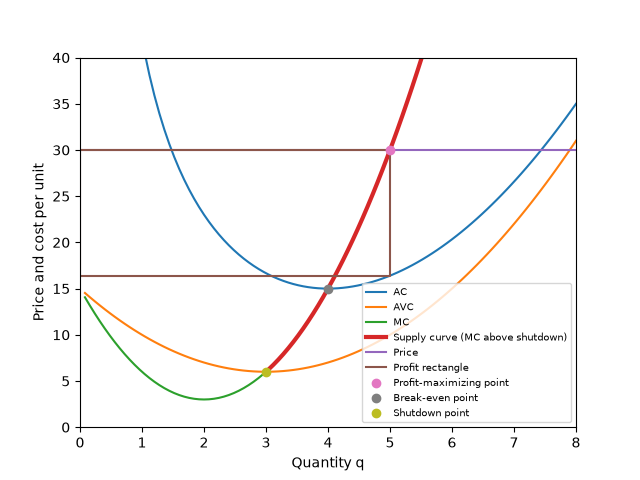
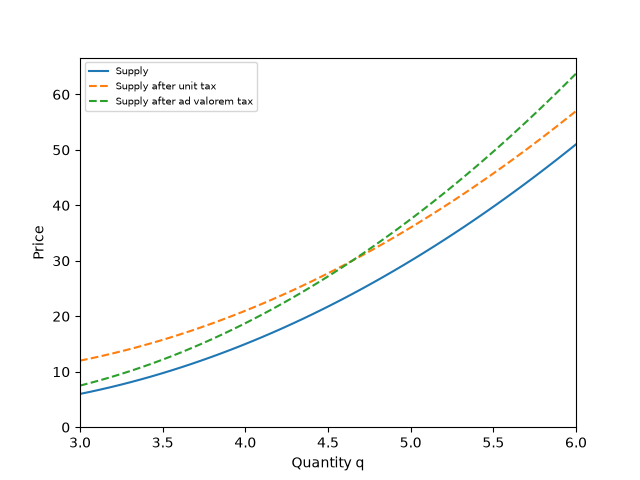

# 第 7 章: 利潤最大化と供給曲線

## 7.1 この章の地図

企業は、いくつ作れば、**利潤が最大**になるでしょうか。**完全競争**の企業は、価格を決められません（**プライステイカー**）。価格 P のもとで、作る量だけを選びます。

> 利潤が最大になるのは、**価格 = 限界費用**（P = MC）の点

作る量が 1 単位増えると、収入は P だけ増え、費用は MC だけ増えます。P > MC なら、増産で利潤が増え、P < MC なら、減産で利潤が増えます。だから、P = MC の点で、利潤が最大です。

この章では、第 5 章の費用曲線を使って、**利潤最大の生産量**と、**損益分岐点**・**操業停止点**を求め、**供給曲線**（操業停止点より上の限界費用曲線）を導きます。第 2 部の**到達チェック**も行います。



| 項目 | 内容 |
| :--- | :--- |
| 経済学の題材 | 利潤最大化（P = MC）、利潤、損益分岐点、操業停止点、供給曲線、市場供給、供給の価格弾力性、従量税・従価税 |
| 使う Python の機能 | 関数、関数を引数に渡す（`Callable`）、リスト内包表記、NumPy（`linspace`・`argmax`）、テスト（`pytest`） |
| 新しく導入するライブラリ | なし |
| 完成形 | `shutdown_price`、`break_even_price`、`profit`、`profit_maximizing_output`、`profit_maximizing_output_by_grid`、`supply_curve`、`market_supply`、`market_supply_curve`、`supply_elasticity`、`supply_price`、`supply_price_unit_tax`、`supply_price_ad_valorem`、`supply_after_unit_tax`、`supply_after_ad_valorem_tax` |
| ファイル | 実装: `lib/chapter07/supply.py`、`lib/chapter07/plot.py`（図）／テスト: `test/chapter07/test_supply.py`、`test/chapter07/test_plot.py`（自分で書くときは、`practice/chapter07/` に、同じ名前で作ります） |
| データ | なし（手計算できる小さな例だけ） |

### 経済学の式とコードの対応

| 経済学 | 式 | コード |
| :--- | :--- | :--- |
| 利潤 | π = P·q − C(q) = (P − AC)·q | `profit(curve, price, q)` |
| 利潤最大化 | P = MC（右上がりの側） | `profit_maximizing_output(curve, price)` |
| 損益分岐点 | AC の最低値（利潤 0） | `break_even_price(curve)` |
| 操業停止点 | AVC の最低値 | `shutdown_price(curve)` |
| 供給曲線 | 操業停止点より上の MC | `supply_curve(curve, prices)` |
| 市場供給 | 各企業の供給を、横に足す | `market_supply(curves, price)` |
| 供給の価格弾力性 | e = (dQ/dP) · P ÷ Q | `supply_elasticity(supply, price)` |
| 従量税・従価税 | 供給価格 = MC + T、MC ÷ (1 − t) | `supply_price_unit_tax`、`supply_price_ad_valorem` |

### 前提とする章

| できること | 場所 |
| :--- | :--- |
| 費用曲線（MC・AC・AVC）と、最低点を求める | この連載の[第 5 章](05-cost-curves.md) |
| 数値微分で弾力性を求める | この連載の[第 3 章](03-demand-curve-and-elasticity.md) |

## 7.2 準備

```bash
cd apps/micro-basics-programming/python
uv sync
uv run pytest test/chapter07
```

```text
55 passed
```

自分でコードを書くときは、`practice/chapter07/` に、`supply.py` と `test_supply.py` を作ります。第 5 章の `CostCurve` などは、完成形の `lib/chapter05/` から import してかまいません（[この記事の読み方](how-to-read.md)を参照）。

## 7.3 予想する

総費用が C(q) = q³ − 6q² + 15q + 32 の企業（第 5 章）がいます。**紙で、手計算で**答えてください。答えは、この節には書いてありません。「プログラミング」の節の「予想の答え合わせ」で、プログラムを動かして確かめます。

- 価格が P = 30 のとき、**利潤が最大**になる生産量は、いくつですか（MC = 3q² − 12q + 15 = 30 を解く）。そのときの**利潤**は、いくつですか
- **損益分岐点**の価格と、**操業停止点**の価格は、それぞれ、いくつですか（第 5 章の、最低値を思い出してください）
- 価格が P = 10 のとき、作りますか。作るなら、利潤は、いくつですか。固定費用 32 の損失より、**大きい**ですか、**小さい**ですか。P = 5 のときは、どうですか
- 同じ企業が 2 社あるとき、P = 30 の**市場供給**は、いくつですか。従量税 6 のとき、q = 5 を供給する**価格**は、いくつですか。従価税 20% のときは、いくつですか

## 7.4 利潤最大化と供給曲線の考え方

### 利潤最大化

完全競争の企業は、価格を、与えられたものとして、受け入れます。利潤は、**収入 − 総費用**です。

> 利潤 = P × q − C(q) = (P − AC) × q

グラフでは、**高さが (P − AC)、幅が q の長方形の面積**です。利潤が最大になる q は、**P = MC** の点です。ただし、MC は U 字型なので、P = MC を満たす点が 2 つあることがあります。**MC が右上がりの側**が、利潤最大の点です（左側は、利潤が最小の点）。

### 損益分岐点と操業停止点

| 点 | 条件 | 意味 |
| :--- | :--- | :--- |
| **損益分岐点** | MC と **AC** の交点（AC の最低点） | 利潤が 0。これより高い価格なら、利潤が出る |
| **操業停止点** | MC と **AVC** の交点（AVC の最低点） | これより低い価格なら、**作るほど損**なので、作らない |

価格が、操業停止点と損益分岐点の**間**にあるとき、赤字ですが、作り続けます。固定費用は、作らなくても、かかるからです。作れば、**固定費用の一部を、回収できます**（赤字が、固定費用より小さくなる）。

### 供給曲線

企業の**供給曲線**は、操業停止点より上の**限界費用曲線**です。価格が、操業停止点より低ければ、供給は 0 です。操業停止点で、**0 から、ジャンプ**します。

**市場供給**は、各企業の供給を、**横に足した**ものです。企業が増えれば、市場供給が増えます。**供給の価格弾力性**は、価格が 1% 上がると、供給量が何% 増えるかです（緩やかな曲線ほど、弾力的）。

### 課税

- **従量税**（1 単位あたり T 円。酒税など）: 供給曲線が、**T だけ上へ平行**に動く
- **従価税**（価格に対する率。消費税など）: 供給曲線の**傾きが急**になる（供給価格 = MC ÷ (1 − t)。生産量が増えるほど、上乗せが大きくなる）

## 7.5 プログラミング

### Red: 利潤最大化のテスト

最初のテストを書きます。P = 30 では、MC(q) = 3q² − 12q + 15 = 30 を解いて、q = 5 です。利潤は、30 × 5 − 82 = 68 です。

```python
import pytest

from lib.chapter05.cost import CostCurve, marginal_cost, total_cost
from lib.chapter07.supply import (
    break_even_price,
    market_supply,
    market_supply_curve,
    profit,
    profit_maximizing_output,
    profit_maximizing_output_by_grid,
    shutdown_price,
    supply_after_ad_valorem_tax,
    supply_after_unit_tax,
    supply_curve,
    supply_elasticity,
    supply_price,
    supply_price_ad_valorem,
    supply_price_unit_tax,
)
```

```python
CURVE = CostCurve(1, -6, 15, 32)


OTHER = CostCurve(0.5, -3, 10, 20)


def test_価格30の利潤最大の生産量は5() -> None:
    q = profit_maximizing_output(CURVE, 30)
    assert q == pytest.approx(5)
    assert marginal_cost(CURVE, q) == pytest.approx(30)


def test_価格が限界費用と等しい点で利潤が最大() -> None:
    best = profit(CURVE, 30, 5)
    for q in (3, 4, 4.5, 5.5, 6, 7):
        assert profit(CURVE, 30, q) < best


def test_価格30の利潤は68() -> None:
    assert profit(CURVE, 30, 5) == pytest.approx(68)
    assert profit(CURVE, 30, 5) == pytest.approx((30 - 82 / 5) * 5)
```

`profit_maximizing_output` などがまだないので、テストは失敗します（**Red**）。

テストの import は、書いた関数だけを、1 つずつ足してかまいません（[第 5 章](05-cost-curves.md)の注意を参照）。

### Green: 利潤最大化を実装する

P = MC を解く、閉じた式は、2 次方程式 3a·q² + 2b·q + c = P の、**大きいほうの解**（右上がりの側）です。価格が、操業停止点より低ければ、作りません（0）。

```python
def shutdown_price(curve: CostCurve) -> float:
    """操業停止点の価格 = 平均可変費用 AVC の最低値。

    AVC = a·q² + b·q + c なので、最低点は q = −b ÷ (2a)（b ≥ 0 なら、q = 0）。
    """
    q = max(0.0, -curve.quadratic / (2 * curve.cubic))
    return curve.cubic * q**2 + curve.quadratic * q + curve.linear


def break_even_price(
    curve: CostCurve, q_max: float = 10.0, points: int = 10001
) -> float:
    """損益分岐点の価格 = 平均費用 AC の最低値（格子点の探索）。"""
    return cost_minima(curve, q_max, points)["AC"][1]


def profit(curve: CostCurve, price: float, q: float) -> float:
    """利潤 = 価格 × 生産量 − 総費用 = (P − AC) × q。"""
    return price * q - total_cost(curve, q)


def profit_maximizing_output(curve: CostCurve, price: float) -> float:
    """利潤を最大にする生産量（閉じた式）。P = MC の、右上がりの側の解。

    価格が操業停止点より低ければ、作らない（0）。
    MC = 3a·q² + 2b·q + c = P を、q について解く。
    """
    validate_non_negative(price, "価格は、0 以上にする")
    if price < shutdown_price(curve):
        return 0.0
    a, b, c = curve.cubic, curve.quadratic, curve.linear
    return float((-b + (b**2 - 3 * a * (c - price)) ** 0.5) / (3 * a))
```

??? note "import と補助関数（写すときに足す）"

    記事の抜粋には、import と、先頭が `_` の補助関数・定数を、省いています。完成形のファイルの先頭にある、次の部分を、写してください。

    **lib/chapter07/plot.py**

    ```python
    import matplotlib.pyplot as plt
    from matplotlib.figure import Figure
    ```

    ```python
    from lib.chapter05.cost import (
        CostCurve,
        average_cost,
        average_variable_cost,
        cost_minima,
        marginal_cost,
    )
    from lib.chapter07.supply import (
        profit_maximizing_output,
        shutdown_price,
        supply_price,
        supply_price_ad_valorem,
        supply_price_unit_tax,
    )
    ```

    ```python
    _POINTS = 100
    _TAX_POINTS = 50
    ```

    **lib/chapter07/supply.py**

    ```python
    from collections.abc import Callable, Sequence
    ```

    ```python
    import numpy as np
    ```

    ```python
    from lib.chapter01.validation import validate_non_negative, validate_positive
    from lib.chapter05.cost import CostCurve, cost_minima, marginal_cost, total_cost
    ```

    ```python
    _STEP = 1e-6
    ```

    ```python
    def _check_rate(rate: float) -> None:
        validate_non_negative(rate, "税率は、0 以上にする")
        validate_positive(1 - rate, "税率は、1 未満にする")
    ```

    **test/chapter07/test_plot.py**

    ```python
    from collections.abc import Sequence
    from typing import cast
    ```

    ```python
    import pytest
    from matplotlib.axes import Axes
    from matplotlib.lines import Line2D
    ```

    ```python
    from lib.chapter05.cost import (
        CostCurve,
        average_cost,
        average_variable_cost,
        marginal_cost,
    )
    from lib.chapter07.plot import plot_supply, plot_tax_supply
    ```

操業停止点は、AVC = a·q² + b·q + c の最低値で、q = −b ÷ (2a) のとき（b ≥ 0 なら、q = 0 の c）です。損益分岐点は、AC の最低値を、第 5 章の格子点の探索（`cost_minima`）で求めます。価格が負のときは、エラーにします。

### 損益分岐点と操業停止点

```python
def test_損益分岐点の価格は平均費用の最低点() -> None:
    assert break_even_price(CURVE) == pytest.approx(15, rel=1e-6)


def test_損益分岐点で利潤は0() -> None:
    price = break_even_price(CURVE)
    q = profit_maximizing_output(CURVE, price)
    assert q == pytest.approx(4, abs=1e-3)
    assert profit(CURVE, price, q) == pytest.approx(0, abs=1e-3)


def test_操業停止点の価格は平均可変費用の最低点() -> None:
    assert shutdown_price(CURVE) == pytest.approx(6)
    assert shutdown_price(OTHER) == pytest.approx(5.5)


def test_操業停止点で作っても作らなくても損失は固定費用() -> None:
    price = shutdown_price(CURVE)
    q = profit_maximizing_output(CURVE, price)
    assert q == pytest.approx(3)
    assert profit(CURVE, price, q) == pytest.approx(-32)
    assert profit(CURVE, price, 0) == -32


def test_価格が損益分岐点と操業停止点の間なら赤字でも固定費の一部を回収する() -> None:
    q = profit_maximizing_output(CURVE, 10)
    assert q == pytest.approx((6 + 21**0.5) / 3)
    loss = profit(CURVE, 10, q)
    assert -32 < loss < 0
```

損益分岐点は 15（q = 4、利潤 0）、操業停止点は 6（q = 3）です。操業停止点では、作っても作らなくても、損失は固定費用 32 と同じです。価格が 10 のとき、赤字ですが、損失は 32 より小さい（約 18.87）ので、作り続けます。

### 格子点の探索で確かめる

第 2・6 章と同じように、**生産量を細かく動かして**、利潤が最大の点を探す方法も、書いておきます。

```python
def test_格子点の探索は閉じた式と一致する() -> None:
    assert profit_maximizing_output_by_grid(CURVE, 30) == pytest.approx(5, abs=1e-3)
    assert profit_maximizing_output_by_grid(CURVE, 10) == pytest.approx(
        profit_maximizing_output(CURVE, 10), abs=1e-3
    )
```

```python
def profit_maximizing_output_by_grid(
    curve: CostCurve, price: float, q_max: float = 10.0, points: int = 10001
) -> float:
    """生産量を格子点で動かして、利潤が最大の点を探す（閉じた式の答え合わせ用）。"""
    validate_positive(points - 2, "点の数は、3 以上にする")
    grid = np.linspace(0.0, q_max, points)
    profits = [profit(curve, price, float(q)) for q in grid]
    return float(grid[int(np.argmax(profits))])
```

NumPy の `argmax` で、利潤の並びの、最大の位置を求めます（同じ値が複数あれば、先の位置。q = 0 が、先頭にあるので、作っても損失が同じなら、**作らない**ほうが選ばれます）。

### 供給曲線と市場供給

```python
def test_供給曲線は価格と供給量の組() -> None:
    curve = supply_curve(CURVE, [5, 6, 15, 30])
    assert [p for p, _ in curve] == [5, 6, 15, 30]
    assert [q for _, q in curve] == pytest.approx([0, 3, 4, 5])


def test_供給曲線は操業停止点を境に不連続にジャンプする() -> None:
    below, above = (q for _, q in supply_curve(CURVE, [5.99, 6]))
    assert below == 0
    assert above == pytest.approx(3)


def test_市場供給は各企業の供給を横に足したもの() -> None:
    assert market_supply([CURVE, CURVE], 30) == pytest.approx(10)
    assert market_supply([CURVE, OTHER], 30) == pytest.approx(
        5 + 2 + (4 + 40 / 3) ** 0.5
    )


def test_市場供給曲線は各価格の合計() -> None:
    curve = market_supply_curve([CURVE, CURVE], [6, 30])
    assert [p for p, _ in curve] == [6, 30]
    assert [q for _, q in curve] == pytest.approx([6, 10])
```

```python
def supply_curve(
    curve: CostCurve, prices: Sequence[float]
) -> list[tuple[float, float]]:
    """価格ごとの供給量 (価格, 供給量) の並び。操業停止点で、0 から跳ね上がる。"""
    return [(p, profit_maximizing_output(curve, p)) for p in prices]


def market_supply(curves: Sequence[CostCurve], price: float) -> float:
    """市場供給。各企業の供給を、同じ価格で、横に足す。操業停止点が高い企業は、退出する。"""
    return sum(profit_maximizing_output(curve, price) for curve in curves)


def market_supply_curve(
    curves: Sequence[CostCurve], prices: Sequence[float]
) -> list[tuple[float, float]]:
    """価格ごとの市場供給 (価格, 市場供給) の並び。"""
    return [(p, market_supply(curves, p)) for p in prices]
```

### 供給の価格弾力性

需要の弾力性（第 3 章）と、同じ数値微分です。供給は、価格が上がると増えるので、**正**の値になります。

```python
def test_供給の価格弾力性は価格30で3分の1() -> None:
    e = supply_elasticity(lambda p: profit_maximizing_output(CURVE, p), 30)
    assert e == pytest.approx(1 / 3, rel=1e-5)


def test_供給の価格弾力性は価格とともに増えて0_5に近づく() -> None:
    def supply(p: float) -> float:
        return profit_maximizing_output(CURVE, p)

    values = [supply_elasticity(supply, p) for p in (10, 30, 60, 300, 3000)]
    assert values == pytest.approx([0.3093, 0.3333, 0.3608, 0.4205, 0.4707], abs=1e-4)
    assert all(a < b < 0.5 for a, b in zip(values, values[1:], strict=False))
```

```python
_STEP = 1e-6


def supply_elasticity(
    supply: Callable[[float], float], price: float, step: float = _STEP
) -> float:
    """供給の価格弾力性 e = (dQ/dP) × P ÷ Q（中心差分による数値微分）。"""
    validate_positive(price, "価格は、正にする")
    quantity = supply(price)
    validate_positive(quantity, "供給量が 0 のとき、供給の価格弾力性は求められない")
    slope = (supply(price + step) - supply(price - step)) / (2 * step)
    return slope * price / quantity
```

この企業の供給の弾力性は、P = 30 で 1/3 です。**価格が高いほど、弾力的になる**（0.5 に近づく）ことが、テストで確かめられます。予想とは逆に、**低い価格ほど、非弾力的**でした（最初に、逆の向きを仮定して、テストを書いたところ、失敗し、実測で、向きを確かめました）。

### 課税の効果

```python
def test_従量税は供給曲線を税額だけ上へ動かす() -> None:
    assert supply_price_unit_tax(CURVE, 5, 6) == 36
    assert supply_after_unit_tax(CURVE, 36, 6) == pytest.approx(5)


def test_従価税は供給曲線の傾きを急にする() -> None:
    assert supply_price_ad_valorem(CURVE, 5, 0.2) == pytest.approx(37.5)
    assert supply_after_ad_valorem_tax(CURVE, 37.5, 0.2) == pytest.approx(5)


def test_従価税のもとの価格の上乗せは生産量が増えると大きくなる() -> None:
    gaps = [
        supply_price_ad_valorem(CURVE, q, 0.2) - supply_price(CURVE, q)
        for q in (3, 4, 5)
    ]
    assert gaps == pytest.approx([1.5, 3.75, 7.5])
    assert all(a < b for a, b in zip(gaps, gaps[1:], strict=False))
```

```python
def supply_price(curve: CostCurve, q: float) -> float:
    """生産量 q を供給する価格（逆供給曲線）。右上がりの側では、限界費用に等しい。"""
    return marginal_cost(curve, q)


def _check_rate(rate: float) -> None:
    validate_non_negative(rate, "税率は、0 以上にする")
    validate_positive(1 - rate, "税率は、1 未満にする")


def supply_price_unit_tax(curve: CostCurve, q: float, tax: float) -> float:
    """従量税（1 単位あたり tax 円）のもとで、生産量 q を供給する価格。MC + tax。"""
    validate_non_negative(tax, "税額は、0 以上にする")
    return marginal_cost(curve, q) + tax


def supply_price_ad_valorem(curve: CostCurve, q: float, rate: float) -> float:
    """従価税（税率 rate）のもとで、生産量 q を供給する価格。MC ÷ (1 − rate)。"""
    _check_rate(rate)
    return marginal_cost(curve, q) / (1 - rate)


def supply_after_unit_tax(curve: CostCurve, price: float, tax: float) -> float:
    """従量税のもとの供給量。企業の手取りは、価格 − tax。"""
    validate_non_negative(tax, "税額は、0 以上にする")
    return profit_maximizing_output(curve, max(price - tax, 0.0))


def supply_after_ad_valorem_tax(curve: CostCurve, price: float, rate: float) -> float:
    """従価税のもとの供給量。企業の手取りは、価格 × (1 − rate)。"""
    _check_rate(rate)
    return profit_maximizing_output(curve, price * (1 - rate))
```

従量税 6 のとき、q = 5 を供給する価格は、30 + 6 = 36 です。従価税 20% のときは、30 ÷ 0.8 = 37.5 です。q = 3 では、上乗せが、従量税で 6、従価税で 1.5 ですが、q = 5 では、従量税で 6、従価税で 7.5 と、**従価税の上乗せは、生産量とともに大きく**なります（傾きが急）。税率は、0 以上 1 未満に限ります。

### 予想の答え合わせ

予想した答えを、プログラムで確かめます。

```python
from lib.chapter05.cost import CostCurve
from lib.chapter07.supply import (
    break_even_price,
    market_supply,
    profit,
    profit_maximizing_output,
    shutdown_price,
    supply_price_ad_valorem,
    supply_price_unit_tax,
)

curve = CostCurve(cubic=1, quadratic=-6, linear=15, fixed=32)
q = profit_maximizing_output(curve, 30)
print("P = 30 の生産量:", q, "利潤:", profit(curve, 30, q))
print("損益分岐点:", round(break_even_price(curve), 4), "操業停止点:", shutdown_price(curve))
q10 = profit_maximizing_output(curve, 10)
print("P = 10 の生産量:", round(q10, 4), "利潤:", round(profit(curve, 10, q10), 4))
print("P = 5 の生産量:", profit_maximizing_output(curve, 5))
print("市場供給 (2 社, P = 30):", market_supply([curve, curve], 30))
print("従量税 6 で q = 5 を供給する価格:", supply_price_unit_tax(curve, 5, 6))
print("従価税 20% で q = 5 を供給する価格:", supply_price_ad_valorem(curve, 5, 0.2))
```

```text
P = 30 の生産量: 5.0 利潤: 68.0
損益分岐点: 15.0 操業停止点: 6.0
P = 10 の生産量: 3.5275 利潤: -18.8715
P = 5 の生産量: 0.0
市場供給 (2 社, P = 30): 10.0
従量税 6 で q = 5 を供給する価格: 36
従価税 20% で q = 5 を供給する価格: 37.5
```

- **1 つ目の問い**: P = 30 の利潤最大の生産量は 5、利潤は 68 です（高さ 30 − 16.4 = 13.6、幅 5 の長方形）
- **2 つ目の問い**: 損益分岐点は 15、操業停止点は 6 です（第 5 章の、AC と AVC の最低値）
- **3 つ目の問い**: P = 10 は、操業停止点（6）より上で、損益分岐点（15）より下です。**作り**（q ≈ 3.53）、利潤は約 −18.87 の赤字ですが、固定費用 32 の損失（作らない場合）より、**小さい**です。固定費用の一部（約 13.13）を、回収しています。P = 5 は、操業停止点より下なので、**作りません**（q = 0。損失は固定費用 32）
- **4 つ目の問い**: 2 社の市場供給は、5 + 5 = 10 です。従量税 6 では、q = 5 を供給する価格が 36、従価税 20% では 37.5 です

### 図

供給曲線の図と、座標のテストです。曲線の値が費用関数と一致すること、利潤の長方形の面積が 68 であること、3 つの点の位置を確かめます。

??? note "描画のテストと実装（後回しにしても、学習は成り立ちます）"

    ```python
    CURVE = CostCurve(1, -6, 15, 32)


    def xs(line: Line2D) -> list[float]:
        return [float(v) for v in cast(Sequence[float], line.get_xdata())]


    def ys(line: Line2D) -> list[float]:
        return [float(v) for v in cast(Sequence[float], line.get_ydata())]


    def line(ax: Axes, label: str) -> Line2D:
        return next(item for item in ax.lines if item.get_label() == label)


    def supply() -> Axes:
        return plot_supply(CURVE, 30, 8, 40).axes[0]


    def test_供給曲線の図の線() -> None:
        assert [item.get_label() for item in supply().lines] == [
            "AC",
            "AVC",
            "MC",
            "Supply curve (MC above shutdown)",
            "Price",
            "Profit rectangle",
            "Profit-maximizing point",
            "Break-even point",
            "Shutdown point",
        ]


    def test_供給曲線は操業停止点より上の限界費用() -> None:
        item = line(supply(), "Supply curve (MC above shutdown)")
        assert xs(item)[0] >= 3 - 1e-9
        assert xs(item)[-1] == pytest.approx(8)
        for q, value in zip(xs(item), ys(item), strict=True):
            assert value == pytest.approx(marginal_cost(CURVE, q))
            assert value >= 6 - 1e-9


    def test_利潤の長方形の面積は利潤() -> None:
        item = line(supply(), "Profit rectangle")
        assert len(xs(item)) == 5
        width = xs(item)[1] - xs(item)[0]
        height = ys(item)[0] - ys(item)[2]
        assert width == pytest.approx(5)
        assert width * height == pytest.approx(68)
        assert xs(item)[0] == xs(item)[3] == xs(item)[4] == 0
        assert ys(item)[0] == ys(item)[1] == ys(item)[4] == 30


    def test_3つの点() -> None:
        ax = supply()
        best = line(ax, "Profit-maximizing point")
        assert (xs(best)[0], ys(best)[0]) == pytest.approx((5, 30))
        even = line(ax, "Break-even point")
        assert (xs(even)[0], ys(even)[0]) == pytest.approx((4, 15), abs=1e-3)
        shut = line(ax, "Shutdown point")
        assert (xs(shut)[0], ys(shut)[0]) == pytest.approx((3, 6), abs=1e-3)
    ```

    ```python
    def plot_supply(curve: CostCurve, price: float, q_max: float, y_max: float) -> Figure:
        """AC・AVC・MC と価格の線に、利潤の長方形と 3 つの点を重ねて描く。

        3 つの点は、利潤最大・損益分岐・操業停止。供給曲線は、操業停止点より上の MC。
        利潤の長方形は、高さ (P − AC)、幅 q。
        """
        qs = [q_max * (i + 1) / _POINTS for i in range(_POINTS)]
        q_best = profit_maximizing_output(curve, price)
        q_stop = cost_minima(curve, q_max)["AVC"][0]
        fig, ax = plt.subplots()
        ax.plot(qs, [average_cost(curve, q) for q in qs], label="AC")
        ax.plot(qs, [average_variable_cost(curve, q) for q in qs], label="AVC")
        ax.plot(qs, [marginal_cost(curve, q) for q in qs], label="MC")
        above = [q for q in qs if q >= q_stop]
        ax.plot(
            above,
            [marginal_cost(curve, q) for q in above],
            linewidth=3,
            label="Supply curve (MC above shutdown)",
        )
        ax.plot([0, q_max], [price, price], label="Price")
        cost = average_cost(curve, q_best)
        ax.plot(
            [0, q_best, q_best, 0, 0],
            [price, price, cost, cost, price],
            label="Profit rectangle",
        )
        minima = cost_minima(curve, q_max)
        ax.plot([q_best], [price], "o", label="Profit-maximizing point")
        ax.plot([minima["AC"][0]], [minima["AC"][1]], "o", label="Break-even point")
        ax.plot([minima["AVC"][0]], [shutdown_price(curve)], "o", label="Shutdown point")
        ax.set_xlabel("Quantity q")
        ax.set_ylabel("Price and cost per unit")
        ax.set_xlim(0, q_max)
        ax.set_ylim(0, y_max)
        ax.legend(fontsize="x-small", loc="lower right")
        plt.close(fig)
        return fig
    ```

課税後の供給曲線です。従量税は、**平行に**上へ動き、従価税は、**傾きが急**になります。



??? note "描画のテストと実装（後回しにしても、学習は成り立ちます）"

    ```python
    CURVE = CostCurve(1, -6, 15, 32)


    def tax() -> Axes:
        return plot_tax_supply(CURVE, 6, 0.2, 3, 6).axes[0]


    def test_課税の図の線() -> None:
        assert [item.get_label() for item in tax().lines] == [
            "Supply",
            "Supply after unit tax",
            "Supply after ad valorem tax",
        ]


    def test_従量税は税額だけ上に平行移動する() -> None:
        ax = tax()
        base, unit = ys(line(ax, "Supply")), ys(line(ax, "Supply after unit tax"))
        assert base[0] == pytest.approx(6)
        assert all(u - b == pytest.approx(6) for b, u in zip(base, unit, strict=True))


    def test_従価税は上乗せが生産量とともに大きくなる() -> None:
        ax = tax()
        base = ys(line(ax, "Supply"))
        ad = ys(line(ax, "Supply after ad valorem tax"))
        gaps = [a - b for b, a in zip(base, ad, strict=True)]
        assert gaps[0] == pytest.approx(1.5)
        assert all(a < b for a, b in zip(gaps, gaps[1:], strict=False))
        assert ad == pytest.approx([b / 0.8 for b in base])


    def test_課税後の曲線は点線() -> None:
        ax = tax()
        assert line(ax, "Supply after unit tax").get_linestyle() == "--"
        assert line(ax, "Supply after ad valorem tax").get_linestyle() == "--"
        assert line(ax, "Supply").get_linestyle() == "-"
    ```

    ```python
    def plot_tax_supply(
        curve: CostCurve, tax: float, rate: float, q_min: float, q_max: float
    ) -> Figure:
        """供給曲線と、課税後の供給曲線。従量税は上へ平行に動き、従価税は傾きが急になる。"""
        step = (q_max - q_min) / (_TAX_POINTS - 1)
        qs = [q_min + step * i for i in range(_TAX_POINTS)]
        fig, ax = plt.subplots()
        ax.plot(qs, [supply_price(curve, q) for q in qs], label="Supply")
        ax.plot(
            qs,
            [supply_price_unit_tax(curve, q, tax) for q in qs],
            "--",
            label="Supply after unit tax",
        )
        ax.plot(
            qs,
            [supply_price_ad_valorem(curve, q, rate) for q in qs],
            "--",
            label="Supply after ad valorem tax",
        )
        ax.set_xlabel("Quantity q")
        ax.set_ylabel("Price")
        ax.set_xlim(q_min, q_max)
        ax.set_ylim(bottom=0)
        ax.legend(fontsize="x-small")
        plt.close(fig)
        return fig
    ```

### 実行結果

```bash
uv run pytest test/chapter07
```

```text
55 passed
```

## 7.6 規則で言うと

1. **利潤は、価格 = 限界費用の点（右上がりの側）で、最大になる。**
2. **損益分岐点は AC の最低点、操業停止点は AVC の最低点である。** 間の価格では、赤字でも、作り続ける
3. **供給曲線は、操業停止点より上の、限界費用曲線である。** 従量税は、平行に、従価税は、傾きが急に動かす

混同しやすい点を、表にまとめます。

| 混同しやすい点 | 違い |
| :--- | :--- |
| 損益分岐点と操業停止点 | 損益分岐点は、MC と **AC** の交点（利潤 0）。操業停止点は、MC と **AVC** の交点（これ以下は作るほど損）。操業停止点のほうが、**低い** |
| 赤字と、操業停止 | 赤字でも、損失が固定費用より**小さい**（AVC を上回る価格）なら、作り続ける。操業停止は、損失が、固定費用より**大きく**なるとき |
| 従量税と従価税 | 従量税は、1 単位あたりの額で、供給曲線が**平行**に動く。従価税は、価格に対する率で、**傾きが急**になる |
| 供給曲線と、限界費用曲線 | 供給曲線は、限界費用曲線の**一部**（操業停止点より上）。それより下では、供給は 0 |

### このモデルが成り立たない場面

- **完全競争を仮定しています。** 企業が、価格を決められる（市場支配力がある）なら、P = MC になりません（第 11 章）
- **短期の費用関数です。** 長期には、固定費用がなく、新規参入で、利潤が 0 になります
- **企業は、利潤を最大にすると仮定しています。** 現実の企業は、売上や、市場シェアを、重視することもあります
- **数値微分や格子点の探索は、近似です。** 格子の幅の分だけ、誤差があります

## 7.7 第 2 部の到達チェック

第 2 部（第 5〜7 章）の終わりです。何も見ずに、できるかどうかを、自分で確かめます。**先に、次の「時間を決めて書く課題」を、何も見ずに試してください。** そのあとで、「値の確かめ」と「できること」で、答えを見ます。

### 時間を決めて書く課題

何も見ずに、時間を計って、関数とテストを書きます。

| 課題 | 目安の時間 |
| :--- | :--- |
| 総費用 C(q) = q³ − 6q² + 15q + 32 から、限界費用・平均費用・平均可変費用を返す関数と、テスト（q = 2・3・4 で確かめる） | 15 分 |
| 費用最小の投入を返す関数と、テスト（q = √(L·K)、w = 1、r = 4、生産量 10） | 15 分 |
| 利潤が最大の生産量と利潤を返す関数と、テスト（上の費用関数で、P = 30） | 15 分 |
| 損益分岐点・操業停止点を求め、P = 5・10・15・30 の供給量を返す関数と、テスト | 20 分 |

### 値の確かめ

到達チェックの値を、プログラムで確かめます。各章の関数を、そのまま呼びます。

```python
from lib.chapter05.cost import (
    CostCurve,
    average_cost,
    average_variable_cost,
    cost_minima,
    marginal_cost,
)
from lib.chapter06.production import cost_minimizing_inputs, mrts
from lib.chapter07.supply import (
    break_even_price,
    profit,
    profit_maximizing_output,
    shutdown_price,
)

curve = CostCurve(cubic=1, quadratic=-6, linear=15, fixed=32)
for name, function in (("MC", marginal_cost), ("AC", average_cost), ("AVC", average_variable_cost)):
    print("q = 2・3・4 の", name, ":", [round(function(curve, q), 4) for q in (2, 3, 4)])
minima = cost_minima(curve)
print("最低点の生産量 MC・AVC・AC:", [round(minima[n][0], 3) for n in ("MC", "AVC", "AC")])
print("最低値 MC・AVC・AC:", [round(minima[n][1], 3) for n in ("MC", "AVC", "AC")])
labor, capital = cost_minimizing_inputs(10, 1, 4)
print("費用最小の投入:", (round(labor, 4), round(capital, 4)), "技術的限界代替率:", round(mrts(labor, capital), 4))
print("損益分岐点・操業停止点:", round(break_even_price(curve), 4), shutdown_price(curve))
for price in (30, 15, 10, 5):
    q = profit_maximizing_output(curve, price)
    print("P =", price, "のとき q =", round(q, 4), "利潤", round(profit(curve, price, q), 4))
```

```text
q = 2・3・4 の MC : [3, 6, 15]
q = 2・3・4 の AC : [23.0, 16.6667, 15.0]
q = 2・3・4 の AVC : [7.0, 6.0, 7.0]
最低点の生産量 MC・AVC・AC: [2.0, 3.0, 4.0]
最低値 MC・AVC・AC: [3.0, 6.0, 15.0]
費用最小の投入: (20.0, 5.0) 技術的限界代替率: 0.25
損益分岐点・操業停止点: 15.0 6.0
P = 30 のとき q = 5.0 利潤 68.0
P = 15 のとき q = 4.0 利潤 0.0
P = 10 のとき q = 3.5275 利潤 -18.8715
P = 5 のとき q = 0.0 利潤 -32.0
```

### できること

| できること | 検証の方法 | 戻る章 |
| :--- | :--- | :--- |
| 費用曲線の 3 本の関係を言う | q = 2・3・4 で、MC は 3・6・15、AC は 23・約 16.67・15、AVC は 7・6・7。MC・AVC・AC の最低点の生産量は 2・3・4（この順）、最低値は 3・6・15。MC は、AVC と AC の最低点を通る | [第 5 章](05-cost-curves.md) |
| 費用最小の投入を求め、接点の条件を言う | (L, K) = (20, 5)、費用 40。MRTS = 0.25 = w ÷ r | [第 6 章](06-production-function-and-cost-minimization.md) |
| 利潤最大の生産量と、利潤を求める | P = 30 で、q = 5、利潤 68（P = MC） | [この章](07-profit-maximization-and-supply.md) |
| 損益分岐点と操業停止点を言う | 損益分岐点 15（q = 4、利潤 0）、操業停止点 6（q = 3） | この章 |
| 供給曲線の形を言う | P = 5 で 0（操業停止）、P = 10 で約 3.53（赤字だが、損失が固定費用 32 より小さい）、P = 15 で 4、P = 30 で 5 | この章 |

### 誤りの原因の分類

できなかった課題は、原因を、次の 4 つに分けて、記録します。

| 分類 | 例 | 対策 |
| :--- | :--- | :--- |
| 知識の不足 | 損益分岐点と操業停止点が、AC と AVC のどちらか、忘れた | 「規則で言うと」の混同の表を、読み直す |
| 式の取り違え | 限界費用に、固定費用を含めた／P = MC の、左側（利潤が最小）の解を選んだ | 式とコードの対応表を、書き写す。右上がりの側を選ぶ |
| 手順の誤り | 価格が操業停止点より低いのに、P = MC の解を、供給量にした | 先に、操業停止点と比べる（低ければ 0） |
| 不注意 | 利潤の符号（赤字）や、固定費用との比較を、見間違えた | 利潤を、固定費用 32 の損失と、並べて書く |

## 7.8 練習問題

| 種類 | 問題 |
| :--- | :--- |
| 想起 | 本文を閉じて、`profit_maximizing_output` の最初のテスト（P = 30 で、生産量 5、利潤 68）を書いてください |
| 生成 | 解説を見る前に、**利潤が正か**を返す `is_profitable(curve, price)` を、テストから書いてください。P = 30 で `True`、P = 15（損益分岐点）・P = 10 で `False` です |
| 多様 | 固定費用を 32 から 0 に変えます。損益分岐点と操業停止点は、どうなりますか。先に予想してから、確かめてください |
| 交互 | [第 1 シリーズ](../economics-programming/index.md)の第 3 章のリスト内包表記で、P = 5・6・10・15・30 の、生産量と利潤を、一度に求めてください |

??? note "解答（先に自分で取り組んでから、開いてください）"

    **想起**:

    ```python
    def test_利潤最大化の最初のテスト() -> None:
        curve = CostCurve(1, -6, 15, 32)
        q = profit_maximizing_output(curve, 30)
        assert q == pytest.approx(5)
        assert profit(curve, 30, q) == pytest.approx(68)
    ```

    **生成**: 利潤最大の生産量での、利潤を調べます。

    ```python
    def is_profitable(curve, price):
        q = profit_maximizing_output(curve, price)
        return profit(curve, price, q) > 1e-9
    ```

    ```python
    def test_利潤が正かどうか() -> None:
        curve = CostCurve(1, -6, 15, 32)
        assert is_profitable(curve, 30)
        assert not is_profitable(curve, 15)
        assert not is_profitable(curve, 10)
    ```

    損益分岐点（P = 15）では、利潤が **0**（浮動小数点数の誤差を許して、`1e-9` より大きいかで判定）です。

    **多様**: 固定費用が 0 なら、AC = AVC なので、**損益分岐点と操業停止点が、一致**します（どちらも 6）。固定費用があるから、2 つの点に、**差**（間の価格で、赤字でも作り続ける）が生まれるのです。

    ```python
    def test_固定費用0なら損益分岐点と操業停止点は同じ() -> None:
        curve = CostCurve(1, -6, 15, 0)
        assert shutdown_price(curve) == pytest.approx(6)
        assert break_even_price(curve) == pytest.approx(6, abs=1e-3)
    ```

    **交互**:

    ```python
    def test_価格ごとの生産量と利潤() -> None:
        curve = CostCurve(1, -6, 15, 32)
        prices = [5, 6, 10, 15, 30]
        quantities = [profit_maximizing_output(curve, p) for p in prices]
        profits = [profit(curve, p, q) for p, q in zip(prices, quantities)]
        assert quantities == pytest.approx([0, 3, 3.5275, 4, 5], abs=1e-4)
        assert profits == pytest.approx([-32, -32, -18.8715, 0, 68], abs=1e-3)
    ```

## 7.9 振り返り

- うまくいったこと:
- 詰まったこと:
- 次に試すこと:

## 7.10 まとめ

- 完全競争の企業は、価格 = 限界費用（右上がりの側）の点で、利潤が最大になる。利潤は、(P − AC) × q の長方形の面積。P = 30 で、q = 5、利潤 68
- 損益分岐点は AC の最低値（15）、操業停止点は AVC の最低値（6）。間の価格では、赤字でも、固定費用の一部を回収できるので、作り続ける。供給曲線は、操業停止点より上の限界費用曲線
- 市場供給は、各企業の供給を横に足したもの。従量税は供給曲線を平行に上へ、従価税は傾きを急にする
- 第 2 部の到達チェックで、費用曲線・費用最小化・利潤最大化・供給曲線を、何も見ずにできるかを確かめた

第 3 部（第 8〜10 章）では、需要と供給を合わせて、**市場均衡**を求めます。次の章では、需要曲線と供給曲線の**交点**から、価格と数量を決め、価格や数量で調整する、**2 つの調整過程**と、曲線の**シフト**を確かめます。
