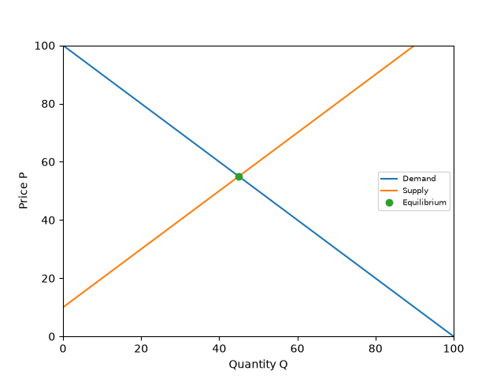
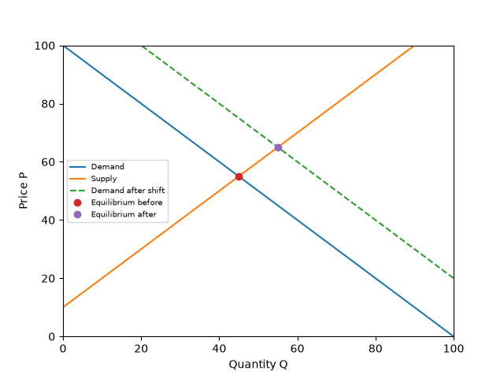
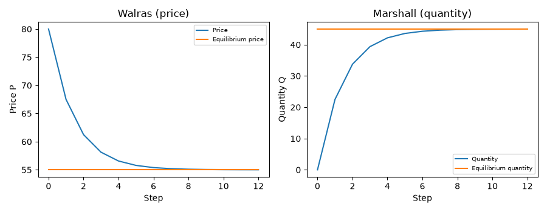

# 第 8 章: 市場均衡と調整過程

## 8.1 この章の地図

第 1 部で需要曲線を、第 2 部で供給曲線を、導きました。第 3 部では、2 つを**合わせて**、市場を調べます。この章は、市場の**均衡**と、そこに**どうたどりつくか**です。

需要曲線は右下がり、供給曲線は右上がりで、**交点**で、価格と数量が決まります。

- 価格が均衡より**高い**と、供給が需要を上回り（**超過供給**）、価格が**下がる**
- 価格が均衡より**低い**と、需要が供給を上回り（**超過需要**）、価格が**上がる**



| 項目 | 内容 |
| :--- | :--- |
| 経済学の題材 | 市場均衡、超過需要、ワルラス的調整（価格で調整）、マーシャル的調整（数量で調整）、需要曲線・供給曲線のシフト |
| 使う Python の機能 | `dataclass`（`frozen=True`、`replace`）、リスト、繰り返し（`for`）、テスト（`pytest`） |
| 新しく導入するライブラリ | なし |
| 完成形 | `LinearMarket`、`quantity_demanded`、`quantity_supplied`、`equilibrium`、`excess_demand`、`price_state`、`walras_adjustment`、`marshall_adjustment`、`shift_demand`、`shift_supply` |
| ファイル | 実装: `lib/chapter08/market.py`、`lib/chapter08/plot.py`（図）／テスト: `test/chapter08/test_market.py`、`test/chapter08/test_plot.py`（自分で書くときは、`practice/chapter08/` に、同じ名前で作ります） |
| データ | なし（手計算できる小さな例だけ） |

### 経済学の式とコードの対応

| 経済学 | 式 | コード |
| :--- | :--- | :--- |
| 需要・供給 | 需要 Q = a + s_d·P（s_d < 0）、供給 Q = c + s_s·P（s_s > 0） | `LinearMarket(a, s_d, c, s_s)` |
| 均衡 | 需要量 = 供給量。P* = (a − c) ÷ (s_s − s_d) | `equilibrium(market)` |
| 超過需要 | 需要量 − 供給量 | `excess_demand(market, price)` |
| ワルラス的調整 | P' = P + 速さ × 超過需要 | `walras_adjustment(market, price0, speed, steps)` |
| マーシャル的調整 | Q' = Q + 速さ × (需要価格 − 供給価格) | `marshall_adjustment(market, quantity0, speed, steps)` |
| シフト | 切片が、数量の方向に動く | `shift_demand`、`shift_supply` |

> **記号の注意（第 11・14 章との違い）**: この章の需要は Q = a + s_d·P（数量を価格で表す式。傾きは負）です。第 11・14 章の逆需要は P = a − b·Q（価格を数量で表す式。傾きは正）で、同じ `demand_intercept`・`demand_slope` という名前でも、**軸と符号が違います**。移すときは、式の向きを変えてください。

### 前提とする章

| できること | 場所 |
| :--- | :--- |
| 直線の需要曲線の数量を求める | この連載の[第 3 章](03-demand-curve-and-elasticity.md) |
| 供給曲線（右上がり）を言う | この連載の[第 7 章](07-profit-maximization-and-supply.md) |

第 1 シリーズの第 3・5・6 章（需要と供給・市場均衡）と、**題材が重なります**。この記事は、独立して読めるように、自分のコードで書きます。

## 8.2 準備

```bash
cd apps/micro-basics-programming/python
uv sync
uv run pytest test/chapter08
```

```text
52 passed
```

自分でコードを書くときは、`practice/chapter08/` に、`market.py` と `test_market.py` を作ります。第 3 章の `linear_demand_quantity` は、完成形の `lib/chapter03/` から import してかまいません（[この記事の読み方](how-to-read.md)を参照）。

## 8.3 予想する

需要が Q = 100 − P、供給が Q = P − 10 の市場があります。**紙で、手計算で**答えてください。答えは、この節には書いてありません。「プログラミング」の節の「予想の答え合わせ」で、プログラムを動かして確かめます。

- **均衡の価格と数量**は、いくつですか。価格が 80 のとき、**超過需要**は、いくつですか（負なら、超過供給）。価格は、上がりますか、下がりますか。価格が 30 のときは、どうですか
- ワルラス的調整（P' = P + 0.25 × 超過需要）を、P = 80 から始めると、価格は、**1 回目・2 回目・3 回目**に、いくつになりますか。均衡との差は、どう縮みますか
- マーシャル的調整（Q' = Q + 0.25 × (需要価格 − 供給価格)。需要価格 = 100 − Q、供給価格 = Q + 10）を、Q = 0 から始めると、数量は、1 回目・2 回目に、いくつになりますか
- 需要が右へ 20 動くと、均衡は、どうなりますか。供給が右へ 20（費用の低下）、左へ 20（材料費の高騰）では、どうなりますか

## 8.4 市場均衡と調整の考え方

### 均衡

需要量と供給量が**等しくなる**価格が、均衡価格です。完全競争（売り手も買い手も、プライステイカー）の市場では、価格が、均衡からずれると、**自然に、均衡へ戻る**力が働きます。

### 2 つの調整過程

| 調整過程 | 何が動くか | 考え方 |
| :--- | :--- | :--- |
| **ワルラス的調整** | **価格** | 超過需要なら、価格が上がり、超過供給なら、下がる |
| **マーシャル的調整** | **数量** | 需要価格（その数量を買ってもらえる、最高の価格）が、供給価格（その数量を作る、最低の価格）より高ければ、増産する |

どちらも、ふつうの右下がりの需要曲線と、右上がりの供給曲線では、均衡に**収束**します。調整の**速さ**が、大きすぎると、行き過ぎて、**発散**することがあります。

### 曲線のシフト

需要曲線や供給曲線が、**動く**（シフトする）と、均衡が変わります。

| 変化 | 動く曲線 | 均衡 |
| :--- | :--- | :--- |
| 所得の増加（上級財）、代替財の値上げ | 需要が**右**へ | 価格↑、数量↑ |
| 所得の増加（下級財）、補完財の値上げ | 需要が**左**へ | 価格↓、数量↓ |
| 限界費用の低下（技術進歩） | 供給が**右**へ | 価格↓、数量↑ |
| 材料費の高騰 | 供給が**左**へ | 価格↑、数量↓ |

## 8.5 プログラミング

### Red: 需要量・供給量と均衡のテスト

最初のテストを書きます。需要 Q = 100 − P、供給 Q = P − 10 で、均衡は P = 55、Q = 45 です。

```python
import pytest

from lib.chapter08.market import (
    LinearMarket,
    equilibrium,
    excess_demand,
    marshall_adjustment,
    price_state,
    quantity_demanded,
    quantity_supplied,
    shift_demand,
    shift_supply,
    walras_adjustment,
)
```

```python
MARKET = LinearMarket(
    demand_intercept=100, demand_slope=-1, supply_intercept=-10, supply_slope=1
)


def test_需要量は価格が上がると減る() -> None:
    assert quantity_demanded(MARKET, 30) == 70
    assert quantity_demanded(MARKET, 55) == 45
    assert quantity_demanded(MARKET, 100) == 0


def test_供給量は価格が上がると増える() -> None:
    assert quantity_supplied(MARKET, 10) == 0
    assert quantity_supplied(MARKET, 55) == 45
    assert quantity_supplied(MARKET, 80) == 70


def test_均衡は需要と供給の交点() -> None:
    assert equilibrium(MARKET) == (55, 45)


def test_均衡で需要量と供給量は等しい() -> None:
    price, quantity = equilibrium(MARKET)
    assert quantity_demanded(MARKET, price) == pytest.approx(quantity)
    assert quantity_supplied(MARKET, price) == pytest.approx(quantity)


def test_正の均衡がなければエラー() -> None:
    with pytest.raises(ValueError, match="均衡"):
        equilibrium(LinearMarket(5, -1, 20, 1))
```

`LinearMarket` などがまだないので、テストは失敗します（**Red**）。

テストの import は、書いた関数だけを、1 つずつ足してかまいません（[第 5 章](05-cost-curves.md)の注意を参照）。

### Green: 市場と均衡を実装する

需要と供給の式は、`dataclass`（`frozen=True`）にまとめます。需要の傾きは**負**、供給の傾きは**正**でなければ、エラーにします。需要量と供給量は、第 3 章の `linear_demand_quantity` を使い、**負になりません**。

```python
@dataclass(frozen=True)
class LinearMarket:
    """直線の需要曲線と供給曲線。Q = 切片 + 傾き × P。"""

    demand_intercept: float
    demand_slope: float
    supply_intercept: float
    supply_slope: float

    def __post_init__(self) -> None:
        if self.demand_slope >= 0:
            raise ValueError("需要の傾きは、負にする（価格が上がると、需要量が減る）")
        validate_positive(
            self.supply_slope,
            "供給の傾きは、正にする（価格が上がると、供給量が増える）",
        )


def quantity_demanded(market: LinearMarket, price: float) -> float:
    """価格 P での需要量。負にならない。"""
    return linear_demand_quantity(market.demand_intercept, market.demand_slope, price)


def quantity_supplied(market: LinearMarket, price: float) -> float:
    """価格 P での供給量。負にならない。"""
    return linear_demand_quantity(market.supply_intercept, market.supply_slope, price)


def equilibrium(market: LinearMarket) -> tuple[float, float]:
    """均衡の価格と数量 (P*, Q*)。

    a + s_d·P = c + s_s·P から、P* = (a − c) ÷ (s_s − s_d)。
    """
    price = (market.demand_intercept - market.supply_intercept) / (
        market.supply_slope - market.demand_slope
    )
    quantity = market.demand_intercept + market.demand_slope * price
    if price <= 0 or quantity <= 0:
        raise ValueError("価格も数量も正になる均衡が、存在しない")
    return price, quantity
```

??? note "import と補助関数（写すときに足す）"

    記事の抜粋には、import と、先頭が `_` の補助関数・定数を、省いています。完成形のファイルの先頭にある、次の部分を、写してください。

    **lib/chapter08/market.py**

    ```python
    from dataclasses import dataclass, replace
    ```

    ```python
    from lib.chapter01.validation import validate_non_negative, validate_positive
    from lib.chapter03.demand import linear_demand_quantity
    ```

    ```python
    # 均衡の判定で、同じ値と見なす誤差
    _TOLERANCE = 1e-9
    ```

    ```python
    def _check_adjustment(speed: float, steps: int) -> None:
        validate_positive(speed, "調整の速さは、正にする")
        validate_non_negative(steps, "調整の回数は、0 以上にする")
    ```

    **lib/chapter08/plot.py**

    ```python
    import matplotlib.pyplot as plt
    from matplotlib.axes import Axes
    from matplotlib.figure import Figure
    ```

    ```python
    from lib.chapter08.market import (
        LinearMarket,
        equilibrium,
        marshall_adjustment,
        quantity_supplied,
        shift_demand,
        walras_adjustment,
    )
    ```

    ```python
    def _style(ax: Axes, q_max: float, p_max: float) -> None:
        ax.set_xlabel("Quantity Q")
        ax.set_ylabel("Price P")
        ax.set_xlim(0, q_max)
        ax.set_ylim(0, p_max)
        ax.legend(fontsize="x-small")
    ```

    **test/chapter08/test_plot.py**

    ```python
    from collections.abc import Sequence
    from typing import cast
    ```

    ```python
    import pytest
    from matplotlib.axes import Axes
    from matplotlib.lines import Line2D
    ```

    ```python
    from lib.chapter08.market import LinearMarket
    from lib.chapter08.plot import plot_adjustment, plot_market, plot_shift
    ```

均衡は、a + s_d·P = c + s_s·P を、P について解いた、閉じた式です。**価格も数量も正になる均衡が、なければ、エラー**にします（`test_正の均衡がなければエラー`）。

### 超過需要と、価格の動き

```python
def test_価格が均衡より高ければ供給超過で下がる() -> None:
    assert price_state(MARKET, 80) == "供給超過（価格が下がる）"


def test_価格が均衡より低ければ需要超過で上がる() -> None:
    assert price_state(MARKET, 30) == "需要超過（価格が上がる）"


def test_均衡の判定は許容誤差を持つ() -> None:
    assert price_state(MARKET, 55 + 4e-10) == "均衡"
    assert price_state(MARKET, 55 + 1.2e-9) == "供給超過（価格が下がる）"
    assert price_state(MARKET, 55 - 1.2e-9) == "需要超過（価格が上がる）"
```

```python
_TOLERANCE = 1e-9


def excess_demand(market: LinearMarket, price: float) -> float:
    """超過需要 = 需要量 − 供給量。正なら需要超過、負なら供給超過。"""
    return quantity_demanded(market, price) - quantity_supplied(market, price)


def price_state(market: LinearMarket, price: float) -> str:
    """価格が、均衡より高いか低いかを、超過需要で判定する。"""
    excess = excess_demand(market, price)
    if abs(excess) <= _TOLERANCE:
        return "均衡"
    if excess < 0:
        return "供給超過（価格が下がる）"
    return "需要超過（価格が上がる）"
```

均衡かどうかの判定には、**許容誤差**（超過需要の大きさが 1e-9 以下）を持たせます。浮動小数点数の誤差で、均衡が、判定できなくなるのを防ぎます。

### ワルラス的調整

価格を、超過需要に**比例して**動かします。P' = P + 速さ × (需要量 − 供給量)。P = 80、速さ 0.25 では、超過需要は −50 なので、P' = 80 − 12.5 = 67.5 です。

```python
def test_ワルラス的調整は価格を超過需要に比例して動かす() -> None:
    prices = walras_adjustment(MARKET, 80, 0.25, 3)
    assert prices == pytest.approx([80, 67.5, 61.25, 58.125])


def test_ワルラス的調整は均衡との差が半分ずつ縮む() -> None:
    prices = walras_adjustment(MARKET, 80, 0.25, 10)
    gaps = [abs(p - 55) for p in prices]
    assert all(b == pytest.approx(a / 2) for a, b in zip(gaps, gaps[1:], strict=False))


def test_調整が速すぎると発散する() -> None:
    prices = walras_adjustment(MARKET, 80, 1.5, 4)
    gaps = [abs(p - 55) for p in prices]
    assert all(a < b for a, b in zip(gaps, gaps[1:], strict=False))
```

```python
def _check_adjustment(speed: float, steps: int) -> None:
    validate_positive(speed, "調整の速さは、正にする")
    validate_non_negative(steps, "調整の回数は、0 以上にする")


def walras_adjustment(
    market: LinearMarket, price0: float, speed: float, steps: int
) -> list[float]:
    """ワルラス的調整。P' = P + 速さ × 超過需要。初期値を含む、steps + 1 個の価格。"""
    _check_adjustment(speed, steps)
    prices = [price0]
    for _ in range(steps):
        prices.append(prices[-1] + speed * excess_demand(market, prices[-1]))
    return prices
```

この市場では、調整のたびに、均衡との差が**半分**に縮みます（係数 1 − 0.25 × 2 = 0.5）。速さを 1.5 にすると、係数が −2 になり、差が**大きくなって発散**します。（発散の例では、価格が**負**になる点も通ります。負の価格に、意味はなく、発散の様子を見るための、数学上の例です。）

### マーシャル的調整

数量を、需要価格と供給価格の**差**に比例して、動かします。需要価格は、需要曲線の逆関数、供給価格は、供給曲線の逆関数です。

```python
def test_マーシャル的調整は需要価格と供給価格の差に比例して数量を動かす() -> None:
    quantities = marshall_adjustment(MARKET, 0, 0.25, 3)
    assert quantities == pytest.approx([0, 22.5, 33.75, 39.375])


def test_マーシャル的調整は均衡に収束する() -> None:
    assert marshall_adjustment(MARKET, 0, 0.25, 40)[-1] == pytest.approx(45, abs=1e-9)
```

```python
def marshall_adjustment(
    market: LinearMarket, quantity0: float, speed: float, steps: int
) -> list[float]:
    """マーシャル的調整。Q' = Q + 速さ × (需要価格 − 供給価格)。

    初期値を含む、steps + 1 個の数量を返す。需要価格は、その数量を買ってもらえる、
    最高の価格。供給価格は、その数量を作る、最低の価格。
    """
    _check_adjustment(speed, steps)
    quantities = [quantity0]
    for _ in range(steps):
        q = quantities[-1]
        demand_price = (q - market.demand_intercept) / market.demand_slope
        supply_price = (q - market.supply_intercept) / market.supply_slope
        quantities.append(q + speed * (demand_price - supply_price))
    return quantities
```

### 曲線のシフト

シフトは、切片を動かした、**新しい市場**を返します（元の市場は、変えません。`frozen=True` の `dataclass` を、`replace` で作り直します）。

```python
def test_需要の右シフトは価格も数量も上げる() -> None:
    shifted = shift_demand(MARKET, 20)
    assert equilibrium(shifted) == pytest.approx((65, 55))


def test_供給の右シフトは価格を下げ数量を増やす() -> None:
    assert equilibrium(shift_supply(MARKET, 20)) == pytest.approx((45, 55))


def test_供給の左シフトは価格を上げ数量を減らす() -> None:
    assert equilibrium(shift_supply(MARKET, -20)) == pytest.approx((65, 35))


def test_シフトは元の市場を変えない() -> None:
    shift_demand(MARKET, 20)
    assert equilibrium(MARKET) == (55, 45)
    assert MARKET.demand_intercept == 100
```

```python
def shift_demand(market: LinearMarket, delta: float) -> LinearMarket:
    """需要曲線を、数量の方向に delta だけ動かす（正なら右へ）。元の市場は変えない。"""
    return replace(market, demand_intercept=market.demand_intercept + delta)


def shift_supply(market: LinearMarket, delta: float) -> LinearMarket:
    """供給曲線を、数量の方向に delta だけ動かす（正なら右へ。費用の低下）。"""
    return replace(market, supply_intercept=market.supply_intercept + delta)
```

### 予想の答え合わせ

予想した答えを、プログラムで確かめます。

> このスクリプトは、**完成形**（`lib/`）を読みます。**自分のコードで確かめる**ときは、import を、`from practice.chapterNN...` に書き換えてください。

```python
from lib.chapter08.market import (
    LinearMarket,
    equilibrium,
    excess_demand,
    marshall_adjustment,
    price_state,
    shift_demand,
    shift_supply,
    walras_adjustment,
)

market = LinearMarket(demand_intercept=100, demand_slope=-1, supply_intercept=-10, supply_slope=1)
print("均衡 (P, Q):", equilibrium(market))
print("P = 80 の超過需要:", excess_demand(market, 80), price_state(market, 80))
print("P = 30 の超過需要:", excess_demand(market, 30), price_state(market, 30))
print("ワルラス的調整 P = 80 から:", walras_adjustment(market, 80, 0.25, 3))
print("マーシャル的調整 Q = 0 から:", marshall_adjustment(market, 0, 0.25, 3))
print("需要が右へ 20:", equilibrium(shift_demand(market, 20)))
print("供給が右へ 20:", equilibrium(shift_supply(market, 20)))
print("供給が左へ 20:", equilibrium(shift_supply(market, -20)))
```

```text
均衡 (P, Q): (55.0, 45.0)
P = 80 の超過需要: -50 供給超過（価格が下がる）
P = 30 の超過需要: 50 需要超過（価格が上がる）
ワルラス的調整 P = 80 から: [80, 67.5, 61.25, 58.125]
マーシャル的調整 Q = 0 から: [0, 22.5, 33.75, 39.375]
需要が右へ 20: (65.0, 55.0)
供給が右へ 20: (45.0, 55.0)
供給が左へ 20: (65.0, 35.0)
```

- **1 つ目の問い**: 均衡は (P, Q) = (55, 45) です。P = 80 では、超過需要が −50（超過供給）で、価格は**下がり**ます。P = 30 では、+50（超過需要）で、価格は**上がり**ます
- **2 つ目の問い**: 価格は、80 → 67.5 → 61.25 → 58.125 と動きます。均衡との差は、25 → 12.5 → 6.25 → 3.125 と、**半分ずつ**縮みます
- **3 つ目の問い**: 数量は、0 → 22.5 → 33.75 → 39.375 と、均衡の 45 に近づきます
- **4 つ目の問い**: 需要が右へ 20 動くと、均衡は (65, 55)（価格↑、数量↑）。供給が右へ 20 では (45, 55)（価格↓、数量↑）、左へ 20 では (65, 35)（価格↑、数量↓）です

### 図

需要曲線と供給曲線、均衡点を描く関数と、座標のテストです。需要曲線が両軸の切片（価格 100、数量 100）を通ること、均衡点が (45, 55) にあることを確かめます。

??? note "描画のテストと実装（後回しにしても、学習は成り立ちます）"

    ```python
    MARKET = LinearMarket(100, -1, -10, 1)


    def xs(line: Line2D) -> list[float]:
        return [float(v) for v in cast(Sequence[float], line.get_xdata())]


    def ys(line: Line2D) -> list[float]:
        return [float(v) for v in cast(Sequence[float], line.get_ydata())]


    def line(ax: Axes, label: str) -> Line2D:
        return next(item for item in ax.lines if item.get_label() == label)


    def market() -> Axes:
        return plot_market(MARKET, 100, 100).axes[0]


    def test_市場の図の線() -> None:
        assert [item.get_label() for item in market().lines] == [
            "Demand",
            "Supply",
            "Equilibrium",
        ]


    def test_均衡点は需要と供給の交点() -> None:
        point = line(market(), "Equilibrium")
        assert (xs(point)[0], ys(point)[0]) == (45, 55)
    ```

    ```python
    def _style(ax: Axes, q_max: float, p_max: float) -> None:
        ax.set_xlabel("Quantity Q")
        ax.set_ylabel("Price P")
        ax.set_xlim(0, q_max)
        ax.set_ylim(0, p_max)
        ax.legend(fontsize="x-small")


    def draw_curves(ax: Axes, market: LinearMarket, p_max: float) -> None:
        """需要曲線（数量が 0 になる価格から、価格 0 まで）と、供給曲線を描く。"""
        choke = -market.demand_intercept / market.demand_slope
        ax.plot([0, market.demand_intercept], [choke, 0], label="Demand")
        reservation = -market.supply_intercept / market.supply_slope
        ax.plot([0, quantity_supplied(market, p_max)], [reservation, p_max], label="Supply")


    def plot_market(market: LinearMarket, q_max: float, p_max: float) -> Figure:
        """需要曲線・供給曲線と、均衡点（交点）を描く。縦軸が価格、横軸が数量。"""
        fig, ax = plt.subplots()
        draw_curves(ax, market, p_max)
        price, quantity = equilibrium(market)
        ax.plot([quantity], [price], "o", label="Equilibrium")
        _style(ax, q_max, p_max)
        plt.close(fig)
        return fig
    ```

需要が右へ動いたときの、均衡の移動です。動かしたあとの曲線は、点線で描きます。



??? note "描画のテストと実装（後回しにしても、学習は成り立ちます）"

    ```python
    def shifted() -> Axes:
        return plot_shift(MARKET, 20, 100, 100).axes[0]


    def test_需要のシフトは点線で右へ20動く() -> None:
        ax = shifted()
        after = line(ax, "Demand after shift")
        assert after.get_linestyle() == "--"
        assert xs(after) == [0, 120]
        assert ys(after) == [120, 0]
        assert line(ax, "Demand").get_linestyle() == "-"
    ```

    ```python
    def plot_shift(
        market: LinearMarket, delta: float, q_max: float, p_max: float
    ) -> Figure:
        """需要曲線が delta だけ右へ動いたときの、均衡の移動。動かしたあとは、点線。"""
        moved = shift_demand(market, delta)
        fig, ax = plt.subplots()
        draw_curves(ax, market, p_max)
        choke = -moved.demand_intercept / moved.demand_slope
        ax.plot([0, moved.demand_intercept], [choke, 0], "--", label="Demand after shift")
        price0, quantity0 = equilibrium(market)
        price1, quantity1 = equilibrium(moved)
        ax.plot([quantity0], [price0], "o", label="Equilibrium before")
        ax.plot([quantity1], [price1], "o", label="Equilibrium after")
        _style(ax, q_max, p_max)
        plt.close(fig)
        return fig
    ```

調整の推移です。左が、ワルラス的調整（価格）、右が、マーシャル的調整（数量）です。どちらも、均衡へ、近づいていきます。



??? note "描画のテストと実装（後回しにしても、学習は成り立ちます）"

    ```python
    def adjustment() -> list[Axes]:
        return plot_adjustment(MARKET, 80, 0, 0.25, 10).axes


    def test_ワルラス的調整の価格の推移() -> None:
        left, _ = adjustment()
        path = line(left, "Price")
        assert xs(path) == list(range(11))
        assert ys(path)[:3] == pytest.approx([80, 67.5, 61.25])
        assert ys(line(left, "Equilibrium price")) == [55, 55]
        assert xs(line(left, "Equilibrium price")) == [0, 10]


    def test_マーシャル的調整の数量の推移() -> None:
        _, right = adjustment()
        path = line(right, "Quantity")
        assert xs(path) == list(range(11))
        assert ys(path)[:3] == pytest.approx([0, 22.5, 33.75])
        assert ys(line(right, "Equilibrium quantity")) == [45, 45]
    ```

    ```python
    def plot_adjustment(
        market: LinearMarket, price0: float, quantity0: float, speed: float, steps: int
    ) -> Figure:
        """ワルラス的調整（価格の推移）と、マーシャル的調整（数量の推移）を、左右に並べる。"""
        price, quantity = equilibrium(market)
        fig, (left, right) = plt.subplots(1, 2, figsize=(9, 3.5))
        steps_axis = list(range(steps + 1))
        prices = walras_adjustment(market, price0, speed, steps)
        quantities = marshall_adjustment(market, quantity0, speed, steps)
        left.plot(steps_axis, prices, label="Price")
        left.plot([0, steps], [price, price], label="Equilibrium price")
        left.set_title("Walras (price)")
        left.set_ylabel("Price P")
        right.plot(steps_axis, quantities, label="Quantity")
        right.plot([0, steps], [quantity, quantity], label="Equilibrium quantity")
        right.set_title("Marshall (quantity)")
        right.set_ylabel("Quantity Q")
        for ax in (left, right):
            ax.set_xlabel("Step")
            ax.legend(fontsize="x-small")
        fig.tight_layout()
        plt.close(fig)
        return fig
    ```

### 実行結果

```bash
uv run pytest test/chapter08
```

```text
52 passed
```

## 8.6 規則で言うと

1. **均衡は、需要量と供給量が等しい点である。** 価格が、ずれると、超過需要・超過供給が、価格を、均衡へ、戻す
2. **ワルラスは価格で、マーシャルは数量で、調整する。** どちらも、均衡に収束する（速さが、大きすぎなければ）
3. **シフトは、曲線そのものが動くこと。価格の変化は、曲線の上の動き。**

混同しやすい点を、表にまとめます。

| 混同しやすい点 | 違い |
| :--- | :--- |
| ワルラス的調整とマーシャル的調整 | ワルラスは、**価格**を、超過需要に応じて動かす。マーシャルは、**数量**を、需要価格と供給価格の差に応じて動かす |
| 需要の変化と、需要量の変化 | 価格が変わると、**需要量**が動く（曲線の上の動き）。所得などが変わると、**需要**（曲線そのもの）が動く（シフト） |
| 供給の右シフトと、左シフト | 費用の低下は、右（価格↓、数量↑）。材料費の高騰は、左（価格↑、数量↓） |
| 均衡と、安定 | 均衡があっても、調整が速すぎると、行き過ぎて、発散する |

### このモデルが成り立たない場面

- **完全競争を仮定しています。** 売り手や買い手が、価格を左右できる市場では、価格は、需給の交点で決まりません（第 11 章）
- **直線の曲線を仮定しています。** 実際の需要・供給は、曲がっていて、調整の速さも、市場により違います
- **調整は、瞬時に、起きるとは限りません。** 在庫・契約・情報の遅れで、価格が、硬直的なことがあります
- **取引は、均衡価格だけで行われると仮定しています。** 均衡に至る途中の、取引（不均衡での取引）は、扱いません

## 8.7 練習問題

| 種類 | 問題 |
| :--- | :--- |
| 想起 | 本文を閉じて、`equilibrium` の最初のテスト（需要 Q = 100 − P、供給 Q = P − 10 で、(55, 45)）を書いてください |
| 生成 | 解説を見る前に、均衡の**取引額**（価格 × 数量）を返す `market_value(market)` を、テストから書いてください。この市場で、2475 になります |
| 多様 | 需要を Q = 120 − 2P、供給を Q = −20 + 4P に変えます。均衡は、どこですか。先に予想してから、確かめてください |
| 交互 | [第 1 シリーズ](../economics-programming/index.md)の第 3 章のリスト内包表記で、需要が右へ 0・10・20・30 動いたときの、均衡価格を、一度に求めてください。価格は、どう動きますか |

??? note "解答（先に自分で取り組んでから、開いてください）"

    **想起**:

    ```python
    def test_均衡の最初のテスト() -> None:
        market = LinearMarket(100, -1, -10, 1)
        assert equilibrium(market) == (55, 45)
    ```

    **生成**: 均衡の価格と数量を、掛けます。

    ```python
    def market_value(market):
        price, quantity = equilibrium(market)
        return price * quantity
    ```

    ```python
    def test_取引額() -> None:
        assert market_value(LinearMarket(100, -1, -10, 1)) == 2475
    ```

    **多様**: 120 − 2P = −20 + 4P から、6P = 140 で、P = 70/3 ≈ 23.33、Q = 120 − 140/3 ≈ 73.33 です。

    ```python
    def test_練習問題の傾きと切片が違う市場の均衡() -> None:
        price, quantity = equilibrium(LinearMarket(120, -2, -20, 4))
        assert price == pytest.approx(70 / 3)
        assert quantity == pytest.approx(120 - 140 / 3)
    ```

    **交互**: 需要が右へ動くほど、均衡価格は、**上がります**（55 → 60 → 65 → 70）。

    ```python
    def test_需要が右へ動くと均衡価格は上がる() -> None:
        market = LinearMarket(100, -1, -10, 1)
        prices = [equilibrium(shift_demand(market, d))[0] for d in (0, 10, 20, 30)]
        assert prices == pytest.approx([55, 60, 65, 70])
    ```

## 8.8 振り返り

- うまくいったこと:
- 詰まったこと:
- 次に試すこと:

## 8.9 まとめ

- 市場均衡は、需要量と供給量が等しい点。直線の需要と供給では、閉じた式で求まる。均衡がなければ（正の価格・数量にならなければ）、エラー
- ワルラス的調整は、価格を超過需要に比例して動かし、マーシャル的調整は、数量を需要価格と供給価格の差に比例して動かす。どちらも均衡へ収束するが、速さが大きすぎると、発散する
- 需要曲線・供給曲線のシフトで、均衡が動く。需要の右シフトは価格↑・数量↑、供給の右シフトは価格↓・数量↑、左シフトは価格↑・数量↓

次の章では、均衡で、**誰が、どれだけ得をしているか**を、**余剰**で測ります。消費者余剰・生産者余剰・総余剰と、**課税**で生まれる**死荷重**を、確かめます。
