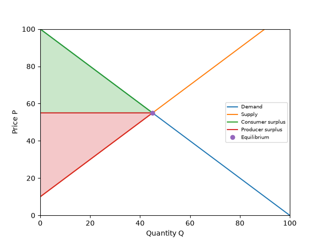
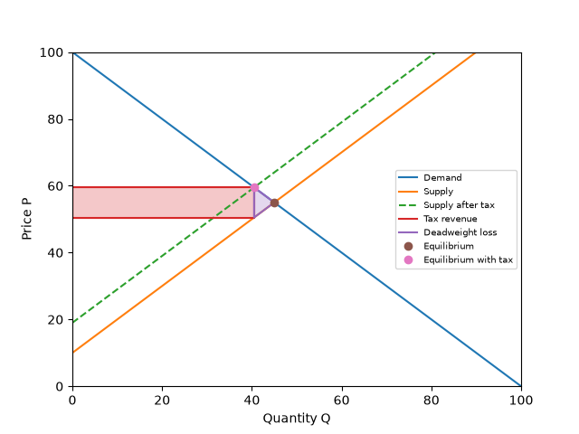

# 第 9 章: 余剰分析と課税

## 9.1 この章の地図

市場均衡で、**誰が、どれだけ得をしているか**を、数字で測るのが、**余剰分析**です。

- **消費者余剰**: 消費者が、払ってもよいと思った額（**支払意思額**）から、実際に払った額を、引いた合計。グラフでは、需要曲線と価格の間の三角形
- **生産者余剰**: 売り手が受け取った価格から、作るのにかかった費用（**限界費用**）を、引いた合計。グラフでは、価格と供給曲線の間の三角形
- **総余剰** = 消費者余剰 + 生産者余剰

**市場均衡で、総余剰が最大**になります。均衡より、少なく取引しても、多く取引しても、**三角形の損失**が出ます。この章では、さらに、**課税**が、取引を減らして、**死荷重**（誰の得にもならない、損失）を生むことを、確かめます。



| 項目 | 内容 |
| :--- | :--- |
| 経済学の題材 | 消費者余剰・生産者余剰・総余剰、パレート効率、従量税と死荷重、税の負担（弾力性との関係） |
| 使う Python の機能 | `dataclass`（`frozen=True`）、タプル、関数、テスト（`pytest`） |
| 新しく導入するライブラリ | なし |
| 完成形 | `choke_price`、`reservation_price`、`consumer_surplus`、`producer_surplus`、`total_surplus_at_quantity`、`deadweight_loss_at_quantity`、`TaxResult`、`tax_equilibrium`、`tax_incidence` |
| ファイル | 実装: `lib/chapter09/surplus.py`、`lib/chapter09/plot.py`（図）／テスト: `test/chapter09/test_surplus.py`、`test/chapter09/test_plot.py`（自分で書くときは、`practice/chapter09/` に、同じ名前で作ります） |
| データ | なし（手計算できる小さな例だけ） |

### 経済学の式とコードの対応

| 経済学 | 式 | コード |
| :--- | :--- | :--- |
| 消費者余剰 | ½ × (需要がなくなる価格 − 価格) × 需要量 | `consumer_surplus(market, price)` |
| 生産者余剰 | ½ × (価格 − 供給が始まる価格) × 供給量 | `producer_surplus(market, price)` |
| 総余剰 | 数量 q を取引したときの、需要価格と供給価格の差の合計 | `total_surplus_at_quantity(market, q)` |
| 死荷重（数量が均衡でないとき） | 均衡の総余剰 − その数量の総余剰 | `deadweight_loss_at_quantity(market, q)` |
| 従量税の均衡 | P_d = (a − c + s_s·T) ÷ (s_s − s_d)、P_s = P_d − T | `tax_equilibrium(market, tax)` |
| 税の負担 | 買い手 P_d − P*、売り手 P* − P_s | `tax_incidence(market, tax)` |

### 前提とする章

| できること | 場所 |
| :--- | :--- |
| 市場均衡を求める | この連載の[第 8 章](08-market-equilibrium-and-adjustment.md) |
| 価格弾力性を言う | この連載の[第 3 章](03-demand-curve-and-elasticity.md)（需要）、[第 7 章](07-profit-maximization-and-supply.md)（供給） |

## 9.2 準備

```bash
cd apps/micro-basics-programming/python
uv sync
uv run pytest test/chapter09
```

```text
38 passed
```

自分でコードを書くときは、`practice/chapter09/` に、`surplus.py` と `test_surplus.py` を作ります。第 8 章の `LinearMarket` などは、完成形の `lib/chapter08/` から import してかまいません（[この記事の読み方](how-to-read.md)を参照）。

## 9.3 予想する

需要が Q = 100 − P、供給が Q = P − 10 の市場（第 8 章。均衡は P = 55、Q = 45）です。**紙で、手計算で**答えてください。答えは、この節には書いてありません。「プログラミング」の節の「予想の答え合わせ」で、プログラムを動かして確かめます。

- 均衡での、**消費者余剰**と**生産者余剰**と**総余剰**は、いくつですか（三角形の面積）
- 数量が 30 のとき、数量が 60 のときの、**死荷重**（均衡の総余剰との差）は、それぞれ、いくつですか
- 売り手に、1 単位あたり 9 の**従量税**がかかります。買い手の価格、売り手の手取り、数量は、いくつですか。**税収**と**死荷重**は、いくつですか
- 同じ均衡（55, 45）で、需要の傾きが −0.5（需要が**急**。Q = 72.5 − 0.5P）の市場に、同じ税 9 をかけると、死荷重は、大きくなりますか、小さくなりますか。税の負担は、買い手と売り手で、どう分かれますか

## 9.4 余剰と課税の考え方

### 消費者余剰と生産者余剰

消費者は、需要曲線の高さ（支払意思額）まで、払う気があります。実際の価格が、それより低ければ、差が、得（**余剰**）です。売り手も、供給曲線の高さ（限界費用）より高い価格で売れれば、差が、得です。

> 総余剰 = 消費者余剰 + 生産者余剰

### 市場均衡と効率

**市場均衡で、総余剰が最大**になります。均衡より少なければ、「買いたい人と売りたい人が、いるのに、取引されていない」損失が、多ければ、「費用が、価値を上回る取引」の損失が、三角形で、出ます。

誰かを犠牲にせずには、誰かを良くできない状態を、**パレート効率**と言います。完全競争の均衡は、パレート効率的です（**厚生経済学の第一定理**）。ただし、効率と公平は、別のものです（均衡は、所得の分配が、公平かは、言っていません）。

### 課税と死荷重

売り手に、1 単位あたり T の**従量税**がかかると、供給曲線が、T だけ上へ動きます。

- 買い手の価格 P_d は上がり、売り手の手取り P_s = P_d − T は下がる。**数量は減る**
- 総余剰 = 消費者余剰 + 生産者余剰 + **税収**（T × 数量）
- 取引が減った分の、三角形が、**死荷重**（誰の得にもならない、損失）

**弾力性が小さい（曲線が急な）**財ほど、数量が減りにくいので、死荷重は、小さくなります。税の負担も、**弾力性の小さい側が、多く負担**します。必需品への課税は、効率的（死荷重が小さい）ですが、低所得者の負担が、重くなります。

## 9.5 プログラミング

### Red: 消費者余剰と生産者余剰のテスト

最初のテストを書きます。均衡（55, 45）で、消費者余剰は、½ × (100 − 55) × 45 = 1012.5 です。

```python
import pytest

from lib.chapter08.market import LinearMarket, equilibrium
from lib.chapter09.surplus import (
    choke_price,
    consumer_surplus,
    deadweight_loss_at_quantity,
    producer_surplus,
    reservation_price,
    tax_equilibrium,
    tax_incidence,
    total_surplus_at_quantity,
)
```

```python
MARKET = LinearMarket(100, -1, -10, 1)


STEEP_DEMAND = LinearMarket(72.5, -0.5, -10, 1)


STEEP_SUPPLY = LinearMarket(100, -1, 17.5, 0.5)


def test_消費者余剰は需要曲線と価格の間の三角形() -> None:
    assert consumer_surplus(MARKET, 55) == 1012.5
    assert consumer_surplus(MARKET, 30) == pytest.approx(0.5 * 70 * 70)


def test_生産者余剰は価格と供給曲線の間の三角形() -> None:
    assert producer_surplus(MARKET, 55) == 1012.5
    assert producer_surplus(MARKET, 70) == pytest.approx(0.5 * 60 * 60)
```

`consumer_surplus` などがまだないので、テストは失敗します（**Red**）。

テストの import は、書いた関数だけを、1 つずつ足してかまいません（[第 5 章](05-cost-curves.md)の注意を参照）。

### Green: 余剰を実装する

三角形の高さは、需要がなくなる価格（**チョーク価格**）と、価格の差です。価格が、それを超えれば、余剰は 0 です（`max(0.0, ...)`）。

```python
def choke_price(market: LinearMarket) -> float:
    """需要量が 0 になる価格（需要曲線の、価格の軸との切片）。"""
    return -market.demand_intercept / market.demand_slope


def reservation_price(market: LinearMarket) -> float:
    """供給が始まる価格（供給曲線の、価格の軸との切片）。"""
    return -market.supply_intercept / market.supply_slope


def consumer_surplus(market: LinearMarket, price: float) -> float:
    """消費者余剰 = ½ × (需要がなくなる価格 − 価格) × 需要量。"""
    gap = max(0.0, choke_price(market) - price)
    return 0.5 * gap * quantity_demanded(market, price)


def producer_surplus(market: LinearMarket, price: float) -> float:
    """生産者余剰 = ½ × (価格 − 供給が始まる価格) × 供給量。"""
    gap = max(0.0, price - reservation_price(market))
    return 0.5 * gap * quantity_supplied(market, price)
```

??? note "import と補助関数（写すときに足す）"

    記事の抜粋には、import と、先頭が `_` の補助関数・定数を、省いています。完成形のファイルの先頭にある、次の部分を、写してください。

    **lib/chapter09/plot.py**

    ```python
    import matplotlib.pyplot as plt
    from matplotlib.axes import Axes
    from matplotlib.figure import Figure
    ```

    ```python
    from lib.chapter08.market import LinearMarket, equilibrium, quantity_supplied
    from lib.chapter08.plot import draw_curves
    from lib.chapter09.surplus import choke_price, reservation_price, tax_equilibrium
    ```

    ```python
    def _style(ax: Axes, q_max: float, p_max: float) -> None:
        ax.set_xlabel("Quantity Q")
        ax.set_ylabel("Price P")
        ax.set_xlim(0, q_max)
        ax.set_ylim(0, p_max)
        ax.legend(fontsize="x-small")
    ```

    **lib/chapter09/surplus.py**

    ```python
    from dataclasses import dataclass
    ```

    ```python
    from lib.chapter01.validation import validate_non_negative
    from lib.chapter08.market import (
        LinearMarket,
        equilibrium,
        quantity_demanded,
        quantity_supplied,
    )
    ```

    **test/chapter09/test_plot.py**

    ```python
    from collections.abc import Sequence
    from typing import cast
    ```

    ```python
    import pytest
    from matplotlib.axes import Axes
    from matplotlib.lines import Line2D
    ```

    ```python
    from lib.chapter08.market import LinearMarket
    from lib.chapter09.plot import plot_surplus, plot_tax
    ```

### 総余剰は、均衡で最大

数量 q を取引したときの総余剰は、「需要価格 − 供給価格」を、0 から q まで足した面積です。需要価格も供給価格も q の 1 次式なので、面積は、q の 2 次式です。

```python
def test_総余剰は消費者余剰と生産者余剰の和() -> None:
    price, quantity = equilibrium(MARKET)
    total = consumer_surplus(MARKET, price) + producer_surplus(MARKET, price)
    assert total == 2025
    assert total_surplus_at_quantity(MARKET, quantity) == pytest.approx(total)


def test_総余剰は均衡の数量で最大() -> None:
    best = total_surplus_at_quantity(MARKET, 45)
    for q in (0, 10, 30, 44, 46, 60, 90):
        assert total_surplus_at_quantity(MARKET, q) < best


def test_均衡より少なくても多くても三角形の損失が出る() -> None:
    assert deadweight_loss_at_quantity(MARKET, 30) == pytest.approx(225)
    assert deadweight_loss_at_quantity(MARKET, 60) == pytest.approx(225)
    assert deadweight_loss_at_quantity(MARKET, 45) == pytest.approx(0, abs=1e-9)
```

```python
def total_surplus_at_quantity(market: LinearMarket, quantity: float) -> float:
    """数量 q を取引したときの総余剰 = 需要価格と供給価格の差の、0 から q までの合計。

    需要価格と供給価格は、どちらも q の 1 次式なので、差の面積は、q の 2 次式。
    """
    if quantity < 0 or quantity > market.demand_intercept:
        raise ValueError("数量は、0 以上、需要曲線の数量の切片以下にする")
    intercept_gap = choke_price(market) - reservation_price(market)
    slope_gap = 1 / market.demand_slope - 1 / market.supply_slope
    return intercept_gap * quantity + 0.5 * slope_gap * quantity**2


def deadweight_loss_at_quantity(market: LinearMarket, quantity: float) -> float:
    """均衡の数量でない数量での、総余剰の損失（三角形）。均衡より少なくても多くても出る。"""
    _, best = equilibrium(market)
    return total_surplus_at_quantity(market, best) - total_surplus_at_quantity(
        market, quantity
    )
```

均衡（q = 45）で、2025 と最大になり、q = 30 でも q = 60 でも、**同じ 225 の損失**が、出ます（均衡の前後で、対称）。

### 従量税

買い手の価格 P_d と、売り手の手取り P_s = P_d − T で、需要量 = 供給量です。a + s_d·P_d = c + s_s·(P_d − T) を解くと、P_d = (a − c + s_s·T) ÷ (s_s − s_d)。T = 9 では、P_d = 59.5、P_s = 50.5、Q = 40.5 です。

```python
def test_従量税のもとの価格と数量() -> None:
    result = tax_equilibrium(MARKET, 9)
    assert result.buyer_price == pytest.approx(59.5)
    assert result.seller_price == pytest.approx(50.5)
    assert result.quantity == pytest.approx(40.5)


def test_税収は税額かける数量() -> None:
    assert tax_equilibrium(MARKET, 9).tax_revenue == pytest.approx(364.5)


def test_死荷重は三角形の面積() -> None:
    result = tax_equilibrium(MARKET, 9)
    assert result.deadweight_loss == pytest.approx(20.25)
    assert result.deadweight_loss == pytest.approx(0.5 * 9 * (45 - 40.5))


def test_総余剰は消費者余剰と生産者余剰と税収の和で死荷重だけ減る() -> None:
    result = tax_equilibrium(MARKET, 9)
    total = result.consumer_surplus + result.producer_surplus + result.tax_revenue
    assert total == pytest.approx(2025 - result.deadweight_loss)
```

```python
@dataclass(frozen=True)
class TaxResult:
    """従量税のもとの、市場の結果。"""

    buyer_price: float
    seller_price: float
    quantity: float
    tax_revenue: float
    consumer_surplus: float
    producer_surplus: float
    deadweight_loss: float


def tax_equilibrium(market: LinearMarket, tax: float) -> TaxResult:
    """従量税（売り手に、1 単位あたり tax 円）のもとの、均衡と余剰。

    買い手の価格 P_d と、売り手の手取り P_s = P_d − tax で、需要量 = 供給量。
    a + s_d·P_d = c + s_s·(P_d − tax) から、P_d = (a − c + s_s·tax) ÷ (s_s − s_d)。
    """
    validate_non_negative(tax, "税額は、0 以上にする")
    buyer_price = (
        market.demand_intercept - market.supply_intercept + market.supply_slope * tax
    ) / (market.supply_slope - market.demand_slope)
    seller_price = buyer_price - tax
    quantity = quantity_demanded(market, buyer_price)
    if quantity <= 0:
        raise ValueError("税が大きすぎて、取引がなくなる")
    _, best_quantity = equilibrium(market)
    return TaxResult(
        buyer_price,
        seller_price,
        quantity,
        tax * quantity,
        consumer_surplus(market, buyer_price),
        producer_surplus(market, seller_price),
        0.5 * tax * (best_quantity - quantity),
    )
```

死荷重は、½ × T × (均衡の数量 − 課税後の数量) = ½ × 9 × 4.5 = 20.25 です。総余剰（消費者余剰 + 生産者余剰 + 税収）は、2025 − 20.25 になります（最後のテスト）。税が大きすぎて、**取引がなくなる**ときは、エラーにします。

### 弾力性と、死荷重・税の負担

同じ均衡（55, 45）で、需要が**急**（傾き −0.5）な市場と、供給が**急**（傾き 0.5）な市場を、比べます。

```python
def test_需要が急な財ほど死荷重が小さい() -> None:
    steep = tax_equilibrium(STEEP_DEMAND, 9)
    assert steep.buyer_price == pytest.approx(61)
    assert steep.seller_price == pytest.approx(52)
    assert steep.quantity == pytest.approx(42)
    assert steep.deadweight_loss == pytest.approx(13.5)
    assert steep.deadweight_loss < tax_equilibrium(MARKET, 9).deadweight_loss


def test_供給が急でも死荷重は小さい() -> None:
    steep = tax_equilibrium(STEEP_SUPPLY, 9)
    assert steep.quantity == pytest.approx(42)
    assert steep.deadweight_loss == pytest.approx(13.5)


def test_税の負担は弾力性の小さい側が多く負担する() -> None:
    assert tax_incidence(MARKET, 9) == pytest.approx((4.5, 4.5))
    assert tax_incidence(STEEP_DEMAND, 9) == pytest.approx((6, 3))
    assert tax_incidence(STEEP_SUPPLY, 9) == pytest.approx((3, 6))


def test_税が大きすぎて取引がなくなればエラー() -> None:
    with pytest.raises(ValueError, match="取引"):
        tax_equilibrium(MARKET, 90)
```

```python
def tax_incidence(market: LinearMarket, tax: float) -> tuple[float, float]:
    """税の負担 (買い手の負担, 売り手の負担)。均衡価格からの、価格の動き。

    弾力性の小さい（曲線が急な）側が、多く負担する。2 つの和は、税額。
    """
    result = tax_equilibrium(market, tax)
    price, _ = equilibrium(market)
    return result.buyer_price - price, price - result.seller_price
```

どちらも、同じ数量（42）まで減り、死荷重は 13.5 と、**元の 20.25 より小さい**です。税の負担は、需要が急なら、買い手が 6・売り手が 3、供給が急なら、買い手が 3・売り手が 6 と、**急な側（弾力性の小さい側）が、多く負担**します。

### 予想の答え合わせ

予想した答えを、プログラムで確かめます。

> このスクリプトは、**完成形**（`lib/`）を読みます。**自分のコードで確かめる**ときは、import を、`from practice.chapterNN...` に書き換えてください。

```python
from lib.chapter08.market import LinearMarket, equilibrium
from lib.chapter09.surplus import (
    consumer_surplus,
    deadweight_loss_at_quantity,
    producer_surplus,
    tax_equilibrium,
    tax_incidence,
)

market = LinearMarket(demand_intercept=100, demand_slope=-1, supply_intercept=-10, supply_slope=1)
price, quantity = equilibrium(market)
cs, ps = consumer_surplus(market, price), producer_surplus(market, price)
print("消費者余剰:", cs, "生産者余剰:", ps, "総余剰:", cs + ps)
print("Q = 30・60 の死荷重:", [round(deadweight_loss_at_quantity(market, q), 4) for q in (30, 60)])
result = tax_equilibrium(market, 9)
print("従量税 9 の買い手の価格・売り手の手取り・数量:", round(result.buyer_price, 4), round(result.seller_price, 4), round(result.quantity, 4))
print("税収:", round(result.tax_revenue, 4), "死荷重:", round(result.deadweight_loss, 4))
steep = LinearMarket(demand_intercept=72.5, demand_slope=-0.5, supply_intercept=-10, supply_slope=1)
print("需要が急な市場の死荷重:", round(tax_equilibrium(steep, 9).deadweight_loss, 4))
print("税の負担 (買い手, 売り手):", tax_incidence(market, 9), tax_incidence(steep, 9))
```

```text
消費者余剰: 1012.5 生産者余剰: 1012.5 総余剰: 2025.0
Q = 30・60 の死荷重: [225.0, 225.0]
従量税 9 の買い手の価格・売り手の手取り・数量: 59.5 50.5 40.5
税収: 364.5 死荷重: 20.25
需要が急な市場の死荷重: 13.5
税の負担 (買い手, 売り手): (4.5, 4.5) (6.0, 3.0)
```

- **1 つ目の問い**: 消費者余剰は 1012.5、生産者余剰も 1012.5、総余剰は 2025 です
- **2 つ目の問い**: 数量 30 でも 60 でも、死荷重は 225 で、**均衡から、同じだけ離れると、同じ損失**です
- **3 つ目の問い**: 買い手の価格は 59.5、売り手の手取りは 50.5（差が税額 9）、数量は 40.5 です。税収は 9 × 40.5 = 364.5、死荷重は 20.25 です
- **4 つ目の問い**: 需要が急な市場の死荷重は 13.5 と、**小さく**なります。税の負担は、この市場では、買い手が 4.5・売り手が 4.5（需要と供給が、同じ傾きの市場）、需要が急な市場では、買い手が 6・売り手が 3 と、**買い手（弾力性の小さい側）が、多く**負担します

### 図

余剰の図と、座標のテストです。三角形の面積が、余剰と一致すること（靴ひも公式で計算）、面積が塗られていることを、確かめます。

??? note "描画のテストと実装（後回しにしても、学習は成り立ちます）"

    ```python
    MARKET = LinearMarket(100, -1, -10, 1)


    def xs(line: Line2D) -> list[float]:
        return [float(v) for v in cast(Sequence[float], line.get_xdata())]


    def ys(line: Line2D) -> list[float]:
        return [float(v) for v in cast(Sequence[float], line.get_ydata())]


    def line(ax: Axes, label: str) -> Line2D:
        return next(item for item in ax.lines if item.get_label() == label)


    def surplus() -> Axes:
        return plot_surplus(MARKET, 100, 100).axes[0]


    def area(item: Line2D) -> float:
        """閉じた折れ線の面積（靴ひも公式）。"""
        x, y = xs(item), ys(item)
        total = sum(x[i] * y[i + 1] - x[i + 1] * y[i] for i in range(len(x) - 1))
        return abs(total) / 2


    def test_余剰の図の線() -> None:
        assert [item.get_label() for item in surplus().lines] == [
            "Demand",
            "Supply",
            "Consumer surplus",
            "Producer surplus",
            "Equilibrium",
        ]


    def test_消費者余剰の三角形の面積は余剰() -> None:
        item = line(surplus(), "Consumer surplus")
        assert (xs(item)[1], ys(item)[1]) == (45, 55)
        assert xs(item)[0] == 0
        assert ys(item)[0] == 100
        assert area(item) == pytest.approx(1012.5)
    ```

    ```python
    def _style(ax: Axes, q_max: float, p_max: float) -> None:
        ax.set_xlabel("Quantity Q")
        ax.set_ylabel("Price P")
        ax.set_xlim(0, q_max)
        ax.set_ylim(0, p_max)
        ax.legend(fontsize="x-small")


    def outline_area(ax: Axes, xs: list[float], ys: list[float], label: str) -> None:
        """閉じた折れ線を描き、同じ色で、面積を半透明に塗る（塗りは、凡例に載せない）。"""
        (item,) = ax.plot(xs, ys, label=label)
        ax.fill(xs, ys, color=item.get_color(), alpha=0.25, label="_nolegend_")


    def plot_surplus(market: LinearMarket, q_max: float, p_max: float) -> Figure:
        """需要曲線・供給曲線と、消費者余剰・生産者余剰の三角形を描く（均衡の価格で）。"""
        price, quantity = equilibrium(market)
        fig, ax = plt.subplots()
        draw_curves(ax, market, p_max)
        choke, reservation = choke_price(market), reservation_price(market)
        outline_area(
            ax, [0, quantity, 0, 0], [choke, price, price, choke], "Consumer surplus"
        )
        outline_area(
            ax,
            [0, quantity, 0, 0],
            [reservation, price, price, reservation],
            "Producer surplus",
        )
        ax.plot([quantity], [price], "o", label="Equilibrium")
        _style(ax, q_max, p_max)
        plt.close(fig)
        return fig
    ```

従量税による、税収の長方形と、死荷重の三角形です。課税後の供給曲線は、点線で、税額だけ上へ動きます。



??? note "描画のテストと実装（後回しにしても、学習は成り立ちます）"

    ```python
    def taxed() -> Axes:
        return plot_tax(MARKET, 9, 100, 100).axes[0]


    def test_課税の図の線() -> None:
        assert [item.get_label() for item in taxed().lines] == [
            "Demand",
            "Supply",
            "Supply after tax",
            "Tax revenue",
            "Deadweight loss",
            "Equilibrium",
            "Equilibrium with tax",
        ]


    def test_税収の長方形の面積は税収() -> None:
        item = line(taxed(), "Tax revenue")
        assert area(item) == pytest.approx(364.5)
        assert ys(item)[0] == pytest.approx(59.5)
        assert ys(item)[2] == pytest.approx(50.5)
        assert xs(item)[1] == pytest.approx(40.5)


    def test_死荷重の三角形の面積は死荷重() -> None:
        item = line(taxed(), "Deadweight loss")
        assert area(item) == pytest.approx(20.25)
        assert xs(item)[0] == pytest.approx(40.5)
        assert (xs(item)[2], ys(item)[2]) == (45, 55)
    ```

    ```python
    def plot_tax(market: LinearMarket, tax: float, q_max: float, p_max: float) -> Figure:
        """従量税による、供給曲線の移動（点線）と、税収の長方形・死荷重の三角形を描く。"""
        result = tax_equilibrium(market, tax)
        price, quantity = equilibrium(market)
        fig, ax = plt.subplots()
        draw_curves(ax, market, p_max)
        ax.plot(
            [0, quantity_supplied(market, p_max - tax)],
            [reservation_price(market) + tax, p_max],
            "--",
            label="Supply after tax",
        )
        q, buyer, seller = result.quantity, result.buyer_price, result.seller_price
        rectangle = ([0, q, q, 0, 0], [buyer, buyer, seller, seller, buyer])
        outline_area(ax, *rectangle, "Tax revenue")
        outline_area(
            ax, [q, q, quantity, q], [buyer, seller, price, buyer], "Deadweight loss"
        )
        ax.plot([quantity], [price], "o", label="Equilibrium")
        ax.plot([q], [buyer], "o", label="Equilibrium with tax")
        _style(ax, q_max, p_max)
        plt.close(fig)
        return fig
    ```

### 実行結果

```bash
uv run pytest test/chapter09
```

```text
38 passed
```

## 9.6 規則で言うと

1. **総余剰は、市場均衡で最大になる。** 均衡より、少なくても、多くても、三角形の損失が出る
2. **課税は、取引を減らし、死荷重を生む。** 買い手の価格と、売り手の手取りに、税額の差ができる
3. **弾力性の小さい側が、税を多く負担し、死荷重は、小さい。**

混同しやすい点を、表にまとめます。

| 混同しやすい点 | 違い |
| :--- | :--- |
| 税収と、死荷重 | 税収は、政府に**移る**（誰かの得になる）。死荷重は、**誰の得にもならない**損失 |
| 税を払う人と、税を負担する人 | 法律上、税を納めるのが売り手でも、**負担**は、弾力性の小さい側に、より多くかかる（買い手が、価格の上昇で、負担することもある） |
| 効率と公平 | 均衡は、**効率的**（総余剰が最大）だが、誰が、どれだけ得をするかの**分配**は、別の問題 |
| 消費者余剰・生産者余剰の変化と、総余剰の変化 | 課税で、両方が減るが、税収が増える。差し引きの減少分が、死荷重 |

### このモデルが成り立たない場面

- **完全競争・直線の曲線を仮定しています。** 実際の需要・供給は、曲がっていて、余剰は、面積の積分で、求めます
- **余剰は、お金で測った、得です。** 所得が高い人の 1 円と、低い人の 1 円を、同じ重さで、足しています
- **外部効果を、考えていません。** 汚染のように、市場の外に影響があれば、均衡で、総余剰が最大とは、限りません（第 13 章）
- **税収の使い道を、考えていません。** 税収が、公共サービスに使われれば、死荷重を、上回る、便益があるかもしれません

## 9.7 練習問題

| 種類 | 問題 |
| :--- | :--- |
| 想起 | 本文を閉じて、`consumer_surplus` の最初のテスト（均衡で、1012.5）を書いてください |
| 生成 | 解説を見る前に、**買い手の負担の割合**（買い手の負担 ÷ 税額）を返す `buyer_share(market, tax)` を、テストから書いてください。同じ傾きの市場で 0.5、需要が急な市場（傾き −0.5）で 2/3 になります |
| 多様 | 税を 9 から 18 に倍にします。死荷重は、何倍になりますか。先に予想してから、確かめてください |
| 交互 | [第 1 シリーズ](../economics-programming/index.md)の第 3 章のリスト内包表記で、税 0・3・6・9 の死荷重を、一度に求めてください。税が大きいほど、どう増えますか |

??? note "解答（先に自分で取り組んでから、開いてください）"

    **想起**:

    ```python
    def test_消費者余剰の最初のテスト() -> None:
        assert consumer_surplus(LinearMarket(100, -1, -10, 1), 55) == 1012.5
    ```

    **生成**: 買い手の負担を、税額で割ります。

    ```python
    def buyer_share(market, tax):
        buyer, _ = tax_incidence(market, tax)
        return buyer / tax
    ```

    ```python
    def test_買い手の負担の割合() -> None:
        assert buyer_share(LinearMarket(100, -1, -10, 1), 9) == pytest.approx(0.5)
        assert buyer_share(LinearMarket(72.5, -0.5, -10, 1), 9) == pytest.approx(2 / 3)
    ```

    **多様**: 死荷重は、½ × 税 × (数量の減少) で、数量の減少も、税に比例するので、**税の 2 乗に比例**します。税を 2 倍にすると、死荷重は **4 倍**（20.25 → 81）になります。

    ```python
    def test_税が2倍なら死荷重は4倍() -> None:
        market = LinearMarket(100, -1, -10, 1)
        base = tax_equilibrium(market, 9).deadweight_loss
        assert tax_equilibrium(market, 18).deadweight_loss == pytest.approx(4 * base)
    ```

    **交互**:

    ```python
    def test_税と死荷重の関係() -> None:
        market = LinearMarket(100, -1, -10, 1)
        losses = [tax_equilibrium(market, t).deadweight_loss for t in (0, 3, 6, 9)]
        assert losses == pytest.approx([0, 2.25, 9, 20.25])
    ```

    死荷重は、税が 3 倍で 9 倍と、**加速して**増えます。

## 9.8 振り返り

- うまくいったこと:
- 詰まったこと:
- 次に試すこと:

## 9.9 まとめ

- 消費者余剰は、需要曲線と価格の間、生産者余剰は、価格と供給曲線の間の三角形。市場均衡で、総余剰が最大になり、均衡より少なくても多くても、三角形の損失が出る
- 従量税は、買い手の価格を上げ、売り手の手取りを下げ、数量を減らす。総余剰は、税収の分を足しても、死荷重だけ減る（20.25）。死荷重は、税の 2 乗に比例する
- 弾力性の小さい（曲線が急な）側が、税を多く負担し、死荷重は小さい

次の章では、**国際貿易**を、余剰分析で調べます。自由貿易で、輸入国も輸出国も、総余剰が増えること、**関税**が、死荷重の三角形を**2 つ**生むこと、そして、**比較優位**を確かめ、第 3 部の**到達チェック**を行います。
