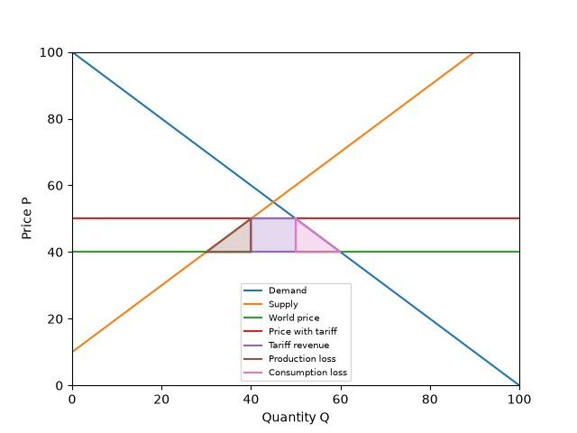
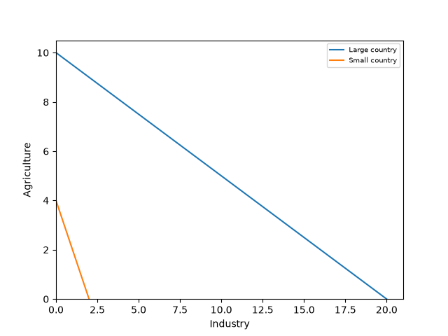

# 第 10 章: 国際貿易と比較優位

## 10.1 この章の地図

前の章の余剰分析を、**国際貿易**に使います。**小国**（世界価格を、与えられたものとして受け入れる国）を考えます。国内の価格は、**世界価格**に、等しくなり、国内の需要量と供給量の**差**が、輸入（または輸出）になります。

- 世界価格が、国内の均衡価格より**低い**: **輸入国**。消費者余剰が増え、生産者余剰が減る
- 世界価格が、国内の均衡価格より**高い**: **輸出国**。生産者余剰が増え、消費者余剰が減る
- どちらの場合も、**総余剰は増える**（得をする人が、損をする人の損を、上回る）

**関税**（輸入にかける税）は、国内価格を上げ、輸入を減らし、**死荷重の三角形を 2 つ**生みます。後半では、なぜ貿易が得になるかを、**比較優位**で説明します。この章は、第 3 部の最後で、**到達チェック**も行います。



| 項目 | 内容 |
| :--- | :--- |
| 経済学の題材 | 小国の自由貿易（輸入国・輸出国）、関税と死荷重（三角形が 2 つ）、絶対優位・比較優位・生産可能性フロンティア・貿易の利益 |
| 使う Python の機能 | `dataclass`（`frozen=True`、`@property`、`replace`）、タプル、関数、テスト（`pytest`） |
| 新しく導入するライブラリ | なし |
| 完成形 | `TradeResult`、`autarky_result`、`free_trade_result`、`gains_from_trade`、`tariff_result`、`tariff_deadweight_loss`、`tariff_losses`、`Country`、`opportunity_cost_of_industry`、`opportunity_cost_of_agriculture`、`absolute_advantage`、`comparative_advantage`、`ppf_endpoints`、`mutually_beneficial_terms`、`trade_gain_per_unit` |
| ファイル | 実装: `lib/chapter10/trade.py`、`lib/chapter10/comparative.py`、`lib/chapter10/plot.py`（図）／テスト: `test/chapter10/test_trade.py`、`test/chapter10/test_comparative.py`、`test/chapter10/test_plot.py`（自分で書くときは、`practice/chapter10/` に、同じ名前で作ります） |
| データ | なし（手計算できる小さな例だけ） |

### 経済学の式とコードの対応

| 経済学 | 式 | コード |
| :--- | :--- | :--- |
| 自由貿易 | 国内価格 = 世界価格。輸入 = 需要量 − 供給量（負なら輸出） | `free_trade_result(market, world_price)` |
| 貿易の利益 | 自由貿易の総余剰 − 閉鎖経済の総余剰 | `gains_from_trade(market, world_price)` |
| 関税 | 国内価格 = 世界価格 + 関税。関税収入 = 関税 × 輸入量 | `tariff_result(market, world_price, tariff)` |
| 関税の死荷重 | 自由貿易の総余剰 − 関税のもとの総余剰（三角形が 2 つ） | `tariff_deadweight_loss`、`tariff_losses` |
| 機会費用 | 工業 1 単位のために、あきらめる農業の量 = 工業の労働 ÷ 農業の労働 | `opportunity_cost_of_industry(country)` |
| 比較優位 | 機会費用が低い国 | `comparative_advantage(a, b, good)` |
| 生産可能性フロンティア | 全部を一方に使った生産量を結ぶ線 | `ppf_endpoints(country, labor)` |

### 前提とする章

| できること | 場所 |
| :--- | :--- |
| 消費者余剰・生産者余剰を求める | この連載の[第 9 章](09-surplus-and-tax.md) |
| 市場均衡を求める | この連載の[第 8 章](08-market-equilibrium-and-adjustment.md) |

## 10.2 準備

```bash
cd apps/micro-basics-programming/python
uv sync
uv run pytest test/chapter10
```

```text
55 passed
```

自分でコードを書くときは、`practice/chapter10/` に、`trade.py`・`comparative.py` と、それぞれのテストを作ります。第 8・9 章の関数は、完成形の `lib/` から import してかまいません（[この記事の読み方](how-to-read.md)を参照）。

## 10.3 予想する

国内の需要が Q = 100 − P、供給が Q = P − 10（閉鎖経済の均衡は P = 55、Q = 45）の小国です。**紙で、手計算で**答えてください。答えは、この節には書いてありません。「プログラミング」の節の「予想の答え合わせ」で、プログラムを動かして確かめます。

- 世界価格が 40 のとき、国内の**需要量・供給量・輸入量**は、いくつですか。消費者余剰・生産者余剰・総余剰は、閉鎖経済（1012.5・1012.5・2025）と比べて、どうなりますか。**貿易の利益**は、いくつですか
- 世界価格が 70 のときは、どうなりますか（輸出量と、貿易の利益）
- 世界価格 40 に、**関税 10** をかけると、国内価格・輸入量・**関税収入**・**死荷重**は、いくつですか。死荷重の 2 つの三角形（生産の歪み・消費の歪み）は、それぞれ、いくつですか
- 大国は工業 1 単位を 4 人、農業 1 単位を 8 人で作れます。小国は工業 20 人、農業 10 人です。**工業の機会費用**（あきらめる農業の量）は、大国と小国で、それぞれ、いくつですか。**比較優位**は、工業・農業の、どちらの財で、どちらの国にありますか。生産可能性フロンティアの両端（大国は労働者 80 人、小国は 40 人）は、どこですか

## 10.4 国際貿易と比較優位の考え方

### 自由貿易（小国）

小国は、世界の市場に比べて小さいので、世界価格を、**変えられません**。国内の価格が、世界価格と違えば、**輸入**や**輸出**が起きて、世界価格に、等しくなります。

| | 輸入国（世界価格 < 国内の均衡価格） | 輸出国（世界価格 > 国内の均衡価格） |
| :--- | :--- | :--- |
| 消費者余剰 | 増える | 減る |
| 生産者余剰 | 減る | 増える |
| 総余剰 | **増える** | **増える** |

輸出入量は、**国内の需要量と供給量の差**です。得をする人が、損をする人の損を上回るので、**補償**すれば、全員が得をできます。

### 関税

**関税**は、輸入にかける税です。国内価格が、**世界価格 + 関税**に上がります。

- 消費者余剰は減り、生産者余剰は増え、**政府が関税収入**を得る
- 総余剰は、自由貿易より減る。その減少が、**死荷重**で、**三角形が 2 つ**
    - **生産の歪み**: 国内価格が上がり、**割高な国内生産**が増える
    - **消費の歪み**: 国内価格が上がり、**消費が減る**
- 関税が大きすぎて、国内価格が、閉鎖経済の価格に達すると、**輸入はなくなり**、貿易の利益は、すべて失われる

### 絶対優位と比較優位

- **絶対優位**: 生産性が**高い**（1 単位に必要な労働が**少ない**）国
- **比較優位**: **機会費用が低い**国（相対的に得意）

**全部の財で、比較優位のある国は、ありません**（一方の機会費用が低ければ、他方の機会費用は高い）。絶対優位は、両方の財にあっても、比較優位は、（機会費用が等しいときを除いて）財ごとに分かれます。各国が、**比較優位のある財に特化**して、貿易すると、**両国が得をします**（リカード）。

## 10.5 プログラミング

### Red: 閉鎖経済と自由貿易のテスト

最初のテストを書きます。閉鎖経済では、輸入は 0 で、総余剰は 2025 です。世界価格 40 では、需要 60・供給 30 で、輸入 30 です。

```python
import pytest

from lib.chapter08.market import LinearMarket
from lib.chapter09.surplus import consumer_surplus, producer_surplus
from lib.chapter10.trade import (
    autarky_result,
    free_trade_result,
    gains_from_trade,
    tariff_deadweight_loss,
    tariff_losses,
    tariff_result,
)
```

```python
MARKET = LinearMarket(100, -1, -10, 1)


def test_閉鎖経済の結果() -> None:
    result = autarky_result(MARKET)
    assert result.domestic_price == 55
    assert result.quantity_demanded == 45
    assert result.quantity_supplied == 45
    assert result.net_imports == 0
    assert result.total_surplus == 2025


def test_世界価格が低ければ輸入国() -> None:
    result = free_trade_result(MARKET, 40)
    assert result.domestic_price == 40
    assert result.quantity_demanded == 60
    assert result.quantity_supplied == 30
    assert result.net_imports == 30


def test_輸入国では消費者余剰が増え生産者余剰が減る() -> None:
    result = free_trade_result(MARKET, 40)
    assert result.consumer_surplus == pytest.approx(1800)
    assert result.producer_surplus == pytest.approx(450)
    assert result.consumer_surplus > consumer_surplus(MARKET, 55)
    assert result.producer_surplus < producer_surplus(MARKET, 55)


def test_輸入国でも総余剰は増える() -> None:
    assert free_trade_result(MARKET, 40).total_surplus == pytest.approx(2250)
    assert gains_from_trade(MARKET, 40) == pytest.approx(225)


def test_輸出国では生産者余剰が増え消費者余剰が減る() -> None:
    result = free_trade_result(MARKET, 70)
    assert result.consumer_surplus == pytest.approx(450)
    assert result.producer_surplus == pytest.approx(1800)
    assert result.consumer_surplus < consumer_surplus(MARKET, 55)
    assert result.producer_surplus > producer_surplus(MARKET, 55)
```

`free_trade_result` などがまだないので、テストは失敗します（**Red**）。

テストの import は、書いた関数だけを、1 つずつ足してかまいません（[第 5 章](05-cost-curves.md)の注意を参照）。

### Green: 自由貿易を実装する

結果は、`TradeResult`（`frozen=True` の `dataclass`）にまとめます。国内価格・需要量・供給量・輸入（負なら輸出）・消費者余剰・生産者余剰・関税収入を持ち、**総余剰**は、`@property` で、3 つの和です。

```python
@dataclass(frozen=True)
class TradeResult:
    """ある国内価格のもとの、需要・供給・輸入（負なら輸出）と、余剰。"""

    domestic_price: float
    quantity_demanded: float
    quantity_supplied: float
    net_imports: float
    consumer_surplus: float
    producer_surplus: float
    tariff_revenue: float

    @property
    def total_surplus(self) -> float:
        """総余剰 = 消費者余剰 + 生産者余剰 + 関税収入。"""
        return self.consumer_surplus + self.producer_surplus + self.tariff_revenue


def _result(market: LinearMarket, price: float) -> TradeResult:
    demanded = quantity_demanded(market, price)
    supplied = quantity_supplied(market, price)
    return TradeResult(
        price,
        demanded,
        supplied,
        demanded - supplied,
        consumer_surplus(market, price),
        producer_surplus(market, price),
        0.0,
    )


def autarky_result(market: LinearMarket) -> TradeResult:
    """閉鎖経済（貿易なし）の結果。国内の均衡で、輸入は 0。"""
    price, _ = equilibrium(market)
    return _result(market, price)


def free_trade_result(market: LinearMarket, world_price: float) -> TradeResult:
    """自由貿易の結果。国内価格 = 世界価格。輸入 = 需要量 − 供給量（負なら輸出）。"""
    validate_positive(world_price, "世界価格は、正にする")
    return _result(market, world_price)


def gains_from_trade(market: LinearMarket, world_price: float) -> float:
    """貿易の利益 = 自由貿易の総余剰 − 閉鎖経済の総余剰。輸入国でも輸出国でも、正。"""
    return (
        free_trade_result(market, world_price).total_surplus
        - autarky_result(market).total_surplus
    )
```

??? note "import と補助関数（写すときに足す）"

    記事の抜粋には、import と、先頭が `_` の補助関数・定数を、省いています。完成形のファイルの先頭にある、次の部分を、写してください。

    **lib/chapter10/comparative.py**

    ```python
    from dataclasses import dataclass
    ```

    ```python
    from lib.chapter01.validation import validate_positive
    ```

    ```python
    _GOODS = ("industry", "agriculture")
    ```

    ```python
    def _check_good(good: str) -> None:
        if good not in _GOODS:
            raise ValueError("財は、industry か agriculture にする")
    ```

    ```python
    def _labor(country: Country, good: str) -> float:
        _check_good(good)
        return country.labor_industry if good == "industry" else country.labor_agriculture
    ```

    ```python
    def _cost(country: Country, good: str) -> float:
        _check_good(good)
        if good == "industry":
            return opportunity_cost_of_industry(country)
        return opportunity_cost_of_agriculture(country)
    ```

    **lib/chapter10/plot.py**

    ```python
    import matplotlib.pyplot as plt
    from matplotlib.figure import Figure
    ```

    ```python
    from lib.chapter08.market import LinearMarket
    from lib.chapter08.plot import draw_curves
    from lib.chapter09.plot import outline_area
    from lib.chapter10.comparative import Country, ppf_endpoints
    from lib.chapter10.trade import free_trade_result, tariff_result
    ```

    **lib/chapter10/trade.py**

    ```python
    from dataclasses import dataclass, replace
    ```

    ```python
    from lib.chapter01.validation import validate_non_negative, validate_positive
    from lib.chapter08.market import (
        LinearMarket,
        equilibrium,
        quantity_demanded,
        quantity_supplied,
    )
    from lib.chapter09.surplus import consumer_surplus, producer_surplus
    ```

    ```python
    def _result(market: LinearMarket, price: float) -> TradeResult:
        demanded = quantity_demanded(market, price)
        supplied = quantity_supplied(market, price)
        return TradeResult(
            price,
            demanded,
            supplied,
            demanded - supplied,
            consumer_surplus(market, price),
            producer_surplus(market, price),
            0.0,
        )
    ```

    **test/chapter10/test_plot.py**

    ```python
    from collections.abc import Sequence
    from typing import cast
    ```

    ```python
    import pytest
    from matplotlib.axes import Axes
    from matplotlib.lines import Line2D
    ```

    ```python
    from lib.chapter08.market import LinearMarket
    from lib.chapter10.comparative import Country
    from lib.chapter10.plot import plot_ppf, plot_tariff
    ```

世界価格 40 では、消費者余剰が 1800（閉鎖経済の 1012.5 より増）、生産者余剰が 450（1012.5 より減）、総余剰が 2250 です。貿易の利益は、2250 − 2025 = **225** です。世界価格 70（輸出国）でも、貿易の利益は 225 で、消費者余剰と生産者余剰の**増減が逆**になります。

### 関税

```python
def test_関税のもとの国内価格は世界価格に関税を足した値() -> None:
    result = tariff_result(MARKET, 40, 10)
    assert result.domestic_price == 50
    assert result.quantity_demanded == 50
    assert result.quantity_supplied == 40
    assert result.net_imports == 10


def test_関税は消費者余剰を減らし生産者余剰を増やす() -> None:
    free, tariff = free_trade_result(MARKET, 40), tariff_result(MARKET, 40, 10)
    assert tariff.consumer_surplus == pytest.approx(1250)
    assert tariff.producer_surplus == pytest.approx(800)
    assert tariff.consumer_surplus < free.consumer_surplus
    assert tariff.producer_surplus > free.producer_surplus


def test_関税収入は関税かける輸入量() -> None:
    assert tariff_result(MARKET, 40, 10).tariff_revenue == pytest.approx(100)


def test_関税の死荷重は自由貿易との差で三角形が2つ() -> None:
    assert tariff_deadweight_loss(MARKET, 40, 10) == pytest.approx(100)
    production, consumption = tariff_losses(MARKET, 40, 10)
    assert production == pytest.approx(50)
    assert consumption == pytest.approx(50)
    assert production + consumption == pytest.approx(
        tariff_deadweight_loss(MARKET, 40, 10)
    )
```

```python
def tariff_result(
    market: LinearMarket, world_price: float, tariff: float
) -> TradeResult:
    """関税（輸入 1 単位あたり tariff 円）のもとの結果。輸入国だけが対象。

    国内価格は、世界価格 + 関税。ただし、閉鎖経済の均衡価格を超えない
    （超えれば、輸入がなくなる）。
    """
    validate_positive(world_price, "世界価格は、正にする")
    validate_non_negative(tariff, "関税は、0 以上にする")
    autarky_price, _ = equilibrium(market)
    if world_price >= autarky_price:
        raise ValueError(
            "関税がかかるのは、輸入国だけ（世界価格が、閉鎖経済の価格より低い）"
        )
    result = _result(market, min(world_price + tariff, autarky_price))
    return replace(result, tariff_revenue=tariff * result.net_imports)


def tariff_deadweight_loss(
    market: LinearMarket, world_price: float, tariff: float
) -> float:
    """関税の死荷重 = 自由貿易の総余剰 − 関税のもとの総余剰。"""
    return (
        free_trade_result(market, world_price).total_surplus
        - tariff_result(market, world_price, tariff).total_surplus
    )


def tariff_losses(
    market: LinearMarket, world_price: float, tariff: float
) -> tuple[float, float]:
    """関税の死荷重の、2 つの三角形 (生産の歪み, 消費の歪み)。

    生産の歪み: 国内価格が上がり、割高な国内生産が増える。消費の歪み: 消費が減る。
    """
    free = free_trade_result(market, world_price)
    taxed = tariff_result(market, world_price, tariff)
    rise = taxed.domestic_price - world_price
    production = 0.5 * rise * (taxed.quantity_supplied - free.quantity_supplied)
    consumption = 0.5 * rise * (free.quantity_demanded - taxed.quantity_demanded)
    return production, consumption
```

世界価格 40・関税 10 では、国内価格が 50、需要 50・供給 40・輸入 10、関税収入は 10 × 10 = 100 です。死荷重は、2250 − 2150 = **100**。2 つの三角形は、生産の歪みが ½ × 10 × (40 − 30) = 50、消費の歪みが ½ × 10 × (60 − 50) = 50 です。関税は、**輸入国だけ**に、かかります（輸出国に、関税をかけようとすれば、エラー）。

```python
def test_関税が大きいほど死荷重は大きい() -> None:
    losses = [tariff_deadweight_loss(MARKET, 40, t) for t in (0, 5, 10, 15)]
    assert losses == pytest.approx([0, 25, 100, 225])


def test_関税が輸入をなくすほど大きければ閉鎖経済と同じ() -> None:
    result = tariff_result(MARKET, 40, 15)
    assert result.domestic_price == pytest.approx(55)
    assert result.net_imports == pytest.approx(0)
    big = tariff_result(MARKET, 40, 30)
    assert big.domestic_price == pytest.approx(55)
    assert big.tariff_revenue == 0
    assert big.total_surplus == pytest.approx(2025)


def test_関税は輸入国だけにかかる() -> None:
    with pytest.raises(ValueError, match="輸入"):
        tariff_result(MARKET, 70, 10)
    with pytest.raises(ValueError, match="輸入"):
        tariff_result(MARKET, 55, 10)
```

関税 0・5・10・15 の死荷重は、0・25・100・225 と、**関税の 2 乗に比例して、増えます**。関税が 15 に達すると、国内価格が、閉鎖経済の 55 に達して、輸入がなくなり、死荷重 225 は、**貿易の利益と、等しくなります**（それ以上の関税でも、国内価格は 55 のまま）。

### 絶対優位と比較優位

国の技術は、1 単位に必要な労働者の数で、表します。機会費用は、2 つの財の労働の**比**です。

この節のテストの import は、次のとおりです（`test_comparative.py` の先頭）。

```python
import pytest

from lib.chapter10.comparative import (
    Country,
    absolute_advantage,
    comparative_advantage,
    mutually_beneficial_terms,
    opportunity_cost_of_agriculture,
    opportunity_cost_of_industry,
    ppf_endpoints,
    trade_gain_per_unit,
)
```

```python
LARGE = Country("Large", labor_industry=4, labor_agriculture=8)


SMALL = Country("Small", labor_industry=20, labor_agriculture=10)


def test_工業の機会費用は農業の何単位をあきらめるか() -> None:
    assert opportunity_cost_of_industry(LARGE) == 0.5
    assert opportunity_cost_of_industry(SMALL) == 2.0


def test_農業の機会費用は工業の何単位をあきらめるか() -> None:
    assert opportunity_cost_of_agriculture(LARGE) == 2.0
    assert opportunity_cost_of_agriculture(SMALL) == 0.5


def test_大国は両方の財で絶対優位() -> None:
    assert absolute_advantage(LARGE, SMALL, "industry") == "Large"
    assert absolute_advantage(LARGE, SMALL, "agriculture") == "Large"


def test_比較優位は機会費用が低い国() -> None:
    assert comparative_advantage(LARGE, SMALL, "industry") == "Large"
    assert comparative_advantage(LARGE, SMALL, "agriculture") == "Small"


def test_全部の財で比較優位のある国はない() -> None:
    winners = {
        comparative_advantage(LARGE, SMALL, "industry"),
        comparative_advantage(LARGE, SMALL, "agriculture"),
    }
    assert winners == {"Large", "Small"}
```

```python
_GOODS = ("industry", "agriculture")


@dataclass(frozen=True)
class Country:
    """国の技術。工業・農業の、1 単位あたりの必要な労働者数（人）。"""

    name: str
    labor_industry: float
    labor_agriculture: float

    def __post_init__(self) -> None:
        validate_positive(self.labor_industry, "工業 1 単位に必要な労働は、正にする")
        validate_positive(self.labor_agriculture, "農業 1 単位に必要な労働は、正にする")


def _check_good(good: str) -> None:
    if good not in _GOODS:
        raise ValueError("財は、industry か agriculture にする")


def opportunity_cost_of_industry(country: Country) -> float:
    """工業 1 単位を作るために、あきらめる農業の量。"""
    return country.labor_industry / country.labor_agriculture


def opportunity_cost_of_agriculture(country: Country) -> float:
    """農業 1 単位を作るために、あきらめる工業の量。"""
    return country.labor_agriculture / country.labor_industry


def _labor(country: Country, good: str) -> float:
    _check_good(good)
    return country.labor_industry if good == "industry" else country.labor_agriculture


def _cost(country: Country, good: str) -> float:
    _check_good(good)
    if good == "industry":
        return opportunity_cost_of_industry(country)
    return opportunity_cost_of_agriculture(country)


def absolute_advantage(a: Country, b: Country, good: str) -> str | None:
    """財 good の、絶対優位のある国の名前。必要な労働が同じなら、None。"""
    if _labor(a, good) == _labor(b, good):
        return None
    return a.name if _labor(a, good) < _labor(b, good) else b.name


def comparative_advantage(a: Country, b: Country, good: str) -> str | None:
    """財 good の、比較優位のある国の名前。機会費用が同じなら、None。"""
    if _cost(a, good) == _cost(b, good):
        return None
    return a.name if _cost(a, good) < _cost(b, good) else b.name
```

大国は、工業も農業も、少ない労働で作れる（**両方で絶対優位**）のに、比較優位は、**工業だけ**にあります（工業の機会費用 0.5 < 小国の 2.0）。農業の比較優位は、小国にあります（機会費用 0.5 < 2.0）。

### 生産可能性フロンティアと貿易の利益

**生産可能性フロンティア**は、労働を全部使ったとき、作れる 2 財の組み合わせの境界です。両端は、全部を工業に使った量と、全部を農業に使った量で、**傾きの大きさが、機会費用**です。

```python
def test_生産可能性フロンティアの両端() -> None:
    assert ppf_endpoints(LARGE, 80) == ((20, 0), (0, 10))
    assert ppf_endpoints(SMALL, 40) == ((2, 0), (0, 4))


def test_貿易の条件は2国の機会費用の間() -> None:
    assert mutually_beneficial_terms(LARGE, SMALL) == (0.5, 2.0)
    assert mutually_beneficial_terms(SMALL, LARGE) == (0.5, 2.0)


def test_交換比率が範囲の内側なら両国が得をする() -> None:
    # 工業 1 単位と農業 1 単位を交換する（交換比率 1）
    assert trade_gain_per_unit(opportunity_cost_of_industry(LARGE), 1) == 0.5
    assert trade_gain_per_unit(opportunity_cost_of_agriculture(SMALL), 1 / 1) == 0.5


def test_交換比率が範囲の外なら一方が損をする() -> None:
    assert trade_gain_per_unit(opportunity_cost_of_industry(LARGE), 0.4) < 0
    assert trade_gain_per_unit(opportunity_cost_of_agriculture(SMALL), 0.4) < 0


def test_特化して貿易すると世界全体の価値が増える() -> None:
    # 交換比率 1（工業 1 = 農業 1）で、世界の生産の価値を比べる。大国 80 人、小国 40 人
    def value(industry: float, agriculture: float) -> float:
        return industry + agriculture

    before = value(80 / 2 / 4 + 40 / 2 / 20, 80 / 2 / 8 + 40 / 2 / 10)
    large_industry = ppf_endpoints(LARGE, 80)[0][0]
    small_agriculture = ppf_endpoints(SMALL, 40)[1][1]
    after = value(large_industry, small_agriculture)
    assert before == 18
    assert after == 24
    assert after > before
```

```python
def ppf_endpoints(
    country: Country, labor: float
) -> tuple[tuple[float, float], tuple[float, float]]:
    """生産可能性フロンティアの両端 ((工業の最大, 0), (0, 農業の最大))。

    傾きの大きさは、工業の機会費用。
    """
    validate_positive(labor, "労働量は、正にする")
    return (labor / country.labor_industry, 0.0), (
        0.0,
        labor / country.labor_agriculture,
    )


def mutually_beneficial_terms(a: Country, b: Country) -> tuple[float, float]:
    """両国が得をする、交換比率（工業 1 単位と交換する農業の量）の範囲 (下限, 上限)。

    2 国の、工業の機会費用の間にある。範囲の外では、一方の国が、損をする。
    """
    costs = (opportunity_cost_of_industry(a), opportunity_cost_of_industry(b))
    return min(costs), max(costs)


def trade_gain_per_unit(own_opportunity_cost: float, terms_of_trade: float) -> float:
    """輸出する財 1 単位あたりの利益 = 交換で得られる量 − 自国で作るときの機会費用。"""
    return terms_of_trade - own_opportunity_cost
```

両国が得をする**交換比率**（工業 1 単位と交換する農業の量）は、**2 国の機会費用の間**（0.5 〜 2.0）です。範囲の外では、一方が、自国で作るより、損をします。大国が工業に、小国が農業に**特化**すると、世界の生産の価値（交換比率 1 で、工業 + 農業）は、18 から 24 に増えます（最後のテスト）。

### 予想の答え合わせ

予想した答えを、プログラムで確かめます。

> このスクリプトは、**完成形**（`lib/`）を読みます。**自分のコードで確かめる**ときは、import を、`from practice.chapterNN...` に書き換えてください。

```python
from lib.chapter08.market import LinearMarket
from lib.chapter10.comparative import (
    Country,
    comparative_advantage,
    mutually_beneficial_terms,
    opportunity_cost_of_agriculture,
    opportunity_cost_of_industry,
    ppf_endpoints,
)
from lib.chapter10.trade import (
    free_trade_result,
    gains_from_trade,
    tariff_deadweight_loss,
    tariff_losses,
    tariff_result,
)

market = LinearMarket(demand_intercept=100, demand_slope=-1, supply_intercept=-10, supply_slope=1)
for world_price in (40, 70):
    r = free_trade_result(market, world_price)
    print("世界価格", world_price, ": 需要", r.quantity_demanded, "供給", r.quantity_supplied, "輸入", r.net_imports)
    print("  消費者余剰", r.consumer_surplus, "生産者余剰", r.producer_surplus, "総余剰", r.total_surplus, "貿易の利益", round(gains_from_trade(market, world_price), 4))
t = tariff_result(market, 40, 10)
print("関税 10: 国内価格", t.domestic_price, "輸入", t.net_imports, "関税収入", t.tariff_revenue)
print("死荷重:", round(tariff_deadweight_loss(market, 40, 10), 4), "三角形:", tariff_losses(market, 40, 10))
large, small = Country("Large", 4, 8), Country("Small", 20, 10)
print("工業の機会費用 大国・小国:", opportunity_cost_of_industry(large), opportunity_cost_of_industry(small))
print("農業の機会費用 大国・小国:", opportunity_cost_of_agriculture(large), opportunity_cost_of_agriculture(small))
print("比較優位 工業・農業:", comparative_advantage(large, small, "industry"), comparative_advantage(large, small, "agriculture"))
print("フロンティアの両端 大国 80 人・小国 40 人:", ppf_endpoints(large, 80), ppf_endpoints(small, 40))
print("両国が得をする交換比率の範囲:", mutually_beneficial_terms(large, small))
```

```text
世界価格 40 : 需要 60 供給 30 輸入 30
  消費者余剰 1800.0 生産者余剰 450.0 総余剰 2250.0 貿易の利益 225.0
世界価格 70 : 需要 30 供給 60 輸入 -30
  消費者余剰 450.0 生産者余剰 1800.0 総余剰 2250.0 貿易の利益 225.0
関税 10: 国内価格 50 輸入 10 関税収入 100
死荷重: 100.0 三角形: (50.0, 50.0)
工業の機会費用 大国・小国: 0.5 2.0
農業の機会費用 大国・小国: 2.0 0.5
比較優位 工業・農業: Large Small
フロンティアの両端 大国 80 人・小国 40 人: ((20.0, 0.0), (0.0, 10.0)) ((2.0, 0.0), (0.0, 4.0))
両国が得をする交換比率の範囲: (0.5, 2.0)
```

- **1 つ目の問い**: 世界価格 40 では、需要 60・供給 30・輸入 30 です。消費者余剰は 1800（増）、生産者余剰は 450（減）、総余剰は 2250 で、貿易の利益は 225 です
- **2 つ目の問い**: 世界価格 70 では、需要 30・供給 60 で、輸出が 30 です。消費者余剰は 450（減）、生産者余剰は 1800（増）で、貿易の利益は、同じく 225 です
- **3 つ目の問い**: 関税 10 では、国内価格 50、輸入 10、関税収入 100、死荷重 100（生産の歪み 50 + 消費の歪み 50）です
- **4 つ目の問い**: 工業の機会費用は、大国 0.5・小国 2.0（農業は、大国 2.0・小国 0.5）です。比較優位は、**工業が大国、農業が小国**にあります。フロンティアの両端は、大国が (工業 20, 0)・(0, 農業 10)、小国が (2, 0)・(0, 4) です。両国が得をする交換比率は、0.5 から 2.0 の間です

### 図

関税の図と、座標のテストです。国内価格の線が、世界価格より 10 高いこと、関税収入の長方形の面積が 100、2 つの死荷重の三角形が、それぞれ 50 であることを、確かめます。

??? note "描画のテストと実装（後回しにしても、学習は成り立ちます）"

    ```python
    MARKET = LinearMarket(100, -1, -10, 1)


    LARGE = Country("Large", 4, 8)


    SMALL = Country("Small", 20, 10)


    def xs(line: Line2D) -> list[float]:
        return [float(v) for v in cast(Sequence[float], line.get_xdata())]


    def ys(line: Line2D) -> list[float]:
        return [float(v) for v in cast(Sequence[float], line.get_ydata())]


    def line(ax: Axes, label: str) -> Line2D:
        return next(item for item in ax.lines if item.get_label() == label)


    def area(item: Line2D) -> float:
        """閉じた折れ線の面積（靴ひも公式）。"""
        x, y = xs(item), ys(item)
        total = sum(x[i] * y[i + 1] - x[i + 1] * y[i] for i in range(len(x) - 1))
        return abs(total) / 2


    def tariff() -> Axes:
        return plot_tariff(MARKET, 40, 10, 100, 100).axes[0]


    def test_関税の図の線() -> None:
        assert [item.get_label() for item in tariff().lines] == [
            "Demand",
            "Supply",
            "World price",
            "Price with tariff",
            "Tariff revenue",
            "Production loss",
            "Consumption loss",
        ]


    def test_関税収入の長方形の面積は関税収入() -> None:
        item = line(tariff(), "Tariff revenue")
        assert area(item) == pytest.approx(100)
        assert sorted(set(xs(item))) == [40, 50]


    def test_2つの死荷重の三角形の面積はそれぞれ50() -> None:
        ax = tariff()
        assert area(line(ax, "Production loss")) == pytest.approx(50)
        assert area(line(ax, "Consumption loss")) == pytest.approx(50)
    ```

    ```python
    def plot_tariff(
        market: LinearMarket,
        world_price: float,
        tariff: float,
        q_max: float,
        p_max: float,
    ) -> Figure:
        """関税による、国内価格の上昇と、関税収入の長方形・死荷重の 2 つの三角形を描く。"""
        free = free_trade_result(market, world_price)
        taxed = tariff_result(market, world_price, tariff)
        price = taxed.domestic_price
        fig, ax = plt.subplots()
        draw_curves(ax, market, p_max)
        ax.plot([0, q_max], [world_price, world_price], label="World price")
        ax.plot([0, q_max], [price, price], label="Price with tariff")
        supplied, demanded = taxed.quantity_supplied, taxed.quantity_demanded
        outline_area(
            ax,
            [supplied, demanded, demanded, supplied, supplied],
            [price, price, world_price, world_price, price],
            "Tariff revenue",
        )
        outline_area(
            ax,
            [free.quantity_supplied, supplied, supplied, free.quantity_supplied],
            [world_price, world_price, price, world_price],
            "Production loss",
        )
        outline_area(
            ax,
            [demanded, demanded, free.quantity_demanded, demanded],
            [price, world_price, world_price, price],
            "Consumption loss",
        )
        ax.set_xlabel("Quantity Q")
        ax.set_ylabel("Price P")
        ax.set_xlim(0, q_max)
        ax.set_ylim(0, p_max)
        ax.legend(fontsize="x-small")
        plt.close(fig)
        return fig
    ```

2 国の生産可能性フロンティアです。傾きの大きさ（機会費用）が違うので、比較優位が分かれます。



??? note "描画のテストと実装（後回しにしても、学習は成り立ちます）"

    ```python
    def ppf() -> Axes:
        return plot_ppf(LARGE, 80, SMALL, 40).axes[0]


    def test_生産可能性フロンティアの図の線() -> None:
        assert [item.get_label() for item in ppf().lines] == ["Large", "Small"]


    def test_傾きの大きさは工業の機会費用() -> None:
        ax = ppf()
        for label, cost in (("Large", 0.5), ("Small", 2.0)):
            item = line(ax, label)
            assert (ys(item)[1] - ys(item)[0]) / (xs(item)[0] - xs(item)[1]) == cost
    ```

    ```python
    def plot_ppf(a: Country, labor_a: float, b: Country, labor_b: float) -> Figure:
        """2 国の生産可能性フロンティア。傾きの大きさ（機会費用）が違う。"""
        fig, ax = plt.subplots()
        for country, labor in ((a, labor_a), (b, labor_b)):
            (industry, _), (_, agriculture) = ppf_endpoints(country, labor)
            ax.plot([industry, 0], [0, agriculture], label=country.name)
        ax.set_xlabel("Industry")
        ax.set_ylabel("Agriculture")
        ax.set_xlim(left=0)
        ax.set_ylim(bottom=0)
        ax.legend(fontsize="x-small")
        plt.close(fig)
        return fig
    ```

### 実行結果

```bash
uv run pytest test/chapter10
```

```text
55 passed
```

## 10.6 規則で言うと

1. **自由貿易は、輸入国でも輸出国でも、総余剰を増やす。** ただし、得をする人と、損をする人が、分かれる
2. **関税は、死荷重の三角形を 2 つ生む。** 生産の歪みと、消費の歪みで、関税の 2 乗に比例して増える
3. **比較優位に従って、特化して貿易すると、両国が得をする。** 全部の財で、比較優位のある国は、ない

混同しやすい点を、表にまとめます。

| 混同しやすい点 | 違い |
| :--- | :--- |
| 絶対優位と、比較優位 | 絶対優位は、**生産性そのもの**（少ない労働で作れる）。比較優位は、**機会費用**（相対的に得意）。絶対優位が、両方の財にあっても、比較優位は、財ごとに分かれる |
| 関税収入と、死荷重 | 関税収入は、政府に**移る**。死荷重は、誰の得にもならない損失（2 つの三角形） |
| 輸入国と輸出国 | 世界価格が、国内の均衡価格より、低ければ輸入国（消費者が得）、高ければ輸出国（生産者が得）。どちらも、総余剰は増える |
| 貿易の利益と、全員の利益 | 貿易の利益は、**総余剰**が増えること。生産者余剰が減る人（輸入国の生産者）は、損をする。**補償**が、必要 |

### このモデルが成り立たない場面

- **小国の仮定です。** 大国が関税をかけると、世界価格が下がり、**交易条件**が改善して、関税が、得になる場合があります（最適関税）
- **労働だけが、生産要素です（リカードのモデル）。** 実際は、資本や技術の違いも、比較優位を決めます
- **輸送費・貿易の障壁・為替を、考えていません。**
- **特化すると、産業が移る費用が、かかります。** 失業した労働者への、補償や再訓練が、必要です

## 10.7 第 3 部の到達チェック

第 3 部（第 8〜10 章）の終わりです。何も見ずに、できるかどうかを、自分で確かめます。**先に、次の「時間を決めて書く課題」を、何も見ずに試してください。** そのあとで、「値の確かめ」と「できること」で、答えを見ます。

### 時間を決めて書く課題

何も見ずに、時間を計って、関数とテストを書きます。課題 1〜4 の市場は、需要 Q = 100 − P、供給 Q = P − 10 です（課税は、売り手にかけます）。

| 課題 | 目安の時間 |
| :--- | :--- |
| 需要 Q = 100 − P、供給 Q = P − 10 の均衡と、消費者余剰・生産者余剰・総余剰を返す関数と、テスト | 15 分 |
| 従量税 9 の、買い手の価格・売り手の手取り・数量・税収・死荷重を返す関数と、テスト | 20 分 |
| 世界価格 40 の輸入量と、貿易の利益（自由貿易の総余剰 − 閉鎖経済の総余剰）を返す関数と、テスト | 15 分 |
| 関税 10（世界価格 40）の、国内価格・輸入・関税収入・死荷重を返す関数と、テスト | 15 分 |
| 大国（工業 1 単位に 4 人・農業 1 単位に 8 人）・小国（工業 20 人・農業 10 人）の、工業の機会費用と、比較優位のある国を返す関数と、テスト | 15 分 |

### 値の確かめ

到達チェックの値を、プログラムで確かめます。各章の関数を、そのまま呼びます。

「値の確かめ」のスクリプトは、`practice/chapter10/reach.py` に保存し（10 は、この章の番号）、`uv run python -m practice.chapter10.reach` で実行します。

```python
from lib.chapter08.market import LinearMarket, equilibrium
from lib.chapter09.surplus import consumer_surplus, producer_surplus, tax_equilibrium
from lib.chapter10.comparative import Country, comparative_advantage
from lib.chapter10.trade import gains_from_trade, tariff_deadweight_loss, tariff_result

market = LinearMarket(demand_intercept=100, demand_slope=-1, supply_intercept=-10, supply_slope=1)
price, quantity = equilibrium(market)
print("均衡 (P, Q):", (price, quantity))
print("総余剰:", consumer_surplus(market, price) + producer_surplus(market, price))
r = tax_equilibrium(market, 9)
print("従量税 9: 数量", round(r.quantity, 4), "税収", round(r.tax_revenue, 4), "死荷重", round(r.deadweight_loss, 4))
print("貿易の利益 (世界価格 40):", round(gains_from_trade(market, 40), 4))
t = tariff_result(market, 40, 10)
print("関税 10: 輸入", t.net_imports, "関税収入", t.tariff_revenue, "死荷重", round(tariff_deadweight_loss(market, 40, 10), 4))
large, small = Country("Large", 4, 8), Country("Small", 20, 10)
print("比較優位 工業・農業:", comparative_advantage(large, small, "industry"), comparative_advantage(large, small, "agriculture"))
```

```text
均衡 (P, Q): (55.0, 45.0)
総余剰: 2025.0
従量税 9: 数量 40.5 税収 364.5 死荷重 20.25
貿易の利益 (世界価格 40): 225.0
関税 10: 輸入 10 関税収入 100 死荷重 100.0
比較優位 工業・農業: Large Small
```

### できること

| できること | 検証の方法 | 戻る章 |
| :--- | :--- | :--- |
| 市場均衡を求め、調整とシフトを言う | 均衡 (55, 45)。需要が右へ 20 動くと (65, 55)。ワルラス的調整は差が半分ずつ縮む | [第 8 章](08-market-equilibrium-and-adjustment.md) |
| 余剰を計算し、総余剰が均衡で最大であることを言う | 消費者余剰 1012.5、生産者余剰 1012.5、総余剰 2025。数量 30・60 の死荷重は 225 | [第 9 章](09-surplus-and-tax.md) |
| 従量税の効果と死荷重を求める | 税 9 で、数量 40.5、税収 364.5、死荷重 20.25。弾力性の小さい側が、多く負担する | 第 9 章 |
| 自由貿易の利益を求める | 世界価格 40 で、輸入 30、貿易の利益 225（輸出国も同じ） | [この章](10-trade-and-comparative-advantage.md) |
| 関税の死荷重を求める | 関税 10 で、輸入 10、関税収入 100、死荷重 100（三角形が 2 つ） | この章 |
| 比較優位を見分ける | 工業は大国（機会費用 0.5 < 2.0）、農業は小国（0.5 < 2.0） | この章 |

### 誤りの原因の分類

できなかった課題は、原因を、次の 4 つに分けて、記録します。

| 分類 | 例 | 対策 |
| :--- | :--- | :--- |
| 知識の不足 | 関税の死荷重が、三角形 2 つであることを忘れた／比較優位と絶対優位を、混ぜた | 「規則で言うと」の混同の表を、読み直す |
| 式の取り違え | 課税後の価格を、供給側の手取りと、取り違えた（P_d と P_s） | 式とコードの対応表を、書き写す。P_d − P_s = 税額を、確かめる |
| 手順の誤り | 税収を、課税前の数量で計算した（課税後の数量を使う） | 税収 = 税額 × **課税後**の数量と、書いておく |
| 不注意 | 輸入と輸出の符号（負なら輸出）や、世界価格の高低を、見間違えた | 世界価格と均衡価格の、どちらが高いかを、先に書く |

## 10.8 練習問題

| 種類 | 問題 |
| :--- | :--- |
| 想起 | 本文を閉じて、`free_trade_result` の最初のテスト（世界価格 40 で、需要 60・供給 30・輸入 30）を書いてください |
| 生成 | 解説を見る前に、**貿易の利益に対する、関税の死荷重の割合**を返す `deadweight_share(market, world_price, tariff)` を、テストから書いてください。関税 10 で 100 ÷ 225、関税 15 で 1 になります |
| 多様 | 世界価格を 40 から 30 に下げます（関税なし）。貿易の利益は、いくつになりますか。先に予想してから、確かめてください |
| 交互 | [第 1 シリーズ](../economics-programming/index.md)の第 3 章のリスト内包表記で、世界価格 20・30・40・50 の、貿易の利益を、一度に求めてください。世界価格が、均衡価格（55）から**離れる**ほど、どうなりますか |

??? note "解答（先に自分で取り組んでから、開いてください）"

    **想起**:

    ```python
    def test_自由貿易の最初のテスト() -> None:
        result = free_trade_result(LinearMarket(100, -1, -10, 1), 40)
        assert (result.quantity_demanded, result.quantity_supplied) == (60, 30)
        assert result.net_imports == 30
    ```

    **生成**: 関税の死荷重を、貿易の利益で割ります。

    ```python
    def deadweight_share(market, world_price, tariff):
        loss = tariff_deadweight_loss(market, world_price, tariff)
        return loss / gains_from_trade(market, world_price)
    ```

    ```python
    def test_死荷重の割合() -> None:
        market = LinearMarket(100, -1, -10, 1)
        assert deadweight_share(market, 40, 10) == pytest.approx(100 / 225)
        assert deadweight_share(market, 40, 15) == pytest.approx(1)
    ```

    **多様**: 世界価格 30 では、需要 70・供給 20 で、貿易の利益は ½ × (70 − 20) × (55 − 30) = **625** です。世界価格が下がるほど、貿易の利益は大きく、**世界価格と国内の均衡価格の差の 2 乗に比例**します（差 15 で 225、差 25 で 625）。

    ```python
    def test_世界価格30の貿易の利益() -> None:
        assert gains_from_trade(LinearMarket(100, -1, -10, 1), 30) == pytest.approx(625)
    ```

    **交互**:

    ```python
    def test_世界価格と貿易の利益() -> None:
        market = LinearMarket(100, -1, -10, 1)
        gains = [gains_from_trade(market, p) for p in (20, 30, 40, 50)]
        assert gains == pytest.approx([1225, 625, 225, 25])
        assert all(a > b for a, b in zip(gains, gains[1:]))
    ```

## 10.9 振り返り

- うまくいったこと:
- 詰まったこと:
- 次に試すこと:

## 10.10 まとめ

- 小国の自由貿易では、国内価格が世界価格に等しくなり、輸入国は消費者余剰が増え生産者余剰が減る（輸出国は逆）。どちらも総余剰は増え、貿易の利益は、世界価格と均衡価格の差の 2 乗に比例する
- 関税は、国内価格を上げ、輸入を減らし、関税収入を生む。死荷重は、生産の歪みと消費の歪みの、三角形 2 つで、関税の 2 乗に比例する。輸入がなくなるまで大きくすると、貿易の利益が、すべて失われる
- 絶対優位は生産性、比較優位は機会費用。全部の財で比較優位のある国は、ない。比較優位に特化して、2 国の機会費用の間の比率で交換すると、両国が得をする
- 第 3 部の到達チェックで、市場均衡・余剰・課税・貿易・比較優位を、何も見ずにできるかを確かめた

第 4 部（第 11〜16 章）では、市場が、**うまくいかない**場合を扱います。次の章では、売り手が価格を決められる**独占**を調べます。限界収入が需要曲線の 2 倍の傾きであること、MR = MC で数量を決めること、そして、完全競争より、価格が高く、数量が少なく、**死荷重**が出ることを、確かめます。
