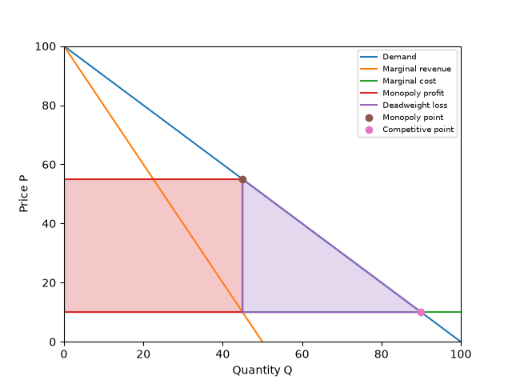
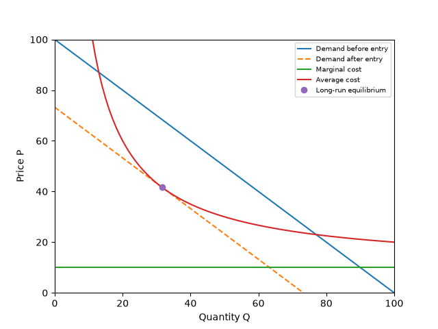
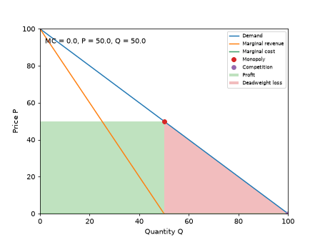

# 第 11 章: 独占と独占的競争

## 11.1 この章の地図

第 3 部までは、売り手も買い手も、価格を**与えられたもの**として行動する完全競争でした。第 4 部は、その前提が崩れる場面を扱います。この章では、売り手が**価格を決められる**場合（**独占**）を調べます。

- 独占企業は、数量を増やすと価格が下がるので、**限界収入 MR は価格より低い**。線形の需要なら、MR の傾きは需要曲線の**2 倍**
- 数量は **MR = MC** で決め、価格は、その数量を買ってもらえる需要曲線の上の価格
- 完全競争（P = MC）に比べて、**価格が高く、数量が少なく、死荷重**が出る
- 製品が少しずつ違う企業が多数いる**独占的競争**では、短期の利潤を見て**新規参入**が起き、需要が左へ動いて、長期には**利潤が 0**になる



| 項目 | 内容 |
| :--- | :--- |
| 経済学の題材 | 限界収入、独占の数量と価格、死荷重、価格弾力性とラーナー指数、独占的競争の長期均衡 |
| 使う Python の機能 | `dataclass`（`frozen=True`、`@property`）、関数、`math.sqrt`、テスト（`pytest`） |
| 新しく導入するライブラリ | なし |
| 完成形 | `Monopoly`、`price_at`、`marginal_revenue`、`monopoly_outcome`、`competitive_outcome`、`deadweight_loss`、`demand_elasticity`、`lerner_index`、`monopolistic_competition_profit`、`long_run_monopolistic_competition` |
| ファイル | 実装: `lib/chapter11/monopoly.py`、`lib/chapter11/plot.py`（図）／テスト: `test/chapter11/test_monopoly.py`、`test/chapter11/test_plot.py`（自分で書くときは、`practice/chapter11/` に、同じ名前で作ります） |
| データ | なし（手計算できる小さな例だけ） |

### 経済学の式とコードの対応

| 経済学 | 式 | コード |
| :--- | :--- | :--- |
| 逆需要 | P = a − b·Q | `price_at(monopoly, quantity)` |
| 限界収入 | MR = a − 2b·Q | `marginal_revenue(monopoly, quantity)` |
| 独占の数量 | MR = MC から Q = (a − c) ÷ 2b | `monopoly_outcome(monopoly)` |
| 完全競争の数量 | P = MC から Q = (a − c) ÷ b | `competitive_outcome(monopoly)` |
| 死荷重 | 完全競争の総余剰 − 独占の総余剰 | `deadweight_loss(monopoly)` |
| 価格弾力性 | e = P ÷ (b·Q) | `demand_elasticity(monopoly, quantity)` |
| ラーナー指数 | (P − MC) ÷ P = 1 ÷ e | `lerner_index(monopoly, price)` |
| 長期均衡 | 需要の切片 a' = c + 2√(b·F) | `long_run_monopolistic_competition(...)` |

> **記号の注意**: この章の `a`・`b`・`c` は、逆需要 P = a − b·Q の切片・傾きと、限界費用です。第 8〜10 章の需要 Q = a + s_d·P（数量を価格で表す式）とは、**式の向きが逆**です（[この記事の読み方](how-to-read.md)を参照）。

### 前提とする章

| できること | 場所 |
| :--- | :--- |
| 完全競争の供給（P = MC）と利潤 | この連載の[第 7 章](07-profit-maximization-and-supply.md) |
| 消費者余剰・総余剰・死荷重 | この連載の[第 9 章](09-surplus-and-tax.md) |

## 11.2 準備

```bash
cd apps/micro-basics-programming/python
uv sync
uv run pytest test/chapter11
```

```text
39 passed
```

自分でコードを書くときは、`practice/chapter11/` に、`monopoly.py` とそのテストを作ります。共通の検証関数（`validate_positive` など）は、第 1 章の完成形から import してかまいません。

## 11.3 予想する

逆需要が P = 100 − Q、限界費用が一定で 10 の、独占企業です。**紙で、手計算で**答えてください。答えは、この節には書いてありません。「プログラミング」の節の「予想の答え合わせ」で、プログラムを動かして確かめます。

- 限界収入 MR は、Q = 0・20・45 で、いくつですか。需要曲線の価格と比べて、どうなりますか
- 独占企業の**数量・価格・利潤**は、いくつですか。完全競争のときの数量・価格は、いくつですか
- 総余剰は、独占と完全競争で、それぞれ、いくつですか。**死荷重**は、いくつですか
- 独占の数量での、需要の**価格弾力性**は、いくつですか（1 より大きいか小さいか）。**ラーナー指数**（P − MC）÷ P は、いくつですか。弾力性と、どんな関係がありますか
- 独占的競争で、固定費用が 1000 のとき、**短期の利潤**は、いくつですか。長期に、新規参入が起きると、需要は**どちらへ**動き、利潤は**いくつ**に落ち着きますか

## 11.4 独占と独占的競争の考え方

### 限界収入

売り手は、数量を 1 単位増やすと、**その 1 単位の価格**を得ますが、**それまでの全部の価格も下がります**。だから、限界収入は、価格より低くなります。逆需要が P = a − b·Q なら、総収入は P·Q = a·Q − b·Q² で、限界収入は MR = a − 2b·Q です。**傾きが、需要曲線の 2 倍**です。

### 独占の決め方

利潤最大の条件は MR = MC です。完全競争の企業は、P = MR なので P = MC でしたが、独占企業は MR が価格より低いので、**P > MC** になります。決めるのは数量で、価格は、その数量を買ってもらえる、需要曲線の上の値です。

### 死荷重

独占の数量は、完全競争より少ないので、**買い手の価値が費用を上回るのに、作られない取引**が出ます。それが死荷重（三角形）です。

### 弾力性とラーナー指数

MR = MC を、P と弾力性 e で書くと、**(P − MC) ÷ P = 1 ÷ e** になります。これが**ラーナー指数**で、独占力（価格の上乗せの割合）を表します。**弾力性が小さいほど、上乗せは大きい**。独占企業は、需要が**弾力的な（e ≥ 1）範囲**でしか、作りません（MR が負にならないため）。

### 独占的競争

製品が少しずつ違う企業が多数いて、**参入が自由**な市場です。各企業は、自分の製品の需要に対して、独占企業のように行動します。短期に**利潤が出れば**新規参入が起き、各企業の需要が**左へ動いて**、長期には**利潤が 0**になります。そのとき、価格は**平均費用に等しく**、かつ**限界費用より高い**（P > MC）ので、完全競争より、数量が少なくなります。

## 11.5 プログラミング

### Red: 逆需要と限界収入のテスト

最初のテストを書きます。逆需要 P = 100 − Q は、Q = 0 で 100、Q = 45 で 55 です。限界収入は、Q = 0 で 100、Q = 45 で 10 で、**傾きが 2 倍**です。

```python
import math

import pytest

from lib.chapter11.monopoly import (
    Monopoly,
    competitive_outcome,
    deadweight_loss,
    demand_elasticity,
    lerner_index,
    long_run_monopolistic_competition,
    marginal_revenue,
    monopolistic_competition_profit,
    monopoly_outcome,
    price_at,
)
```

```python
MONOPOLY = Monopoly(demand_intercept=100, demand_slope=1, marginal_cost=10)


def test_逆需要は数量が増えると価格が下がる() -> None:
    assert price_at(MONOPOLY, 0) == 100
    assert price_at(MONOPOLY, 45) == 55
    assert price_at(MONOPOLY, 100) == 0


def test_需要の範囲外の数量はエラー() -> None:
    with pytest.raises(ValueError, match="数量"):
        price_at(MONOPOLY, -1)
    with pytest.raises(ValueError, match="数量"):
        price_at(MONOPOLY, 101)


def test_限界収入は需要曲線の2倍の傾き() -> None:
    assert marginal_revenue(MONOPOLY, 0) == 100
    assert marginal_revenue(MONOPOLY, 45) == 10
    drop_price = price_at(MONOPOLY, 10) - price_at(MONOPOLY, 20)
    drop_revenue = marginal_revenue(MONOPOLY, 10) - marginal_revenue(MONOPOLY, 20)
    assert drop_revenue == 2 * drop_price


def test_傾きが違う需要の限界収入() -> None:
    steep = Monopoly(demand_intercept=100, demand_slope=2, marginal_cost=10)
    assert marginal_revenue(steep, 10) == 100 - 4 * 10
```

`Monopoly` などがまだないので、テストは失敗します（**Red**）。テストの import は、書いた関数だけを、1 つずつ足してかまいません（[第 5 章](05-cost-curves.md)の注意を参照）。

### Green: 独占を実装する

需要の仮定（傾きは正、限界費用は 0 以上、切片は限界費用より大きい）は、`__post_init__` で、作るときに検査します。

```python
@dataclass(frozen=True)
class Monopoly:
    """逆需要 P = a − b·Q と、一定の限界費用。"""

    demand_intercept: float
    demand_slope: float
    marginal_cost: float

    def __post_init__(self) -> None:
        validate_positive(self.demand_slope, "需要の傾きは、正にする")
        validate_non_negative(self.marginal_cost, "限界費用は、0 以上にする")
        if self.demand_intercept <= self.marginal_cost:
            raise ValueError("需要の切片（最高の価格）は、限界費用より大きくする")


def price_at(monopoly: Monopoly, quantity: float) -> float:
    """数量 Q を買ってもらえる、最高の価格（逆需要）。P = a − b·Q。"""
    if quantity < 0 or quantity > monopoly.demand_intercept / monopoly.demand_slope:
        raise ValueError("数量は、0 以上、需要の数量の切片以下にする")
    return monopoly.demand_intercept - monopoly.demand_slope * quantity


def marginal_revenue(monopoly: Monopoly, quantity: float) -> float:
    """限界収入 MR = a − 2b·Q。1 単位多く売ると、価格が下がるので、価格より低い。"""
    validate_non_negative(quantity, "数量は、0 以上にする")
    return monopoly.demand_intercept - 2 * monopoly.demand_slope * quantity
```

??? note "import と補助関数（写すときに足す）"

    記事の抜粋には、import と、先頭が `_` の補助関数・定数を、省いています。完成形のファイルの先頭にある、次の部分を、写してください。

    **lib/chapter11/monopoly.py**

    ```python
    import math
    from dataclasses import dataclass
    ```

    ```python
    from lib.chapter01.validation import validate_non_negative, validate_positive
    ```

    ```python
    def _outcome(monopoly: Monopoly, quantity: float) -> MarketOutcome:
        price = price_at(monopoly, quantity)
        return MarketOutcome(
            price,
            quantity,
            (price - monopoly.marginal_cost) * quantity,
            0.5 * (monopoly.demand_intercept - price) * quantity,
        )
    ```

    **lib/chapter11/plot.py**

    ```python
    import matplotlib.pyplot as plt
    from matplotlib.axes import Axes
    from matplotlib.figure import Figure
    ```

    ```python
    from lib.chapter09.plot import outline_area
    from lib.chapter11.monopoly import (
        Monopoly,
        competitive_outcome,
        long_run_monopolistic_competition,
        monopoly_outcome,
    )
    ```

    ```python
    _POINTS = 100
    ```

    ```python
    def _demand_line(
        ax: Axes, intercept: float, slope: float, label: str, linestyle: str = "-"
    ) -> None:
        ax.plot([0, intercept / slope], [intercept, 0], label=label, linestyle=linestyle)
    ```

    ```python
    def _style(ax: Axes, q_max: float, p_max: float) -> None:
        ax.set_xlabel("Quantity Q")
        ax.set_ylabel("Price P")
        ax.set_xlim(0, q_max)
        ax.set_ylim(0, p_max)
        ax.legend(fontsize="x-small")
    ```

    **test/chapter11/test_plot.py**

    ```python
    import math
    from collections.abc import Sequence
    from typing import cast
    ```

    ```python
    import pytest
    from matplotlib.axes import Axes
    from matplotlib.lines import Line2D
    ```

    ```python
    from lib.chapter11.monopoly import Monopoly
    from lib.chapter11.plot import plot_long_run, plot_monopoly
    ```

### 独占の数量と価格

MR = MC の点が、独占の数量です。結果は、価格・数量・利潤・消費者余剰を持つ `MarketOutcome` にまとめ、**総余剰**は、`@property` で、消費者余剰と利潤の和にします。

```python
def test_独占の数量と価格は限界収入と限界費用が等しい点() -> None:
    outcome = monopoly_outcome(MONOPOLY)
    assert outcome.quantity == 45
    assert outcome.price == 55
    assert marginal_revenue(MONOPOLY, outcome.quantity) == MONOPOLY.marginal_cost


def test_独占の利潤と消費者余剰() -> None:
    outcome = monopoly_outcome(MONOPOLY)
    assert outcome.profit == 2025
    assert outcome.consumer_surplus == pytest.approx(1012.5)
    assert outcome.total_surplus == pytest.approx(3037.5)


def test_完全競争では価格は限界費用で数量は多い() -> None:
    outcome = competitive_outcome(MONOPOLY)
    assert outcome.price == 10
    assert outcome.quantity == 90
    assert outcome.profit == 0
    assert outcome.consumer_surplus == pytest.approx(4050)
    assert outcome.total_surplus == pytest.approx(4050)


def test_独占は完全競争より価格が高く数量が少ない() -> None:
    mono, comp = monopoly_outcome(MONOPOLY), competitive_outcome(MONOPOLY)
    assert mono.price > comp.price
    assert mono.quantity < comp.quantity
```

```python
@dataclass(frozen=True)
class MarketOutcome:
    """価格・数量・利潤・消費者余剰。総余剰 = 消費者余剰 + 利潤。"""

    price: float
    quantity: float
    profit: float
    consumer_surplus: float

    @property
    def total_surplus(self) -> float:
        """総余剰 = 消費者余剰 + 利潤。"""
        return self.consumer_surplus + self.profit


def _outcome(monopoly: Monopoly, quantity: float) -> MarketOutcome:
    price = price_at(monopoly, quantity)
    return MarketOutcome(
        price,
        quantity,
        (price - monopoly.marginal_cost) * quantity,
        0.5 * (monopoly.demand_intercept - price) * quantity,
    )


def monopoly_outcome(monopoly: Monopoly) -> MarketOutcome:
    """独占の結果。MR = MC から、Q = (a − c) ÷ 2b。"""
    quantity = (monopoly.demand_intercept - monopoly.marginal_cost) / (
        2 * monopoly.demand_slope
    )
    return _outcome(monopoly, quantity)


def competitive_outcome(monopoly: Monopoly) -> MarketOutcome:
    """完全競争の結果。P = MC から、Q = (a − c) ÷ b。利潤は 0。"""
    quantity = (
        monopoly.demand_intercept - monopoly.marginal_cost
    ) / monopoly.demand_slope
    return _outcome(monopoly, quantity)
```

数量は、独占が 45、完全競争が 90 で、ちょうど**半分**です（線形の需要と一定の限界費用のとき）。価格は 55 と 10。独占の利潤は (55 − 10) × 45 = 2025、消費者余剰は 1012.5 です。

### 死荷重

```python
def test_独占の死荷重は総余剰の差() -> None:
    assert deadweight_loss(MONOPOLY) == pytest.approx(1012.5)
    assert deadweight_loss(MONOPOLY) == pytest.approx(
        competitive_outcome(MONOPOLY).total_surplus
        - monopoly_outcome(MONOPOLY).total_surplus
    )


def test_限界費用が高い独占() -> None:
    high = Monopoly(demand_intercept=100, demand_slope=1, marginal_cost=40)
    assert (monopoly_outcome(high).quantity, monopoly_outcome(high).price) == (30, 70)
    assert (competitive_outcome(high).quantity, competitive_outcome(high).price) == (
        60,
        40,
    )


def test_傾きが違う需要の独占() -> None:
    steep = Monopoly(demand_intercept=100, demand_slope=2, marginal_cost=10)
    outcome = monopoly_outcome(steep)
    assert (outcome.quantity, outcome.price) == (22.5, 55)
    assert competitive_outcome(steep).quantity == 45


def test_限界費用0なら独占は需要曲線の中点で作る() -> None:
    free = Monopoly(demand_intercept=100, demand_slope=1, marginal_cost=0)
    outcome = monopoly_outcome(free)
    assert (outcome.quantity, outcome.price) == (50, 50)
    assert demand_elasticity(free, outcome.quantity) == pytest.approx(1)


def test_独占の仮定のチェック() -> None:
    with pytest.raises(ValueError, match="傾き"):
        Monopoly(100, 0, 10)
    with pytest.raises(ValueError, match="限界費用"):
        Monopoly(100, 1, -1)
    with pytest.raises(ValueError, match="切片"):
        Monopoly(10, 1, 10)
```

```python
def deadweight_loss(monopoly: Monopoly) -> float:
    """独占の死荷重 = 完全競争の総余剰 − 独占の総余剰。"""
    return (
        competitive_outcome(monopoly).total_surplus
        - monopoly_outcome(monopoly).total_surplus
    )
```

総余剰は、完全競争が 4050、独占が 3037.5（消費者余剰 1012.5 + 利潤 2025）で、死荷重は 1012.5 です。傾きが 2 の需要では、独占の数量は 22.5、完全競争は 45 と、やはり半分です。

### 弾力性とラーナー指数

```python
def test_価格弾力性は価格を数量と傾きで割った値() -> None:
    assert demand_elasticity(MONOPOLY, 45) == pytest.approx(55 / 45)
    assert demand_elasticity(MONOPOLY, 90) == pytest.approx(10 / 90)


def test_弾力性は数量が正でなければ求められない() -> None:
    with pytest.raises(ValueError, match="数量"):
        demand_elasticity(MONOPOLY, 0)


def test_独占は需要が弾力的な範囲で作る() -> None:
    assert demand_elasticity(MONOPOLY, monopoly_outcome(MONOPOLY).quantity) > 1


def test_ラーナー指数は価格の上乗せの割合で弾力性の逆数() -> None:
    outcome = monopoly_outcome(MONOPOLY)
    assert lerner_index(MONOPOLY, outcome.price) == pytest.approx(45 / 55)
    assert lerner_index(MONOPOLY, outcome.price) == pytest.approx(
        1 / demand_elasticity(MONOPOLY, outcome.quantity)
    )
    assert lerner_index(MONOPOLY, MONOPOLY.marginal_cost) == 0


def test_ラーナー指数の価格は正でなければエラー() -> None:
    with pytest.raises(ValueError, match="価格"):
        lerner_index(MONOPOLY, 0)
```

```python
def demand_elasticity(monopoly: Monopoly, quantity: float) -> float:
    """需要の価格弾力性（大きさ）e = P ÷ (b·Q)。"""
    validate_positive(quantity, "数量は、正にする")
    return price_at(monopoly, quantity) / (monopoly.demand_slope * quantity)


def lerner_index(monopoly: Monopoly, price: float) -> float:
    """ラーナー指数 (P − MC) ÷ P。独占力の大きさ。利潤最大なら、弾力性の逆数。"""
    validate_positive(price, "価格は、正にする")
    return (price - monopoly.marginal_cost) / price
```

### 独占的競争

固定費用 F を持つ企業が、独占企業のように行動するとき、短期の利潤は、独占の利潤から F を引いた値です。利潤が正なら、新規参入が起きます。

```python
def test_独占的競争の短期の利潤は固定費用を引いた値() -> None:
    assert monopolistic_competition_profit(MONOPOLY, 1000) == 1025
    assert monopolistic_competition_profit(MONOPOLY, 2025) == 0
    assert monopolistic_competition_profit(MONOPOLY, 3000) == -975


def test_長期には新規参入で利潤が0になり価格は平均費用に等しい() -> None:
    long_run = long_run_monopolistic_competition(
        marginal_cost=10, demand_slope=1, fixed_cost=1000
    )
    assert long_run.quantity == pytest.approx(math.sqrt(1000))
    assert long_run.price == pytest.approx(10 + math.sqrt(1000))
    average_cost = 10 + 1000 / long_run.quantity
    assert long_run.price == pytest.approx(average_cost)
    assert long_run.profit == pytest.approx(0, abs=1e-9)


def test_長期の需要曲線は参入で左へ動く() -> None:
    long_run = long_run_monopolistic_competition(10, 1, 1000)
    assert long_run.demand_intercept == pytest.approx(10 + 2 * math.sqrt(1000))
    assert long_run.demand_intercept < MONOPOLY.demand_intercept


def test_長期に利潤が0になる需要では短期の利潤も0() -> None:
    long_run = long_run_monopolistic_competition(10, 1, 2025)
    assert long_run.demand_intercept == pytest.approx(100)
    after = Monopoly(long_run.demand_intercept, 1, 10)
    assert monopolistic_competition_profit(after, 2025) == pytest.approx(0, abs=1e-9)


def test_独占的競争の長期の価格は限界費用より高い() -> None:
    long_run = long_run_monopolistic_competition(10, 1, 1000)
    assert long_run.price > 10
    assert long_run.price - 10 == pytest.approx(math.sqrt(1000))


def test_独占的競争の仮定のチェック() -> None:
    with pytest.raises(ValueError, match="固定費用"):
        long_run_monopolistic_competition(10, 1, 0)
    with pytest.raises(ValueError, match="傾き"):
        long_run_monopolistic_competition(10, 0, 1000)
    with pytest.raises(ValueError, match="限界費用"):
        long_run_monopolistic_competition(-1, 1, 1000)
```

```python
def monopolistic_competition_profit(monopoly: Monopoly, fixed_cost: float) -> float:
    """独占的競争の、短期の利潤 = 独占の利潤 − 固定費用。正なら、新規参入が起きる。"""
    return monopoly_outcome(monopoly).profit - fixed_cost


@dataclass(frozen=True)
class LongRunResult:
    """独占的競争の長期均衡。参入で、需要が左へ動き、利潤が 0 になる。"""

    price: float
    quantity: float
    demand_intercept: float
    profit: float


def long_run_monopolistic_competition(
    marginal_cost: float, demand_slope: float, fixed_cost: float
) -> LongRunResult:
    """長期均衡。参入で、需要の切片が a' に下がり、独占の利潤が 0 になる。

    利潤 (a' − c)² ÷ 4b が、固定費用 F に等しいので、a' = c + 2√(b·F)。
    数量は √(F ÷ b)、価格は c + √(b·F)。価格は、平均費用 c + F ÷ q に等しい。
    """
    validate_non_negative(marginal_cost, "限界費用は、0 以上にする")
    validate_positive(demand_slope, "需要の傾きは、正にする")
    validate_positive(fixed_cost, "固定費用は、正にする")
    root = math.sqrt(demand_slope * fixed_cost)
    quantity = math.sqrt(fixed_cost / demand_slope)
    price = marginal_cost + root
    return LongRunResult(
        price,
        quantity,
        marginal_cost + 2 * root,
        (price - marginal_cost) * quantity - fixed_cost,
    )
```

長期の条件は、独占の利潤 (a' − c)² ÷ 4b が F に等しいことです。そこから a' = c + 2√(b·F)、数量 √(F ÷ b)、価格 c + √(b·F) が出ます。**価格は平均費用 c + F ÷ q に等しく**なります。

### 予想の答え合わせ

予想した答えを、プログラムで確かめます。

> このスクリプトは、**完成形**（`lib/`）を読みます。**自分のコードで確かめる**ときは、import を、`from practice.chapterNN...` に書き換えてください。

```python
from lib.chapter11.monopoly import (
    Monopoly,
    competitive_outcome,
    deadweight_loss,
    demand_elasticity,
    lerner_index,
    long_run_monopolistic_competition,
    marginal_revenue,
    monopolistic_competition_profit,
    monopoly_outcome,
)

monopoly = Monopoly(demand_intercept=100, demand_slope=1, marginal_cost=10)
print("限界収入 Q=0, 20, 45:", [marginal_revenue(monopoly, q) for q in (0, 20, 45)])
m, c = monopoly_outcome(monopoly), competitive_outcome(monopoly)
print("独占: 数量", m.quantity, "価格", m.price, "利潤", m.profit, "消費者余剰", m.consumer_surplus)
print("完全競争: 数量", c.quantity, "価格", c.price, "消費者余剰", c.consumer_surplus)
print("総余剰 独占・完全競争:", m.total_surplus, c.total_surplus, "死荷重", deadweight_loss(monopoly))
e = demand_elasticity(monopoly, m.quantity)
print("独占点の弾力性", round(e, 4), "ラーナー指数", round(lerner_index(monopoly, m.price), 4), "弾力性の逆数", round(1 / e, 4))
print("短期の利潤 固定費用 1000:", monopolistic_competition_profit(monopoly, 1000))
r = long_run_monopolistic_competition(marginal_cost=10, demand_slope=1, fixed_cost=1000)
print("長期: 数量", round(r.quantity, 4), "価格", round(r.price, 4), "需要の切片", round(r.demand_intercept, 4), "利潤", round(r.profit, 6))
```

```text
限界収入 Q=0, 20, 45: [100, 60, 10]
独占: 数量 45.0 価格 55.0 利潤 2025.0 消費者余剰 1012.5
完全競争: 数量 90.0 価格 10.0 消費者余剰 4050.0
総余剰 独占・完全競争: 3037.5 4050.0 死荷重 1012.5
独占点の弾力性 1.2222 ラーナー指数 0.8182 弾力性の逆数 0.8182
短期の利潤 固定費用 1000: 1025.0
長期: 数量 31.6228 価格 41.6228 需要の切片 73.2456 利潤 0.0
```

- **1 つ目の問い**: 限界収入は、100・60・10。価格（100・80・55）より**低く**、需要曲線の 2 倍の傾きで下がります
- **2 つ目の問い**: 独占は、数量 45・価格 55・利潤 2025。完全競争は、数量 90・価格 10 です
- **3 つ目の問い**: 総余剰は、独占 3037.5、完全競争 4050。死荷重は 1012.5 です
- **4 つ目の問い**: 弾力性は約 1.22（1 より大きい）、ラーナー指数は約 0.818 で、**弾力性の逆数と一致**します
- **5 つ目の問い**: 短期の利潤は 1025 で、参入が起きます。長期には、需要が**左へ**動き（切片が 100 から約 73.2 へ）、数量は約 31.6、価格は約 41.6 で、**利潤は 0** です

### 図

独占の図は、利潤の長方形と死荷重の三角形の、面積を確かめるテストを持ちます。面積は、輪郭線と同じ色で、半透明に塗ります（第 9 章の `outline_area` を再利用します）。

??? note "描画のテストと実装（後回しにしても、学習は成り立ちます）"

    ```python
    MONOPOLY = Monopoly(100, 1, 10)


    def xs(line: Line2D) -> list[float]:
        return [float(v) for v in cast(Sequence[float], line.get_xdata())]


    def ys(line: Line2D) -> list[float]:
        return [float(v) for v in cast(Sequence[float], line.get_ydata())]


    def line(ax: Axes, label: str) -> Line2D:
        return next(item for item in ax.lines if item.get_label() == label)


    def area(item: Line2D) -> float:
        """閉じた折れ線の面積（靴ひも公式）。"""
        x, y = xs(item), ys(item)
        total = sum(x[i] * y[i + 1] - x[i + 1] * y[i] for i in range(len(x) - 1))
        return abs(total) / 2


    def monopoly() -> Axes:
        return plot_monopoly(MONOPOLY, 100, 100).axes[0]


    def test_独占の図の線() -> None:
        assert [item.get_label() for item in monopoly().lines] == [
            "Demand",
            "Marginal revenue",
            "Marginal cost",
            "Monopoly profit",
            "Deadweight loss",
            "Monopoly point",
            "Competitive point",
        ]


    def test_限界収入は需要曲線の2倍の傾き() -> None:
        ax = monopoly()
        demand, revenue = line(ax, "Demand"), line(ax, "Marginal revenue")
        assert (xs(demand), ys(demand)) == ([0, 100], [100, 0])
        assert (xs(revenue), ys(revenue)) == ([0, 50], [100, 0])


    def test_限界費用は水平線() -> None:
        cost = line(monopoly(), "Marginal cost")
        assert ys(cost) == [10, 10]
        assert xs(cost) == [0, 100]


    def test_独占点と競争点() -> None:
        ax = monopoly()
        mono, comp = line(ax, "Monopoly point"), line(ax, "Competitive point")
        assert (xs(mono)[0], ys(mono)[0]) == (45, 55)
        assert (xs(comp)[0], ys(comp)[0]) == (90, 10)


    def test_独占の利潤の長方形と死荷重の三角形の面積() -> None:
        ax = monopoly()
        assert area(line(ax, "Monopoly profit")) == pytest.approx(2025)
        assert area(line(ax, "Deadweight loss")) == pytest.approx(1012.5)


    def test_面積は塗られている() -> None:
        ax = monopoly()
        assert len(ax.patches) == 2
        for patch in ax.patches:
            assert patch.get_alpha() == pytest.approx(0.25)


    def test_独占の図の軸と凡例() -> None:
        ax = monopoly()
        assert ax.get_xlabel() == "Quantity Q"
        assert ax.get_ylabel() == "Price P"
        assert ax.get_xlim() == (0, 100)
        assert ax.get_ylim() == (0, 100)
        assert ax.get_legend() is not None
    ```

    ```python
    def plot_monopoly(monopoly: Monopoly, q_max: float, p_max: float) -> Figure:
        """需要・限界収入・限界費用と、独占の利潤の長方形・死荷重の三角形を描く。"""
        a, b, c = monopoly.demand_intercept, monopoly.demand_slope, monopoly.marginal_cost
        mono, comp = monopoly_outcome(monopoly), competitive_outcome(monopoly)
        fig, ax = plt.subplots()
        _demand_line(ax, a, b, "Demand")
        ax.plot([0, a / (2 * b)], [a, 0], label="Marginal revenue")
        ax.plot([0, q_max], [c, c], label="Marginal cost")
        q, p = mono.quantity, mono.price
        outline_area(ax, [0, q, q, 0, 0], [p, p, c, c, p], "Monopoly profit")
        outline_area(ax, [q, q, comp.quantity, q], [p, c, c, p], "Deadweight loss")
        ax.plot([q], [p], "o", label="Monopoly point")
        ax.plot([comp.quantity], [comp.price], "o", label="Competitive point")
        _style(ax, q_max, p_max)
        plt.close(fig)
        return fig
    ```

独占的競争の長期均衡です。需要が参入で左へ動き（点線）、価格が平均費用に等しい点で、利潤が 0 になります。



??? note "描画のテストと実装（後回しにしても、学習は成り立ちます）"

    ```python
    def long_run() -> Axes:
        return plot_long_run(MONOPOLY, 1000, 100, 100).axes[0]


    def test_独占的競争の図の線() -> None:
        assert [item.get_label() for item in long_run().lines] == [
            "Demand before entry",
            "Demand after entry",
            "Marginal cost",
            "Average cost",
            "Long-run equilibrium",
        ]


    def test_参入後の需要は点線で左へ動く() -> None:
        ax = long_run()
        after = line(ax, "Demand after entry")
        assert after.get_linestyle() == "--"
        assert ys(after)[0] == pytest.approx(10 + 2 * math.sqrt(1000))
        assert ys(after)[0] < ys(line(ax, "Demand before entry"))[0]
        assert line(ax, "Demand before entry").get_linestyle() == "-"


    def test_長期均衡で価格は平均費用に等しい() -> None:
        ax = long_run()
        point = line(ax, "Long-run equilibrium")
        q, p = xs(point)[0], ys(point)[0]
        assert q == pytest.approx(math.sqrt(1000))
        assert p == pytest.approx(10 + 1000 / q)


    def test_平均費用の曲線は100点で右下がり() -> None:
        average = line(long_run(), "Average cost")
        assert len(xs(average)) == 100
        assert xs(average)[0] == pytest.approx(1)
        assert xs(average)[-1] == pytest.approx(100)
        for q, cost in zip(xs(average), ys(average), strict=True):
            assert cost == pytest.approx(10 + 1000 / q)
        assert all(a > b for a, b in zip(ys(average), ys(average)[1:], strict=False))


    def test_独占的競争の図の軸と凡例() -> None:
        ax = long_run()
        assert ax.get_xlim() == (0, 100)
        assert ax.get_ylim() == (0, 100)
        assert ax.get_legend() is not None
    ```

    ```python
    def plot_long_run(
        monopoly: Monopoly, fixed_cost: float, q_max: float, p_max: float
    ) -> Figure:
        """独占的競争。参入で需要が左へ動き（点線）、価格が平均費用に等しい点で利潤 0。"""
        b, c = monopoly.demand_slope, monopoly.marginal_cost
        result = long_run_monopolistic_competition(c, b, fixed_cost)
        qs = [q_max * (i + 1) / _POINTS for i in range(_POINTS)]
        fig, ax = plt.subplots()
        _demand_line(ax, monopoly.demand_intercept, b, "Demand before entry")
        _demand_line(ax, result.demand_intercept, b, "Demand after entry", linestyle="--")
        ax.plot([0, q_max], [c, c], label="Marginal cost")
        ax.plot(qs, [c + fixed_cost / q for q in qs], label="Average cost")
        ax.plot([result.quantity], [result.price], "o", label="Long-run equilibrium")
        _style(ax, q_max, p_max)
        plt.close(fig)
        return fig
    ```

### 動かして見る

限界費用を 0 から 40 へ上げます。MR = MC の点が動き、独占の価格と数量が変わります。利潤（緑）と死荷重（赤）の大きさも変わります。



このアニメーションは、`lib/animations/` の関数で作っています（`uv run python -m tools.render_animations` で、GIF を書き出します）。**写経は、不要**です。動きを見て、式と図の対応を、確かめてください。

### 実行結果

```bash
uv run pytest test/chapter11
```

```text
39 passed
```

## 11.6 規則で言うと

1. **限界収入は、価格より低い。** 線形の需要なら、傾きは 2 倍
2. **独占は MR = MC で数量を決める。** 完全競争より、価格が高く、数量が少なく、死荷重が出る
3. **独占的競争は、参入で利潤が 0 になる。** 価格は平均費用に等しいが、限界費用より高い

混同しやすい点を、表にまとめます。

| 混同しやすい点 | 違い |
| :--- | :--- |
| 限界収入と価格 | 完全競争では MR = P。独占では MR < P（数量を増やすと、価格が下がる） |
| 独占の価格と、MR = MC の点 | MR = MC で決まるのは**数量**。価格は、その数量での、**需要曲線**の上の値 |
| 独占の利潤と死荷重 | 利潤は、売り手の得（移転）。死荷重は、誰の得にもならない損失 |
| 独占的競争と完全競争 | どちらも長期の利潤は 0。ただし、独占的競争は P > MC で、数量が少ない（完全競争は P = MC） |

### このモデルが成り立たない場面

- **一定の限界費用・線形の需要を仮定しました。** 規模の経済・費用逓減では、結果が変わります（第 15 章の自然独占）
- **価格差別を、考えていません。** 買い手ごとに価格を変えられれば（完全価格差別なら）、死荷重はなくなります（利潤は、さらに大きくなります）
- **参入の脅威・規制を、考えていません。** 新規参入が見込まれれば、独占企業も価格を下げます
- **静的なモデルです。** 技術革新（シュンペーター）の、動学的な効果は、含みません

## 11.7 練習問題

| 種類 | 問題 |
| :--- | :--- |
| 想起 | 本文を閉じて、`monopoly_outcome` の最初のテスト（P = 100 − Q、限界費用 10 で、数量 45・価格 55）を書いてください |
| 生成 | 解説を見る前に、**独占の利潤と完全競争の利潤の差**を返す `monopoly_profit_premium(monopoly)` を、テストから書いてください。この例では 2025 です |
| 多様 | 限界費用を 10 から 40 に上げます。独占の価格と数量は、どうなりますか。先に予想してから、確かめてください |
| 交互 | [第 1 シリーズ](../economics-programming/index.md)の第 3 章のリスト内包表記で、限界費用 0・10・20・30・40 の独占価格を、一度に求めてください。限界費用が 10 上がると、価格は、いくら上がりますか |

??? note "解答（先に自分で取り組んでから、開いてください）"

    **想起**:

    ```python
    def test_練習問題の独占の最初のテスト() -> None:
        outcome = monopoly_outcome(Monopoly(100, 1, 10))
        assert (outcome.quantity, outcome.price) == (45, 55)
    ```

    **生成**: 独占の利潤から、完全競争の利潤（0）を引きます。

    ```python
    def monopoly_profit_premium(monopoly):
        return monopoly_outcome(monopoly).profit - competitive_outcome(monopoly).profit
    ```

    ```python
    def test_練習問題の独占の利潤の上乗せ() -> None:
        assert monopoly_profit_premium(Monopoly(100, 1, 10)) == 2025
    ```

    **多様**: 限界費用 40 では、数量は (100 − 40) ÷ 2 = 30、価格は 70 です。限界費用が 30 上がると、価格は 15 上がります（**上がり方は半分**）。

    ```python
    def test_練習問題の限界費用が上がった独占() -> None:
        outcome = monopoly_outcome(Monopoly(100, 1, 40))
        assert (outcome.quantity, outcome.price) == (30, 70)
    ```

    **交互**:

    ```python
    def test_練習問題の限界費用と独占価格() -> None:
        prices = [monopoly_outcome(Monopoly(100, 1, c)).price for c in (0, 10, 20, 30, 40)]
        assert prices == [50, 55, 60, 65, 70]
    ```

## 11.8 振り返り

- うまくいったこと:
- 詰まったこと:
- 次に試すこと:

## 11.9 まとめ

- 独占企業の限界収入は、価格より低く、線形の需要なら傾きは 2 倍。MR = MC で数量を決め、価格は需要曲線の上で決まる
- 完全競争に比べて、価格が高く、数量が少なく、死荷重が出る。ラーナー指数は、弾力性の逆数で、独占力の大きさを表す
- 独占的競争では、短期の利潤が新規参入を呼び、需要が左へ動いて、長期には利潤が 0 になる。価格は平均費用に等しい

次の章では、売り手が**少数**の市場（**寡占**）を調べます。相手の出方を読み合う状況を、**利得表**で表し、支配戦略・ナッシュ均衡・囚人のジレンマを求めます。繰り返しゲームで、協調が続く条件（割引因子の閾値）も、確かめます。
