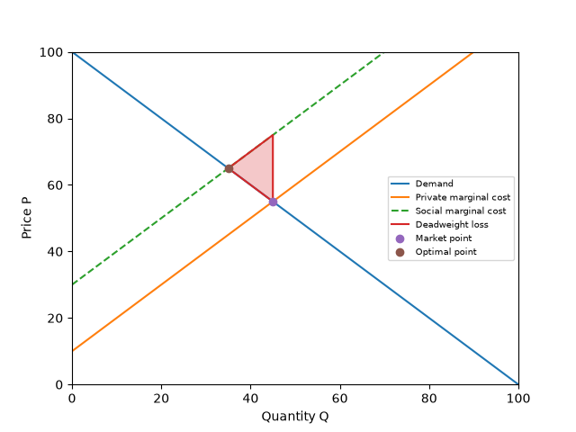
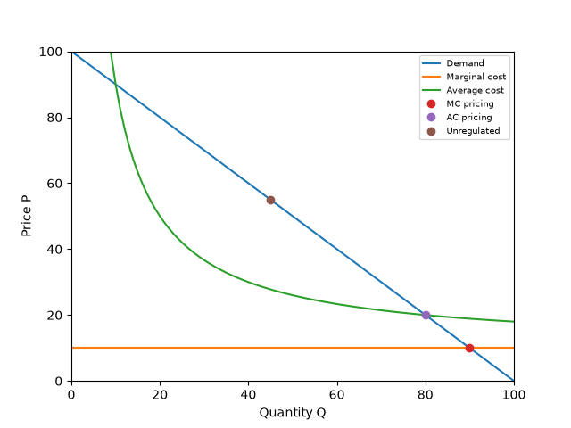

# 第 13 章: 外部効果・公共財・費用逓減産業

## 13.1 この章の地図

市場は、価格を通して、資源を効率的に配分します。しかし、次の 3 つの場面では、**市場の失敗**が起きます。

- **外部効果**: 取引の当事者以外に、費用（外部不経済）や便益（外部経済）が及ぶ。市場は、外部の費用を、**考えない**ので、作りすぎる（外部経済では、作りなさすぎる）。是正には、**ピグー税**（外部費用に等しい税）・**コースの交渉**・**排出権取引**がある
- **公共財**: **非競合性**（みんなが同時に使える）と**非排除性**（払わない人を排除できない）を持つ財。**フリーライダー**がいるので、自発的な供給は、**過少**になる
- **費用逓減産業（自然独占）**: 固定費用が大きく、平均費用が下がり続ける。限界費用で価格を決めると**赤字**、規制しないと**独占**になる



| 項目 | 内容 |
| :--- | :--- |
| 経済学の題材 | 外部不経済・外部経済、ピグー税・補助金、コースの定理、排出権取引、公共財とフリーライダー、財の 4 分類、自然独占の価格規制 |
| 使う Python の機能 | `dataclass`（`frozen=True`、`replace`）、タプルの範囲、内包表記、`math.sqrt`、テスト（`pytest`） |
| 新しく導入するライブラリ | なし |
| 完成形 | `ExternalityMarket`、`market_quantity`、`socially_optimal_quantity`、`pigou_tax`、`quantity_with_tax`、`externality_deadweight_loss`、`coase_outcome`、`emissions_trading`、`uniform_reduction`、`abatement_cost`、`PublicGood`、`public_good_optimal_quantity`、`voluntary_quantity`、`under_provision`、`classify_good`、`marginal_cost_pricing`、`average_cost_pricing`、`unregulated_outcome`、`required_subsidy` |
| ファイル | 実装: `lib/chapter13/externality.py`、`public.py`、`natural.py`、`plot.py`（図）／テスト: `test/chapter13/` の同名のファイル（自分で書くときは、`practice/chapter13/` に、同じ名前で作ります） |
| データ | なし（手計算できる小さな例だけ） |

### 経済学の式とコードの対応

| 経済学 | 式 | コード |
| :--- | :--- | :--- |
| 市場の数量 | P = 私的 MC から Q = (a − c) ÷ (b + d) | `market_quantity(market)` |
| 最適な数量 | P = 社会的 MC（= 私的 MC + e）から Q = (a − c − e) ÷ (b + d) | `socially_optimal_quantity(market)` |
| ピグー税 | 外部費用 e に等しい税（負なら補助金） | `pigou_tax(market)` |
| コースの定理 | 取引費用 0 なら、利益 > 被害のときだけ汚染（権利の配分に依らない） | `coase_outcome(gain, damage, victim_has_right)` |
| 排出権取引 | 限界削減費用 m_i·x_i を全社で等しくする | `emissions_trading(slopes, total)` |
| 公共財の最適量 | 限界便益の縦の和 Σ MB_i = MC | `public_good_optimal_quantity(good)` |
| 平均費用価格 | P = AC から b·Q² − (a − c)·Q + F = 0 | `average_cost_pricing(monopoly, F)` |

> **記号の注意**: この章の `a`・`b`・`c`・`d`・`e` は、逆需要 P = a − b·Q、私的限界費用 MC = c + d·Q、外部費用 e です。第 8〜10 章の需要・供給の係数とは、別です（[この記事の読み方](how-to-read.md)を参照）。

### 前提とする章

| できること | 場所 |
| :--- | :--- |
| 余剰と死荷重 | この連載の[第 9 章](09-surplus-and-tax.md) |
| 独占の価格と数量 | この連載の[第 11 章](11-monopoly-and-monopolistic-competition.md) |

## 13.2 準備

```bash
cd apps/micro-basics-programming/python
uv sync
uv run pytest test/chapter13
```

```text
52 passed
```

自分でコードを書くときは、`practice/chapter13/` に、`externality.py`・`public.py`・`natural.py` と、それぞれのテストを作ります。

## 13.3 予想する

逆需要が P = 100 − Q、私的限界費用が MC = 10 + Q の市場で、生産 1 単位あたり**外部費用 20** が出ます。**紙で、手計算で**答えてください。答えは、この節には書いてありません。「プログラミング」の節の「予想の答え合わせ」で、プログラムを動かして確かめます。

- 市場の数量と、社会的に最適な数量は、いくつですか。**ピグー税**はいくつで、その税のもとの数量は、いくつですか。**死荷重**は、いくつですか
- 外部費用が**負**（1 単位あたり便益 10）なら、最適な数量・補助金・死荷重は、いくつですか
- コースの定理: 汚染から得る利益が 100、被害が 60 のとき、権利が被害者にあっても、加害者にあっても、汚染は起きますか。利益が 40 なら、どうですか
- 3 社の限界削減費用の傾きが 1・2・4 で、総削減量 14 のとき、**排出権取引**での、権利の価格と各社の削減量は、いくつですか。全社が同じ量を削減する**一律規制**より、費用は、いくら安くなりますか
- 2 人の公共財（限界便益 40 − 2q と 20 − q、限界費用 30）の、最適な供給量と、自発的な供給量は、いくつですか
- 自然独占（P = 100 − Q、限界費用 10、固定費用 800）で、限界費用価格・平均費用価格・規制なしの、価格・数量・利潤は、いくつですか

## 13.4 外部効果・公共財・費用逓減産業の考え方

### 外部効果

私的限界費用 MC には、生産者が払う費用だけが含まれます。環境汚染のように、第三者に及ぶ**外部費用 e**を足したものが、**社会的限界費用**（MC + e）です。市場は、私的 MC で決まるので、**数量が多すぎ**ます。

- **ピグー税**: 外部費用に等しい税 e をかけると、生産者の費用に e が入り、数量が最適になる。外部経済なら、**補助金**
- **コースの定理**: **取引費用が 0** で、権利が明確なら、権利をどちらに与えても、当事者の交渉で、効率的な結果になる（汚染するのは、利益 > 被害のときだけ）。分配は、権利の与え方で変わる
- **排出権取引**: 総削減量を決め、排出権を**取引**させる。限界削減費用が等しくなるように、**費用の低い企業が、多く削減**する。一律規制より、同じ削減を、**安い費用**で実現できる

### 公共財

**非競合性**（一人が使っても、他の人の分は減らない）と**非排除性**（払わない人を排除できない）を持つ財です。財は、この 2 つで、4 つに分かれます。

| | 排除できる | 排除できない |
| :--- | :--- | :--- |
| **競合する** | 私的財（パン） | 共有資源（漁場） |
| **競合しない** | クラブ財（有料の道路） | 公共財（国防・灯台） |

公共財は、全員が同時に消費できるので、社会全体の限界便益は、各人の限界便益を**縦に足す**（Σ MB_i）。最適な供給量は、Σ MB_i = MC の点です。しかし、払わなくても使える（**フリーライダー**）ので、自発的には、最も欲しい 1 人が供給する量しか出ず、**過少供給**になります。

### 費用逓減産業（自然独占）

固定費用 F が大きく、平均費用 AC = c + F ÷ Q が、限界費用 c より常に高く、右下がりの産業です（電力網・水道）。1 社で供給する方が、安い（**自然独占**）。価格の決め方が、3 通りあります。

- **規制しない独占**: MR = MC。価格が高く、数量が少ない
- **限界費用価格形成**（P = MC）: 効率的（数量が最大）だが、**固定費用の分が赤字**。補助金が必要
- **平均費用価格形成**（P = AC）: **利潤が 0** で、補助金は不要。ただし、価格は MC より高く、数量が少ない（死荷重が残る）

## 13.5 プログラミング

### Red: 外部不経済のテスト

最初のテストを書きます。市場の数量は 45、外部費用を含めた最適な数量は 35 です。

```python
import pytest

from lib.chapter13.externality import (
    ExternalityMarket,
    abatement_cost,
    coase_outcome,
    emissions_trading,
    externality_deadweight_loss,
    market_quantity,
    pigou_tax,
    quantity_with_tax,
    socially_optimal_quantity,
    uniform_reduction,
)
```

```python
POLLUTION = ExternalityMarket(
    demand_intercept=100,
    demand_slope=1,
    cost_intercept=10,
    cost_slope=1,
    external_cost=20,
)


BENEFIT = ExternalityMarket(100, 1, 10, 1, -10)


def test_市場の数量は私的限界費用で決まる() -> None:
    assert market_quantity(POLLUTION) == 45


def test_社会的に最適な数量は外部費用を含めた限界費用で決まる() -> None:
    assert socially_optimal_quantity(POLLUTION) == 35
    assert socially_optimal_quantity(POLLUTION) < market_quantity(POLLUTION)


def test_外部不経済があると市場は作りすぎる() -> None:
    assert market_quantity(POLLUTION) - socially_optimal_quantity(POLLUTION) == 10
```

`ExternalityMarket` などがまだないので、テストは失敗します（**Red**）。テストの import は、書いた関数だけを、1 つずつ足してかまいません（[第 5 章](05-cost-curves.md)の注意を参照）。

### Green: 外部不経済を実装する

```python
@dataclass(frozen=True)
class ExternalityMarket:
    """逆需要 P = a − b·Q、私的限界費用 MC = c + d·Q、外部費用 e（1 単位あたり）。"""

    demand_intercept: float
    demand_slope: float
    cost_intercept: float
    cost_slope: float
    external_cost: float

    def __post_init__(self) -> None:
        validate_positive(self.demand_slope, "需要の傾きは、正にする")
        validate_positive(self.cost_slope, "費用の傾きは、正にする")
        if self.demand_intercept <= self.cost_intercept:
            raise ValueError("需要の切片は、費用の切片より大きくする")


def _quantity(market: ExternalityMarket, extra: float) -> float:
    """P = MC + extra の数量 (a − c − extra) ÷ (b + d)。"""
    return (market.demand_intercept - market.cost_intercept - extra) / (
        market.demand_slope + market.cost_slope
    )


def market_quantity(market: ExternalityMarket) -> float:
    """外部費用を考えない、市場の数量。"""
    return _quantity(market, 0)


def socially_optimal_quantity(market: ExternalityMarket) -> float:
    """社会的に最適な数量（P = 社会的限界費用）。"""
    quantity = _quantity(market, market.external_cost)
    if quantity <= 0:
        raise ValueError("最適な数量が、0 以下になる市場は、扱わない")
    return quantity
```

??? note "import と補助関数（写すときに足す）"

    記事の抜粋には、import と、先頭が `_` の補助関数・定数を、省いています。完成形のファイルの先頭にある、次の部分を、写してください。

    **lib/chapter13/externality.py**

    ```python
    from collections.abc import Sequence
    from dataclasses import dataclass
    ```

    ```python
    from lib.chapter01.validation import validate_non_negative, validate_positive
    ```

    ```python
    def _quantity(market: ExternalityMarket, extra: float) -> float:
        """P = MC + extra の数量 (a − c − extra) ÷ (b + d)。"""
        return (market.demand_intercept - market.cost_intercept - extra) / (
            market.demand_slope + market.cost_slope
        )
    ```

    ```python
    def _check_firms(slopes: Sequence[float]) -> None:
        if not slopes:
            raise ValueError("企業が、1 社もありません")
        for slope in slopes:
            validate_positive(slope, "限界削減費用の傾きは、正にする")
    ```

    **lib/chapter13/natural.py**

    ```python
    import math
    from dataclasses import replace
    ```

    ```python
    from lib.chapter01.validation import validate_positive
    from lib.chapter11.monopoly import (
        MarketOutcome,
        Monopoly,
        competitive_outcome,
        monopoly_outcome,
    )
    ```

    **lib/chapter13/plot.py**

    ```python
    import matplotlib.pyplot as plt
    from matplotlib.axes import Axes
    from matplotlib.figure import Figure
    ```

    ```python
    from lib.chapter09.plot import outline_area
    from lib.chapter11.monopoly import Monopoly, monopoly_outcome
    from lib.chapter13.externality import (
        ExternalityMarket,
        market_quantity,
        socially_optimal_quantity,
    )
    from lib.chapter13.natural import average_cost_pricing, marginal_cost_pricing
    ```

    ```python
    _POINTS = 100
    ```

    ```python
    def _style(ax: Axes, q_max: float, p_max: float) -> None:
        ax.set_xlabel("Quantity Q")
        ax.set_ylabel("Price P")
        ax.set_xlim(0, q_max)
        ax.set_ylim(0, p_max)
        ax.legend(fontsize="x-small")
    ```

    **lib/chapter13/public.py**

    ```python
    from dataclasses import dataclass
    ```

    ```python
    from lib.chapter01.validation import validate_non_negative, validate_positive
    ```

    **test/chapter13/test_plot.py**

    ```python
    from collections.abc import Sequence
    from typing import cast
    ```

    ```python
    import pytest
    from matplotlib.axes import Axes
    from matplotlib.lines import Line2D
    ```

    ```python
    from lib.chapter11.monopoly import Monopoly
    from lib.chapter13.externality import ExternalityMarket
    from lib.chapter13.plot import plot_externality, plot_natural_monopoly
    ```

数量は、**P = MC + 追加の費用**の式 `_quantity(market, extra)` を共通にします。市場は追加の費用が 0、最適な数量は外部費用 e です。

### ピグー税と死荷重

```python
def test_ピグー税は外部費用に等しい() -> None:
    assert pigou_tax(POLLUTION) == 20


def test_ピグー税をかけると市場の数量が最適な数量になる() -> None:
    assert quantity_with_tax(
        POLLUTION, pigou_tax(POLLUTION)
    ) == socially_optimal_quantity(POLLUTION)
    assert quantity_with_tax(POLLUTION, 0) == market_quantity(POLLUTION)
    assert quantity_with_tax(POLLUTION, 10) == 40


def test_税が大きすぎると作りすぎの逆になる() -> None:
    assert quantity_with_tax(POLLUTION, 30) < socially_optimal_quantity(POLLUTION)


def test_外部不経済の死荷重は三角形() -> None:
    assert externality_deadweight_loss(POLLUTION) == pytest.approx(0.5 * 20 * 10)


def test_外部経済は補助金で作りすぎの逆を直す() -> None:
    assert socially_optimal_quantity(BENEFIT) == 50
    assert market_quantity(BENEFIT) == 45
    assert pigou_tax(BENEFIT) == -10
    assert quantity_with_tax(BENEFIT, pigou_tax(BENEFIT)) == 50
    assert externality_deadweight_loss(BENEFIT) == pytest.approx(0.5 * 10 * 5)


def test_外部費用が0なら市場は効率的() -> None:
    clean = ExternalityMarket(100, 1, 10, 1, 0)
    assert socially_optimal_quantity(clean) == market_quantity(clean)
    assert externality_deadweight_loss(clean) == 0


def test_傾きが違う市場の最適な数量() -> None:
    market = ExternalityMarket(100, 2, 10, 1, 30)
    assert market_quantity(market) == pytest.approx(30)
    assert socially_optimal_quantity(market) == pytest.approx(20)
    assert externality_deadweight_loss(market) == pytest.approx(0.5 * 30 * 10)


def test_需要が小さすぎる市場はエラー() -> None:
    with pytest.raises(ValueError, match="最適な数量"):
        socially_optimal_quantity(ExternalityMarket(100, 1, 10, 1, 95))
    with pytest.raises(ValueError, match="需要の切片"):
        ExternalityMarket(10, 1, 10, 1, 0)


def test_傾きは正でなければエラー() -> None:
    with pytest.raises(ValueError, match="傾き"):
        ExternalityMarket(100, 0, 10, 1, 0)
    with pytest.raises(ValueError, match="傾き"):
        ExternalityMarket(100, 1, 10, 0, 0)


def test_税の後の数量は正でなければエラー() -> None:
    with pytest.raises(ValueError, match="税"):
        quantity_with_tax(POLLUTION, 100)
```

```python
def pigou_tax(market: ExternalityMarket) -> float:
    """ピグー税 = 外部費用。負なら補助金。"""
    return market.external_cost


def quantity_with_tax(market: ExternalityMarket, tax: float) -> float:
    """1 単位あたり tax の税（負なら補助金）をかけたときの、市場の数量。"""
    quantity = _quantity(market, tax)
    if quantity <= 0:
        raise ValueError("税が大きすぎて、数量が 0 以下になる")
    return quantity


def externality_deadweight_loss(market: ExternalityMarket) -> float:
    """外部効果を放置した死荷重 = ½ × |外部費用| × |市場の数量 − 最適な数量|。"""
    gap = abs(market_quantity(market) - socially_optimal_quantity(market))
    return 0.5 * abs(market.external_cost) * gap
```

外部費用 20 のピグー税をかけると、数量が 35（最適）になります。死荷重は ½ × 20 × (45 − 35) = 100 で、**外部費用の 2 乗に比例**します（数量の差が e ÷ 2 のため）。外部費用が**負**なら、補助金で、数量が 45 から 50 に増えます。

### コースの定理

```python
def test_コースの定理_被害者に権利があっても加害者に権利があっても効率的() -> None:
    # 汚染から得る利益 100、被害 60。汚染が効率的
    victim = coase_outcome(gain=100, damage=60, victim_has_right=True)
    polluter = coase_outcome(gain=100, damage=60, victim_has_right=False)
    assert victim.pollution and polluter.pollution
    assert victim.payment_range == (60, 100)
    assert polluter.payment_range is None


def test_コースの定理_被害が利益より大きいなら汚染しない() -> None:
    victim = coase_outcome(gain=40, damage=60, victim_has_right=True)
    polluter = coase_outcome(gain=40, damage=60, victim_has_right=False)
    assert not victim.pollution and not polluter.pollution
    assert victim.payment_range is None
    assert polluter.payment_range == (40, 60)


def test_コースの定理_利益と被害が等しいときは汚染しない() -> None:
    assert not coase_outcome(50, 50, True).pollution
    assert not coase_outcome(50, 50, False).pollution
```

```python
@dataclass(frozen=True)
class CoaseResult:
    """コースの交渉の結果。汚染が起きるか、補償（交渉）の範囲。"""

    pollution: bool
    payment_range: tuple[float, float] | None


def coase_outcome(gain: float, damage: float, victim_has_right: bool) -> CoaseResult:
    """取引費用が 0 の交渉。権利をどちらに与えても、汚染は、利益 > 被害のときだけ。

    payment_range は、権利を持たない側が、持つ側へ払う金額の範囲。
    """
    validate_non_negative(gain, "利益は、0 以上にする")
    validate_non_negative(damage, "被害は、0 以上にする")
    pollution = gain > damage
    if victim_has_right:
        return CoaseResult(pollution, (damage, gain) if pollution else None)
    return CoaseResult(pollution, None if pollution else (gain, damage))
```

汚染するかどうかは、**権利の与え方に依らず**、利益 > 被害で決まります。変わるのは、**だれがだれに払うか**（`payment_range`）です。

### 排出権取引

```python
def test_排出権取引は限界削減費用を等しくする() -> None:
    price, reductions = emissions_trading([1, 2, 4], 14)
    assert price == pytest.approx(8)
    assert reductions == pytest.approx([8, 4, 2])
    assert sum(reductions) == pytest.approx(14)
    for slope, reduction in zip([1, 2, 4], reductions, strict=True):
        assert slope * reduction == pytest.approx(price)


def test_排出権取引は一律規制より費用が小さい() -> None:
    slopes = [1, 2, 4]
    _, trading = emissions_trading(slopes, 14)
    assert abatement_cost(slopes, trading) == pytest.approx(56)
    uniform = uniform_reduction(slopes, 14)
    assert uniform == pytest.approx([14 / 3] * 3)
    assert abatement_cost(slopes, uniform) > abatement_cost(slopes, trading)


def test_企業の費用が同じなら取引しても一律でも同じ() -> None:
    _, trading = emissions_trading([2, 2], 10)
    assert trading == pytest.approx(uniform_reduction([2, 2], 10))


def test_排出権取引の入力のチェック() -> None:
    with pytest.raises(ValueError, match="傾き"):
        emissions_trading([1, 0], 10)
    with pytest.raises(ValueError, match="企業"):
        emissions_trading([], 10)
    with pytest.raises(ValueError, match="削減"):
        emissions_trading([1, 2], -1)
    with pytest.raises(ValueError, match="企業"):
        uniform_reduction([], 10)
```

```python
def _check_firms(slopes: Sequence[float]) -> None:
    if not slopes:
        raise ValueError("企業が、1 社もありません")
    for slope in slopes:
        validate_positive(slope, "限界削減費用の傾きは、正にする")


def emissions_trading(
    slopes: Sequence[float], total_reduction: float
) -> tuple[float, list[float]]:
    """排出権取引。限界削減費用 m_i·x_i を、全社で等しくする（= 排出権の価格）。

    価格 = 総削減量 ÷ Σ(1 ÷ m_i)。各社の削減量 x_i = 価格 ÷ m_i。
    """
    _check_firms(slopes)
    validate_non_negative(total_reduction, "総削減量は、0 以上にする")
    price = total_reduction / sum(1 / slope for slope in slopes)
    return price, [price / slope for slope in slopes]


def uniform_reduction(slopes: Sequence[float], total_reduction: float) -> list[float]:
    """一律規制。全社が、同じ量を、削減する。"""
    _check_firms(slopes)
    return [total_reduction / len(slopes)] * len(slopes)


def abatement_cost(slopes: Sequence[float], reductions: Sequence[float]) -> float:
    """削減費用の合計 Σ ½·m_i·x_i²。"""
    return sum(0.5 * m * x**2 for m, x in zip(slopes, reductions, strict=True))
```

限界削減費用 m_i·x_i を全社で等しくすると、価格 = 総削減量 ÷ Σ(1 ÷ m_i)、各社の削減量 x_i = 価格 ÷ m_i です。費用の低い（傾きの小さい）企業が、多く削減します。

### 公共財

```python
GOOD = PublicGood(benefit_intercepts=(40, 20), benefit_slopes=(2, 1), marginal_cost=30)


def test_最適な供給量は限界便益の縦の和が限界費用に等しい点() -> None:
    assert public_good_optimal_quantity(GOOD) == pytest.approx(10)
    total_benefit = (40 - 2 * 10) + (20 - 10)
    assert total_benefit == GOOD.marginal_cost


def test_1人だけで決めるなら自分の限界便益が限界費用に等しい点() -> None:
    assert individual_quantity(GOOD, 0) == pytest.approx(5)
    assert individual_quantity(GOOD, 1) == 0


def test_自発的な供給は最も欲しい人の量() -> None:
    assert voluntary_quantity(GOOD) == pytest.approx(5)


def test_フリーライダーがいると供給は最適より少ない() -> None:
    assert under_provision(GOOD) == pytest.approx(5)
    assert voluntary_quantity(GOOD) < public_good_optimal_quantity(GOOD)


def test_全員の限界便益が限界費用以下なら供給しない() -> None:
    hopeless = PublicGood((10, 10), (1, 1), 50)
    assert public_good_optimal_quantity(hopeless) == 0
    assert voluntary_quantity(hopeless) == 0
    assert under_provision(hopeless) == 0


def test_1人だけの社会では自発的な供給が最適() -> None:
    alone = PublicGood((40,), (2,), 30)
    assert voluntary_quantity(alone) == public_good_optimal_quantity(alone)


def test_人数が増えるほど最適な供給は増えるが自発的な供給は変わらない() -> None:
    more = PublicGood((40, 20, 20), (2, 1, 1), 30)
    assert public_good_optimal_quantity(more) == pytest.approx((80 - 30) / 4)
    assert voluntary_quantity(more) == pytest.approx(5)
    assert under_provision(more) > under_provision(GOOD)


def test_公共財の入力のチェック() -> None:
    with pytest.raises(ValueError, match="人"):
        PublicGood((), (), 10)
    with pytest.raises(ValueError, match="同じ"):
        PublicGood((40, 20), (2,), 10)
    with pytest.raises(ValueError, match="傾き"):
        PublicGood((40,), (0,), 10)
    with pytest.raises(ValueError, match="限界費用"):
        PublicGood((40,), (2,), -1)
    with pytest.raises(ValueError, match="番号"):
        individual_quantity(GOOD, 2)


def test_財の4分類() -> None:
    assert classify_good(rival=True, excludable=True) == "private"
    assert classify_good(rival=False, excludable=True) == "club"
    assert classify_good(rival=True, excludable=False) == "common"
    assert classify_good(rival=False, excludable=False) == "public"
```

```python
@dataclass(frozen=True)
class PublicGood:
    """各人の限界便益の切片・傾きと、限界費用。"""

    benefit_intercepts: tuple[float, ...]
    benefit_slopes: tuple[float, ...]
    marginal_cost: float

    def __post_init__(self) -> None:
        if not self.benefit_intercepts:
            raise ValueError("人が、1 人もいません")
        if len(self.benefit_intercepts) != len(self.benefit_slopes):
            raise ValueError("切片と傾きは、同じ人数にする")
        for slope in self.benefit_slopes:
            validate_positive(slope, "限界便益の傾きは、正にする")
        validate_non_negative(self.marginal_cost, "限界費用は、0 以上にする")


def public_good_optimal_quantity(good: PublicGood) -> float:
    """最適な供給量。縦の和 Σ(a_i − b_i·q) = MC から q = (Σa − MC) ÷ Σb。負なら 0。"""
    quantity = (sum(good.benefit_intercepts) - good.marginal_cost) / sum(
        good.benefit_slopes
    )
    return max(quantity, 0.0)


def individual_quantity(good: PublicGood, person: int) -> float:
    """その人 1 人が、自分の便益だけで、供給するなら、MB = MC の点。負なら 0。"""
    if not 0 <= person < len(good.benefit_intercepts):
        raise ValueError("人の番号が、範囲外です")
    quantity = (
        good.benefit_intercepts[person] - good.marginal_cost
    ) / good.benefit_slopes[person]
    return max(quantity, 0.0)


def voluntary_quantity(good: PublicGood) -> float:
    """自発的な供給量。最も欲しい人 1 人の量（他の人は、ただ乗りする）。"""
    return max(
        individual_quantity(good, person)
        for person in range(len(good.benefit_intercepts))
    )


def under_provision(good: PublicGood) -> float:
    """過少供給の大きさ = 最適な量 − 自発的な量。"""
    return public_good_optimal_quantity(good) - voluntary_quantity(good)


def classify_good(rival: bool, excludable: bool) -> str:
    """競合性・排除性による、財の 4 分類。"""
    if rival:
        return "private" if excludable else "common"
    return "club" if excludable else "public"
```

### 自然独占

```python
DEMAND = Monopoly(demand_intercept=100, demand_slope=1, marginal_cost=10)


FIXED = 800


def test_平均費用は限界費用に固定費用の分を足した値で右下がり() -> None:
    assert natural_average_cost(DEMAND, FIXED, 40) == pytest.approx(10 + 800 / 40)
    assert natural_average_cost(DEMAND, FIXED, 80) < natural_average_cost(
        DEMAND, FIXED, 40
    )
    assert natural_average_cost(DEMAND, FIXED, 80) > DEMAND.marginal_cost


def test_平均費用の数量は正でなければエラー() -> None:
    with pytest.raises(ValueError, match="数量"):
        natural_average_cost(DEMAND, FIXED, 0)


def test_限界費用価格形成は効率的だが赤字() -> None:
    outcome = marginal_cost_pricing(DEMAND, FIXED)
    assert (outcome.price, outcome.quantity) == (10, 90)
    assert outcome.profit == -800
    assert outcome.consumer_surplus == pytest.approx(4050)
    assert outcome.total_surplus == pytest.approx(4050 - 800)


def test_赤字は固定費用に等しく補助金が必要() -> None:
    assert required_subsidy(DEMAND, FIXED) == 800
    assert marginal_cost_pricing(DEMAND, FIXED).profit == -required_subsidy(
        DEMAND, FIXED
    )


def test_平均費用価格形成は利潤が0で価格が平均費用に等しい() -> None:
    outcome = average_cost_pricing(DEMAND, FIXED)
    assert outcome.quantity == pytest.approx(80)
    assert outcome.price == pytest.approx(20)
    assert outcome.profit == pytest.approx(0, abs=1e-9)
    assert outcome.price == pytest.approx(
        natural_average_cost(DEMAND, FIXED, outcome.quantity)
    )


def test_平均費用価格形成は限界費用価格形成より価格が高く数量が少ない() -> None:
    mc, ac = marginal_cost_pricing(DEMAND, FIXED), average_cost_pricing(DEMAND, FIXED)
    assert ac.price > mc.price
    assert ac.quantity < mc.quantity


def test_規制しない独占は価格が最も高く数量が最も少ない() -> None:
    free = unregulated_outcome(DEMAND, FIXED)
    ac = average_cost_pricing(DEMAND, FIXED)
    assert (free.price, free.quantity) == (55, 45)
    assert free.profit == pytest.approx(2025 - 800)
    assert free.price > ac.price
    assert free.quantity < ac.quantity


def test_総余剰の順は限界費用価格_平均費用価格_独占() -> None:
    mc = marginal_cost_pricing(DEMAND, FIXED).total_surplus
    ac = average_cost_pricing(DEMAND, FIXED).total_surplus
    free = unregulated_outcome(DEMAND, FIXED).total_surplus
    assert mc > ac > free


def test_固定費用が大きすぎると平均費用価格は成り立たない() -> None:
    with pytest.raises(ValueError, match="固定費用"):
        average_cost_pricing(DEMAND, 2100)


def test_固定費用は正でなければエラー() -> None:
    with pytest.raises(ValueError, match="固定費用"):
        marginal_cost_pricing(DEMAND, 0)
    with pytest.raises(ValueError, match="固定費用"):
        required_subsidy(DEMAND, -1)


def test_傾きが違う需要の平均費用価格() -> None:
    steep = Monopoly(demand_intercept=100, demand_slope=2, marginal_cost=10)
    outcome = average_cost_pricing(steep, 400)
    assert outcome.quantity == pytest.approx(40)
    assert outcome.price == pytest.approx(20)
    assert outcome.profit == pytest.approx(0, abs=1e-9)
```

```python
def natural_average_cost(
    monopoly: Monopoly, fixed_cost: float, quantity: float
) -> float:
    """平均費用 AC = c + F ÷ Q。"""
    validate_positive(quantity, "数量は、正にする")
    return monopoly.marginal_cost + fixed_cost / quantity


def marginal_cost_pricing(monopoly: Monopoly, fixed_cost: float) -> MarketOutcome:
    """限界費用価格形成。利潤は、固定費用の分だけ、赤字。"""
    validate_positive(fixed_cost, "固定費用は、正にする")
    outcome = competitive_outcome(monopoly)
    return replace(outcome, profit=outcome.profit - fixed_cost)


def required_subsidy(monopoly: Monopoly, fixed_cost: float) -> float:
    """限界費用価格形成で、必要な補助金 = 固定費用。"""
    validate_positive(fixed_cost, "固定費用は、正にする")
    return -marginal_cost_pricing(monopoly, fixed_cost).profit


def average_cost_pricing(monopoly: Monopoly, fixed_cost: float) -> MarketOutcome:
    """平均費用価格形成。P = AC から b·Q² − (a − c)·Q + F = 0 の、大きい方の解。"""
    validate_positive(fixed_cost, "固定費用は、正にする")
    gap = monopoly.demand_intercept - monopoly.marginal_cost
    b = monopoly.demand_slope
    discriminant = gap**2 - 4 * b * fixed_cost
    if discriminant < 0:
        raise ValueError("固定費用が大きすぎて、平均費用が、需要曲線に届かない")
    quantity = (gap + math.sqrt(discriminant)) / (2 * b)
    price = monopoly.demand_intercept - b * quantity
    return MarketOutcome(
        price,
        quantity,
        (price - monopoly.marginal_cost) * quantity - fixed_cost,
        0.5 * (monopoly.demand_intercept - price) * quantity,
    )


def unregulated_outcome(monopoly: Monopoly, fixed_cost: float) -> MarketOutcome:
    """規制しない独占（MR = MC）。利潤は、固定費用を引いた値。"""
    validate_positive(fixed_cost, "固定費用は、正にする")
    outcome = monopoly_outcome(monopoly)
    return replace(outcome, profit=outcome.profit - fixed_cost)
```

平均費用価格形成は、P = AC の式 b·Q² − (a − c)·Q + F = 0 の、**大きい方の解**を使います（数量が多い方）。固定費用が大きすぎて、判別式が負になると、平均費用が需要曲線に届かず、**エラー**にします。

### 予想の答え合わせ

予想した答えを、プログラムで確かめます。

> このスクリプトは、**完成形**（`lib/`）を読みます。**自分のコードで確かめる**ときは、import を、`from practice.chapterNN...` に書き換えてください。

```python
from lib.chapter11.monopoly import Monopoly
from lib.chapter13.externality import (
    ExternalityMarket,
    abatement_cost,
    coase_outcome,
    emissions_trading,
    externality_deadweight_loss,
    market_quantity,
    pigou_tax,
    quantity_with_tax,
    socially_optimal_quantity,
    uniform_reduction,
)
from lib.chapter13.natural import (
    average_cost_pricing,
    marginal_cost_pricing,
    required_subsidy,
    unregulated_outcome,
)
from lib.chapter13.public import (
    PublicGood,
    classify_good,
    public_good_optimal_quantity,
    under_provision,
    voluntary_quantity,
)

pollution = ExternalityMarket(100, 1, 10, 1, 20)
print("市場の数量", market_quantity(pollution), "最適な数量", socially_optimal_quantity(pollution))
print("ピグー税", pigou_tax(pollution), "税のもとの数量", quantity_with_tax(pollution, 20), "死荷重", externality_deadweight_loss(pollution))
benefit = ExternalityMarket(100, 1, 10, 1, -10)
print("外部経済: 最適な数量", socially_optimal_quantity(benefit), "補助金", -pigou_tax(benefit), "死荷重", externality_deadweight_loss(benefit))
print("コース 被害者に権利 利益100 被害60:", coase_outcome(100, 60, True))
print("コース 加害者に権利 利益100 被害60:", coase_outcome(100, 60, False))
print("コース 被害者に権利 利益40 被害60:", coase_outcome(40, 60, True))
print("コース 加害者に権利 利益40 被害60:", coase_outcome(40, 60, False))
slopes = [1, 2, 4]
price, reductions = emissions_trading(slopes, 14)
print("排出権の価格", price, "削減量", reductions, "費用", abatement_cost(slopes, reductions))
uniform = uniform_reduction(slopes, 14)
print("一律規制の削減量", [round(x, 4) for x in uniform], "費用", round(abatement_cost(slopes, uniform), 4))
good = PublicGood(benefit_intercepts=(40, 20), benefit_slopes=(2, 1), marginal_cost=30)
print("公共財: 最適", public_good_optimal_quantity(good), "自発的", voluntary_quantity(good), "過少供給", under_provision(good))
print("財の分類:", classify_good(True, True), classify_good(False, True), classify_good(True, False), classify_good(False, False))
demand = Monopoly(demand_intercept=100, demand_slope=1, marginal_cost=10)
for name, o in (
    ("限界費用価格", marginal_cost_pricing(demand, 800)),
    ("平均費用価格", average_cost_pricing(demand, 800)),
    ("規制なし", unregulated_outcome(demand, 800)),
):
    print(name, ": 価格", o.price, "数量", o.quantity, "利潤", o.profit, "総余剰", o.total_surplus)
print("必要な補助金", required_subsidy(demand, 800))
```

```text
市場の数量 45.0 最適な数量 35.0
ピグー税 20 税のもとの数量 35.0 死荷重 100.0
外部経済: 最適な数量 50.0 補助金 10 死荷重 25.0
コース 被害者に権利 利益100 被害60: CoaseResult(pollution=True, payment_range=(60, 100))
コース 加害者に権利 利益100 被害60: CoaseResult(pollution=True, payment_range=None)
コース 被害者に権利 利益40 被害60: CoaseResult(pollution=False, payment_range=None)
コース 加害者に権利 利益40 被害60: CoaseResult(pollution=False, payment_range=(40, 60))
排出権の価格 8.0 削減量 [8.0, 4.0, 2.0] 費用 56.0
一律規制の削減量 [4.6667, 4.6667, 4.6667] 費用 76.2222
公共財: 最適 10.0 自発的 5.0 過少供給 5.0
財の分類: private club common public
限界費用価格 : 価格 10.0 数量 90.0 利潤 -800.0 総余剰 3250.0
平均費用価格 : 価格 20.0 数量 80.0 利潤 0.0 総余剰 3200.0
規制なし : 価格 55.0 数量 45.0 利潤 1225.0 総余剰 2237.5
必要な補助金 800.0
```

- **1 つ目の問い**: 市場の数量は 45、最適な数量は 35、ピグー税は 20（税のもとの数量は 35）、死荷重は 100 です
- **2 つ目の問い**: 外部便益なら、最適な数量は 50、補助金は 10、死荷重は 25 です
- **3 つ目の問い**: 利益 100・被害 60 では、権利が被害者にあっても、加害者にあっても、汚染します（払う金額の範囲は、被害者に権利があれば 60〜100）。利益 40 では、どちらでも汚染しません
- **4 つ目の問い**: 権利の価格は 8、削減量は 8・4・2（合計 14）。費用は 56 で、一律規制の約 76.2 より、約 20 安いです
- **5 つ目の問い**: 最適な供給量は 10、自発的な供給量は 5（最も欲しい 1 人の量）で、**過少供給**は 5 です
- **6 つ目の問い**: 限界費用価格は、価格 10・数量 90・利潤 −800（赤字）、平均費用価格は、価格 20・数量 80・利潤 0、規制なしは、価格 55・数量 45・利潤 1225 です。総余剰は、順に 3250・3200・2237.5 で、**限界費用価格 > 平均費用価格 > 規制なし**です

### 図

外部不経済の図は、章の最初に載せました。死荷重の三角形の面積が 100 であることを、テストで確かめます。

??? note "描画のテストと実装（後回しにしても、学習は成り立ちます）"

    ```python
    POLLUTION = ExternalityMarket(100, 1, 10, 1, 20)


    DEMAND = Monopoly(100, 1, 10)


    def xs(line: Line2D) -> list[float]:
        return [float(v) for v in cast(Sequence[float], line.get_xdata())]


    def ys(line: Line2D) -> list[float]:
        return [float(v) for v in cast(Sequence[float], line.get_ydata())]


    def line(ax: Axes, label: str) -> Line2D:
        return next(item for item in ax.lines if item.get_label() == label)


    def area(item: Line2D) -> float:
        """閉じた折れ線の面積（靴ひも公式）。"""
        x, y = xs(item), ys(item)
        total = sum(x[i] * y[i + 1] - x[i + 1] * y[i] for i in range(len(x) - 1))
        return abs(total) / 2


    def externality() -> Axes:
        return plot_externality(POLLUTION, 100, 100).axes[0]


    def test_外部不経済の図の線() -> None:
        assert [item.get_label() for item in externality().lines] == [
            "Demand",
            "Private marginal cost",
            "Social marginal cost",
            "Deadweight loss",
            "Market point",
            "Optimal point",
        ]


    def test_社会的限界費用は私的限界費用より外部費用だけ高い() -> None:
        ax = externality()
        private = line(ax, "Private marginal cost")
        social = line(ax, "Social marginal cost")
        assert (xs(private), ys(private)) == ([0, 100], [10, 110])
        assert xs(social) == [0, 100]
        assert [s - p for s, p in zip(ys(social), ys(private), strict=True)] == [20, 20]
        assert social.get_linestyle() == "--"


    def test_市場の点と最適な点() -> None:
        ax = externality()
        market, optimal = line(ax, "Market point"), line(ax, "Optimal point")
        assert (xs(market)[0], ys(market)[0]) == (45, 55)
        assert (xs(optimal)[0], ys(optimal)[0]) == (35, 65)


    def test_死荷重の三角形の面積() -> None:
        ax = externality()
        assert area(line(ax, "Deadweight loss")) == pytest.approx(100)
        assert len(ax.patches) == 1
        assert ax.patches[0].get_alpha() == pytest.approx(0.25)


    def test_外部不経済の図の軸と凡例() -> None:
        ax = externality()
        assert ax.get_xlim() == (0, 100)
        assert ax.get_ylim() == (0, 100)
        assert ax.get_xlabel() == "Quantity Q"
        assert ax.get_ylabel() == "Price P"
        assert ax.get_legend() is not None
    ```

    ```python
    def plot_externality(market: ExternalityMarket, q_max: float, p_max: float) -> Figure:
        """需要・私的限界費用・社会的限界費用（点線）と、死荷重の三角形を描く。"""
        a, b = market.demand_intercept, market.demand_slope
        c, d, e = market.cost_intercept, market.cost_slope, market.external_cost
        q_market, q_opt = market_quantity(market), socially_optimal_quantity(market)
        fig, ax = plt.subplots()
        ax.plot([0, a / b], [a, 0], label="Demand")
        ax.plot([0, q_max], [c, c + d * q_max], label="Private marginal cost")
        ax.plot(
            [0, q_max],
            [c + e, c + e + d * q_max],
            linestyle="--",
            label="Social marginal cost",
        )
        outline_area(
            ax,
            [q_opt, q_market, q_market, q_opt],
            [a - b * q_opt, a - b * q_market, c + d * q_market + e, a - b * q_opt],
            "Deadweight loss",
        )
        ax.plot([q_market], [a - b * q_market], "o", label="Market point")
        ax.plot([q_opt], [a - b * q_opt], "o", label="Optimal point")
        _style(ax, q_max, p_max)
        plt.close(fig)
        return fig
    ```

自然独占の図です。平均費用（曲線）は、限界費用（水平線）より高く、右下がりです。



??? note "描画のテストと実装（後回しにしても、学習は成り立ちます）"

    ```python
    def natural() -> Axes:
        return plot_natural_monopoly(DEMAND, 800, 100, 100).axes[0]


    def test_自然独占の図の線() -> None:
        assert [item.get_label() for item in natural().lines] == [
            "Demand",
            "Marginal cost",
            "Average cost",
            "MC pricing",
            "AC pricing",
            "Unregulated",
        ]


    def test_平均費用は右下がりで限界費用より高い() -> None:
        ax = natural()
        average = line(ax, "Average cost")
        assert len(xs(average)) == 100
        for q, cost in zip(xs(average), ys(average), strict=True):
            assert cost == pytest.approx(10 + 800 / q)
        assert all(a > b for a, b in zip(ys(average), ys(average)[1:], strict=False))
        assert ys(line(ax, "Marginal cost")) == [10, 10]


    def test_3つの価格設定の点() -> None:
        ax = natural()
        mc, ac, free = (
            line(ax, "MC pricing"),
            line(ax, "AC pricing"),
            line(ax, "Unregulated"),
        )
        assert (xs(mc)[0], ys(mc)[0]) == (90, 10)
        assert (xs(ac)[0], ys(ac)[0]) == (pytest.approx(80), pytest.approx(20))
        assert (xs(free)[0], ys(free)[0]) == (45, 55)


    def test_自然独占の図の軸と凡例() -> None:
        ax = natural()
        assert ax.get_xlim() == (0, 100)
        assert ax.get_ylim() == (0, 100)
        assert ax.get_legend() is not None
    ```

    ```python
    def plot_natural_monopoly(
        monopoly: Monopoly, fixed_cost: float, q_max: float, p_max: float
    ) -> Figure:
        """需要・限界費用・平均費用と、3 つの価格設定（限界費用・平均費用・規制なし）。"""
        a, b, c = monopoly.demand_intercept, monopoly.demand_slope, monopoly.marginal_cost
        qs = [q_max * (i + 1) / _POINTS for i in range(_POINTS)]
        mc = marginal_cost_pricing(monopoly, fixed_cost)
        ac = average_cost_pricing(monopoly, fixed_cost)
        free = monopoly_outcome(monopoly)
        fig, ax = plt.subplots()
        ax.plot([0, a / b], [a, 0], label="Demand")
        ax.plot([0, q_max], [c, c], label="Marginal cost")
        ax.plot(qs, [c + fixed_cost / q for q in qs], label="Average cost")
        ax.plot([mc.quantity], [mc.price], "o", label="MC pricing")
        ax.plot([ac.quantity], [ac.price], "o", label="AC pricing")
        ax.plot([free.quantity], [free.price], "o", label="Unregulated")
        _style(ax, q_max, p_max)
        plt.close(fig)
        return fig
    ```

### 実行結果

```bash
uv run pytest test/chapter13
```

```text
52 passed
```

## 13.6 規則で言うと

1. **外部効果を放置すると、外部不経済は作りすぎ、外部経済は作りなさすぎになる。** ピグー税（補助金）で、数量が最適になる
2. **公共財は、フリーライダーで、過少供給になる。** 最適量は、限界便益の縦の和 = 限界費用
3. **自然独占は、限界費用価格で赤字、平均費用価格で利潤 0。** 規制しない独占より、総余剰が大きい

混同しやすい点を、表にまとめます。

| 混同しやすい点 | 違い |
| :--- | :--- |
| 私的限界費用と社会的限界費用 | 私的 MC は、生産者が払う費用。社会的 MC は、外部費用を足したもの。市場は、私的 MC で決まる |
| コースの定理の「権利の配分」 | 権利をどちらに与えても、**汚染の量**は同じ（効率的）。変わるのは、**だれが得をするか**（分配） |
| 公共財の需要の足し方 | 私的財は、需要を**横に**足す（同じ価格で、数量を足す）。公共財は、限界便益を**縦に**足す（同じ数量で、価格を足す） |
| 平均費用価格と限界費用価格 | 平均費用価格は、赤字にならないが、価格が高く、数量が少ない。限界費用価格は、効率的だが、補助金が必要 |

### このモデルが成り立たない場面

- **外部費用が、数量に比例する（1 単位あたり一定）と仮定しました。** 汚染の被害は、累積すると、増えることがあります
- **ピグー税は、外部費用を、正確に知る必要があります。** 実際には、被害の金額を測るのは、難しいです
- **コースの定理は、取引費用が 0 で、当事者が少ないときの話です。** 汚染の被害者が多数のときは、交渉が成り立ちません
- **公共財の各人の便益は、本人しか知りません。** 縦の和を求めるには、便益の**正直な申告**が必要です（嘘をつく誘因が、あります）
- **自然独占の補助金には、別の費用があります。** 税を集めるときの歪みや、費用を削減する誘因の低下です

## 13.7 練習問題

| 種類 | 問題 |
| :--- | :--- |
| 想起 | 本文を閉じて、外部費用 20 のピグー税をかけると、数量が最適な数量 35 になるテストを書いてください |
| 生成 | 解説を見る前に、**ピグー税の税収**（税額 × 税のもとの数量）を返す `pigou_tax_revenue(market)` を、テストから書いてください。この例では 20 × 35 = 700 です |
| 多様 | 外部費用を 20 から 30 に上げます。最適な数量・ピグー税・死荷重は、いくつになりますか。先に予想してから、確かめてください |
| 交互 | [第 1 シリーズ](../economics-programming/index.md)の第 3 章のリスト内包表記で、外部費用 0・10・20・30 の死荷重を、一度に求めてください。外部費用が 2 倍になると、死荷重は、何倍になりますか |

??? note "解答（先に自分で取り組んでから、開いてください）"

    **想起**:

    ```python
    def test_練習問題のピグー税と最適な数量() -> None:
        market = ExternalityMarket(100, 1, 10, 1, 20)
        assert quantity_with_tax(market, pigou_tax(market)) == 35
    ```

    **生成**: ピグー税のもとの数量に、税額を掛けます。

    ```python
    def pigou_tax_revenue(market):
        tax = pigou_tax(market)
        return tax * quantity_with_tax(market, tax)
    ```

    ```python
    def test_練習問題のピグー税の税収() -> None:
        assert pigou_tax_revenue(ExternalityMarket(100, 1, 10, 1, 20)) == 700
    ```

    **多様**: 外部費用 30 では、最適な数量は (100 − 10 − 30) ÷ 2 = 30、ピグー税は 30、死荷重は ½ × 30 × (45 − 30) = 225 です。

    ```python
    def test_練習問題の外部費用が大きい場合() -> None:
        market = ExternalityMarket(100, 1, 10, 1, 30)
        assert socially_optimal_quantity(market) == 30
        assert externality_deadweight_loss(market) == pytest.approx(225)
    ```

    **交互**: 外部費用が 2 倍で、死荷重は **4 倍**（2 乗に比例）です。

    ```python
    def test_練習問題の外部費用と死荷重() -> None:
        losses = [
            externality_deadweight_loss(ExternalityMarket(100, 1, 10, 1, e))
            for e in (0, 10, 20, 30)
        ]
        assert losses == pytest.approx([0, 25, 100, 225])
    ```

## 13.8 振り返り

- うまくいったこと:
- 詰まったこと:
- 次に試すこと:

## 13.9 まとめ

- 外部不経済では、市場は作りすぎる。外部費用に等しいピグー税で、数量が最適になる。死荷重は、外部費用の 2 乗に比例する。コースの定理は、取引費用が 0 なら、権利の配分に依らず、利益 > 被害のときだけ汚染する、と言う。排出権取引は、限界削減費用を等しくして、一律規制より安く削減する
- 公共財は、限界便益の縦の和 = 限界費用で最適量が決まるが、フリーライダーで、自発的な供給は過少になる
- 自然独占では、限界費用価格形成は効率的だが赤字、平均費用価格形成は利潤 0 で、価格が高く、数量が少ない

次の章（最終章）では、**情報の非対称性**を調べます。買い手が質を見分けられないと、良い品が市場から消える**逆選択**、能力を示す**シグナル**、努力を観察できないときの**モラルハザード**を確かめ、第 4 部の到達チェックを行います。
