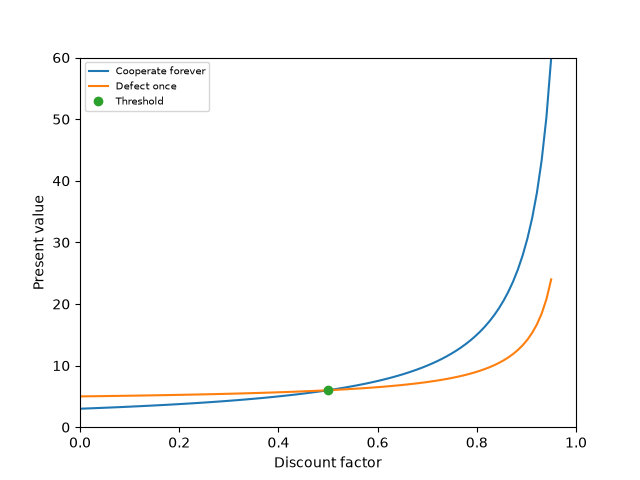
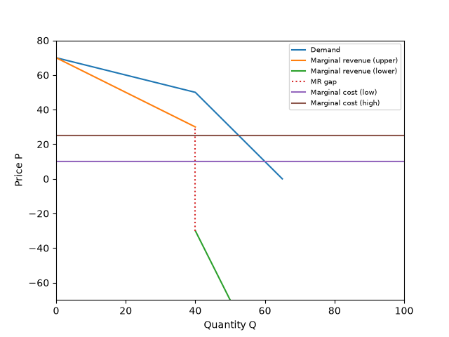

# 第 13 章: 寡占とゲーム理論（2）: 繰り返しゲームと屈折需要曲線

## 13.1 この章の地図

前の章では、1 回限りのゲームで、囚人のジレンマの均衡が（裏切り、裏切り）になることを見ました。この章では、**同じゲームを繰り返し**ます。将来の報復があると、協調が続くことがあります。また、寡占の価格が**硬直的**になる理由の 1 つ、**屈折需要曲線**も調べます。

- **繰り返しゲーム**: トリガー戦略で、**割引因子が閾値以上**なら、協調が続く（しっぺ返しの条件は、別。13.4 を参照）
- **屈折需要曲線**: 値上げに他社がついてこず、値下げにはついてくる。限界収入が途切れて、価格が**硬直的**になる



| 項目 | 内容 |
| :--- | :--- |
| 経済学の題材 | 繰り返しゲーム（しっぺ返し・トリガー戦略・割引因子）、屈折需要曲線 |
| 使う Python の機能 | 関数を値として渡す（戦略）、リスト内包表記、テスト（`pytest`） |
| 新しく導入するライブラリ | なし |
| 完成形 | `discounted_sum`、`cooperation_value`、`deviation_value`、`cooperation_threshold`、`trigger_sustains_cooperation`、戦略（`tit_for_tat` など）、`play`、`total_payoffs`、`KinkedDemand`、`marginal_revenue_gap`、`price_stays`、`price_when_cost_shifts` |
| ファイル | 実装: `lib/chapter13/repeated.py`、`lib/chapter13/kinked.py`、`lib/chapter13/plot.py`（図）／テスト: `test/chapter13/` の同名のファイル（自分で書くときは、`practice/chapter13/` に、同じ名前で作ります） |
| データ | なし（手計算できる小さな例だけ） |

### 経済学の式とコードの対応

| 経済学 | 式 | コード |
| :--- | :--- | :--- |
| 協調の価値 | R ÷ (1 − δ) | `cooperation_value(reward, delta)` |
| 裏切りの価値 | T + δ·P ÷ (1 − δ) | `deviation_value(T, P, delta)` |
| 割引因子の閾値 | δ\* = (T − R) ÷ (T − P) | `cooperation_threshold(T, R, P)` |
| 限界収入の途切れ | (b₂ − b₁)·Q | `marginal_revenue_gap(demand)` |

> **記号の注意**: この章の T・R・P・S は、囚人のジレンマの利得（誘惑・報酬・罰・愚か者）です。第 7・9・10 章の T（税額・関税）や、P（価格）とは、別の意味です。

### 前提とする章

| できること | 場所 |
| :--- | :--- |
| 利得表・囚人のジレンマ・ナッシュ均衡 | この連載の[第 12 章](12-oligopoly-and-game-theory.md)（`lib.chapter12.game` を使います） |
| 独占の限界収入 | この連載の[第 11 章](11-monopoly-and-monopolistic-competition.md) |

## 13.2 準備

```bash
cd apps/micro-basics-programming/python
uv sync
uv run pytest test/chapter13
```

```text
38 passed
```

自分でコードを書くときは、`practice/chapter13/` に、`repeated.py`・`kinked.py` と、それぞれのテストをを作ります。

## 13.3 予想する

囚人のジレンマです（第 12 章と同じ）。2 人が、協調（0）か裏切り（1）を選びます。利得は、誘惑 T = 5、報酬 R = 3、罰 P = 1、愚か者 S = 0 です。**紙で、手計算で**答えてください。答えは、この節には書いてありません。「プログラミング」の節の「予想の答え合わせ」で、プログラムを動かして確かめます。

- 同じゲームを**無限に繰り返し**、トリガー戦略（相手が一度でも裏切ったら、永久に裏切る）を使います。協調が続く**割引因子の閾値**は、いくつですか。割引因子が 0.4・0.5・0.6 のとき、協調を続ける価値と、一度裏切る価値は、いくつですか
- しっぺ返し（最初は協調し、以後は、相手の前の手をまねる）が、いつも裏切る相手と 4 回戦うと、合計の利得は、それぞれ、いくつですか
- 屈折需要曲線で、屈折点が（数量 40、価格 50）、上の傾きが 0.5、下の傾きが 2 のとき、限界収入は、屈折点の上と下で、いくつですか。**途切れ**の大きさは、いくつですか。限界費用が 10・30・40 のとき、価格は動きますか

## 13.4 繰り返しゲームと屈折需要曲線の考え方

### 繰り返しゲーム

同じゲームを繰り返すと、**将来の報復**があるので、協調が続くことがあります。将来の利得を**割引因子 δ**（0 以上 1 未満）で割り引くとき、トリガー戦略で協調が続く条件は、**協調の価値 ≥ 裏切りの価値**です。

- 協調を続ける価値: R ÷ (1 − δ)
- 今期だけ裏切り、以後は罰: T + δ·P ÷ (1 − δ)
- 条件を解くと、**δ ≥ (T − R) ÷ (T − P)**

将来を重く見る（δ が大きい）ほど、協調が続きます。これが**フォーク定理**の核心で、δ が十分大きければ、罰より良い利得の組は、均衡で実現できる、というものです。無限回の繰り返しは、閉じた式（等比級数の和）で扱います。

**しっぺ返しの条件は、別です。** 相手が、交互に裏切るなど、しっぺ返しを利用するとき、協調が続くには、δ ≥ (T − R) ÷ (R − S)（この例では 2/3）が必要です。この章の閾値 0.5 は、**トリガー戦略だけ**のものです。

### 屈折需要曲線

寡占企業が、値上げをしても、他社はついてこない（需要は**弾力的**で、曲線は緩やか）。値下げをすると、他社もついてくる（需要は**非弾力的**で、曲線は急）。需要曲線が、現在の価格で**折れ**ます。そのため、限界収入が、屈折点で**途切れ**、限界費用が、その途切れの中で動いても、**価格は変わりません**（価格の硬直性）。

## 13.5 プログラミング

### Red: 繰り返しゲームのテスト

```python
import pytest

from lib.chapter12.game import prisoners_dilemma
from lib.chapter13.repeated import (
    always_cooperate,
    always_defect,
    cooperation_threshold,
    cooperation_value,
    deviation_value,
    discounted_sum,
    grim_trigger,
    play,
    tit_for_tat,
    total_payoffs,
    trigger_sustains_cooperation,
)
```

```python
GAME = prisoners_dilemma(temptation=5, reward=3, punishment=1, sucker=0)


def test_割引現在価値の合計() -> None:
    assert discounted_sum([3, 3, 3], 0.5) == pytest.approx(3 + 1.5 + 0.75)
    assert discounted_sum([], 0.5) == 0
    assert discounted_sum([10], 0.9) == 10


def test_割引因子は0以上1未満() -> None:
    with pytest.raises(ValueError, match="割引因子"):
        discounted_sum([1], -0.1)
    with pytest.raises(ValueError, match="割引因子"):
        discounted_sum([1], 1)


def test_協調を続ける価値は報酬を割引因子で割った値() -> None:
    assert cooperation_value(3, 0.5) == pytest.approx(6)
    assert cooperation_value(3, 0.9) == pytest.approx(30)
    assert cooperation_value(3, 0) == 3


def test_裏切る価値は誘惑に以後の罰を足した値() -> None:
    assert deviation_value(5, 1, 0.5) == pytest.approx(5 + 0.5 * 1 / 0.5)
    assert deviation_value(5, 1, 0) == 5


def test_協調が続く最低の割引因子() -> None:
    assert cooperation_threshold(5, 3, 1) == pytest.approx(0.5)
    assert cooperation_threshold(4, 3, 1) == pytest.approx(1 / 3)
    assert cooperation_threshold(10, 3, 1) == pytest.approx(7 / 9)


def test_閾値の条件が崩れるとエラー() -> None:
    with pytest.raises(ValueError, match="T > R > P"):
        cooperation_threshold(3, 3, 1)
    with pytest.raises(ValueError, match="T > R > P"):
        cooperation_threshold(5, 1, 1)


def test_トリガー戦略は割引因子が閾値以上なら協調を保てる() -> None:
    assert trigger_sustains_cooperation(5, 3, 1, 0.6)
    assert trigger_sustains_cooperation(5, 3, 1, 0.5)
    assert not trigger_sustains_cooperation(5, 3, 1, 0.4)


def test_閾値の上下で協調と裏切りの価値が入れ替わる() -> None:
    for delta in (0.4, 0.49, 0.6, 0.9):
        stays = cooperation_value(3, delta) >= deviation_value(5, 1, delta)
        assert stays == trigger_sustains_cooperation(5, 3, 1, delta)
    assert cooperation_value(3, 0.5) == pytest.approx(deviation_value(5, 1, 0.5))
```

### Green: 繰り返しゲームを実装する

```python
Strategy = Callable[[Sequence[int], Sequence[int]], int]


COOPERATE = 0


DEFECT = 1


def _check_delta(delta: float) -> None:
    if not 0 <= delta < 1:
        raise ValueError("割引因子は、0 以上 1 未満にする")


def discounted_sum(payoffs: Sequence[float], delta: float) -> float:
    """割引現在価値 Σ δ^t × 利得_t（t = 0, 1, …）。"""
    _check_delta(delta)
    return sum(payoff * delta**t for t, payoff in enumerate(payoffs))


def cooperation_value(reward: float, delta: float) -> float:
    """毎期、報酬 R を得続ける価値 R ÷ (1 − δ)（無限回）。"""
    _check_delta(delta)
    return reward / (1 - delta)


def deviation_value(temptation: float, punishment: float, delta: float) -> float:
    """今期だけ裏切り、以後は罰 P を受け続ける価値 T + δ·P ÷ (1 − δ)。"""
    _check_delta(delta)
    return temptation + delta * punishment / (1 - delta)


def cooperation_threshold(temptation: float, reward: float, punishment: float) -> float:
    """トリガー戦略で協調が続く、最低の割引因子 δ* = (T − R) ÷ (T − P)。"""
    if not temptation > reward > punishment:
        raise ValueError("T > R > P にする")
    return (temptation - reward) / (temptation - punishment)


def trigger_sustains_cooperation(
    temptation: float, reward: float, punishment: float, delta: float
) -> bool:
    """割引因子が閾値以上なら、トリガー戦略で、協調を保てる。"""
    threshold = cooperation_threshold(temptation, reward, punishment)
    return delta >= threshold - _TOLERANCE
```

??? note "import と補助関数（写すときに足す）"

    記事の抜粋には、import と、先頭が `_` の補助関数・定数を、省いています。完成形のファイルの先頭にある、次の部分を、写してください。

    **lib/chapter13/kinked.py**

    ```python
    from dataclasses import dataclass
    ```

    **lib/chapter13/plot.py**

    ```python
    import matplotlib.pyplot as plt
    from matplotlib.figure import Figure
    ```

    ```python
    from lib.chapter13.kinked import (
        KinkedDemand,
        marginal_revenue_above,
        marginal_revenue_below,
    )
    from lib.chapter13.repeated import (
        cooperation_threshold,
        cooperation_value,
        deviation_value,
    )
    ```

    **lib/chapter13/repeated.py**

    ```python
    from collections.abc import Callable, Sequence
    ```

    ```python
    from lib.chapter12.game import Game
    ```

    ```python
    _TOLERANCE = 1e-9  # 閾値ちょうどの判定を、浮動小数点の誤差に左右させない
    ```

    ```python
    def _check_delta(delta: float) -> None:
        if not 0 <= delta < 1:
            raise ValueError("割引因子は、0 以上 1 未満にする")
    ```

    **test/chapter13/test_plot.py**

    ```python
    from collections.abc import Sequence
    from typing import cast
    ```

    ```python
    import pytest
    from matplotlib.axes import Axes
    from matplotlib.lines import Line2D
    ```

    ```python
    from lib.chapter13.kinked import KinkedDemand
    from lib.chapter13.plot import plot_kinked, plot_trigger
    ```

最後に `test_有限回で近似した価値は閾値の判定と同じ向き` が、無限の閉じた式を、**200 回の合計で近似**した値と、比べます（近似であることを、テストが示します）。

```python
def test_有限回で近似した価値は閾値の判定と同じ向き() -> None:
    delta = 0.6
    rounds = 200
    cooperate = discounted_sum([3] * rounds, delta)
    deviate = discounted_sum([5] + [1] * (rounds - 1), delta)
    assert cooperate == pytest.approx(cooperation_value(3, delta), rel=1e-6)
    assert deviate == pytest.approx(deviation_value(5, 1, delta), rel=1e-6)
    assert cooperate > deviate
```

### 戦略を関数にする

戦略は、**自分と相手の過去の手**から、次の手を決める関数です。関数を、値として、`play` に渡します。

```python
def test_戦略は過去の手から次の手を決める() -> None:
    assert always_cooperate([], []) == 0
    assert always_defect([], []) == 1
    assert tit_for_tat([], []) == 0
    assert tit_for_tat([0], [1]) == 1
    assert tit_for_tat([1], [0]) == 0
    assert grim_trigger([], []) == 0
    assert grim_trigger([0, 0], [0, 0]) == 0
    assert grim_trigger([0, 0], [0, 1]) == 1
    assert grim_trigger([0, 1, 1], [0, 1, 0]) == 1


def test_しっぺ返し同士は協調が続く() -> None:
    history = play(GAME, tit_for_tat, tit_for_tat, 5)
    assert history == [(0, 0)] * 5
    assert total_payoffs(GAME, history) == (15, 15)


def test_しっぺ返しは裏切りに裏切りで返す() -> None:
    history = play(GAME, tit_for_tat, always_defect, 4)
    assert history == [(0, 1), (1, 1), (1, 1), (1, 1)]
    assert total_payoffs(GAME, history) == (0 + 1 + 1 + 1, 5 + 1 + 1 + 1)


def test_裏切り同士は罰のまま() -> None:
    history = play(GAME, always_defect, always_defect, 3)
    assert total_payoffs(GAME, history) == (3, 3)


def test_協調しつづけると裏切りに搾取される() -> None:
    history = play(GAME, always_cooperate, always_defect, 3)
    assert total_payoffs(GAME, history) == (0, 15)


def test_トリガー戦略は一度の裏切りで永久に裏切る() -> None:
    history = play(GAME, grim_trigger, tit_for_tat, 4)
    assert history == [(0, 0)] * 4
    history = play(GAME, grim_trigger, always_defect, 4)
    assert history == [(0, 1), (1, 1), (1, 1), (1, 1)]


def test_回数は1以上() -> None:
    with pytest.raises(ValueError, match="回数"):
        play(GAME, tit_for_tat, tit_for_tat, 0)
```

```python
def always_cooperate(own: Sequence[int], opponent: Sequence[int]) -> int:
    """いつも協調する。"""
    return COOPERATE


def always_defect(own: Sequence[int], opponent: Sequence[int]) -> int:
    """いつも裏切る。"""
    return DEFECT


def tit_for_tat(own: Sequence[int], opponent: Sequence[int]) -> int:
    """しっぺ返し。最初は協調し、以後は、相手の前の手をまねる。"""
    return opponent[-1] if opponent else COOPERATE


def grim_trigger(own: Sequence[int], opponent: Sequence[int]) -> int:
    """トリガー戦略。相手が一度でも裏切ったら、永久に裏切る。"""
    return DEFECT if DEFECT in opponent else COOPERATE


def play(
    game: Game, row_strategy: Strategy, column_strategy: Strategy, rounds: int
) -> list[tuple[int, int]]:
    """rounds 回、繰り返して、各期の（行の手、列の手）を返す。"""
    if rounds < 1:
        raise ValueError("回数は、1 以上にする")
    row_moves: list[int] = []
    column_moves: list[int] = []
    for _ in range(rounds):
        row = row_strategy(row_moves, column_moves)
        column = column_strategy(column_moves, row_moves)
        row_moves.append(row)
        column_moves.append(column)
    return list(zip(row_moves, column_moves, strict=True))


def total_payoffs(
    game: Game, history: Sequence[tuple[int, int]]
) -> tuple[float, float]:
    """各期の利得の合計（割り引かない）。"""
    row_total = sum(game.payoffs[i][j][0] for i, j in history)
    column_total = sum(game.payoffs[i][j][1] for i, j in history)
    return row_total, column_total
```

### 屈折需要曲線

次の `kinked.py` は、独立した話題です。

```python
import pytest

from lib.chapter13.kinked import (
    KinkedDemand,
    marginal_revenue_above,
    marginal_revenue_below,
    marginal_revenue_gap,
    price_stays,
    price_when_cost_shifts,
)
```

```python
KINKED = KinkedDemand(kink_quantity=40, kink_price=50, upper_slope=0.5, lower_slope=2)


def test_屈折点で限界収入は上下に分かれる() -> None:
    assert marginal_revenue_above(KINKED) == pytest.approx(50 - 0.5 * 40)
    assert marginal_revenue_below(KINKED) == pytest.approx(50 - 2 * 40)


def test_限界収入の途切れの大きさ() -> None:
    assert marginal_revenue_gap(KINKED) == pytest.approx(60)
    assert marginal_revenue_gap(KINKED) == pytest.approx(
        marginal_revenue_above(KINKED) - marginal_revenue_below(KINKED)
    )


def test_限界費用が途切れの中なら価格は変わらない() -> None:
    assert price_stays(KINKED, 10)
    assert price_stays(KINKED, 30)
    assert price_stays(KINKED, -30)
    assert not price_stays(KINKED, 31)
    assert not price_stays(KINKED, -31)


def test_限界費用が変わっても価格は同じ() -> None:
    assert price_when_cost_shifts(KINKED, 10) == 50
    assert price_when_cost_shifts(KINKED, 30) == 50


def test_途切れを出る費用の上昇は価格を動かす() -> None:
    with pytest.raises(ValueError, match="屈折"):
        price_when_cost_shifts(KINKED, 40)


def test_屈折には上の傾きが下より小さいことが必要() -> None:
    with pytest.raises(ValueError, match="傾き"):
        KinkedDemand(40, 50, 2, 0.5)
    with pytest.raises(ValueError, match="傾き"):
        KinkedDemand(40, 50, 0, 2)
    with pytest.raises(ValueError, match="屈折点"):
        KinkedDemand(0, 50, 0.5, 2)
    with pytest.raises(ValueError, match="屈折点"):
        KinkedDemand(40, 0, 0.5, 2)


def test_傾きの差が大きいほど途切れが大きい() -> None:
    wide = KinkedDemand(40, 50, 0.5, 4)
    assert marginal_revenue_gap(wide) > marginal_revenue_gap(KINKED)
    assert marginal_revenue_gap(wide) == pytest.approx((4 - 0.5) * 40)
```

```python
@dataclass(frozen=True)
class KinkedDemand:
    """屈折点 (数量, 価格) と、屈折点の上・下の需要曲線の傾き（大きさ）。"""

    kink_quantity: float
    kink_price: float
    upper_slope: float
    lower_slope: float

    def __post_init__(self) -> None:
        if self.kink_quantity <= 0 or self.kink_price <= 0:
            raise ValueError("屈折点の数量と価格は、正にする")
        if not 0 < self.upper_slope < self.lower_slope:
            raise ValueError("傾きは、0 < 上の傾き < 下の傾き にする")


def marginal_revenue_above(demand: KinkedDemand) -> float:
    """屈折点の、緩やかな側（上）の限界収入 P − b₁·Q。"""
    return demand.kink_price - demand.upper_slope * demand.kink_quantity


def marginal_revenue_below(demand: KinkedDemand) -> float:
    """屈折点の、急な側（下）の限界収入 P − b₂·Q。"""
    return demand.kink_price - demand.lower_slope * demand.kink_quantity


def marginal_revenue_gap(demand: KinkedDemand) -> float:
    """限界収入の途切れの大きさ (b₂ − b₁)·Q。"""
    return marginal_revenue_above(demand) - marginal_revenue_below(demand)


def price_stays(demand: KinkedDemand, marginal_cost: float) -> bool:
    """限界費用が、途切れの範囲の中なら、価格は、屈折点のまま。"""
    return (
        marginal_revenue_below(demand)
        <= marginal_cost
        <= marginal_revenue_above(demand)
    )


def price_when_cost_shifts(demand: KinkedDemand, marginal_cost: float) -> float:
    """限界費用が変わったときの価格。途切れの中なら、屈折点の価格のまま。"""
    if not price_stays(demand, marginal_cost):
        raise ValueError("限界費用が、途切れの範囲を出ると、屈折点では決まらない")
    return demand.kink_price
```

### 予想の答え合わせ

予想した答えを、プログラムで確かめます。

> このスクリプトは、**完成形**（`lib/`）を読みます。**自分のコードで確かめる**ときは、import を、`from practice.chapterNN...` に書き換えてください。

```python
from lib.chapter12.game import prisoners_dilemma
from lib.chapter13.kinked import (
    KinkedDemand,
    marginal_revenue_above,
    marginal_revenue_below,
    marginal_revenue_gap,
    price_stays,
)
from lib.chapter13.repeated import (
    always_defect,
    cooperation_threshold,
    cooperation_value,
    deviation_value,
    grim_trigger,
    play,
    tit_for_tat,
    total_payoffs,
    trigger_sustains_cooperation,
)

game = prisoners_dilemma(temptation=5, reward=3, punishment=1, sucker=0)
print("割引因子の閾値:", cooperation_threshold(5, 3, 1))
for delta in (0.4, 0.5, 0.6):
    print("δ =", delta, "協調", round(cooperation_value(3, delta), 4), "裏切り", round(deviation_value(5, 1, delta), 4), trigger_sustains_cooperation(5, 3, 1, delta))
h = play(game, tit_for_tat, always_defect, 4)
print("しっぺ返し対いつも裏切り:", h, total_payoffs(game, h))
h = play(game, tit_for_tat, tit_for_tat, 4)
print("しっぺ返し同士:", h, total_payoffs(game, h))
h = play(game, grim_trigger, always_defect, 4)
print("トリガー対いつも裏切り:", h, total_payoffs(game, h))
kinked = KinkedDemand(kink_quantity=40, kink_price=50, upper_slope=0.5, lower_slope=2)
print("限界収入 上・下・途切れ:", marginal_revenue_above(kinked), marginal_revenue_below(kinked), marginal_revenue_gap(kinked))
print("限界費用 10・30・40 で価格は動かないか:", [price_stays(kinked, c) for c in (10, 30, 40)])
```

```text
割引因子の閾値: 0.5
δ = 0.4 協調 5.0 裏切り 5.6667 False
δ = 0.5 協調 6.0 裏切り 6.0 True
δ = 0.6 協調 7.5 裏切り 6.5 True
しっぺ返し対いつも裏切り: [(0, 1), (1, 1), (1, 1), (1, 1)] (3, 8)
しっぺ返し同士: [(0, 0), (0, 0), (0, 0), (0, 0)] (12, 12)
トリガー対いつも裏切り: [(0, 1), (1, 1), (1, 1), (1, 1)] (3, 8)
限界収入 上・下・途切れ: 30.0 -30 60.0
限界費用 10・30・40 で価格は動かないか: [True, True, False]
```

- **1 つ目の問い**: 閾値は 0.5 です。δ = 0.4 では、協調 5.0 < 裏切り 5.67 で、裏切ります。δ = 0.5 は、ちょうど等しく（6.0）、δ = 0.6 では、協調 7.5 > 裏切り 6.5 で、協調が続きます
- **2 つ目の問い**: しっぺ返しは、最初に 1 回だけ、搾取され（0 対 5）、あとは、お互いに裏切ります。合計は (3, 8)。しっぺ返し同士なら、協調が続いて (12, 12) です。トリガー戦略も、いつも裏切る相手には、同じ結果です
- **3 つ目の問い**: 限界収入は、屈折点の上が 30、下が −30 で、途切れは 60 です。限界費用が 10 と 30 なら、価格は動かず、40 では、途切れの範囲を出るので、動きます

### 図

屈折需要曲線の図です。需要は、屈折点で折れ、上側の限界収入（橙）と、下側の限界収入（緑）が、屈折点で途切れます（点線）。限界費用（2 本）が、途切れの中なら、価格は動きません。



??? note "描画のテストと実装（後回しにしても、学習は成り立ちます）"

    ```python
    KINKED = KinkedDemand(40, 50, 0.5, 2)


    def xs(line: Line2D) -> list[float]:
        return [float(v) for v in cast(Sequence[float], line.get_xdata())]


    def ys(line: Line2D) -> list[float]:
        return [float(v) for v in cast(Sequence[float], line.get_ydata())]


    def line(ax: Axes, label: str) -> Line2D:
        return next(item for item in ax.lines if item.get_label() == label)


    def kinked() -> Axes:
        return plot_kinked(KINKED, 100, 80, 10, 25).axes[0]


    def test_屈折需要曲線の図の線() -> None:
        assert [item.get_label() for item in kinked().lines] == [
            "Demand",
            "Marginal revenue (upper)",
            "Marginal revenue (lower)",
            "MR gap",
            "Marginal cost (low)",
            "Marginal cost (high)",
        ]


    def test_需要曲線は屈折点で傾きが変わる() -> None:
        demand = line(kinked(), "Demand")
        assert xs(demand)[1] == 40
        assert ys(demand)[1] == 50
        assert xs(demand)[0] == 0
        assert ys(demand)[0] == pytest.approx(50 + 0.5 * 40)
        assert ys(demand)[-1] == pytest.approx(0)
        assert xs(demand)[-1] == pytest.approx(40 + 50 / 2)


    def test_限界収入は屈折点で途切れる() -> None:
        ax = kinked()
        upper, lower = (
            line(ax, "Marginal revenue (upper)"),
            line(ax, "Marginal revenue (lower)"),
        )
        assert (xs(upper)[-1], ys(upper)[-1]) == (40, pytest.approx(30))
        assert (xs(lower)[0], ys(lower)[0]) == (40, pytest.approx(-30))
        assert ys(upper)[0] == pytest.approx(70)


    def test_途切れの線は屈折点の上下を結ぶ() -> None:
        gap = line(kinked(), "MR gap")
        assert xs(gap) == [40, 40]
        assert ys(gap) == [pytest.approx(-30), pytest.approx(30)]


    def test_限界費用は水平線() -> None:
        ax = kinked()
        assert ys(line(ax, "Marginal cost (low)")) == [10, 10]
        assert ys(line(ax, "Marginal cost (high)")) == [25, 25]


    def test_屈折需要曲線の図の軸と凡例() -> None:
        ax = kinked()
        assert ax.get_xlim() == (0, 100)
        assert ax.get_ylim() == (-70, 80)
        assert ax.get_xlabel() == "Quantity Q"
        assert ax.get_ylabel() == "Price P"
        assert ax.get_legend() is not None
    ```

    ```python
    def plot_kinked(
        demand: KinkedDemand,
        q_max: float,
        p_max: float,
        cost_low: float,
        cost_high: float,
    ) -> Figure:
        """屈折需要曲線と、限界収入の途切れ。限界費用が途切れの中なら、価格は動かない。"""
        q, p = demand.kink_quantity, demand.kink_price
        b1, b2 = demand.upper_slope, demand.lower_slope
        above, below = marginal_revenue_above(demand), marginal_revenue_below(demand)
        y_min = below - 40
        a2 = p + b2 * q
        fig, ax = plt.subplots()
        ax.plot([0, q, q + p / b2], [p + b1 * q, p, 0], label="Demand")
        ax.plot([0, q], [p + b1 * q, above], label="Marginal revenue (upper)")
        ax.plot(
            [q, (a2 - y_min) / (2 * b2)], [below, y_min], label="Marginal revenue (lower)"
        )
        ax.plot([q, q], [below, above], linestyle=":", label="MR gap")
        ax.plot([0, q_max], [cost_low, cost_low], label="Marginal cost (low)")
        ax.plot([0, q_max], [cost_high, cost_high], label="Marginal cost (high)")
        ax.set_xlabel("Quantity Q")
        ax.set_ylabel("Price P")
        ax.set_xlim(0, q_max)
        ax.set_ylim(y_min, p_max)
        ax.legend(fontsize="x-small")
        plt.close(fig)
        return fig
    ```

協調が続く条件の図は、章の最初に載せました。

??? note "描画のテストと実装（後回しにしても、学習は成り立ちます）"

    ```python
    def trigger() -> Axes:
        return plot_trigger(5, 3, 1, 0.95, 100, 60).axes[0]


    def test_協調が続く条件の図の線() -> None:
        assert [item.get_label() for item in trigger().lines] == [
            "Cooperate forever",
            "Defect once",
            "Threshold",
        ]


    def test_協調と裏切りの価値は閾値で交わる() -> None:
        ax = trigger()
        cooperate, defect = line(ax, "Cooperate forever"), line(ax, "Defect once")
        assert len(xs(cooperate)) == 100
        assert xs(cooperate)[0] == 0
        assert xs(cooperate)[-1] == pytest.approx(0.95)
        for delta, value in zip(xs(cooperate), ys(cooperate), strict=True):
            assert value == pytest.approx(3 / (1 - delta))
        for delta, value in zip(xs(defect), ys(defect), strict=True):
            assert value == pytest.approx(5 + delta * 1 / (1 - delta))
        below = [
            d
            for d, c, f in zip(xs(cooperate), ys(cooperate), ys(defect), strict=True)
            if c < f
        ]
        assert max(below) < 0.5


    def test_閾値の点() -> None:
        point = line(trigger(), "Threshold")
        assert xs(point) == [pytest.approx(0.5)]
        assert ys(point) == [pytest.approx(6)]


    def test_協調が続く条件の図の軸と凡例() -> None:
        ax = trigger()
        assert ax.get_xlim() == (0, 1)
        assert ax.get_ylim() == (0, 60)
        assert ax.get_xlabel() == "Discount factor"
        assert ax.get_ylabel() == "Present value"
        assert ax.get_legend() is not None
    ```

    ```python
    def plot_trigger(
        temptation: float,
        reward: float,
        punishment: float,
        delta_max: float,
        delta_points: int,
        y_max: float,
    ) -> Figure:
        """協調を続ける価値と、一度裏切る価値。割引因子が閾値を超えると、協調が上回る。"""
        deltas = [delta_max * i / (delta_points - 1) for i in range(delta_points)]
        threshold = cooperation_threshold(temptation, reward, punishment)
        fig, ax = plt.subplots()
        ax.plot(
            deltas,
            [cooperation_value(reward, d) for d in deltas],
            label="Cooperate forever",
        )
        ax.plot(
            deltas,
            [deviation_value(temptation, punishment, d) for d in deltas],
            label="Defect once",
        )
        ax.plot(
            [threshold],
            [cooperation_value(reward, threshold)],
            "o",
            label="Threshold",
        )
        ax.set_xlabel("Discount factor")
        ax.set_ylabel("Present value")
        ax.set_xlim(0, 1)
        ax.set_ylim(0, y_max)
        ax.legend(fontsize="x-small")
        plt.close(fig)
        return fig
    ```

### 実行結果

```bash
uv run pytest test/chapter13
```

```text
38 passed
```

## 13.6 規則で言うと

1. **トリガー戦略の繰り返しゲームでは、δ ≥ (T − R) ÷ (T − P) なら、協調が続く。** 将来を重く見るほど、協調が続く
2. **屈折需要曲線では、限界費用が途切れの範囲内なら、価格は硬直的になる。**

混同しやすい点を、表にまとめます。

| 混同しやすい点 | 違い |
| :--- | :--- |
| トリガー戦略としっぺ返し | 閾値 (T − R) ÷ (T − P) は、トリガー戦略のもの。しっぺ返しは、利用されることがあり、必要な δ が違う（δ ≥ (T − R) ÷ (R − S)） |
| 割引因子の大小 | δ が大きいほど、将来を重く見る（辛抱強い）。協調が続きやすい |
| 屈折需要の価格 | 価格が硬直的なのは、限界費用が**途切れの範囲内**で動くとき。範囲を出れば、価格は動く。また、**屈折点の価格が、なぜ決まったか**は、説明しない |

### このモデルが成り立たない場面

- **無限に繰り返すことを、閉じた式で近似しました。** 実際の取引は、有限回です。終わりが分かっていれば、最後の期から順に協調が崩れ、全期で崩れることがあります（後ろ向き帰納法）
- **屈折需要曲線は、価格の硬直性を、仮定として置くだけで、説明しません。** 実証的にも、支持は限定的です
- **トリガー戦略は、一度の裏切りを、永久に罰します。** 現実には、許す（罰を、有限にする）戦略もあります

## 13.7 練習問題

| 種類 | 問題 |
| :--- | :--- |
| 想起 | 本文を閉じて、トリガー戦略で、割引因子 0.5 のとき、協調が続く（誘惑 5、報酬 3、罰 1）ことを確かめるテストを書いてください |
| 生成 | 解説を見る前に、**一度裏切る価値から協調を続ける価値を引いた値**を返す `deviation_gain(temptation, reward, punishment, delta)` を、テストから書いてください。δ = 0.5 で 0、δ = 0.4 で正になります |
| 多様 | 誘惑 T を 5 から 4 に下げると、割引因子の閾値は、どうなりますか。先に予想してから、確かめてください |
| 交互 | [第 1 シリーズ](../economics-programming/index.md)の第 3 章のリスト内包表記で、T = 4〜10 の閾値を、一度に求めてください（R = 3、P = 1）。T が大きいと、閾値は、どうなりますか |

??? note "解答（先に自分で取り組んでから、開いてください）"

    **想起**:

    ```python
    def test_練習問題の協調が続く条件() -> None:
        assert trigger_sustains_cooperation(5, 3, 1, 0.5)
    ```

    **生成**: 裏切りの価値から、協調の価値を引きます。

    ```python
    def deviation_gain(temptation, reward, punishment, delta):
        return deviation_value(temptation, punishment, delta) - cooperation_value(reward, delta)
    ```

    ```python
    def test_練習問題の裏切りの得() -> None:
        assert deviation_gain(5, 3, 1, 0.5) == pytest.approx(0)
        assert deviation_gain(5, 3, 1, 0.4) > 0
        assert deviation_gain(5, 3, 1, 0.6) < 0
    ```

    **多様**: T = 4 では、閾値は (4 − 3) ÷ (4 − 1) = 1/3 です。誘惑が小さいほど、辛抱が少なくても、協調が続きます。

    ```python
    def test_練習問題の誘惑が小さい場合の閾値() -> None:
        assert cooperation_threshold(4, 3, 1) == pytest.approx(1 / 3)
    ```

    **交互**:

    ```python
    def test_練習問題の誘惑と閾値() -> None:
        thresholds = [cooperation_threshold(t, 3, 1) for t in range(4, 11)]
        assert thresholds == pytest.approx([1 / 3, 1 / 2, 3 / 5, 2 / 3, 5 / 7, 3 / 4, 7 / 9])
        assert all(a < b for a, b in zip(thresholds, thresholds[1:]))
    ```

## 13.8 振り返り

- うまくいったこと:
- 詰まったこと:
- 次に試すこと:

## 13.9 まとめ

- 繰り返しゲームでは、割引因子が閾値 (T − R) ÷ (T − P) 以上なら、トリガー戦略で協調が続く。しっぺ返しは、搾取されるのは、最初の 1 回だけ
- 屈折需要曲線では、限界収入が途切れ、限界費用がその範囲内なら、価格は硬直的になる

次の章では、市場が**価格を通して**伝えない影響（**外部効果**）を調べます。ピグー税・コースの定理・排出権取引で、外部効果を是正する方法を、確かめます。
