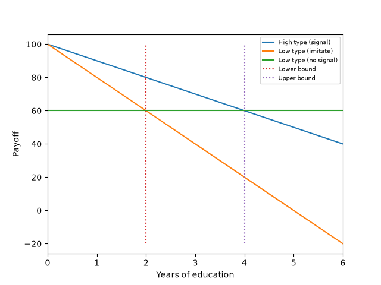
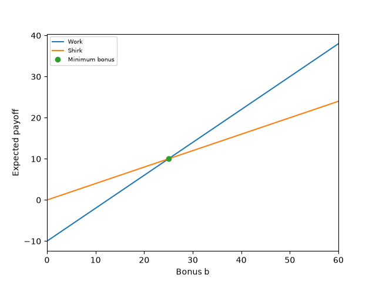

# 第 14 章: 情報の非対称性

## 14.1 この章の地図

市場の取引では、売り手と買い手が、**持っている情報が違う**ことがあります（**情報の非対称性**）。取引の**前**に問題が起きるのが**逆選択**、取引の**後**に起きるのが**モラルハザード**です。この章では、手計算できる小さな離散的な例で、次のことを関数にします。

- **逆選択（レモン市場）**: 買い手が質を見分けられないと、平均の質にしか払わない。すると、良い品の売り手が市場から出て行き、平均の質が下がり、さらに出て行く。**市場が崩れる**
- **シグナル**: 高い能力の人だけが、割に合う費用（教育）を払って、能力を示す。区別がつく教育年数の**範囲**がある
- **モラルハザード**: 依頼人は、努力を観察できない。成果に応じた**報酬**で、努力させる。努力させるのに必要な**最低の成果報酬**がある



| 項目 | 内容 |
| :--- | :--- |
| 経済学の題材 | 逆選択（レモン市場・市場の崩れ）、シグナル（教育）、モラルハザード（プリンシパル・エージェント、成果報酬） |
| 使う Python の機能 | 繰り返し（`while`）、リスト内包表記、条件、`dataclass`は使わず関数だけ、テスト（`pytest`） |
| 新しく導入するライブラリ | なし |
| 完成形 | `expected_value_of_unknown_quality`、`good_quality_sells`、`unraveling`、`separating_education_range`、`signal_separates`、`minimum_bonus`、`agent_works`、`principal_profit_with_bonus`、`worth_paying_bonus` |
| ファイル | 実装: `lib/chapter14/information.py`、`lib/chapter14/plot.py`（図）／テスト: `test/chapter14/test_information.py`、`test/chapter14/test_plot.py`（自分で書くときは、`practice/chapter14/` に、同じ名前で作ります） |
| データ | なし（手計算できる小さな例だけ） |

### 経済学の式とコードの対応

| 経済学 | 式 | コード |
| :--- | :--- | :--- |
| 質が分からない買い手の支払意思額 | 良い品の割合 × 良い品の価値 + 悪い品の割合 × 悪い品の価値 | `expected_value_of_unknown_quality(share, good, bad)` |
| 市場の崩れ | 売られる質の平均 × 倍率が、最低価格（= 質）に届かない質は、出る。繰り返す | `unraveling(qualities, premium)` |
| シグナルの範囲 | (w_高 − w_低) ÷ c_低 ≤ e ≤ (w_高 − w_低) ÷ c_高 | `separating_education_range(...)` |
| 最低の成果報酬 | b = 努力の費用 ÷ (p_高 − p_低) | `minimum_bonus(p_high, p_low, cost)` |
| 依頼人の期待利潤 | p_高 × (V − b) | `principal_profit_with_bonus(...)` |

> **記号の注意**: この章の `w`・`c`・`e`・`p`・`b` は、賃金・教育の費用（1 年あたり）・教育年数・成功確率・成果報酬です。第 11〜13 章の同じ文字（数量・費用・外部費用など）とは、別の意味です（[この記事の読み方](how-to-read.md)を参照）。

### 前提とする章

| できること | 場所 |
| :--- | :--- |
| 期待値（確率で重みづけた平均） | この章の最初の式で、導入します（良い品の割合で重みづける） |
| 関数・内包表記・繰り返し | [第 1 シリーズ](../economics-programming/index.md)の第 3 章 |

## 14.2 準備

```bash
cd apps/micro-basics-programming/python
uv sync
uv run pytest test/chapter14
```

```text
34 passed
```

自分でコードを書くときは、`practice/chapter14/` に、`information.py` とそのテストを作ります。

## 14.3 予想する

**紙で、手計算で**答えてください。答えは、この節には書いてありません。「プログラミング」の節の「予想の答え合わせ」で、プログラムを動かして確かめます。

- 中古車市場で、良い車の価値 100、悪い車の価値 40 で、良い車が半分です。質が分からない買い手の**支払意思額**は、いくつですか。良い車の売り手の最低価格が 60 のとき・80 のとき、良い車は、売られますか
- 質が 20・40・60・80・100 の 5 種類で、売り手の最低価格は質に等しく、買い手の支払意思額は、売られる質の**平均の 1.2 倍・1.5 倍・2 倍**です。それぞれ、市場に**どの質が残る**でしょうか（残らなくなる質を、順に消していきます）
- 高い能力の人の賃金 100、低い能力の人の賃金 60。教育は、1 年あたり、高い能力の人に費用 10、低い能力の人に費用 20 です。**高い能力の人だけが教育を選ぶ**年数の範囲は、いくつですか。教育 1・3・5 年のとき、区別できますか
- 成功すると 100 の価値がある仕事です。努力すると成功確率 0.8、努力しないと 0.4 で、努力の費用は 10 です。成功したときだけ報酬 b を払います。努力させる**最低の報酬**は、いくつですか。そのときの、依頼人の期待利潤は、努力させない場合と比べて、どうなりますか

## 14.4 情報の非対称性の考え方

### 逆選択

中古車の売り手は、質を知っていますが、買い手は、知りません。買い手は、**平均の質**にしか払いません。すると、平均より**良い**車の売り手は、割に合わなくて、市場を出ます。残った車の平均の質は、下がり、買い手の支払意思額も下がり、さらに、その次に良い車が出て行きます。この**連鎖**が、最後まで続けば、**悪い車しか残らない**市場になります（市場の崩れ）。

売り手の最低価格が質に等しく、買い手の評価が高い（倍率が大きい）ほど、崩れは小さくなります。倍率が十分高ければ、**全部が売られます**。

### シグナルとスクリーニング

高い能力の人は、それを**示したい**。能力は見えませんが、**教育**は見えます。教育が、**高い能力の人にとって、より安い**（1 年あたりの費用が小さい）なら、教育が、シグナルになります。

- 低い能力の人が、教育を**まねしない**条件: 教育の費用が、賃金の差を上回る → e ≥ (w_高 − w_低) ÷ c_低
- 高い能力の人が、教育を**選ぶ**条件: 賃金の差が、教育の費用を上回る → e ≤ (w_高 − w_低) ÷ c_高

この範囲の教育年数なら、教育が、能力を**区別**します。ただし、教育は、**生産性を上げないなら、社会的には浪費**です（能力を示す費用だけが、かかります）。逆に、**情報を持たない側**が、選択肢を用意して、相手に選ばせ、情報を引き出すのが、**スクリーニング**（自己選択）です。

### モラルハザード

依頼人（プリンシパル）は、代理人（エージェント）の**努力を観察できません**。成果（成功・失敗）だけが見えます。固定の賃金では、努力しても、しなくても同じなので、代理人は努力しません。そこで、**成功したときだけ、報酬 b**を払います。代理人が努力する条件は、

- 努力する期待報酬 p_高·b − 費用 ≥ 努力しない期待報酬 p_低·b
- すなわち **b ≥ 費用 ÷ (p_高 − p_低)**（成功確率の差が小さいほど、高い報酬が必要）

依頼人にとって、努力させる価値があるのは、**報酬を払っても、期待利潤が、努力しない場合を上回る**ときです。

## 14.5 プログラミング

### Red: 質が分からない買い手

最初のテストを書きます。良い品の割合が 0.5、価値が 100 と 40 なら、支払意思額は 70 です。

```python
import pytest

from lib.chapter14.information import (
    agent_works,
    expected_value_of_unknown_quality,
    good_quality_sells,
    minimum_bonus,
    principal_profit_with_bonus,
    separating_education_range,
    signal_separates,
    unraveling,
    worth_paying_bonus,
)
```

```python
def test_質が分からない買い手の支払意思額は期待値() -> None:
    assert expected_value_of_unknown_quality(0.5, 100, 40) == pytest.approx(70)
    assert expected_value_of_unknown_quality(1, 100, 40) == 100
    assert expected_value_of_unknown_quality(0, 100, 40) == 40


def test_良い品の割合は0から1() -> None:
    with pytest.raises(ValueError, match="割合"):
        expected_value_of_unknown_quality(1.1, 100, 40)
    with pytest.raises(ValueError, match="割合"):
        expected_value_of_unknown_quality(-0.1, 100, 40)


def test_良い品が売られるのは期待値が売り手の最低価格以上のとき() -> None:
    assert good_quality_sells(0.5, 100, 40, seller_reservation=60)
    assert good_quality_sells(0.5, 100, 40, seller_reservation=70)
    assert not good_quality_sells(0.5, 100, 40, seller_reservation=80)


def test_良い品の割合が低いと良い品が市場から消える() -> None:
    assert good_quality_sells(0.8, 100, 40, 70)
    assert not good_quality_sells(0.3, 100, 40, 70)
```

`expected_value_of_unknown_quality` などがまだないので、テストは失敗します（**Red**）。テストの import は、書いた関数だけを、1 つずつ足してかまいません（[第 5 章](05-cost-curves.md)の注意を参照）。

### Green: 逆選択

```python
def _check_share(share: float) -> None:
    if not 0 <= share <= 1:
        raise ValueError("良い品の割合は、0 以上 1 以下にする")


def expected_value_of_unknown_quality(
    good_share: float, value_good: float, value_bad: float
) -> float:
    """質が分からない買い手の、支払意思額 = 良い品の割合で重みづけた、価値の期待値。"""
    _check_share(good_share)
    return good_share * value_good + (1 - good_share) * value_bad


def good_quality_sells(
    good_share: float,
    value_good: float,
    value_bad: float,
    seller_reservation: float,
) -> bool:
    """良い品が、市場に出るか。期待値が、良い品の売り手の最低価格以上のとき。"""
    return (
        expected_value_of_unknown_quality(good_share, value_good, value_bad)
        >= seller_reservation
    )
```

??? note "import と補助関数（写すときに足す）"

    記事の抜粋には、import と、先頭が `_` の補助関数・定数を、省いています。完成形のファイルの先頭にある、次の部分を、写してください。

    **lib/chapter14/information.py**

    ```python
    from collections.abc import Sequence
    ```

    ```python
    from lib.chapter01.validation import validate_non_negative, validate_positive
    ```

    ```python
    def _check_share(share: float) -> None:
        if not 0 <= share <= 1:
            raise ValueError("良い品の割合は、0 以上 1 以下にする")
    ```

    ```python
    def _check_probabilities(p_high: float, p_low: float) -> None:
        if not 0 <= p_low < p_high <= 1:
            raise ValueError("成功確率は、0 ≤ 努力しない < 努力する ≤ 1 にする")
    ```

    **lib/chapter14/plot.py**

    ```python
    import matplotlib.pyplot as plt
    from matplotlib.axes import Axes
    from matplotlib.figure import Figure
    ```

    ```python
    from lib.chapter14.information import (
        minimum_bonus,
        separating_education_range,
    )
    ```

    ```python
    def _style(ax: Axes, x_max: float, xlabel: str, ylabel: str) -> None:
        ax.set_xlabel(xlabel)
        ax.set_ylabel(ylabel)
        ax.set_xlim(0, x_max)
        ax.legend(fontsize="x-small")
    ```

    **test/chapter14/test_plot.py**

    ```python
    from collections.abc import Sequence
    from typing import cast
    ```

    ```python
    import pytest
    from matplotlib.axes import Axes
    from matplotlib.lines import Line2D
    ```

    ```python
    from lib.chapter14.plot import plot_bonus, plot_signal
    ```

### 市場の崩れを繰り返しで求める

質の種類が多いときは、**崩れの連鎖**を、繰り返しで求めます。残る質が、変わらなくなるまで、価格を計算し直します。

```python
def test_逆選択は市場が崩れる() -> None:
    # 質 20〜100 の 5 種類。売り手の最低価格 = 質、買い手の支払意思額 = 質の平均 × 1.2
    assert unraveling([20, 40, 60, 80, 100], 1.2) == [20]


def test_買い手の評価が高いと一部だけが残る() -> None:
    assert unraveling([20, 40, 60, 80, 100], 1.5) == [20, 40, 60]


def test_買い手の評価が十分高ければ全部が売られる() -> None:
    assert unraveling([20, 40, 60, 80, 100], 2.0) == [20, 40, 60, 80, 100]


def test_質が1種類だけなら崩れない() -> None:
    assert unraveling([50], 1.0) == [50]


def test_市場が崩れる入力のチェック() -> None:
    with pytest.raises(ValueError, match="質"):
        unraveling([], 1.2)
    with pytest.raises(ValueError, match="評価"):
        unraveling([20, 40], 0)


def test_買い手が質を見分けられない市場では売り手の順序は入力の順に依らない() -> None:
    assert unraveling([100, 20, 80, 40, 60], 1.5) == [20, 40, 60]


def test_買い手の評価が低すぎると市場が消える() -> None:
    assert unraveling([20, 40], 0.5) == []
```

```python
def unraveling(qualities: Sequence[float], premium: float) -> list[float]:
    """市場が崩れる過程。売り手の最低価格は質、買い手の支払意思額は平均 × premium。

    価格が最低価格に届かない質は、市場から出る。変わらなくなるまで、繰り返す。
    """
    if not qualities:
        raise ValueError("質が、1 つもありません")
    validate_positive(premium, "買い手の評価の倍率は、正にする")
    selling = sorted(qualities)
    while selling:
        price = premium * sum(selling) / len(selling)
        remaining = [quality for quality in selling if quality <= price]
        if remaining == selling:
            break
        selling = remaining
    return selling
```

`while selling:` の中で、価格 = 倍率 × 平均を求め、価格以下の質だけを残します。残りが前と**同じなら**止めます（`break`）。倍率 1.2 では、[20, 40, 60, 80, 100] → [20, 40, 60] → [20, 40] → [20] と、**20 だけが残ります**。

### シグナル

```python
def test_シグナルで高い能力の人だけが選ぶ教育年数の範囲() -> None:
    low, high = separating_education_range(
        wage_high=100, wage_low=60, cost_high=10, cost_low=20
    )
    assert (low, high) == (pytest.approx(2), pytest.approx(4))


def test_範囲の中の教育年数なら高い能力の人だけが教育を選ぶ() -> None:
    args = {"wage_high": 100, "wage_low": 60, "cost_high": 10, "cost_low": 20}
    assert signal_separates(3, **args)
    assert signal_separates(2, **args)
    assert signal_separates(4, **args)
    assert not signal_separates(1, **args)
    assert not signal_separates(5, **args)


def test_シグナルの費用が同じなら区別できない() -> None:
    with pytest.raises(ValueError, match="費用"):
        separating_education_range(100, 60, 20, 20)
    with pytest.raises(ValueError, match="費用"):
        separating_education_range(100, 60, 30, 20)


def test_シグナルの賃金は高い能力の方が高い() -> None:
    with pytest.raises(ValueError, match="賃金"):
        separating_education_range(60, 100, 10, 20)
    with pytest.raises(ValueError, match="賃金"):
        separating_education_range(100, 100, 10, 20)


def test_教育の費用が負ならエラー() -> None:
    with pytest.raises(ValueError, match="費用"):
        separating_education_range(100, 60, 0, 20)
```

```python
def separating_education_range(
    wage_high: float, wage_low: float, cost_high: float, cost_low: float
) -> tuple[float, float]:
    """高い能力の人だけが、教育を選ぶ、教育年数 e の範囲。

    低い能力の人は、まねしない: w_low ≥ w_high − c_low·e
        → e ≥ (w_high − w_low) ÷ c_low
    高い能力の人は、選ぶ: w_high − c_high·e ≥ w_low
        → e ≤ (w_high − w_low) ÷ c_high
    """
    if wage_high <= wage_low:
        raise ValueError("賃金は、高い能力の方を高くする")
    validate_positive(cost_high, "教育の費用は、正にする")
    if cost_low <= cost_high:
        raise ValueError("教育の費用は、低い能力の人の方を大きくする")
    premium = wage_high - wage_low
    return premium / cost_low, premium / cost_high


def signal_separates(
    education: float,
    wage_high: float,
    wage_low: float,
    cost_high: float,
    cost_low: float,
) -> bool:
    """教育年数 e で、高い能力の人だけが、教育を選ぶか。"""
    low, high = separating_education_range(wage_high, wage_low, cost_high, cost_low)
    return low <= education <= high
```

賃金の差 40 を、1 年あたりの費用で割ると、低い能力の人は 40 ÷ 20 = 2 年、高い能力の人は 40 ÷ 10 = 4 年が、境目で、**2 年〜4 年**が区別できる範囲です。下の端（2 年）は、**低い能力の人**が、教育しても、しなくても、同じになる年数。上の端（4 年）は、**高い能力の人**が、同じになる年数です。両端を範囲に含めるのは、無差別のとき、望ましい側（低い能力の人はまねしない、高い能力の人は選ぶ）に倒す、という約束です。

### モラルハザード

```python
def test_努力させるのに必要な最低の成果報酬() -> None:
    assert minimum_bonus(0.8, 0.4, effort_cost=10) == pytest.approx(25)
    assert minimum_bonus(0.9, 0.3, effort_cost=12) == pytest.approx(20)


def test_成果報酬が最低額以上なら努力する() -> None:
    assert agent_works(25, 0.8, 0.4, 10)
    assert agent_works(30, 0.8, 0.4, 10)
    assert not agent_works(24, 0.8, 0.4, 10)
    assert not agent_works(0, 0.8, 0.4, 10)


def test_努力しても成功確率が変わらないなら報酬で動かせない() -> None:
    with pytest.raises(ValueError, match="確率"):
        minimum_bonus(0.5, 0.5, 10)
    with pytest.raises(ValueError, match="確率"):
        minimum_bonus(0.4, 0.8, 10)
    with pytest.raises(ValueError, match="確率"):
        minimum_bonus(1.1, 0.4, 10)


def test_努力させたときの依頼人の期待利潤() -> None:
    assert principal_profit_with_bonus(100, 0.8, 0.4, 10) == pytest.approx(
        0.8 * (100 - 25)
    )


def test_努力させる価値があるのは利潤が努力なしを上回るとき() -> None:
    assert worth_paying_bonus(100, 0.8, 0.4, 10)
    assert not worth_paying_bonus(100, 0.8, 0.4, 50)


def test_努力の費用が負ならエラー() -> None:
    with pytest.raises(ValueError, match="費用"):
        minimum_bonus(0.8, 0.4, -1)
```

```python
def _check_probabilities(p_high: float, p_low: float) -> None:
    if not 0 <= p_low < p_high <= 1:
        raise ValueError("成功確率は、0 ≤ 努力しない < 努力する ≤ 1 にする")


def minimum_bonus(p_high: float, p_low: float, effort_cost: float) -> float:
    """努力させる、最低の成果報酬 b = 努力の費用 ÷ (p_high − p_low)。"""
    _check_probabilities(p_high, p_low)
    validate_non_negative(effort_cost, "努力の費用は、0 以上にする")
    return effort_cost / (p_high - p_low)


def agent_works(bonus: float, p_high: float, p_low: float, effort_cost: float) -> bool:
    """努力すると、期待報酬 p_high·b − 費用 が、努力しない p_low·b 以上になるか。"""
    _check_probabilities(p_high, p_low)
    return bonus >= minimum_bonus(p_high, p_low, effort_cost)


def principal_profit_with_bonus(
    value: float, p_high: float, p_low: float, effort_cost: float
) -> float:
    """最低の成果報酬で、努力させたときの、依頼人の期待利潤 p_high·(V − b)。"""
    bonus = minimum_bonus(p_high, p_low, effort_cost)
    return p_high * (value - bonus)


def worth_paying_bonus(
    value: float, p_high: float, p_low: float, effort_cost: float
) -> bool:
    """努力させる利潤が、努力しない場合の期待利潤 p_low·V を、上回るか。"""
    return (
        principal_profit_with_bonus(value, p_high, p_low, effort_cost) > p_low * value
    )
```

### 予想の答え合わせ

予想した答えを、プログラムで確かめます。

> このスクリプトは、**完成形**（`lib/`）を読みます。**自分のコードで確かめる**ときは、import を、`from practice.chapterNN...` に書き換えてください。

```python
from lib.chapter14.information import (
    agent_works,
    expected_value_of_unknown_quality,
    good_quality_sells,
    minimum_bonus,
    principal_profit_with_bonus,
    separating_education_range,
    signal_separates,
    unraveling,
    worth_paying_bonus,
)

print("質が分からない買い手の支払意思額 (良い品 50%):", expected_value_of_unknown_quality(0.5, 100, 40))
print("良い品は売られるか 最低価格 60・80:", good_quality_sells(0.5, 100, 40, 60), good_quality_sells(0.5, 100, 40, 80))
qualities = [20, 40, 60, 80, 100]
for premium in (1.2, 1.5, 2.0):
    print("評価の倍率", premium, "→ 市場に残る質:", unraveling(qualities, premium))
low, high = separating_education_range(wage_high=100, wage_low=60, cost_high=10, cost_low=20)
print("教育年数の範囲:", low, high)
print("教育 1・3・5 年で区別できるか:", [signal_separates(e, 100, 60, 10, 20) for e in (1, 3, 5)])
print("最低の成果報酬:", minimum_bonus(0.8, 0.4, 10))
print("報酬 24・25 で努力するか:", agent_works(24, 0.8, 0.4, 10), agent_works(25, 0.8, 0.4, 10))
print("依頼人の期待利潤 (努力させる):", principal_profit_with_bonus(100, 0.8, 0.4, 10), "努力なし:", 0.4 * 100)
print("努力させる価値 費用 10・50:", worth_paying_bonus(100, 0.8, 0.4, 10), worth_paying_bonus(100, 0.8, 0.4, 50))
```

```text
質が分からない買い手の支払意思額 (良い品 50%): 70.0
良い品は売られるか 最低価格 60・80: True False
評価の倍率 1.2 → 市場に残る質: [20]
評価の倍率 1.5 → 市場に残る質: [20, 40, 60]
評価の倍率 2.0 → 市場に残る質: [20, 40, 60, 80, 100]
教育年数の範囲: 2.0 4.0
教育 1・3・5 年で区別できるか: [False, True, False]
最低の成果報酬: 25.0
報酬 24・25 で努力するか: False True
依頼人の期待利潤 (努力させる): 60.0 努力なし: 40.0
努力させる価値 費用 10・50: True False
```

- **1 つ目の問い**: 支払意思額は 70 です。最低価格が 60 なら、良い車は売られ、80 なら、売られません（市場から消えます）
- **2 つ目の問い**: 倍率 1.2 では 20 だけ、1.5 では 20・40・60、2.0 では**全部**が、残ります。評価が高いほど、市場が崩れにくくなります
- **3 つ目の問い**: 範囲は 2〜4 年です。1 年では、低い能力の人も、まねします（区別できない）。3 年は区別できます。5 年は、高い能力の人にとっても、割に合いません
- **4 つ目の問い**: 最低の報酬は 25 です（24 では努力せず、25 なら努力する）。努力させたときの、依頼人の期待利潤は 60 で、努力させない場合の 40 より大きく、努力させる価値があります。努力の費用が 50 なら、報酬が 125 になり、割に合いません

### 図

シグナルの図は、章の最初に載せました。成果報酬の図は、報酬 b ごとの、努力する場合（青）と、しない場合（橙）の、期待利得です。2 本が交わる点が、最低の成果報酬 25 です。



??? note "描画のテストと実装（後回しにしても、学習は成り立ちます）"

    ```python
    def xs(line: Line2D) -> list[float]:
        return [float(v) for v in cast(Sequence[float], line.get_xdata())]


    def ys(line: Line2D) -> list[float]:
        return [float(v) for v in cast(Sequence[float], line.get_ydata())]


    def line(ax: Axes, label: str) -> Line2D:
        return next(item for item in ax.lines if item.get_label() == label)


    def signal() -> Axes:
        return plot_signal(100, 60, 10, 20, 6).axes[0]


    def bonus() -> Axes:
        return plot_bonus(0.8, 0.4, 10, 60).axes[0]


    def test_シグナルの図の線() -> None:
        assert [item.get_label() for item in signal().lines] == [
            "High type (signal)",
            "Low type (imitate)",
            "Low type (no signal)",
            "Lower bound",
            "Upper bound",
        ]


    def test_高い能力の人の利得は教育で下がる() -> None:
        high = line(signal(), "High type (signal)")
        assert xs(high) == [0, 6]
        assert ys(high) == [100, pytest.approx(100 - 10 * 6)]


    def test_低い能力の人がまねした利得は急に下がる() -> None:
        low = line(signal(), "Low type (imitate)")
        assert ys(low) == [100, pytest.approx(100 - 20 * 6)]


    def test_教育しない低い能力の人の利得は水平線() -> None:
        flat = line(signal(), "Low type (no signal)")
        assert ys(flat) == [60, 60]
        assert xs(flat) == [0, 6]


    def test_教育年数の範囲の端は2年と4年() -> None:
        ax = signal()
        assert xs(line(ax, "Lower bound")) == [pytest.approx(2)] * 2
        assert xs(line(ax, "Upper bound")) == [pytest.approx(4)] * 2
        assert line(ax, "Lower bound").get_linestyle() == ":"


    def test_シグナルの図の軸と凡例() -> None:
        ax = signal()
        assert ax.get_xlim() == (0, 6)
        assert ax.get_xlabel() == "Years of education"
        assert ax.get_ylabel() == "Payoff"
        assert ax.get_legend() is not None


    def test_成果報酬の図の線() -> None:
        assert [item.get_label() for item in bonus().lines] == [
            "Work",
            "Shirk",
            "Minimum bonus",
        ]


    def test_努力する期待利得と努力しない期待利得() -> None:
        ax = bonus()
        work, shirk = line(ax, "Work"), line(ax, "Shirk")
        assert xs(work) == [0, 60]
        assert ys(work) == [pytest.approx(-10), pytest.approx(0.8 * 60 - 10)]
        assert ys(shirk) == [0, pytest.approx(0.4 * 60)]


    def test_最低の成果報酬で2本の線が交わる() -> None:
        point = line(bonus(), "Minimum bonus")
        assert xs(point) == [pytest.approx(25)]
        assert ys(point) == [pytest.approx(0.4 * 25)]


    def test_成果報酬の図の軸と凡例() -> None:
        ax = bonus()
        assert ax.get_xlim() == (0, 60)
        assert ax.get_xlabel() == "Bonus b"
        assert ax.get_ylabel() == "Expected payoff"
        assert ax.get_legend() is not None
    ```

    ```python
    def plot_signal(
        wage_high: float,
        wage_low: float,
        cost_high: float,
        cost_low: float,
        e_max: float,
    ) -> Figure:
        """教育年数ごとの利得。範囲の中なら、高い能力の人だけが、教育を選ぶ。"""
        low, high = separating_education_range(wage_high, wage_low, cost_high, cost_low)
        y_min = wage_high - cost_low * e_max
        fig, ax = plt.subplots()
        ax.plot(
            [0, e_max],
            [wage_high, wage_high - cost_high * e_max],
            label="High type (signal)",
        )
        ax.plot(
            [0, e_max],
            [wage_high, wage_high - cost_low * e_max],
            label="Low type (imitate)",
        )
        ax.plot([0, e_max], [wage_low, wage_low], label="Low type (no signal)")
        ax.plot([low, low], [y_min, wage_high], linestyle=":", label="Lower bound")
        ax.plot([high, high], [y_min, wage_high], linestyle=":", label="Upper bound")
        _style(ax, e_max, "Years of education", "Payoff")
        plt.close(fig)
        return fig


    def plot_bonus(p_high: float, p_low: float, effort_cost: float, b_max: float) -> Figure:
        """成果報酬 b ごとの、努力する・しない場合の、期待利得。交点が最低の成果報酬。"""
        bonus = minimum_bonus(p_high, p_low, effort_cost)
        fig, ax = plt.subplots()
        ax.plot([0, b_max], [-effort_cost, p_high * b_max - effort_cost], label="Work")
        ax.plot([0, b_max], [0, p_low * b_max], label="Shirk")
        ax.plot([bonus], [p_low * bonus], "o", label="Minimum bonus")
        _style(ax, b_max, "Bonus b", "Expected payoff")
        plt.close(fig)
        return fig
    ```

### 実行結果

```bash
uv run pytest test/chapter14
```

```text
34 passed
```

## 14.6 規則で言うと

1. **質が見えないと、平均にしか払われず、良い品が出て行く（逆選択）。** 買い手の評価が高ければ、崩れない
2. **能力は、高い能力の人に安い費用で示せる教育で、区別できる。** 範囲の中の年数なら、区別がつく
3. **努力が見えないと、成果報酬で動かす。** 最低の報酬は、費用 ÷ 成功確率の差

混同しやすい点を、表にまとめます。

| 混同しやすい点 | 違い |
| :--- | :--- |
| 逆選択とモラルハザード | 逆選択は、取引の**前**に、質の情報が非対称。モラルハザードは、取引の**後**に、行動が観察できない |
| シグナルとスクリーニング | シグナルは、**情報を持つ側**が、示す。スクリーニングは、**持たない側**が、選択肢を用意して、選ばせる |
| 成果報酬と固定賃金 | 固定賃金では、努力しても同じなので、努力の誘因がない。成果報酬は、誘因を与えるが、**リスク**を負わせる（この章は、リスク中立を仮定した） |
| 市場の崩れと取引の停止 | 崩れても、**悪い品だけ**は、取引される。市場が、全くなくなるのは、買い手の評価が低すぎるとき（テストの最後） |

### このモデルが成り立たない場面

- **離散的な、小さな例です。** 教科書や論文により、数値や前提が違います。この章は、前提を、明示しました（売り手の最低価格が質に等しい、など）
- **能力や質の種類を、少数にしました。** 連続的な質の分布では、式が変わります
- **シグナルは、生産性を上げないと仮定しました。** 教育が、生産性も上げるなら、社会的な評価が変わります
- **成果報酬は、リスク中立の代理人を仮定しました。** リスク回避的なら、保険と誘因の間の、トレードオフが生じます
- **保証・ブランド・評判・規制で、逆選択は、緩和されます。** 中古車の保証は、質のシグナルです

## 14.7 第 4 部の到達チェック

第 4 部（第 11〜14 章）の終わりです。何も見ずに、できるかどうかを、自分で確かめます。**先に、次の「時間を決めて書く課題」を、何も見ずに試してください。** そのあとで、「値の確かめ」と「できること」で、答えを見ます。

### 時間を決めて書く課題

何も見ずに、時間を計って、関数とテストを書きます。課題 1 の市場は、逆需要 P = 100 − Q、限界費用 10 です。課題 3 の市場は、逆需要 P = 100 − Q、**私的限界費用 MC = 10 + Q**（外部費用は 1 単位あたり 10）です。

| 課題 | 目安の時間 |
| :--- | :--- |
| 独占の数量・価格と、完全競争の数量・価格を返す関数と、テスト | 15 分 |
| 囚人のジレンマ（T = 5、R = 3、P = 1、S = 0）のナッシュ均衡と、トリガー戦略で協調が続く割引因子の閾値を返す関数と、テスト | 20 分 |
| 外部費用 10 のピグー税と、税のもとの数量（最適な数量）を返す関数と、テスト（市場は、上の MC = 10 + Q） | 15 分 |
| 質が 20・40・60・80・100 で、買い手の評価が平均の 1.5 倍のとき、市場に残る質を返す関数と、テスト | 15 分 |

### 値の確かめ

到達チェックの値を、プログラムで確かめます。各章の関数を、そのまま呼びます。

「値の確かめ」のスクリプトは、`practice/chapter14/reach.py` に保存し、`uv run python -m practice.chapter14.reach` で実行します。このスクリプトは、**完成形**（`lib/`）を読みます。**自分のコードで確かめる**ときは、import を、`from practice.chapterNN...` に書き換えてください。

```python
from lib.chapter11.monopoly import Monopoly, competitive_outcome, monopoly_outcome
from lib.chapter12.game import prisoners_dilemma, pure_nash_equilibria
from lib.chapter12.repeated import cooperation_threshold
from lib.chapter13.externality import (
    ExternalityMarket,
    pigou_tax,
    quantity_with_tax,
    socially_optimal_quantity,
)
from lib.chapter13.natural import average_cost_pricing
from lib.chapter14.information import minimum_bonus, unraveling

demand = Monopoly(demand_intercept=100, demand_slope=1, marginal_cost=10)
m, c = monopoly_outcome(demand), competitive_outcome(demand)
print("独占: 数量", m.quantity, "価格", m.price, "/ 完全競争: 数量", c.quantity, "価格", c.price)
game = prisoners_dilemma(temptation=5, reward=3, punishment=1, sucker=0)
print("ナッシュ均衡:", pure_nash_equilibria(game), "割引因子の閾値:", cooperation_threshold(5, 3, 1))
market = ExternalityMarket(100, 1, 10, 1, 10)
print("ピグー税:", pigou_tax(market), "最適数量:", socially_optimal_quantity(market), "税のもとの数量:", quantity_with_tax(market, 10))
ac = average_cost_pricing(demand, 800)
print("平均費用価格形成: 価格", ac.price, "数量", ac.quantity, "利潤", ac.profit)
print("逆選択 (倍率 1.5): 市場に残る質", unraveling([20, 40, 60, 80, 100], 1.5))
print("最低の成果報酬:", minimum_bonus(0.8, 0.4, 10))
```

```text
独占: 数量 45.0 価格 55.0 / 完全競争: 数量 90.0 価格 10.0
ナッシュ均衡: [(1, 1)] 割引因子の閾値: 0.5
ピグー税: 10 最適数量: 40.0 税のもとの数量: 40.0
平均費用価格形成: 価格 20.0 数量 80.0 利潤 0.0
逆選択 (倍率 1.5): 市場に残る質 [20, 40, 60]
最低の成果報酬: 25.0
```

### できること

| できること | 検証の方法 | 戻る章 |
| :--- | :--- | :--- |
| 独占の数量・価格を求め、完全競争と比べる | 独占は数量 45・価格 55、完全競争は数量 90・価格 10（死荷重 1012.5） | [第 11 章](11-monopoly-and-monopolistic-competition.md) |
| 利得表からナッシュ均衡を求め、協調が続く条件を言う | 均衡は（裏切り、裏切り）だけ。割引因子の閾値は 0.5 | [第 12 章](12-oligopoly-and-game-theory.md) |
| 外部効果をピグー税で是正する | 外部費用 10 のピグー税 10 で、数量が最適な 40 になる | [第 13 章](13-externality-public-goods-and-natural-monopoly.md) |
| 自然独占の価格規制を比べる | 平均費用価格形成で、価格 20・数量 80・利潤 0 | 第 13 章 |
| 逆選択による市場の崩れを求める | 評価が 1.5 倍なら、質 20・40・60 が残る | [この章](14-information-asymmetry.md) |
| 努力させる最低の成果報酬を求める | 費用 10、成功確率 0.8 と 0.4 で、報酬 25 | この章 |

自然独占（第 13 章）と成果報酬（この章）は、時間の都合で、課題に入れていません。値の確かめの出力を見て、自分で、関数とテストを書いてみてください。

### 誤りの原因の分類

できなかった課題は、原因を、次の 4 つに分けて、記録します。

| 分類 | 例 | 対策 |
| :--- | :--- | :--- |
| 知識の不足 | 限界収入の傾きが 2 倍であることを忘れた／支配戦略とナッシュ均衡を混ぜた | 「規則で言うと」の混同の表を、読み直す |
| 式の取り違え | 独占の数量を、P = MC で求めた（MR = MC のはず）／閾値の式の、分子と分母を逆にした | 式とコードの対応表を、書き写す。MR = MC、δ\* = (T − R) ÷ (T − P) |
| 手順の誤り | 市場の崩れを、1 回の計算で止めた（変わらなくなるまで繰り返す） | 「前と同じなら止める」条件を、先に書く |
| 不注意 | 外部費用の符号（外部経済は負）や、T・R・P・S の順を、見間違えた | 例を 1 つ、手で計算してから、コードを書く |

## 14.8 練習問題

| 種類 | 問題 |
| :--- | :--- |
| 想起 | 本文を閉じて、`unraveling` の最初のテスト（質 20〜100、倍率 1.2 で [20] が残る）を書いてください |
| 生成 | 解説を見る前に、**努力させる最低の報酬を払ったときの、代理人の期待報酬**（成功確率 × 報酬）を返す `agent_expected_pay(p_high, p_low, effort_cost)` を、テストから書いてください。この例では 0.8 × 25 = 20 です |
| 多様 | 努力の費用が 10 から 20 に上がると、最低の成果報酬は、いくつになりますか。先に予想してから、確かめてください |
| 交互 | [第 1 シリーズ](../economics-programming/index.md)の第 3 章のリスト内包表記で、倍率 1.0・1.2・1.5・2.0 の、市場に残る質の**数**を、一度に求めてください。倍率が上がると、残る数は、どうなりますか |

??? note "解答（先に自分で取り組んでから、開いてください）"

    **想起**:

    ```python
    def test_練習問題の市場の崩れ() -> None:
        assert unraveling([20, 40, 60, 80, 100], 1.2) == [20]
    ```

    **生成**: 最低の報酬に、努力する場合の成功確率を掛けます。

    ```python
    def agent_expected_pay(p_high, p_low, effort_cost):
        return p_high * minimum_bonus(p_high, p_low, effort_cost)
    ```

    ```python
    def test_練習問題の代理人の期待報酬() -> None:
        assert agent_expected_pay(0.8, 0.4, 10) == pytest.approx(20)
    ```

    **多様**: 努力の費用が 2 倍の 20 なら、最低の報酬も 2 倍の 50 です（費用に比例します）。

    ```python
    def test_練習問題の努力の費用が上がった場合() -> None:
        assert minimum_bonus(0.8, 0.4, 20) == pytest.approx(50)
    ```

    **交互**: 倍率が上がるほど、残る質が、増えます（1.0 で 1 種類、2.0 で 5 種類）。

    ```python
    def test_練習問題の倍率と残る質の数() -> None:
        counts = [len(unraveling([20, 40, 60, 80, 100], m)) for m in (1.0, 1.2, 1.5, 2.0)]
        assert counts == [1, 1, 3, 5]
    ```

## 14.9 振り返り

- うまくいったこと:
- 詰まったこと:
- 次に試すこと:

## 14.10 まとめ

- 逆選択では、買い手が平均にしか払わず、良い品が出て行く連鎖で、市場が崩れる。買い手の評価が高ければ、崩れない
- シグナルは、高い能力の人に安い費用の行動（教育）で、能力を区別する。区別できる年数の範囲は、賃金の差を、費用で割った 2 つの値で決まる
- モラルハザードでは、成果報酬で努力させる。最低の報酬は、努力の費用 ÷ 成功確率の差。努力させる価値があるかは、依頼人の期待利潤で決まる

### 連載の終わりに

14 章で、ミクロ経済学の基礎（消費者・企業・市場・不完全競争・市場の失敗・情報）を、**テストを書き、動かして確かめる**形で、一通り扱いました。次に進む道は、3 つあります。

- **同じ道具で、実データを扱う**: [計量経済学のためのプログラミング](../econometrics-programming/index.md)で、回帰・仮説検定・因果推論に進みます
- **マクロへ**: [マクロ経済学のためのプログラミング（初級）](../macro-basics-programming/index.md)で、GDP・IS-LM・成長を、同じ形で扱います
- **経済学の考え方に戻る**: 各章の「このモデルが成り立たない場面」を、読み直して、仮定を変えて、もう一度、動かしてみてください
