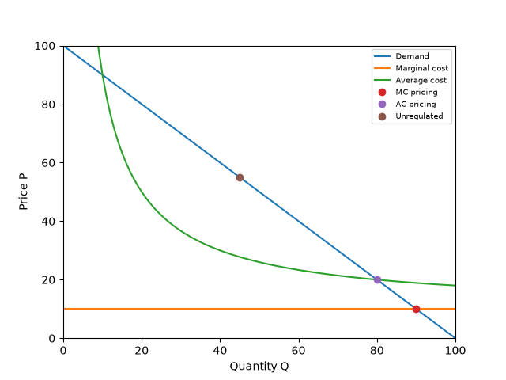

# 第 15 章: 公共財と自然独占

## 15.1 この章の地図

前の章の外部効果に続いて、市場が失敗する、あと 2 つの場面を扱います。

- **公共財**: **非競合性**（みんなが同時に使える）と**非排除性**（払わない人を排除できない）を持つ財。**フリーライダー**がいるので、自発的な供給は、**過少**になる
- **費用逓減産業（自然独占）**: 固定費用が大きく、平均費用が下がり続ける。限界費用で価格を決めると**赤字**、規制しないと**独占**になる



| 項目 | 内容 |
| :--- | :--- |
| 経済学の題材 | 公共財とフリーライダー、財の 4 分類、自然独占の価格規制 |
| 使う Python の機能 | `dataclass`（`frozen=True`、`replace`）、内包表記、`math.sqrt`、テスト（`pytest`） |
| 新しく導入するライブラリ | なし |
| 完成形 | `PublicGood`、`public_good_optimal_quantity`、`individual_quantity`、`voluntary_quantity`、`under_provision`、`classify_good`、`natural_average_cost`、`marginal_cost_pricing`、`average_cost_pricing`、`unregulated_outcome`、`required_subsidy` |
| ファイル | 実装: `lib/chapter15/public.py`、`natural.py`、`plot.py`（図）／テスト: `test/chapter15/` の同名のファイル（自分で書くときは、`practice/chapter15/` に、同じ名前で作ります） |
| データ | なし（手計算できる小さな例だけ） |

### 経済学の式とコードの対応

| 経済学 | 式 | コード |
| :--- | :--- | :--- |
| 公共財の最適量 | 限界便益の縦の和 Σ MB_i = MC | `public_good_optimal_quantity(good)` |
| 自発的な供給量 | 最も欲しい 1 人の量 | `voluntary_quantity(good)` |
| 平均費用価格 | P = AC から b·Q² − (a − c)·Q + F = 0 | `average_cost_pricing(monopoly, F)` |
| 限界費用価格の赤字 | 利潤 = −F | `marginal_cost_pricing(monopoly, F)`、`required_subsidy` |

> **記号の注意**: この章の `a`・`b`・`c` は、逆需要 P = a − b·Q の切片・傾きと、限界費用です。`F` は固定費用です。

### 前提とする章

| できること | 場所 |
| :--- | :--- |
| 独占の価格と数量 | この連載の[第 11 章](11-monopoly-and-monopolistic-competition.md)（`lib.chapter11.monopoly` を使います） |
| 余剰 | この連載の[第 9 章](09-surplus-and-tax.md) |

## 15.2 準備

```bash
cd apps/micro-basics-programming/python
uv sync
uv run pytest test/chapter15
```

```text
30 passed
```

自分でコードを書くときは、`practice/chapter15/` に、`public.py`・`natural.py` と、それぞれのテストをを作ります。

## 15.3 予想する

**紙で、手計算で**答えてください。答えは、この節には書いてありません。「プログラミング」の節の「予想の答え合わせ」で、プログラムを動かして確かめます。

- 2 人の公共財（限界便益 40 − 2q と 20 − q、限界費用 30）の、最適な供給量と、自発的な供給量は、いくつですか
- 自然独占（P = 100 − Q、限界費用 10、固定費用 800）で、限界費用価格・平均費用価格・規制なしの、価格・数量・利潤は、いくつですか

## 15.4 公共財と自然独占の考え方

### 公共財

**非競合性**（一人が使っても、他の人の分は減らない）と**非排除性**（払わない人を排除できない）を持つ財です。財は、この 2 つで、4 つに分かれます。

| | 排除できる | 排除できない |
| :--- | :--- | :--- |
| **競合する** | 私的財（パン） | 共有資源（漁場） |
| **競合しない** | クラブ財（有料の道路） | 公共財（国防・灯台） |

公共財は、全員が同時に消費できるので、社会全体の限界便益は、各人の限界便益を**縦に足す**（Σ MB_i）。最適な供給量は、Σ MB_i = MC の点です（限界便益が 0 になる数量を超えた人は、足しません。負の便益を足さないため）。しかし、払わなくても使える（**フリーライダー**）ので、自発的には、最も欲しい 1 人が供給する量しか出ず、**過少供給**になります。

### 費用逓減産業（自然独占）

固定費用 F が大きく、平均費用 AC = c + F ÷ Q が、限界費用 c より常に高く、右下がりの産業です（電力網・水道）。1 社で供給する方が、安い（**自然独占**）。価格の決め方が、3 通りあります。

- **規制しない独占**: MR = MC。価格が高く、数量が少ない
- **限界費用価格形成**（P = MC）: 効率的（数量が最大）だが、**固定費用の分が赤字**。補助金が必要
- **平均費用価格形成**（P = AC）: **利潤が 0** で、補助金は不要。ただし、価格は MC より高く、数量が少ない（死荷重が残る）

## 15.5 プログラミング

### Red: 公共財のテスト

```python
import pytest

from lib.chapter15.public import (
    PublicGood,
    classify_good,
    individual_quantity,
    public_good_optimal_quantity,
    under_provision,
    voluntary_quantity,
)
```

```python
GOOD = PublicGood(benefit_intercepts=(40, 20), benefit_slopes=(2, 1), marginal_cost=30)


def test_最適な供給量は限界便益の縦の和が限界費用に等しい点() -> None:
    assert public_good_optimal_quantity(GOOD) == pytest.approx(10)
    total_benefit = (40 - 2 * 10) + (20 - 10)
    assert total_benefit == GOOD.marginal_cost


def test_1人だけで決めるなら自分の限界便益が限界費用に等しい点() -> None:
    assert individual_quantity(GOOD, 0) == pytest.approx(5)
    assert individual_quantity(GOOD, 1) == 0


def test_自発的な供給は最も欲しい人の量() -> None:
    assert voluntary_quantity(GOOD) == pytest.approx(5)


def test_フリーライダーがいると供給は最適より少ない() -> None:
    assert under_provision(GOOD) == pytest.approx(5)
    assert voluntary_quantity(GOOD) < public_good_optimal_quantity(GOOD)


def test_全員の限界便益が限界費用以下なら供給しない() -> None:
    hopeless = PublicGood((10, 10), (1, 1), 50)
    assert public_good_optimal_quantity(hopeless) == 0
    assert voluntary_quantity(hopeless) == 0
    assert under_provision(hopeless) == 0


def test_1人だけの社会では自発的な供給が最適() -> None:
    alone = PublicGood((40,), (2,), 30)
    assert voluntary_quantity(alone) == public_good_optimal_quantity(alone)


def test_人数が増えるほど最適な供給は増えるが自発的な供給は変わらない() -> None:
    more = PublicGood((40, 20, 20), (2, 1, 1), 30)
    assert public_good_optimal_quantity(more) == pytest.approx((80 - 30) / 4)
    assert voluntary_quantity(more) == pytest.approx(5)
    assert under_provision(more) > under_provision(GOOD)


def test_公共財の入力のチェック() -> None:
    with pytest.raises(ValueError, match="人"):
        PublicGood((), (), 10)
    with pytest.raises(ValueError, match="同じ"):
        PublicGood((40, 20), (2,), 10)
    with pytest.raises(ValueError, match="傾き"):
        PublicGood((40,), (0,), 10)
    with pytest.raises(ValueError, match="限界費用"):
        PublicGood((40,), (2,), -1)
    with pytest.raises(ValueError, match="番号"):
        individual_quantity(GOOD, 2)


def test_財の4分類() -> None:
    assert classify_good(rival=True, excludable=True) == "private"
    assert classify_good(rival=False, excludable=True) == "club"
    assert classify_good(rival=True, excludable=False) == "common"
    assert classify_good(rival=False, excludable=False) == "public"


def test_限界便益が負になる人は縦の和に入れない() -> None:
    lopsided = PublicGood((100, 10), (1, 1), 20)
    assert public_good_optimal_quantity(lopsided) == pytest.approx(80)
    assert voluntary_quantity(lopsided) == pytest.approx(80)
    assert under_provision(lopsided) == pytest.approx(0)


def test_最適な量では正の限界便益の和が限界費用に等しい() -> None:
    good = PublicGood((100, 30, 10), (1, 2, 1), 20)
    q = public_good_optimal_quantity(good)
    total = sum(
        max(a - b * q, 0)
        for a, b in zip(good.benefit_intercepts, good.benefit_slopes, strict=True)
    )
    assert total == pytest.approx(good.marginal_cost)
    assert under_provision(good) >= 0


def test_全員の便益が正の範囲なら従来どおり() -> None:
    both = PublicGood((40, 30), (1, 1), 20)
    assert public_good_optimal_quantity(both) == pytest.approx(25)


def test_限界費用が0なら限界便益が0になる数量まで供給する() -> None:
    assert public_good_optimal_quantity(PublicGood((10,), (1,), 0)) == pytest.approx(10)
```

### Green: 公共財を実装する

```python
@dataclass(frozen=True)
class PublicGood:
    """各人の限界便益の切片・傾きと、限界費用。"""

    benefit_intercepts: tuple[float, ...]
    benefit_slopes: tuple[float, ...]
    marginal_cost: float

    def __post_init__(self) -> None:
        if not self.benefit_intercepts:
            raise ValueError("人が、1 人もいません")
        if len(self.benefit_intercepts) != len(self.benefit_slopes):
            raise ValueError("切片と傾きは、同じ人数にする")
        for slope in self.benefit_slopes:
            validate_positive(slope, "限界便益の傾きは、正にする")
        validate_non_negative(self.marginal_cost, "限界費用は、0 以上にする")


def public_good_optimal_quantity(good: PublicGood) -> float:
    """最適な供給量。正の限界便益だけを縦に足した Σ max(a_i − b_i·q, 0) = MC の点。

    限界便益が 0 になる数量（a_i ÷ b_i）を超えた人は、足さない。足す人を絞りながら、
    q = (Σa − MC) ÷ Σb を、足す人が変わらなくなるまで、求め直す。
    """
    active = list(range(len(good.benefit_intercepts)))
    while True:
        quantity = (
            sum(good.benefit_intercepts[i] for i in active) - good.marginal_cost
        ) / sum(good.benefit_slopes[i] for i in active)
        still = [
            i
            for i in active
            if good.benefit_intercepts[i] / good.benefit_slopes[i] >= quantity
        ]
        if still == active:
            return max(quantity, 0.0)
        active = still


def individual_quantity(good: PublicGood, person: int) -> float:
    """その人 1 人が、自分の便益だけで、供給するなら、MB = MC の点。負なら 0。"""
    if not 0 <= person < len(good.benefit_intercepts):
        raise ValueError("人の番号が、範囲外です")
    quantity = (
        good.benefit_intercepts[person] - good.marginal_cost
    ) / good.benefit_slopes[person]
    return max(quantity, 0.0)


def voluntary_quantity(good: PublicGood) -> float:
    """自発的な供給量。最も欲しい人 1 人の量（他の人は、ただ乗りする）。"""
    return max(
        individual_quantity(good, person)
        for person in range(len(good.benefit_intercepts))
    )


def under_provision(good: PublicGood) -> float:
    """過少供給の大きさ = 最適な量 − 自発的な量。"""
    return public_good_optimal_quantity(good) - voluntary_quantity(good)


def classify_good(
    rival: bool, excludable: bool
) -> Literal["private", "club", "common", "public"]:
    """競合性・排除性による、財の 4 分類。"""
    if rival:
        return "private" if excludable else "common"
    return "club" if excludable else "public"
```

??? note "import と補助関数（写すときに足す）"

    記事の抜粋には、import と、先頭が `_` の補助関数・定数を、省いています。完成形のファイルの先頭にある、次の部分を、写してください。

    **lib/chapter15/natural.py**

    ```python
    import math
    from dataclasses import replace
    ```

    ```python
    from lib.chapter01.validation import validate_positive
    from lib.chapter11.monopoly import (
        MarketOutcome,
        Monopoly,
        competitive_outcome,
        monopoly_outcome,
    )
    ```

    **lib/chapter15/plot.py**

    ```python
    import matplotlib.pyplot as plt
    from matplotlib.axes import Axes
    from matplotlib.figure import Figure
    ```

    ```python
    from lib.chapter11.monopoly import Monopoly, monopoly_outcome
    from lib.chapter15.natural import average_cost_pricing, marginal_cost_pricing
    ```

    ```python
    _POINTS = 100
    ```

    ```python
    def _style(ax: Axes, q_max: float, p_max: float) -> None:
        ax.set_xlabel("Quantity Q")
        ax.set_ylabel("Price P")
        ax.set_xlim(0, q_max)
        ax.set_ylim(0, p_max)
        ax.legend(fontsize="x-small")
    ```

    **lib/chapter15/public.py**

    ```python
    from dataclasses import dataclass
    from typing import Literal
    ```

    ```python
    from lib.chapter01.validation import validate_non_negative, validate_positive
    ```

    **test/chapter15/test_plot.py**

    ```python
    from collections.abc import Sequence
    from typing import cast
    ```

    ```python
    import pytest
    from matplotlib.axes import Axes
    from matplotlib.lines import Line2D
    ```

    ```python
    from lib.chapter11.monopoly import Monopoly
    from lib.chapter15.plot import plot_natural_monopoly
    ```

### 自然独占

次の `natural.py` は、第 11 章の `Monopoly` を使います。

```python
import pytest

from lib.chapter11.monopoly import Monopoly
from lib.chapter15.natural import (
    average_cost_pricing,
    marginal_cost_pricing,
    natural_average_cost,
    required_subsidy,
    unregulated_outcome,
)
```

```python
DEMAND = Monopoly(demand_intercept=100, demand_slope=1, marginal_cost=10)


FIXED = 800


def test_平均費用は限界費用に固定費用の分を足した値で右下がり() -> None:
    assert natural_average_cost(DEMAND, FIXED, 40) == pytest.approx(10 + 800 / 40)
    assert natural_average_cost(DEMAND, FIXED, 80) < natural_average_cost(
        DEMAND, FIXED, 40
    )
    assert natural_average_cost(DEMAND, FIXED, 80) > DEMAND.marginal_cost


def test_平均費用の数量は正でなければエラー() -> None:
    with pytest.raises(ValueError, match="数量"):
        natural_average_cost(DEMAND, FIXED, 0)


def test_限界費用価格形成は効率的だが赤字() -> None:
    outcome = marginal_cost_pricing(DEMAND, FIXED)
    assert (outcome.price, outcome.quantity) == (10, 90)
    assert outcome.profit == -800
    assert outcome.consumer_surplus == pytest.approx(4050)
    assert outcome.total_surplus == pytest.approx(4050 - 800)


def test_赤字は固定費用に等しく補助金が必要() -> None:
    assert required_subsidy(DEMAND, FIXED) == 800
    assert marginal_cost_pricing(DEMAND, FIXED).profit == -required_subsidy(
        DEMAND, FIXED
    )


def test_平均費用価格形成は利潤が0で価格が平均費用に等しい() -> None:
    outcome = average_cost_pricing(DEMAND, FIXED)
    assert outcome.quantity == pytest.approx(80)
    assert outcome.price == pytest.approx(20)
    assert outcome.profit == pytest.approx(0, abs=1e-9)
    assert outcome.price == pytest.approx(
        natural_average_cost(DEMAND, FIXED, outcome.quantity)
    )


def test_平均費用価格形成は限界費用価格形成より価格が高く数量が少ない() -> None:
    mc, ac = marginal_cost_pricing(DEMAND, FIXED), average_cost_pricing(DEMAND, FIXED)
    assert ac.price > mc.price
    assert ac.quantity < mc.quantity


def test_規制しない独占は価格が最も高く数量が最も少ない() -> None:
    free = unregulated_outcome(DEMAND, FIXED)
    ac = average_cost_pricing(DEMAND, FIXED)
    assert (free.price, free.quantity) == (55, 45)
    assert free.profit == pytest.approx(2025 - 800)
    assert free.price > ac.price
    assert free.quantity < ac.quantity


def test_総余剰の順は限界費用価格_平均費用価格_独占() -> None:
    mc = marginal_cost_pricing(DEMAND, FIXED).total_surplus
    ac = average_cost_pricing(DEMAND, FIXED).total_surplus
    free = unregulated_outcome(DEMAND, FIXED).total_surplus
    assert mc > ac > free


def test_固定費用が大きすぎると平均費用価格は成り立たない() -> None:
    with pytest.raises(ValueError, match="固定費用"):
        average_cost_pricing(DEMAND, 2100)


def test_固定費用は正でなければエラー() -> None:
    with pytest.raises(ValueError, match="固定費用"):
        marginal_cost_pricing(DEMAND, 0)
    with pytest.raises(ValueError, match="固定費用"):
        required_subsidy(DEMAND, -1)


def test_傾きが違う需要の平均費用価格() -> None:
    steep = Monopoly(demand_intercept=100, demand_slope=2, marginal_cost=10)
    outcome = average_cost_pricing(steep, 400)
    assert outcome.quantity == pytest.approx(40)
    assert outcome.price == pytest.approx(20)
    assert outcome.profit == pytest.approx(0, abs=1e-9)
```

```python
def natural_average_cost(
    monopoly: Monopoly, fixed_cost: float, quantity: float
) -> float:
    """平均費用 AC = c + F ÷ Q。"""
    validate_positive(quantity, "数量は、正にする")
    return monopoly.marginal_cost + fixed_cost / quantity


def marginal_cost_pricing(monopoly: Monopoly, fixed_cost: float) -> MarketOutcome:
    """限界費用価格形成。利潤は、固定費用の分だけ、赤字。"""
    validate_positive(fixed_cost, "固定費用は、正にする")
    outcome = competitive_outcome(monopoly)
    return replace(outcome, profit=outcome.profit - fixed_cost)


def required_subsidy(monopoly: Monopoly, fixed_cost: float) -> float:
    """限界費用価格形成で、必要な補助金 = 固定費用。"""
    validate_positive(fixed_cost, "固定費用は、正にする")
    return -marginal_cost_pricing(monopoly, fixed_cost).profit


def average_cost_pricing(monopoly: Monopoly, fixed_cost: float) -> MarketOutcome:
    """平均費用価格形成。P = AC から b·Q² − (a − c)·Q + F = 0 の、大きい方の解。"""
    validate_positive(fixed_cost, "固定費用は、正にする")
    gap = monopoly.demand_intercept - monopoly.marginal_cost
    b = monopoly.demand_slope
    discriminant = gap**2 - 4 * b * fixed_cost
    if discriminant < 0:
        raise ValueError("固定費用が大きすぎて、平均費用が、需要曲線に届かない")
    quantity = (gap + math.sqrt(discriminant)) / (2 * b)
    price = monopoly.demand_intercept - b * quantity
    return MarketOutcome(
        price,
        quantity,
        (price - monopoly.marginal_cost) * quantity - fixed_cost,
        0.5 * (monopoly.demand_intercept - price) * quantity,
    )


def unregulated_outcome(monopoly: Monopoly, fixed_cost: float) -> MarketOutcome:
    """規制しない独占（MR = MC）。利潤は、固定費用を引いた値。"""
    validate_positive(fixed_cost, "固定費用は、正にする")
    outcome = monopoly_outcome(monopoly)
    return replace(outcome, profit=outcome.profit - fixed_cost)
```

平均費用価格形成は、P = AC の式 b·Q² − (a − c)·Q + F = 0 の、**大きい方の解**を使います（数量が多い方）。固定費用が大きすぎて、判別式が負になると、平均費用が需要曲線に届かず、**エラー**にします。

### 予想の答え合わせ

予想した答えを、プログラムで確かめます。

> このスクリプトは、**完成形**（`lib/`）を読みます。**自分のコードで確かめる**ときは、import を、`from practice.chapterNN...` に書き換えてください。

```python
from lib.chapter11.monopoly import Monopoly
from lib.chapter15.natural import (
    average_cost_pricing,
    marginal_cost_pricing,
    required_subsidy,
    unregulated_outcome,
)
from lib.chapter15.public import (
    PublicGood,
    classify_good,
    public_good_optimal_quantity,
    under_provision,
    voluntary_quantity,
)

good = PublicGood(benefit_intercepts=(40, 20), benefit_slopes=(2, 1), marginal_cost=30)
print("公共財: 最適", public_good_optimal_quantity(good), "自発的", voluntary_quantity(good), "過少供給", under_provision(good))
print("財の分類:", classify_good(True, True), classify_good(False, True), classify_good(True, False), classify_good(False, False))
demand = Monopoly(demand_intercept=100, demand_slope=1, marginal_cost=10)
for name, o in (
    ("限界費用価格", marginal_cost_pricing(demand, 800)),
    ("平均費用価格", average_cost_pricing(demand, 800)),
    ("規制なし", unregulated_outcome(demand, 800)),
):
    print(name, ": 価格", o.price, "数量", o.quantity, "利潤", o.profit, "総余剰", o.total_surplus)
print("必要な補助金", required_subsidy(demand, 800))
```

```text
公共財: 最適 10.0 自発的 5.0 過少供給 5.0
財の分類: private club common public
限界費用価格 : 価格 10.0 数量 90.0 利潤 -800.0 総余剰 3250.0
平均費用価格 : 価格 20.0 数量 80.0 利潤 0.0 総余剰 3200.0
規制なし : 価格 55.0 数量 45.0 利潤 1225.0 総余剰 2237.5
必要な補助金 800.0
```

- **1 つ目の問い**: 最適な供給量は 10、自発的な供給量は 5（最も欲しい 1 人の量）で、**過少供給**は 5 です
- **2 つ目の問い**: 限界費用価格は、価格 10・数量 90・利潤 −800（赤字）、平均費用価格は、価格 20・数量 80・利潤 0、規制なしは、価格 55・数量 45・利潤 1225 です。総余剰は、順に 3250・3200・2237.5 で、**限界費用価格 > 平均費用価格 > 規制なし**です

### 図

自然独占の図は、章の最初に載せました。平均費用（曲線）は、限界費用（水平線）より高く、右下がりです。


??? note "描画のテストと実装（後回しにしても、学習は成り立ちます）"

    ```python
    DEMAND = Monopoly(100, 1, 10)


    def xs(line: Line2D) -> list[float]:
        return [float(v) for v in cast(Sequence[float], line.get_xdata())]


    def ys(line: Line2D) -> list[float]:
        return [float(v) for v in cast(Sequence[float], line.get_ydata())]


    def line(ax: Axes, label: str) -> Line2D:
        return next(item for item in ax.lines if item.get_label() == label)


    def natural() -> Axes:
        return plot_natural_monopoly(DEMAND, 800, 100, 100).axes[0]


    def test_自然独占の図の線() -> None:
        assert [item.get_label() for item in natural().lines] == [
            "Demand",
            "Marginal cost",
            "Average cost",
            "MC pricing",
            "AC pricing",
            "Unregulated",
        ]


    def test_平均費用は右下がりで限界費用より高い() -> None:
        ax = natural()
        average = line(ax, "Average cost")
        assert len(xs(average)) == 100
        for q, cost in zip(xs(average), ys(average), strict=True):
            assert cost == pytest.approx(10 + 800 / q)
        assert all(a > b for a, b in zip(ys(average), ys(average)[1:], strict=False))
        assert ys(line(ax, "Marginal cost")) == [10, 10]


    def test_3つの価格設定の点() -> None:
        ax = natural()
        mc, ac, free = (
            line(ax, "MC pricing"),
            line(ax, "AC pricing"),
            line(ax, "Unregulated"),
        )
        assert (xs(mc)[0], ys(mc)[0]) == (90, 10)
        assert (xs(ac)[0], ys(ac)[0]) == (pytest.approx(80), pytest.approx(20))
        assert (xs(free)[0], ys(free)[0]) == (45, 55)


    def test_自然独占の図の軸と凡例() -> None:
        ax = natural()
        assert ax.get_xlim() == (0, 100)
        assert ax.get_ylim() == (0, 100)
        assert ax.get_legend() is not None
    ```

    ```python
    def plot_natural_monopoly(
        monopoly: Monopoly, fixed_cost: float, q_max: float, p_max: float
    ) -> Figure:
        """需要・限界費用・平均費用と、3 つの価格設定（限界費用・平均費用・規制なし）。"""
        a, b, c = monopoly.demand_intercept, monopoly.demand_slope, monopoly.marginal_cost
        qs = [q_max * (i + 1) / _POINTS for i in range(_POINTS)]
        mc = marginal_cost_pricing(monopoly, fixed_cost)
        ac = average_cost_pricing(monopoly, fixed_cost)
        free = monopoly_outcome(monopoly)
        fig, ax = plt.subplots()
        ax.plot([0, a / b], [a, 0], label="Demand")
        ax.plot([0, q_max], [c, c], label="Marginal cost")
        ax.plot(qs, [c + fixed_cost / q for q in qs], label="Average cost")
        ax.plot([mc.quantity], [mc.price], "o", label="MC pricing")
        ax.plot([ac.quantity], [ac.price], "o", label="AC pricing")
        ax.plot([free.quantity], [free.price], "o", label="Unregulated")
        _style(ax, q_max, p_max)
        plt.close(fig)
        return fig
    ```

### ノートブックで試す

数字を書き換えて、結果と図が変わるのを、手軽に確かめられます。`apps/micro-basics-programming/python/notebooks/ch15_public_goods_and_natural_monopoly.ipynb` を開き、「Parameters」のセルの数字（固定費用、公共財の限界便益と費用）を書き換えて、上から順に実行します。起動は、アプリのディレクトリで `uv run --with jupyterlab jupyter lab notebooks/` です。

### 実行結果

```bash
uv run pytest test/chapter15
```

```text
30 passed
```

## 15.6 規則で言うと

1. **公共財は、フリーライダーで、過少供給になる。** 最適量は、限界便益の縦の和 = 限界費用
2. **自然独占は、限界費用価格で赤字、平均費用価格で利潤 0。** 規制しない独占より、総余剰が大きい

混同しやすい点を、表にまとめます。

| 混同しやすい点 | 違い |
| :--- | :--- |
| 公共財の需要の足し方 | 私的財は、需要を**横に**足す（同じ価格で、数量を足す）。公共財は、限界便益を**縦に**足す（同じ数量で、価格を足す） |
| 平均費用価格と限界費用価格 | 平均費用価格は、赤字にならないが、価格が高く、数量が少ない。限界費用価格は、効率的だが、補助金が必要 |

### このモデルが成り立たない場面

- **公共財の各人の便益は、本人しか知りません。** 縦の和を求めるには、便益の**正直な申告**が必要です（嘘をつく誘因が、あります）
- **自然独占の補助金には、別の費用があります。** 税を集めるときの歪みや、費用を削減する誘因の低下です
- **一定の限界費用・線形の需要を仮定しました。** 費用が違う形のときは、結果が変わります

## 15.7 練習問題

| 種類 | 問題 |
| :--- | :--- |
| 想起 | 本文を閉じて、2 人の公共財（限界便益 40 − 2q と 20 − q、限界費用 30）の最適な供給量が 10 になるテストを書いてください |
| 生成 | 解説を見る前に、**平均費用価格が、限界費用価格より、いくら高いか**を返す `ac_price_premium(monopoly, fixed_cost)` を、テストから書いてください。固定費用 800 で、20 − 10 = 10 です |
| 多様 | 固定費用を 800 から 1400 に上げます。平均費用価格と数量は、どうなりますか。先に予想してから、確かめてください |
| 交互 | [第 1 シリーズ](../economics-programming/index.md)の第 3 章のリスト内包表記で、固定費用 800・1400・1925 の、平均費用価格の数量と価格を、一度に求めてください。固定費用が大きいと、価格と数量は、どうなりますか |

??? note "解答（先に自分で取り組んでから、開いてください）"

    **想起**:

    ```python
    def test_練習問題の公共財の最適量() -> None:
        good = PublicGood((40, 20), (2, 1), 30)
        assert public_good_optimal_quantity(good) == pytest.approx(10)
    ```

    **生成**: 2 つの価格の差です。

    ```python
    def ac_price_premium(monopoly, fixed_cost):
        return average_cost_pricing(monopoly, fixed_cost).price - marginal_cost_pricing(monopoly, fixed_cost).price
    ```

    ```python
    def test_練習問題の平均費用価格の上乗せ() -> None:
        assert ac_price_premium(Monopoly(100, 1, 10), 800) == pytest.approx(10)
    ```

    **多様**: 固定費用 1400 では、(90 + 50) ÷ 2 = 70 を作り、価格は 30 です。固定費用が大きいほど、価格が上がり、数量が減ります。

    ```python
    def test_練習問題の固定費用が大きい場合() -> None:
        outcome = average_cost_pricing(Monopoly(100, 1, 10), 1400)
        assert (outcome.quantity, outcome.price) == (pytest.approx(70), pytest.approx(30))
    ```

    **交互**:

    ```python
    def test_練習問題の固定費用と平均費用価格() -> None:
        outcomes = [average_cost_pricing(Monopoly(100, 1, 10), f) for f in (800, 1400, 1925)]
        assert [o.quantity for o in outcomes] == pytest.approx([80, 70, 55])
        assert [o.price for o in outcomes] == pytest.approx([20, 30, 45])
    ```

## 15.8 振り返り

- うまくいったこと:
- 詰まったこと:
- 次に試すこと:

## 15.9 まとめ

- 公共財は、限界便益の縦の和 = 限界費用で最適量が決まるが、フリーライダーで、自発的な供給は過少になる
- 自然独占では、限界費用価格形成は効率的だが赤字、平均費用価格形成は利潤 0 で、価格が高く、数量が少ない

次の章（最終章）では、**情報の非対称性**を調べます。買い手が質を見分けられないと、良い品が市場から消える**逆選択**、能力を示す**シグナル**、努力を観察できないときの**モラルハザード**を確かめ、第 4 部の到達チェックを行います。
