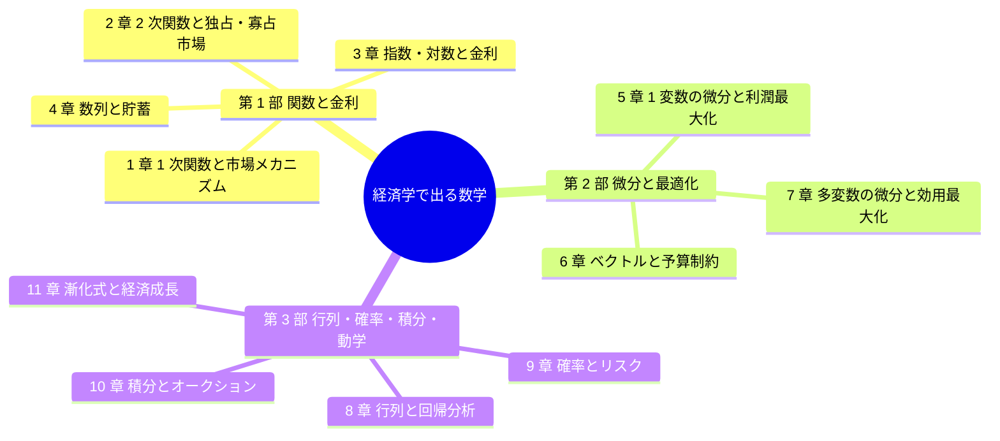
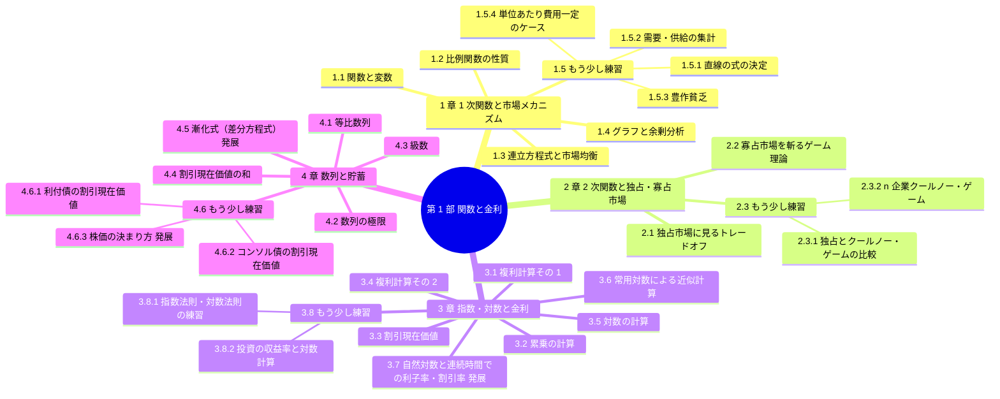
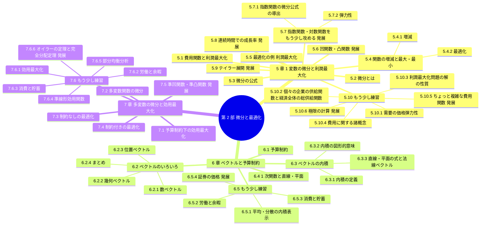
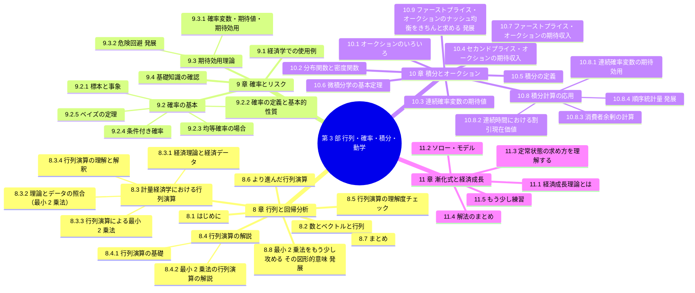

# 経済学で出る数学 マインドマップ

[全体](#all)[第 1 部 関数と金利（1〜4 章）](#p1)[第 2 部 微分と最適化（5〜7 章）](#p2)[第 3 部 行列・確率・積分・動学（8〜11 章）](#p3)

経済学の分析に使う数学を、経済学の題材に結びつけて学ぶ教材の目次（全 11 章）を、マインドマップにしたものです。章・節の見出しだけを使い、本文・例題・数値は載せていません。見出しの末尾の「発展」は、目次で `*` が付いている節です（初めて読むときは飛ばしてもよい節）。

この目次をもとに、Python で書いて確かめる連載「経済学で出る数学プログラミング」を計画しています（執筆計画は、執筆者向けの内部文書として管理しています）。

## 全体図 {#all}

## 第 1 部 関数と金利 {#p1}

1 次関数・2 次関数で市場を読み、指数・対数・数列でお金の時間価値を読む

## 第 2 部 微分と最適化 {#p2}

微分で利潤を最大にし、ベクトルで予算を表し、偏微分で効用を最大にする

## 第 3 部 行列・確率・積分・動学 {#p3}

行列で回帰を、確率でリスクを、積分でオークションを、漸化式で経済成長を読む

## 章と経済学の題材

各章が、経済学のどの場面で使われるかの対応です（目次の見出しから読み取れる範囲）。

| 章 | 数学 | 経済学の題材 |
| :--- | :--- | :--- |
| 1 | 1 次関数・連立方程式 | 需要・供給、市場均衡、余剰、豊作貧乏 |
| 2 | 2 次関数 | 独占、クールノー競争（寡占） |
| 3 | 指数・対数 | 複利、割引現在価値、収益率 |
| 4 | 数列・級数・漸化式 | 貯蓄、債券、株価 |
| 5 | 1 変数の微分 | 費用関数、利潤最大化、弾力性、供給関数 |
| 6 | ベクトル・内積 | 予算制約、労働と余暇、証券の価格 |
| 7 | 偏微分・制約付き最適化 | 効用最大化、部分均衡分析 |
| 8 | 行列 | 最小 2 乗法（回帰分析） |
| 9 | 確率 | リスク、ベイズの定理、期待効用 |
| 10 | 積分 | オークション、消費者余剰 |
| 11 | 漸化式（差分方程式） | ソロー・モデル、経済成長 |
