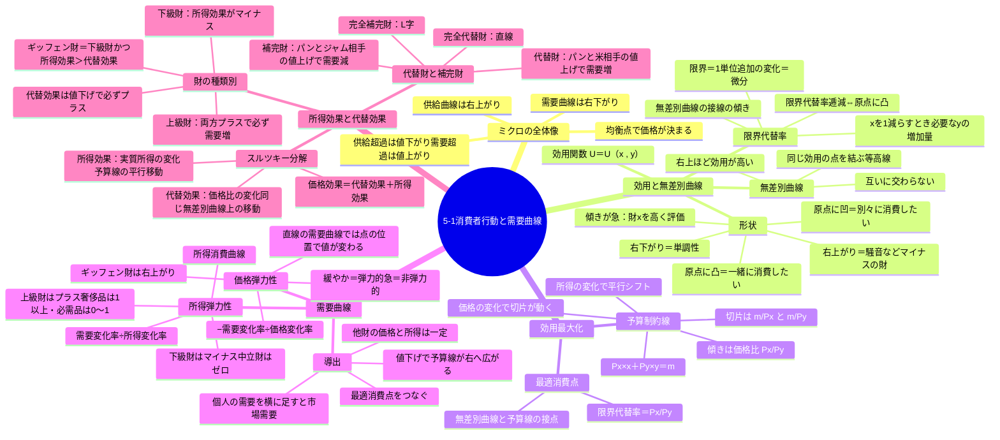
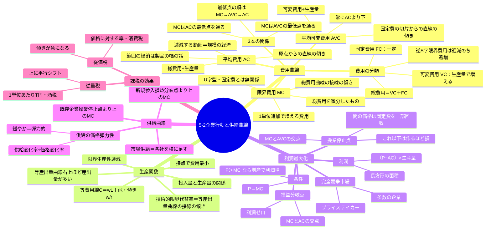
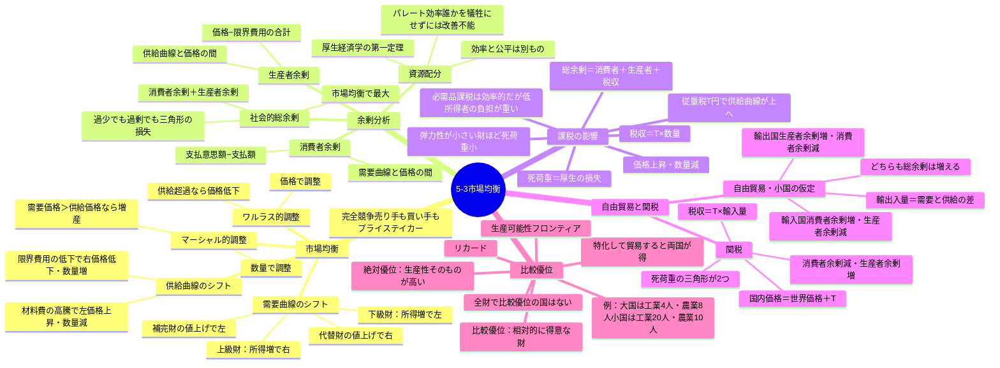
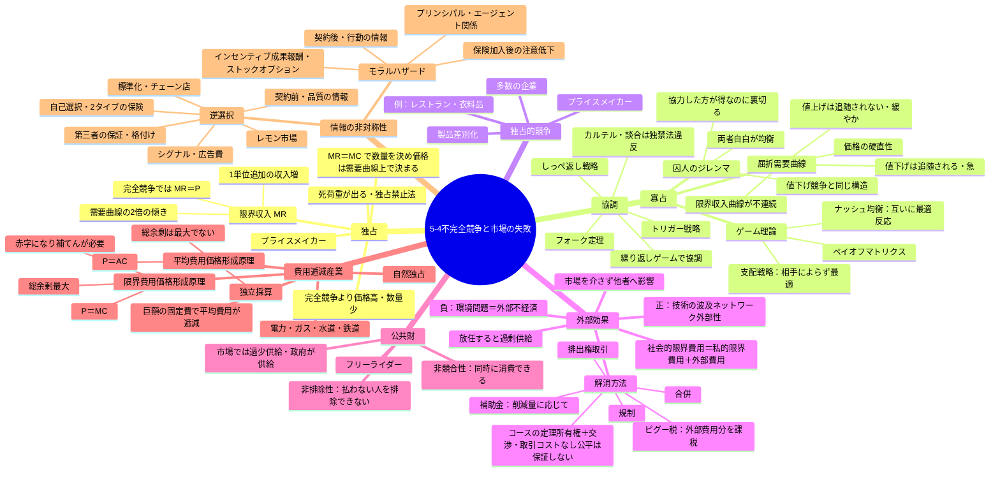
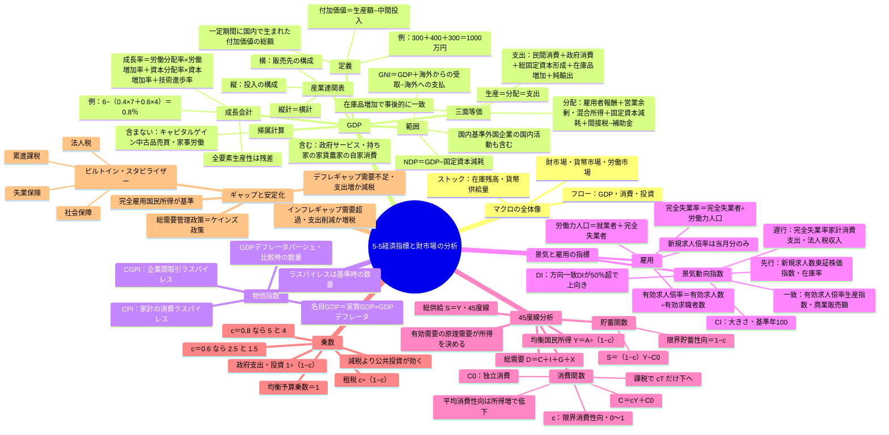
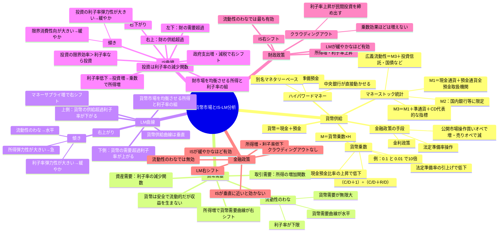
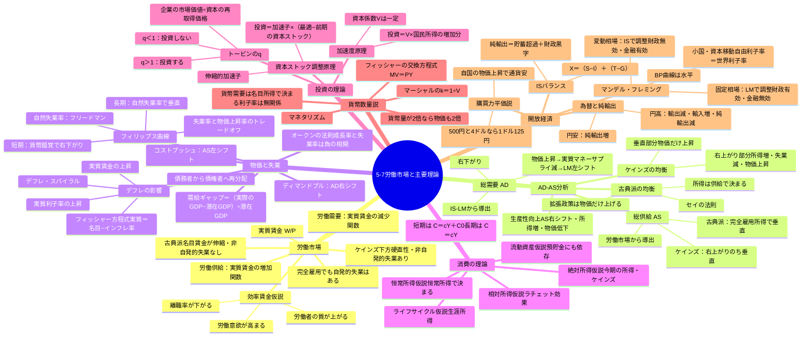

# 経済学・経済政策 トピック別マインドマップ

[5-1 消費者行動と需要曲線](#t1)[5-2 企業行動と供給曲線](#t2)[5-3 市場均衡](#t3)[5-4 不完全競争と市場の失敗](#t4)[5-5 経済指標と財市場の分析](#t5)[5-6 貨幣市場とIS-LM分析](#t6)[5-7 労働市場と主要理論](#t7)

## 5-1 消費者行動と需要曲線

**核の式**限界代替率＝Px/Py（最適消費点）

**混同注意**奢侈品は所得弾力性1以上、必需品は0〜1、下級財はマイナス

**描いて確認**スルツキー分解の3点（元の点・代替効果後・最終）

## 5-2 企業行動と供給曲線

**核の式**P＝MC（利潤最大化）、利潤＝（P−AC）×生産量

**混同注意**損益分岐点はMCとAC、操業停止点はMCとAVCの交点

**描いて確認**MC・AC・AVCの3本と最低点の位置関係

## 5-3 市場均衡

**核の式**総余剰＝消費者余剰＋生産者余剰（＋税収）

**混同注意**ワルラスは価格で調整、マーシャルは数量で調整

**描いて確認**従量税の死荷重1つ、関税の死荷重2つ

## 5-4 不完全競争と市場の失敗

**核の式**MR＝MC（独占）、MRの傾きは需要曲線の2倍

**混同注意**逆選択は契約前の品質、モラルハザードは契約後の行動

**描いて確認**費用逓減産業の2つの価格（P＝MC と P＝AC）

## 5-5 経済指標と財市場の分析

**核の式**政府支出乗数 1÷（1−c）、租税乗数 c÷（1−c）、均衡予算乗数 1

**混同注意**GDPデフレータはパーシェ、CPI・CGPIはラスパイレス

**計算で確認**c＝0.6 なら 2.5 と 1.5、c＝0.8 なら 5 と 4

## 5-6 貨幣市場とIS-LM分析

**核の式**マネーサプライ＝貨幣乗数×ハイパワードマネー

**混同注意**財政はLMが緩やかなほど、金融はISが緩やかなほど有効

**描いて確認**流動性のわな（LM水平）で財政有効・金融無効

## 5-7 労働市場と主要理論

**核の式**MV＝PY、X＝（S−I）＋（T−G）、実質利子率＝名目−インフレ率

**混同注意**固定相場は財政有効・金融無効、変動相場はその逆

**描いて確認**ASの形（古典派は垂直、ケインズは右上がりのち垂直）
